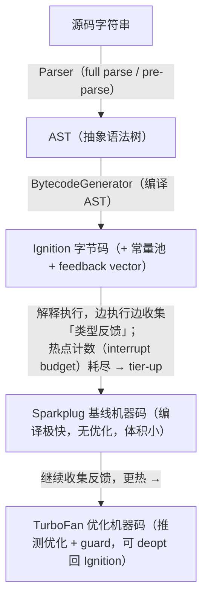
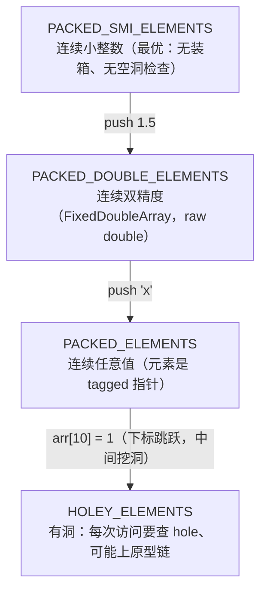

---
mdx:
  format: mdx
---
# 07 · V8 引擎：从源码到机器码

> 对应大纲：阶段 2 —— V8 执行流程（解析 → Ignition → Sparkplug/TurboFan）、隐藏类（hidden classes）与内联缓存（inline cache）对性能的影响。
> 一手依据：v8.dev 官方博客与文档，尤其是 [Fast properties in V8](https://v8.dev/blog/fast-properties)、[Sparkplug](https://v8.dev/blog/sparkplug)、[TurboFan JIT](https://v8.dev/blog/turbofan-jit)、[Ignition interpreter](https://v8.dev/blog/ignition-interpreter)、[Elements kinds](https://v8.dev/docs/elements-kinds)。

## 学习目标

- 能画出一段 JS 源码从「字符串」到「机器码执行」的完整链路，并说清每一层为什么存在。
- 能解释隐藏类（V8 内部叫 **Map**）与内联缓存（IC）如何把「动态语言的属性访问」优化成「一次内存偏移读取」。
- 能预测哪些代码模式会让对象/数组「掉出快路径」，并给出等价的快路径写法。
- 会用 `%HaveSameMap`、`--trace-opt/--trace-deopt` 等工具亲手验证结论，而不是背结论。

---

## 关键概念

### 1. 源码 → 执行全链路



分步拆解：

1. **Parser 与 lazy parsing**。V8 有两个解析器：
   - **full parser**：完整建 AST。顶层代码必须 full parse。
   - **pre-parser（预解析）**：对函数体只做「轻量语法检查 + 记录括号配对等元数据」，**不建 AST**。
   预解析为什么快？因为它跳过了建树、作用域分析等最重的部分，只线性扫一遍确认「这个函数体语法合法、能在哪起止」。更关键的是：网页上大量函数一辈子只被定义、不被调用，为它们生成 AST 和字节码是纯浪费。lazy parsing 把这份成本推迟到「函数第一次被调用」那一刻。副作用是「先预解析、后调用」会扫两遍函数体，所以 V8 对 IIFE 这类「定义即调用」模式有启发式，直接 full parse。
2. **AST → Ignition 字节码**。BytecodeGenerator 遍历 AST，产出字节码（寄存器机模型：累加器 + 寄存器 + 常量池）。字节码与函数绑定存在 SharedFunctionInfo 上。生成字节码而非直接机器码，是为了**省内存**：同一段字节码可以被解释执行，不需要为冷函数生成几十倍的机器码。
3. **Ignition 解释执行 + 热点计数**。Ignition 是 V8 的解释器，每个字节码对应一个（由 TurboFan 预生成的）机器码 handler，通过字节码分发循环执行。执行过程中，IC（见第 3 节）持续把「实际见到的类型/形状」写进 feedback vector。每个函数带一个 **interrupt budget（中断预算）**，函数调用与循环回边会扣减预算；预算耗尽就触发 tier-up 判定——这正是「热点」的判定机制。
4. **Sparkplug 基线编译**（2021 加入，见 v8.dev/blog/sparkplug）：把字节码**逐条**线性翻译成机器码，不做跨语句优化。特点：
   - 编译速度极快（几乎不比解释执行慢多少就完成编译）；
   - 生成的机器码体积小（大约只有 TurboFan 的 1/3）；
   - 执行速度大约是 Ignition 的 2 倍。
   很多「温热」函数终生停在 Sparkplug 层——这是内存、启动速度与峰值性能之间的甜点。
5. **TurboFan 优化编译**（见 v8.dev/blog/turbofan-jit）：基于**推测优化（speculation）**。它读取 feedback vector 里的历史，做出推测并生成带 **guard（检查）** 的高速代码：
   - 推测：「这个 `+` 一直见到 Smi（小整数），我按整数加法生成代码」；
   - guard：生成 `CheckSmi`，每次执行前验证推测仍成立；
   - **deopt（去优化）**：guard 失败时，TurboFan 代码作废，回退（bailout）到 Ignition/Sparkplug 继续执行，并可能带着更保守的假设重新优化。
   所以「优化代码」不是永远快——它是一种「带押注的高速路径」。类型翻来覆去变化的代码会反复 deopt，反而比不优化更慢。
6. **OSR（on-stack replacement，栈上替换）**一句带过：一个正在解释执行的长循环变热时，V8 可以**在函数还在栈上时**把当前帧替换成优化版本，让正在跑的循环立刻享受优化——这就是为什么一个死循环也能越跑越快。

> 一句话串起来：**Parser 决定「什么时候编译」，Ignition 决定「先便宜地跑着并记账」，feedback vector 是账本，Sparkplug/TurboFan 是照着账本加急的快路径，deopt 是账目对不上时的回滚。**

> 补充（2023+）：Sparkplug 与 TurboFan 之间新增了 **Maglev** 中间层编译器（Chrome 117 起），编译比 TurboFan 快、性能比 Sparkplug 好。层级模型不变，只是档位更细。

各层定位小结：

| 层 | 角色 | 编译耗时 | 执行速度 | 代码体积 | 典型归宿 |
| --- | --- | --- | --- | --- | --- |
| Ignition | 解释器 + 反馈收集器 | （生成字节码很快） | 1× | 小 | 冷函数、只跑几次的函数 |
| Sparkplug | 基线 JIT | 极快 | ~2× | ~TurboFan 的 1/3 | 温热函数（大多数函数的终点） |
| Maglev | 中间层 JIT | 快 | ~3–4× | 中 | 较热、但等不起 TurboFan 编译的函数 |
| TurboFan | 顶层优化 JIT | 慢（可数十 ms） | 最快 | 大 | 真正的热点（大循环、高频函数） |

一个常见误解是「代码越热越应该快点优化」，方向反了：**编译本身要花主线程时间**。给一个只执行几千次的函数上 TurboFan，编译成本收不回来。分层正是为了让「每个函数按自己的热度拿到性价比最高的那一层」。

### 2. 隐藏类（hidden class / Map）：对象的「形状」

依据 [v8.dev/blog/fast-properties](https://v8.dev/blog/fast-properties)。

- JS 对象在 V8 里不是「字符串键 → 值」的哈希表。每个对象头部有一个指针指向它的 **Map**（隐藏类），Map 记录的是这个对象的**形状**：
  - 有哪些属性键、按什么顺序加入的；
  - 每个属性存在哪个**偏移量**（in-object 槽位或 out-of-object 后备存储里第几格）。
- **transition（迁移）链**：从「空对象 Map」开始，每添加一个属性就沿着链走一步：

  ```mermaid
  flowchart LR
      M0["M0（空）"] -->|"加 x"| M1["M1 {x}"]
      M1 -->|"加 y"| M2["M2 {x,y}"]
  ```

  走过同一条路径的对象**共享链上的同一个 Map**。`new Point(1,2)` 一万次，这一万个对象最终都停在 M2 上。
- 属性访问于是从「哈希查找」变成：**「拿对象的 Map → 查 Map 里 x 的 offset → 直接读那块内存」**。这就是动态语言能跑出接近静态语言速度的核心。
- 对象的内存布局直观图：

  ```mermaid
  flowchart LR
      O["对象 o<br>──────<br>map 指针<br>properties<br>elements<br>slot0: x 值<br>slot1: y 值"]
      O -->|"map 指针"| M["Map（隐藏类，同类共享）<br>──────<br>形状描述：<br>slot0 → &quot;x&quot; (Smi)<br>slot1 → &quot;y&quot; (Smi)<br>transition: 加 z → M3<br>…"]
  ```

  `properties` 指针指向「快属性后备存储」（in-object 槽位放不下时的溢出区），`elements` 指向数组元素存储。快属性按 offset 直读；dictionary mode 下 `properties` 指向一个真正的哈希字典，且**该字典只属于这个对象、不共享**——共享形状的红利全部消失。
- 三种典型破坏方式：
  1. **delete**：`delete obj.x` 会把对象**整体打入 dictionary mode（慢属性）**——属性表退化成真正的哈希字典，所有后续属性访问都走哈希查找。即使你 delete 的是最后加的属性也一样。
  2. **属性添加顺序不同**：`{}→x→y` 与 `{}→y→x` 是两条**不同的 transition 链**，终点 Map 不同。「先 x 后 y」和「先 y 后 x」的两个对象形状不同。
  3. **中途插入新属性**：给 `{x,y}` 形状的对象补一个 `z`，它走到 `M3{x,y,z}`，与停在 `M2{x,y}` 的对象不再同形状——一个函数同时处理两者时 IC 变多态（见下节）。
- 形状只由「**键集合 + 添加顺序**」决定，**与属性值无关**。`p.x = 1` 改成 `p.x = null` 不改变形状——这是替代 delete 的标准手法。
- `%HaveSameMap(a, b)`（V8 native，需 `--allow-natives-syntax`）可直接验证两个对象是否共享隐藏类，见练习 01。

### 3. 内联缓存（IC，inline cache）

- 动机：上面说的「拿 Map → 查 offset」里的「查」如果每次都做，仍然慢。IC 把**「这个程序点（字节码位置）上一次见到的 Map + 对应的快速取值 handler」缓存下来**。
- 每个含属性访问（`o.x` 读/写）的字节码有一个 **feedback slot**，一个函数的所有 slot 组成它的 **feedback vector**。
- 参与 IC 的主要是 **LoadIC**（读属性）、**StoreIC**（写属性），此外还有 KeyedLoadIC、CallIC 等。
- 状态机（以 LoadIC 为例）：

  ```mermaid
  stateDiagram-v2
      uninitialized: uninitialized
      monomorphic: monomorphic（缓存 1 个 Map + handler）
      polymorphic: polymorphic（缓存 2–4 个 Map：逐个比较）
      megamorphic: megamorphic（放弃专用缓存，查全局 stub cache / 通用慢路径）
      [*] --> uninitialized
      uninitialized --> monomorphic: 首次访问
      monomorphic --> polymorphic: 又见到不同的 Map（≤4 种）
      polymorphic --> megamorphic: 出现第 5 种 Map
  ```

  - **monomorphic（单态）**：这个点永远只见过一种形状。最好：一条 map 指针比较 + 一次偏移读取，TurboFan 优化后连比较都常量化，直接变成一条寻址指令。
  - **polymorphic（多态）**：见过 2–4 种形状。每次访问要**逐个比较 Map** 命中才走对应 handler。
  - **megamorphic（超多态）**：≥5 种形状。IC 放弃本地缓存，每次走全局缓存查找或运行时通用路径。
- 把 feedback slot 具象化：下面这个函数有 3 个 IC 点，各自独立记录自己见过的形状。

  ```js
  function process(o) {
    const v = o.x;   // LoadIC  slot#0：记录见过的 Map
    o.y = v + 1;     // StoreIC slot#1：记录见过的 Map
    return o.z;      // LoadIC  slot#2：记录见过的 Map
  }
  ```

  即使 `o.x` 与 `o.z` 见到的是同一个对象，两个 slot 各自维护状态；一个点单态、另一个点多态是完全正常的现象。IC 状态是**按程序点**的，不是按函数的——「函数多态」其实是「函数内某个 slot 多态」的口语说法。
- **为什么热循环里混形状对象会慢一个数量级**：设某热函数循环 10⁶ 次读 `o.x`。
  - 全部同形状：LoadIC 单态 → TurboFan 把「Map 比较 + offset」编译成两条机器指令，循环内近乎寄存器操作；
  - 轮询传入 4+ 种形状：LoadIC 变 poly/mega，每次都要做一串 Map 比较（或全局查找），循环里这一项从 ~1 条指令膨胀到一串分支 + 查找，吞吐量掉一个数量级是常态。
  - 这就是「数据处理函数要固定输入对象的形状」的底层原因，见练习 02。

### 4. 数组元素 kinds（ElementsKind）

依据 [v8.dev/docs/elements-kinds](https://v8.dev/docs/elements-kinds)。

数组的「元素」不存属性表里，存在独立的 **elements 后备存储**中，其类型由 **ElementsKind** 标记。kind 沿「更通用」方向单向退化，**不可逆**：



每一档都有对应的 HOLEY 版（`PACKED_SMI → HOLEY_SMI → …`），退化链是格：只能往「更通用」走，**永不回头**。

- **为什么 for 循环里先 push 数字再 push 字符串会变慢**：数组从 `PACKED_SMI` 一路退化。退化瞬间整个 backing store 要**整体迁移**（Smi 数组 → double 数组 → tagged 数组）；之后遍历/求和时，解释器与优化代码都必须按最通用的 kind 处理：元素可能是任意对象，数值运算前要拆 tagged 指针、判类型，double 还要装/拆箱。
- 挖洞（`arr[5] = 1` 时长度只有 3）同样触发退化：holey 数组每次 `arr[i]` 都要检查「是不是 hole」，而**读一个洞要沿原型链查找**（`[]` 上的 `arr[3]` 若原型链有 setter/getter 就会被触发）——语义要求如此，快不掉。
- 实践：预分配定长（`new Array(n)` + 索引赋值顺序填满），同类元素打包；一旦混入异类值，**建新数组**而不是修补旧数组（旧数组的 kind 回不去了）。
- 两个延伸注意点：
  - `Object.freeze(arr)`（以及非常旧的 `arr.length = 0` 之外的极端操作）会把数组推入 dictionary elements——不可变性优先于布局优化的场景要想清楚。
  - 密集数值计算如果形状天然统一，直接用 **TypedArray**（`Float64Array`）：它是独立的存储模型（raw bytes、无 tagged、无 kind 退化），与本节机制互补；代价是只能存数字。

### 5. 可操作的性能清单

| 做法 | 原因 |
| --- | --- |
| 构造函数里**一次性按固定顺序初始化全部属性**（暂不用就置 `null`） | 所有实例停在同一个 Map，IC 单态 |
| **不要 `delete`**；用 `obj.x = null` 或重建对象 | delete → dictionary mode，全员慢属性 |
| **复用同一构造函数/同一字面量键顺序**，别为同类数据造多种形状 | 避免多态 |
| 数组**保持同类元素**，避免中途混入字符串/对象；预分配避免挖洞 | 保住 PACKED_SMI/DOUBLE kind |
| 老代码别怕 `arguments`：现代 V8 已优化（逃逸分析、arguments 与形参不重命名时零成本）。历史上 `f.apply(null, arguments)`、泄漏 arguments 到闭包会导致对象 arguments 物化，如今大多无害；新代码直接用 rest 参数 `(...args)` 更清晰 | 历史 API 已被引擎优化，理解历史即可，不必再绕着写 |
| 超热路径上的 `JSON.parse` 结果先「洗」进统一构造函数再处理 | parse 结果键序不受你控制，不洗的话 IC 可能永远多态 |
| 修改前先测量：`performance.now()` 分段、`--trace-opt --trace-deopt`、DevTools Performance | 形状问题的收益因地而异，别为冷代码做形状优化 |
| 观测手段：`node --allow-natives-syntax` + `%HaveSameMap` / `%DebugPrint`；`node --trace-opt --trace-deopt` 看 tier-up 与 deopt | 结论要用工具验证，不靠猜 |

---

## 可运行示例

配套练习（本工作区可直接运行）：

- `exercises/v8-and-performance/01-hidden-class.mjs` —— 用 `%HaveSameMap` 验证：同构造顺序共享形状、插入顺序不同形状分叉、delete 打入慢模式、置 null 保持形状。
- `exercises/v8-and-performance/02-inline-cache.mjs` —— 10⁶ 次热点访问：同形状（单态）vs 4 种形状轮询（多态），只打印确定性结论。

最小感受版（任何环境可跑）：

```js live noInline
// 混形状轮询 vs 单态 —— 只比较相对耗时，结论：慢版本更慢
function bench(objs) {
  let sink = 0;
  for (let i = 0; i < 1e6; i++) sink += objs[i & 3].x; // 防止被优化掉
  return sink;
}
const same = Array.from({ length: 4 }, (_, i) => ({ x: i + 1, y: 0 }));
const mixed = [
  { x: 1, y: 0 },   // 键序 x,y
  { y: 0, x: 2 },   // 键序 y,x —— 不同链
  (() => { const o = { z: 0 }; o.x = 3; return o; })(), // 链 z→x
  (() => { const o = {}; o.w = 0; o.x = 4; return o; })(), // 链 w→x
];
console.log(bench(same) === bench(mixed)); // true，两版计算等价
// 分别计时（练习 02 有完整实现）：mixed 版稳定慢数倍
```

用 natives 直接观测形状（需 `node --allow-natives-syntax`）：

```js live noInline
// 运行：node --allow-natives-syntax demo.mjs
function P(x, y) { this.x = x; this.y = y; }
const a = new P(1, 2);
const b = new P(3, 4);
console.log(%HaveSameMap(a, b));  // true  —— 同构造路径共享隐藏类
b.z = 5;
console.log(%HaveSameMap(a, b));  // false —— b 沿 transition 链又走了一步
delete a.x;
console.log(%HaveSameMap(a, new P(0, 0))); // false —— a 进了 dictionary mode
```

`%HaveSameMap(a, b)` 的输出含义：两个对象的头部是否指向**同一个** Map 对象。`true` 表示形状完全一致（IC 可以单态命中）；`false` 只说明形状不同，不直接说明谁快谁慢——要判断是否进了慢模式，可用 `%DebugPrint(a)` 看 `properties` 字段是否为 `DictionaryProperties`（输出较大，建议只在小对象上试）。

---

## 易错点与面试高频

1. **「JS 是解释型语言」——不准确**。现代 V8 是分层 JIT：解释（Ignition）+ 两级编译（Sparkplug/TurboFan）。准确说法：JS 先被解释执行，热点代码被渐进编译为机器码。
2. **「属性值变了 → 隐藏类变了」——错**。形状由「键集合 + 添加顺序」决定，与值无关。`p.x = 1` → `p.x = null` 形状不变。
3. **`{x:1, y:2}` 与 `{y:2, x:1}` 形状不同**。字面量键顺序就是添加顺序，走不同 transition 链。序列化/反序列化、ORM 映射层若不保证键序，会把下游 IC 打成多态。
4. **delete 的真实代价不是「删得慢」，是「删完之后每一次访问都慢」**。一次 delete，整个对象进 dictionary mode。
5. **数组 kind 退化不可逆**。`[1,2].push('a')` 之后把 `'a'` pop 掉，数组也回不到 PACKED_SMI。
6. **优化代码可能更慢**：反复 deopt（类型抖动）的函数，优化-去优化循环开销可能超过收益。`--trace-deopt` 能看到。
7. **别把「单态」教条化**：分支处理（如 `if (type === 'a')` 各分支内访问不同形状）天然多态，这不是 bug；要消灭的是「**同一个热点 slot 轮流**见到多种形状」。给不同数据定义稳定的构造路径，比到处写 `if` 更有效。
8. **JSON 反序列化的形状陷阱**：`JSON.parse` 产出的对象键顺序由字符串决定；同一接口不同分支返回不同键序，会让同一个处理函数的 IC 反复换 Map。对超热路径，把 parse 结果「洗」进统一构造函数再处理。
9. **面试高频问法**：「讲讲 V8 的隐藏类和内联缓存」「为什么 delete 慢」「为什么数组混合类型后遍历变慢」「解释一下 deopt」「JS 是编译型还是解释型」。答题骨架就是本文第 1–4 节：链路 → 形状 → IC 状态机 → elements kind，收尾落在「优化是带 guard 的押注，形状稳定才押得中」。

---

## 输出预测题

### 题 1（隐藏类）

```js live noInline
function P(x, y) { this.x = x; this.y = y; }
const a = new P(1, 2);
const b = new P(3, 4);
b.z = 5;              // ①
const c = new P(5, 6);
delete c.y;           // ②
// ① 之后：%HaveSameMap(a, b) 是？
// ② 之后：%HaveSameMap(a, c) 是？
```

### 题 2（数组 kinds）

```js live noInline
const arr = [1, 2, 3];   // 起始 PACKED_SMI_ELEMENTS
arr.push(1.5);           // A 步后 kind？
arr.push('x');           // B 步后 kind？
arr[10] = 1;             // C 步后 kind？
arr.pop(); arr.pop();    // D 步：能回到 PACKED_SMI 吗？
```

（答案见文末）

---

## 延伸阅读

- v8.dev/blog/fast-properties —— 快属性/慢属性、in-object 槽位、dictionary mode（本文第 2 节主要依据）
- v8.dev/blog/sparkplug —— 基线编译器设计动机：编译速度、代码体积、可调试性
- v8.dev/blog/turbofan-jit —— 优化编译器与推测优化
- v8.dev/blog/ignition-interpreter —— 为什么需要字节码层：内存账本
- v8.dev/blog/maglev —— 中间层编译器（2023）
- v8.dev/docs/elements-kinds —— ElementsKind 完整退化图与 `%DebugPrint` 观测法
- v8.dev/blog/slack-tracking —— 预留 in-object 槽位与构造后 Map 收缩的机制
- v8.dev/blog（博客索引）—— 持续跟踪 Maglev、Wasm、GC 等新文章
- 《深入理解 V8》（书）与 v8.dev 源码仓库 `src/objects/map.cc` —— transition 链的实现

---

## 预测题答案

### 题 1

- ① 之后 `%HaveSameMap(a, b)` 为 **false**。a 停在 `M{x,y}`；b 继续迁移到 `M{x,y,z}`（transition 链的后继节点）。两者形状分叉——b 变「长」不可怕（b 仍在快属性模式），可怕的是「同一函数既要处理 M\{x,y\} 又要处理 M\{x,y,z\}」时 IC 变多态。
- ② 之后 `%HaveSameMap(a, c)` 为 **false**，且比 ① 更糟：delete 把 c 打入 **dictionary mode（慢属性）**，c 上所有后续属性访问都退化为哈希表查找；即使再 `c.y = 6` 补回去，也不会恢复快属性形状。

### 题 2

- A：`PACKED_DOUBLE_ELEMENTS`（Smi 数组装不下小数，backing store 整体迁移为 raw double 数组）
- B：`PACKED_ELEMENTS`（字符串是 tagged 指针，double 数组装不下，再迁移为通用指针数组）
- C：`HOLEY_ELEMENTS`（下标 4–9 是洞；注意它是从 PACKED_ELEMENTS 直接到 HOLEY_ELEMENTS，kind 只能单向变通用）
- D：**回不去**。退化链单向：即使把混入的值都移走、洞补齐，kind 也不会收缩回 PACKED_SMI。想要 PACKED_SMI，只能新建数组并从头按整数填充。

---

## 替换清单（ASCII 图 → Mermaid）

| 原 ASCII 图位置/标题 | Mermaid 图表类型 |
| --- | --- |
| §1 源码 → 执行全链路（Parser → AST → Ignition → Sparkplug → TurboFan） | flowchart (TD) |
| §2 隐藏类 transition 链（M0 → M1 → M2） | flowchart (LR) |
| §2 对象内存布局直观图（对象 o 与 Map 两栏结构） | flowchart (LR) |
| §3 IC 状态机（uninitialized → monomorphic → polymorphic → megamorphic） | stateDiagram-v2 |
| §4 ElementsKind 单向退化链 | flowchart (TD) |

---

## 深入一层：迁移树、IC 的存储形态与分代回收的现场

### A1. transition 的完整形态：共享树、back pointer 与 map deprecated

正文 §2 把 transition 画成了链，真实实现是一棵**共享树**：同一个「空对象 Map」可以长出多条分支（先加 x 与先加 y 各占一条），树的信息存在每个 Map 的 back pointer 与 transition 数组里。下面实跑取证节里 `%DebugPrint(a)` 的输出有一行 `back pointer: 0x…`——它就是「我从哪个 Map 迁移过来」的反指。链与树两种说法都对，只是粒度不同：**单个对象走过的是链，全体对象构成树**。树上每个节点都是全进程共享的一份形状描述，这正是「一万个同构造路径的对象共享同一个 Map」的实现基础。

两个正文没展开、但收据里能直接看到的机制：

1. **字段表示的泛化（generalization）**。收据里 `#x: 1 (const data field 0)` 的 `const` 值得单独讲：构造函数里只赋过一次值的字段，V8 会把它记成 const data field，优化器敢把它当常量内联。一旦后续代码改写该字段，「const」的假设破灭，字段表示被**泛化**，所在的 Map 随之换新；旧 Map 被标记为 deprecated（弃用）并记录迁移目标，持有旧 Map 的对象在下次被访问时**惰性迁移**过去。这解释了一个反直觉现象：改一个已有字段的值（键集合与顺序都没变），也可能让依赖旧 Map 的优化代码 deopt——不是形状变了，是字段的 const 性变了，Map 换了地址。同理，字段类型从 Smi 泛化到 double 再到 tagged（Any），每一步都可能触发一轮「旧 Map 弃用 + 对象迁移 + 优化代码作废」。
2. **slack tracking（槽位预留观察）**。收据 Map 部分有 `inobject properties: 10`、`unused property fields: 8` 与 `construction counter: 6`：构造函数第一次被 new 时，V8 按「本进程里其他同源对象的历史」预留了一批 in-object 槽位，并用构造计数器观察「实际会用到几个」；观察期结束（计数走完）后收缩多余槽位、锁定最终 instance size。所以「同一构造函数造出的对象，前后批次的 instance size 可能短暂不同」——这不是玄学，是观察期的窗口效应。延伸阅读里的 slack-tracking 一文是官方出处。

### A2. IC 的存储形态：状态在数据里，不在代码里

正文 §3 讲了 IC 状态机，这里补「状态存在哪」：**feedback vector 是堆上的普通数据结构，IC 态迁移就是改这份结构的内容**，而不是像早期教科书的 self-modifying code 那样改写机器指令。

- uninitialized：slot 里只有空占位；
- monomorphic：slot 存「1 个 Map + 1 个 handler」；
- polymorphic：slot 升级为「2–4 组 (Map, handler)，访问时逐组比对」；
- megamorphic：slot 写入一个超多态哨兵，查找改走**全局 stub cache**（以 Map 与属性名为键的进程级缓存表）。

这个设计有两个推论。其一，TurboFan 编译时读的也是同一份 feedback vector——优化代码的推测与 IC 的历史**同源**，「某个 slot 见过 5 种形状」与「优化代码放弃内联」是同一本账的两个读法。其二，IC 态迁移对已生成代码透明：Ignition/Sparkplug 的属性访问本来就是「查 slot → 按记录的 handler 走」的形态，slot 内容变了，代码不需要重新生成；TurboFan 是例外——它把单态假设**固化**进了机器码，对 Map 变化敏感，所以只能靠 guard + deopt 兜底。理解了「账本在数据侧」，就理解了为什么 V8 敢在每个属性访问点都装 IC：便宜、可整体作废、可被优化器复用。

### A3. 读懂 --trace-gc：分代回收的触发现场

V8 是分代回收：新生代用 Scavenger（半空间复制，快但频繁），老生代用并发标记加清扫或整理（慢，靠增量标记摊薄停顿）。触发时机不是定时器，而是**分配失败（allocation failure）**——分配器发现空间放不下本次分配，才触发对应生代的回收。实跑取证节有两条真实输出，逐段读：

`8 ms: Scavenge 4.1 (5.9) -> 4.0 (6.9) MB, pooled: 0 MB, 0.17 / 0.00 ms … allocation failure`

- 开头 `8 ms` 是进程启动后经过的毫秒数；`4.1 (5.9) -> 4.0 (6.9)` 是回收前后「实际存活（提交大小）」，单位 MB——本次只降了 0.1MB，因为实验刻意持有引用，这批对象大多还活着；
- 尾部 `allocation failure` 是触发原因：分配失败驱动，不是「攒够了次数」。Scavenge 的耗时数字很小，这是「新生代回收便宜」的直接读数。

`137 ms: Mark-Compact 506.8 (637.9) -> 506.7 (637.2) MB … (+ 3.3 ms in 391 steps since start of marking …) finalize incremental marking via task; GC in old space requested`

- 这是老生代主回收。括号里的账目说明**增量标记**：标记被切成 391 个小步、累计 3.3ms，穿插在 JS 执行间隙完成，最后由 `finalize` 收尾——主要标记工作量被摊薄，是 V8 「低停顿」叙事的机制本体；
- `mu`（mutator utilization）字段衡量标记期间留给 JS 执行的时间占比，越接近 1 说明停顿摊得越开；
- 尾部 `GC in old space requested` 指明触发方：老生代压力，而不是新生代。

工程读法两条：Scavenge 频繁但单次极快，属正常心跳；若 `--trace-gc` 里 Mark-Compact 每隔几十毫秒一次、且回收前后存活量几乎不变（形如 500MB 到 500MB），就是「老生代被长期存活对象占满」的铁证——去查缓存、闭包滞留与全局数组，而不是调堆参数了事。

### A4. 层级切换的现场：interrupt budget、OSR 与 Maglev 的位置

收据里有三段值得逐行拆：

- `marking … <JSFunction add …> for optimization to MAGLEV, … reason: hot and stable`：函数变热的判定来自 interrupt budget 耗尽（调用与循环回边反复扣减），`hot and stable` 是引擎给出的升级理由。注意目标是 **Maglev** 而不是 TurboFan——Node 24 的默认升级路径是 Ignition 到 Maglev 再到 TurboFan，正文分层表里 Maglev 一行的活例子。
- `bailout (kind: deopt-eager, reason: not a Smi): begin. deoptimizing … <Code MAGLEV> …`：优化代码带着「参数是 Smi」的 guard，传入普通对象后 guard 失败，整段优化代码当场作废、回退解释器——正文 §1 的押注叙事在日志里的原文形态。
- `completed optimizing … (target TURBOFAN_JS) OSR` 与 `bailout (kind: deopt-eager, reason: prepare for on stack replacement (OSR))`：正文 §1 一句带过的 OSR，实际机制是——长循环的回边扣预算到耗尽后，编译器按**当前字节码偏移**（日志里的 `bytecode offset 85`）生成一个「能从循环中部进入」的 OSR 版本，再借一次受控的 deopt 把还在栈上的解释帧替换成优化帧，循环余下部分立即跑机器码。所以 OSR 在 trace 里表现为一次「以 OSR 准备为理由的 bailout」——名字像事故，实际是升级通道。

### A5. 字节码的现场：一条 Add 指令的完整解剖

正文 §1 说 Ignition 是「寄存器机模型：累加器 + 寄存器 + 常量池」，空口无凭，用 `--print-bytecode` 把一个小函数的字节码打出来看（收据 5，`--print-bytecode-filter=add` 只过滤名为 add 的函数，避免整份脚本的字节码刷屏）。每行的格式是「源位置标记 字节码地址 偏移：操作码字节 助记符 操作数」，三条指令逐条拆：

- `Ldar a1`：把 1 号寄存器（对应第二个具名形参 b）装进累加器——Ldar 即 load accumulator，累加器是 Ignition 指令间传递值的主通道；
- `Add a0, [0]`：把 0 号寄存器（形参 a）与累加器相加。方括号里的 `[0]` 是**feedback slot 的下标**——正文 §3 说「每个含运算或属性访问的字节码有一个 feedback slot」，这行就是 slot 的实体：Add 属于 BinaryOp 类字节码，slot 0 记录它实际见过的操作数类型（Smi、double 还是字符串），tier-up 时优化器照着这个 slot 押注。IC、feedback vector、优化器三者在这里对上号；
- `Return`：把累加器的值返回。

元信息同样有讲究：`Parameter count 3` 是 this 与两个形参的总数——接收者也要占一个参数位；寄存器 a0、a1 对应两个具名形参。`Bytecode length: 6`：三条指令总共六个字节，这就是「字节码省内存」的直观读数——同一函数的机器码体积通常是它的许多倍，这正是冷函数停在字节码层、Sparkplug 体积只有 TurboFan 三分之一这些设计共同的出发点。`Constant pool (size = 0)` 说明函数没有字符串字面量等常量；`Handler Table (size = 0)` 说明没有 try/catch——有异常处理时会在这张表里登记各 catch 的覆盖范围。

最后看源位置标记 `21 S>` 与 `30 E>`：S 表示语句起点、E 表示表达式起点，数字是源码字节偏移。异常堆栈能把运行时刻对回源码行、调试器能在正确的行上断住，靠的就是输出末尾那张 `Source Position Table`——字节码层也 care 调试体验，这是 Sparkplug 一文里「可调试性」卖点的底层支撑。

---

## 实跑取证：命令与原始输出（node v24.10.0）

以下命令全部实跑，输出为原始摘录（行首的进程号与地址每次运行不同，属正常）。对照着自己跑一遍，比背结论可靠。

收据 1：隐藏类、const 字段与 delete（需 `--allow-natives-syntax`）。

```bash
node --allow-natives-syntax -e "
function P(x, y) { this.x = x; this.y = y; }
const a = new P(1, 2);
%DebugPrint(a);
console.log('hasFast:', %HasFastProperties(a));
delete a.x;
console.log('after delete:', %HasFastProperties(a));
"
```

关键输出（节选，长地址以 … 缩写）：

```text
DebugPrint: 0x2272deea8ad9: [JS_OBJECT_TYPE]
 - map: 0x240939154c59 <Map[104](HOLEY_ELEMENTS)> [FastProperties]
 - properties: 0x0ce9049c0cf9 <FixedArray[0]>
    #x: 1 (const data field 0, attrs: [WEC]) @ Any, location: in-object
    #y: 2 (const data field 1, attrs: [WEC]) @ Any, location: in-object
0x240939154c59: [Map]
 - instance size: 104
 - inobject properties: 10
 - unused property fields: 8
 - back pointer: 0x240939154c01 <Map[104](HOLEY_ELEMENTS)>
 - construction counter: 6
hasFast: true
after delete: false
```

读法：`[FastProperties]` 与 `location: in-object` 是「快属性 + 槽位直读」的原文；`const data field` 是 A1 的泛化伏笔；`back pointer` 是 transition 反指；`construction counter` 是 slack tracking 的观察计数；`%HasFastProperties` 在 delete 后从 true 翻成 false，是字典模式的直接取证。

收据 2：分代回收两现场（`--trace-gc`，命令与逐段读法见 A3），原始行：

```text
8 ms: Scavenge 4.1 (5.9) -> 4.0 (6.9) MB, pooled: 0 MB, 0.17 / 0.00 ms  (average mu = 1.000, current mu = 1.000) allocation failure;
137 ms: Mark-Compact 506.8 (637.9) -> 506.7 (637.2) MB, pooled: 0 MB, 1.88 / 0.00 ms  (+ 3.3 ms in 391 steps since start of marking, biggest step 0.0 ms, walltime since start of marking 10 ms) (average mu = 0.964, current mu = 0.964) finalize incremental marking via task; GC in old space requested
```

收据 3：层级切换与去优化（`--trace-opt --trace-deopt`，脚本见 A4），原始行（节选）：

```text
[marking 0x… <JSFunction add (sfi = 0x…)> for optimization to MAGLEV, ConcurrencyMode::kConcurrent, reason: hot and stable]
[completed compiling 0x… <JSFunction add (sfi = 0x…)> (target MAGLEV) - took 0.000, 0.125, 0.000 ms]
[bailout (kind: deopt-eager, reason: not a Smi): begin. deoptimizing 0x… <JSFunction add …>, 0x… <Code MAGLEV>, opt id 0, bytecode offset 2, deopt exit 0, …]
[completed optimizing 0x… <JSFunction …> (target TURBOFAN_JS) OSR]
[bailout (kind: deopt-eager, reason: prepare for on stack replacement (OSR)): begin. … bytecode offset 85, …]
```

收据 4：堆上限的真相（`--max-old-space-size=64`，脚本用 try/catch 包住无限分配）：

```text
[14972:0x86a80c000] 32 ms: Mark-Compact 63.5 (128.6) -> 63.5 (128.3) MB, pooled: 0 MB, 3.54 / 0.00 ms  (average mu = 0.644, current mu = 0.384) allocation failure; scavenge might not succeed
FATAL ERROR: Reached heap limit Allocation failed - JavaScript heap out of memory
```

要点：**catch 块一次都没执行**（脚本里安排的捕获输出没有打印）。堆耗尽不是可捕获的异常，是 V8 的致命错误，进程直接死。所以「用 try/catch 兜住 OOM 再降级」在 Node 里是幻觉；内存防线只能前置——限流、分页、流式处理、按水位丢弃。

收据 5：字节码与 feedback slot 的实体（`--print-bytecode`，命令与逐条读法见 A5）：

```text
[generated bytecode for function: add (0x26bcad6d1399 <SharedFunctionInfo add>)]
Bytecode length: 6
Parameter count 3
Register count 0
Frame size 0
   21 S> 0x18019d404870 @    0 : 0b 04             Ldar a1
   30 E> 0x18019d404872 @    2 : 3f 03 00          Add a0, [0]
   34 S> 0x18019d404875 @    5 : b3                Return
Constant pool (size = 0)
Handler Table (size = 0)
Source Position Table (size = 8)
```

读法见 A5；把 `Add a0, [0]` 里的 `[0]` 与正文 §3 的 feedback slot、收据 3 里优化器的押注行为连起来看，三层证据闭环：字节码层装 slot，解释执行填 slot，优化编译读 slot。

---

## 工程三陷阱

三个陷阱的共性：都不报错，只在你主动测量时现形；分别打在引擎的三本账上——形状账本（Map）、内存账本（分代回收）、类型账本（feedback vector），对应诊断速查表的前三行。下面按「现象、机制、处置」各写一遍，现象一栏取自真实工程场景的抽象。

**陷阱一：delete 的第二重代价——作废别人的优化**。正文讲了 delete 把对象打入字典模式，这里补连带伤害：delete 改变了对象的 Map（快 Map 到字典），此前把「这个 Map + offset」固化进机器码的优化代码 guard 失败、批量 deopt。现象是「一行 delete 让一个不相干的热函数变慢」，trace 里能看到该函数紧跟一次 bailout。处置：热路径不 delete；要「逻辑上删除」用置 null（形状与 const 性都不动），或直接换 `Map` 数据结构，让属性表问题不复存在。观察方法：delete 前后各跑一次收据 1 的 `%HasFastProperties`，true 翻 false 与 `--trace-deopt` 里紧接着出现的 bailout 会同时发生，因果一目了然。

**陷阱二：闭包把大对象钉在老生代**。闭包捕获的是**变量所在的上下文对象**，不是「用到的那个值」——回调里只读了 `list.length`，整个百万条的 `list` 仍被上下文牵着，进老生代后 Mark-Compact 回收不掉。典型现场：注册后从不注销的事件监听器、定时器回调、缓存了请求对象的中间件。诊断：heap snapshot 看 retained size，沿保留链找「谁牵着它」；`--trace-gc` 里 Mark-Compact 存活量居高不下是旁证。处置：回调参数化（只传需要的字段）、用完置 null、监听器显式注销。

**陷阱三：类型抖动让优化白做**。热函数先被整数输入喂热、按 Smi 押注优化，之后一批浮点输入进来（`Math.random()` 是典型无辜源——它**永远返回 double**，结果一进热路径就把整数假设打碎），guard 失败、deopt、重新收集反馈、再优化，循环往复。收据 3 的 `reason: not a Smi` 正是这一类 guard。处置：在边界统一收敛类型（入口把输入过一遍数值化），或者干脆把「整数路径」与「浮点路径」拆成两个函数，各自单态；`--trace-deopt` 里同一函数反复 bailout 就是抖动铁证。一个诚实的提醒：并非所有 deopt 都值得修——低频路径上的一次 deopt 只是一次回退的常数开销，只有热点函数的反复 bailout 才值得动手，判断依据仍是先测量。

---

## 排查速查表：采样与日志的现象到处置

（`--prof` 产出 isolate 日志、配 `--prof-process` 汇总出按函数与按字节码的计数表；`--cpu-prof` 直接产出 DevTools Performance 面板可打开的 .cpuprofile。下表为手推整理口径，工具行为以官方文档为准。）

| 现象 | 常见根因 | 处置 |
| --- | --- | --- |
| 汇总表里 GC 行占比高、Scavenge 极频 | 分配速率过高（循环内造临时对象、字符串反复拼接） | 对象复用、拼接改数组后一次 join |
| GC 占比高且 Mark-Compact 频繁、存活量不降 | 老生代被长期对象占满 | 按陷阱二查闭包与缓存滞留 |
| 火焰图顶层是 IC 相关与 runtime 存根 | 属性访问多态或超多态 | 固定输入形状（正文 §3、§5 清单） |
| `--trace-deopt` 同一函数反复出现 | 类型或形状抖动（陷阱三） | 入口收敛类型、拆分函数 |
| Ignition 解释层占比高、函数始终不升级 | 函数温热但预算总被重置，或对象频繁迁移 | 查循环内是否有形状修改 |
| 采样里偶发长任务尖峰 | 同步大循环、大 `JSON.parse`、大正则 | 分片让出主线程；换流式解析 |

## 决策速查表

| 决策点 | 选什么 | 一句话理由 |
| --- | --- | --- |
| 怀疑形状分叉 | `%HaveSameMap` 与 `%DebugPrint` | 直接看 Map 是否共享、是否字典模式 |
| 怀疑优化抖动 | `--trace-deopt` | bailout 理由是引擎亲口说的 |
| 怀疑内存 | `--trace-gc` 加 heap snapshot | 分代账本看触发，快照看滞留链 |
| 怀疑 CPU 热点 | `--cpu-prof` | 函数级采样，DevTools 直接开 |
| 想看字节码 | `--print-bytecode` 配 filter | 不加过滤会整份脚本刷屏 |
| 冷代码要不要形状优化 | 不要 | 编译与迁移成本收不回来 |
| 热路径要删属性吗 | 永不，置 null 或换 `Map` | delete 的代价是「之后每一次访问」 |
| 数组要混类型吗 | 不混，混了就重建 | kind 退化不可逆 |

最后一条使用纪律：这些开关全部只用于诊断，不要常驻生产。`--print-bytecode` 会显著拖慢启动并放大日志量；`--allow-natives-syntax` 是引擎的调试后门，允许脚本直接调用内部动词（`%DebugPrint` 这类），生产进程绝不要开——等于把引擎内部不变量暴露给脚本层。诊断顺序建议自顶向下：先用采样工具（`--cpu-prof` 一类）确认「慢在哪一层」，再带着嫌疑对象用 trace 与 natives 类开关「问引擎为什么」。上来就开 trace，输出量足够把人淹死；先采样定位、后取证确认，是读引擎日志最省力气的路径。

