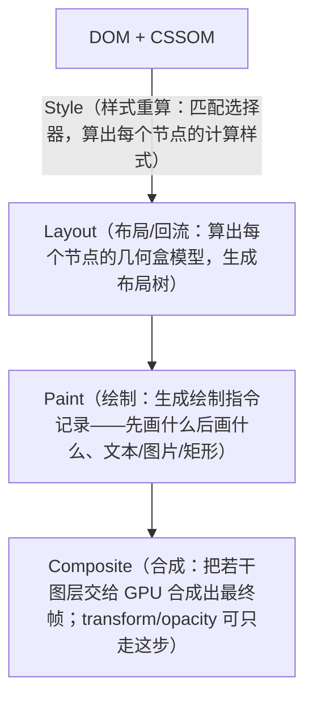

---
mdx:
  format: mdx
---
# 08 · 渲染管线、事件循环与性能专题

> 对应大纲：阶段 2 —— 浏览器渲染管线与事件循环的关系（rAF、rIC、任务切片）；性能专题：防抖/节流、懒加载、Web Workers、长任务分析。
> 一手依据：HTML Standard《[Event loops](https://html.spec.whatwg.org/multipage/webappapis.html#event-loops)》与《[Rendering](https://html.spec.whatwg.org/multipage/rendering.html)》章节（update the rendering 处理模型）；Chrome 文档 scheduler.postTask / scheduler.yield 系列。

## 学习目标

- 能按 HTML Standard 的处理模型说出「一个 task 执行完之后浏览器发生了什么」，并解释 rAF、微任务、渲染三者顺序。
- 能诊断并修复强制同步回流（layout thrashing），理解读写分离为什么有效。
- 掌握防抖/节流的语义边界与实现要点，能按场景选型。
- 知道任务切片、懒加载、Web Workers 各自解决什么问题、各自的成本在哪。

---

## 关键概念

### 1. 渲染管线：style → layout → paint → composite

浏览器把 DOM 变成像素走四步（依据 HTML Standard Rendering 章节的渲染模型与 Chrome 实现术语）：



关键性质：**这条管线是按需、增量的**。改了 `class` 只触发 style→…；改几何属性触发 layout；只改 `transform`/`opacity` 可能只触发 composite（这正是 CSS 动画推荐用 `transform` 的原因）。

**强制同步回流（forced synchronous layout / layout thrashing）**是最大的性能陷阱：

```js
// 经典反模式：读写在循环里交替
for (const node of nodes) {
  node.style.height = '50px';       // 写：使布局「脏」
  console.log(box.offsetTop);       // 读：布局脏了 → 浏览器被迫【立刻同步】重算布局
}
```

浏览器本想把多次写合并成一次 layout（在帧末统一做）。但 `offsetTop`/`offsetHeight`/`getBoundingClientRect()` 这类**几何读取**必须返回「此刻」的准确值——布局脏着就必须先同步算完再返回。读写交替等于每圈循环强制一次完整 layout，复杂度变成 O(n × layout成本)。

修复思路是**读写分离 / 批量写**：

```js
// 先集中读，再集中写
const tops = nodes.map(n => n.offsetTop);       // 读：只触发一次强制回流
nodes.forEach((n, i) => { n.style.height = ...; }); // 写：统一标脏，帧末一次 layout
```

工程化方案即 FastDom 这类库的 read/write 双队列；`DocumentFragment` 批量插 DOM、`content-visibility: auto` 让屏外内容跳过渲染，也是同一思想。虚拟滚动/覆盖索引本质是「让 DOM 数量级下降，layout/paint 的输入变小」——一句话带过，不展开。

### 2. 事件循环与渲染的关系

依据 HTML Standard 9.7 节 Event loops 的处理模型：事件循环每轮做三件事——**取一个 task 执行 → 把微任务队列全部清空 → （如果需要渲染）执行 update the rendering**。update the rendering 的大致内部顺序：

```
一轮循环：
  1. 取出一个 task（宏任务）执行
  2. 清空整个 microtask 队列（Promise.then、queueMicrotask、MutationObserver）
  3. 若该渲染时机到了（对齐显示器的 vsync）：
     3a. 依次执行所有 requestAnimationFrame 回调
     3b. style → layout → paint → composite
     3c. 若本帧还有剩余时间：执行 requestIdleCallback（rIC，带 deadline）
```

画成 60Hz 的一帧时间线（约 16.7ms）：

```
|← task ←→ 微任务全清 ←→ rAF ←→ style/layout/paint ←→ rIC(剩余时间) →|
|----------------------------- 一帧 ≈ 16.7ms ------------------------------|
        任何一段超支，都会把「下一帧」推迟 → 掉帧
```

记住这个坐标系：后面所有性能手段（切片、防抖节流、懒加载、worker）本质都是在给这条时间线里**腾位置**。

三个高频推论：

- **微任务在 task 结束后立即清空，且一定在渲染之前**。所以一个 task 里塞 1000 个微任务，这一帧直接被吃掉。
- **rAF 回调运行在 style/layout 之前**——这是「先改样式再读几何」或「在渲染前更新动画」的唯一正规位置。
- **一帧预算 ≈ 16.7ms**（60Hz；120Hz 屏是 8.3ms）。注意 16.7ms 是「从上一帧到下一帧」的全部时间：task + 微任务 + rAF + 渲染全算在内。3c 里的 rIC 拿到的 `deadline.timeRemaining()` 就是这个预算的剩余值。

**长任务（long task）**：规范定义为主线程上**持续超过 50ms** 的任务（task 或渲染步骤连续占用）。50ms 这个数来自「人对『立刻』的感知边界」：交互响应被阻塞超过约 100ms 就会感觉卡，50ms 是留给输入处理与渲染的余量。它是 TBT（Total Blocking Time）、INP（Interaction to Next Paint）等指标的基础。

**为什么 setTimeout 动画会抖而 rAF 不掉帧**：

- `setTimeout(fn, 0)` 只保证「至少 0ms 后把 fn 放进 task 队列」。它对齐的是**任务队列**，不是显示器刷新。回调实际执行时刻取决于当时队列里还有什么；嵌套 5 层以上的 timer 还会被强制钳到 ≥4ms。于是动画帧可能与 vsync 错相：有时一帧里跑了两次回调，有时一帧一次都没有——肉眼看就是抖动/掉帧。
- `requestAnimationFrame` 的回调由浏览器在 **update the rendering 步骤里、绘制之前**统一调度——天然对齐 vsync，每帧恰好一次，且后台标签页会暂停（省电）。做动画只有一种正确选择：rAF + 帧间 `delta` 计算。

### 3. 任务切片：把控制权还给主线程

一个 10⁷ 元素的同步循环就是一个 >50ms 的长任务：期间输入事件排不上队、渲染停摆、用户点什么都没反应。切片（chunking）的原理：**把大任务拆成多个小 task，片与片之间事件循环有机会处理输入、执行渲染**。

三种实现，按现代程度排列：

| 方案 | 写法 | 特点 |
| --- | --- | --- |
| `setTimeout(fn, 0)` 链 | 每片末尾 `setTimeout(next, 0)` | 兼容一切环境；但嵌套钳制 ≥4ms，且 task 优先级不可控（可能插在用户输入后面） |
| `scheduler.postTask(fn, { priority })` | 显式优先级（`user-visible`/`user-blocking`/`background`），可 `AbortController` 取消 | 浏览器按优先级调度，让交互任务先跑 |
| `scheduler.yield()` | `await scheduler.yield()` 续行 | 语义是「让一拍再继续」：保持执行顺序（不让别的同优先级任务插队到逻辑前面），返回 Promise，写法最接近同步代码 |

交互延迟改善的原理一句话：**INP 测的是「用户点击 → 下一帧渲染」的时间**；同步长任务把点击事件的处理与随后的渲染全部压后；切片让点击 task 得以在片间执行，页面「看起来活着」。（虚拟滚动/覆盖索引那句话同前，不展开。）

练习 `04-task-slicing.mjs` 在 Node 里演示同样的机制：setTimeout(0) 切片期间，先注册的「交互任务」能穿插进两片之间执行——事件循环语义在浏览器与 Node 中一致。

### 4. 防抖 debounce / 节流 throttle

语义差异是第一位的，实现是第二位的：

- **防抖（debounce）= 停了才做**：连续调用会不断推迟执行，只有「安静了 wait 毫秒」才真正执行**最后一次**。类比：电梯关门——有人进来就重新等。
- **节流（throttle）= 期间最多一次**：不管调用多频繁，每个 wait 窗口内最多执行一次。类比：技能冷却。

| 维度 | debounce | throttle |
| --- | --- | --- |
| 触发时机 | 停止调用 wait 后（trailing）或首次立即（leading） | 窗口开始（leading）和/或窗口结束（trailing） |
| 典型场景 | 搜索输入联想（打完再查）、resize 结束后重算布局、表单自动保存 | scroll 加载更多、mousemove 拖尾、按钮防连点、埋点上报 |
| 期间调用 N 次 | 合并为 1 次（最后一次的参数） | 每窗口至多 1 次 |

**leading / trailing 选项**：

- leading：窗口**开始**时立即执行（响应快）。debounce + leading = 「第一次敲键立刻搜，之后静默期内的连击合并到最后一次」。
- trailing：窗口**结束**时补一次（不丢最后一次）。throttle 默认 leading + trailing；debounce 默认 trailing。

**两种实现路线**（面试高频）：

1. **时间戳法**：记录 `last`，每次调用比较 `now - last >= wait` 决定是否执行。
   - 优点：不需要定时器就能实现 leading；
   - 缺点：trailing 补发**必须有定时器**——「停止调用后自动来一次」这件事靠比较时间戳无法自发发生，得有人再调用一次才行。
2. **定时器法**：每次调用 `clearTimeout` + `setTimeout`。
   - 优点：天然支持 trailing；
   - 缺点：leading 需要额外状态（区分「窗口外第一枪」与「窗口内重复」）。

lodash 的成熟实现是两者混合。练习 `03-debounce-throttle.ts` 用**纯定时器法 + 可注入时钟**完整实现四个选项组合，并用假时钟逐 tick 验证触发序列。

### 5. 懒加载：IntersectionObserver

旧方案「监听 scroll + getBoundingClientRect」有两个致命伤：scroll 事件高频（必须节流）、getBoundingClientRect 是几何读取（配合样式修改就是 layout thrashing 教科书案例）。

**IntersectionObserver（IO）** 原理：你注册「目标元素 × 容器 × 阈值」，浏览器在**自己的渲染流程中**（布局信息本来就在算）顺带计算交集，只在「交叉状态发生**变化**」时把回调作为一个 task 派发给主线程。主线程不做持续轮询、不主动触发回流。

两个关键配置：

- **rootMargin**：把判定区域向四周扩/缩一圈（CSS margin 语法，如 `'200px 0px'`）。「提前 200px 开始加载图片」就是它——用户还没看到，加载已开始，体验上「即滚即有」。
- **threshold**：交叉比例阈值数组 `[0, 0.5, 1]`，跨越每个阈值都会触发一次回调；常用 `0`（刚出现）与 `1`（完全进入）。

配套一句：图片原生 `loading="lazy"`、CSS `content-visibility: auto` 把「屏外不渲染」下沉给了浏览器，能用原生就别手写。

最小用法：

```js live noInline
const io = new IntersectionObserver((entries) => {
  for (const e of entries) {
    if (e.isIntersecting) {
      e.target.src = e.target.dataset.src; // 进入视口前 300px 才加载真实图片
      io.unobserve(e.target);              // 一次性任务记得取消观察
    }
  }
}, { root: null, rootMargin: '300px', threshold: 0 });
document.querySelectorAll('img[data-src]').forEach(img => io.observe(img));
```

### 6. Web Workers 与 Node worker_threads

- **模型**：Worker 是**独立的 JS 运行时实例**（独立堆、独立事件循环、独立线程），与主线程不共享普通对象。通信靠 `postMessage` 消息传递。
- **结构化克隆（structured clone）传值的限制**：`postMessage` 的数据按 HTML Standard 的可序列化算法深拷贝一份。**函数、闭包、DOM 节点、Symbol、`SharedArrayBuffer` 之外的「环境绑定」对象都不可克隆**——传不了。能传：原始值、普通对象/数组、Map/Set、Date/RegExp、ArrayBuffer（可转移）、TypedArray 等。想「传行为」只能传数据 + 让 worker 端代码自带处理逻辑。
- **Transferable 零拷贝**：`postMessage(data, [buffer])` 的 transferList 里放 `ArrayBuffer`，**所有权**从发送方转移给接收方——没有任何字节拷贝。代价：转移后发送方的这个 buffer 变成 **detached**，`byteLength === 0`，不可再用。典型用法：主线程填好 `Float64Array` 转给 worker 算，算完再转回来，全程零拷贝。
- **Node 对应 `node:worker_threads`**：同样的模型（独立线程 + `postMessage` 结构化克隆 + `transferList`），差异：Node 的 worker 可以 `require`/`import` 模块、有 `workerData` 传初始数据；浏览器 worker 没有 DOM，Node worker 没有 `window`。
- **适用 / 不适用**：
  - 适用：单次大计算（图像像素处理、大 JSON 解析、加密哈希、大排序），数据进出次数少、计算/通信比高；
  - 不适用：高频小消息——每次 postMessage 都是一次完整序列化/反序列化，**序列化开销可能吞掉并行收益**；也不适用需要直接操作 DOM/UI 状态的任务（还要排队回主线程）。
- 一句带过：真正的共享内存要 `SharedArrayBuffer` + `Atomics`（两个线程可同时访问同一块内存），用于极高性能场景。

主线程侧通信骨架（浏览器与 Node 写法几乎一致）：

```js
// 浏览器
const w = new Worker('worker.js');
w.postMessage({ rows: bigArray });            // 结构化克隆：深拷贝，函数传不过去
w.onmessage = (e) => render(e.data.result);

// Node（见练习 05）
import { Worker } from 'node:worker_threads';
const w = new Worker('./worker.mjs');
w.postMessage(new ArrayBuffer(8), [/* transferList */]); // 第二参数转移所有权，零拷贝
```

### 7. 长任务分析：怎么测量

- **performance.now() 分段计时**：对可疑代码块手工插桩（`t0 = performance.now()` … `performance.now() - t0`）。最朴素、跨环境，适合定位「哪一段慢」。注意：**只报告耗时，不阻塞、不修复**；分段粒度由你决定。
- **PerformanceObserver `longtask` 条目（浏览器）**：

  ```js
  new PerformanceObserver(list => {
    for (const e of list.getEntries()) console.log('长任务', e.duration);
  }).observe({ type: 'longtask', buffered: true });
  ```

  浏览器在主线程上占用超过 50ms 的任务结束后自动上报，无需插桩。配合 DevTools Performance 面板可以看到长任务发生在哪、阻塞了多少交互。
- **Node 下如何近似**：Node 没有浏览器的 longtask 条目，但有对应工具：
  - `perf_hooks.monitorEventLoopDelay()` —— 事件循环延迟直方图（两次轮询之间的空闲间隙被吃掉的程度），是「主线程被长任务占住」的近似信号；
  - `perf_hooks.eventLoopUtilization()` —— 事件循环利用率（busy/total），适合采样监控；
  - 更细的归因仍靠 `performance.now()` 分段插桩（练习 04 的做法）。

---

## 可运行示例

配套练习（本工作区可直接运行）：

- `exercises/v8-and-performance/03-debounce-throttle.ts` —— 假时钟（可手动 `tick(ms)`）驱动，逐事件验证 debounce/throttle 的 leading/trailing 触发序列。
- `exercises/v8-and-performance/04-task-slicing.ts` —— 10⁷ 求和：同步版 vs setTimeout(0) 切片版，观察交互任务穿插。
- `exercises/v8-and-performance/05-worker-threads.mjs` —— worker_threads：结构化克隆传数组求和 + ArrayBuffer 零拷贝转移（转移后主线程 byteLength 变 0）。

浏览器侧最小感受版（粘贴到 DevTools Console）：

```js live noInline
// 1) 观察一帧内的顺序：task → microtask → rAF
setTimeout(() => console.log('timeout'));
Promise.resolve().then(() => console.log('microtask'));
requestAnimationFrame(() => console.log('rAF'));
console.log('sync');
// 输出顺序：sync → microtask → rAF → timeout（若该轮有渲染机会）

// 2) 强制同步回流的量化感受
const box = document.querySelector('header');
let t0 = performance.now();
for (let i = 0; i < 1000; i++) { box.style.marginTop = i + 'px'; box.offsetTop; } // 读写交替
console.log('thrashing 版相对耗时高:', performance.now() - t0);
t0 = performance.now();
for (let i = 0; i < 1000; i++) { box.style.marginTop = i + 'px'; } // 先写
box.offsetTop; // 后读
console.log('分离版:', performance.now() - t0); // 数量级更小
```

---

## 易错点与面试高频

1. **「微任务比 rAF 先」和「rAF 比微任务先」都听过？** 规范答案：本轮 task 结束先**清空全部微任务**，然后进入 update the rendering 才跑 rAF。顺序固定：task → microtask(全清) → rAF → style/layout/paint → rIC。
2. **`setTimeout(fn, 0)` 不是 0ms**：嵌套 5 层后被钳到约 4ms；且它排的是 task 队列，跟渲染帧没关系。「下一帧执行」的唯一承诺来自 rAF。
3. **防抖节流混为一谈**：面试必考。口诀：防抖「停了才做、合并最后一次」，节流「期间最多一次、匀速放行」。按钮防连点用 throttle（立即反馈 leading）或 debounce+leading；搜索联想用 debounce（trailing）；滚动无限加载用 throttle + IO。
4. **debounce + leading 的坑**：leading 那一枪之后，冷却期内的调用是否要在结束时补一次，取决于 trailing——想清楚语义再选，别抄了库的默认值不知道为什么。
5. **「交给 worker 就快了」**：小数据高频通信的序列化开销可能让总耗时更高。判断式：`(计算收益) > 2 × 序列化成本` 才值得。
6. **Transferable 转移后原 buffer 报错**：`ArrayBuffer` 转移后 `byteLength` 为 0、再读写它的 TypedArray 会抛 `TypeError`（detached）。这不是 bug，是所有权语义。
7. **IO 不是「立刻」回调**：回调是 task，可能在布局后的某个时机派发；别在 IO 回调里假设布局是「这一帧」的状态。
8. **长任务 50ms 是 task 粒度，不是函数粒度**：一个 task 里连续 10 个 6ms 的函数同样构成 60ms 长任务。优化目标是把控制权交出去，不是把每个函数都写快。

---

## 输出预测题

### 题 1（浏览器环境，事件循环与渲染顺序）

```js live noInline
console.log('A: script start');
setTimeout(() => console.log('B: timeout 0'));
Promise.resolve().then(() => console.log('C: microtask'));
requestAnimationFrame(() => console.log('D: rAF'));
console.log('E: script end');
// 浏览器 Console 中执行，写出一行输出顺序（假设该轮事件循环有渲染机会）。
```

### 题 2（throttle 触发序列）

```js
// 使用练习 03 的实现：throttle(fn, 100, { leading: true, trailing: true })
// fn 会打印触发的参数。调用时刻表如下（时间单位 ms）：
//   t=0   调用('a')   t=40  调用('b')   t=60  调用('c')
//   t=200 调用('d')   t=250 调用('e')
// 写出 fn 实际被触发的完整序列（时刻 + 参数）。
```

（答案见文末）

---

## 延伸阅读

- HTML Standard, Event loops —— html.spec.whatwg.org/multipage/webappapis.html#event-loops（task/microtask/渲染步骤的一手定义）
- HTML Standard, Rendering —— html.spec.whatwg.org/multipage/rendering.html（update the rendering 的展开步骤）
- web.dev/articles/long-tasks 与 W3C Long Tasks API（w3c.github.io/longtasks）—— 50ms 阈值与 PerformanceObserver longtask
- web.dev/articles/inp —— Interaction to Next Paint 的定义与长任务的关系
- developer.chrome.com/articles/scheduler-posttask/ 与 developer.chrome.com/blog/scheduler-yield/ —— 现代调度 API 对照
- developer.mozilla.org/en-US/docs/Web/API/Intersection_Observer_API 与 w3c/IntersectionObserver 规范 —— 交集计算与 rootMargin/threshold
- MDN《Web Workers API / Structured clone algorithm》与 HTML Standard 可序列化值列表 —— 克隆限制的一手依据
- nodejs.org/api/worker_threads.html 与 nodejs.org/api/perf_hooks.html（monitorEventLoopDelay / eventLoopUtilization）—— Node 侧对应物

---

## 预测题答案

### 题 1

输出顺序：**A → E → C → D → B**。

- `A: script start` / `E: script end`：同步代码，最先、最后于本轮 task 内执行。
- task 结束 → **清空微任务**：`C: microtask`。
- 该轮有渲染机会 → update the rendering：先跑 rAF 回调 → `D: rAF`。
- 渲染（或跳过渲染）后进入下一轮事件循环，才从 task 队列取出 timer task → `B: timeout 0`。

### 题 2

触发序列：

```
t=0   → 'a'   （leading：冷却窗口开启时立即执行，窗口到 t=100）
t=100 → 'c'   （trailing：b、c 都在窗口内，只保留最后一次的参数）
t=200 → 'd'   （t=100 触发后窗口重开到 t=200；t=200 时无待发调用解锁，
                t=200 的 'd' 在窗口外 → 新窗口立即触发）
t=300 → 'e'   （'e' 在 t=200–300 窗口内被记录，窗口到期补发）
```

要点：throttle 的 trailing 触发会**重开下一个冷却窗口**（连续调用的节流匀速放行）；而 t=200 处没有候选时只是解锁、不重开。

---

## 替换清单（ASCII 图 → Mermaid）

| 原 ASCII 图位置/标题 | Mermaid 图表类型 |
| --- | --- |
| §1 渲染管线（DOM+CSSOM → Style → Layout → Paint → Composite） | flowchart (TD) |

延伸对比——若改成 `{ leading: false, trailing: true }`：t=0 的 'a' 不立即执行，只记录并开窗口到 t=100；t=100 触发 'a' 并重开窗口到 t=200；t=200 的 'd' 恰在窗口外，但 leading=false 不允许立即触发，只记录；t=250 的 'e' 覆盖记录；t=300 触发 'e'。序列变为 **t=100 → 'a'、t=300 → 'e'**。与练习 03 场景 4 的事件表对照可验证。

