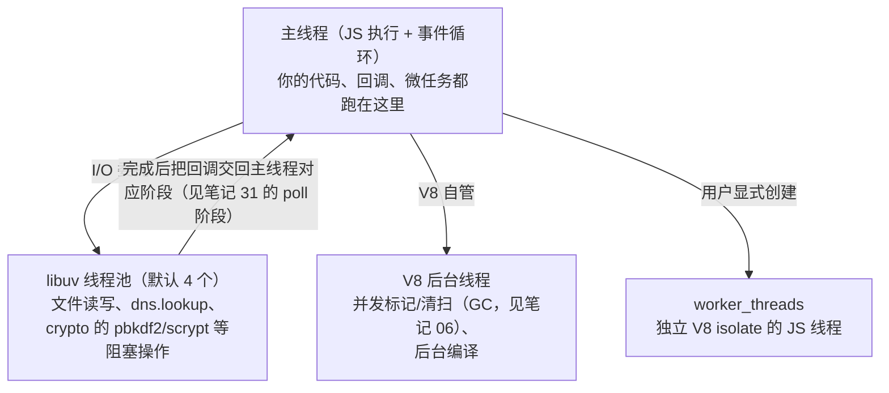
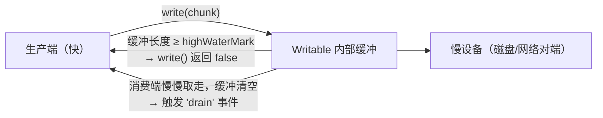

---
mdx:
  format: mdx
references:
  - 31-async-supplement
  - 16-modules-esm-cjs
  - 08-render-and-performance
  - 06-memory-management
---
# 35 · Node.js 运行时：streams、Buffer、子进程与并行模型

> 对应大纲：阶段 2 —— Node.js 运行时（streams 与背压、Buffer 与二进制数据、worker_threads 与 cluster、child_process、Node 特有的模块加载与进程模型）。
> 一手依据：Node 官方文档 [nodejs.org/api](https://nodejs.org/api/) 的 stream、buffer、child_process、worker_threads、cluster、process、modules 各页（本文所有 API 行为描述以官方文档为准，涉及本机实测的数字均标注环境）。
> 事件循环与 libuv 六阶段**不在本文重复**——见笔记 31（libuv 各阶段、nextTick/微任务、setImmediate vs setTimeout、饥饿对照）；ESM/CJS 的语法与 interop 见笔记 16；worker_threads 的通信机制（结构化克隆 + transferList）见笔记 08 第 6 节。

## 学习目标

- 能画出一个 Node 进程的线程全景：主线程、libuv 线程池、V8 后台线程、worker 线程各自做什么，「Node 是单线程」这句话错在哪一半。
- 能讲清背压的完整因果链：`highWaterMark` → `write()` 返回 `false` → `'drain'` 事件，以及为什么 `pipe` / `pipeline` / `for await...of` 天然正确。
- 能说清 Buffer 住在哪（V8 堆外）、怎么创建（`alloc` vs `allocUnsafe` vs `from`）、`slice`/`subarray` 为什么是视图不是拷贝。
- 给「调用外部命令 / CPU 密集纯计算 / HTTP 服务吃满多核」三类场景，能分别选出 child_process / worker_threads / cluster 并说清依据。
- 能说出 CJS 模块缓存与 ESM 模块求值在**进程模型**层面的推论：模块级单例的边界是进程，cluster 下每个 worker 各一份。

---

## 关键概念

### 1. 一个 Node 进程的线程全景

「Node 是单线程的」只对**你的 JS 代码**成立。一个真实 Node 进程里至少有四类线程：



- **libuv 线程池**大小由 `UV_THREADPOOL_SIZE` 控制（默认 4）。它解释了一个经典现象：4 个并发的 `fs.readFile` 大文件互不影响线程池，但 8 个并发的 `crypto.pbkdf2` 会排队——后者也跑在线程池里（`crypto` 文档明示 pbkdf2/scrypt/randomBytes 异步版走线程池）。
- **进程对象**三个高频要点：
  - `process.exit(code)` 立即退出，**会截断还在飞行中的异步 I/O**（stdout 没 flush 完就没了）。想「自然退出去设置 `process.exitCode`」，让事件循环自己走完。
  - 信号：`process.on('SIGTERM', handler)` 接管优雅停机（Kubernetes/Docker 发的就是 SIGTERM）；不注册处理器时 SIGTERM 直接终止进程。
  - `process.send` 是否存在 = 当前进程是不是被 `fork`/`cluster` 出来的子进程（练习 03/05 用它区分「父脚本 / 子模块」两种角色）。

### 2. Buffer：住在 V8 堆外的二进制数据

依据 [nodejs.org/api/buffer.html](https://nodejs.org/api/buffer.html)。

- **身份**：`Buffer` 是 `Uint8Array` 的子类，但底层字节**不分配在 V8 堆里**（C++ 侧分配），计入 `process.memoryUsage().external`——这正是笔记 06 第 6 节四字段表里 `external` 的来源。推论：`heapUsed` 不涨但 `rss` 涨，先查 Buffer（练习 01 实测：分配 100MB 后 `external` 从 1.6MB 涨到 101.6MB）。
- **三种创建**：

| 写法 | 语义 | 什么时候用 |
| --- | --- | --- |
| `Buffer.alloc(n)` | 零填充（安全默认） | 默认选择 |
| `Buffer.allocUnsafe(n)` | 不清洗旧字节；小于池上限的分配走 8KB 共享池 | 从文件/网络读数据**马上整体覆盖**时（读完就覆盖，旧数据无泄露面） |
| `Buffer.from(...)` | 从字符串（按编码）/数组/TypedArray/ArrayBuffer 构建 | 一切「从已有数据出发」的场景 |

- **`allocUnsafe` 的「Unsafe」指什么**：那块内存可能残留上一次使用的数据。所以「先用 allocUnsafe 再逐字节填」的代码里，填漏的字节就是信息泄露面——安全审计的真实条目，不只是性能话题。
- **零拷贝视图**：`Buffer.from(arrayBuffer, byteOffset, length)` 不复制字节，只是开视图；`buf.subarray(i, j)`（以及旧名 `slice`）同理。两个推论：改视图 = 改原数据；**长期持有一个小视图会「钉住」整块底层内存**（`external` 不回落的经典原因，练习 01 演示写穿语义）。
- **编码**：I/O 层默认 `utf8`（变长多字节）。`str.length` 是 UTF-16 码元数，`Buffer.byteLength(str, enc)` 才是字节数——`'汉'.length` 是 1，UTF-8 字节是 3，`utf16le` 字节是 2（单码元 BMP 字符）。一切按字节计费的场合（协议长度字段、截断）都必须用后者。
- **大流量的标准姿势**：收 chunk 进数组、结束后 `Buffer.concat(chunks)`；别在循环里反复拼字符串/拼 Buffer——每轮都产生新的中间产物，白给 GC 送工作量（衔接笔记 06 的分配压力）。

### 3. streams：四种流、两种读法与背压

依据 [nodejs.org/api/stream.html](https://nodejs.org/api/stream.html)（该页 Buffering 一节是背压语义的官方出处）。

**四种核心类型**：`Readable`（可读，如 `fs.createReadStream`、HTTP request）、`Writable`（可写，如 `fs.createWriteStream`、HTTP response）、`Duplex`（读写皆可，如 TCP socket）、`Transform`（读进什么规则变换后写出，如 `zlib.createGzip()`）。另有 WHATWG 风格的 Web Streams（`node:stream/web`），浏览器代码平移时用，本笔记不展开。

**两种读法**：

- **flowing（推）**：`stream.on('data', chunk => ...)`——数据来了就推给你，你不喊停就一直推。
- **paused（拉）**：`stream.on('readable', ...)` + `stream.read(size)`——你按自己的节奏拉。
- **`for await (const chunk of readable)` 是拉模式的语法糖**：循环体内每次迭代才取下一块，消费速度天然反压生产速度——这也是它在「读快写慢」场景里安全的规范理由。

**背压的完整因果链**（练习 02 逐步实测）：



1. `Writable` 内部有一个缓冲队列。`write(chunk)` 把 chunk 入队，**然后**比较内部缓冲长度与 `highWaterMark`：达到水位返回 `false`。
2. **`false` 不是错误、不会丢数据**，语义是「我积压到高水位了，请等我 `'drain'`（缓冲清空）再继续」。正确姿势：`false` 后停写，`await once(ws, 'drain')` 再写下一块。
3. 水位默认值以官方文档与本机实测为准：`new Writable()` / `new Readable()` 均为 **64KiB**（`stream.getDefaultHighWaterMark(false)` 实测 65536；objectMode 下是 **16 个对象**——按个数计，不按字节）。老教程里「Writable 默认 16KB」的说法对应旧版本 Node，别背数字、跑一下 `writableHighWaterMark` 就知道。
4. **忽略背压的后果**：快读慢写时，写不出去的数据全部滞留在内部缓冲里——内存无界增长 + 后面的数据排队延迟。练习 02 的对照实验（100 块 64KB 写进每块 1ms 的慢 sink）：硬写版缓冲峰值精确等于 100 × 64KB（同步循环期间消费端一次都轮不到执行）；礼貌版峰值恒为 1 块。
5. `readable.pipe(writable)` 内部实现了同一套暂停/恢复逻辑（读端按写端的速度调速）；`for await...of` 同理。**但 `pipe` 不转发流错误、出错也不清理**——生产代码一律用 `stream.pipeline`（callback 版 / `promisify` 版）：任何一个环节出错，整条链上的流全部 `destroy`，错误传给调用方。
6. `Transform` 有**双向独立**的缓冲与水位（读侧、写侧各管各的），所以「Transform 不等于零成本」——两侧速率不匹配时它自己也会积压。

### 4. child_process：四种衍生的边界

依据 [nodejs.org/api/child_process.html](https://nodejs.org/api/child_process.html)。

| API | 过 shell？ | 输出 | IPC | 典型用途 |
| --- | --- | --- | --- | --- |
| `spawn(cmd, args)` | 否 | stdout/stderr 是**流** | 否 | 大输出、流式处理（构建工具、ffmpeg） |
| `execFile(cmd, args)` | 否 | 收集成整块 buffer，受 `maxBuffer`（默认 1MB） | 否 | 小输出的确定性命令 |
| `exec(cmdString)` | **是**（`/bin/sh`，Windows 是 cmd） | 同 execFile | 否 | 确实需要 shell 语法时（管道、通配符） |
| `fork(modulePath)` | 否 | 同 spawn | **是**（内置 channel） | Node 进程分身 + 消息通信 |

三个高频坑（练习 03 全部实测）：

- **`exec` 的注入面**：命令是拼出来的字符串，任何拼进去的用户输入都是 shell 注入素材。参数走 `spawn`/`execFile` 的 args 数组（不经 shell）是结构性防御。
- **`maxBuffer` 是安全阀不是配置项**：子进程输出超过 1MB 直接杀进程报 `ERR_CHILD_PROCESS_STDIO_MAXBUFFER`。大输出换 `spawn` 流式读，而不是把 maxBuffer 调大——那是把内存问题改成超时问题。
- **`exit` 事件的 `code` 与 `signal` 互斥**：正常退出 `code` 是数字、`signal` 是 `null`；被信号杀死 `code` 是 `null`、`signal` 是 `'SIGTERM'` 之类。诊断「子进程为什么死」要同时看两者，另加 `'error'` 事件（启动失败时 `code`/`signal` 可能都是 `null`）。

`fork` 的 IPC（`process.send` / `child.on('message')`）与 worker_threads 的 `postMessage` 同族：消息走结构化克隆系序列化，**传不了函数**（笔记 08 第 6 节的克隆限制清单同样适用）。

### 5. worker_threads 与 cluster：并行的两条路

worker 的**通信机制**（独立 isolate、`postMessage` 结构化克隆、`transferList` 零拷贝转移）笔记 08 第 6 节已讲透；cluster 的**分发机制**练习 05 已实测。这里补齐「工程选型」这一层：

| 维度 | child_process（fork/spawn） | worker_threads | cluster |
| --- | --- | --- | --- |
| 隔离级别 | 独立进程（独立地址空间） | 独立线程 + 独立 V8 isolate（同进程） | 独立进程（primary 的分身） |
| 通信 | IPC / stdout 流 | `postMessage`（可 transfer） | IPC（fork 同款）+ 共享监听端口 |
| 启动成本 | 最高（fork 进程） | 中（线程 + isolate，数 MB 内存起） | 最高 |
| 崩溃影响 | 互不连坐 | worker 崩溃不拖垮主线程（需自己重启） | worker 崩溃不连坐，**重启责任在 primary** |
| 典型场景 | 跑外部命令、第三方脚本、强隔离 | CPU 密集纯计算、图像/加解密批处理 | HTTP 服务吃满多核 |

三条判据：

1. **worker 的账**：`(计算收益) > 2 × 通信成本` 才值得（结构化克隆不免费）。适用形态是「一次传数据进去、算很久、一次传结果出来」——练习 04 的素数统计（每片传 2 个数字、回 1 个数字）在 Apple M4 Pro / Node 24.10.0 上多次实测加速约 2.5–3.1 倍（4 workers，逐次运行有浮动）；反过来，高频小消息的「worker 池 RPC」经常比单线程还慢。
2. **cluster 的独特价值只有一个**：多个进程共享同一个监听端口。非 Windows 平台默认 round-robin——primary 统一 `accept` 连接再轮流分发（练习 05 实测 6 个请求 1/2 交替服务）。改造成本最低的多核扩容，代价是进程内存各一份。
3. **「独立进程」的推论**：模块级单例、内存缓存、计数器在**每个 worker 里各是一份**。跨 worker 共享状态必须外置（Redis 等）或走 IPC——这是「用 cluster 扩容后计数器对不上」这类事故的根源。

### 6. 模块加载与进程模型（Node 特有）

笔记 16 讲透了 ESM/CJS 的**语法与 interop**；这里只讲运行时行为在进程模型上的三个推论。

- **CJS：同步 `require` + 模块缓存**。`require.cache` 让同一模块在进程内只求值一次——模块级状态（配置、连接池）天然单例。推论一：删缓存热重载只在开发期玩（生产下等于赌博）；推论二：**循环依赖**拿到的是对方「部分完成的导出」（键可能在、值还是 `undefined`）——CJS 的加载是「执行到哪算哪」。解析顺序：内置 → 相对/绝对路径 → 逐级向上找 `node_modules`。
- **ESM：模块图异步构建 + 求值一次即冻结**。`import` 是异步语义（这正是笔记 31.1 里「ESM 顶层运行在微任务上下文」的根源），模块求值只发生一次、结果被模块图缓存。top-level await 会挂起整条依赖链（笔记 31.4）。
- **同步加载阻塞事件循环**：`require` 是同步 I/O + 同步执行。启动期无所谓；**请求路径上动态 `require`** 等于在主线程上插一段同步磁盘读 + 代码执行——和长任务同罪（笔记 31.1 的饥饿同源）。ESM 的动态 `import()` 是异步的，语义上安全得多。

---

## 可运行示例

配套练习（`exercises/node-runtime/`，全部实际运行验证过，预期输出逐行写在文件头注释）：

```bash
# Buffer：编码、堆外内存（external）、零拷贝视图、字节序
node exercises/node-runtime/01-buffer-basics.mjs

# streams 背压：硬写 vs 等 drain 的缓冲峰值对照 + pipeline 错误传播（全程确定值）
node exercises/node-runtime/02-streams-backpressure.mjs

# child_process 四件套：spawn/execFile/exec/fork；maxBuffer；exit code vs signal
node exercises/node-runtime/03-child-process.mjs

# worker_threads：素数统计串行 vs 4 workers（实测加速比，注明环境）
node exercises/node-runtime/04-worker-threads-pool.mjs

# cluster：2 worker 共享端口，6 个请求观察 round-robin 分发
node exercises/node-runtime/05-cluster-http.mjs
```

背压的最小感受版（摘自练习 02 的核心骨架）：

```js
import { Writable } from 'node:stream';
import { once } from 'node:events';

const sink = new Writable({
  write(chunk, _enc, cb) { setTimeout(cb, 1); }, // 模拟慢设备
});
const chunk = Buffer.alloc(64 * 1024, 1);

for (let i = 0; i < 100; i++) {
  const ok = sink.write(chunk);
  if (!ok) await once(sink, 'drain'); // false → 停写 → 等 drain：就这一行
}
sink.end();
```

---

## 易错点与面试高频

1. **「Node 是单线程」半对**：JS 执行单线程；libuv 线程池（文件/dns/部分 crypto）、V8 后台线程（GC/编译）、worker_threads 都是真线程。把这句话说全，就是面试里「Node 怎么利用多核」的开场答案。
2. **`write()` 返回 `false` 不是失败**：是「到高水位了，该等 drain」。忽略它不报错、不丢数据——代价是无界缓冲 + 排队延迟，比报错更隐蔽。
3. **`pipe` 不处理错误**：上游出错时管道静默停止且资源不清理。默认写法是 `pipeline`（错误时整链 destroy）。
4. **`buf.slice`/`subarray` 是视图**：改它会写穿原数据；持有小视图会钉住大块底层内存。「只想留一小段」请复制（`Buffer.from(buf.subarray(i, j))` 会拷贝出独立缓冲）。
5. **`allocUnsafe` 的名字是警告**：残渣可能属于上一个使用者。只有「分配后立即整体覆盖」的场景才允许用。
6. **`exec` 拼命令 = shell 注入面**：参数一律走 `spawn`/`execFile` 的数组；真需要 shell 语法时也要把用户输入放环境变量/文件传递，别拼进命令串。
7. **`maxBuffer` 超限的表现**：子进程被杀、回调收到 `ERR_CHILD_PROCESS_STDIO_MAXBUFFER`——大输出用 `spawn` 流式读，不是调大缓冲。
8. **cluster 的默认分发**：非 Windows 是 round-robin（primary 集中 accept）；Windows 默认把端口交给系统分发。练习里「多 worker 交替服务」在 Windows 上顺序可能不同。
9. **cluster 下的模块级状态是每 worker 一份**：内存缓存/计数器不共享，跨 worker 一致性要外置存储或 IPC——「扩容后数据对不上」的根源。
10. **`process.exit()` 截断挂起中的 I/O**：优雅退出用 `process.exitCode` + 让事件循环自然走完；`SIGTERM` 处理器里先 `server.close()` 再退（练习 05 的停机骨架）。

---

## 输出预测题

### 题 1（背压时序）

```js
import { Writable } from 'node:stream';
const ws = new Writable({ write(c, e, cb) { setTimeout(cb, 5); } }); // 慢消费
const big = Buffer.alloc(64 * 1024); // 64KB，默认水位 64KiB
const results = [];
results.push(ws.write(big));   // ①
results.push(ws.write(big));   // ②
console.log(results.join(','));
ws.on('drain', () => console.log('drain'));
ws.end();
// 问：console.log 打印什么？'drain' 一共会触发几次？
//（本答案经实际运行验证：node 24，默认水位 64KiB）
```

### 题 2（Buffer 语义）

```js
const raw = Buffer.from('a汉b'); // UTF-8
const view = raw.subarray(1, 4);
view[0] = 0x62; // 'b'
console.log(raw.length, raw.toString('utf8'));
console.log(Buffer.byteLength('汉', 'utf8'), Buffer.byteLength('汉', 'utf16le'));
// 问：两行输出各是什么？view 的改动会不会影响 raw？
```

（答案见文末）

---

## 延伸阅读

- nodejs.org/api/stream.html —— 四种流、Buffering 与背压语义、pipeline、objectMode 的官方定义（本文第 3 节主要依据）
- nodejs.org/api/buffer.html —— Buffer/Uint8Array 关系、alloc 系列与共享池、编码与 byteLength
- nodejs.org/api/child_process.html —— 四 API 对照、maxBuffer、exit 的 code/signal 语义
- nodejs.org/api/worker_threads.html 与 nodejs.org/api/cluster.html —— worker/cluster 模型与调度策略（round-robin）
- nodejs.org/api/process.html —— exitCode/exit、信号、process.send
- nodejs.org/api/modules.html —— CJS 缓存、解析算法、循环依赖；ESM 见 nodejs.org/api/esm.html
- 衔接：笔记 31（libuv 六阶段与两微队列）、笔记 16（ESM/CJS interop）、笔记 08 第 6 节（结构化克隆与 Transferable）、笔记 06（external 与四字段内存表）

---

## 预测题答案

### 题 1

打印 **`false,false`**，'drain' 触发 **0 次**。

- 每块 64KB 入队后内部缓冲立即达到 64KiB 水位（`64 * 1024 ≥ 65536`），所以两次 `write` 都返回 `false`（false 只表示「到水位」，不是「写不进」——两块都进了缓冲）。
- **drain 一次都不触发**：`end()` 紧跟着两块未消化的写入被调用，流进入「收尾」状态；缓冲清空后直接走 `'finish'`。'drain' 的语义是「可以继续写了」——都已经 end 了，没有「继续写」可言。这是背压题的经典陷阱：**drain 只对「还想继续 write 的生产者」有意义**（对照练习 02 的礼貌版：不调 end，每次 false 后等 drain，drain 就如期触发）。

### 题 2

```
5 ab□□b     （□ 是两个替换字符 U+FFFD，终端通常显示为 ? 或豆腐块）
3 2
```

- `raw.length` = **5**：`'a'`(1 字节) + `'汉'`(3 字节) + `'b'`(1 字节)。`.length` 数的是字节，不是字符——第一个高频错点。
- `subarray(1, 4)` 恰好框住 `'汉'` 的 3 个字节（E6 B1 89），`view[0] = 0x62` 把首字节改成 `'b'`——**视图写穿原数据**。剩下的 B1 89 不再是合法 UTF-8 序列（延续字节没了前导字节），各自解码成 U+FFFD 替换字符，所以第二行输出 `a` + `b` + 两个替换字符 + `b`。
- 第三行：`'汉'` 是单个 BMP 码元（U+6C49），UTF-8 编码 3 字节；`utf16le` 每码元 2 字节 → **3 2**。别背「汉字都是 2 字节」——那是 UTF-16 码元的视角，UTF-8 下是 3。

## 附：Node 运行时心智模型速查（收尾增补）

本册覆盖了 Buffer/二进制/编码与运行时边界，收尾把"Node 里遇到数据/进程问题先想什么"压成心智模型速查表：

| 场景 | 心智模型的第一反应 | 本册出处 |
|---|---|---|
| 字符串乱码/替换字符 | 编码链哪一环断了（读/传输/写） | UTF-8 三节 |
| Buffer 与 string 互转 | encoding 参数显式给了吗 | 二进制数据节 |
| 大文件读写内存爆 | 流（stream）代替一次性读 | Node I/O 观 |
| 进程退出码非 0 | 哪一层抛的（用户码/运行时/信号） | 进程模型 |
| 环境变量读不到 | process.env 何时快照 | 运行时边界 |
| 跨平台路径错 | path.posix vs path.win32 | 平台层 |
| 定时器漂移 | 事件循环的相位（timer 阶段） | 事件循环一瞥 |

速查表的用法：**先定位"数据在这一刻的物理形态"**（string/Buffer/流字节），再问"谁在转换它"——八成运行时问题的根因都是"形态与预期不符"。

### 收尾自测（增补）

1. 速查表哪几行共同指向"编码链断裂"这一类问题？链路顺序是什么？
2. "流代替一次性读"的收益边界在哪？（小文件反而啰嗦——判据是尺寸吗？还是内存画像？）
3. 事件循环的 timer 相位解释了 setTimeout 精度的什么现象？setImmediate 与它的先后怎么记？

### 收尾一句话（增补）

Node 运行时层的知识都有一个共同形状：**V8 管语言语义，libuv 管时间与 I/O，两者之间的缝隙（编码、进程、路径）才是事故高发区**——本册速查表的每一行都站在某条缝隙上。

## 附二：进程与信号的一页补充

本册正文点到进程模型，这里把"进程怎么死"补成一页（运维事故的常客）：

| 退出方式 | 退出码 | 谁触发 | 典型场景 |
|---|---|---|---|
| 正常退出 | 0 | process.exit(0) / 事件循环清空 | 任务完成 |
| 未捕获异常 | 1 | 运行时默认 handler | bug（必须配 uncaughtException 兜底上报） |
| process.exit(n) | n | 代码主动 | 语义化失败码（脚本调用方判断） |
| SIGTERM | 143 | 编排系统（k8s/docker stop） | 优雅关闭窗口（先清连接再退） |
| SIGKILL | 137 | 强杀（不可捕获） | 超过优雅关闭时限 |
| OOM | 137（常见） | 内核 | 内存泄漏的终局 |

表的使用要点：**137 ≠ "被 OOM 了"**——它只是 128+9（SIGKILL），需要结合 dmesg/编排日志区分"谁杀的"；优雅关闭的正确姿势是监听 SIGTERM → 停止接新请求 → 等在途完成 → exit，而不是捕获后立刻退出（那和被杀没区别）。

### 附二自测

1. SIGTERM 与 SIGKILL 的可捕获性差异决定了什么工程纪律？（优雅关闭必须在 TERM 窗口内完成）
2. uncaughtException 里"记录 + 退出"为什么比"记录 + 继续跑"正确？（状态一致性已不可信）
3. 你的服务被 137 杀过吗？三步区分"OOM 还是人为 kill"。
