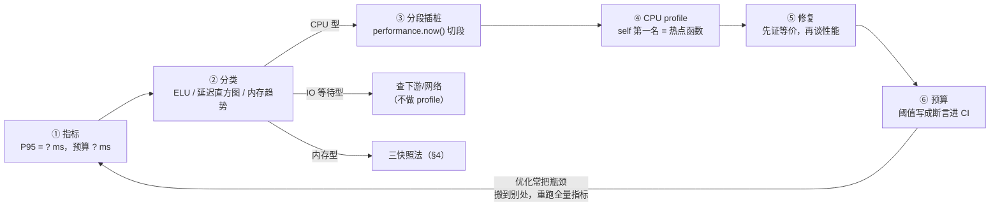

---
mdx:
  format: mdx
references:
  - 06-memory-management
  - 07-v8-engine
  - 08-render-and-performance
  - 31-async-supplement
  - 35-node-runtime
---
# 36 · 性能工程：CPU profile、堆快照与事件循环延迟

> 对应大纲：阶段 2 —— 性能专题的长任务分析与排查方法论（CPU 采样与火焰图、堆快照与三快照法、事件循环延迟度量，以及从「页面/服务慢」定位到函数的完整流程）。
> 一手依据：Node 官方文档 [nodejs.org/api/cli.html](https://nodejs.org/api/cli.html)（`--cpu-prof` 系列旗标）、[nodejs.org/api/inspector.html](https://nodejs.org/api/inspector.html)（Profiler 域）、[nodejs.org/api/perf_hooks.html](https://nodejs.org/api/perf_hooks.html)（`monitorEventLoopDelay` / `eventLoopUtilization`）、[nodejs.org/api/v8.html](https://nodejs.org/api/v8.html)（`writeHeapSnapshot` / `getHeapStatistics`）；火焰图读法依据发明者 Brendan Gregg 的 [flamegraphs 主页](https://brendangregg.com/flamegraphs.html)与 Chrome DevTools [Performance](https://developer.chrome.com/docs/devtools-performance) / [Memory](https://developer.chrome.com/docs/devtools/memory-problems) 文档。
> 分工：GC 机制与五种泄漏场景的最小复现见笔记 06（第 3、6 节），本文只讲「它们在快照里怎么现形」；分层编译、内联与形状优化见笔记 07；浏览器侧 longtask（50ms 阈值）与任务切片见笔记 08（第 2、7 节）；libuv 六阶段与 setImmediate 让出见笔记 31；streams/Buffer/进程模型见笔记 35。

## 学习目标

- 能说出 V8 CPU profiler 是**采样式**的：它「拍」的是什么、默认多久拍一次、为什么「样本数 × 间隔 ≈ 总耗时」、误差从哪来。
- 能按**宽度、栈深、self/total** 三个维度读火焰图：「优化谁」看 self 最宽条，「归因到哪个模块」看 total。
- 能讲清 shallow size / retained size / 支配树三者的关系，会把三种最常见泄漏模式对号入座到堆快照特征上。
- 会用 `monitorEventLoopDelay` 与 `eventLoopUtilization` 把「慢」先分成 CPU 型 / IO 等待型，再决定抓 profile 还是查下游。
- 能复述六步法（指标 → 分类 → 插桩 → profile → 修复 → 预算），说出每步的产出物与跳步的代价。

---

## 关键概念

### 1. 先分类，再选工具：「慢」的三种病因

性能排查第一件事不是开工具，是把病因分类——选错工具会一无所获：

| 病因 | 特征信号 | 对的工具 |
| --- | --- | --- |
| CPU 型（计算/解析/序列化/正则……） | `eventLoopUtilization` ≈ 1，延迟直方图有与耗时相当的尖峰 | CPU profile（§2–3） |
| 内存型（泄漏/GC 压力） | `rss` / `heapUsed` / `external` 单调涨，GC 后不回落 | 三快照法（§4） |
| IO 等待型（下游慢/网络/磁盘） | ELU 低、CPU 安静，但接口就是慢 | CPU profile **抓不到东西**，该查下游依赖与网络（trace/APM） |

CPU 型还有一个重要子类：**事件循环被单个长任务整段占住**——延迟直方图会直接给出尖峰证据（§5）。

两条前置纪律：

1. **测量优先于直觉**。「感觉是 XX 慢」不算输入，每个结论都要有工具产出支撑——本文后面每一步都是可运行的。
2. **指标用分位数（P95），不用平均值**。尾部延迟才是用户「偶尔很卡」的来源，平均会被快请求稀释（浏览器侧同一观点见笔记 08 第 7 节）。

### 2. CPU 采样剖析：V8 怎么「拍」调用栈

**两种剖析哲学**：instrumentation（记录每次函数进出，精确但开销大、会改变被测行为）vs **sampling（采样）**——按固定间隔抓一次当前调用栈。V8 内置的 CPU profiler、`--cpu-prof`、DevTools 录制都是采样式。

**机制**：采样器按设定间隔中断 JS 线程，把**当时的完整调用栈**记为一个样本。聚合后：

- 函数出现在**栈顶**的次数 → **self time** 的近似（它自己正在耗 CPU）；
- 函数出现在**栈上任意位置**的次数 → **total time** 的近似（它连同其子调用一共占了多久）。

它是**统计量**：执行时间短于采样间隔的函数可能一个样本都拿不到（整段落在两次采样之间），样本越多（负载更长 / 间隔更短）误差越小。所以 profile 用于找**数量级**热点，不用于比较毫秒级差异。

**三个入口**（同一套 Inspector Profiler 协议的三种驱动方式）：

| 入口 | 采什么时候 | 产物 |
| --- | --- | --- |
| `node --cpu-prof`（配 `--cpu-prof-interval` / `--cpu-prof-dir` / `--cpu-prof-name`） | 进程启动即采、退出落盘 | 当前目录下的 `.cpuprofile`。默认间隔 1000µs（nodejs.org/api/cli.html）；本机实测（Node 24.10.0）默认间隔下相邻样本中位间隔约 1.3ms（含采样开销抖动），产物名为 `CPU.<日期>.<时间>.<pid>.<线程号>.<序号>.cpuprofile` |
| `node:inspector` 的 Session（`Profiler.setSamplingInterval` + `start`/`stop`） | 进程内任意代码区间 | 同一 JSON 结构，可只剖析热点段（练习 01/04 的做法，间隔可设到 100µs） |
| `node --inspect` + Chrome DevTools Performance | 交互式录制、面板内直接看 | 面板内火焰图（也可 Load profile 导入离线文件） |

**`.cpuprofile` 的数据结构**（练习 01 手工聚合的就是它）：

- `nodes[]`：调用树。每个节点带 `callFrame.functionName` 与 `hitCount`（self 样本数）；
- `samples[]`：按时间序的节点 id 序列；
- `timeDeltas[]`：相邻样本的间隔（微秒）。

火焰图（§3）就是这棵树按样本量聚合的可视化。

两个必备细节：

- **系统帧**：`(root)`、`(program)`、`(garbage collector)`——GC 抢走 CPU 的时间记在 `(garbage collector)` 名下。「JS 函数都不宽但 CPU 高」先看 GC 帧：那是内存问题穿了 CPU 的外衣（转 §4，衔接笔记 06）。
- **内联导致的归因塌缩**：小函数被 TurboFan 内联进调用方后（笔记 07 第 1 节），采样帧上只剩调用方名字——profile 里「看不到」某个小函数不代表它没执行。练习 01 刻意把循环写进大函数来演示函数级归因；练习 04 用 `%NeverOptimizeFunction`（`--allow-natives-syntax`，**教学专用**，生产代码不这么做）保住帧，注释里明确说了这是为什么。

### 3. 怎么读火焰图：宽度、栈深、self 与 total

火焰图（Brendan Gregg）= **采样调用树的聚合可视化**：x 轴**不是时间轴**（按函数名排序聚合，避免把时间顺序误当因果）；**宽度 = 该函数占的样本比例**；y 轴 = 栈深，每根竖列是一条真实调用链（底 = 入口，顶 = 栈顶）。

三条读法：

1. **宽度即占比，先看宽的平台，不看尖峰**。宽条 = 大量样本落在它身上，稳定可复现；又高又窄的塔可能只是采样噪声或一次性 I/O。
2. **self 与 total 回答两个不同的问题**。「优化哪个函数」看 **self** 最宽者（它自己耗 CPU）；「这条耗时归因给哪个入口/模块」看 **total**（谁包住了宽条）。练习 01 的实测结构就是教科书案例（Apple M4 Pro / Node 24.10.0，间隔 100µs，共 26198 个样本）：

   | 函数 | self | total |
   | --- | --- | --- |
   | `hotInner`（大负载） | 81.2% | ≈ 81.2% |
   | `mediumInner`（中负载） | 18.8% | ≈ 18.8% |
   | `wrapper`（只是转发） | 0.0% | ≈ 100% |

   wrapper 的 self 是 0，但它的 total 包住两个热点——改 wrapper 没有用，改 hotInner 才有用；而「哪个入口贡献了这 81%」的归因答案是 wrapper 这条链。
3. **栈深读法**：「宽而浅」= 每一层都各自花时间，逐层看；「一根宽柱立在高塔顶」= 底下全是转发层，问题就是塔顶那个函数。DevTools 的 Call Tree / Bottom-Up 视图与 speedscope.app 的 left-heavy 视图是同一数据的不同切法（Bottom-Up 按 self 排序，就是「谁最宽」的列表）。

工具：`.cpuprofile` 是通用格式——Chrome DevTools（Performance → Load profile）与 [speedscope.app](https://www.speedscope.app/)（拖入即看）都能打开练习 01 的产物。

### 4. 堆快照与三快照法：把泄漏边找出来

概念骨架（三快照步骤、Retainers）笔记 06 第 6 节已给，这里补齐「尺寸语义 + Node 工具链 + 泄漏模式对号入座」。

**两个尺寸**：

- **Shallow Size**：对象自身占的字节数；
- **Retained Size**：把它删掉后**能一并释放**的总量（自身 + 只经它才可达的整棵子树）。

排泄漏**按 Retained Size 排序**：一个自身很小的 Map/闭包可能牵住几百 MB 的子树——shallow 视角完全看不见它。

**支配树（dominator tree）**：retained size 的计算基础。图论定义：D 支配 N ⇔ 从 GC 根到 N 的**每条**路径都必须经过 D。于是「删掉 D，N 与 N 的整棵被支配子树一起不可达」——retained size 量的就是这棵子树。DevTools 的 **Retainers 面板**给出的保留路径，就是沿引用关系回答「谁是它的支配性持有者」；**那条引用链就是泄漏边**（06 的口诀：泄漏 = 意外的可达边）。

**三快照法**（判据与 06 相同）：A（操作前）→ 重复执行疑似泄漏操作 N 次 → B → 强制 GC → C；看 A→C 的增量里 **Retained 单调增长、GC 后不回落**。Node 侧的落盘/测量工具：

| 手段 | 场景 |
| --- | --- |
| `v8.writeHeapSnapshot()`（代码触发） | 测试脚本里定点拍快照 |
| `node --heapsnapshot-signal=SIGUSR2 app.js`（信号触发） | 生产进程随时拍，产物拖进 Chrome DevTools Memory 面板 |
| `node --inspect` + DevTools Memory 面板 | 交互式；面板垃圾桶按钮可强制 GC |
| `v8.getHeapStatistics()`（进程内数值，不落盘） | 练习 02 的做法——`.heapsnapshot` 产物在大堆下可达数百 MB，而三快照的**纪律**不依赖落盘 |

**三种最常见泄漏模式怎么在快照里现形**（各场景的最小复现代码见笔记 06 第 3 节，此处只讲快照特征）：

| 模式 | 三快照特征 | Retainers 链形状 |
| --- | --- | --- |
| ① 意外全局变量 | 同一批构造器数量随操作轮数**线性**增长 | 链顶是全局对象下的那个属性名（ESM 默认严格模式，赋值给未声明变量直接 ReferenceError——见 06 场景 1） |
| ② 强引用容器 / 无界缓存（Map、数组、对象缓存） | 容器自身 Retained Size 巨大且逐轮涨；Comparison 视图里每轮 +N 的都是业务对象 | 模块级变量/单例 → 容器 → 业务对象。练习 02 实测（Apple M4 Pro / Node 24.10.0）：模块级 Map 键强引用会话对象，used_heap 逐轮 3.9 → 16.2 → 28.5 → 40.8 MB 单调涨；置 null + GC 后回落 3.9 MB——**泄漏边就是容器本身**；同样的分配换成 WeakMap，三轮 GC 后 4.0 MB |
| ③ 定时器 / 监听器未清理 | Node：`Timeout` 对象连同其闭包逐轮累积；浏览器：`Detached` 节点成批出现（06 场景 4） | timer / 事件目标 → 回调闭包 → 大对象——它们是 root 性质的持有者，不死则整条闭包链不死（06 场景 2） |

一个 Node 特有的补丁：**Buffer 泄漏不在 `heapUsed` 上现形**——Buffer 住在 V8 堆外，看 `process.memoryUsage().external` 与 `rss`（35 号练习 01 实测：分配 100MB 后 external 1.6 → 101.6 MB）。「JS 堆没涨、rss 涨了」先查 external。

### 5. 事件循环延迟的度量：monitorEventLoopDelay 与 ELU

浏览器有 `PerformanceObserver` 的 longtask 条目（50ms 阈值，笔记 08 第 7 节）；**Node 没有这个条目**，对应物是 `perf_hooks` 的两个 API：

- **`monitorEventLoopDelay({ resolution })`**：返回一个直方图（IntervalHistogram），周期性检查事件循环**两次轮询之间的间隙**。主线程被同步长任务占住时，检查点本身被推迟 → 记一次大延迟。要点：
  - 单位是**纳秒**；`resolution` 默认 20ms——比一个分辨率更细的间隙测不出来（**它决定了能测到的下限**）；
  - `mean` 会被空闲期稀释，只看数量级；**`max` / `percentile(99)` 才是 long task 的直接证据**；
  - 两段实验共用一个 monitor 时，中间必须 `reset()`，否则前一段的尖峰污染后一段。
- **`eventLoopUtilization([since])`**：返回 `{ idle, active, utilization }`；传上一个采样点作参数可得**增量区间**值。它是 §1 分类的量化手段。

实测对照（练习 03，Apple M4 Pro / Node 24.10.0，resolution 20ms）：

| 版本 | mean | max |
| --- | --- | --- |
| A：单个 300ms 同步长任务 | 78.1 ms | **307.2 ms** |
| B：30 片 × 10ms，片间 `setImmediate` 让出 | 21.3 ms | **39.3 ms** |

解读：A 的 max ≈ 任务本身时长——事件循环整段被占住；B 的 max 落在「一片 + 让出开销」的量级，不到 A 的 1/5。ELU 侧实测：空闲 100ms 区间 utilization = 0.00，同步阻塞 200ms 区间 = 1.00。

**两者合用的分类判据**：

- ELU ≈ 1 **且**延迟有尖峰 → CPU 型 → 抓 CPU profile（§2）；
- ELU ≈ 0 但接口慢 → IO 等待型 → CPU profile 里什么都没有，查下游/网络；
- ELU 忙闲交替、延迟尖峰逐个出现 → 长任务型 → 先切片（`setImmediate` 让出，每代之间事件循环完整转一圈——为什么不是递归 `nextTick` 见笔记 31 的饥饿对照）。

### 6. 六步法：从「页面/服务慢」到函数的完整流程

把前面几件工具串成一条流程（练习 04 是完整可运行的复盘）：



| 步 | 做什么 | 产出物 | 跳步的代价 |
| --- | --- | --- | --- |
| ① 指标 | 定分位数指标与预算 | 「P95 = 199.4ms，预算 20ms」这样的可验收陈述 | 没有指标的优化无法验收，也无法防回归 |
| ② 分类 | ELU + 延迟直方图（内存看 rss/heapUsed/external 趋势） | CPU 型 / IO 等待型 / 内存型三选一 | IO 型去抓 CPU profile，一无所获 |
| ③ 插桩 | `performance.now()` 给可疑链路分段 | 热点段：练习 04 实测 parse 0.8% / transform 99.0% / render 0.2% | 直接看全量 profile，热点淹没在噪声里 |
| ④ profile | inspector 采样剖析热点段 | 热点函数：self 第一名 `insertFront`（99.0%）——`transform` 里逐条 `unshift` 的 O(n²) | 只停在第 ③ 步「知道哪段慢」，不知道哪个函数/为什么 |
| ⑤ 修复 | 先**证等价**（顺序敏感地对比输出）再替换实现 | `unshift`（O(n²)）→ `push` + `reverse`（O(n)，最终顺序一致）；实测 P95 199.4 → 2.4ms（同环境，逐次运行有浮动） | 快但算错，毫无意义 |
| ⑥ 预算 | 把阈值写成断言，进 CI 跑同一脚本 | 防回归护栏（修复后 P95 小于 20ms） | 下次合并不是有意为之也会把 O(n²) 带回来 |

三句心法：**先分类再开工具**（②决定后面所有工具的选择）；**先等价再优化**（⑤的顺序不能反）；**修完重跑全量指标**（⑥回到①——优化常把瓶颈搬到别处）。

---

## 可运行示例

配套练习（`exercises/performance-engineering/`，全部实际运行验证过，预期输出逐行写在文件头注释；实测行数值随机器变化，样例环境 Apple M4 Pro / Node 24.10.0 / macOS 26.6.2）：

```bash
# CPU 采样：进程内 inspector 启停 profiler，手工聚合 self/total，产出 .cpuprofile
node exercises/performance-engineering/01-cpu-profile.mjs

# 三快照法：泄漏版（模块级 Map）vs 修复版（WeakMap）的三个测量点对照
node --expose-gc exercises/performance-engineering/02-heap-three-snapshots.mjs

# 事件循环延迟：300ms 长任务 vs 30 片 × 10ms 的直方图对照 + ELU 分类
node exercises/performance-engineering/03-event-loop-delay.mjs

# 六步法完整复盘：慢接口 → P95 → 分类 → 插桩 → profile → 等价修复 → 预算
node --allow-natives-syntax exercises/performance-engineering/04-slow-to-function.mjs
```

不用写代码的最小感受版——`--cpu-prof` 三行（产物落在当前目录，别在仓库里跑）：

```bash
cd "$(mktemp -d)"
node --cpu-prof -e 'let t=0;for(let n=1;n<800000;n++){let v=n;while(v!==1){v=v%2===0?v/2:3*v+1;t++}}console.log(t)'
ls CPU.*.cpuprofile   # 拖进 https://www.speedscope.app/ 立刻看到火焰图
```

---

## 易错点与面试高频

1. **「火焰图的 x 轴是时间」——错**。样本按函数名聚合排序，宽度是占比不是时间先后；看「哪段时间慢」用时间轴视图，看「谁占得多」用火焰图。
2. **「profile 里最宽的函数就是该改的函数」——半错**。先分 self/total：total 宽只说明它包住了热点（转发层全是这样）；改代码看 self 最宽者，归因看 total。
3. **采样有盲区**：执行时间短于采样间隔的函数可能零样本命中；间隔调小则开销上升、被测行为被扰动。profile 找数量级热点，不做毫秒级比较。
4. **GC 时间在 profile 里叫 `(garbage collector)`**。JS 函数都不宽而 CPU 高，先看 GC 帧——那是内存问题，换工具（§4）。
5. **「内存高 = 泄漏」——错**。判据是**重复操作后 Retained 单调增长且 GC 后不回落**（笔记 06 的口诀）；一次性大分配不是泄漏。
6. **排序字段用 Retained Size，不用 Shallow Size**：小容器牵住大子树，shallow 视角看不见。
7. **Buffer 泄漏不在 heapUsed 上现形**：看 `external` / `rss`（堆外内存，笔记 35 第 2 节）。
8. **ELU 低 + 接口慢 ≠ 没问题**：那是 IO 等待型的定义，CPU profile 对它失明，方向是下游与网络。
9. **`monitorEventLoopDelay` 有分辨率下限**（默认 20ms），更细的间隙测不出；mean 被空闲稀释，尖峰看 `max` / `percentile(99)`；两段实验之间记得 `reset()`。
10. **面试高频问法**：「讲讲你怎么排查一个慢接口」「self time 和 total time 的区别」「三快照法怎么做」「火焰图怎么看」「Node 里怎么度量事件循环延迟」。答题骨架就是本文 §5 的分类判据 + §6 六步法。

---

## 输出预测题

### 题 1（self / total 计算）

一次 10 秒的采样剖析共 1000 个样本（间隔 10ms）。聚合后发现：

- `requestHandler` 出现在**全部 1000 个样本**的栈上；
- 其中 100 个样本的**栈顶**是 `requestHandler`；
- 600 个样本的栈顶是 `queryAll`（`requestHandler` 都在它下方）；
- 其余 300 个样本的栈顶是 `(garbage collector)`（其下方 JS 栈同样是 `requestHandler` → `queryAll`）。

问：`requestHandler` 与 `queryAll` 的 self%、total% 各是多少？应该优化谁？这次剖析还额外提示了什么？

### 题 2（分类判断）

同一段 100ms 的窗口，三种代码：

```js
// a)
await new Promise((r) => setTimeout(r, 100));
// b)
busy(100); // 纯同步循环打满 100ms
// c)
for (let i = 0; i < 10; i++) { busy(10); await new Promise((r) => setImmediate(r)); }
```

问：各自的 `eventLoopUtilization` 大概是多少？`monitorEventLoopDelay` 的 max 有何不同？哪个版本用户「点不动页面」，哪个版本「点得动但总时长一样」？

（答案见文末）

---

## 延伸阅读

- nodejs.org/api/cli.html —— `--cpu-prof` / `--cpu-prof-interval` / `--cpu-prof-dir` / `--cpu-prof-name` / `--heapsnapshot-signal` 的官方定义与默认值（本文 §2、§4 的依据）
- nodejs.org/api/inspector.html —— Profiler 域（`setSamplingInterval` / `start` / `stop`）：进程内剖析的协议层
- nodejs.org/api/perf_hooks.html —— `monitorEventLoopDelay`（IntervalHistogram、resolution）与 `eventLoopUtilization`（§5 的依据）
- nodejs.org/api/v8.html —— `writeHeapSnapshot` / `getHeapStatistics`（§4 的 Node 侧工具）
- brendangregg.com/flamegraphs.html —— 火焰图发明者的原始出处：宽度语义、y 轴、为什么按字母序聚合（§3 读法的依据）
- developer.chrome.com/docs/devtools-performance 与 developer.chrome.com/docs/devtools/memory-problems —— Performance 面板（火焰图 / Call Tree / Bottom-Up）与 Memory 面板（快照、Retainers）
- speedscope.app —— 跨工具打开 `.cpuprofile` 的开源查看器
- 衔接：笔记 06（GC 与泄漏场景、四字段内存表）、07（分层编译与内联——归因塌缩的根源）、08（浏览器 longtask 与切片）、31（libuv 六阶段与 setImmediate 让出）、35（Node 运行时、Buffer 与 external）

---

## 预测题答案

### 题 1

- `requestHandler`：self = 100/1000 = **10%**；total = 1000/1000 = **100%**（每个样本它都在栈上）。
- `queryAll`：self = 600/1000 = **60%**；total = 600/1000 = **60%**（它没有更深的子调用，栈顶命中即全部命中）。
- **优化 `queryAll`**：self 最大（60%），它自己耗掉了大部分 CPU；`requestHandler` 的 total 100% 只说明所有路径都经过它（它是入口/转发层），改它没有下手处。
- 额外提示：剩下 **30% 的样本是 `(garbage collector)`**——CPU 高里有一小块其实是 GC 压力。修完 `queryAll` 若 P95 仍不达标，下一步该看内存（分配压力/泄漏，§4），这正是「优化常把瓶颈搬家」的一个具体形态。

### 题 2

- **a) ELU ≈ 0**（整窗都在等定时器，CPU 空闲），延迟 max 没有尖峰（间隙就是这次 setTimeout 等待，且在分辨率下限附近）。**IO 等待型**：CPU profile 抓不到东西。
- **b) ELU ≈ 1**（同步打满），延迟 max ≈ 100ms 出一个尖峰（练习 03 版本 A 的同构放大：300ms 长任务实测 max 307ms）。**长任务型**：用户在这 100ms 里「点不动」——点击回调排在事件循环后面。
- **c) ELU 仍接近 1**（忙的时间占满窗口，片间 setImmediate 立即回来），但延迟 max 降到「一片 + 让出开销」的量级（练习 03 版本 B 实测 max 39.3ms，不到版本 A 的 1/5）。总耗时与 b 同量级，但每片之间事件循环都转圈——用户「点得动」，交互回调能在片间插入。
- 结论：**ELU 区分「忙/闲」，延迟直方图区分「一次占多久」**——b 与 c 的 ELU 几乎相同，分界线在 max。这就是 §1 先分类时两个指标要一起看的原因。
