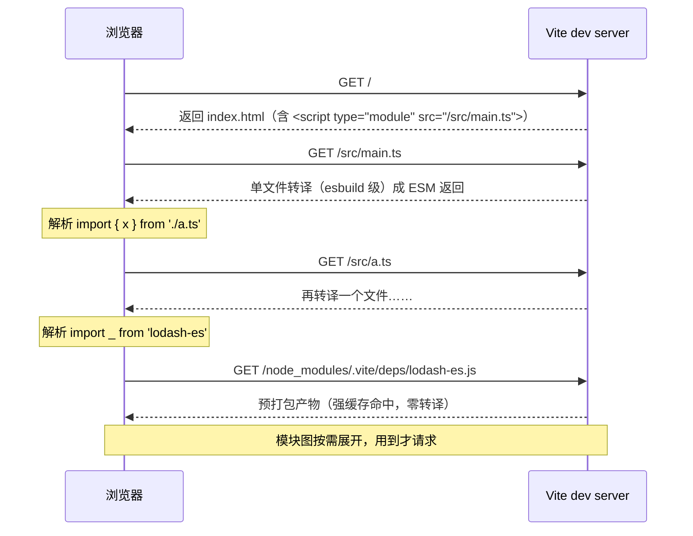

# 17 · 构建工具：Vite / esbuild / SWC 为什么这样设计

> 对应大纲：阶段 4 工程化 —— 构建工具：Vite/esbuild/SWC 原理浅析，为什么快

## 学习目标

1. 讲清 Vite dev「不打包」的思路、esbuild 预打包的两个动机、两类 HTTP 缓存策略
2. 解释「dev 不打包、build 反而打包」看似矛盾的原因，并联系 tree-shaking 对 ESM 静态性的依赖
3. 用 esbuild 官方 FAQ 的四点解释它为什么比 babel/tsc 快一个量级
4. 建立 TypeScript 工程的正确分工：**构建工具 transpile-only + 独立 `tsc --noEmit` 类型检查**，并理解本工作区 `tsx`「跑通 ≠ 类型对」的含义

## 关键概念

### 1）Vite dev 的 no-bundle 思路

一手依据：Vite 官方指南《Why Vite》与《Dependency Pre-Bundling》。

**冷启动问题的根源**：基于打包器的 dev server（webpack 时代）在启动时必须从入口把整个模块图扫描、打包完才能返回第一个页面——项目越大启动越慢，且改一行代码热更新也要重新处理一大片模块图。

**Vite 的思路**：dev 阶段**完全不打包业务源码**。

- 启动时只做「预构建依赖」，源码零处理，服务器立即可用
- 浏览器请求入口 `index.html` → 发现 `<script type="module" src="/src/main.ts">` → **浏览器原生 ESM** 发起按需请求
- Vite dev server 拦截每个模块请求，**单文件级别**地把 TS/JSX/`style` 转译成 ESM 返回（内部用 esbuild/Sucrase 级别的转译器），浏览器自己沿着 `import` 语句递归向服务器要下一个模块
- 改哪个文件只需要重新转译**那一个文件**——启动时间与项目规模解耦

**一次页面加载的请求流（逐步）**：



关键观察：请求由**浏览器驱动**（解析到 import 才发下一个），服务器只做单文件转译——这就是「no-bundle」的字面含义。

### 2）esbuild 预打包依赖：为什么必须做

一手依据：Vite 官方指南《Dependency Pre-Bundling》。

裸导入的第三方依赖（`node_modules` 里的东西）不能直接交给浏览器按需请求，两个原因：

1. **请求数爆炸**：`lodash-es` 内部是几百个细粒度 ESM 文件（`debounce.js`、`throttle.js` 各自带内部依赖）。浏览器原生 ESM 会**串行瀑布式**发起数百个请求（内置 HTTP 6 连接上限），页面直接卡死。预打包把一个依赖合成**单个文件**，请求数变成 O(依赖数) 而不是 O(依赖内部模块数)
2. **CJS → ESM 转换**：大量包只发布 CJS（如 React、旧版 lodash）。浏览器只认 ESM，esbuild 预打包时顺带把 CJS 转成 ESM（这与 Node 的 cjs-module-lexer 互操作是同一类问题，见 `notes/stage-4-engineering/16-modules-esm-cjs.md`）

附带效果：预打包也做 CommonJS 全局变量注入、可选链语法降级等兼容处理。

### 3）HTTP 缓存策略：依赖强缓存、源码协商缓存

一手依据：《Dependency Pre-Bundling》中 Cache Headers 一节。

| 类别 | 策略 | 头 | 依据 |
| --- | --- | --- | --- |
| 依赖（`node_modules/.vite/deps`） | **强缓存** | `Cache-Control: max-age=31536000, immutable` | 文件名带内容 hash，内容变名字变，可以「永久」缓存；只有 Vite 版本/lockfile/配置变化才重新预构建 |
| 业务源码 | **协商缓存** | `304 Not Modified`（ETag/Last-Modified） | 源码改动频繁且 URL 不变（`/src/App.tsx`），必须每次回源校验 freshness |

效果：二次访问页面时依赖零网络传输，源码没改的走 304——「快」不只靠不做打包，还靠缓存分层。

### 4）Vite build 用 Rollup：dev 不打包、build 反而打包

看似矛盾，其实目标不同：

- **dev 的目标是「反馈快」**：按需转译 + 浏览器并行请求源码模块，天然服务 localhost
- **build 的目标是「产物优」**：生产环境不能让用户浏览器发几百个请求（同「请求数爆炸」问题），且需要 tree-shaking、代码分割（async chunk）、压缩、兼容降级——这些是**打包器**的活。Vite build 用 Rollup（新版可切 Rolldown），把 dev 期间「以 ESM 形式逐个提供的同一份模块图」整体打包

**tree-shaking 与 ESM 静态性的联系**（承接 `notes/stage-4-engineering/16-modules-esm-cjs.md`）：摇树的前提是**不执行代码就能确定哪些导出没被 import**。ESM 的 import/export 是编译期静态结构，Rollup 可以在模块图上做「从入口可达」的标记清除。CJS 的 `require` 是运行时表达式（`require(cond ? 'a' : 'b')` 完全合法），打包器不敢删任何可能被加载/挂载的东西——所以「发 ESM 包才能被有效摇树」是库作者的常识。

**dev / build 目标对照表**：

| 维度 | dev（no-bundle） | build（Rollup 打包） |
| --- | --- | --- |
| 模块交付 | 逐文件按需转译，浏览器拼装 | 整图打包成少量优化 chunk |
| 转译器 | esbuild（快） | Rollup 插件链（esbuild 可选） |
| tree-shaking | 不需要（没打包） | 核心（删不可达导出） |
| 代码分割 | 不适用（天然按模块） | 静态 import 合入引用方；`import()` 切异步 chunk |
| 优化目标 | 冷启动/热更新延迟 | 产物体积/请求数/缓存友好（内容 hash 文件名） |
| 缓存 | 依赖强缓存 + 源码 304 | 产物指纹文件名 + CDN 长缓存 |

### 5）esbuild 为什么快

一手依据：esbuild 官方 FAQ《Why is esbuild fast?》，四点归纳：

1. **Go 编译为原生代码**：无解释器/JIT 预热，无 JS↔Native 反复跨界（Node 工具链的每次插件回调都是跨语言边界）
2. **并行**：解析、打印、部分转译天然可并行，Go 的 goroutine/共享内存让它能吃满多核；JS 单线程 + worker 序列化开销大
3. **所有功能从零实现**：自研 parser、linker、printer、source map——各阶段共享同一套内部 AST 数据结构，一遍过；babel 每个插件独立遍历/修改 AST，插件链越长遍历越多，中间表示反复转换
4. **高效的内存利用与直接输出**：AST 尽量复用，代码生成直接流式写出

再加一个关键取舍：**esbuild 只做转译（transpile），不做类型检查**。类型检查的复杂度远高于转译——转译是「逐文件、语法层」的工作；类型检查需要跨文件的完整类型程序（TypeScript Program）、类型推断、类型兼容性求解，是全局计算。esbuild 直接把 TS 当「带类型语法的 JS」剥掉类型就完事。

### 6）SWC / babel 的定位差异

| | babel | SWC | esbuild |
| --- | --- | --- | --- |
| 实现语言 | JS | Rust | Go |
| 可编程性 | 插件 API 极其成熟（JS 写插件） | 插件（Rust 原生/JS 宿主绑定） | 几乎不可扩展（内置转换集） |
| 典型角色 | 老项目、需要自定义语法插件 | Next.js 编译内核、jest-swc、Parcel | Vite 预打包、tsx、大量工具的转译底座 |
| 类型检查 | 无（`@babel/preset-typescript` 同样剥类型） | 无 | 无 |

共同点：**没有一个做类型检查**——类型检查永远是 `tsc` 的活。

补充两个同类工具，完善认知地图：

- **Sucrase**：更激进的「dev 专用转译器」——只支持「新语法→旧语法」的直译（跳过大部分降级 polyfill 场景），比 babel 快约 20 倍，思路与 esbuild 同源（dev 快就够了，别的不管）
- **Rolldown**：Rollup 作者用 Rust 重写的打包器（未来 Vite 的 build 内核候选）——目标是把「esbuild 的速度」与「Rollup 的插件生态/产物质量」合一；这说明「dev 与 build 用两套内核」本身是性能与生态妥协的产物，而非理想终态

### 7）TypeScript 工程的正确姿势

```jsonc
// package.json（示意）
{
  "scripts": {
    "dev": "vite",                       // 或任何 transpile-only 工具
    "build": "vite build",               // 构建：转译 + 打包，不做类型检查
    "typecheck": "tsc --noEmit"          // 类型检查：单独一步，进 CI
  }
}
```

分工依据：转译快但不管类型 → 开发体验；`tsc --noEmit` 慢但权威 → CI 门禁。把类型检查塞进每次保存/构建会拖垮迭代速度（对照第 5 点的复杂度论证）。

**本工作区呼应**：我们一直用的 `npx tsx` 内部就是 esbuild 转译（`notes/stage-0-setup/00-environment-setup.md` 已约定）。所以 `npx tsx file.ts` 成功只证明「语法能转译、运行时逻辑跑通」，**不证明类型对**。本工作区的等价门禁是 `npx tsc --noEmit --strict ... <file>`——阶段 4 的 `exercises/vitest-basics/*.ts` 四个源文件就是这样验证的（vitest 跑测试 = 转译执行；tsc 另行检查）。

### 8）HMR 原理一句话（及流程拆解）

一句话：Vite 沿 **importer 链**向上找到该模块的「HMR 边界」（接受了自身热更新的模块，如组件文件），通过 **WebSocket** 通知浏览器：边界内重新 `import` 变更模块的新 URL（带时间戳破缓存）并重执行，边界外的模块图不动——所以 HMR 是模块级的精准失效，而不是整页刷新。

流程拆解（四个概念：模块图 / 失效边界 / WebSocket / 时间戳 URL）：

```
① 文件保存 → ② dev server 确认变更模块的 importers 链（谁直接/间接导入了它）
→ ③ 找到最近的 HMR 边界（import.meta.hot.accept 所在模块；没有边界则整页 reload）
→ ④ WebSocket 推送 update 消息 → ⑤ 浏览器动态 import 新模块（URL 加 ?t=<时间戳> 绕缓存）
→ ⑥ 边界模块重新执行、按框架约定重挂载/重渲染
```

对照 webpack 时代：打包器内部维护模块图，HMR 要重新打包受影响 chunk 再推送 bundle；Vite 的模块图就是**浏览器里真实的 import 关系**，失效计算天然精准。

## 可运行示例

本主题的「可运行」体现在工具链行为，而非单个脚本；工作区内的直接体验点：

```bash
# ① tsx = esbuild 转译：秒开，但把 file.ts 里类型改错它照样跑（跑通 ≠ 类型对）
npx tsx exercises/vitest-basics/debounce.ts

# ② 独立类型检查：tsc 才是类型的裁判
npx tsc --ignoreConfig --noEmit --strict --target es2022 --module esnext \
  --moduleResolution bundler --lib es2022,dom exercises/vitest-basics/debounce.ts

# ③ 对照实验（自行尝试）：把 debounce.ts 的 wait 参数类型改成 string，
#    tsx 照样运行成功，tsc --noEmit 立刻报错——这就是「转译器 vs 类型检查器」的分工
```

模块机制层面的配套练习见 `exercises/esm-cjs/`（`notes/stage-4-engineering/16-modules-esm-cjs.md`）。

配套练习（本主题专属 `exercises/build-tools/`，零依赖）：

```bash
node exercises/build-tools/01-mini-bundler.mjs           # 手写打包器内核：模块图 → 工厂包装 → IIFE 注册表 + 微运行时（§4/§5）
node exercises/build-tools/02-transpile-vs-typecheck.mjs # 转译器 vs 检查器：跑通 ≠ 类型对 + 耗时差两个数量级（§7）
```

## 易错点与面试高频

- **「Vite dev 完全不打包」不准确**：业务源码不打包，**依赖照样要 esbuild 预打包**（请求数 + CJS 两个动机必须能脱口而出）
- **强缓存为什么敢配 immutable**：因为文件名带内容 hash；源码 URL 不变所以只能协商缓存——缓存策略由「URL 是否随内容变化」决定，这是通用工程判断
- **tree-shaking 为什么对 CJS 无效**：require 运行时求值，依赖图不可静态确定（高频题）
- **esbuild/swc/babel 都不检查类型**；`tsc --noEmit` 是唯一权威——「为什么构建工具不做类型检查」要用类型检查的全局性来答
- **副作用与摇树**：`package.json` 的 `"sideEffects": false` 帮打包器安全删除未引用模块；模块顶层有 `console.log`/polyfill 就不能乱标
- 面试高频：「Vite 为什么快」（原生 ESM 按需 + esbuild 预构建 + 缓存分层 + 单文件转译）；「HMR 与整页刷新的差异（模块边界失效）」

## 输出预测题

### 题 1（概念辨析）

下面四句话，哪几句是错的？说明理由。

1. Vite dev 启动快，是因为它把所有代码提前打包好了
2. Vite dev 也要打包，打包对象是 `node_modules` 里的依赖
3. 生产构建必须打包，主要因为浏览器请求几百个模块文件会产生瀑布，且需要 tree-shaking/压缩/分割
4. esbuild 预打包依赖时，会把 CJS 依赖转换成 ESM 再提供给浏览器

### 题 2（工具分工）

同事说：「`vite build` 成功了，说明我们的 TS 代码类型全对，CI 不用再跑 `tsc --noEmit` 了。」这句话错在哪两个层面？

## 预测题答案

### 题 1 答案

**只有第 1 句错。** dev 快恰恰是因为**不打包源码**：浏览器原生 ESM 按需逐模块请求，服务器单文件转译。第 2 句对：依赖必须预打包（请求数爆炸 + CJS→ESM）。第 3 句对：生产要控制请求数并做优化，打包器（Rollup）负责。第 4 句对：esbuild 预构建内置 CJS→ESM 转换（对应官方指南《Dependency Pre-Bundling》的两大动机）。

### 题 2 答案

层面一：`vite build` 内部用 esbuild/Rollup 转译，**transpile-only，剥掉类型语法**，任何类型错误都不会在构建期报告。层面二：即便工具想查也查不全——类型检查需要完整跨文件的 TypeScript 程序（类型推断是全局计算），正确姿势是独立跑 `tsc --noEmit` 进 CI（构建工具管转译，tsc 管类型）。本工作区的对应实践：`npx tsx` 跑通 + `npx tsc --noEmit` 门禁。

## 延伸阅读

- Vite 官方指南《Why Vite》《Dependency Pre-Bundling》（vitejs.dev/guide/why.html, /guide/dep-pre-bundling）
- esbuild 官方 FAQ《Why is esbuild fast?》（esbuild.github.io/faq）
- Rollup 文档《Tree Shaking》 tutorial
- SWC 官方文档（swc.rs）——Rust 编译器生态定位
- TypeScript 性能 wiki《Performance》（github.com/microsoft/TypeScript/wiki/Performance）——类型检查为什么慢

---

## 替换清单（ASCII 图 → Mermaid）

| 原 ASCII 图位置/标题 | Mermaid 图表类型 |
| --- | --- |
| §1）一次页面加载的请求流（浏览器 vs Vite dev server） | sequenceDiagram |
