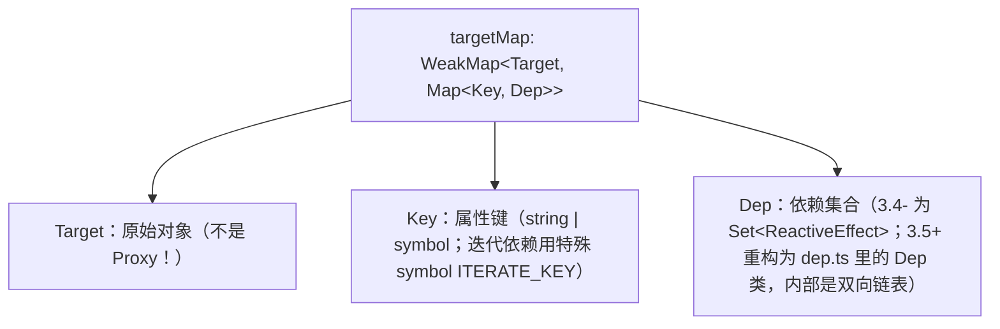
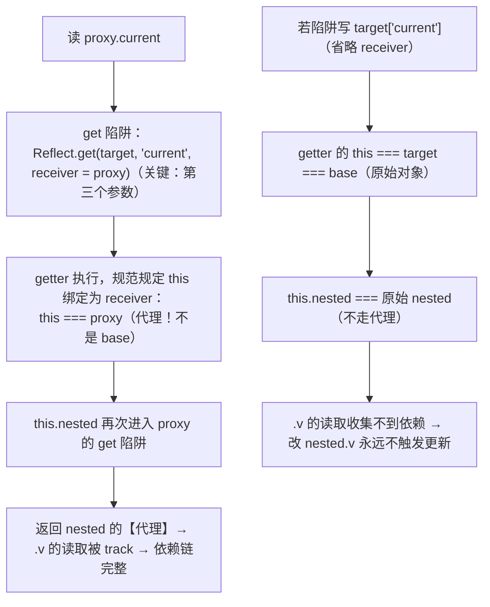

---
mdx:
  format: mdx
---
# 23 · 响应式源码阅读：@vue/reactivity 路线图

> 对应大纲：阶段 5 专题深入 —— 源码阅读：一个响应式库（Vue reactivity / signal 实现）

## 学习目标

1. 画出 `targetMap: WeakMap<Target, Map<Key, Dep>>` 的三层结构，讲清第一层为什么必须是 WeakMap
2. 逐个说明 Proxy get/set/deleteProperty/has/ownKeys 陷阱各自要 track/trigger 什么，以及 `Reflect + receiver` 如何保住「子代理 this」
3. 讲清 effect 的 activeEffect 栈、cleanup（分支切换防残留依赖：泄漏 + 重复触发两个后果）、scheduler（批量/nextTick/computed 三大支柱）
4. 讲清 computed 的 dirty 标志、缓存、「依赖变化只置脏不重算」的惰性求值链
5. 说清 ref 存在的原因（原始值无法代理）与 shallow 系列语义
6. 对比 Vue 的「拉」与 signal（Solid/Preact）的「推」：依赖图粒度差异与取舍
7. 按「推荐阅读顺序」能直接打开 vuejs/core 仓库对应文件读下去

配套练习：`exercises/reactivity/mini-reactivity.ts`（约 300 行手写迷你实现，文件头有**与源码的概念对照表**）+ `mini-reactivity.test.ts`（8 个用例锁定语义）。

## 关键概念

一手依据：Vue 官方文档《深入响应式系统》（Reactivity in Depth / Reactivity API）；GitHub 仓库 `vuejs/core/packages/reactivity/src/` 源码（下文引用文件名与函数名，不标行号——版本间会挪动；版本相关处以 v3.4/3.5 为参照并注明）。

### 1）总数据结构：targetMap



- **依赖挂在原始对象上，而不是 Proxy 上**：同一个 target 理论上可被多个代理包裹（reactive/readonly），以原始对象为键保证依赖索引全局唯一、O(1) 定位。
- **第一层为什么必须是 WeakMap**：① target 是**弱引用**键——原始对象在其他地方被销毁时，它名下的整棵依赖记录能被 GC 自动回收，响应式系统不会反过来「锁住」已废弃组件的数据（这是经典内存泄漏点）；② WeakMap 键只能是对象，天然排除原始值（原始值要走 ref，见 §4）。

### 2）reactive.ts + baseHandlers.ts：代理的建立与五个陷阱

`reactive(obj)` → `createReactiveObject()`：查 `proxyMap`（WeakMap 缓存，**同一 target 只包一次**，保证嵌套代理引用稳定）→ `new Proxy(target, mutableHandlers)`。陷阱实现在 baseHandlers.ts 的 `createGetter/createSetter/deleteProperty/has/ownKeys`。

| 陷阱 | 触发时机 | track | trigger 时机 |
| --- | --- | --- | --- |
| `get` | 读属性（含 getter 访问） | `track(target, 'get', key)` | — |
| `set` | 写属性 | — | `Reflect.set` 成功且 `hasChanged`（`Object.is` 判 false）才 `trigger(..., 'set', key)` |
| `has` | `key in obj` | track key（GET 型 HAS 依赖） | — |
| `ownKeys` | `Object.keys` / `for...in` / 展开等 | track **ITERATE_KEY**（symbol）：key 的「集合本身」被依赖了 | `add`/`delete` 属性时 trigger ITERATE_KEY——因为新增/删除会改变「有哪些 key」，影响一切迭代结果 |
| `deleteProperty` | `delete obj.k` | — | 删除成功且 key 原本存在才 trigger（DELETE 型，同时联动 ITERATE_KEY/length） |

「ownKeys 影响 iterate」举一反三：`for (const k in state)` 依赖的是 key 集合，所以「新增一个从未读过的属性」也会让它重跑——这不是 bug，是 ITERATE_KEY 的语义。

**Reflect + receiver：保住子代理 this 的经典细节**。场景（练习 `mini-reactivity.ts` 演示 5）：

```text
const base = { nested: { v: 1 }, get current() { return this.nested } }
const proxy = reactive(base)
effect(() => { log(proxy.current.v) })
```



一句话：**receiver 让 getter 里的 `this` 指向「最初发起读取的那个代理」，响应式因此能穿透 getter / 继承（super）链**。这也是 `Reflect` 与 `Proxy` 成对出现的原因——`Reflect.get(target, key, receiver)` 是唯一能手动指定 this 的读取原语。

**惰性嵌套代理**：get 到「对象类型的值」才递归 `reactive()` 包一层（配合 proxyMap 缓存）。不在创建时深遍历——大对象冷数据不会被白白包装；深层的对象永远不被读到就永远不进 targetMap。

**数组与 length（一句话）**：数组索引本质是 string key，但写 `arr[5]` 可能隐式改变 `length`，set 陷阱对数组索引写入与 `'length'` 写入做特判，联动触发 length 相关依赖；`for...of`/展开走的是数组的迭代器协议，同样落到 ITERATE_KEY。（Map/Set 则完全另一套 collectionHandlers.ts，用方法劫持替代 get/set——本笔记不展开。）

### 3）ref.ts：为什么原始值需要 ref

`new Proxy(3, {})` 直接抛 TypeError——**Proxy 的目标必须是对象**。原始值（number/string/boolean…）没有「属性槽位」可以挂陷阱，只能装进「盒子」：

```ts live noInline
class RefImpl<T> {
  get value() { trackRefValue(this); return this._value }
  set value(newVal) {
    if (hasChanged(newVal, this._rawValue)) { this._rawValue = newVal; this._value = toReactive(newVal); triggerRefValue(this) }
  }
}
```

- `.value` 的 get/set 就是手动版的 get/set 陷阱：读时收集、写时判变再触发；
- `toReactive`：`ref({a:1}).value` 拿到的内层对象自动是 reactive 代理（ref 默认深层）；
- `_rawValue` 存原始值（`Object.is` 判变，绕过 NaN !== NaN）、`_value` 存转换后的值。

**shallow 系列语义**：

| API | 响应的范围 |
| --- | --- |
| `reactive` | 深层：读到哪层代理到哪层 |
| `shallowReactive` | 只有根层属性读写被拦截；`.nested` 拿到的是**原始对象** |
| `ref` | `.value` 替换触发；内层对象自动 reactive（深层） |
| `shallowRef` | 只有 `.value = x` 触发；内层结构变化不跟踪（要手动 `triggerRef`） |
| `readonly` / `shallowReadonly` | 只 track 不 trigger（set 警告）；shallow 只封根层 |

用途：性能优化（大列表/第三方大对象不深代理）、对接不可变数据、明确「这层以下是外部世界」。

### 4）effect.ts：ReactiveEffect、activeEffect 栈、cleanup、scheduler

`effect(fn)` 包装出 `ReactiveEffect` 实例并**立即执行一次**。核心问题：「fn 执行期间的属性读取」怎么知道该记到哪个 effect 名下？——全局变量 `activeEffect`。

- **activeEffect 栈**（3.4- 的 `effectStack: ReactiveEffect[]`；3.5+ 重构为 `activeSub` + 双向链表，语义相同）：

  ```text
  effect(() => {            ← activeEffect = 外层
    const a = state.a       ← track 到外层名下
    effect(() => { state.b })  ← push：activeEffect = 内层；run 完 pop
    const c = state.c       ← 恢复 activeEffect = 外层，track 到外层名下 ✓
  })
  ```

  没有栈的话，内层 effect 跑完后 activeEffect 要么停留在内层（c 的依赖记错人）、要么变成 undefined（c 收集不到）——**嵌套恢复靠栈**。

- **cleanup：防分支切换的残留依赖**。看经典例子：

  ```ts
  const state = reactive({ ok: true, msg: 'A', alt: 'B' })
  effect(() => { use(state.ok ? state.msg : state.alt) })
  // 初次运行依赖 = {ok, msg}
  state.ok = false   // 重跑：真实依赖变成 {ok, alt}
  state.msg = 'X'    // ← 如果不做 cleanup，这次 set 仍会触发重跑！
  ```

  不做 cleanup 的两个后果：① **重复触发**：`msg` 的依赖集合里还留着本 effect，改 `msg` 触发无意义重跑（读到 alt，结果没变还浪费）；② **泄漏**：effect 反向被 dep 集合引用着，组件销毁后只要 target 活着，effect 与其闭包（往往挂着整个组件作用域）就回收不掉。解法：**每次 run 前先把 effect 从它记录的所有 dep 集合里删掉（cleanup），跑完按本轮真实读取重新收集**。3.4- 是 `cleanupEffect`；3.5+ 的 Dep 链表版本在 track 时自动断开同 key 旧边，思想一致。测试用例 4（分支切换后不再触发明分支）就是锁定这个语义。

- **scheduler：trigger 的「改道开关」**。`ReactiveEffect` 构造可传 `scheduler`；trigger 时有 scheduler 就不直接重跑 effect，改调 scheduler。三大支柱：
  1. **组件渲染批量化**：runtime-core 给渲染 effect 配 scheduler → `queueJob`：同一 tick 内多次 set 只入队一次，在微任务里 flush（`nextTick` 即这个 flush 的 Promise）——「改三个属性只渲染一次」的实现根基；
  2. **computed**：见 §5，scheduler 里只置脏 + 通知；
  3. **watch 定制**：watch 的回调跑在 scheduler 里，可以排队、防抖、批处理（`flush: 'post'` 等配置也经由调度实现）。

### 5）computed.ts：dirty 标志 + 缓存 + 只置脏不重算

`computed(getter)` 返回 `ComputedRefImpl` 实例，三件事配合：

1. **getter 跑在一个 lazy 的内部 effect 里**（不立即执行，首次读取才算）；
2. **scheduler 拦截依赖变化**：依赖 trigger 时**不重跑 getter**，只把 `dirty = true`，并 `triggerRefValue` 通知「读过我这个 computed 的外层 effects」；
3. **get value 时**：dirty 才重算（以内部 effect 身份运行，重新收集依赖），否则直接吐缓存值；同时把读 `.value` 的外层 effect track 到自己身上。

惰性求值链（面试高频，务必背下这条链而不是结论）：

```text
state.count 变
  → 内部 effect 的 scheduler：dirty = true（没有计算发生！）
  → 通知依赖 .value 的外层 effect 重跑
      → 外层重读 .value → 发现 dirty → 此刻才执行 getter
```

所以「computed 依赖变化」本身是廉价的；真正的计算推迟到「有人要结果」的那一刻。没人读的 computed 永远不算（lazy 的完整含义）。3.4 之后官方进一步用版本号/脏等级处理「computed 依赖 computed」的级联判定，核心思想不变。

### 6）Vue（拉）vs signal（推）：依赖图粒度

| | Vue reactivity | Solid / Preact signals |
| --- | --- | --- |
| 依赖建立 | effect（渲染函数）执行时**拉取**：读到什么依赖什么 | 每个 signal 节点记录**直接订阅者**，图在编译/首次求值时显式建立 |
| 更新传播 | 变更沿 target→dep→effects 推一跳到 effect，然后 **effect 整体重跑**（组件级：整个渲染函数 + VDOM diff 找变化） | 变更把新值沿依赖图**推**到每个精确的表达式/绑定，只更新绑定的 DOM 片段（节点级） |
| 粒度 | 组件级（靠 VDOM diff 收敛到 DOM 级） | 节点/表达式级（Solid 无 VDOM） |
| 取舍 | 任意命令式读取都自然工作，心智简单；代价是组件级重渲染 | 更新最优；代价是依赖关系要求静态可分析（模板编译期建图），动态依赖要靠显式 API |

一句话：**Vue 推到 effect 就停下、由 effect 拉着重算一切；signal 一路推到每个叶子节点**。Vue 的 Vapor Mode（无 VDOM、编译期细粒度）正是在吸收 signal 路线的优势（写作时仍在推进中）。

## 可运行示例

| 练习 | 覆盖点 | 运行 |
| --- | --- | --- |
| `exercises/reactivity/mini-reactivity.ts` | reactive（惰性嵌套/Reflect+receiver/deleteProperty）、effect（栈/cleanup/scheduler）、computed（dirty）——文件头有源码对照表 | `npx tsx exercises/reactivity/mini-reactivity.ts` |
| `exercises/reactivity/mini-reactivity.test.ts` | 8 个语义锁定用例（含分支切换 cleanup、computed 计数器证明缓存） | `npx vitest run exercises/reactivity/` |

## 易错点与面试高频

1. **「targetMap 挂在 Proxy 上」**——错。挂在原始对象上；这也是第一层用 WeakMap 的前提（原始对象被 GC，依赖记录随之回收）。
2. **依赖收集发生在「读」，触发发生在「写」**——`reactive(obj)` 本身不收集任何依赖（惰性）；只有 effect 跑起来读到属性那一刻才 track。
3. **set 时忘了判 `Object.is`**——值没变也 trigger → 无限循环（`obj.a = obj.a` 或 effect 内自写）；NaN 场景必须用 `Object.is`（`NaN === NaN` 为 false 但 `Object.is(NaN, NaN)` 为 true）。
4. **`obj.nested.x = 1` 为什么能触发**——不是「深层 set 被拦截」，而是 `.nested` 读取时已返回内层代理，set 发生在内层代理上。
5. **「computed 依赖变化会立刻重算」**——错。只置脏 + 通知；重算推迟到下一次读取（lazy 链，见 §5）。
6. **getter 里 this 指向**——`Reflect.get(target, key, receiver)` 少传 receiver 是响应式「莫名不更新」的一号嫌疑（§2 场景图）。
7. **effect 内 `state.count++`**——trigger 会跳过当前 activeEffect（防自触发无限递归），mini 版与源码同款处理。
8. **ref vs reactive 选择题**——原始值/整体替换用 ref；对象图/属性级更新用 reactive；`shallowRef` 包大对象 + 手动 `triggerRef` 是性能逃生门。

## 输出预测题

### 题 1（分支切换与 cleanup）

用 mini-reactivity 的语义（与 @vue/reactivity 一致）：

```ts
const state = reactive({ ok: true, msg: 'A', alt: 'B' });
let shown = '';
let runs = 0;
effect(() => {
  runs += 1;
  shown = state.ok ? state.msg : state.alt;
});
state.msg = 'A2';
console.log(1, shown, runs);
state.ok = false;
console.log(2, shown, runs);
state.msg = 'A3';
console.log(3, shown, runs);
```

三次输出各是什么？第 3 次为什么？

### 题 2（computed 的惰性求值链）

```ts
const state = reactive({ n: 1 });
let runs = 0;
const ten = computed(() => {
  runs += 1;
  return state.n * 10;
});
console.log(ten.value, runs);
console.log(ten.value, runs);
state.n = 2;
console.log(runs);
console.log(ten.value, runs);
```

四行输出各是什么？

## 预测题答案

### 题 1

```
1 A2 2
2 B 3
3 B 3
```

逐步：① 初次执行 runs=1，依赖 \{ok, msg\}，shown='A'；② `msg='A2'` 触发重跑（runs=2），仍走真分支，shown='A2'；③ `ok=false` 重跑（runs=3），**先 cleanup 清掉 msg 的旧依赖**，改走假分支，shown='B'；④ `msg='A3'`——msg 的 dep 里已经没有这个 effect，不重跑：runs 停在 3，shown 仍是 'B'。一句话：**cleanup 保证依赖集合永远等于「最近一次执行真实读取过的属性」**；没有它，第 3 行会是 `B 4`（无意义重跑）且 effect 无法随组件销毁回收。

### 题 2

```
10 1
10 1
1
20 2
```

逐步：① 首次读取：dirty → 执行 getter（runs=1），缓存 10；② 再读：缓存命中，runs 不变；③ `n=2`：内部 effect 的 scheduler 只置脏 + 通知 `.value` 订阅者，**没有计算发生**，runs 仍是 1；④ 再读：发现 dirty，重算（runs=2）得 20。一句话：**「置脏不重算、读取才重算」**——computed 的廉价依赖变化全靠这条惰性链。

## 延伸阅读

- Vue 官方文档《深入响应式系统》《Reactivity API: shallowRef / computed / effectScope》
- vuejs/core 仓库 `packages/reactivity/src/`（按下述顺序读）
- **推荐阅读顺序**（先数据结构与枚举，后机制，最后专项）：
  1. `operations.ts` —— `TrackOpTypes`/`TriggerOpTypes` 枚举：先知道「有哪些操作」
  2. `reactive.ts` + `baseHandlers.ts` —— reactive 的建立：proxyMap、createReactiveObject、createGetter/createSetter/deleteProperty/has/ownKeys
  3. `effect.ts` —— track/trigger、`ReactiveEffect`、activeEffect 栈与 cleanup、scheduler 分支
  4. `ref.ts` —— `RefImpl` 的 get/set value、`toReactive`、shallowRef
  5. `computed.ts` —— `ComputedRefImpl` 的 dirty 与 scheduler
  6. `collectionHandlers.ts` —— Map/Set 的方法劫持（另一套陷阱思路）
  7. `dep.ts`（3.5+）—— Dep/Sub 双向链表重构：cleanup 与级联通知的链表化
- Solid 文档《Reactivity》与 preactsignals 文档 —— 对照「推」模型
- 《Vapor Mode》RFC/讨论（vuejs/core-vapor 仓库）—— Vue 对 signal 路线的回应

---

## 替换清单（ASCII 图 → Mermaid）

| 原 ASCII 图位置/标题 | Mermaid 图表类型 |
| --- | --- |
| §1）总数据结构：targetMap（WeakMap/Map/Dep 层级注释图） | flowchart (TD) |
| §2）Reflect + receiver 场景（正例/反例两条调用链；块首 3 行示例代码保留为 text 块） | flowchart (TD) |


## 附：响应式实现的四层谱系速查（收尾增补）

源码读到这里（Vue 的 Reflect 依赖收集、块的订阅链），收尾把本册读到的机制放进响应式实现的完整谱系——四层从粗到细，各有取舍：

| 层 | 代表 | 依赖追踪粒度 | 更新传播 | 本册读到的部分 |
|---|---|---|---|---|
| 全量重渲染 | React（ Fiber） | 无追踪（整组件树重算） | vdom diff | 对照组（react 站专册，见仓库 react/ 目录） |
| 脏检查 | Angular 旧版 | 无追踪（digest 轮询） | 多轮收敛 | 历史注脚 |
| 按组件级订阅 | Vue 2 | 组件级 watcher | 组件重渲 | §1 的前身 |
| 按属性级订阅 | Vue 3 / Solid / Preact Signals | **属性级**（Proxy/get 拦截） | 精确直达 effect | 本册正文 |

谱系的读法：**追踪粒度每细一层，"无效工作"就少一个量级，机制复杂度加一层**（Proxy 拦截、订阅链管理、更新调度）。本册源码读的正是最细层的实现代价：Reflect 要 receiver 对齐、数组方法要劫持、块订阅要去重——这些"麻烦"就是粒度红利的价签。

### 收尾自测（增补）

1. 表中四层各自的"无效工作"是什么？从全量重渲染到属性级订阅，无效工作怎么一步步消失？
2. Vue 3 用 Proxy 替代 Vue 2 的 defineProperty——对应谱系表里哪一层的升级？解决了哪两类追踪盲区？（新增属性/数组索引）
3. 你在用的状态库在哪一层？它的"细"换来了什么、付出了什么？

谱系表再补最后一行用法提示：**选库先选层**——业务形态决定层位：重交互表单（细粒度层收益最大）、大列表渲染（全量重渲染 + memo 反而简单可控）、低频管理后台（任何层都够，团队熟悉度优先）。层位选错是响应式性能问题的第一根因，比任何微观调优都值钱。

### 收尾一句话（增补）

响应式的本质是**把"哪部分界面依赖哪部分数据"显式化**——四层谱系就是四种显式化的精度档位，源码阅读读的是最高档位的实现代价，选型时读的是哪一档配得上你的业务。

## 精读补遗一：dep.ts——Dep 与 Link 的双向链表（v3.5.13 实录）

本册正文按 3.4 的「Set 集合」讲 Dep，这里补 3.5 重构后的真实形态。以下引文全部出自 `vuejs/core` tag `v3.5.13` 的 `packages/reactivity/src/dep.ts`（为省篇幅去掉 `__DEV__` 调试分支，主干原样保留）。`Link` 是 dep 与订阅者之间那条边的对象化——正反两条链共用一批节点：

```ts
export class Link {
  version: number
  nextDep?: Link   // 订阅者的依赖链（effect 的 deps 表）
  prevDep?: Link
  nextSub?: Link   // 依赖的订阅链（dep 的 subs 表）
  prevSub?: Link
  prevActiveLink?: Link
  constructor(public sub: Subscriber, public dep: Dep) {
    this.version = dep.version
    // 五根指针全部置 undefined
  }
}

export class Dep {
  version = 0
  activeLink?: Link = undefined
  subs?: Link = undefined          // 订阅链（尾）
  sc: number = 0                   // 订阅计数
  constructor(public computed?: ComputedRefImpl | undefined) {}
}
```

读这张结构的三个要点：

1. **一节 Link 同时活在两条链上**——挂在 sub（effect）的 `deps` 链上，也挂在 dep 的 `subs` 链上。cleanup 时摘一个节点等于同时从两边注销，这正是 3.4 里「Set 与反向 Set」合体的链表版。
2. **`version` 是 cleanup 的标记位**：每次 run 前（`prepareDeps`）把该订阅者全部旧 Link 的 version 置 -1；track 时复用旧 Link 并同步成 dep 的当前 version；run 后（`cleanupDeps`）version 仍是 -1 的 Link 就是「本轮没读过」的死边，双双摘除。§4 讲的 cleanup 语义，3.5 的实现从「遍历 dep 集合删除」变成了「版本标记筛选」——意图不变，复杂度从遍历 dep 变成只动链表节点。
3. **`targetMap` 的建账仍是惰性的**（与 3.4 一致）：

```ts
export function track(target: object, type: TrackOpTypes, key: unknown): void {
  if (shouldTrack && activeSub) {
    let depsMap = targetMap.get(target)
    if (!depsMap) {
      targetMap.set(target, (depsMap = new Map()))
    }
    let dep = depsMap.get(key)
    if (!dep) {
      depsMap.set(key, (dep = new Dep()))
      dep.map = depsMap   // 反向指回所在 Map，供「无订阅者时删账」用
      dep.key = key
    }
    dep.track()
  }
}
```

`trigger` 侧（同一文件）：`dep.trigger()` 只做三件事——`version++`、`globalVersion++`（模块级全局版本号，供 computed 走快路径，见补遗三）、`notify()`；`notify` 用 `startBatch/endBatch` 包住「沿 `subs` 链从尾向头逐个 `link.sub.notify()`」的通知过程。另有一个内存优化值得记住：`removeSub` 里当某属性 dep 的订阅计数 `sc` 归零时，会把它从 `depsMap` 里删掉（源码注释引用 issue #11979）——「对象长期存活、但只有部分属性被间歇 track」的场景不会积累死账。

## 精读补遗二：effect.ts——run 的五步与批量刷新队列

引文出自同 tag 的 `packages/reactivity/src/effect.ts`。`ReactiveEffect.run` 是整册最核心的十行：

```ts
run(): T {
  if (!(this.flags & EffectFlags.ACTIVE)) {
    return this.fn()   // 已 stop：裸跑，不收集
  }
  this.flags |= EffectFlags.RUNNING
  cleanupEffect(this)        // 用户级 onEffectCleanup 函数
  prepareDeps(this)          // 旧 Link 全部置 version = -1（待定标记）
  const prevEffect = activeSub
  const prevShouldTrack = shouldTrack
  activeSub = this           // 3.5 的「栈顶」就这一个变量
  shouldTrack = true
  try {
    return this.fn()
  } finally {
    cleanupDeps(this)        // 摘除 version 仍为 -1 的死边
    activeSub = prevEffect   // 恢复外层
    shouldTrack = prevShouldTrack
    this.flags &= ~EffectFlags.RUNNING
  }
}
```

对照 §4：3.4 的 `activeEffect` 栈在这里退化成「一个 `activeSub` 加 `prevEffect` 保存恢复」——嵌套恢复的正确性不再需要数组，函数调用栈天然就是那个栈。cleanup 拆成了两层：`cleanupEffect` 跑用户注册的清理函数（历史 API），`prepareDeps/cleanupDeps` 负责依赖边的版本标记筛选，两件事在 3.4 里都堆在 cleanupEffect 名下。

**触发侧的三个新细节**（同文件）：

```ts
trigger(): void {
  if (this.flags & EffectFlags.PAUSED) {
    pausedQueueEffects.add(this)
  } else if (this.scheduler) {
    this.scheduler()
  } else {
    this.runIfDirty()   // 3.5：普通触发也先查脏，版本没变就不跑
  }
}
```

其一，无 scheduler 的普通 effect 也**不再直接重跑**，而是 `runIfDirty`——沿自己的 deps 链逐个比较 `link.version` 与 `dep.version`，全等就免跑。其二，`notify()` 遇到自身 `RUNNING` 且未开 `ALLOW_RECURSE` 直接 return，这是 §易错点 7「effect 内自写不无限递归」在 3.5 的实现位（mini 版用「effectsToRun 排除 activeEffect」表达同一意图）。其三，`batch/endBatch` 维护**两条队列**：`batchedComputed` 先清标志（只置脏不执行），`batchedSub` 再逐个 `trigger()`——computed 的「下传」与 effect 的「执行」被拆成两个阶段，同一轮 set 里多次赋值只触发一轮执行。

## 精读补遗三：computed.ts 与 refreshComputed——两级版本号

引文出自 `packages/reactivity/src/computed.ts` 与 `effect.ts` 的 `refreshComputed`。`ComputedRefImpl` 的字段里有三处「初值即机关」：

```ts
export class ComputedRefImpl<T = any> implements Subscriber {
  _value: any = undefined
  readonly dep: Dep = new Dep(this)   // 把自己作为 computed 传进 Dep
  flags: EffectFlags = EffectFlags.DIRTY            // 初始即脏：首读必须真算
  globalVersion: number = globalVersion - 1         // 故意错位：首读绕不过快路径
```

`get value` 只有三步：`this.dep.track()`（把读 `.value` 的外层 effect 挂到 computed 自己的 dep 上）→ `refreshComputed(this)`（保证值新鲜）→ 同步 `link.version` 并返回 `_value`。真正的账在 `refreshComputed`，四道闸门按序过：

```ts
export function refreshComputed(computed: ComputedRefImpl): undefined {
  if (computed.flags & EffectFlags.TRACKING && !(computed.flags & EffectFlags.DIRTY)) {
    return                                   // 闸门一：没脏不算
  }
  computed.flags &= ~EffectFlags.DIRTY
  if (computed.globalVersion === globalVersion) {
    return                                   // 闸门二：全局无任何变更，快路径
  }
  computed.globalVersion = globalVersion
  const dep = computed.dep
  if (dep.version > 0 && !computed.isSSR && computed.deps && !isDirty(computed)) {
    return                                   // 闸门三：逐边查版本，全等不重算
  }
  activeSub = computed                       // 以 computed 身份跑 getter（重新收集依赖）
  try {
    prepareDeps(computed)
    const value = computed.fn(computed._value)
    if (dep.version === 0 || hasChanged(value, computed._value)) {
      computed._value = value
      dep.version++                          // 闸门四之后：结果真变了才推进自己的版本
    }
  } finally {
    cleanupDeps(computed)
    activeSub = prevSub
  }
}
```

对照 §5 的惰性链，3.5 把「只置脏不重算」升级成两级：依赖变化时 `notify` 只把 `flags |= DIRTY` 并下传通知（computed 的 `notify` 返回 true，`Dep.notify` 里就地再 `dep.notify()` 通知下游，源码注释写明这是为减少调用栈深度）；真正重算推迟到读取，读取还要过三道闸门。而闸门四的 `hasChanged` 是「依赖变化但计算结果不变时，下游不重跑」的根基——getter 产出与缓存相同就不推进 `dep.version`，下游 `isDirty` 逐边比较时版本全等，整段下游直接免跑。3.4 的布尔 `dirty` 表达不了这个语义（置脏必然导致重算），这正是重构的动机。SSR 分支（`isSSR`）绕过闸门三强制重算，因为服务端没有渲染 effect、computed 无订阅者，脏检查无从谈起。

## 精读补遗四：baseHandlers.ts——set 的三个判定细节

引文出自同 tag 的 `packages/reactivity/src/baseHandlers.ts`（`MutableReactiveHandler.set`）。正文 §2 的表格给了骨架，这里补三个容易读漏的判定：

```ts
set(target, key, value, receiver) {
  let oldValue = target[key]
  if (!this._isShallow) {
    if (!isArray(target) && isRef(oldValue) && !isRef(value)) {
      // 旧值是 ref、新值不是：直接改 ref 的 .value，而不是替换属性
      oldValue.value = value
      return true
    }
  }
  const hadKey = isArray(target) && isIntegerKey(key)
    ? Number(key) < target.length   // 数组索引：比 length 判新旧
    : hasOwn(target, key)
  const result = Reflect.set(target, key, value, isRef(target) ? target : receiver)
  if (target === toRaw(receiver)) {  // 只有「归属代理」的写入才触发
    if (!hadKey) {
      trigger(target, TriggerOpTypes.ADD, key, value)
    } else if (hasChanged(value, oldValue)) {
      trigger(target, TriggerOpTypes.SET, key, value, oldValue)
    }
  }
  return result
}
```

1. **ref 旧值解包**：给「值为 ref 的属性」赋普通值，走的是 `oldValue.value = value`（改 ref 内部）而不是替换属性——这就是「reactive 对象里 ref 自动解包」在写方向的实现。非数组限定是因为数组元素不解包（正文 §2 的 ref unwrapping 同款例外）。
2. **ADD 与 SET 的分界**决定触发哪些依赖：新增走 ADD（会联动 ITERATE_KEY，见 dep.ts trigger 的 switch 分支），覆盖走 SET（只触发本 key）。数组索引用「索引小于 length」判新旧，等价于 hasOwn 但免去一次属性查找。
3. **`target === toRaw(receiver)` 才 trigger**：拦截的是「在继承代理上写父对象属性」的场景——此时 set 陷阱的 receiver 是上游代理而非自己的代理，`toRaw` 解包后不相等，跳过触发；真正的触发由 receiver 所属的那层代理完成，避免一次写入两次 trigger。

同文件还有一个对正文表格的**补正**：`ownKeys` 对数组 track 的不是 ITERATE_KEY 而是 `'length'`——

```ts
ownKeys(target) {
  track(target, TrackOpTypes.ITERATE, isArray(target) ? 'length' : ITERATE_KEY)
  return Reflect.ownKeys(target)
}
```

配套地，dep.ts 的 trigger 里有专门的 length 分支：写 `length` 时遍历 depsMap，把 `length` 自身、`ARRAY_ITERATE_KEY`、以及所有「大于等于新 length 的索引」的 dep 全部触发（缩短数组会杀掉尾部元素，这些索引的依赖必须失效）。正文 §2「数组与 length」一段的「特判」，在 3.5 里精确落在这两处。`ARRAY_ITERATE_KEY`（`dep.ts` 定义，与 ITERATE_KEY、MAP_KEY_ITERATE_KEY 并列的第三个 symbol）是 `for...of`/展开专用的数组迭代依赖。

## 精读补遗五：ref.ts 的 3.5 形态——RefImpl 同样换装 Dep

正文 §3 贴的是 3.4 形态（`trackRefValue/triggerRefValue`）。3.5 里 `RefImpl` 与全局响应式共用同一套 Dep：

```ts
class RefImpl<T = any> {
  _value: T
  private _rawValue: T
  dep: Dep = new Dep()

  get value() {
    this.dep.track()
    return this._value
  }
  set value(newValue) {
    const oldValue = this._rawValue
    const useDirectValue =
      this[ReactiveFlags.IS_SHALLOW] || isShallow(newValue) || isReadonly(newValue)
    newValue = useDirectValue ? newValue : toRaw(newValue)
    if (hasChanged(newValue, oldValue)) {
      this._rawValue = newValue
      this._value = useDirectValue ? newValue : toReactive(newValue)
      this.dep.trigger()
    }
  }
}
```

与 §3 的语义清单逐条对上：`.value` 读时收集、写时 `hasChanged`（内部即 `!Object.is`，`@vue/shared` 出品）判变再触发；`toRaw/toReactive` 维持 `_rawValue`（原始值）与 `_value`（代理化值）双份存储。新增的精确细节是 `useDirectValue` 的三个条件——shallow 自身、新值是 shallow、新值是 readonly 时直接存（不代理化）：readonly 对象不该被复制成可写代理，shallow 语义不该被 ref 的深层默认悄悄覆盖。读到这里可以合上正文 §3 与 §4 的断言：3.5 之后 ref、reactive、computed 三者共用 Dep/Link 一套底座，「三种响应式原语、两套记账结构」的说法在 3.5 已不成立。

## 精读补遗六：工程三陷阱（源码对齐版）

**陷阱一：把「依赖变了必触发下游」当成铁律。** 3.5 的 computed 是「结果变了才下传」（补遗三闸门四），副作用是：下游 effect 读 computed 时，若两次读取间 getter 结果恰好相同，effect 不重跑——若下游效果依赖「调用次数」而非值（计数器、日志），会少跑。跨实现核对语义时尤其小心：mini 版的布尔 dirty 语义没有这道闸门，同样代码两个实现跑出的次数不同。修复思路：次数敏感的逻辑移出 computed 读取链，或显式用 ref 记录。

**陷阱二：手写 set 用 `!==` 或 `===` 判变。** 正文易错点 3 的源码级呼应：Vue 全库统一用 `hasChanged`（`!Object.is`）。用 `===` 时 `NaN = NaN` 赋值会误触发，`+0 = -0` 会漏触发（`Object.is` 区分 ±0 而 `===` 不区分）。修复：判变一律 `!Object.is(a, b)`，与官方保持同一个函数。

**陷阱三：在「祖先代理」上写字对象属性，期望触发却没触发。** 场景：`const child = Object.create(reactiveParent)` 后写 `child.x = 1`（x 定义在 parent 上）。set 陷阱的 receiver 是 child 所属的代理，`target === toRaw(receiver)` 不成立，这一层不触发——触发交给归属层完成。若你的包装层又手动 `Reflect.set(parent, ...)` 二次写入，就可能真的双触发或零触发。修复：写入永远走「归属对象的那层代理」；包装层不要代写。

## 精读补遗七：手推配方——v3.5 名词版全链路推演

把本册核心场景用 3.5 的真实函数名推一遍（与 §补遗一至四互为索引）：

```text
初始：reactive({ n: 1 }) → createReactiveObject → proxyMap 无记录 → new Proxy(target, mutableHandlers)
     effect(fn) → new ReactiveEffect(fn) → runner = e.run.bind(e) → e.run()

读 state.n（fn 内）：
  get 陷阱 → track(target, 'get', 'n')
    → targetMap 建 depsMap、new Dep
    → Dep.track：new Link(activeSub, dep) → 挂 sub.deps 尾部 + addSub 挂 dep.subs（sc=1）

写 state.n = 2：
  set 陷阱 → hadKey 为 true → Reflect.set → hasChanged(2, 1) 成立
    → trigger(target, 'set', 'n', 2, 1)
    → Dep.trigger：version++、globalVersion++ → notify
    → startBatch → 沿 subs 链：link.sub.notify()
      → ReactiveEffect.notify：无 RUNNING 冲突 → batch(this) 入 batchedSub 队列
    → endBatch（计数归零）→ 队列逐个 e.trigger()
      → 无 scheduler → runIfDirty → isDirty：dep.version !== link.version → true
      → run()：prepareDeps 置 -1 → activeSub = this → fn 重跑 → cleanupDeps 摘死边
```

推演时自查三处易断点：activeSub 是否在 fn 执行前挂好（否则收集不到）；isDirty 比较的是「边上的旧版本 vs dep 的新版本」（不是值比较）；endBatch 的队列先 computed 后 effect（顺序错了会出现用旧 computed 值渲染的脏读）。能把这十二行名词推演口播到底，源码阅读就算通关。

## 精读补遗八：输出预测题（题 3、题 4，附解析）

**题 3（判变语义）**：用 mini-reactivity 语义（对齐 `hasChanged` 实现），以下输出什么？

```ts
const state = reactive({ n: 1 });
let runs = 0;
effect(() => { runs += 1; void state.n; });
state.n = 1;
state.n = 2;
state.n = 2;
console.log(runs);
```

**答案**：`2`（本仓库 mini-reactivity 实跑收据，`npx tsx` 直跑）。逐步：初次执行 runs=1；`n = 1` 与旧值 `Object.is` 相等不触发；`n = 2` 触发重跑 runs=2；再赋 `2` 又不触发。机制出处：mini 版 set 的 `!Object.is(oldValue, value)`（第 185 行附近）对应 Vue `@vue/shared` 的 `hasChanged`——判变是 `Object.is` 不是 `===`，NaN 与正负零两处行为因此不同（正文易错点 3）。延伸：任何「写后必然读」的调试日志放在 effect 里时要记得同值写不进循环。

**题 4（自写自读）**：

```ts
const state = reactive({ n: 1 });
let runs = 0;
effect(() => { runs += 1; state.n += 1; });
console.log(runs, state.n);
```

**答案**：`1 2`（同上，实跑收据）。逐步：初次执行 runs=1，读取 `state.n`（收集依赖）后写回 2；这次 set 在**自己执行期间**发生，trigger 排除当前活跃 effect，不重跑——运行停在 n=2。机制出处：mini 版的 `if (fn !== activeEffect) effectsToRun.add(fn)`；3.5 源码对应 `ReactiveEffect.notify` 里 `RUNNING` 且未开 `ALLOW_RECURSE` 即返回（补遗二）。两版意图一致：没有这道闸，`n += 1` 自己触发自己，无限递归。延伸：真需要自写循环推进时，用 `triggerRef`/手动 `runner()` 这类「显式驱动」，别指望关掉闸门。

## 精读补遗九：reactive.ts——createReactiveObject 的四道闸门

引文出自同 tag 的 `packages/reactivity/src/reactive.ts`。`reactive/readonly/shallowReactive/shallowReadonly` 四个入口全部汇到 `createReactiveObject`，它按序过四道闸门：

```ts
function createReactiveObject(target, isReadonly, baseHandlers, collectionHandlers, proxyMap) {
  if (!isObject(target)) return target            // 闸门一：非对象直接返回
  if (target[ReactiveFlags.RAW] && !(isReadonly && target[ReactiveFlags.IS_REACTIVE])) {
    return target                                  // 闸门二：已是代理，原样返回
  }
  const existingProxy = proxyMap.get(target)
  if (existingProxy) return existingProxy          // 闸门三：同一 target 已包过
  const targetType = getTargetType(target)
  if (targetType === TargetType.INVALID) return target  // 闸门四：不可代理类型
  const proxy = new Proxy(target,
    targetType === TargetType.COLLECTION ? collectionHandlers : baseHandlers)
  proxyMap.set(target, proxy)
  return proxy
}
```

正文 §2 说「同一 target 只包一次」，这里补全精确语义。闸门二与闸门三都防止重复包装，但键不同：闸门二检查的是**入参本身**是不是代理（读它的 `RAW` 标记属性），闸门三查的是 proxyMap 里有没有**这个原始对象**的记录。两者的组合产生一个重要特例：`readonly(reactive(obj))` 不走「原样返回」——条件里 `isReadonly && IS_REACTIVE` 的例外放行，让 readonly 包一层 reactive 代理，得到「外层只读、内层可写」的组合（读走 readonly 陷阱并向下转 readonly，写经由内层 reactive 生效，两套行为叠加在同一数据上）。另外每个入口各带一张专属 proxyMap（reactiveMap、readonlyMap、shallowReactiveMap、shallowReadonlyMap）——「同一个对象被 reactive 和 readonly 各包一次」是合法且必要的，因为两张缓存互不干扰；`isProxy` 只查 `RAW` 标记，四种代理都算。

## 精读补遗十：arrayInstrumentations.ts——数组方法劫持的三个动机

正文 §2 的「数组与 length」一句话带过了方法劫持，v3.5 的 `packages/reactivity/src/arrayInstrumentations.ts`（328 行）值得专门一读。劫持分三组，各有独立动机：

**第一组：身份敏感的查找方法**（includes、indexOf、lastIndexOf）。 motives 写在 `searchProxy` 里：

```ts
function searchProxy(self, method, args) {
  const arr = toRaw(self)
  track(arr, TrackOpTypes.ITERATE, ARRAY_ITERATE_KEY)
  const res = arr[method](...args)          // 先用原实参（可能是代理）找一遍
  if ((res === -1 || res === false) && isProxy(args[0])) {
    args[0] = toRaw(args[0])                // 找不到且实参是代理：换原始值再找一遍
    return arr[method](...args)
  }
  return res
}
```

动机：数组内部存的是**原始值**，而调用方手里的是**代理**——`reactive(arr).includes(reactive(obj))` 直接比会因引用不等而误判「不存在」。双查询（先代理后原始）是纯工程补丁，一次没找到可能多跑一遍遍历。同时注意 `track` 的是 `ARRAY_ITERATE_KEY`：indexOf 这类「可能扫全数组」的方法，按最坏情况记全量迭代依赖。

**第二组：遍历类方法**（forEach、map、every、find 一族，经 `apply` 收口）。统一做三件事：转原始数组再调原生方法（内层循环不再每步过陷阱）、track 全量迭代依赖（`shallowReadArray` 里那一行）、按需包回代理——回调拿到的 item 用 `toReactive` 转换，第三个参数（数组本身）传**代理** `self` 而不是原始数组，保持「回调里看到的数组与调用方一致」。源码里 `#11759` 分支处理用户自定义 Array 子类的方法（方法不在 Array.prototype 上时不做处理），是防御性兼容的样本。

**第三组：改长度的写方法**（push、pop、shift、unshift、splice）经 `noTracking` 收口：

```ts
function noTracking(self, method, args = []) {
  pauseTracking()
  startBatch()
  const res = (toRaw(self))[method].apply(self, args)
  endBatch()
  resetTracking()
  return res
}
```

动机写在源码注释引用的 issue #2137：push 内部读 `length` 再写回，若 length 被当前 effect track 住，「读 length 收集依赖、写 length 触发自己」就是无限循环。解法是调用期间 `pauseTracking`（`shouldTrack` 压栈置 false——effect.ts 末尾的 trackStack 那四个函数）加批量。这解释了一个易错点：**push 不触发「依赖 length」的 effect 吗？** 触发照常发生（写 length 的 trigger 不受影响），只是 push 自己执行期间不收集——被 track 住的是「读 length 的那个 effect」，push 之后它照常重跑。

## 精读补遗十一：collectionHandlers.ts——Map/Set 为什么必须换路线

引文出自同 tag 的 `packages/reactivity/src/collectionHandlers.ts`。正文 §2 说 Map/Set「用方法劫持替代 get/set」，这里给出精确原因与实现形态。**原因在规范**：Map/Set 的数据不在普通属性槽位里，Proxy 的 get/set 陷阱拦不到内部槽操作（ECMA-262 的 Map.prototype.get 不经过属性访问），且很多方法要求 `this` 是真 Map（内部槽校验），拿代理当 this 会直接 TypeError。所以路线换成：Proxy 的 get 陷阱只拦截**方法名**，返回劫持版函数：

```ts
get(this: MapTypes, key: unknown) {
  const target = this[ReactiveFlags.RAW]
  const rawTarget = toRaw(target)
  const rawKey = toRaw(key)
  if (!readonly) {
    if (hasChanged(key, rawKey)) track(rawTarget, TrackOpTypes.GET, key)
    track(rawTarget, TrackOpTypes.GET, rawKey)     // 原始 key 与代理 key 各记一笔
  }
  const { has } = getProto(rawTarget)
  if (has.call(rawTarget, key)) return wrap(target.get(key))
  else if (has.call(rawTarget, rawKey)) return wrap(target.get(rawKey))
  // …
}
```

三个读点：其一，`this[ReactiveFlags.RAW]` 拿原始 Map 再操作——方法都作用在原始对象上，避开内部槽校验；其二，键是原始值，但调用方可能用代理键存取，所以 key 与 rawKey **各 track/查一笔**（和数组的双查询同一动机）；其三，迭代方法（`createIterableMethod`）track 的是 ITERATE_KEY 或 MAP_KEY_ITERATE_KEY（Map 的 keys() 专用，dep.ts 里定义的第二个 symbol），返回手动包装的迭代器——值按 shallow/readonly/reactive 三种策略 wrap。写方法（set/add/delete/clear）同理由劫持函数手写 trigger：`has` 判新旧走 ADD/SET 分岔，clear 触发整个 depsMap（dep.ts trigger 的 CLEAR 分支）。读 Map/Set 相关断言时，把「方法调用」当作「属性读加函数调用」的合成物来推理即可。

## 精读补遗十二：effectScope.ts——组件卸载即作用域注销

引文出自同 tag 的 `packages/reactivity/src/effectScope.ts`。正文 §4 讲泄漏时说「effect 反向被 dep 引用，需要 stop」，这里补上「谁负责批量 stop」的机制——`EffectScope`：

```ts
constructor(public detached = false) {
  this.parent = activeEffectScope
  if (!detached && activeEffectScope) {
    this.index = (activeEffectScope.scopes || (activeEffectScope.scopes = [])).push(this) - 1
  }
}
run<T>(fn: () => T): T | undefined {
  if (this._active) {
    const currentEffectScope = activeEffectScope
    try {
      activeEffectScope = this
      return fn()
    } finally {
      activeEffectScope = currentEffectScope
    }
  }
}
stop(fromParent?: boolean): void {
  // 遍历 effects 逐个 stop → 跑 cleanups → 递归 stop 子作用域 → 从父 scopes 摘除
}
```

与补遗二呼应的那一行在 `ReactiveEffect` 的构造器里：`if (activeEffectScope && activeEffectScope.active) { activeEffectScope.effects.push(this) }`——**effect 创建时自动登记进当前活跃作用域**，与 `activeSub` 的 track 自动收集互为镜像：一个管「我依赖谁」，一个管「谁负责回收我」。`run` 的时序结构与 `ReactiveEffect.run` 完全同构（保存、换入、try/finally 恢复），`activeEffectScope` 就是作用域版的 activeSub。stop 的最后一段值得细读：非 detached 的作用域销毁时用 `pop + index 回填` 做 O(1) 从父数组摘除（swap-remove 技巧）。组件卸载时 runtime-core 停掉组件的渲染 effect 所在的作用域，整棵 effect/computed/子作用域树一并注销——正文 §4 说的「cleanup 防泄漏」在框架层由这条链兜底。

## 精读补遗十三：输出预测题（题 5、题 6，附解析）

**题 5（嵌套代理的引用稳定性）**：用 mini-reactivity 语义，以下输出什么？

```ts
const state = reactive({ nested: { v: 1 } });
console.log(state.nested === state.nested);
```

**答案**：`true`（本仓库 mini-reactivity 实跑收据）。逐步：第一次读 `state.nested`，get 陷阱拿到原始内层对象、惰性调 `reactive()` 包装——proxyMap 以**原始内层对象**为键缓存代理；第二次读取查同一张表命中缓存，返回同一个代理。注意缓存键是内层**原始对象**而非「读取路径」——从另一个代理对象读到同一个内层对象，拿到的仍是同一代理（这也是 `proxyMap` 必须是 WeakMap 的第二个理由：内层对象随外层一起可被 GC）。反例陷阱：若手写实现把缓存键写成属性路径字符串，两条路径读到同一对象会产出两个代理，`===` 与依赖记录全部失配。

**题 6（重复包裹与 RAW 门）**：Vue 3.5 源码语义下，`reactive(reactive(obj))` 与 `readonly(reactive(obj))` 各返回什么？依据哪道闸门？

**答案**（手推加源码依据，v3.5.13 `createReactiveObject`，见补遗九）：`reactive(reactive(obj))` 返回**内层那个代理本身**——入参已是代理，闸门二读到 `RAW` 标记直接原样返回；`readonly(reactive(obj))` 返回**新的 readonly 代理**——闸门二的条件里 `isReadonly && IS_REACTIVE` 是例外放行，允许 readonly 包 reactive，形成「外层只读、内层可写」的组合。解析：两道闸门的分工——闸门二问「入参是不是代理」，闸门三问「这个原始对象包过没有」；`reactive(p) === p` 是闸门二的结论，而「同一原始对象既被 reactive 又被 readonly 各包一份」是闸门三按入口专属 proxyMap 得出的合法结论。延伸一问自测：`toRaw(readonly(reactive(obj)))` 返回什么？（返回 obj——`toRaw` 沿 `RAW` 标记递归解到底，reactive.ts 源码里它的实现只有三行。）

### 精读补遗收束

八段补遗读完，把「推荐阅读顺序」升级成 v3.5.13 的终版：`constants.ts` → `dep.ts` → `effect.ts`（含 `refreshComputed`）→ `reactive.ts` → `baseHandlers.ts` → `arrayInstrumentations.ts` → `ref.ts` → `computed.ts` → `collectionHandlers.ts` → `effectScope.ts`。正文各节给的是 3.4 心智模型（Set 集合、dirty 布尔、直接重跑），补遗一至五给出 3.5 的精确对应（Link 双向链表、两级版本号、批量队列加查脏）——面试时先讲模型再讲版本演进，比只背一套名词高一个层级。所有引文出自 `vuejs/core` tag `v3.5.13`，读其它版本时按「函数名定位、行号不认」的规则迁移。

## 精读补遗十四：tracking 开关家族——shouldTrack 的栈式保存

引文出自同 tag `packages/reactivity/src/effect.ts` 尾部。`track` 的第一道门槛是全局开关 `shouldTrack`（补遗一 track 源码里的 `if (shouldTrack && activeSub)`），而操作这个开关的是一组**栈式保存**的小函数：

```ts
export let shouldTrack = true
const trackStack: boolean[] = []

export function pauseTracking(): void {
  trackStack.push(shouldTrack)
  shouldTrack = false
}
export function resetTracking(): void {
  const last = trackStack.pop()
  shouldTrack = last === undefined ? true : last
}
```

三个读点：其一，`trackStack` 保存的是**进入前的旧值**而不是固定 true——允许嵌套暂停（暂停之中再暂停），恢复时弹栈还原，这与 `activeSub/activeEffectScope` 的「保存、换入、finally 恢复」是同一时序模式在布尔开关上的化身；其二，`resetTracking` 在弹栈为空时回退到 true，这是「配对调用被破坏」的兜底——`pauseTracking` 之后忘了 reset，后续所有 track 静默失效，组件「莫名不更新」的又一嫌疑点（引擎侧有 `noTracking` 的 startBatch/endBatch 包裹保证配对，补遗十的写方法正是样板）；其三，`cleanupEffect` 跑用户清理函数前也把 `activeSub` 置空再恢复（effect.ts 的 finally 块）——清理函数里的响应式读取不该被记到本 effect 名下，三处机制（shouldTrack 栈、activeSub 保存恢复、activeLink 版本标记）各管一段「谁不该被收集」。

工程对照：业务代码不该直接调这三个内部函数（`@vue/reactivity` 的导出面里它们偏内部），等价的公开姿势是 `pauseTracking` 所服务的场景——遍历大结构做预读、读已知静态配置、在 trigger 的传播路径上避免自收集。手写迷你版时若遇到「effect 里读配置对象也被记录」的噪音，就是这道开关缺失的症状。


