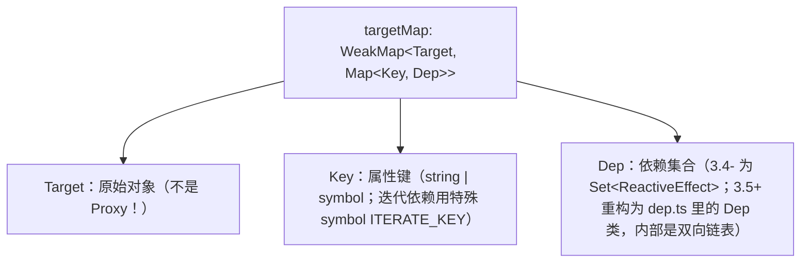
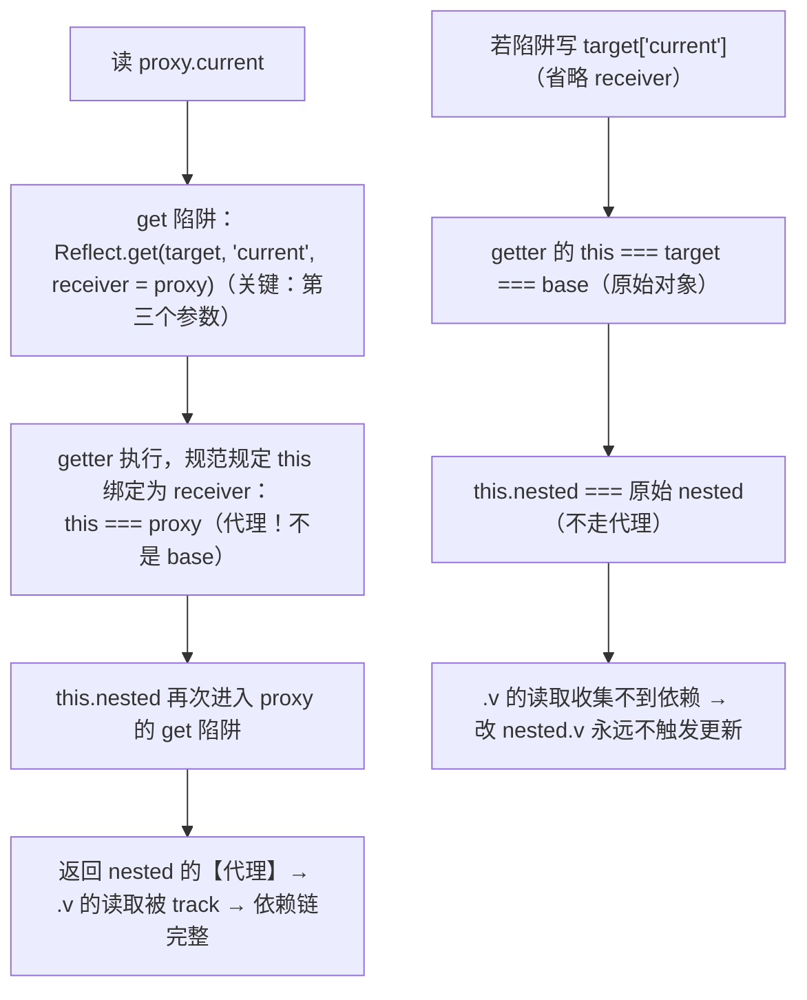

---
mdx:
  format: mdx
---
# 23 · 响应式源码阅读：@vue/reactivity 路线图

> 对应大纲：阶段 5 专题深入 —— 源码阅读：一个响应式库（Vue reactivity / signal 实现）

## 学习目标

1. 画出 `targetMap: WeakMap<Target, Map<Key, Dep>>` 的三层结构，讲清第一层为什么必须是 WeakMap
2. 逐个说明 Proxy get/set/deleteProperty/has/ownKeys 陷阱各自要 track/trigger 什么，以及 `Reflect + receiver` 如何保住「子代理 this」
3. 讲清 effect 的 activeEffect 栈、cleanup（分支切换防残留依赖：泄漏 + 重复触发两个后果）、scheduler（批量/nextTick/computed 三大支柱）
4. 讲清 computed 的 dirty 标志、缓存、「依赖变化只置脏不重算」的惰性求值链
5. 说清 ref 存在的原因（原始值无法代理）与 shallow 系列语义
6. 对比 Vue 的「拉」与 signal（Solid/Preact）的「推」：依赖图粒度差异与取舍
7. 按「推荐阅读顺序」能直接打开 vuejs/core 仓库对应文件读下去

配套练习：`exercises/reactivity/mini-reactivity.ts`（约 300 行手写迷你实现，文件头有**与源码的概念对照表**）+ `mini-reactivity.test.ts`（8 个用例锁定语义）。

## 关键概念

一手依据：Vue 官方文档《深入响应式系统》（Reactivity in Depth / Reactivity API）；GitHub 仓库 `vuejs/core/packages/reactivity/src/` 源码（下文引用文件名与函数名，不标行号——版本间会挪动；版本相关处以 v3.4/3.5 为参照并注明）。

### 1）总数据结构：targetMap



- **依赖挂在原始对象上，而不是 Proxy 上**：同一个 target 理论上可被多个代理包裹（reactive/readonly），以原始对象为键保证依赖索引全局唯一、O(1) 定位。
- **第一层为什么必须是 WeakMap**：① target 是**弱引用**键——原始对象在其他地方被销毁时，它名下的整棵依赖记录能被 GC 自动回收，响应式系统不会反过来「锁住」已废弃组件的数据（这是经典内存泄漏点）；② WeakMap 键只能是对象，天然排除原始值（原始值要走 ref，见 §4）。

### 2）reactive.ts + baseHandlers.ts：代理的建立与五个陷阱

`reactive(obj)` → `createReactiveObject()`：查 `proxyMap`（WeakMap 缓存，**同一 target 只包一次**，保证嵌套代理引用稳定）→ `new Proxy(target, mutableHandlers)`。陷阱实现在 baseHandlers.ts 的 `createGetter/createSetter/deleteProperty/has/ownKeys`。

| 陷阱 | 触发时机 | track | trigger 时机 |
| --- | --- | --- | --- |
| `get` | 读属性（含 getter 访问） | `track(target, 'get', key)` | — |
| `set` | 写属性 | — | `Reflect.set` 成功且 `hasChanged`（`Object.is` 判 false）才 `trigger(..., 'set', key)` |
| `has` | `key in obj` | track key（GET 型 HAS 依赖） | — |
| `ownKeys` | `Object.keys` / `for...in` / 展开等 | track **ITERATE_KEY**（symbol）：key 的「集合本身」被依赖了 | `add`/`delete` 属性时 trigger ITERATE_KEY——因为新增/删除会改变「有哪些 key」，影响一切迭代结果 |
| `deleteProperty` | `delete obj.k` | — | 删除成功且 key 原本存在才 trigger（DELETE 型，同时联动 ITERATE_KEY/length） |

「ownKeys 影响 iterate」举一反三：`for (const k in state)` 依赖的是 key 集合，所以「新增一个从未读过的属性」也会让它重跑——这不是 bug，是 ITERATE_KEY 的语义。

**Reflect + receiver：保住子代理 this 的经典细节**。场景（练习 `mini-reactivity.ts` 演示 5）：

```text
const base = { nested: { v: 1 }, get current() { return this.nested } }
const proxy = reactive(base)
effect(() => { log(proxy.current.v) })
```



一句话：**receiver 让 getter 里的 `this` 指向「最初发起读取的那个代理」，响应式因此能穿透 getter / 继承（super）链**。这也是 `Reflect` 与 `Proxy` 成对出现的原因——`Reflect.get(target, key, receiver)` 是唯一能手动指定 this 的读取原语。

**惰性嵌套代理**：get 到「对象类型的值」才递归 `reactive()` 包一层（配合 proxyMap 缓存）。不在创建时深遍历——大对象冷数据不会被白白包装；深层的对象永远不被读到就永远不进 targetMap。

**数组与 length（一句话）**：数组索引本质是 string key，但写 `arr[5]` 可能隐式改变 `length`，set 陷阱对数组索引写入与 `'length'` 写入做特判，联动触发 length 相关依赖；`for...of`/展开走的是数组的迭代器协议，同样落到 ITERATE_KEY。（Map/Set 则完全另一套 collectionHandlers.ts，用方法劫持替代 get/set——本笔记不展开。）

### 3）ref.ts：为什么原始值需要 ref

`new Proxy(3, {})` 直接抛 TypeError——**Proxy 的目标必须是对象**。原始值（number/string/boolean…）没有「属性槽位」可以挂陷阱，只能装进「盒子」：

```ts live noInline
class RefImpl<T> {
  get value() { trackRefValue(this); return this._value }
  set value(newVal) {
    if (hasChanged(newVal, this._rawValue)) { this._rawValue = newVal; this._value = toReactive(newVal); triggerRefValue(this) }
  }
}
```

- `.value` 的 get/set 就是手动版的 get/set 陷阱：读时收集、写时判变再触发；
- `toReactive`：`ref({a:1}).value` 拿到的内层对象自动是 reactive 代理（ref 默认深层）；
- `_rawValue` 存原始值（`Object.is` 判变，绕过 NaN !== NaN）、`_value` 存转换后的值。

**shallow 系列语义**：

| API | 响应的范围 |
| --- | --- |
| `reactive` | 深层：读到哪层代理到哪层 |
| `shallowReactive` | 只有根层属性读写被拦截；`.nested` 拿到的是**原始对象** |
| `ref` | `.value` 替换触发；内层对象自动 reactive（深层） |
| `shallowRef` | 只有 `.value = x` 触发；内层结构变化不跟踪（要手动 `triggerRef`） |
| `readonly` / `shallowReadonly` | 只 track 不 trigger（set 警告）；shallow 只封根层 |

用途：性能优化（大列表/第三方大对象不深代理）、对接不可变数据、明确「这层以下是外部世界」。

### 4）effect.ts：ReactiveEffect、activeEffect 栈、cleanup、scheduler

`effect(fn)` 包装出 `ReactiveEffect` 实例并**立即执行一次**。核心问题：「fn 执行期间的属性读取」怎么知道该记到哪个 effect 名下？——全局变量 `activeEffect`。

- **activeEffect 栈**（3.4- 的 `effectStack: ReactiveEffect[]`；3.5+ 重构为 `activeSub` + 双向链表，语义相同）：

  ```text
  effect(() => {            ← activeEffect = 外层
    const a = state.a       ← track 到外层名下
    effect(() => { state.b })  ← push：activeEffect = 内层；run 完 pop
    const c = state.c       ← 恢复 activeEffect = 外层，track 到外层名下 ✓
  })
  ```

  没有栈的话，内层 effect 跑完后 activeEffect 要么停留在内层（c 的依赖记错人）、要么变成 undefined（c 收集不到）——**嵌套恢复靠栈**。

- **cleanup：防分支切换的残留依赖**。看经典例子：

  ```ts
  const state = reactive({ ok: true, msg: 'A', alt: 'B' })
  effect(() => { use(state.ok ? state.msg : state.alt) })
  // 初次运行依赖 = {ok, msg}
  state.ok = false   // 重跑：真实依赖变成 {ok, alt}
  state.msg = 'X'    // ← 如果不做 cleanup，这次 set 仍会触发重跑！
  ```

  不做 cleanup 的两个后果：① **重复触发**：`msg` 的依赖集合里还留着本 effect，改 `msg` 触发无意义重跑（读到 alt，结果没变还浪费）；② **泄漏**：effect 反向被 dep 集合引用着，组件销毁后只要 target 活着，effect 与其闭包（往往挂着整个组件作用域）就回收不掉。解法：**每次 run 前先把 effect 从它记录的所有 dep 集合里删掉（cleanup），跑完按本轮真实读取重新收集**。3.4- 是 `cleanupEffect`；3.5+ 的 Dep 链表版本在 track 时自动断开同 key 旧边，思想一致。测试用例 4（分支切换后不再触发明分支）就是锁定这个语义。

- **scheduler：trigger 的「改道开关」**。`ReactiveEffect` 构造可传 `scheduler`；trigger 时有 scheduler 就不直接重跑 effect，改调 scheduler。三大支柱：
  1. **组件渲染批量化**：runtime-core 给渲染 effect 配 scheduler → `queueJob`：同一 tick 内多次 set 只入队一次，在微任务里 flush（`nextTick` 即这个 flush 的 Promise）——「改三个属性只渲染一次」的实现根基；
  2. **computed**：见 §5，scheduler 里只置脏 + 通知；
  3. **watch 定制**：watch 的回调跑在 scheduler 里，可以排队、防抖、批处理（`flush: 'post'` 等配置也经由调度实现）。

### 5）computed.ts：dirty 标志 + 缓存 + 只置脏不重算

`computed(getter)` 返回 `ComputedRefImpl` 实例，三件事配合：

1. **getter 跑在一个 lazy 的内部 effect 里**（不立即执行，首次读取才算）；
2. **scheduler 拦截依赖变化**：依赖 trigger 时**不重跑 getter**，只把 `dirty = true`，并 `triggerRefValue` 通知「读过我这个 computed 的外层 effects」；
3. **get value 时**：dirty 才重算（以内部 effect 身份运行，重新收集依赖），否则直接吐缓存值；同时把读 `.value` 的外层 effect track 到自己身上。

惰性求值链（面试高频，务必背下这条链而不是结论）：

```text
state.count 变
  → 内部 effect 的 scheduler：dirty = true（没有计算发生！）
  → 通知依赖 .value 的外层 effect 重跑
      → 外层重读 .value → 发现 dirty → 此刻才执行 getter
```

所以「computed 依赖变化」本身是廉价的；真正的计算推迟到「有人要结果」的那一刻。没人读的 computed 永远不算（lazy 的完整含义）。3.4 之后官方进一步用版本号/脏等级处理「computed 依赖 computed」的级联判定，核心思想不变。

### 6）Vue（拉）vs signal（推）：依赖图粒度

| | Vue reactivity | Solid / Preact signals |
| --- | --- | --- |
| 依赖建立 | effect（渲染函数）执行时**拉取**：读到什么依赖什么 | 每个 signal 节点记录**直接订阅者**，图在编译/首次求值时显式建立 |
| 更新传播 | 变更沿 target→dep→effects 推一跳到 effect，然后 **effect 整体重跑**（组件级：整个渲染函数 + VDOM diff 找变化） | 变更把新值沿依赖图**推**到每个精确的表达式/绑定，只更新绑定的 DOM 片段（节点级） |
| 粒度 | 组件级（靠 VDOM diff 收敛到 DOM 级） | 节点/表达式级（Solid 无 VDOM） |
| 取舍 | 任意命令式读取都自然工作，心智简单；代价是组件级重渲染 | 更新最优；代价是依赖关系要求静态可分析（模板编译期建图），动态依赖要靠显式 API |

一句话：**Vue 推到 effect 就停下、由 effect 拉着重算一切；signal 一路推到每个叶子节点**。Vue 的 Vapor Mode（无 VDOM、编译期细粒度）正是在吸收 signal 路线的优势（写作时仍在推进中）。

## 可运行示例

| 练习 | 覆盖点 | 运行 |
| --- | --- | --- |
| `exercises/reactivity/mini-reactivity.ts` | reactive（惰性嵌套/Reflect+receiver/deleteProperty）、effect（栈/cleanup/scheduler）、computed（dirty）——文件头有源码对照表 | `npx tsx exercises/reactivity/mini-reactivity.ts` |
| `exercises/reactivity/mini-reactivity.test.ts` | 8 个语义锁定用例（含分支切换 cleanup、computed 计数器证明缓存） | `npx vitest run exercises/reactivity/` |

## 易错点与面试高频

1. **「targetMap 挂在 Proxy 上」**——错。挂在原始对象上；这也是第一层用 WeakMap 的前提（原始对象被 GC，依赖记录随之回收）。
2. **依赖收集发生在「读」，触发发生在「写」**——`reactive(obj)` 本身不收集任何依赖（惰性）；只有 effect 跑起来读到属性那一刻才 track。
3. **set 时忘了判 `Object.is`**——值没变也 trigger → 无限循环（`obj.a = obj.a` 或 effect 内自写）；NaN 场景必须用 `Object.is`（`NaN === NaN` 为 false 但 `Object.is(NaN, NaN)` 为 true）。
4. **`obj.nested.x = 1` 为什么能触发**——不是「深层 set 被拦截」，而是 `.nested` 读取时已返回内层代理，set 发生在内层代理上。
5. **「computed 依赖变化会立刻重算」**——错。只置脏 + 通知；重算推迟到下一次读取（lazy 链，见 §5）。
6. **getter 里 this 指向**——`Reflect.get(target, key, receiver)` 少传 receiver 是响应式「莫名不更新」的一号嫌疑（§2 场景图）。
7. **effect 内 `state.count++`**——trigger 会跳过当前 activeEffect（防自触发无限递归），mini 版与源码同款处理。
8. **ref vs reactive 选择题**——原始值/整体替换用 ref；对象图/属性级更新用 reactive；`shallowRef` 包大对象 + 手动 `triggerRef` 是性能逃生门。

## 输出预测题

### 题 1（分支切换与 cleanup）

用 mini-reactivity 的语义（与 @vue/reactivity 一致）：

```ts
const state = reactive({ ok: true, msg: 'A', alt: 'B' });
let shown = '';
let runs = 0;
effect(() => {
  runs += 1;
  shown = state.ok ? state.msg : state.alt;
});
state.msg = 'A2';
console.log(1, shown, runs);
state.ok = false;
console.log(2, shown, runs);
state.msg = 'A3';
console.log(3, shown, runs);
```

三次输出各是什么？第 3 次为什么？

### 题 2（computed 的惰性求值链）

```ts
const state = reactive({ n: 1 });
let runs = 0;
const ten = computed(() => {
  runs += 1;
  return state.n * 10;
});
console.log(ten.value, runs);
console.log(ten.value, runs);
state.n = 2;
console.log(runs);
console.log(ten.value, runs);
```

四行输出各是什么？

## 预测题答案

### 题 1

```
1 A2 2
2 B 3
3 B 3
```

逐步：① 初次执行 runs=1，依赖 \{ok, msg\}，shown='A'；② `msg='A2'` 触发重跑（runs=2），仍走真分支，shown='A2'；③ `ok=false` 重跑（runs=3），**先 cleanup 清掉 msg 的旧依赖**，改走假分支，shown='B'；④ `msg='A3'`——msg 的 dep 里已经没有这个 effect，不重跑：runs 停在 3，shown 仍是 'B'。一句话：**cleanup 保证依赖集合永远等于「最近一次执行真实读取过的属性」**；没有它，第 3 行会是 `B 4`（无意义重跑）且 effect 无法随组件销毁回收。

### 题 2

```
10 1
10 1
1
20 2
```

逐步：① 首次读取：dirty → 执行 getter（runs=1），缓存 10；② 再读：缓存命中，runs 不变；③ `n=2`：内部 effect 的 scheduler 只置脏 + 通知 `.value` 订阅者，**没有计算发生**，runs 仍是 1；④ 再读：发现 dirty，重算（runs=2）得 20。一句话：**「置脏不重算、读取才重算」**——computed 的廉价依赖变化全靠这条惰性链。

## 延伸阅读

- Vue 官方文档《深入响应式系统》《Reactivity API: shallowRef / computed / effectScope》
- vuejs/core 仓库 `packages/reactivity/src/`（按下述顺序读）
- **推荐阅读顺序**（先数据结构与枚举，后机制，最后专项）：
  1. `operations.ts` —— `TrackOpTypes`/`TriggerOpTypes` 枚举：先知道「有哪些操作」
  2. `reactive.ts` + `baseHandlers.ts` —— reactive 的建立：proxyMap、createReactiveObject、createGetter/createSetter/deleteProperty/has/ownKeys
  3. `effect.ts` —— track/trigger、`ReactiveEffect`、activeEffect 栈与 cleanup、scheduler 分支
  4. `ref.ts` —— `RefImpl` 的 get/set value、`toReactive`、shallowRef
  5. `computed.ts` —— `ComputedRefImpl` 的 dirty 与 scheduler
  6. `collectionHandlers.ts` —— Map/Set 的方法劫持（另一套陷阱思路）
  7. `dep.ts`（3.5+）—— Dep/Sub 双向链表重构：cleanup 与级联通知的链表化
- Solid 文档《Reactivity》与 preactsignals 文档 —— 对照「推」模型
- 《Vapor Mode》RFC/讨论（vuejs/core-vapor 仓库）—— Vue 对 signal 路线的回应

---

## 替换清单（ASCII 图 → Mermaid）

| 原 ASCII 图位置/标题 | Mermaid 图表类型 |
| --- | --- |
| §1）总数据结构：targetMap（WeakMap/Map/Dep 层级注释图） | flowchart (TD) |
| §2）Reflect + receiver 场景（正例/反例两条调用链；块首 3 行示例代码保留为 text 块） | flowchart (TD) |


## 附：响应式实现的四层谱系速查（收尾增补）

源码读到这里（Vue 的 Reflect 依赖收集、块的订阅链），收尾把本册读到的机制放进响应式实现的完整谱系——四层从粗到细，各有取舍：

| 层 | 代表 | 依赖追踪粒度 | 更新传播 | 本册读到的部分 |
|---|---|---|---|---|
| 全量重渲染 | React（ Fiber） | 无追踪（整组件树重算） | vdom diff | 对照组（[react 站](../../react/docs) 专册） |
| 脏检查 | Angular 旧版 | 无追踪（digest 轮询） | 多轮收敛 | 历史注脚 |
| 按组件级订阅 | Vue 2 | 组件级 watcher | 组件重渲 | §1 的前身 |
| 按属性级订阅 | Vue 3 / Solid / Preact Signals | **属性级**（Proxy/get 拦截） | 精确直达 effect | 本册正文 |

谱系的读法：**追踪粒度每细一层，"无效工作"就少一个量级，机制复杂度加一层**（Proxy 拦截、订阅链管理、更新调度）。本册源码读的正是最细层的实现代价：Reflect 要 receiver 对齐、数组方法要劫持、块订阅要去重——这些"麻烦"就是粒度红利的价签。

### 收尾自测（增补）

1. 表中四层各自的"无效工作"是什么？从全量重渲染到属性级订阅，无效工作怎么一步步消失？
2. Vue 3 用 Proxy 替代 Vue 2 的 defineProperty——对应谱系表里哪一层的升级？解决了哪两类追踪盲区？（新增属性/数组索引）
3. 你在用的状态库在哪一层？它的"细"换来了什么、付出了什么？

谱系表再补最后一行用法提示：**选库先选层**——业务形态决定层位：重交互表单（细粒度层收益最大）、大列表渲染（全量重渲染 + memo 反而简单可控）、低频管理后台（任何层都够，团队熟悉度优先）。层位选错是响应式性能问题的第一根因，比任何微观调优都值钱。

### 收尾一句话（增补）

响应式的本质是**把"哪部分界面依赖哪部分数据"显式化**——四层谱系就是四种显式化的精度档位，源码阅读读的是最高档位的实现代价，选型时读的是哪一档配得上你的业务。
