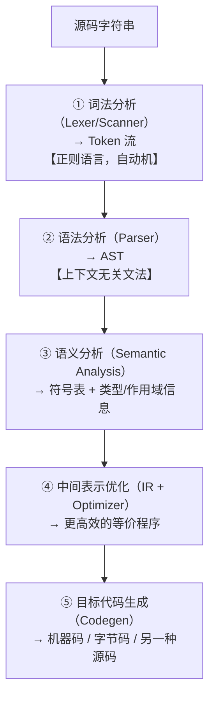
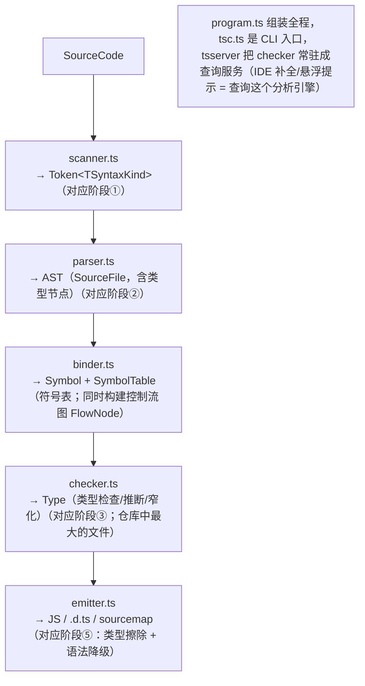

---
mdx:
  format: mdx
references:
  - 07-v8-engine
  - 02-scope-and-closure
  - 09-ts-narrowing
  - 16-modules-esm-cjs
  - 13-ts-type-theory
---
# 26 · 编译原理视角：把 JS/TS 放回编译器全景

> 对应大纲：阶段 5 专题「编译原理视角看 JS/TS」；回扣阶段 2（V8，笔记 07）、阶段 1.2（作用域，笔记 02）、阶段 3（TS 类型系统，笔记 09–13）、阶段 4.1（ESM，笔记 16）。
> 一手依据：ECMA-262（Lexical Grammar、Static Semantics / Early Errors、`ParseScript`、GlobalDeclarationInstantiation / FunctionDeclarationInstantiation、GetIdentifierReference）；TypeScript 官方 wiki《Architectural Overview》与源码 `src/compiler/`（scanner.ts / parser.ts / binder.ts / checker.ts / emitter.ts / program.ts）；TypeScript 设计目标文档（Design Goals / Non-goals：明确不追求 soundness）；TS Handbook 与 TS 5.8 发布说明（`erasableSyntaxOnly`）。

## 学习目标

- 能画出教科书编译器的五阶段管道，并把 V8、tsc、Babel、esbuild、ESLint 各自「截取」了其中哪一段说清楚。
- 能用 ECMA-262 的术语解释：什么是 JS 的「编译期」（early errors / static semantics），hoisting 和 TDZ 为什么**不是** AST 变换，而是「环境实例化先于语句执行」。
- 能说出 tsc 的五个阶段（scanner → parser → binder → checker → emitter），并解释「类型检查是静态分析、类型体操是类型层求值」。
- 能解释为什么 `npx tsx` 从不做类型检查、为什么 TS 7 原生化后架构不变但快一个数量级。

---

## 关键概念

### 1. 教科书五阶段，每家工具截取一段

经典编译器管道：



把本工作区学过的工具对号入座：

| 工具 | ① | ② | ③ | ④ | ⑤ | 产物 |
| --- | --- | --- | --- | --- | --- | --- |
| V8（JS 引擎） | ✅ | ✅ | ✅（作用域分析） | ✅（TurboFan 优化） | ✅ | Ignition 字节码 → 机器码 |
| tsc（完整编译） | ✅ | ✅ | ✅（binder+checker，最重的一步） | — | ✅（擦除+降级） | JS + `.d.ts` |
| tsx / esbuild（仅转译） | ✅ | ✅ | ❌ | — | ✅ | JS（无类型检查！） |
| Babel | ✅ | ✅ | ❌（ preset 只做语法层） | — | ✅（AST→AST 再打印） | 降级后的 JS |
| ESLint | ✅ | ✅ | 部分（作用域分析） | — | — | 诊断报告 |
| Prettier | ✅ | ✅ | — | — | ✅（「反解析」打印） | 格式化代码 |

三个直接推论（都是日常现象的原理）：

1. **`npx tsx` 跑得再顺也不代表类型对**：tsx 走 esbuild，只做 ①②⑤；③（binder/checker）被整体跳过。类型检查必须 `tsc --noEmit` 或 IDE 里的 tsserver。这也是 CI 必须跑 tsc 的原因。
2. **V8 是「每次加载都重新编译」的编译器**：没有独立产物文件（Java 有 .class、Python 有 .pyc 缓存），JS 只有 V8 code cache 这类引擎内部缓存。所谓「JS 是解释型语言」的准确修正在笔记 07：先解析成字节码解释执行，热点再 JIT。
3. **TS 7（2025–2026 原生化）架构不变**：tsc 的 Go 移植版把同样的 scanner→parser→binder→checker→emitter 流水线用原生语言重写并行化，快约一个数量级——印证「架构（阶段划分）」与「实现语言」正交。副作用：主线 `typescript@7` 移除了经典 JS compiler API，本工作区 devDependency 因此固定在 5.x（练习用它的 API 观察编译器内部）。

### 2. JS 的「编译期」在规范里叫什么：Early Errors 与 Static Semantics

ECMA-262 不规定实现方式，但它**规定了两类语义**，恰好对应「编译期/运行时」：

- **Static Semantics（静态语义）**：只看语法结构就能判定的事实。其中违反即抛 `SyntaxError` 的条款叫 **Early Errors**（早期错误），挂在每条文法产生式下，由 `ParseScript` / `ParseModule` 这两个抽象操作在**解析完成、执行之前**检查。典型：同一作用域重复 `let` 声明、`delete` 一个裸变量（strict 下）、保留字做标识符。
- **Runtime Semantics（运行时语义）**：语句真正执行时才求值的行为：`ReferenceError`、`TypeError`、值计算……

推论：**early error 不看可达性**。`if (false) { let a; let a; }` 在解析阶段直接 `SyntaxError`——判断它根本不需要执行任何代码。而 `if (false) { null.x; }` 永不报错（运行时错误没机会发生）、`if (false) { x; let x; }` 也不报错——**TDZ 检查是运行时语义**（GetBindingValue 发现 binding 未初始化才抛 `ReferenceError`）。练习 02 逐一验证这张分类表。

### 3. 词法分析：Token 流与两个著名难题

- 词法分析的对象是正则语言，理论上一组自动机就够。JS 的词法文法在 ECMA-262《ECMAScript Language: Lexical Grammar》一章：InputElementDiv / InputElementRegExp / InputElementRegExpOrTemplateTail——**同一个字符流有多种切法**，这就引出两个经典难题：
  1. **`/` 的二义性**（除法还是正则表达式的开头）：`a = b / hi / g` 到底是两次除法还是一次正则？词法器单靠自己无法决定，必须问 parser「上一个 token 处于表达式中间还是结束」。教科书里「词法/语法严格分层」在真实语言中常被打穿。
  2. **ASI（自动分号插入）**：规范用 `[no LineTerminator here]` 产生式标记哪些位置换行有意义（`return`、`throw`、`break/continue`、后缀 `++/--`），三条 ASI 规则本质是 parser 的**错误恢复机制**——遇到语法错误时尝试补一个分号重试。这就是 `return\n 1` 实际返回 `undefined` 的规范根源。
- **Trivia（空白/注释）在 token 流里通常被丢弃**，但 sourcemap、格式化工具（Prettier）必须保留它们——不同工具对 token 流的需求不同。

### 4. 语法分析：AST——前端的「公共货币」

- AST 忠实反映源码结构。两个事实标准：**ESTree**（acorn/babel/ESLint 系）与 **TypeScript AST**（`ts.createSourceFile` 产出，节点带 `pos/end/flags`，且包含类型节点）。练习 01 用 TS API 亲手 dump。
- **hoisting 不发生在 AST 层**：把「调用写在函数声明之前」的代码 parse 出来，AST 中调用语句依然在声明前面——没有任何节点被「移到顶部」。提升是下一阶段（语义分析/环境实例化）的行为。这是「从编译原理看 JS」最典型的一次祛魅：*「提升」不是代码移动，是阶段顺序*。
- **V8 的 lazy parsing 回扣**（笔记 07）：pre-parser 只验证语法、不建 AST。所以「语法错误」在预解析阶段就可能暴露，而作用域分析只在 full parse 时做。

### 5. 语义分析：作用域、提升、TDZ 的真相是「环境实例化」

ECMA-262 对一段 Script/函数体的执行分两步：

1. **声明实例化（Declaration Instantiation）**：`GlobalDeclarationInstantiation` / `FunctionDeclarationInstantiation` / Block 级别的声明绑定——在**执行任何语句之前**创建词法环境（Environment Record）并为所有声明建立 binding：
   - 函数声明：创建 binding **并立即初始化**（函数对象此时已生成）→ 这就是「函数整体提升」；
   - `var`：创建 binding 并初始化为 `undefined` → 「var 提升为 undefined」；
   - `let`/`const`：创建 binding 但**不初始化**（uninitialized）→ 访问即 TDZ；
   - `class`：同 `let`。
2. **逐语句求值（Evaluation）**：按 AST 顺序执行。标识符查找走 `GetIdentifierReference(name, env)`：沿词法环境链逐层向外，链是**解析期由源码嵌套结构静态确定**的（词法作用域 = 编译期性质），找不到才抛 `ReferenceError`。

于是三个「玄学」全部落位：

- **提升** = 第 1 步先于第 2 步，与代码顺序无关；
- **TDZ** = binding 存在但未初始化，是运行时的状态检查（所以不可达就不抛）；
- **闭包** = 函数对象携带 `[[Environment]]`（创建时的环境引用），环境结构编译期定、实例运行时建（笔记 02）。

为什么引擎敌视 `eval`/`with`：它们能在运行时**注入新的作用域层级**，让「编译期静态确定的环境链」失效，V8 被迫放弃大量静态优化。strict mode 禁 `with`、CSP 禁 `eval`，本质都是在保护「作用域可静态分析」这条编译期不变量。

### 6. TypeScript 编译器：scanner → parser → binder → checker → emitter

依据 TypeScript 官方 wiki《Architectural Overview》与 `src/compiler/` 源码结构：



三个关键认知：

1. **binder = 经典「符号表构建」**。遍历 AST 为每个声明建 `Symbol`，合并同名声明（声明合并），记录「这个名字指的是谁」。没有它，checker 无法回答 `x` 是什么。
2. **checker = 一个静态分析引擎**。assignability（可赋值性）判定是核心子类型关系；**narrowing（收窄）是 binder 建好的控制流图上的数据流分析**——checker 沿 FlowNode 传播「每个变量在流到某点时的类型状态」。练习 04 直接把 checker 当分析器调用，打印同一变量在不同控制流位置的类型。
3. **emitter = 类型擦除的转译器**。tsc 身兼两职：类型检查器 + 源到源转译器，而**这两职责可拆**：只跑 ①②⑤（esbuild/tsx/swc）就是转译；只跑 ①②③④（`tsc --noEmit`）就是检查。语法分两类：
   - **可擦除（erasable）**：`interface`、`type`、类型注解、`as` 断言、`import type`——emitter 直接删掉，不留痕迹；
   - **不可擦除**：`enum`、含运行时值的 `namespace`、参数属性（`constructor(private x)`）、旧式装饰器——**会生成运行时代码**（如 enum 的 IIFE）。「TS 类型在运行时不存在」严格说只对第一类成立。TS 5.8 的 `erasableSyntaxOnly` 就是把第二类判为错误，保证代码可被任何「只删类型」的工具转译（练习 03 亲眼对比输出）。注意：**该开关的执法者是 checker**——`ts.transpileModule`/esbuild 这类纯转译器连它都不理会，照样把 enum 编译出去（练习 03 第三、四节实验证实）。

### 7. 类型系统视角：检查 = 抽象解释，类型体操 = 类型层求值

把 PL（编程语言）理论的透镜架上：

- **类型检查是一种抽象解释（abstract interpretation）**：对每个表达式，用「类型」这个抽象域上的近似值去解释程序，保证「抽象解释不出错 → 真执行也不出错」。narrowing 的路径敏感性（path sensitivity）、回调边界上的保守放大（变量可能被重赋值 → 回调内不敢保持窄化）都是数据流分析的标准操作：**宁可高估（保守近似），不可漏报**。练习 04 演示这两面。
- **类型推断是合一（unification）思想的工程裁剪**：HM（Hindley-Milner）式的「从表达式推出最一般类型」被 TS 改造成**双向推断**——既有自底向上的推断，也有自顶向下的上下文类型（contextual typing）。`const x = 1` 推出字面量类型 `1`，`let x = 1` 立即拓宽为 `number`，拓宽点由「可变性」决定（练习 04 打印验证）。
- **结构类型系统**：assignability 按**结构**而非名字判定（笔记 13）；方法语法参数**双变**（bivariant，兼容 JS 现实而刻意放弃 soundness——设计文档 Non-goals 明言「不追求可证明正确，在正确性与生产力间取平衡」，`any` 就是逃生舱）。
- **类型层是一门函数式小语言，而且图灵完备**：条件类型 = 模式匹配/分支、`infer` = 逻辑变量（被合一求解）、递归类型 = 递归函数、映射类型 = map、模板字面量类型 = 字符串级编程。checker 对它们**求值**（社区已用 λ 演算解释器等证明其图灵完备）。练习 05 让 checker 现场求值 4 个递归类型程序——你会看到「类型体操的本质是：写一段类型层程序，让 checker 替你执行」。另一个验证中撞见的事实：在 `noLib` 环境下连 `T[]` 都无法求值（诊断：`Cannot find name 'Array'`）——**类型层的 `Array<T>` 本身就是 lib.d.ts 里用 TS 写出来的一份几十万行类型程序**，「内置类型」和「类型体操」是同一种东西。

### 8. ESM 是带链接器的模块语言：parse → instantiate → evaluate

ECMA-262 模块体系（及 Node ESM 实现）把模块生命周期明确分三阶段（回扣笔记 16）：

1. **Parse**：从入口递归解析 import，构建模块图；
2. **Instantiate（链接）**：为所有模块建立环境与 binding——导入/导出连接到**同一块内存槽位**，这就是 **live binding** 的实现真相（连接的是槽位引用，不是值拷贝）；
3. **Evaluate**：按模块图深度优先后序执行模块体，循环依赖处拿到的是「已实例化未求值」的绑定。

CJS 的 `require` 是运行时函数调用（同步、值拷贝、可条件化），ESM 是**编译期链接 + 运行期求值**的分离——这正是传统编译器「符号解析/链接」与「执行」分离在 JS 的落地。

---

## 可运行示例

配套练习（`exercises/compiler-perspective/`，均可 `npx tsx` 直接运行、`npx tsc --noEmit` 严格校验）：

- `01-scanner-and-ast.ts` —— 用 scanner 打印 token 流、用 parser dump AST；亲眼看到「调用写在声明前」的代码 AST 顺序不变（提升不在 AST 层），以及类型注解只是普通 AST 节点。
- `02-early-errors-vs-runtime.ts` —— 五段代码分类实验：early error（不可达也抛 SyntaxError）vs 运行时错误（不可达不抛）vs TDZ（运行时语义）；再对比 `ts.transpileModule` 对重复 `let` 沉默不报——证明转译器没有语义检查。
- `03-type-erasure.ts` —— `ts.transpileModule` 前后对照：interface/type/`as` 蒸发，enum/namespace 生成运行时代码。
- `04-checker-as-flow-analyzer.ts` —— ~30 行把 checker 用起来：打印同一变量在不同控制流位置的窄化类型、const/let 的拓宽差异、回调边界保守化；顺手收获一个「自制诊断器」。
- `05-type-level-evaluation.ts` —— 让 checker 现场求值递归条件类型（Flatten / 模板 Join / 字符串长度 Len / DeepReadonly），看类型层程序被「执行」。

最小感受版（零依赖，任何环境可跑）：

```js live noInline
// 编译期(early error) vs 运行时错误的分类实验 —— 直接复制进 node REPL
console.log("case1:", (() => { try { eval("if (false) { let a; let a; }"); return "no error"; } catch (e) { return e.constructor.name; } })()); // SyntaxError：解析期即抛，不可达也拦不住
console.log("case2:", (() => { try { eval("if (false) { null.x; }"); return "no error"; } catch (e) { return e.constructor.name; } })()); // no error：运行时错误，没执行到
console.log("case3:", (() => { try { eval("if (false) { x; let x; }"); return "no error"; } catch (e) { return e.constructor.name; } })()); // no error：TDZ 是运行时检查
console.log("case4:", (() => { try { eval("if (true)  { x; let x; }"); return "no error"; } catch (e) { return e.constructor.name; } })()); // ReferenceError：TDZ 真的发生了
```

---

## 易错点与面试高频

1. **「JS 是解释型语言」——不准确**（也是笔记 07 的高频题）：现代引擎是「解析 → 字节码 → 分层 JIT」的编译器；从编译原理看，它只是把编译推迟到**每次加载时**、且无独立产物文件。
2. **「提升是代码被移到顶部」——错误心智模型**。AST 原样保留源码顺序；提升 = 声明实例化（环境建立）先于语句求值。TDZ 是 binding「存在但未初始化」的**运行时**状态。
3. **「TS 类型编译后被擦除，所以运行时完全没有类型痕迹」——不完全对**：enum、namespace、参数属性、旧装饰器会生成运行时代码，属「不可擦除语法」；`erasableSyntaxOnly`（TS 5.8+）专门约束这一点。
4. **「tsc 慢在转译」——错**。转译（parse+emit）极快，慢的是 binder+checker 的全程序类型分析；esbuild/tsx 跳过它们所以快——也因此**永远不做类型检查**。
5. **「narrowing 失效是 bug」——不，是保守近似**。回调边界、别名、重赋值处收窄失效或放大，是数据流分析「宁可不报错也不漏报」的刻意设计（配合设计目标里的非-soundness 立场）。
6. **`let a; let a;` 谁来报错**：V8（ECMA-262 early error，解析期 SyntaxError）；tsc 完整编译报 TS2451（binder/checker 层）；`ts.transpileModule`/esbuild **不报**（无语义分析）。同一段代码、三种工具、三个阶段——这是「编译器阶段论」最锋利的一道题。
7. **AST 是前端工具的公共货币**：Babel/ESLint/Prettier/tsc 都在 ESTree（或 TS AST）上工作；学 AST 的投资在整个工具链通用。ESLint 本质 = 编译器前端 + 规则驱动的 AST 模式匹配（linter 是静态分析的子领域）。
8. **live binding 不是语法糖**：ESM instantiate 阶段把导入导出连到同一内存槽位，属「链接器」行为；CJS 的 require 是运行时求值 + 值拷贝。两者是编译模型差异，不是写法差异。
9. **面试高频问法**：「讲讲 tsc 的编译流程」「为什么 tsx 快但不做类型检查」「hoisting 的原理」「TS 类型擦除的边界（哪些语法擦不掉）」「narrowing 为什么在回调里失效」「ESM 和 CJS 的加载模型差异」。答题骨架：五阶段管道 → 各工具截取哪段 → 规范的 static/runtime 语义分界 → checker 即分析引擎。

---

## 输出预测题

### 题 1（早错误 vs 运行时错误：判断每行输出）

```js live noInline
const run = (code) => { try { eval(code); return "ok"; } catch (e) { return e.constructor.name; } };
console.log(run("if (false) { let a; let a; }"));   // ①
console.log(run("if (false) { null.x; }"));          // ②
console.log(run("if (false) { x; let x; }"));        // ③
console.log(run("let b = 1; b();"));                 // ④
console.log(run("function f(){ return\n 1; } const r = f();"));  // ⑤ 之后 r 是什么？
```

### 题 2（类型擦除边界：`ts.transpileModule` 之后还剩什么）

```ts
enum Color { Red, Green }
interface Point { x: number; y: number }
const p = { x: 1, y: 2 } as Point;
namespace Util { export const id = (v) => v; }
```

问：整段交给 `tsc --target es2022` 编译后——
① `Color`、`p`、`Util` 三个名字在**运行时**各是什么？
② 如果换成 `--erasableSyntaxOnly`（TS 5.8+）会怎样？
③ 若 `enum Color` 改为 `type Color = "red" | "green"`，运行时还剩什么？

（答案见文末）

---

## 延伸阅读

- ECMA-262 —— Lexical Grammar 一章（词法文法、InputElementDiv/RegExp 的分裂即 `/` 二义性）、各产生式 Static Semantics: Early Errors、`ParseScript`、GlobalDeclarationInstantiation / FunctionDeclarationInstantiation（提升/ TDZ 的一手定义）、GetIdentifierReference
- microsoft/TypeScript wiki《Architectural Overview》—— scanner→parser→binder→checker→emitter 官方架构图
- microsoft/TypeScript 源码 `src/compiler/` —— scanner.ts、parser.ts、binder.ts（含 FlowNode 构建）、checker.ts（flow analysis 与 assignability）、emitter.ts
- TypeScript 设计文档《Design Goals》—— Non-goal："Apply a sound or 'provably correct' type system"（`any`/双变的理论出处）
- TS 5.8 Release Notes —— `erasableSyntaxOnly`
- babel.dev/docs —— Babel 三步（parse/transform/generate）与 visitor 模式；estree/estree 仓库（AST 规范）
- esbuild 文档《Architecture》—— 单遍、并行、无类型检查的设计取舍
- v8.dev/blog（回扣笔记 07）—— lazy parsing、JIT 分层；本笔记把 07 的「引擎内部视角」接回「编译器教科书视角」
- 社区「TypeScript 类型系统图灵完备」证明（λ 演算解释器、四位加法器等实现）—— 类型层求值能力的极端展示

---

## 预测题答案

### 题 1

- ① **SyntaxError**。重复 `let` 是 ECMA-262 early error（static semantics），`ParseScript` 在解析完成、执行之前检查，`if (false)` 的不可达性与它无关。
- ② **ok**。`null.x` 是运行时 TypeError；块从未执行，错误没有发生的机会。
- ③ **ok**。TDZ 是运行时语义（GetBindingValue 发现 binding 未初始化才抛），块没执行就不抛。
- ④ **TypeError**。`b` 是数字，调用它：这个错误**发生在运行时且该行执行了**——与 ① 的对比点：同样是「这行代码一看就有问题」，语义错误的检测时机由错误类别决定，不由「明不明显」决定。
- ⑤ r 是 **undefined**。`return` 后跟换行触发 ASI（`return` 的产生式带 `[no LineTerminator here]`），函数返回 undefined；`1` 成了不可达的独立表达式语句。这是词法/文法层的换行敏感性，编译期就定死了。

### 题 2

- ① 运行时：`Color` 是一个**对象**（IIFE 生成的 `{ Red: 0, Green: 1, 0: "Red", 1: "Green" }`，双向映射）；`p` 是普通对象字面量 `{x:1, y:2}`——`as Point` 断言被擦除，`Point` 接口不存在；`Util` 是一个**真实对象**（namespace 含运行时值，生成 `var Util; (function (Util) { ... })(Util || (Util = {}));` 结构）。
- ② **直接编译错误**。`erasableSyntaxOnly` 把一切「需要生成运行时代码的类型语法」判为非法：enum、该 namespace、参数属性、旧装饰器全中招——这段代码必须改写才能通过。
- ③ 运行时**什么都不剩**（type alias 可擦除）；代价是失去 enum 的「值 + 名」双向映射，想留运行时痕迹就得自己建对象或用 `as const` 对象模拟。
---

## 替换清单（ASCII 图 → Mermaid）

| 原 ASCII 图位置/标题 | Mermaid 图表类型 |
| --- | --- |
| §1 经典编译器管道（五阶段）——该节内容在本文档中重复出现两次，两处均已替换 | flowchart (TD) |
| §6 TypeScript 编译器源码结构（scanner → parser → binder → checker → emitter）——重复出现两次，两处均已替换 | flowchart (TD) |

## 附：编译器视角的项目体检表（收尾增补）

本册教"用编译器的眼睛看代码"，收尾把体检项压成一张可跑的清单——每项都能在本站的工具（tsc/ESLint/练习工程）上直接验证：

| 体检项 | 用什么查 | 不合格的信号 |
|---|---|---|
| 类型图覆盖面 | tsc --strict 全开 + 关闭 any 逃生门 | any/隐式 any 出现在业务路径 |
| 语法树信息利用 | ESLint type-aware 规则 | 该用 no-floating-promises 的地方裸写 async |
| 死代码面积 | tsc noUnusedLocals + 覆盖率工具 | 不可达分支/未用导出堆积 |
| 变换可重复性 | 代码生成器 + golden 文件 | 生成产物手工改过（下次生成被覆盖） |
| 增量友好性 | project references / 分包 | 改一个文件全仓库重查 |
| 宏/元编程边界 | babel 插件清单 | 运行时 eval 与编译期变换混用 |

体检表的使用节奏：季度跑一次全量，CI 里只保留三行（类型图/增量/宏边界）作为门禁——全量体检找方向，门禁守底线。

### 与主线三阶段的一句话回链

体检表的六行分别对应主线三阶段（词法语法）、四阶段（语义）、五~七阶段（执行与优化）的产出物：**编译器视角的代码体检，就是把流水线各段的"编译器在乎什么"翻译成工程纪律**——翻译过来的就是这张表，翻译之前的动机都在前面八条主线里。

### 收尾一句话（增补）

编译器视角不是让你去写编译器，而是**借它"只在乎结构与约束"的眼光，把代码从散文变回命题**——能被流水线机械处理的代码，才配得上"可维护"三个字。

体检表之外再补一行"最高性价比单项"：**把 any 从业务代码里清出去**。它是六行体检里唯一"一项收益覆盖全站"的——类型图一旦有洞，四阶段的语义分析、ESLint 的 type-aware 规则、重构工具的引用边全部失效。清 any 的顺序建议：先业务核心路径（钱/权限/状态机），再边界（IO/第三方），最后测试文件——每一刀都有独立可验证的收益。

### 收尾自测（增补）

1. 体检表六行各对应主线哪一阶段的产出物？按流水线顺序复述。
2. 为什么"清 any"是性价比最高的单项？它同时修复了体检表的哪几行？
3. 你的项目跑一遍六行体检：哪两行是重灾区？各自的第一刀切哪里？

### 体检表的分层执行节奏（补充）

- CI 门禁（每次提交）：类型图 noImplicitAny、增量编译不退化、宏边界声明；
- PR 级（改动触发）：改动文件的 no-floating-promises/no-unused 类规则；
- 季度全量：六行全跑 + 与上次体检 diff，趋势入档；
- 大版本前：死代码面积专项（unused exports 清理批次）。

四级节奏让体检从"年度大扫除"变成"持续流水线"——每级的成本与收益对齐各自的触发频率。

### 收尾自测（增补）

1. 四级节奏里，哪一级最容易被省略？省略的代价什么时候显现？
2. 你的 CI 现在覆盖了哪几行体检项？按四级节奏补全的 第一刀切哪里？

### 一次真实的体检叙事（示例）

把六行体检在一个虚构中型项目上跑一遍的叙事（示范怎么读结果）：类型图 12 个 any 集中在 API 边界（第一刀位置确定）；死代码 40+ 未用导出（多为迭代遗留）；增量编译因 tsconfig 扁平 include 全量重查（project references 一刀解决）；宏边界干净（无 eval）但有一个手工 babel 变换未登记（补 ADR）。四刀排完，两个月工期——这就是体检表把"感觉不健康"翻译成"施工单"的样子。

叙事读完做一次替换练习：把"12 个 any、40 个死导出"换成你项目的真实数字——体检表只有在填入自己的数字后才算跑完。

最后一次提醒本册的立场：编译器视角是**分析视角不是洁癖视角**——体检的全部产出都是施工单，不是批评信。能落成工单的体检才有第二次。

对照一句：能落成工单的体检 + 能排进迭代的工单 + 能对账的复查——这是"编译器视角"在工程里活过第一年的全部条件。

把"能对账的复查"再具体一步：复查就是重跑六行体检表并与上次记录 diff——数字变好了才算工单关闭，"做完了"不算。
