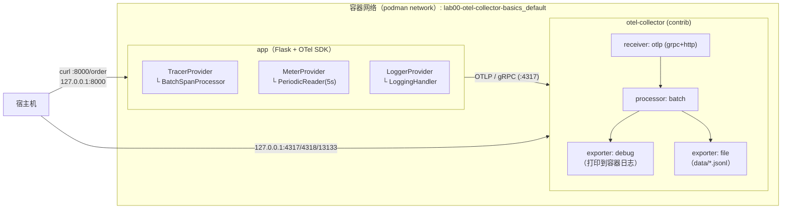
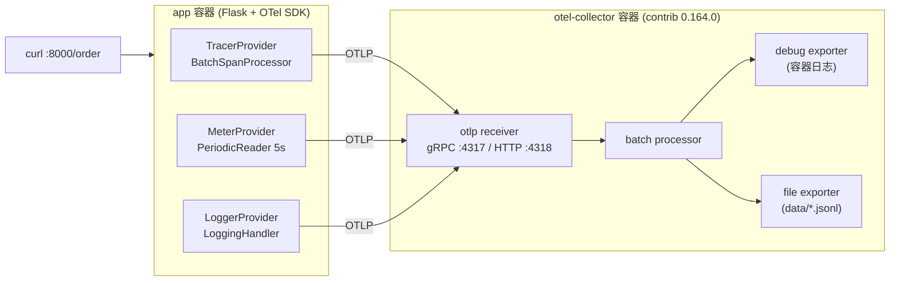

# Lab 00 · 第一次跑通 OpenTelemetry Collector

> 阶段 0 动手实验 · 预计 30~45 分钟
>
> **目标**：用 podman compose 一键起"示例应用 + OpenTelemetry Collector"，让应用产生
> **traces / metrics / logs** 三种信号，通过 OTLP 发给 Collector，然后：
> 1. 在 Collector 的 debug 输出里**亲眼辨认**三种信号长什么样；
> 2. 在落盘的 JSONL 文件里看到与后端最终收到的**等价原始数据**；
> 3. 踩一遍新手必踩的坑（端口 4317/4318、容器网络、丢数据），并知道怎么排查。

对应概念笔记：[OpenTelemetry 总览](../../notes/00-concepts/opentelemetry-overview.md)、[核心对象速查](../../notes/00-concepts/otel-quickstart-concepts.md)。

---

## 目录

1. [架构](#1-架构)
2. [前置条件](#2-前置条件)
3. [目录结构](#3-目录结构)
4. [启动](#4-启动)
5. [制造流量](#5-制造流量)
6. [验证：在 debug 输出里辨认三种信号](#6-验证在-debug-输出里辨认三种信号)
7. [验证：落盘文件与 health 端点](#7-验证落盘文件与-health-端点)
8. [常见坑与排查](#8-常见坑与排查)
9. [清理](#9-清理)
10. [思考题](#10-思考题)
11. [参考资料](#11-参考资料)

---

## 1. 架构





要点回顾（详见概念笔记）：

- app 里三种 **Provider** 共用同一个 `Resource`（`service.name=lab00-app` 等），后端才能把三种信号对上同一个服务；
- Collector 配置里 `receivers/processors/exporters` 只是**声明**，真正生效的是 `service.pipelines` 里对它们的**引用**；
- `debug` exporter 的 `verbosity: detailed` 会打印每条 span/log/metric 的完整字段——这是本实验的"后端"。

## 2. 前置条件

| 依赖 | 最低版本 | 检查命令 |
| --- | --- | --- |
| podman | 4.x+（本工作区在 5.8.2 上验证） | `podman version` |
| podman compose（外部 provider 模式） | 与 podman 版本配套 | `podman compose version` |
| curl | 任意 | `curl --version` |

说明：

- **macOS 先启动 podman machine**：容器实际跑在一台轻量虚拟机里，首次使用先执行 `podman machine init && podman machine start`；此后 `podman compose` 子命令与 compose v2 语法完全一致，本实验的 `docker-compose.yml` 文件名 podman 完全兼容，无需改名；
- 首次运行需要拉取 `python:3.12-slim`（来自 docker.io）与 `opentelemetry-collector-contrib`（来自 ghcr.io）镜像（约 100~200MB），请保证网络可达 `ghcr.io` 与 `docker.io`——podman 拉取的是相同镜像名，无需任何改动；
- Collector 镜像使用 ghcr 官方发行版 `opentelemetry-collector-releases/opentelemetry-collector-contrib:0.164.0`；**版本 tag 以官方 release 页为准**：<https://github.com/open-telemetry/opentelemetry-collector-releases/releases>（访问日期：2026-11-04），换版本时同步检查组件增删（本实验只用到 otlp/batch/debug/file/health_check 这些长期存在的基础组件）。

## 3. 目录结构

```text
labs/lab00-otel-collector-basics/
├── README.md                    # 本文件
├── docker-compose.yml           # app + otel-collector 两个服务
├── otel-collector-config.yaml   # Collector 配置（receivers→processors→exporters）
├── data/                        # 运行后生成：file exporter 的 JSONL 输出（gitignore 它）
│   └── lab00-telemetry.jsonl
└── app/
    ├── Dockerfile
    ├── requirements.txt         # flask + opentelemetry-sdk/exporter（版本固定）
    └── app.py                   # 手动 SDK 埋点：traces + metrics + logs 全在这一个文件
```
<!-- 保留原图：目录结构清单，非概念示意图，Mermaid 无原生文件树类型 -->

## 4. 启动

```bash
cd labs/lab00-otel-collector-basics

# Linux 用户注意：file exporter 要写 ./data 目录，而 collector 容器以 UID 10001 运行；
# macOS 的 podman machine 由 VM 的 virtiofs 提供 bind mount，通常同样没有 UID 权限问题。
mkdir -p data && sudo chown -R 10001:10001 data   # 仅 Linux 需要

podman compose up -d --build
```

预期：`app` 会等 `otel-collector` 健康检查通过后再启动。检查状态：

```bash
podman compose ps
```

预期输出（关键看两个服务都处于 `Up ... (healthy)`；列名与格式因 compose provider 而异，首次构建 app 镜像需要 1~3 分钟）：

```text
NAME                    STATUS                 PORTS
lab00-app               Up 1 minute (healthy)   127.0.0.1:8000->8000/tcp
lab00-otel-collector    Up 2 minutes (healthy)  127.0.0.1:4317->4317/tcp, 127.0.0.1:4318->4318/tcp, 127.0.0.1:13133->13133/tcp
```

先看一眼 Collector 日志确认配置加载成功：

```bash
podman compose logs otel-collector | tail -20
```

预期看到类似（节选）：

```text
2026-11-04T12:00:00.000Z    info    service@v0.164.0/service.go:174    Everything is ready. Begin serving and batch data.
```

若有 `error`/`fatal`，跳到[第 8 节常见坑](#8-常见坑与排查)。

## 5. 制造流量

```bash
# 连续下 20 个订单（其中大约 2 个慢支付、1 个支付失败——概率 10% / 5%）
for i in $(seq 1 20); do curl -s http://127.0.0.1:8000/order; echo; done
```

单次响应示例：

```json
{"order_id":"A-3f9c2ab1","status":200,"duration_ms":87.3}
```

偶发的失败订单（约 5%）：

```json
{"order_id":"A-77d1e0c9","status":500,"duration_ms":95.1}
```

同时 app 自身日志里可以看到结构化输出（`podman compose logs -f app`）：

```text
2026-11-04 12:01:23,104 INFO lab00.app order received
2026-11-04 12:01:23,220 INFO lab00.app order completed
```

> 计时提示：app 的批处理器每 ~5s 导出一次（traces/logs/metrics 的默认 `schedule_delay` 均为 5s）；
> 敲完命令后**等 10 秒**再去翻 Collector 日志，大概率刚好错过一个导出周期。

## 6. 验证：在 debug 输出里辨认三种信号

打开 Collector 日志（`debug` exporter 的输出去这里）：

```bash
podman compose logs otel-collector | less
# 或实时跟踪：
podman compose logs -f otel-collector
```

### 6.1 Traces 长这样

搜索关键字 `Traces` 或 `Trace ID`。`verbosity: detailed` 下的一段典型输出：

```text
2026-11-04T12:01:24.012Z info Traces Service [logs.Kinternal]
ResourceSpans #0
Resource SchemaURL:
Resource attributes[0]: service.version(Str): 0.1.0
Resource attributes[1]: service.name(Str): lab00-app
Resource attributes[2]: deployment.environment.name(Str): lab
Resource attributes[3]: service.instance.id(Str): 9f2c...
Resource attributes[4]: telemetry.sdk.language(Str): python
Resource attributes[5]: telemetry.sdk.name(Str): opentelemetry
Resource attributes[6]: telemetry.sdk.version(Str): 1.29.0
ScopeSpans #0
ScopeSpans SchemaURL:
InstrumentationScope[0]: __main__ 0.1.0
Span #0
    Trace ID        : 3382e10b1b4c6f5d8c0a4e2f1a3b4c5d
    Parent ID       : 5b8ad3c7d1e94f2a
    ID              : 7c11a2f0e3d54b8c
    Name            : inventory.check_stock
    Kind            : SpanKindInternal
    Start time      : 2026-11-04 12:01:23.110123 +0000 UTC
    End time        : 2026-11-04 12:01:23.128456 +0000 UTC
    Duration        : 18.333ms
    Attributes
        -> db.system: Str(postgresql)
        -> db.operation.name: Str(SELECT)
        -> shop.sku.id: Str(SKU-42)
    Status code     : Unset
    Status message  :
Span #1
    Trace ID        : 3382e10b1b4c6f5d8c0a4e2f1a3b4c5d   ← 同一条 trace！
    Parent ID       :                                    ← 空 = 根 span
    ID              : 5b8ad3c7d1e94f2a
    Name            : POST /order
    Kind            : SpanKindServer
    ...
```

辨认要点：

1. **同一 `Trace ID` 下的多个 Span** 通过 `Parent ID` 串成树：根 span 是 `POST /order`（Parent ID 为空），子 span `inventory.check_stock` / `db.insert_order` / `payment.charge` 的 Parent ID 都指向根；
2. `Kind`：我们手动设的 `SpanKindServer` 与默认的 `SpanKindInternal`；
3. 失败订单的 span 里能看到 `Status code: Error`、`Status message` 以及一个 `exception` Event（含 Python 堆栈）；
4. 慢支付订单里 `payment.charge` span 的 Duration 会到 700~900ms，且带 `shop.payment.slow: Bool(true)` 属性。

### 6.2 Metrics 长这样

搜索 `Metrics`：

```text
2026-11-04T12:01:25.003Z info Metrics Service [logs.Kinternal]
ResourceMetrics #0
Resource attributes[0]: service.name(Str): lab00-app
...
ScopeMetrics #0
ScopeMetrics SchemaURL:
InstrumentationScope[0]: __main__ 0.1.0
Metric #0
    Descriptor:
        -> Name: app.request.count
        -> Description: Number of handled requests, labeled by route and status.
        -> Unit: {request}
        -> DataType: Sum
        IsMonotonic: true
        AggregationTemporality: Cumulative
    Datapoints: 2
    datapoint #0
        StartTimestamp: 2026-11-04 12:01:20 +0000 UTC
        Timestamp: 2026-11-04 12:01:25 +0000 UTC
        Value: 19
        Attributes:
            -> http.route: Str(/order)
            -> http.response.status_code: Int(200)
    datapoint #1
        ...
        Value: 1
        Attributes:
            -> http.response.status_code: Int(500)
Metric #1
    Descriptor:
        -> Name: app.request.duration
        -> Unit: s
        -> DataType: Histogram                    ← 直方图：按桶累计
    Datapoints: ...
        ExplicitBounds [0 0.005 0.01 0.025 ...]
        BucketCounts [0 3 5 9 ...]
Metric #2
    Descriptor:
        -> Name: app.uptime
        -> Unit: s
        -> DataType: Gauge
```

辨认要点：

1. `app.request.count` 是 **Sum（单调递增）**：`IsMonotonic: true` + `AggregationTemporality: Cumulative`——这就是 counter；
2. **属性 = 维度**：`http.response.status_code=200/500` 被拆成两个 datapoint，成功/失败分开统计（黄金信号实践）；
3. `app.request.duration` 是 **Histogram**：`ExplicitBounds`（桶边界）+ `BucketCounts`（各桶计数），后端由此算 P99；
4. `app.uptime` 是 **Gauge**：单个当前值，无流量时也每 5s 导出一次。

### 6.3 Logs 长这样

搜索 `Logs`：

```text
2026-11-04T12:01:24.010Z info Logs Service [logs.Kinternal]
ResourceLogs #0
Resource attributes[0]: service.name(Str): lab00-app
...
ScopeLogs #0
InstrumentationScope[0]: __main__ 0.1.0
LogRecord #0
    ObservedTimestamp: 2026-11-04 12:01:23.104 +0000 UTC
    Timestamp: 2026-11-04 12:01:23.104 +0000 UTC
    SeverityText: INFO
    SeverityNumber: Info(9)
    Body: Str(order received)
    Attributes:
        -> shop.order.id: Str(A-3f9c2ab1)
    Trace ID         : 3382e10b1b4c6f5d8c0a4e2f1a3b4c5d   ← 与 6.1 的 trace 是同一条！
    Span ID          : 5b8ad3c7d1e94f2a
    TraceFlags       : Sampled
```

辨认要点：

1. **`Trace ID` / `Span ID` 字段是三大支柱打通的关键**：把这条日志的 Trace ID 拿去 6.1 的段落里搜，能找到同一条请求的 span——LoggingHandler 自动注入了当前 context；
2. `Body` 是日志正文，`Attributes` 是结构化字段（我们用 `extra=` 传的 `shop.order.id`）；
3. ERROR 日志（支付失败）的 `SeverityText: ERROR`。

### 6.4 一条命令核对三种信号

```bash
podman compose logs otel-collector | grep -cE "^(Resource)?(Spans|Metrics|Logs)"   # 三种信号的数据块数
podman compose logs otel-collector | grep -c "Trace ID"
podman compose logs otel-collector | grep -c "Name: app\."
```

## 7. 验证：落盘文件与 health 端点

`file` exporter 把**后端将收到的等价原始数据**按行写入 JSONL：

```bash
ls -lh data/
head -c 800 data/lab00-telemetry.jsonl; echo
```

每行是一个 `Export*ServiceRequest` 结构（`resourceSpans` / `resourceMetrics` / `resourceLogs`），用 `jq` 抽取第一条 trace 的 span 名称：

```bash
jq -r '.resourceSpans[].scopeSpans[].spans[] | .name' data/lab00-telemetry.jsonl 2>/dev/null | head
# 期望输出（顺序不定）：
# POST /order
# inventory.check_stock
# db.insert_order
# payment.charge
# ...
```

health_check 扩展端点（compose 里容器 healthcheck 探测的就是它）：

```bash
curl -i http://127.0.0.1:13133/
# HTTP/1.1 200 OK
```

OTLP/HTTP 端口直发实验（可选）：从宿主机用 curl 直接给 4318 发一条 OTLP/JSON 日志：

```bash
curl -s -X POST http://127.0.0.1:4318/v1/logs \
  -H 'Content-Type: application/json' \
  -d '{"resourceLogs":[{"resource":{"attributes":[{"key":"service.name","value":{"stringValue":"curl-host"}}]},
       "scopeLogs":[{"logRecords":[{"timeUnixNano":"'$(date +%s)'000000000",
       "severityText":"INFO","body":{"stringValue":"hello from host curl"}}]}]}]}'
# 预期：返回 200（空 body），随后在 podman compose logs otel-collector 里
# 能看到一条来自 service.name=curl-host 的 Logs 记录。
```

## 8. 常见坑与排查

先排除两个环境级问题（与配置无关）：

```bash
# ① macOS：podman machine 是否在运行？（未启动时 podman compose 会报连不上 podman socket）
podman machine list          # 看当前 machine 是否 running
podman machine start         # 没运行就启动（首次需先 podman machine init）

# ② 镜像能否拉取？（首次拉取 ghcr.io / docker.io 需要网络可达）
podman pull ghcr.io/open-telemetry/opentelemetry-collector-releases/opentelemetry-collector-contrib:0.164.0
```

### 坑 0：Collector 起不来 / `error loading config`

```text
Error: service::pipelines: references processor "batch" which does not exist
```

配置语法是"**声明**（顶层 receivers/processors/exporters）+ **引用**（service.pipelines）"两段式。启动报错的典型原因是**引用了没声明**（如上面的报错：pipelines 引用了不存在的 processor）——对照 `otel-collector-config.yaml` 逐字检查缩进（YAML 对缩进敏感，**不要用 Tab**）。反过来，**声明了没引用不会报错**，该组件只是静默不启用（对应思考题 1）。

另一个"启动期卡住"的来源是 healthcheck：`docker-compose.yml` 里 otel-collector 的探针用**镜像内置的 wget** 探测 health_check 扩展端口 13133。若你换用了不含 wget 的精简镜像，healthcheck 会一直 unhealthy，而 app 依赖 `condition: service_healthy`，就永远不会启动——此时 `podman compose ps` 里只有 collector 一个服务。

### 坑 1：4317 vs 4318——协议与端口必须配套

| 端口 | 协议 | 典型客户端写法 |
| --- | --- | --- |
| 4317 | OTLP over **gRPC** | `OTEL_EXPORTER_OTLP_ENDPOINT=http://otel-collector:4317`（gRPC exporter） |
| 4318 | OTLP over **HTTP** | `curl http://otel-collector:4318/v1/traces`；HTTP exporter 端点写 `http://host:4318` |

症状对照：

- **gRPC 客户端打 4318**：连接失败 / `UNAVAILABLE`（4318 上没有 gRPC 服务）；
- **HTTP 客户端打 4317**：`connection reset`、curl 卡住或 404/405；
- **用 https:// 打本地 Collector**：TLS 握手失败（本实验 Collector 未开 TLS，要用 `http://`）。

### 坑 2：网络不通——"容器里 localhost 不是宿主机"

app 容器里 `localhost:4317` 指向 **app 自己**。容器之间必须用 compose 服务名：

```text
✅ http://otel-collector:4317   （compose 默认网络内的服务发现）
❌ http://localhost:4317        （指向 app 容器自身，必然 Connection refused）
❌ http://127.0.0.1:4317
```

排查命令：`podman compose exec app python -c "import socket; print(socket.gethostbyname('otel-collector'))"`

补充：反过来，如果容器里要访问**宿主机**上的服务（比如临时在宿主机跑一个 Collector），地址用 `host.containers.internal`——这是 podman 提供的宿主机网关别名，容器里的 `localhost`/`127.0.0.1` 都不是宿主机。

### 坑 3：app 报错 `Connection refused` 但 Collector 明明健康

大概率是 app 比 Collector 先起（本实验已用 `depends_on: condition: service_healthy` 规避）。若你手动改过 compose，记得恢复该依赖。OTLP exporter 内部会重试，短暂不可达只是日志里有 warning，恢复后自动续传；批处理器缓冲满后开始丢弃（默认无上限告警，生产要配 `memory_limiter`）。

### 坑 4：明明有请求，debug 输出里没有数据

按链路逐层排查（对应笔记 5 的全链路图）：

```bash
# ① app 是否装配了 SDK 且 endpoint 正确？
podman compose logs app | grep "otlp_endpoint"
# ② 有没有到 Collector 的导出记录/报错？
podman compose logs app | grep -i "error\|warn" | tail
# ③ Collector 是否收到（receiver 有没有流量日志）？
podman compose logs otel-collector | grep -i "otlp" | tail
# ④ pipeline 是否把 exporter 引用了？（file/debug 在 pipelines 里吗）
grep -A3 "pipelines:" otel-collector-config.yaml
```

另一个高频原因：**查询太早**。app 侧批处理器默认 5s 一批（traces/logs/metrics 相同），Collector 的 `batch` 也设了 5s，`debug` exporter 还有 `sampling_initial: 5` 的每秒打印限速。等 10 秒再看。

### 坑 5：Linux 下 file exporter 写不进 `data/`

Collector 容器以 UID 10001 运行，`./data` 归 root 时会 `permission denied` 并导致导出报错。修复：

```bash
sudo chown -R 10001:10001 data
```

（macOS 上 podman machine 的 bind mount 由 VM 的 virtiofs 提供，通常同样无视宿主 UID，无需处理。）

### 坑 6：`podman compose down` 之后数据没了？

`data/` 是 bind mount，宿主机上还在（`ls data/`）。被删的是容器与默认网络（compose 网络）与匿名卷；本实验没有用到命名卷。

## 9. 清理

```bash
# 停止并删除容器与网络
podman compose down

# 连镜像一起清（可选；podman 中 python:3.12-slim 的全名是 docker.io/library/python:3.12-slim）
podman compose down --rmi local
podman rmi ghcr.io/open-telemetry/opentelemetry-collector-releases/opentelemetry-collector-contrib:0.164.0 docker.io/library/python:3.12-slim

# 保留 data/ 目录即可离线复盘 JSONL；想彻底重来：
rm -rf data/
```

## 10. 思考题

做完实验后试着回答（答案都能在阶段 0 笔记里找到）：

1. 把 `debug` exporter 从 `pipelines.traces.exporters` 里删掉（但保留顶层声明），重启后会发生什么？——由此总结"声明 vs 引用"的规则。
2. 日志记录里的 `Trace ID` 是谁写进去的？如果这条日志由一个后台定时线程打印（不在任何 span 的 context 里），`Trace ID` 字段会是什么样？
3. `app.request.count` 的两个 datapoint（status=200 / 500）在 Prometheus 里会变成什么？（提示：属性 → 标签；Cumulative Sum → counter。阶段 1 会亲手验证。）
4. 为什么 `POST /order` span 的属性用 `http.route: /order` 而不是把 `url.full`（含每次不同的 query）拿去当指标维度？
5. 把 `batch` processor 从三条 pipeline 里全部去掉，Collector 还能工作吗？吞吐上会有什么差别？什么时候必须加回来？
6. 如果你想把同一份数据再发一份到一个 OTLP 后端（比如本地 Jaeger，阶段 3 的内容），要改配置里的哪两个地方？
7. app 退出时如果不调用三个 Provider 的 `shutdown()`，最后一批数据会怎样？把 `atexit` 注册删掉重启实验验证你的猜测。

## 11. 参考资料

1. OpenTelemetry Collector 文档（架构、组件、部署模式）：
   <https://opentelemetry.io/docs/collector/> （访问日期：2026-11-04）
2. Collector 官方发行版与 release 版本列表（镜像 tag 以此为准）：
   <https://github.com/open-telemetry/opentelemetry-collector-releases> （访问日期：2026-11-04）
3. debug exporter 文档（verbosity/sampling 参数）：
   <https://github.com/open-telemetry/opentelemetry-collector-contrib/blob/main/exporter/debugexporter/README.md> （访问日期：2026-11-04）
4. file exporter 文档（rotation 配置）：
   <https://github.com/open-telemetry/opentelemetry-collector-contrib/blob/main/exporter/fileexporter/README.md> （访问日期：2026-11-04）
5. OTLP 协议规范（4317/4318、HTTP 路径）：
   <https://opentelemetry.io/docs/specs/otlp/> （访问日期：2026-11-04）
6. Python SDK 手动埋点入门（本实验 app.py 的写法来源）：
   <https://opentelemetry.io/docs/languages/python/instrumentation/> （访问日期：2026-11-04）
7. health_check extension 文档：
   <https://github.com/open-telemetry/opentelemetry-collector-contrib/blob/main/extension/healthcheckextension/README.md> （访问日期：2026-11-04）

## 附：ASCII 图替换清单

| 原 ASCII 图位置（章节标题） | 原图内容简述 | 替换结果 |
| --- | --- | --- |
| 1. 架构 | app 与 otel-collector 在容器网络内的信号拓扑：OTLP/gRPC (:4317)、receiver→batch→debug/file exporter、宿主机 curl :8000/order 与端口映射 | flowchart LR |

### 保留说明

- 「3. 目录结构」：工程目录清单（文件树），Mermaid 无原生文件树类型，保留原样（图后已加 HTML 注释）。
- 第 4~7 节中的 `podman compose ps` 输出、debug exporter 打印的 Traces/Metrics/Logs 段落为命令与日志样例，不是示意图，未处理。
