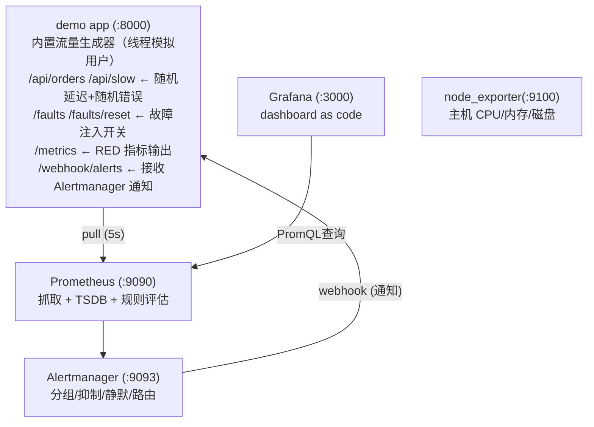

# Lab01 · 从零搭一套指标监控：埋点 → 抓取 → 可视化 → 告警

> 对应笔记：[notes/01-metrics/](../../notes/01-metrics/README.md)
> 一条命令跑通：示例应用埋点（Python + prometheus_client）→ Prometheus 抓取 → Grafana 可视化 → 告警规则 + Alertmanager 通知。

## 目标

1. 看到一个真实的 `/metrics` 输出，与 [data-model.md](../../notes/01-metrics/data-model.md) 的逐行注释对上。
2. 在 Prometheus UI 里跑 PromQL（QPS / 错误率 / p99 / 资源使用率）。
3. 在 Grafana 看一块自动装配的 dashboard（provisioning，零手工配置）。
4. 动态注入故障，亲眼看到：指标变化 → 告警 pending → firing → Alertmanager 分组路由 → webhook 收到通知 → 故障恢复 → resolved。

## 架构



## 前置条件

- podman ≥ 4.x + podman compose（macOS 需先 `podman machine init && podman machine start`）
- 约 2GB 可用内存；本机 8000 / 9090 / 9093 / 3000 / 9100 端口未被占用
- 镜像版本（如无法拉取，可改为就近可用的 tag；版本以官方发布为准）：
  - `prom/prometheus:v3.4.2`、`prom/alertmanager:v0.28.1`、`grafana/grafana:12.1.0`、`prom/node-exporter:v1.9.1`、`python:3.12-slim`

## 启动

```bash
cd labs/lab01-prometheus-grafana
podman compose up -d --build
podman compose ps          # 五个容器应全部 Up（约等 30s 数据积累）
```

## 验证步骤（含预期输出）

### 1. 看原始 /metrics（对应笔记：数据模型）

```bash
curl -s http://localhost:8000/metrics | head -30
```

预期：能看到 `# HELP http_requests_total ...`、`# TYPE http_requests_total counter`、
`http_requests_total{method="GET",path="/api/orders",status="200"} 42` 这样的行；
以及 histogram 的 `http_request_duration_seconds_bucket{...,le="0.05"}` 累积桶。

### 2. Prometheus 抓取健康检查

- 打开 <http://localhost:9090/targets>：`demo-app`、`node-exporter`、`prometheus` 三个 job 的 State 均为 **UP**。
- PromQL 验证：在 <http://localhost:9090/graph> 执行 `up`，预期返回三条序列，值全为 `1`。

### 3. 跑 PromQL（对应笔记：PromQL 详解）

在 Graph 页依次执行，观察曲线/即时值：

| 查询 | 预期 |
| --- | --- |
| `sum(rate(http_requests_total[1m]))` | 总 QPS 约 4~10 req/s（生成器每轮顺序发 3~8 个请求再睡 0.5s，吞吐还受请求自身延迟拖累，到不了 3~8 ÷ 0.5 的理论上限） |
| `sum by (path) (rate(http_requests_total[1m]))` | 两条线：`/api/orders` 为主、`/api/slow` 约占两成 |
| `sum(rate(http_requests_total{status=~"5.."}[1m])) / sum(rate(http_requests_total[1m]))` | 错误率约 `0.02`（基础注入 2%） |
| `histogram_quantile(0.99, sum by (le) (rate(http_request_duration_seconds_bucket[2m])))` | p99 大致在 0.3~1s 波动（slow 接口 + 罕见长尾） |
| `sum(increase(orders_created_total[10m]))` | 近 10 分钟新增订单数十个 |
| `1 - avg(rate(node_cpu_seconds_total{mode="idle"}[2m]))` | podman machine VM 的 CPU 使用率，0~1 之间 |

### 4. Grafana 仪表盘（对应笔记：Grafana 可视化）

- 打开 <http://localhost:3000>，登录 `admin / admin`（首登可能提示改密码，可 Skip）。
- 左侧 Dashboards → 文件夹 **Lab01** → **Lab01 · 指标监控总览（RED + 主机资源）**。
  （该 dashboard 由 provisioning 自动加载，数据源也已自动配置。）
- 预期看到：四个 Stat（QPS / 错误率 / p99 / 存活目标）+ QPS 按路径 + 错误率按路径 +
  延迟分位数（p50 远低于 p99，因为 `/api/slow` 制造了双峰分布）+ 订单速率 + CPU/内存使用率。
- 顶部 `job` 变量可切换/多选（试试只看 `demo-app`）。

### 5. 触发告警（对应笔记：告警体系）

**注入故障（把 5xx 概率提到 50%）：**

```bash
curl -X POST 'http://localhost:8000/faults?error_ratio=0.5'
# {"error_ratio":0.5,"extra_latency_seconds":0.0}
```

**按时间线观察（对照状态机 pending → firing）：**

1. ~10 秒内：Grafana「5xx 错误率」Stat 变红，错误率曲线冲到 0.5 附近。
2. ~1 分钟：<http://localhost:9090/alerts> 中 `HighErrorRate` 先 **PENDING**（黄）；
   持续满足 `for: 1m` 后变为 **FIRING**（红）。
3. FIRING 后约 10~40 秒（group_wait）：<http://localhost:9093> Alertmanager UI 中出现该告警（severity=critical），
   随后路由到 webhook。查看通知已到达：

   ```bash
   curl -s http://localhost:8000/webhook/alerts | python3 -m json.tool
   ```

   预期：`alerts` 数组里有 `alertname: "HighErrorRate"`、`severity: "critical"`、
   `summary: "demo-app 5xx 错误率过高"` 的记录，`status: "firing"`。
4. **恢复故障：**

   ```bash
   curl -X POST http://localhost:8000/faults/reset
   ```

   错误率回落 → `for` 条件失效 → Prometheus 标记 resolved → Alertmanager 发送恢复通知
   （webhook 记录中出现 `status: "resolved"`）。

**触发延迟告警（可选）：**

```bash
curl -X POST 'http://localhost:8000/faults?extra_latency_seconds=2'
# 等待约 4 分钟（for: 2m + 窗口累积）→ HighLatencyP99 FIRING（severity=warning）
curl -X POST http://localhost:8000/faults/reset
```

**观察 Watchdog 哨兵：** <http://localhost:9090/alerts> 里 `Watchdog` 恒为 FIRING——这是设计如此；
若 webhook 里它停止出现，说明告警链路断了（这正是它的用途）。

### 6. Alertmanager 分组/抑制/静默速玩

- **分组**：`podman compose stop node-exporter` 会产生 `TargetDown{job="node-exporter"}`，注意它作为独立 alertname 分组到达 webhook。
- **抑制**：同 alertname 下 critical 告警存在时，配置中的 inhibition 会压制同 job 的 warning（本 lab 组合较少，主要看配置语义）。
- **静默**：<http://localhost:9093> → Silences → New Silence，matcher 填 `job="demo-app"`，时长 10 分钟 →
  再次注入故障，指标照样恶化，但 webhook 不再有新通知（Prometheus `/alerts` 页仍显示 FIRING——静默只影响通知）。

## 清理

```bash
podman compose down            # 停止并删除容器（保留两个 named volumes）
podman compose down -v         # 连同 prometheus/grafana 数据卷一起删除
```

## 目录结构

```
lab01-prometheus-grafana/
├── docker-compose.yml             # 五个服务一键编排
├── README.md                      # 本文件
├── app/                           # 示例应用（FastAPI + prometheus_client）
│   ├── app.py                     # RED 埋点 + 故障注入 + 流量生成器 + webhook 接收
│   ├── requirements.txt
│   └── Dockerfile
├── prometheus/
│   ├── prometheus.yml             # 抓取配置（3 个 job + alertmanager 对接）
│   └── alerts/alert_rules.yml     # 告警规则（HighErrorRate/HighLatencyP99/TargetDown/Watchdog...）
├── alertmanager/
│   └── alertmanager.yml           # 路由树 + 分组 + 抑制 + webhook 接收器
└── grafana/
    ├── provisioning/
    │   ├── datasources/prometheus.yml   # 数据源（固定 uid=prometheus）
    │   └── dashboards/dashboards.yml    # dashboard provider
    └── dashboards/lab01-overview.json   # 完整 dashboard JSON（schemaVersion 39）
```
<!-- 保留原图：目录结构清单，非概念示意图，Mermaid 无原生文件树类型 -->

## 常见问题

1. **Grafana 面板 No data**：先查 <http://localhost:9090/targets> 是否 UP；再确认时间范围（默认最近 15 分钟）与浏览器时区；`job` 变量是否误排除。
2. **告警不 firing**：检查 `/alerts` 页 pending 剩余时间；错误率是否真的稳定 >5%（流量低时 rate 波动大，多等一两个评估周期）。
3. **webhook 没收到通知**：Alertmanager UI 里看告警是否到达、是否被静默/抑制；`podman compose logs alertmanager` 看投递报错。
4. **Mac 上 node_exporter 指标"不对"**：podman machine 下读到的是 Linux VM 的指标，属正常现象；Linux 宿主机上跑则为主机真实指标。
5. **改了 prometheus.yml 不生效**：`curl -X POST http://localhost:9090/-/reload`（已启用 `--web.enable-lifecycle`），或 `podman compose restart prometheus`。

## 思考题（配合笔记食用）

1. 把 `app.py` 中 DURATION 的 buckets 改成 `(1, 2, 3)`，p99 面板会变成什么样？为什么桶边界要贴着 SLO 设计？（提示：histogram_quantile 插值）
2. 在 `/api/orders` 的标签里加一个 `user_id`（模拟），观察 Prometheus `/targets` 页的 series 数量变化——高基数问题的直观感受。改完记得改回来。
3. 把告警规则 `HighErrorRate` 的 `for` 改成 `10s` 和 `10m` 各试一次，体会误报与漏报的权衡。
4. 为什么 dashboard 里错误率面板阈值（黄 2%/红 5%）要与 `HighErrorRate` 告警阈值保持一致？不一致会带来什么认知负担？
5. `Watchdog` 哨兵告警有什么用？如果它是低优先级（info），为什么还要一直 firing？（提示：死信检测 / meta-monitoring）
6. 尝试给 dashboard 加一块 Heatmap 面板（延迟分布热力图）：查询 `sum by (le) (increase(http_request_duration_seconds_bucket[$__rate_interval]))`，Format 选 Heatmap，观察双峰分布。
7. 若要把本 lab 改造成"双实例 app"，哪些查询不需要改（为什么）？哪些需要加 `by (instance)`？

## 版本与参考

- 镜像版本以官方发布为准：[prom/prometheus](https://hub.docker.com/r/prom/prometheus)、[prom/alertmanager](https://hub.docker.com/r/prom/alertmanager)、[grafana/grafana](https://hub.docker.com/r/grafana/grafana)、[prom/node-exporter](https://hub.docker.com/r/prom/node-exporter)（访问日期：2026-11-04）
- Prometheus 文档：<https://prometheus.io/docs/>（访问日期：2026-11-04）
- prometheus_client（Python）：<https://github.com/prometheus/client_python>（访问日期：2026-11-04）
- Grafana provisioning：<https://grafana.com/docs/grafana/latest/administration/provisioning/>（访问日期：2026-11-04）

## 附：ASCII 图替换清单

| 原 ASCII 图位置（章节标题） | 原图内容简述 | 替换结果 |
| --- | --- | --- |
| 架构 | demo app / Prometheus (:9090) / Alertmanager (:9093) / Grafana (:3000) / node_exporter (:9100) 五服务拓扑，含 pull (5s)、webhook (通知)、PromQL查询 等箭头标注 | flowchart TD |

### 保留说明

- 「目录结构」：工程目录清单（文件树），Mermaid 无原生文件树类型，保留原样（图后已加 HTML 注释）。
