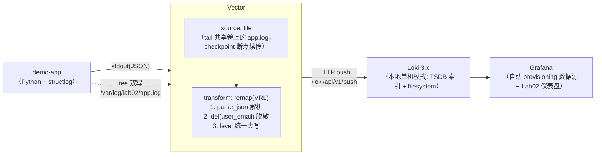

# Lab02：结构化日志采集与查询全链路（Vector + Loki + Grafana，podman 版）

> 阶段 2 配套实验。理论笔记见 [notes/02-logging/](../../notes/02-logging/README.md)。
> 本工作区容器工具一律使用 **podman**（macOS 需先启动 podman machine），`docker-compose.yml`
> 文件名保留（podman compose 直接兼容）。

## 目标

跑通一条最小但完整的生产级日志链路，并亲手验证每个环节：

1. **应用产出结构化日志**：Python + structlog，单行 JSON 写 stdout，字段包含
   `level / timestamp / event / service / request_id / user_id / status / duration_ms` 等；
2. **采集端解析与脱敏**：Vector `file` source 采集共享卷上的日志文件（podman 环境没有
   docker.sock，应用把 stdout 双写一份到文件），用 VRL 解析 JSON、
   删除敏感字段（`user_email`）、统一 `level` 大小写，再以低基数 label 推给 Loki；
3. **存储端理解 Loki 设计**：本地单机模式（TSDB 索引 + filesystem 存储 + compactor retention），
   体会"label 做索引、正文只压缩不索引"的成本模型；
4. **查询端掌握 LogQL**：在 Grafana 中做流过滤、`| json` 解析取字段、行过滤、
   `rate / count_over_time / unwrap` 聚合，从"看日志"到"算指标"。

## 架构



数据流要点：

- 应用按 12-factor 只感知"把 JSON 日志写出去"：stdout 一份（`podman compose logs app`
  随时能看），同时经 Tee 双写共享卷上的 `/var/log/lab02/app.log`（`app-logs` 卷）；
- **为什么不用 Vector 的 `docker_logs` source？** 它依赖 Docker Engine API（docker.sock）。
  podman 下虽可 `podman system service` 暴露兼容 socket，但路径/权限随 podman machine
  环境漂移；改用 file source 更稳，且这正是生产 K8s 的形态
  （kubelet 落盘 + DaemonSet tail 宿主机日志文件）；
- Vector 用 `file` source tail 该文件，checkpoint 存在独立卷 `vector-data`（`/var/lib/vector`），
  重启后从断点续读，不重读不漏读；
- 推给 Loki 的 **label 只有 4 个**：`job / env / service / level`（全部低基数），
  `user_id / request_id / order_id` 留在日志行里，用 `| json` 查询时再提取。

## 文件结构

```
lab02-loki-vector-logging/
├── docker-compose.yml              # 一键编排（podman compose）：app + vector + loki + grafana
├── app/
│   ├── Dockerfile                  # python:3.12-slim（注意 python -u 关闭缓冲）
│   ├── requirements.txt            # structlog
│   └── app.py                      # 模拟订单服务：INFO/WARN/ERROR/DEBUG 混合事件；支持 LOG_FILE 双写
├── vector/
│   └── vector.toml                 # file source → VRL 解析+脱敏 → loki sink（含 checkpoint 说明）
├── loki/
│   └── loki-config.yaml            # 单机模式：TSDB(v13) + retention(72h) + compactor
├── grafana/
│   ├── provisioning/
│   │   ├── datasources/loki.yaml   # Loki 数据源（uid=loki）
│   │   └── dashboards/dashboards.yaml
│   └── dashboards/lab02-logs.json  # 日志面板 + 级别速率 + error rate + p95 耗时
└── README.md                       # 本文件
```
<!-- 保留原图：目录结构清单，非概念示意图，Mermaid 无原生文件树类型 -->

## 前置条件

- podman ≥ 4.x + podman compose（macOS 需先 `podman machine init && podman machine start`）：
  `podman compose version` 能正常输出即就绪
- 可用内存 ≥ 2GB（Loki + Grafana + Vector 合计约 1GB 左右）
- 端口：`3000`（Grafana）、`3100`（Loki）未被占用
- 无需本地安装 Python/Node：应用在容器内构建运行（镜像由 podman 从 docker.io 拉取）

## 启动

```bash
cd labs/lab02-loki-vector-logging
podman compose up -d --build
```

首次构建需拉取基础镜像与 pip 依赖（约 1-3 分钟，取决于网络）。

查看各组件状态与日志：

```bash
podman compose ps

# 确认 app 在输出 JSON 日志（每一行应是一个完整 JSON 对象）
podman compose logs app | head -5
```

预期输出（字段顺序可能不同）：

```json
{"event": "service_started", "level": "info", "service": "demo-app", "request_id": "-", "timestamp": "2026-11-04T12:00:00.123456Z", "user_id": "-", "pid": 1, "config": {"log_level": "INFO", "error_rate": 0.12, "warn_rate": 0.15}}
{"duration_ms": 234, "event": "request_completed", "level": "info", "method": "GET", "order_id": "ord-1a2b3c4d", "path": "/api/search", "request_id": "9f8e7d6c5b4a", "service": "demo-app", "status": 200, "timestamp": "2026-11-04T12:00:00.654321Z", "user_id": "u1007", "amount": 259.9}
```

同一份日志也在共享卷文件里（Vector 采集的就是它）：

```bash
podman compose exec app head -2 /var/log/lab02/app.log
```

确认 Loki 就绪（返回 `ready`）：

```bash
curl -s http://localhost:3100/ready
```

确认 Vector 已推送日志（应能看到 `job`/`service`/`level` 等 label 值）：

```bash
curl -s http://localhost:3100/loki/api/v1/labels | python3 -m json.tool
curl -s "http://localhost:3100/loki/api/v1/label/service/values" | python3 -m json.tool
# 预期：["demo-app"]
```

## 验证

### 1. Grafana 仪表盘

打开 <http://localhost:3000>（匿名已开 Admin 权限，或 admin/admin 登录）。
左侧 Dashboards → 文件夹 **Lab02** → **Lab02 - 结构化日志采集与查询**。

等约 30 秒后应看到：

- 「应用日志」面板持续滚动 JSON 日志（ERROR 行红色高亮）；
- 「各级别日志量」堆叠曲线，info 占大头、error/warning 少量；
- 「ERROR 日志速率 vs 总速率」两条曲线，errors/s 明显低于 total/s；
- 「请求耗时 p95」有 slow_request 与 request_completed 两条曲线。

### 2. 在 Grafana Explore 里跑 LogQL

左侧 Explore → 选择 Loki 数据源，依次执行下列查询（时间范围选最近 15 分钟）。

| # | 目的 | 查询 |
|---|------|------|
| 1 | 看原始日志 | `{job="lab02"}` |
| 2 | label 过滤错误日志（最快，label 已索引） | `{job="lab02", level="ERROR"}` |
| 3 | json 解析器取字段过滤（level 也在行内） | `{job="lab02"} \| json \| level="ERROR"` |
| 4 | 5xx 请求（数值比较） | `{job="lab02"} \| json \| status >= 500` |
| 5 | 行内正则搜索堆栈关键词 | `{job="lab02"} \|~ "DownstreamTimeout\|InsufficientStock"` |
| 6 | 指定用户的全链路日志 | `{job="lab02"} \| json \| user_id="u1007"` |
| 7 | 验证敏感字段已被 Vector 删除 | `{job="lab02"} \| json \| user_email=~".+"` |
| 8 | 错误日志速率（条/秒） | `sum(rate({job="lab02"} \| json \| level="ERROR" [1m]))` |
| 9 | 错误占比 | `sum(rate({job="lab02"} \| json \| level="ERROR" [5m])) / sum(rate({job="lab02"} [5m]))` |
| 10 | 按事件聚合错误数 | `topk(3, sum by (event) (count_over_time({job="lab02"} \| json \| level="ERROR" [$__auto])))` |
| 11 | 慢请求耗时分位数（unwrap 数值字段） | `quantile_over_time(0.95, {job="lab02"} \| json \| event="slow_request" \| unwrap duration_ms [5m])` |
| 12 | 自定义行格式输出 | `{job="lab02"} \| json \| level="ERROR" \| line_format "{{.request_id}} {{.event}} {{.duration_ms}}"` |

预期结果：

- 查询 2/3/4：仅返回 `request_failed` 事件，含 `status=500/502/503`、`exception` 堆栈字符串；
- **查询 7 应返回空**——app 明明打了 `user_email`（可在 `podman compose logs app \| grep user_email` 看到），
  但 Vector 的 VRL 已将其删除。这是"采集端脱敏兜底"的直接证据；
- 查询 8：曲线数值 ≈ `请求速率 × ERROR_RATE`（默认 0.12 × ~2 条请求日志/秒 ≈ 0.2 上下波动）；
- 查询 11：数值在 800–3000 之间（app 模拟的慢请求区间）。

### 3. 用 curl 验证 LogQL（不经过 Grafana）

```bash
# 即时查询：当前 error 日志每秒条数
curl -s -G "http://localhost:3100/loki/api/v1/query" \
  --data-urlencode 'query=sum(rate({job="lab02"} | json | level="ERROR" [1m]))' | python3 -m json.tool
```

预期输出（数值随流量波动）：

```json
{
    "status": "success",
    "data": {
        "resultType": "vector",
        "result": [
            {
                "metric": {},
                "value": [1762257600, "0.21333333333333335"]
            }
        ]
    }
}
```

### 4. 观察 retention / compactor 配置生效

```bash
podman compose logs loki 2>&1 | grep -i compactor | head -5
```

`loki/loki-config.yaml` 中 `limits_config.retention_period: 72h` + `compactor.retention_enabled: true`
表示超过 72 小时的数据会被删除；本地实验很难等到 3 天，理解配置含义即可（可改为 24h 观察）。

### 5. 验证 checkpoint 断点续传（可选）

```bash
podman compose restart vector   # 重启采集器
# 等 10 秒后在 Grafana 里看 {job="lab02"}：不应出现大段重复日志——
# file source 从 vector-data 卷里的 checkpoint 续读，而不是从头重读文件
```

## 清理

```bash
podman compose down          # 停止并删除容器（保留 loki-data / app-logs / vector-data 卷）
podman compose down -v       # 连同卷一起删除，彻底回到初始状态
```

## 思考题

1. 把 `vector.toml` 中 `[sinks.loki.labels]` 里加一行 `user_id = "{{ user_id }}"` 会发生什么？
   （提示：Loki 每个独立 label 组合都是一条"流"，20 个用户 × 4 个 level 会产生多少流？
   如果 user_id 是 100 万个呢？参考 notes/02-logging/loki.md 的"高基数 label"一节。）
2. 查询 2（label 过滤）与查询 3（`| json` 解析后过滤）在 Loki 内部的执行路径有何不同？
   哪种在大时间范围内更便宜？为什么？
3. 应用把 `ERROR_RATE` 调到 0.9，`rate(...[1m])` 的曲线会怎样变化？把区间改成 `[5m]` 呢？
   体会 range interval 对平滑度的影响。
4. 如果 Vector 挂掉 10 分钟，恢复后会发生什么？能补读这 10 分钟的日志吗？
   （提示：`file` source 的 checkpoint 在 `vector-data` 卷里，重启后从断点续读；
   再想想如果 `down -v` 把 checkpoint 卷删了会怎样——文件从头重读，Loki 里出现重复行。
   对比：`docker_logs` source 是实时事件流，断了就是丢了，无法回放——这就是两种 source 的语义差别。）
5. 本实验中 app 同时写 stdout 与共享卷文件（tee 双写）。如果把 `LOG_FILE` 指到容器可写层
   而不是挂 `app-logs` 卷，容器重建后日志文件去哪了？为什么 named volume 能活过容器重建？
   `vector-data`（checkpoint）为什么要单独持久化？
   （提示：容器可写层随容器删除；参考 notes/02-logging/collectors.md 第 9 节。）
6. 当前链路里 `timestamp` 用的是应用时间（Vector merge 后又 parse_timestamp 转回时间戳类型）。
   如果应用机器时钟快了 5 分钟，Loki 会发生什么？`out_of_order_action="accept"` 能救多少？

## 版本与参考

| 组件 | 版本 | 说明 |
|------|------|------|
| Python | 3.12-slim | 官方镜像 `https://hub.docker.com/_/python`（podman 从 docker.io 拉取同名镜像） |
| structlog | 24.4.0 | https://github.com/hynek/structlog/releases |
| Vector | 0.61.0-alpine | https://github.com/vectordotdev/vector/releases |
| Loki | 3.7.9 | https://github.com/grafana/loki/releases |
| Grafana | 13.3.0 | https://github.com/grafana/grafana/releases |

镜像 tag 以各项目官方发布为准（访问日期：2026-11-04）。更多文档：

- podman compose 文档：<https://docs.podman.io/en/latest/markdown/podman-compose.1.html>（访问日期：2026-11-04）
- Vector file source：<https://vector.dev/docs/reference/configuration/sources/file/>（访问日期：2026-11-04）
- Vector 配置参考：<https://vector.dev/docs/reference/configuration/>（访问日期：2026-11-04）
- VRL 语言参考：<https://vector.dev/docs/reference/vrl/>（访问日期：2026-11-04）
- Loki 配置参考：<https://grafana.com/docs/loki/latest/configure/>（访问日期：2026-11-04）
- LogQL 语法：<https://grafana.com/docs/loki/latest/query/>（访问日期：2026-11-04）

## 附：ASCII 图替换清单

| 原 ASCII 图位置（章节标题） | 原图内容简述 | 替换结果 |
| --- | --- | --- |
| 架构 | demo-app → Vector（file source + VRL transform）→ Loki → Grafana 日志链路，含 stdout(JSON)、tee 双写、HTTP push /loki/api/v1/push 标注 | flowchart LR |

### 保留说明

- 「文件结构」：工程目录清单（文件树），Mermaid 无原生文件树类型，保留原样（图后已加 HTML 注释）。
