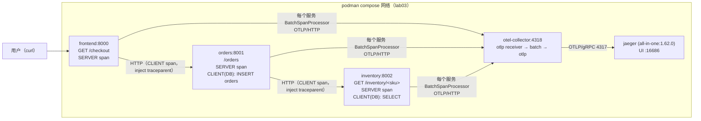

# lab03 · 微服务链路追踪实战：亲眼看一条跨服务 trace

> 对应笔记：[notes/03-tracing/](../../notes/03-tracing/README.md)
> 本实验用**纯手动埋点**（Python + opentelemetry-sdk，不用自动 instrumentation），
> 让你亲眼看到：一次请求如何变成一条贯穿 3 个服务、7 个 span 的 trace，
> W3C `traceparent` 头如何在服务间传播，错误与延迟在瀑布图上长什么样。

## 1. 实验目标

- [x] 看到一条完整的跨服务 trace：frontend → orders → inventory，共 7 个 span
- [x] 亲眼验证 W3C Trace Context 传播：手工构造 `traceparent` 头发起请求，在 Jaeger 中按该 trace_id 搜到整棵树
- [x] 制造并分析三类 trace：正常、慢（数据库延迟）、错误（中间层出错 / 最深层出错）
- [x] 读懂 OTLP 链路：服务 → otel-collector（batch）→ Jaeger
- [x] 理解采样标志：`trace-flags=00`（不采样）时链路"消失"

## 2. 架构



span 树（一次正常请求共 7 个）：

```mermaid
flowchart TD
    S1["GET /checkout<br/>frontend SERVER"] --> S2["GET http://orders:8001/orders<br/>frontend CLIENT"]
    S2 --> S3["GET&#124;POST /orders<br/>orders SERVER"]
    S3 --> S4["INSERT orders<br/>orders CLIENT·DB"]
    S3 --> S5["GET http://inventory:8002/inventory/&lt;item&gt;<br/>orders CLIENT"]
    S5 --> S6["GET /inventory/&lt;sku&gt;<br/>inventory SERVER"]
    S6 --> S7["SELECT inventory<br/>inventory CLIENT·DB"]
```



三个业务服务共用 `services/common/` 下的引导代码：

| 文件 | 职责 |
| --- | --- |
| `otel_setup.py` | TracerProvider / Resource / Batch / OTLP 导出器 / W3C 传播器 / 优雅退出 |
| `wsgi_tracing.py` | 手写的 SERVER span 中间件（extract → span → attach → status → end） |
| `http_client.py` | 手写的出站调用（CLIENT span + `propagate.inject`，并把发出的 traceparent 记为属性） |

## 3. 前置条件

- **podman ≥ 4.x + podman compose**（本工作区统一使用 podman，不使用 docker）。
  macOS 上 podman 运行在轻量 Linux 虚拟机里，首次使用需先初始化并启动：

  ```bash
  podman machine init && podman machine start
  podman --version && podman compose version   # 确认两者可用
  ```

- 约 2 GB 磁盘（python:3.12-slim + collector + jaeger 镜像）
- 浏览器打开 <http://localhost:16686>
- 端口占用检查：8000/8001/8002（服务）、4317/4318（collector）、16686（Jaeger UI）

镜像与依赖版本（均以官方发布为准；下表发布页为 Docker Hub 链接，
**podman 拉取的镜像名与之完全相同**——podman 默认 registry 就是 docker.io，无需任何改写）：

| 组件 | 版本 | 发布页 |
| --- | --- | --- |
| jaegertracing/all-in-one | 1.62.0 | <https://hub.docker.com/r/jaegertracing/all-in-one>（访问日期：2026-11-04） |
| otel/opentelemetry-collector-contrib | 0.112.0 | <https://hub.docker.com/r/otel/opentelemetry-collector-contrib>（访问日期：2026-11-04） |
| python（基础镜像） | 3.12-slim | <https://hub.docker.com/_python>（访问日期：2026-11-04） |
| Flask / httpx / opentelemetry-* | 3.0.3 / 0.27.2 / 1.27.0 | <https://pypi.org>（访问日期：2026-11-04） |

## 4. 启动

```bash
cd labs/lab03-otel-tracing-jaeger
podman compose up -d --build      # 首次构建约 1~3 分钟（拉镜像 + pip install）
podman compose ps                 # 三个业务服务应显示 healthy（jaeger/collector 无 healthcheck，显示空）
```

**预期输出**（`podman compose ps`，状态列示意；podman 的容器名前缀可能略有差异）：

```
NAME                          STATUS
lab03-...-frontend-1          Up 30 seconds (healthy)
lab03-...-orders-1            Up 40 seconds (healthy)
lab03-...-inventory-1         Up 50 seconds (healthy)
lab03-...-otel-collector-1    Up 50 seconds
lab03-...-jaeger-1            Up 50 seconds
```

排错入口：

```bash
podman compose logs frontend          # 服务启动日志（Werkzeug development server）
podman compose logs otel-collector    # 应看到 debug exporter 打印的 span 流
podman compose logs jaeger            # OTLP 接收是否正常
```

## 5. 验证

### 5.1 制造一条正常 trace

```bash
curl -i 'http://localhost:8000/checkout?item=widget'
```

**预期输出**（关键部分）：

```
HTTP/1.1 200 OK
x-trace-id: 0af7651916cd43dd8448eb211c80319c     ← 每次请求不同；记下它，下一步要用
Content-Type: application/json

{"service":"frontend","item":"widget","orders":{"service":"orders","order_id":4821,"item":"widget","stock":17}}
```

等 5 秒（BatchSpanProcessor 默认导出周期 + collector batch 2s），打开 Jaeger UI：

1. <http://localhost:16686> → 左上 Service 下拉 → 应出现 **frontend / orders / inventory** 三个服务（来自 Resource 的 `service.name`）
2. Service 选 `frontend`，Operation 选 `GET /checkout`（或不选），点 **Find Traces**
3. 点开最新一条 trace：
   - **共 7 个 span、3 个服务分组**，结构与第 2 节的 span 树一致
   - 瀑布图上 frontend CLIENT span 与 orders SERVER span 有 1~2ms 错位（本机容器网络 + 排队）
   - 点开 `GET /inventory/<sku>` 这个 SERVER span：名称是路由模板而不是 `widget`（`before_request` 里 `update_name` 的效果），`url.path` 属性仍是真实路径
   - 点开 orders 的 `INSERT orders` / inventory 的 `SELECT inventory`：`db.system`、`db.query.text` 属性齐全
   - orders SERVER span 的 **Tags/Logs** 里有 `order.accepted` 事件（Logs 栏）
   - 任一 CLIENT span（frontend→orders）的属性里有 `http.request.header.traceparent`，形如 `00-<trace_id>-<32位中后16位正是本 span 的 span_id>-01`

### 5.2 用 trace_id 精确搜 trace

上一步响应头里的 `x-trace-id` 直接用于 Jaeger 搜索框左侧的 **Search by Trace ID**：
粘贴进去回车，应直接命中那一条 trace。这也验证了响应链路里 trace_id 从头贯穿到尾。

### 5.3 找错误 trace（两种形态）

**形态 A：错误在最深层（inventory）**

```bash
curl -s 'http://localhost:8000/checkout?item=boom'    # 注意 HTTP 状态码是 502
```

**形态 B：错误在中间层（orders 自身）**

```bash
curl -s 'http://localhost:8000/checkout?item=widget&fail=1'   # 状态码 502（orders 内部是 500，frontend 统一包装成 502）
```

到 Jaeger 里找 trace：Service 选 `frontend` → Find Traces → 红色（Error）的就是；
或者直接用 curl 响应头里的 x-trace-id 精确搜索。

**预期看到的差异**（对照 [tracing-practice.md](../../notes/03-tracing/tracing-practice.md) 第 4 节）：

| | 形态 A（item=boom） | 形态 B（fail=1） |
| --- | --- | --- |
| 最深的红色 span | inventory 的 `GET /inventory/<sku>` | orders 的 SERVER span |
| exception 事件在哪层 | inventory（`RuntimeError: inventory record ... corrupted`，Logs 栏可见 exception.type/message/stacktrace） | orders（`order validation failed ... payment quota exceeded`） |
| inventory 是否出现 | 出现（并自己标红） | 不出现（orders 在调它之前就失败了，链路少一截） |
| 上层 span | orders SERVER 标红（502），frontend SERVER 标红 | frontend SERVER 标红（502） |

### 5.4 手工验证跨服务 traceparent 传播（本实验的高光）

我们**自己编一个 trace_id**，通过请求头塞给 frontend。如果传播真的在工作，
Jaeger 里应当出现一条根 span 为 frontend、trace_id 等于我们编造值的完整 3 服务 trace：

```bash
TRACE_ID=$(openssl rand -hex 16)     # 128bit = 32 个 hex 字符
SPAN_ID=$(openssl rand -hex 8)       # 64bit = 16 个 hex 字符
echo "trace_id = $TRACE_ID"

# trace-flags=01 表示"采样"；格式：00-{trace_id}-{span_id}-{flags}
curl -s -H "traceparent: 00-${TRACE_ID}-${SPAN_ID}-01" \
     'http://localhost:8000/checkout?item=widget'
```

等 5 秒，Jaeger 顶部 **Search by Trace ID** 输入 `$TRACE_ID`（或直接粘贴上面 echo 的值）：
应看到整棵树。frontend SERVER span 是树根，但点开它能看到 **references/parent 指向我们伪造的 `${SPAN_ID}`**——这个父 span 在后端里并不存在（它是"虚拟父"），所以整棵树看起来仍以 frontend 为根。

**对照组：不采样标志**。只把末位从 `01` 换成 `00`：

```bash
curl -s -H "traceparent: 00-${TRACE_ID}-${SPAN_ID}-00" \
     'http://localhost:8000/checkout?item=widget'
```

等 10 秒再搜同一个 trace_id：**什么都没有**。因为 `ParentBased` 采样器尊重上游
`trace-flags=00` 的决定，整条链路不产生任何导出的 span——这不是断链，是采样的正常行为。

**对照组：非法头**。

```bash
curl -s -H "traceparent: 00-bad-id-bad-01" 'http://localhost:8000/checkout?item=widget'
```

按 W3C 规范，非法 traceparent 视作不存在 → frontend 新建根 span（trace_id 与我们给的无关）。

### 5.5 制造慢 trace 并读关键路径

```bash
curl -s 'http://localhost:8000/checkout?item=widget&slow=1'
```

在 Jaeger 打开这条 trace，对照思考（答案见 [tracing-practice.md](../../notes/03-tracing/tracing-practice.md) 第 2~3 节）：

- 总耗时主要由谁贡献？（inventory 的 `SELECT inventory` 约 850ms，是关键路径末端）
- frontend SERVER span 与其 CLIENT 子 span 之间的空隙是什么？（frontend 自身 sleep 的 10~30ms self time）
- 试着对比：勾选两条 trace 点 **Compare**，看慢与正常的差异段。

### 5.6 看 Collector 的中转（可选）

```bash
podman compose logs -f otel-collector
```

每 2 秒左右应看到 `debug` exporter 输出的 span 摘要（名称、trace id、服务名），
证明数据确实经过了 Collector 这一层（生产上你还会在这里做脱敏/过滤/tail 采样）。

## 6. 常见坑（按"现象 → 原因 → 修法"）

1. **Jaeger 里搜不到 trace**
   - 等待不足：SDK 批处理默认最长 5s + collector batch 2s，刚发完请求立刻搜会扑空；
   - 端口写错：HTTP 导出必须带 `/v1/traces` 路径（`http://otel-collector:4318/v1/traces`），写成 4317 会静默失败（Batch 会吞掉导出错误，`podman compose logs frontend` 里才有线索）；
   - trace-flags 是 00（见 5.4）。
2. **服务下拉里没有某个服务**：Resource 的 `service.name` 没生效；本实验在 `otel_setup.py` 的 `init_tracing(SERVICE_NAME)` 传入，检查是否传错。
3. **trace 只有 frontend 一层**：出站调用忘了 inject（本实验封装在 `http_client.traced_get` 里，若你手写 httpx 调用而没 `propagate.inject(headers)`，orders 就会另起一个根 span）。
4. **span 泄漏/trace 奇怪地不完整**：容器被 SIGKILL（`podman compose kill`）时 Batch 里没导出的 span 会丢；用 `podman compose stop`（SIGTERM，代码里注册了 flush 钩子）。
5. **`/health` 也出现在 trace 里**：本实验的中间件已显式跳过 `/health`；若你自己加路由做实验，注意别让探针流量淹没业务 trace。
6. **compose 报端口占用**：改 `docker-compose.yml` 的 `ports` 映射（左边宿主机端口），服务间互调用的是容器内端口不用动。
7. **podman 专属：端口映射与访问宿主机**
   - macOS 上端口由 podman machine（Linux 虚拟机）转发到宿主机，`localhost:16686` 打不开时先确认 machine 在跑：`podman machine list`，必要时 `podman machine start`；
   - 容器内要访问宿主机服务时，地址写 `host.containers.internal`（不是 `localhost`，容器里的 localhost 是容器自己）；
   - `podman compose` 使用外部 compose provider（如 docker-compose 二进制或 podman-compose），首次运行若提示缺 provider，按提示安装即可，命令用法不变。

## 7. 清理

```bash
podman compose down            # 停止并删除容器（Jaeger 内存存储的数据一并消失）
podman compose down --rmi all  # 连镜像一起删，彻底还原
```

## 8. 思考题

1. 把 `services/common/http_client.py` 里的 `propagate.inject(headers)` 注释掉再重建，Jaeger 里会看到什么现象？（提示：orders 的 SERVER span 会变成新的根——两棵孤树，即"断链"）
2. `traceparent` 末位 `00` 时链路消失（5.4 实验）；如果业务上要求"错误请求必须留痕"，采样策略应该怎么改？（提示：head-based 固定比例 vs tail-based 按错误保留，见 `tracing-practice.md` 第 7 节，阶段 5 详讲）
3. 为什么 `INSERT orders` / `SELECT inventory` 的 span kind 用 `CLIENT` 而不是 `INTERNAL`？如果把它们改成 INTERNAL，Jaeger 的展示会有什么不同？
4. frontend 的 CLIENT span 与 orders 的 SERVER span 之间的时间差在本实验里大约 1~2ms；如果生产环境这个差值是 200ms，你会按什么顺序排查？
5. 本实验每个请求产生 7 个 span。若 orders 里再串行调用 3 个下游、每个下游再查 2 次 DB，span 数是多少？什么时候该考虑合并 span 为 event/属性？
6. `docker-compose.yml` 里 collector 用 `depends_on: jaeger` 而**没有** `condition: service_healthy`——如果 Jaeger 起得慢，头几批 span 会丢吗？（去看 collector exporter 的重试行为）

## 9. 文件清单

```
lab03-otel-tracing-jaeger/
├── README.md                      # 本文件
├── docker-compose.yml             # 5 个容器：3 服务 + collector + jaeger
├── otel-collector-config.yaml     # otlp receiver → batch → otlp(Jaeger) + debug
└── services/
    ├── common/
    │   ├── otel_setup.py          # 共享 OTel 引导（Resource/Batch/OTLP/传播器/退出钩子）
    │   ├── wsgi_tracing.py        # SERVER span 中间件（extract/attach/status/end）
    │   └── http_client.py         # CLIENT span + propagate.inject
    ├── frontend/  (app.py + Dockerfile + requirements.txt)
    ├── orders/    (app.py + Dockerfile + requirements.txt)
    └── inventory/ (app.py + Dockerfile + requirements.txt)
```
<!-- 保留原图：目录结构清单，非概念示意图，Mermaid 无原生文件树类型 -->

## 附：ASCII 图替换清单

| 原 ASCII 图位置（章节标题） | 原图内容简述 | 替换结果 |
| --- | --- | --- |
| 2. 架构 | podman compose 网络内 frontend → orders → inventory 调用链（CLIENT span inject traceparent）与各服务 BatchSpanProcessor → otel-collector → jaeger 的导出链路 | flowchart LR |
| 2. 架构（原代码块下半部分的 span 树） | 一次正常请求共 7 个 span 的父子层级树 | flowchart TD |

### 保留说明

- 「9. 文件清单」：工程目录清单（文件树），Mermaid 无原生文件树类型，保留原样（图后已加 HTML 注释）。
