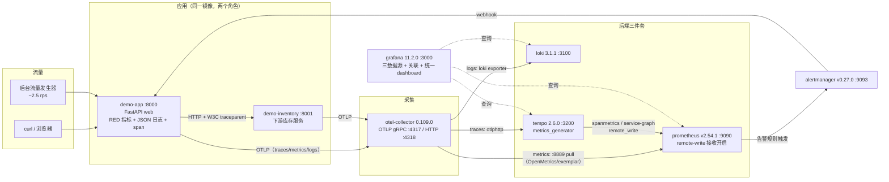

# Lab04 · 三支柱整合：一次请求贯穿 Metrics / Logging / Tracing

> 本工作区的压轴整合实验。前面三个 lab 分别点亮了 Prometheus、Loki、Jaeger/Tempo 单项，
> 这次把它们拼成完整体系：**一个应用同时产出三种信号 → OTel Collector 统一分发 →
> Grafana 互相跳转下钻 → SLO burn-rate 告警闭环**。
> 配套笔记：[notes/04-integration/](../../notes/04-integration/README.md)

## 目标

1. 亲手跑通"指标 → trace → 日志"与"日志 → trace"的双向关联下钻；
2. 看懂并会改三大数据源的关联配置（`tracesToLogsV2` / `derivedFields` / `exemplarTraceIdDestinations`）；
3. 触发一次真实的 SLO 多窗口燃烧率告警，体验告警分组/抑制/恢复；
4. 在统一 dashboard 上按 SOP 完成一次完整的"告警→定位→根因→验证"演练。

## 架构



目录结构：

```
lab04-three-pillars/
├── docker-compose.yml
├── app/                       # FastAPI + OTel SDK（web/inventory 双角色共用）
│   ├── app.py                 # 接口、混沌开关、告警展示页、RED 中间件
│   ├── telemetry.py           # 三信号 Provider 初始化
│   ├── logging_utils.py       # 日志注入 trace_id/trace_flags（关联核心）
│   ├── Dockerfile / requirements.txt
├── otel-collector/otel-collector-config.yaml   # 按信号分 pipeline
├── prometheus/prometheus.yml  └─ rules/slo-burn-rate.yml（多窗口燃烧率）
├── loki/loki-config.yaml
├── tempo/tempo.yml            # 含 metrics_generator（派生指标/服务图）
├── grafana/
│   ├── provisioning/datasources/datasources.yaml  # 三数据源 + 关联配置
│   ├── provisioning/dashboards/dashboards.yaml
│   └── dashboards/three-pillars.json              # 统一 dashboard
└── alertmanager/alertmanager.yml └─ templates.tmpl
```
<!-- 保留原图：目录结构清单，非概念示意图，Mermaid 无原生文件树类型 -->

## 前置条件

- podman ≥ 4.x + podman compose（macOS 需先 `podman machine init && podman machine start`），**内存建议 ≥ 4GB**（7 个容器常驻约 1.5GB）
- 端口未被占用：3000 / 8000 / 8889 / 9090 / 9093 / 3100 / 3200
- 镜像版本（写作时以官方发布为准，如更换请核对配置兼容性）：
  `otel/opentelemetry-collector-contrib:0.109.0`、`prom/prometheus:v2.54.1`、
  `grafana/loki:3.1.1`、`grafana/tempo:2.6.0`、`grafana/grafana:11.2.0`、`prom/alertmanager:v0.27.0`

## 启动

```bash
cd labs/lab04-three-pillars
podman compose up -d --build      # 首次构建 app 镜像约 1~3 分钟
podman compose ps                 # 等 7 个服务都是 Up/running
podman compose logs -f app        # 可看到 JSON 日志（每条带 trace_id）
```

启动后 30~60 秒数据链路陆续就绪（后台流量发生器 ~2.5 rps 自动开跑）。

- Grafana：<http://localhost:3000>（admin / admin）
- 统一 dashboard：Dashboards → `Lab04 · 三支柱` → `Lab04 · 三支柱统一仪表盘`
- demo-app：<http://localhost:8000> ；告警展示页：<http://localhost:8000/alerts>
- Prometheus：<http://localhost:9090> ；Alertmanager：<http://localhost:9093>

## 验证步骤（含预期输出）

### ① 发请求，看信号产生

```bash
# 打几条请求（部分会 500，这是预期的 2% 基础错误率）
for i in $(seq 1 10); do curl -s -o /dev/null -w "%{http_code} " http://localhost:8000/api/orders; done; echo
# 例输出：200 200 200 500 200 200 200 200 200 200

# podman logs 里每条日志都是 JSON，且同一次请求的两条日志 trace_id 相同
podman compose logs app | tail -n 2
# 例：{"ts":"2026-11-04T12:00:00.123Z","level":"INFO","logger":"app","message":"order processed",
#      "trace_id":"3f9a...","span_id":"...","trace_flags":"01","order_id":"a1b2c3d4",...}
```

### ② Grafana 看 RED 指标

打开 <http://localhost:3000/d/lab04-three-pillars>：
- 「请求速率」≈ 2.5 reqps（背景流量）；
- 「延迟分位数」p50 ≈ 0.05s 上下，p99 因 8% 长尾（300~900ms）明显更高；
- 「Span 调用速率」面板需等 Tempo 派生指标到位（约 2~3 分钟），能看到
  `GET /api/orders`、`orders.process`、`GET`（下游 CLIENT span）等 span_name。

### ③ 指标/日志 → Tempo trace

- 在 dashboard 底部「日志」面板：每行日志展开后点 **TraceID** 字段（derivedFields）→
  直接跳到 Tempo 的完整 trace，能看到 `demo-app GET /api/orders → orders.process →
  GET（client）→ demo-inventory GET /api/inventory` 的跨服务调用链；
- 也可以在 Explore 选 Tempo 数据源，用 TraceQL 搜：`{resource.service.name = "demo-app" && status = error}`；
- Explore 里选 Tempo → 切到 **Service Graph** 标签，几分钟后能看到 `demo-app → demo-inventory` 的边。

### ④ Tempo trace 页跳回日志

在 Tempo 的任意 span 上点 **Logs for this span** —— Grafana 自动切到 Loki 并执行
`{service_name="demo-app"} | json | trace_id="<该 trace 的 id>"`，只显示这一个 trace 的日志。
这就是 `tracesToLogsV2.customQuery` 配置的效果。

### ⑤ 触发错误，观察 burn-rate 告警

```bash
# 注入 60% 错误率
curl -X POST "http://localhost:8000/chaos?rate=0.6"
# 3~5 分钟后查看：
curl -s http://localhost:9093/api/v2/alerts | python3 -m json.tool | grep -E '"labels"|"alertname"|"severity"'
```

预期（时间轴）：
1. ~2-3 分钟：`SLOAvailabilityBurnRateFast`（severity=critical）firing
   —— 双窗口 5m & 1h 错误率同时 > 14.4×0.1%（`for: 2m` 也要满足）；
2. Alertmanager 按 `severity` 路由到 `webhook-critical`，<http://localhost:8000/alerts>
   页面出现红色 firing 行（10 秒自动刷新）；`SLOAvailabilityBurnRateSlow` 若同告警名触发会被
   inhibition 规则抑制（本实验档位 1/2 告警名不同，抑制规则展示见笔记）；
3. 恢复：`curl -X POST "http://localhost:8000/chaos?rate=0.02"`，等 2~3 分钟，
   告警转 **resolved**（webhook `send_resolved: true`，展示页变绿）。

顺手验证 SLO 录制规则：

```bash
curl -s 'http://localhost:9090/api/v1/query' \
  --data-urlencode 'query=slo:demo_app_availability:error_ratio_rate5m' | python3 -m json.tool
# "value" 里第一个数是时间戳，第二个是当前 5m 错误比例（混沌期间 ≈ 0.6）
```

## 常见坑（关联不生效 checklist）

| 症状 | 排查点 |
| --- | --- |
| 日志点 TraceID 没反应 | ① 日志正文字段名必须是 `trace_id`（derivedFields 正则按 `"trace_id":"(...)"` 匹配，`traceId`/`traceID` 都不行）；② 确认 app 日志是**紧凑 JSON**（`separators=(",",":")`）；③ Loki 数据源 `derivedFields.datasourceUid` 必须是 `tempo`（uid 大小写敏感） |
| Tempo 点 "Logs for this span" 空 | ① `tracesToLogsV2.customQuery` 里的 Loki 标签名 `service_name` 是否真的存在（Loki → Label browser 验证）；② 时间范围：配置里加了 ±15m 的 `spanStartTimeShift/EndTimeShift`，若浏览器时间范围太窄先扩大；③ trace_flags=00（未采样）的 trace 在 Tempo 里查不到对应日志 |
| 指标面板无数据 | ① Prometheus Targets 页确认 `otel-collector:8889` 是 UP；② 指标名后缀：OTel 仪表 `app.http.requests` → Prometheus `app_http_requests_total`（点号转下划线、unit 补 `seconds`、counter 补 `total`）；③ label 用 `service_name`（resource_to_telemetry_conversion 的功劳），不是 `service.name` |
| Span 指标/服务图面板空 | Tempo metrics_generator 需要 2~3 分钟预热；确认 Prometheus 启动参数带 `--web.enable-remote-write-receiver`，`podman compose logs tempo | grep -i generator` 无报错 |
| burn-rate 告警不触发 | ① 双窗口要**同时**超阈值，且 `for: 2m` 连续满足；② 错误率给到 0.6、持续 3 分钟以上；③ Prometheus → Alertmanager 连通：`http://localhost:9090/api/v1/rules` 看规则状态 |
| 时间对不上（日志"来自未来/过去"） | 容器默认 UTC，Grafana 默认浏览器时区；本实验日志 `ts` 是 UTC ISO 串，Grafana 的绝对时间查询按浏览器时区解释，跨时区排查时先统一时区再看数据 |
| trace_id 当 Loki label 报错/爆内存 | 本实验为教学把 `trace_id/span_id` 提升为 label（collector 的 `loki.attribute.labels` hint）。生产中这是高基数反派，删掉 hint，保留正文 + derivedFields 方案即可 |

其他已知边界：

- **Exemplar**：链路已全打开（collector `enable_open_metrics` + Prometheus
  `exemplar-storage` + 数据源 `exemplarTraceIdDestinations` + 延迟面板开启 Exemplar 显示），
  但写作本文时 **Python SDK 尚未实现 exemplar 产出**，所以面板上暂无亮点。把 app 换成
  Java/.NET 即可看到"直方图上的点 → 点击跳 trace"。详见 [notes/04-integration/exemplars.md](../../notes/04-integration/exemplars.md)。
- **loki exporter 弃用**：更高版本的 collector contrib 中 loki exporter 逐步弃用
  （改用 Loki 原生 OTLP ingestion），本实验固定 0.109.0。

## 清理

```bash
podman compose down          # 保留数据卷
podman compose down -v       # 连数据卷一起删（推荐，下次实验从头来）
```

## 思考题

1. 把 `/chaos` 错误率从 0.6 调回 0.02 后，为什么 5m 窗口的错误率曲线立刻回落，
   而 1h 窗口回落得很慢？这对手工设置阈值告警（如"错误率>1% 就告警"）意味着什么？
2. 如果把可用性 SLI 从"5xx 比例"改成"非 2xx 比例"（把用户的 404 也算坏事件），
   预算消耗速度会怎么变？404 到底算不算"服务失败"？（提示：区分用户错误与系统错误）
3. 想让"延迟面板 → 直接点 exemplar 跳 trace"在本实验生效，至少要改动哪几个环节？
4. `tracesToLogsV2` 若把 `customQuery` 关掉（用默认按 tags 匹配），还能精确到
   "这一个 trace 的日志"吗？差在哪？
5. 假设 demo-app 的日请求量是本实验的 1000 倍，本方案里哪些配置/设计必须改？
   （提示：Loki label 基数、Tempo 采样、Prometheus 规则窗口）

## 附：ASCII 图替换清单

本文件无被替换的 ASCII 字符图：「架构」一节本身就是 mermaid flowchart 块，未改动。

### 保留说明

- 「架构 · 目录结构」：工程目录清单（文件树），Mermaid 无原生文件树类型，保留原样（图后已加 HTML 注释）。
