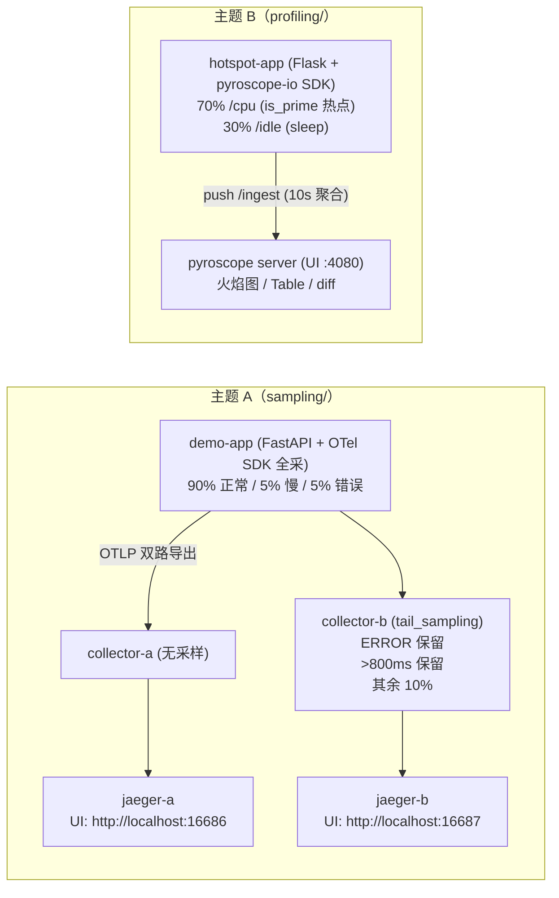

# Lab 05 · 采样与持续剖析（sampling & profiling）

> 阶段 5 配套实验，对应笔记：
> - 主题 A ← `notes/05-production/sampling.md`（采样策略）
> - 主题 B ← `notes/05-production/profiling.md`（持续性能剖析）
>
> 两个主题相互独立，可分别进入各自子目录 `podman compose up -d` 一键启动。

## 1. 目标

| 主题 | 验证的问题 | 关键结论 |
| --- | --- | --- |
| A. sampling | tail_sampling 能否做到"错误 trace 100% 保留 + 正常流量 10%"？ | 能：policy OR 组合，最终保留率 ≈ 错误率 + 慢率 + 10%×正常率（默认参数下 ≈19%）；且每条保留的 trace span 树完整 |
| B. profiling | 火焰图能否一眼定位代码里故意制造的 CPU 热点？ | 能：`is_prime` 函数占据 CPU 火焰图最大宽度；同时验证 off-CPU 盲区（sleep 在 CPU 图上不可见） |

## 2. 架构总览



## 3. 目录结构

```
lab05-sampling-and-profiling/
├── README.md               # 本文件（总览）
├── sampling/               # 主题 A：tail_sampling 双路对照实验
│   ├── README.md           # 详细步骤：启动/验证（含预期输出）/清理/思考题
│   ├── docker-compose.yml  # app + collector-a/b + jaeger-a/b
│   ├── app/                # FastAPI 示例应用（Python，OTel SDK 双路导出）
│   └── collector/          # 两份 Collector 配置（无采样 vs tail_sampling）
└── profiling/              # 主题 B：Pyroscope CPU 热点定位实验
    ├── README.md           # 详细步骤 + 火焰图读图指引（一步步找到热点）
    ├── docker-compose.yml  # pyroscope server + hotspot-app
    └── app/                # Flask 示例应用（故意埋 is_prime 热点）
```
<!-- 保留原图：目录结构清单，非概念示意图，Mermaid 无原生文件树类型 -->

## 4. 快速启动

```bash
# 主题 A：tail_sampling 实验（UI: Jaeger A :16686 / B :16687）
cd sampling
podman compose up -d --build
# 跑 3~5 分钟后按 sampling/README.md 第 4 节验证

# 主题 B：profiling 实验（UI: Pyroscope :4080）
cd ../profiling
podman compose up -d --build
# 跑 1~2 分钟后按 profiling/README.md 第 4 节看火焰图
```

详细的前置条件、验证命令与预期输出见各自子目录 README。

## 5. 清理（两个主题通用）

```bash
podman compose down          # 在对应子目录内执行
podman compose down -v       # 额外删除卷（profiling 的历史 profile 数据）
podman compose down --rmi local  # 连本地构建的应用镜像一起删
```

## 6. 镜像与平台说明

| 镜像 | tag（以官方发布为准） | arm64 (Apple Silicon) |
| --- | --- | --- |
| otel/opentelemetry-collector-contrib | 0.112.0 | 支持 |
| jaegertracing/all-in-one | 1.62.0 | 支持 |
| grafana/pyroscope | 1.7.0 | 支持 |
| python（构建应用） | 3.12-slim-bookworm | 支持 |

所有镜像均为官方多架构镜像，Apple Silicon（M 系列芯片）上无需 `--platform` 直接运行。唯一的小风险点是 `pyroscope-io` 的 aarch64 wheel 可用性（以 PyPI 发布为准），回退方案见 `profiling/README.md` 第 2 节（用 `--platform linux/amd64` 构建）。

## 7. 思考题（跨主题）

1. **把采样率调到 1% 会发生什么？**（主题 A 实操：改 `sampling_percentage: 1`）
   - 正常流量样本变稀：还能"随时看到"代表性 trace 吗？多稀算太稀？
   - 错误/慢 trace 仍然 100% 保留——tail 采样的"保真承诺"具体保的是什么真？
   - 后端存储成本大约降到原来的多少？（≈ 错误率 + 慢率 + 1%×正常率）
2. **off-CPU 分析适合什么场景？**（主题 B 实操：把 `P_CPU` 调成 0.1）
   - CPU 图几乎变空、但请求耗时没变——数据去哪了？
   - 线程都在 sleep/等锁/等 IO 时，哪个信号（metrics/trace/off-CPU profile）能告诉你"在等谁"？
3. 两个主题结合：慢 trace（主题 A 的 latency policy 保留的）+ 该时段的 profile（主题 B），如何组合成一次完整的"p99 劣化"排障？各信号分别回答什么问题？
4. 如果这两个实验部署到 K8s（阶段 5 的 kubernetes-observability.md），采集组件分别变成什么形态？（提示：OTel DaemonSet agent；Pyroscope eBPF profiler / Alloy。）
5. 预算思维：假设 Jaeger 后端预算只允许存 5% 的 trace，主题 A 的三个 policy 该如何重新组合才能在预算内最大化"排障价值"？（提示：composite policy 的 `max_total_spans_per_second`。）

## 附：ASCII 图替换清单

| 原 ASCII 图位置（章节标题） | 原图内容简述 | 替换结果 |
| --- | --- | --- |
| 2. 架构总览 | 主题 A（demo-app OTLP 双路导出 → collector-a/b → jaeger-a/b）与主题 B（hotspot-app push → pyroscope server）并列数据流 | flowchart LR |

### 保留说明

- 「3. 目录结构」：工程目录清单（文件树），Mermaid 无原生文件树类型，保留原样（图后已加 HTML 注释）。
