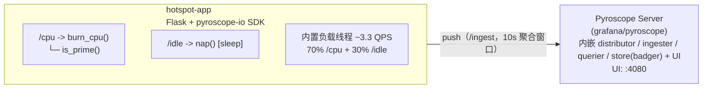

# 实验 B：Pyroscope 持续性能剖析（定位 CPU 热点）

> 配套笔记：`notes/05-production/profiling.md`
>
> 目标：亲手完成一次"从现象到代码行"的剖析闭环——
> 1. 启动 Pyroscope server + 一个埋了**故意热点**的 Python 应用；
> 2. 打开火焰图，读懂"宽 = CPU 时间占比"；
> 3. 用搜索/下钻定位我们故意制造的 `is_prime` 热点函数；
> 4. 体会 off-CPU 的盲区：`/idle` 端点在 CPU 火焰图上几乎看不见。

## 1. 架构



应用内埋设的"案发现场"：

| 函数 | 行为 | 在火焰图上的预期形态 |
| --- | --- | --- |
| `is_prime(n)` | 低效试除法，O(√n) 纯 Python 循环 | **极宽**：CPU 样本大头都落在这一帧 |
| `burn_cpu(ms)` | 循环调用 is_prime 燃烧 CPU | 宽（含下游），自身 self 很窄 |
| `nap(ms)` | time.sleep 睡眠 | **几乎不可见**：sleep 时不占 CPU（off-CPU 盲区） |

## 2. 前置条件

- podman ≥ 4.x + podman compose（macOS 需先启动 podman machine）；
- Apple Silicon 可直接运行：`grafana/pyroscope` 与 `python:3.12-slim-bookworm` 均有 `linux/arm64` 版本；
- `pyroscope-io` 提供 manylinux aarch64 wheel（内嵌 py-spy aarch64）。**若构建时 pip 报找不到该平台 wheel**（以 PyPI 实际发布为准），回退方案：`podman build --platform linux/amd64 ./app`（Rosetta 模拟，火焰图照常工作）。

镜像版本（以官方发布为准）：

| 镜像 | tag |
| --- | --- |
| grafana/pyroscope | 1.7.0（单二进制，默认端口 4080） |
| python | 3.12-slim-bookworm |

## 3. 启动

```bash
cd labs/lab05-sampling-and-profiling/profiling
podman compose up -d --build

# 确认应用负载已开始（约每 0.3s 一条日志，累积 cpu/idle 计数）
podman compose logs -f hotspot-app
```

等 **1~2 分钟**（Pyroscope 默认 10s 聚合窗口，攒够样本火焰图才稳定）再进入验证。

## 4. 验证：一步步找到我们故意制造的热点

### 第 1 步：确认负载在跑

```bash
curl -s http://localhost:5000/stats | jq
```

预期输出（数字持续增长，比例约 7:3）：

```json
{
  "cpu": 214,
  "idle": 88
}
```

### 第 2 步：打开 Pyroscope UI

浏览器访问 **http://localhost:4080**

- 左侧/顶部选择 application：**`hotspot-app`**（tags 会显示 `env=lab05`, `version=1.0.0`）；
- Profile type：`cpu`（Python SDK 默认上报 CPU 剖析）；
- 时间窗选最近 15 分钟，视图选 **Flamegraph**。

预期：出现一张火焰图，最显眼的是一堵"宽墙"。

### 第 3 步：读图（本实验的核心练习）

对照预期形态逐项确认：

1. **找到主塔基**：从下往上沿最宽的路径钻：`_pyroscope...` 采样器帧 → Flask 工作线程 → `app.py` → `burn_cpu` → `is_prime`；
2. **搜索热点**：在火焰图搜索框输入 `is_prime`，命中的帧会高亮——它应该占据整图 **40%~60% 以上宽度**（70% 的请求都在烧 CPU，而 is_prime 占燃烧时间的绝大部分）；
3. **看 self time**：`burn_cpu` 很宽，但把它和 `is_prime` 对比——`burn_cpu` 自身（不 含 is_prime 的部分）很窄，说明它只是"点火者"，真正吃 CPU 的是 `is_prime`。**这就是"宽 ≠ 自身慢"的活教材**（见 profiling.md 第 2.4 节）；
4. **验证 off-CPU 盲区**：搜索 `nap`——几乎找不到（或极窄）。`/idle` 占了 30% 的流量，但 sleep 不消耗 CPU 周期，所以 CPU 火焰图看不见它。**结论：CPU 饱和分析用 on-CPU 图；"30% 请求在睡觉"这类问题要靠 off-CPU / wall-clock 分析或 trace 的延迟数据。**
5. （可选）切换视图 **Table**（表格）：按 total/self 排序，`is_prime` 应排在第一行，可以直接读出百分比。

### 第 4 步：模拟"优化后对比"（火焰图 diff）

体验持续剖析最有价值的功能——时间对比：

1. 让应用跑 5 分钟，记下 `is_prime` 宽度比例；
2. 修改 `app/app.py`：把 `P_CPU` 默认值改为 `"0.2"`（compose 里改 `P_CPU: "0.2"` 更方便），`podman compose up -d --build` 重启；
3. UI 中刷新，选择覆盖"修改前后"的时间窗，观察 `is_prime` 帧明显变窄；有条件的话用 **Compare/diff** 功能对前后两个窗口做对比（红色=增加，蓝色=减少）；
4. 这正是生产上"发布回归检测"的用法：版本 A vs 版本 B 的火焰图 diff。

### 预期结果自查清单

- [ ] UI 能看到 `hotspot-app` 且 tags 正确（env=lab05）；
- [ ] CPU 火焰图中 `is_prime` 是最宽的帧之一（>40%）；
- [ ] `burn_cpu` 宽但 self 窄（热点在下游）；
- [ ] 搜索 `nap` 基本找不到（off-CPU 盲区验证）；
- [ ] Table 视图 `is_prime` 的 total 排第一。

## 5. 清理

```bash
podman compose down                # 停止并删除容器
podman compose down -v             # 连同 pyroscope-data 卷一起删（历史 profile 数据清空）
podman compose down --rmi local    # 连本地构建的 hotspot-app 镜像一起删
```

## 6. 思考题

1. 把 `/idle` 流量从 30% 提到 90%（`P_CPU=0.1`），CPU 火焰图会怎么变？服务的"吞吐"和"CPU 使用率"分别会怎么变？（off-CPU 分析适合什么场景？）
2. 如果把 `is_prime` 换成预筛 + Miller-Rabin（真的优化），用火焰图如何**证明**优化有效？用哪个指标对比最直观？
3. 本实验用语言 SDK（pyroscope-io）采集。如果这个应用是不容许改代码的存量服务，有哪些替代采集方式？（提示：eBPF profiler / OTel eBPF。它们的标签维度有什么差别？）
4. Python 火焰图里除了 `is_prime`，为什么通常还能看到较宽的 `flask` / `werkzeug` / `socket` 帧？这些帧变宽分别说明什么？
5. Pyroscope 的聚合窗口是 10 秒。如果某个热点函数每 15 秒只被执行 100ms，火焰图上可能完全看不到它——这说明 profiling 的什么本质特性？该用什么手段补充？（提示：统计采样 vs 事件记录；trace span。）

## 7. 目录结构

```
profiling/
├── README.md              # 本文件
├── docker-compose.yml     # pyroscope server + hotspot-app
└── app/
    ├── Dockerfile
    ├── requirements.txt   # flask / requests / pyroscope-io
    └── app.py             # 故意埋了 is_prime 热点 + nap 睡眠对照
```
<!-- 保留原图：目录结构清单，非概念示意图，Mermaid 无原生文件树类型 -->

## 8. 参考

| 资料 | 链接 | 访问日期 |
| --- | --- | --- |
| Grafana Pyroscope 文档 | https://grafana.com/docs/pyroscope/latest/ | 2026-11-04 |
| Pyroscope Python 客户端配置 | https://grafana.com/docs/pyroscope/latest/configure-client/language-sdks/python/ | 2026-11-04 |
| pyroscope-io（PyPI） | https://pypi.org/project/pyroscope-io/ | 2026-11-04 |
| 火焰图（Brendan Gregg） | https://www.brendangregg.com/flamegraphs.html | 2026-11-04 |
| OTel Profiles 信号 | https://opentelemetry.io/docs/specs/otel/profile/ | 2026-11-04 |

## 附：ASCII 图替换清单

| 原 ASCII 图位置（章节标题） | 原图内容简述 | 替换结果 |
| --- | --- | --- |
| 1. 架构 | hotspot-app（/cpu → burn_cpu() → is_prime()、/idle → nap()、内置负载线程 ~3.3 QPS）push 到 Pyroscope Server（UI :4080） | flowchart LR |

### 保留说明

- 「7. 目录结构」：工程目录清单（文件树），Mermaid 无原生文件树类型，保留原样（图后已加 HTML 注释）。
