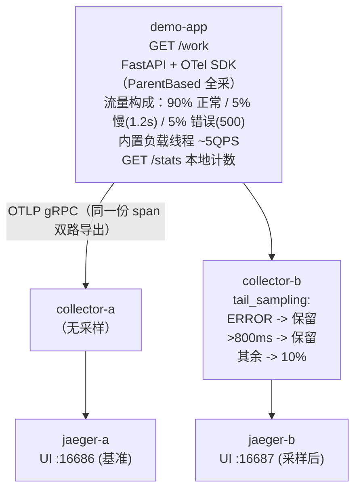

# 实验 A：tail_sampling 尾部采样对照实验

> 配套笔记：`notes/05-production/sampling.md`
>
> 目标：亲眼验证 tail-based sampling 的三个承诺——
> 1. **错误 trace 100% 保留**（status_code policy）；
> 2. **慢 trace 100% 保留**（latency policy）；
> 3. **正常 trace 按比例保留**（probabilistic 10%）；
> 并理解 head 全采 + tail 决策后置的标准接入形态。

## 1. 架构



流量构成与预期（默认参数，P_NORMAL=0.90 / P_SLOW=0.05 / P_ERROR=0.05）：

| 类别 | 占比 | Jaeger A（全量） | Jaeger B（tail） |
| --- | --- | --- | --- |
| 错误（HTTP 500，span status=ERROR） | ~5% | 全部 | **~100% 保留** |
| 慢（sleep 1.2s > 800ms 阈值） | ~5% | 全部 | **~100% 保留** |
| 正常 | ~90% | 全部 | ~10% 保留 |
| **合计保留率** | — | **100%** | **≈ 19%**（5% + 5% + 90%×10%） |

## 2. 前置条件

- podman ≥ 4.x + podman compose（macOS 需先启动 podman machine），建议 4GB+ 可用内存；
- Apple Silicon（M1/M2/M3）可直接运行：所用镜像（`python:3.12-slim-bookworm`、`otel/opentelemetry-collector-contrib`、`jaegertracing/all-in-one`）均提供 `linux/arm64` 版本；
- 验证命令用到 `curl` 与 `jq`（`brew install jq`，可选：没有 jq 也能在 UI 里人工对比）。

镜像版本（以官方发布为准）：

| 镜像 | tag | 说明 |
| --- | --- | --- |
| otel/opentelemetry-collector-contrib | 0.112.0 | tail_sampling 处理器在 contrib 发行版 |
| jaegertracing/all-in-one | 1.62.0 | 1.43+ 默认开启 OTLP 接收 |
| python | 3.12-slim-bookworm | 应用基础镜像 |

## 3. 启动

```bash
cd labs/lab05-sampling-and-profiling/sampling
podman compose up -d --build

# 观察应用日志，确认负载发生器已启动（约每 0.2s 一条请求）
podman compose logs -f demo-app
```

启动顺序说明：`demo-app` 的 OTel 导出器有重试机制，Collector/Jaeger 未就绪的几秒内可能报连接错误，属预期现象，稍后自动恢复。

让它跑 **3~5 分钟**（积累约 900~1500 条 trace），再进入验证。

## 4. 验证

### 4.1 先看"地面真值"：应用本地计数

```bash
curl -s http://localhost:8000/stats | jq
```

预期输出（数字持续增长，比例大致 90:5:5）：

```json
{
  "total": 1032,
  "error": 49,
  "slow": 51,
  "normal": 932
}
```

### 4.2 对比两个后端的 trace 总量

```bash
# Jaeger A（全量）：近 1 小时内 demo-app 的 trace 数
curl -sG "http://localhost:16686/api/traces" \
  --data-urlencode 'service=demo-app' \
  --data-urlencode 'lookback=1h' \
  --data-urlencode 'limit=1500' | jq '.data | length'

# Jaeger B（tail 采样）：同样查询
curl -sG "http://localhost:16687/api/traces" \
  --data-urlencode 'service=demo-app' \
  --data-urlencode 'lookback=1h' \
  --data-urlencode 'limit=1500' | jq '.data | length'
```

预期输出示例：

```
1057      # Jaeger A（≈ 应用 stats.total，全量）
198       # Jaeger B（≈ 1057 × 19%，采样后）
```

两数之比应落在 **15%~25%** 区间（概率波动 + decision_wait 期间在途 trace 未计入，属正常）。

> 注：Jaeger 查询接口的 `limit` 是单次返回上限，如果跑得时间较长，A 侧可能被截断到上限值——这不影响 4.3 的错误对比验证，或改用 UI 里的 Search 分页。

### 4.3 核心验证：错误 trace 是否 100% 保留

```bash
# A 侧：带 error 标签的 trace 数（OTel ERROR 状态映射为 Jaeger 的 error=true）
curl -sG "http://localhost:16686/api/traces" \
  --data-urlencode 'service=demo-app' \
  --data-urlencode 'lookback=1h' \
  --data-urlencode 'limit=1500' \
  --data-urlencode 'tags={"error":"true"}' | jq '.data | length'

# B 侧：同样的查询
curl -sG "http://localhost:16687/api/traces" \
  --data-urlencode 'service=demo-app' \
  --data-urlencode 'lookback=1h' \
  --data-urlencode 'limit=1500' \
  --data-urlencode 'tags={"error":"true"}' | jq '.data | length'
```

预期输出示例：

```
47    # Jaeger A 错误 trace 数
47    # Jaeger B 错误 trace 数 —— 两者相等（100% 保留！）
```

**判读标准**：B 侧错误数应与 A 侧相等（允许 ±1~2 条边界误差：decision_wait 到期前应用重启、或恰好落在查询窗口边缘）。若 B 明显小于 A，检查 4.4 的 collector 指标与 `otelcol-b` 日志。

慢 trace 同理（可选验证）：在两个 UI 里用 `minDuration=1s` 过滤（UI: Search → Min Duration），B 侧数量应与 A 侧几乎一致。

### 4.4 看 tail_sampling 的自身指标（采样决策统计）

```bash
curl -s http://localhost:8889/metrics | grep tail_sampling | grep -v '#'
```

预期输出示例（节选）：

```
otelcol_processor_tail_sampling_decisions{decision="delayed",service_instance_id="..."} 3
otelcol_processor_tail_sampling_decisions{decision="not_sampled",service_instance_id="..."} 789
otelcol_processor_tail_sampling_decisions{decision="sampled",service_instance_id="..."} 191
otelcol_processor_tail_sampling_decisions_dropped 0        # 被逐出的 trace（正常应为 0）
otelcol_processor_tail_sampling_late_decisions{decision="not_sampled",...} 0
```

`sampled / (sampled + not_sampled)` ≈ 19%，与 4.2 相互印证。

### 4.5 UI 肉眼复核

- 打开 `http://localhost:16686`（A）与 `http://localhost:16687`（B）：
  - Service 选 `demo-app` → Find Traces：B 的结果明显更少；
  - Tags 过滤 `error=true`：两边数量几乎一样，且每条错误 trace 都是**完整的 2 个 span**（GET /work client + server），这就是"整条 trace 级决策"的含义；
  - 点开一条慢 trace，Duration ≈ 1.2s，span 树完整。

## 5. 动手改参数（可选）

1. **把正常采样率降到 1%**：编辑 `collector/otelcol-b.yaml` 的 `sampling_percentage: 1`，`podman compose restart collector-b`，几分钟后重跑 4.2——B 侧总量会掉到 ≈ 错误+慢+1%（约 11%）。思考：极限情况下（0%）会怎样？错误/慢还会在吗？
2. **把 latency 阈值调大到 2s**：`threshold_ms: 2000` > 应用的 1.2s，慢 trace 不再命中 latency policy，只能靠 10% 概率保留——4.3 的"慢"验证就会失效。这演示了**阈值必须与业务 SLO 对齐**。
3. **调大错误率**：`P_ERROR=0.5 P_NORMAL=0.45`（compose 环境变量），观察保留率随之上升——tail 采样保留率与流量构成相关，预算要用 composite/rate_limiting 控制。

## 6. 清理

```bash
podman compose down          # 停止并删除容器（Jaeger 用内存存储，数据随之消失）
podman compose down --rmi local   # 连本地构建的 demo-app 镜像一起删
```

## 7. 思考题

1. 本实验中 **SDK 端是全采（AlwaysOn）双路导出**。如果把 SDK 换成 `TraceIDRatioBased(0.1)`，Collector B 的错误 100% 保留还能保证吗？为什么？（提示：head 采样发生在决策前，错误的 span 可能根本没被发送。）
2. 为什么 `decision_wait: 10s` 必须大于应用的最长请求耗时（1.2s）？如果设成 `500ms` 会出现什么现象？
3. 多副本部署 collector-b 时（`podman compose up --scale collector-b=2`），本实验还能正确工作吗？需要什么前提？（提示：trace_id 一致性哈希 / loadbalancing exporter。）
4. 4.3 中我们看到 B 侧错误 trace 数和 A 相等。那 **B 侧的错误率（错误数/总数）** 和 A 相等吗？由此说明什么？（提示：被采样的 trace 不能直接做除法，见 sampling.md 第 6.1 节。）
5. 若把 P_NORMAL 调成 0，即全部流量都是错误/慢，tail 采样退化成了什么？成本上意味着什么？

## 8. 目录结构

```
sampling/
├── README.md                  # 本文件
├── docker-compose.yml         # 5 个服务：app + 2 collector + 2 jaeger
├── app/
│   ├── Dockerfile
│   ├── requirements.txt
│   └── app.py                 # FastAPI 应用 + 双路 OTLP 导出 + 内置负载
└── collector/
    ├── otelcol-a.yaml         # 基准：无采样
    └── otelcol-b.yaml         # tail_sampling：错误/慢全保 + 正常 10%
```
<!-- 保留原图：目录结构清单，非概念示意图，Mermaid 无原生文件树类型 -->

## 9. 参考

| 资料 | 链接 | 访问日期 |
| --- | --- | --- |
| tail_sampling processor | https://github.com/open-telemetry/opentelemetry-collector-contrib/blob/main/processor/tailsamplingprocessor/README.md | 2026-11-04 |
| OTel 采样概念 | https://opentelemetry.io/docs/concepts/sampling/ | 2026-11-04 |
| Jaeger all-in-one 镜像 | https://www.jaegertracing.io/docs/1.62/getting-started/ | 2026-11-04 |
| OTel Python SDK | https://opentelemetry.io/docs/languages/python/ | 2026-11-04 |

## 附：ASCII 图替换清单

| 原 ASCII 图位置（章节标题） | 原图内容简述 | 替换结果 |
| --- | --- | --- |
| 1. 架构 | demo-app 同一份 span 双路 OTLP 导出：collector-a（无采样）与 collector-b（tail_sampling：ERROR、>800ms 全保留，其余 10%），分别落到 jaeger-a/b | flowchart TD |

### 保留说明

- 「8. 目录结构」：工程目录清单（文件树），Mermaid 无原生文件树类型，保留原样（图后已加 HTML 注释）。
