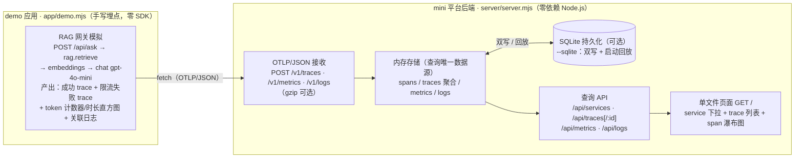

# Lab 06 · Mini 可观测平台（从 OTLP 接收到瀑布图页面）

> 阶段 6 配套实验，对应笔记：
> - [服务端 SDK 设计](../../notes/06-system-design/sdk-design-server.md) 第 9 节「最小骨架」——本 lab 是那 200 行骨架的"平台侧完整可跑版"
> - [大模型应用可观测性](../../notes/07-topics/llm-observability.md) §3.3——`app/demo.mjs` 用的就是该节的手写埋点（OTLP/JSON，含 gen_ai span）
>
> 前五个 lab 学"用现成组件搭平台"（Prometheus / Loki / Jaeger / Tempo / Grafana），
> 本 lab 把视角倒转：**平台本身成为被造的对象**——亲手实现一个 mini 可观测平台后端，
> 打通"埋点 → OTLP → 存储 → 查询 → 页面"全链路。
> 零第三方依赖（只用 `node:` 内置模块）、零容器（不需要 podman/docker）、零安装（不 `npm install`）：
> `node server/server.mjs` 即可跑。

## 1. 目标

1. **造一个最小内核**：OTLP/JSON 接收 + 内存/SQLite 存储 + 查询 API + 单文件页面，服务端约 350 行（教学骨架，带注释）；
2. **吃透 OTLP 数据模型**：`resourceSpans → scopeSpans → spans` 三层包装、AnyValue 取值、int64 的 JSON 字符串映射——手工拼一遍，比读十遍规范记得牢；
3. **理解三类信号各自的访问模式**：trace 按 traceId 点查、metrics 按名称+属性分组、logs 按 trace/服务过滤——这正是 Tempo / Mimir / Loki 三副引擎各自存在的理由；
4. **体验"没有 SDK"的裸奔**：demo 里 parent 关系要自己传、纳秒时间戳要自己算，反过来理解 OTel SDK 替你做了什么（对照 [sdk-design-server](../../notes/06-system-design/sdk-design-server.md) 第 2/3 节）。

本 lab 实现与真实系统的对照（差距即进阶方向）：

| 平台层 | 本 lab（~354 行） | 真实系统对应物 | 主要差距 |
| --- | --- | --- | --- |
| 接入 | `/v1/traces` `/v1/metrics` `/v1/logs`，JSON + gzip | OTel Collector receiver / Tempo distributor | 无认证、无限流（429）、无 protobuf |
| 存储 | 内存 Map（可选 SQLite 双写+回放） | Tempo 扁平块+对象存储 / Mimir TSDB / Loki 流压缩 | 无倒排索引、无列存压缩、无 retention |
| 查询 | REST + traceId 点查 + 属性分组 | TraceQL / PromQL / LogQL | 无查询语言、无并行拆分与缓存 |
| 可视化 | 单文件页面（下拉+列表+瀑布图） | Grafana | 无仪表盘、无告警引擎 |
| 埋点 | demo 手写 span（gen_ai.* / error.type） | OTel SDK + instrumentation | 无 context 传播、无批量、无重试 |

## 2. 架构



## 3. 目录结构

```
lab06-mini-platform/
├── README.md            # 本文件
├── _category_.json      # 侧边栏排序（position: 6）
├── server/
│   └── server.mjs       # 平台后端：接收/存储/查询/页面，约 354 行（含注释与内联 HTML）
└── app/
    └── demo.mjs         # 手写埋点 demo：2 条 trace（gen_ai span + error span）+ 指标 + 日志
```
<!-- 保留原图：目录结构清单，非概念示意图，Mermaid 无原生文件树类型 -->

## 4. 环境要求

- **Node.js ≥ 18**（用到全局 `fetch` 与 `crypto`）；无任何 npm 依赖，无需 `npm install`
- 可选持久化：**Node ≥ 22.5** 才有 `node:sqlite`；22.5–22.12 需加 `--experimental-sqlite` 启动参数，≥ 22.13 / ≥ 23.4 起免标志（运行时仍会打印实验性警告）。探测不到时自动回退纯内存模式（启动日志会说明）
- 不需要 podman/docker——这是本站唯一的"零容器"lab（平台本身足够小）
- 实测环境（见第 11 节验收记录）：macOS · Apple Silicon · Node **v24.10.0**

## 5. 快速开始

```bash
cd docs/labs/lab06-mini-platform

node server/server.mjs                  # 终端 1：默认 127.0.0.1:4318（OTLP 标准 HTTP 端口）
node app/demo.mjs                       # 终端 2：发 2 条 trace + 4 个指标 + 3 条日志
open http://127.0.0.1:4318/             # 浏览器：下拉选服务 → 点 trace 行 → 看 span 瀑布图

# 4318 被占用（本机可能已跑 OTel Collector）时换端口：
node server/server.mjs --host 127.0.0.1 --port 43180
node app/demo.mjs --url http://127.0.0.1:43180
```

## 6. 分步骤施工指南

> 两种用法：**A. 导读**——直接跑成品，按步骤对照 `server/server.mjs` 里标注的「第 N 节」阅读；
> **B. 手搓（推荐）**——把 `server/` 目录盖住，照每步的"做什么"自己写，用每步的验证命令自测。
> 每步都可独立验证；步骤号与 `server.mjs` 内的注释分节对应（第 0~7 节）。

### Step 0 · HTTP 骨架（server.mjs 第 6 节）

用 `node:http` 起一个 server：`GET /` 返回占位 HTML，其余 404。只做一件事：**路由分发 + 统一错误兜底**（接收端自己也不能崩）。

```bash
node your-server.mjs --port 43180
curl -s -o /dev/null -w '%{http_code}\n' http://127.0.0.1:43180/   # 期望 200
```

### Step 1 · OTLP traces 接收（第 3、6 节）

`POST /v1/traces` 读 body → `JSON.parse` → 按 `resourceSpans → scopeSpans → spans` 三层展开成扁平 span 记录。
两个规范细节最容易踩坑：**字段名是 protobuf JSON 的 camelCase**；**AnyValue 里 `intValue` 是字符串**（int64 的 JSON 映射）。先支持 gzip（`content-encoding: gzip` 时 `gunzipSync`），OTLP 导出器默认常开。

```bash
curl -s -X POST http://127.0.0.1:43180/v1/traces -H 'content-type: application/json' -d '{
  "resourceSpans":[{"resource":{"attributes":[{"key":"service.name","value":{"stringValue":"curl-sender"}}]},
    "scopeSpans":[{"scope":{"name":"manual"},"spans":[{
      "traceId":"0af7651916cd43dd8448eb211c80319c","spanId":"b7ad6b7169203331",
      "name":"hello","kind":"SPAN_KIND_INTERNAL",
      "startTimeUnixNano":"1794589000000000000","endTimeUnixNano":"1794589000200000000"}]}]}]}'
# 期望：HTTP 200，响应体 {}；服务端日志打出 [ingest] /v1/traces ← 1 条记录
```

### Step 2 · 内存存储与 trace 聚合（第 1、3 节）

span 记录入 `Map<spanId>`；同时按 `traceId` 聚合概览：`start/end` 取区间、`services` 去重集合、`errorCount`、`rootName`。
关键设计：**聚合不依赖到达顺序**——子 span 先到、root 后到（真实世界常态，Exporter 批量/重试乱序）也要聚出正确结果。

```bash
# 验证乱序：把上面 curl 的 parentSpanId 指到"还不存在"的 span 再发 root span，聚合仍应正确
```

### Step 3 · 查询 API：services / traces 列表 / traceId 点查（第 4 节）

- `GET /api/services`：遍历 span 聚合出每个服务的 spanCount / errorCount / lastSeen；
- `GET /api/traces?service=X&limit=N`：概览列表（这就是 Jaeger/Tempo 搜索页的后端）；
- `GET /api/traces/:traceId`：**点查**——Tempo 的核心访问模式；在查询端沿 `parentSpanId` 回溯算每个 span 的深度（瀑布图缩进的依据）。

```bash
curl -s http://127.0.0.1:43180/api/services
curl -s 'http://127.0.0.1:43180/api/traces?limit=5'
curl -s http://127.0.0.1:43180/api/traces/0af7651916cd43dd8448eb211c80319c
```

### Step 4 · metrics 与 logs 通道（第 3、4 节）

- metrics：`resourceMetrics → scopeMetrics → metrics`，教学骨架认 `sum/gauge/histogram` 三种，dataPoint 记原始值；查询端按 **名称+属性集** 分组成序列——这就是"属性组合数 = 序列数"的高基数来源（[高基数笔记](../../notes/05-production/cardinality.md)的无形之手在这里）；
- logs：`logRecords` 携带 `traceId/spanId` 入库，`GET /api/logs?trace=T` 即"从 trace 下钻日志"的最小实现（Grafana `tracesToLogs` 的原型）。

```bash
curl -s http://127.0.0.1:43180/api/metrics
curl -s 'http://127.0.0.1:43180/api/logs?trace=<Step1 的 traceId>'
```

### Step 5 · 单文件页面（第 5 节）

`GET /` 返回内联 HTML（无外部 CDN）：fetch `/api/services` 填下拉、fetch `/api/traces` 填列表、点行 fetch `/api/traces/:id` 渲染瀑布图。
瀑布图定位公式（教学核心，两行）：`left% = (span.start − trace.start) / trace.duration × 100`，`width% = max(0.5, span.duration / trace.duration × 100)`；span 按深度缩进、按服务着色、错误标红。

```bash
open http://127.0.0.1:43180/   # 期望：能选服务、看 trace 列表、点开有时间条瀑布图
```

### Step 6 · demo 联调（app/demo.mjs）

跑 `node app/demo.mjs --url http://127.0.0.1:43180`，在页面核对：
成功 trace 的 `chat gpt-4o-mini` span 展开有 12 个 `gen_ai.*` 属性（§3.3 全集）；
错误 trace 的 chat span 标红，attrs 里有 `error.type=RateLimitError`，events 里有 `exception`；
日志面板里 DEBUG 详情事件带 `gen_ai.input.messages_ref`（内容外置，不落原文——§6 的做法）。

### Step 7（可选） · SQLite 持久化（第 2 节）

`--sqlite`（默认文件 `mini-platform.db`）：写路径**双写**（内存 + SQLite），读路径只走内存，启动时**回放**。
这是"带 WAL 的简易版"：崩溃不丢已确认数据，同时查询零改动。建议库文件放 `/tmp` 以免弄脏仓库。

```bash
node server/server.mjs --port 43180 --sqlite /tmp/mini-platform.db
node app/demo.mjs --url http://127.0.0.1:43180
# Ctrl-C 后重启同样的命令 → 启动日志 [sqlite] 已回放历史数据: 8 spans / 3 logs
```

## 7. 验收清单

- [ ] `node server/server.mjs` 启动成功，打印监听地址与存储模式
- [ ] `node app/demo.mjs` 三个 POST 全部 200（输出 8 spans / 4 metrics / 3 logs 与两个 traceId）
- [ ] `GET /api/services` 返回 `rag-gateway-demo`：spanCount=8、errorCount=2
- [ ] 成功 trace 明细：4 个 span 名称与深度正确（root=0，三个子 span=1）
- [ ] chat span 含 §3.3 全部 12 个 gen_ai 属性；`usage.input_tokens=523`、`output_tokens=180`、`finish_reasons=["stop"]`
- [ ] 错误 trace：chat span `error=true`、`error.type=RateLimitError`、status 含 429、events 含 `exception`
- [ ] `GET /api/metrics` ≥ 4 个指标名；`llm.chat.duration` 直方图 count=2、bucketCounts=[1,1,0]
- [ ] `GET /api/logs?trace=<错误 traceId>` 只返回该 trace 的 1 条 ERROR 日志（三支柱关联）
- [ ] `GET /` 返回 200 HTML；浏览器中瀑布图时间条、深度缩进、attrs 折叠均正常
- [ ] gzip 请求（`Content-Encoding: gzip`）能正常接收入库
- [ ] （可选）`--sqlite` 模式重启后数据回放，`/api/services` 与重启前一致
- [ ] 实验结束进程已关停（`Ctrl-C` 或 `kill`），无残留后台进程

## 8. 排错

| 症状 | 原因 | 解法 |
| --- | --- | --- |
| 启动报 `EADDRINUSE` | 4318 是 OTLP 标准端口，本机可能已跑 Collector/其他服务 | `--port` 换高端口（demo 加 `--url`）；`lsof -i :4318` 查占用 |
| POST 返回 400 `Unexpected token` 等 | 字段名没按 OTLP/JSON 的 camelCase（写成 `resource_spans` 等），或 body 不是合法 JSON | 对照 server.mjs 第 3 节；OTLP/JSON 字段名一律小驼峰 |
| 属性值变成 `null` | AnyValue 写法不对：`intValue` 忘了写成字符串，或没用 `{stringValue: ...}` 包装 | `{"key":"k","value":{"intValue":"523"}}`；对照 `anyValue()` 支持的五种形态 |
| POST 返回 415 | 发的是 protobuf（`content-type: application/x-protobuf`） | 本骨架只实现 OTLP/JSON；收 protobuf 需要 protoc 解码（见思考题 6） |
| trace 列表有数据但瀑布图时长全 0 | span 缺 `endTimeUnixNano`（创建了没 End——SDK 世界的头号坑，见 sdk-design-server §10 坑 1） | demo 的 `endSpan()` 负责补；手搓时确保每个 span 都有起止纳秒 |
| 树深度全是 0 / 子 span 不挂到 root | `parentSpanId` 与实际 `spanId` 不一致（长度/进制/复制错），或两者 `traceId` 不同 | spanId 为 16 位 hex、traceId 为 32 位 hex；平台点查统一转小写 |
| `--sqlite` 报未知模块或要求实验标志 | Node 22.5–22.12 的 `node:sqlite` 仍在标志后 | 升级到 ≥ 22.13 / 23.4；或 `node --experimental-sqlite server.mjs` |
| 重启后数据没了 | 默认是纯内存模式（启动日志已注明） | 加 `--sqlite`；或接受"重启即清空"的教学设定 |
| demo 报 `fetch failed` / 连接拒绝 | server 未启动，或端口/地址对不上（demo 默认 `127.0.0.1:4318`） | 先起 server；demo 加 `--url http://127.0.0.1:<port>` |
| 页面开了但各面板"（空）" | 数据还没发（或发到了另一个端口/实例） | 跑一次 demo；确认页面 URL 端口与 server 一致；点"刷新" |

## 9. 思考题

1. `GET /api/traces` 的服务过滤是**全量扫描** `store.traces`。什么数据规模下这会成为瓶颈？Tempo 为什么干脆"不为服务搜索建索引"，而是把 service 维度交给 spanmetrics/生成指标？（对照 [storage-backends](../../notes/06-system-design/storage-backends.md) 的 Tempo 扁平索引一节）
2. 本平台 metrics 存原始 dataPoints、查询端现算"按属性分组"。Mimir/Prometheus 为什么必须在**写入端**把序列定型（labels → series）？这个决定的代价叫什么？（提示：[高基数](../../notes/05-production/cardinality.md)）
3. 想给这个平台加 tail-based 采样（错误 trace 100% 保留），要动哪一层、加什么数据结构？（提示：接收后按 traceId 缓冲 + decision_wait，见 [lab05/sampling](../lab05-sampling-and-profiling/sampling/README.md) 的对照实验）
4. 页面靠轮询拉 `/api/*`。换成 SSE/WebSocket 推送要改什么？真实观测平台为什么几乎都选"查询拉取"而不是"服务端推送"？（提示：多租户 fan-out 成本、时间范围回看、缓存友好）
5. 若把这个平台对外开放给 100 个团队用，OTLP 接收层要补哪些防线？（提示：认证、按租户限流 429 + Retry-After、payload 上限、基数配额——[ingestion-pipeline](../../notes/06-system-design/ingestion-pipeline.md) 的三问）
6. （进阶）把 `/v1/traces` 升级为同时接收 protobuf：解码路径怎么设计？为什么 OTLP 把 JSON 也定为一等公民？（提示：浏览器/网关对二进制的不友好，sdk-design-server §6 的传输选型表）

## 10. 常见坑之外：这个骨架"故意没做"的事

- **没有批量/队列/重试**：demo 一次 fetch 发全部数据。真实 SDK 的导出管线是有界队列 + 批量 + 指数退避（sdk-design-server §6 的状态机），数据量大了以后这三样缺一不可；
- **没有乱序之外的复杂流控**：span 迟到超过"聚合窗口"在本骨架永远会被接纳（Map 一直开着），真实 tail 采样器要用 decision_wait 强制收割；
- **没有多租户与认证**：所有数据混在一个命名空间；`service.name` 只是标签而非边界。

## 11. 验收记录（2026-11-14 实测）

环境：macOS · Apple Silicon · **Node v24.10.0** · 无容器、无 npm 依赖。端口取随机高位 `43180` 避免与本机服务冲突；每条命令均在 30 秒内返回。

```text
$ node --version
v24.10.0

$ node server/server.mjs --host 127.0.0.1 --port 43180     # 后台启动
mini 可观测平台已启动: http://127.0.0.1:43180/
  接收: POST /v1/traces | /v1/metrics | /v1/logs（OTLP/JSON）
  查询: GET /api/services | /api/traces | /api/traces/:id | /api/metrics | /api/logs
  存储: 纯内存（重启即清空；加 --sqlite 开启持久化）

$ node app/demo.mjs --url http://127.0.0.1:43180
POST /v1/traces → 200
POST /v1/metrics → 200
POST /v1/logs → 200
完成，共 8 spans / 4 metrics / 3 logs
成功 trace: 8d7f90cfd35a3e1d2e0b57445b0eff66
错误 trace: eae7bf39f3262356c222c8b242784514（chat span 带 error.type=RateLimitError）

$ curl -s http://127.0.0.1:43180/api/services
[{"name":"rag-gateway-demo","spanCount":8,"errorCount":2,"lastSeenIso":"2026-11-13T17:07:57.608Z"}]
```

随后用脚本对查询 API 做断言（`GET /api/traces/:traceId` 等），**全部通过**：

- 成功 trace：span 树为 `POST /api/ask → rag.retrieve / embeddings text-embedding-3-small / chat gpt-4o-mini`，子 span 深度均为 1；
- chat span 含全部 12 个 `gen_ai.*` 属性：`usage.input_tokens=523`、`output_tokens=180`、`response.finish_reasons=["stop"]`、`request.temperature=0.7`、`response.model="gpt-4o-mini-2024-07-18"` 等；
- 错误 trace：chat span `error=true`、`error.type=RateLimitError`、status 为 `429 Too Many Requests: quota exceeded`、events 含 `exception`（exception.type/message 齐全）；
- `/api/metrics`：4 个指标名（两个 token 计数器、`llm.chat.requests` 两条序列、`llm.chat.duration` 直方图 count=2 / bucketCounts=[1,1,0] / bounds=[0.1,0.25]）；
- `/api/logs?trace=<错误 traceId>`：只返回该 trace 的 1 条 ERROR 日志；全量 3 条中含 1 条 DEBUG `gen_ai.client.inference.operation.details` 事件（带 `messages_ref` 外置引用）；
- `GET /`：HTTP 200（单文件页面 5691 字节）；
- gzip：`Content-Encoding: gzip` 的 POST 返回 200 且入库（`gzip-sender` 服务出现在 `/api/logs`）；
- SQLite：`--sqlite /tmp/mini-platform.db` 发同样数据 → kill → 重启，启动日志 `[sqlite] 已回放历史数据: 8 spans / 3 logs`，`/api/services` 与重启前一致（Node 24 打印 `ExperimentalWarning: SQLite is an experimental feature`，功能正常）；
- 收尾：全部进程已 kill，`pgrep -f server/server.mjs` 无残留。

## 12. 参考

| 资料 | 链接 | 访问日期 |
| --- | --- | --- |
| OTLP 规范 · JSON Protobuf Encoding（字段名/int64 映射） | `https://opentelemetry.io/docs/specs/otlp/#json-protobuf-encoding` | 2026-11-14 |
| OTLP HTTP 端点与响应语义 | `https://opentelemetry.io/docs/specs/otlp/#otlphttp-request` | 2026-11-14 |
| Node.js `node:sqlite`（DatabaseSync） | `https://nodejs.org/api/sqlite.html` | 2026-11-14 |
| GenAI 语义约定（demo 属性依据） | `https://github.com/open-telemetry/semantic-conventions-genai` | 2026-11-14 |

站内关联：[服务端 SDK 设计](../../notes/06-system-design/sdk-design-server.md)（第 9 节骨架）、[存储后端设计](../../notes/06-system-design/storage-backends.md)、[查询与告警引擎](../../notes/06-system-design/query-and-alerting.md)、[接入管道设计](../../notes/06-system-design/ingestion-pipeline.md)、[大模型应用可观测性](../../notes/07-topics/llm-observability.md)（§3.3 手写埋点）、[lab05 采样实验](../lab05-sampling-and-profiling/README.md)（思考题 3 的对照）。

## 附：ASCII 图替换清单

本文件为新增内容，插图全部以 Mermaid 编写，无被替换的 ASCII 图。

### 保留说明

- 「3. 目录结构」：工程目录清单（文件树），Mermaid 无原生文件树类型，保留原样（图后已加 HTML 注释）。
