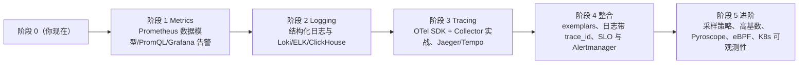

# 阶段 0 · 概念基础（Observability Concepts）

> 可观测性学习大纲的第一站。本阶段不追求跑通生产级栈，而是**把概念的地基打牢**：监控与可观测性的分野、三大支柱的数据模型、OpenTelemetry 的全貌、语义约定的意义、SDK 核心对象的心智模型——最后用一个 podman compose 实验亲眼看见三种信号。

## 本阶段笔记索引

| # | 文件 | 简介 | 建议用时 |
| --- | --- | --- | --- |
| 1 | [observability-vs-monitoring.md](./observability-vs-monitoring.md) | 可观测性 vs 监控：控制论起源、"未知未知"与"已知未知"、监控是可观测性子集、同一故障的两种排障过程对比、常见误区（"买了工具就有可观测性"） | 30 min |
| 2 | [three-pillars.md](./three-pillars.md) | 三大支柱 Metrics / Logging / Tracing：各自数据模型（counter/gauge/histogram、结构化日志、trace/span）、优缺点与成本模型对比、下单接口变慢的三幕排障演练、四大黄金信号与 USE/RED 方法论 | 45 min |
| 3 | [opentelemetry-overview.md](./opentelemetry-overview.md) | OpenTelemetry 总览：OpenTracing + OpenCensus 合并史、CNCF 毕业地位、API vs SDK、五种 Signals、OTLP 协议（4317/4318）、Collector 架构（receivers/processors/exporters/connectors + agent/gateway 部署模式）、自动 vs 手动埋点、厂商解耦 | 45 min |
| 4 | [semantic-conventions.md](./semantic-conventions.md) | 语义约定：为什么统一命名、Resource/Scope/Record 层级、`service.name`/`http.request.method`/`url.full`/`db.system` 实例速查、属性命名空间规范、新旧命名迁移与稳定性现状 | 30 min |
| 5 | [otel-quickstart-concepts.md](./otel-quickstart-concepts.md) | 核心对象速查：Tracer/Meter/Logger Provider、context 传播（W3C Trace Context）、Exporter、Processor（batch 等）、采样器概念预览，配"信号从应用到后端的全链路" mermaid 图 | 30 min |
| 6 | [otel-collector-deep-dive.md](./otel-collector-deep-dive.md) | Collector 生产化：五类组件与 declare≠activate 装配规则、connector（spanmetrics/routing）与 extension、confmap 配置工程（env 展开/include/validate）、必备处理器顺序（memory_limiter 第一/batch 最后）、sending queue 与重试语义、agent→gateway 级联分层、自监控四象限指标、telemetrygen 压测与 OCB 定制 | 45 min |
| 7 | [otel-metrics-and-logs-sdks.md](./otel-metrics-and-logs-sdks.md) | Metrics SDK 与 Logs 信号：七种 Instrument 选型表（含 Prometheus 映射）、View 聚合定制（桶边界/砍维度/改名/丢弃）、temporality 与后端选择、exemplar 过滤、Logs Bridge API 定位、severity 映射、OTLP→Prometheus/Loki 字段映射 | 40 min |

配套动手实验：[labs/lab00-otel-collector-basics/](../../labs/lab00-otel-collector-basics/README.md) —— 第一次跑通 OpenTelemetry Collector，亲眼看三种信号长什么样（读完笔记 3 与笔记 5 后做，效果最佳）。

## 学习目标（自查清单）

完成本阶段后，你应该能不查资料回答：

- [ ] 用两句话向外行解释"监控"和"可观测性"的区别，并各举一个场景；
- [ ] 说出三大支柱各自的数据模型核心名词（label/histogram 桶、结构化日志字段、trace_id/span/parent）；
- [ ] 给定"下单接口 P99 变慢"，排出三种信号的使用顺序和每步能看到什么；
- [ ] 默写四大黄金信号，并说出 RED 与 USE 分别面向什么层次；
- [ ] 画出 OpenTelemetry 的分层（API/SDK/OTLP/Collector/后端），并解释 API 与 SDK 分离的原因；
- [ ] 解释 Collector 里 receiver/processor/exporter/connector 的职责与 pipeline 的装配规则；
- [ ] 说出 4317 与 4318 的区别，以及 `service.name` 为什么重要；
- [ ] 区分 Resource 属性与 Span 属性，解释为什么 Resource 必须低基数；
- [ ] 写出 `traceparent` 头的大致结构，指出链路断链的三个高发位置。

## 与后续阶段的衔接

本阶段实验（lab00）中你已经接触过：OTLP gRPC 上报、Collector 管道（batch/debug/file）、三种信号在 debug 输出里的长相——它们分别会在阶段 1（file exporter 的数据当"后端"雏形）、阶段 3（换成真实 Jaeger 后端）被正式展开。

## 阅读约定

- 所有外部引用均附完整 URL 与统一访问日期（2026-11-04）；
- 术语首次出现时给出中英对照（如"直方图 Histogram"）；
- 代码示例以 Python 为主（与 lab00 一致），关键差异处会提示其他语言的形态。

---

> 下一阶段：`notes/01-metrics/`（各阶段索引见本目录 README）

## 附：ASCII 图替换清单

| 原 ASCII 图位置（章节标题） | 原图内容简述 | 替换结果 |
| --- | --- | --- |
| 与后续阶段的衔接 | 阶段 0 → 1 Metrics → 2 Logging → 3 Tracing → 4 整合 → 5 进阶 的学习路径链 | flowchart LR |

---

## 阶段导读：为什么要有这个阶段

整条学习路径是按"信号"推进的：阶段 1 指标、阶段 2 日志、阶段 3 链路、阶段 4 整合、阶段 5 生产化。每一站都在回答"某一类信号怎么落地"。而阶段 0 的任务不是落地任何东西，而是**在你动手之前，把三件事准备好**：

1. **词汇**：可观测性领域术语密度极高（span、基数、temporality、burn rate……），中文资料的翻译又很混乱。本阶段每篇笔记坚持"术语首次出现给中英对照"，下方的术语速查表可以随时回来翻——词汇不统一，读官方文档时会反复卡壳；
2. **心智模型**：遥测数据从应用到后端要经过"业务代码 → API/SDK → OTLP → Collector → 存储 → 查询"这条流水线。阶段 0 把每一环的职责讲清楚，之后所有实验（lab00 到 lab06）你都能知道"我改的是哪一环"；
3. **判断力**：监控与可观测性不是新旧替代关系、三大支柱不是三选一、OTel 不是后端——这些判断在做选型（阶段 2 存储选型、阶段 3 后端选型、阶段 6 自研/组装/购买）时每天都要用。

一个速查：本阶段各篇笔记解决什么问题、支撑后面哪个阶段——

| 阶段 0 笔记 | 解决的问题 | 直接支撑 |
| --- | --- | --- |
| observability-vs-monitoring | 两种排障范式的分野与适用场景 | 全部阶段的"为什么" |
| three-pillars | 三种信号的数据模型与互补关系 | 阶段 1/2/3 的数据模型地基 |
| opentelemetry-overview | OTel 全貌与 Collector 架构 | lab00、阶段 3、阶段 5 |
| semantic-conventions | 统一命名规范的意义与实例 | 阶段 1 的 label 设计、阶段 4 的关联 |
| otel-quickstart-concepts | SDK 核心对象与 context 传播 | 阶段 3 的 SDK 实战 |
| otel-collector-deep-dive | Collector 生产化与装配规则 | lab00、阶段 5 的 tail 采样 |
| otel-metrics-and-logs-sdks | Metrics/Logs SDK 细节 | 阶段 1/2 的埋点落地 |

学法建议：本阶段**不要背结论，要画图**。每读完一篇，合上笔记画一遍"信号从产出到查询"的完整链路，画不出来的地方就是你还没懂的地方。配套实验 [labs/lab00-otel-collector-basics/](../../labs/lab00-otel-collector-basics/README.md) 在读完笔记 3 与笔记 5 后做：概念阶段看到 debug 输出里三种信号的"长相"即可，不必追求调优。

## 常见误区与正解

- **误区一："买了商业 APM 或装了 Prometheus，就有可观测性了。"**
  为什么错：可观测性是**系统自身的属性**——仅凭外部输出能否推断内部状态（控制论定义）。工具只是放大器：埋点缺字段、命名混乱、context 断链的系统，装什么工具都只能"监控"到已知未知。
  正解：先定义排障工作流与命名规范，再谈工具；数据质量治理的欠账，换任何工具都还不掉。
- **误区二："三大支柱是三个独立产品，选一个主力就行。"**
  为什么错：三种信号是**同一现实的三个投影**：指标是聚合后的数值（便宜、丢细节），日志是离散的事件记录（信息密度高、贵），trace 是跨服务的因果树（独有因果信息）。排障的标准顺序"指标发现异常 → trace 定位环节 → 日志解释原因"缺一环就断。
  正解：按问题选信号，而不是按产品选信仰；三者用 trace_id 关联起来（阶段 4）才是完整体系。
- **误区三："OpenTelemetry 是一个后端，能替代 Prometheus/ELK。"**
  为什么错：OTel 的边界是"**产出、传输、加工**"（API/SDK/OTLP/Collector），明确不做存储与查询。
  正解：把 OTel 当作插桩与管道层的标准，后端仍然要选型——这也是阶段 2/3 存储选型与阶段 6 存储设计存在的理由。
- **误区四："属性和标签想加就加，以后再清理。"**
  为什么错：遥测数据的成本在**写入时**就爆炸（基数是 label 取值的笛卡尔积），Resource 属性还会复制到该服务产出的每一条记录；"以后清理"意味着重装全部探针。
  正解：Resource 只放低基数身份属性（`service.name` 等），span 属性克制并遵循语义约定（参考 `https://opentelemetry.io/docs/specs/semconv` （官方文档） ）。
- **误区五："自动埋点 = 零成本全链路覆盖。"**
  为什么错：自动埋点只覆盖**框架边界**（HTTP 入口、DB 驱动调用等），业务内部分段、批处理任务、自研中间件都需要手动补 span；另外 Go 没有字节码增强，做不到 Java 式无侵入。
  正解：自动埋点打底 + 手动 span 补关键业务段，双语言的完整写法在阶段 3 的 otel-sdk 笔记里。

## 术语速查表

| 术语 | 英文 | 一句话解释 |
| --- | --- | --- |
| 可观测性 | Observability | 仅凭系统外部输出推断其内部状态的能力，源自控制论。 |
| 监控 | Monitoring | 对预先定义的问题（已知未知）做被动检查，是可观测性的子集。 |
| 指标 | Metrics | 带时间戳的数值序列，低成本回答"系统现在怎么样"。 |
| 日志 | Logging | 带时间戳的离散事件记录，结构化后才能高效检索与聚合。 |
| 链路追踪 | Tracing | 用 trace/span 树描述一次请求跨服务的因果路径。 |
| 信号 | Signal | metrics/logs/traces 及后续 profiles 等遥测数据类型的统称。 |
| 采样 | Sampling | 只保留一部分遥测数据以控制成本的手段（阶段 5 展开）。 |
| 语义约定 | Semantic Conventions | OTel 官方统一属性命名规范，如 `service.name`、`http.request.method`。 |
| 资源 | Resource | 描述"数据由谁产生"的低基数属性集合（服务名、版本、部署环境）。 |
| OTLP | OpenTelemetry Protocol | OTel 的遥测传输协议，gRPC 4317 / HTTP 4318 两个端口。 |
| Collector | OTel Collector | 独立进程，负责遥测数据的接收、处理与导出（receiver/processor/exporter）。 |
| 基数 | Cardinality | 一个 label 的不同取值数量，决定时间序列规模与存储成本。 |

更多权威定义：OpenTelemetry 官方文档 `https://opentelemetry.io/docs` （官方文档） 、Prometheus 官方文档 `https://prometheus.io/docs` （官方文档） 。

## 与下一阶段的接口：带着什么进阶段 1

阶段 0 不产出任何可运行的系统，但它决定了阶段 1 起步的姿势。进阶段 1 时，你的行李里应该有三件东西：

1. **一套数据模型词汇**：label、时间序列、counter/gauge/histogram、桶——阶段 1 的 data-model 篇会把这些词正式展开成 Prometheus 的四种指标类型与抓取机制。如果读那篇时被词汇卡住，回 three-pillars 补课，而不是硬读；
2. **一个判断**："指标回答预定义问题"。PromQL 的全部语法（选择器、聚合、函数）都是在为"预定义问题"定义语言——带着这个视角学 PromQL，你会理解它为什么长成面向向量匹配的样子，而不是像 SQL 一样面向行；
3. **一个预埋点**：笔记 7 讲过 instrument 与 View、temporality 与后端选择——当你在业务代码里埋 RED 指标时（阶段 1 的 exporters 篇），它们第一次真正落地。

两道返工信号，出现就回炉：

- 在阶段 1 写 PromQL 时，说不清 `http_requests_total{status="500"}` 里哪一段是指标名、哪一段是 label 匹配——说明 three-pillars 的数据模型没吃透；
- 分不清"该埋 counter 还是 gauge"——回笔记 7 的七种 Instrument 选型表，再回 three-pillars 的数据模型一节对照。

收尾动作：对照本页开头的"学习目标（自查清单）"逐条打勾。若有打不了的条目，先别进阶段 1——清单里的每一项都是后面六站要反复调用的地基；尤其是"下单接口变慢的使用顺序"那一题，它就是阶段 4 排障 SOP 的雏形。

## 输出自测题：三道概念辨析题

概念阶段的输出不是代码，是"能把判断说清楚"。三道场景题，先自己回答再看要点：

1. **同事说："我们日志全量进了 ELK，可观测性已经很好了。"** 你怎么回应？
   要点：可观测性是系统属性，不是某个产品的到货状态；日志只是三支柱之一，缺了指标就没有低成本的"发现"，缺了 trace 就没有跨服务的"因果"。全量存储解决的是"能不能查"，不解决"知不知道该查什么"。
2. **新项目只允许引入一个组件，Prometheus 和 OTel Collector 二选一，怎么选？**
   要点：先指出这不是同类比较——Prometheus 是"抓取 + 存储 + 查询"的后端，Collector 是"接收 + 加工 + 转发"的管道，处在链路的不同位置。真正的决策是需求问题：要预定义问题的告警与趋势选后端，要三种信号统一出口与厂商解耦选管道。
3. **一个跑了很多年、改不了代码的老系统，怎么让它"可观测"起来？**
   要点：改不了代码不等于拿不到信号——主机与中间件有 exporter，日志文件有采集器，黑盒层面有探测与 eBPF 类无侵入手段（阶段 5 展开）；同时明确边界：拿不到业务内部语义，这部分"可观测"是有上限的，改造优先级要按排障痛点排。

三道题分别检验"三大支柱互补"、"OTel 定位"、"监控与可观测性的边界"三个概念。答的时候若只能背出定义、给不出场景，说明还停留在词汇层——回对应笔记把例子吃透。

## 一页速记：阶段 0 六句话

1. 监控回答预定义的问题，可观测性让你回答事先没想到要问的问题；前者是后者的子集。
2. 三大支柱是同一现实的三个投影：指标说"有事"，trace 说"在哪一环"，日志说"为什么"。
3. OpenTelemetry 管"产出、传输、加工"，不管存储与查询；后端永远要单独选型。
4. 语义约定是互操作的地基：`service.name` 写错，后面的分组、关联、跳转全部失效。
5. context 传播是显式的三步：inject 写头 → 线上传输 → extract 读头，缺任何一步就断链。
6. Resource 低基数、span 属性放细节、label 表类别不表个体——这三句守住成本底线。

六句各自展开后，就是本阶段七篇笔记的全部主线。
