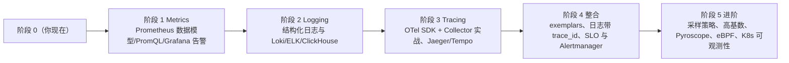

# 阶段 0 · 概念基础（Observability Concepts）

> 可观测性学习大纲的第一站。本阶段不追求跑通生产级栈，而是**把概念的地基打牢**：监控与可观测性的分野、三大支柱的数据模型、OpenTelemetry 的全貌、语义约定的意义、SDK 核心对象的心智模型——最后用一个 podman compose 实验亲眼看见三种信号。

## 本阶段笔记索引

| # | 文件 | 简介 | 建议用时 |
| --- | --- | --- | --- |
| 1 | [observability-vs-monitoring.md](./observability-vs-monitoring.md) | 可观测性 vs 监控：控制论起源、"未知未知"与"已知未知"、监控是可观测性子集、同一故障的两种排障过程对比、常见误区（"买了工具就有可观测性"） | 30 min |
| 2 | [three-pillars.md](./three-pillars.md) | 三大支柱 Metrics / Logging / Tracing：各自数据模型（counter/gauge/histogram、结构化日志、trace/span）、优缺点与成本模型对比、下单接口变慢的三幕排障演练、四大黄金信号与 USE/RED 方法论 | 45 min |
| 3 | [opentelemetry-overview.md](./opentelemetry-overview.md) | OpenTelemetry 总览：OpenTracing + OpenCensus 合并史、CNCF 毕业地位、API vs SDK、五种 Signals、OTLP 协议（4317/4318）、Collector 架构（receivers/processors/exporters/connectors + agent/gateway 部署模式）、自动 vs 手动埋点、厂商解耦 | 45 min |
| 4 | [semantic-conventions.md](./semantic-conventions.md) | 语义约定：为什么统一命名、Resource/Scope/Record 层级、`service.name`/`http.request.method`/`url.full`/`db.system` 实例速查、属性命名空间规范、新旧命名迁移与稳定性现状 | 30 min |
| 5 | [otel-quickstart-concepts.md](./otel-quickstart-concepts.md) | 核心对象速查：Tracer/Meter/Logger Provider、context 传播（W3C Trace Context）、Exporter、Processor（batch 等）、采样器概念预览，配"信号从应用到后端的全链路" mermaid 图 | 30 min |
| 6 | [otel-collector-deep-dive.md](./otel-collector-deep-dive.md) | Collector 生产化：五类组件与 declare≠activate 装配规则、connector（spanmetrics/routing）与 extension、confmap 配置工程（env 展开/include/validate）、必备处理器顺序（memory_limiter 第一/batch 最后）、sending queue 与重试语义、agent→gateway 级联分层、自监控四象限指标、telemetrygen 压测与 OCB 定制 | 45 min |
| 7 | [otel-metrics-and-logs-sdks.md](./otel-metrics-and-logs-sdks.md) | Metrics SDK 与 Logs 信号：七种 Instrument 选型表（含 Prometheus 映射）、View 聚合定制（桶边界/砍维度/改名/丢弃）、temporality 与后端选择、exemplar 过滤、Logs Bridge API 定位、severity 映射、OTLP→Prometheus/Loki 字段映射 | 40 min |

配套动手实验：[labs/lab00-otel-collector-basics/](../../labs/lab00-otel-collector-basics/README.md) —— 第一次跑通 OpenTelemetry Collector，亲眼看三种信号长什么样（读完笔记 3 与笔记 5 后做，效果最佳）。

## 学习目标（自查清单）

完成本阶段后，你应该能不查资料回答：

- [ ] 用两句话向外行解释"监控"和"可观测性"的区别，并各举一个场景；
- [ ] 说出三大支柱各自的数据模型核心名词（label/histogram 桶、结构化日志字段、trace_id/span/parent）；
- [ ] 给定"下单接口 P99 变慢"，排出三种信号的使用顺序和每步能看到什么；
- [ ] 默写四大黄金信号，并说出 RED 与 USE 分别面向什么层次；
- [ ] 画出 OpenTelemetry 的分层（API/SDK/OTLP/Collector/后端），并解释 API 与 SDK 分离的原因；
- [ ] 解释 Collector 里 receiver/processor/exporter/connector 的职责与 pipeline 的装配规则；
- [ ] 说出 4317 与 4318 的区别，以及 `service.name` 为什么重要；
- [ ] 区分 Resource 属性与 Span 属性，解释为什么 Resource 必须低基数；
- [ ] 写出 `traceparent` 头的大致结构，指出链路断链的三个高发位置。

## 与后续阶段的衔接

本阶段实验（lab00）中你已经接触过：OTLP gRPC 上报、Collector 管道（batch/debug/file）、三种信号在 debug 输出里的长相——它们分别会在阶段 1（file exporter 的数据当"后端"雏形）、阶段 3（换成真实 Jaeger 后端）被正式展开。

## 阅读约定

- 所有外部引用均附完整 URL 与统一访问日期（2026-11-04）；
- 术语首次出现时给出中英对照（如"直方图 Histogram"）；
- 代码示例以 Python 为主（与 lab00 一致），关键差异处会提示其他语言的形态。

---

> 下一阶段：`notes/01-metrics/`（各阶段索引见本目录 README）

## 附：ASCII 图替换清单

| 原 ASCII 图位置（章节标题） | 原图内容简述 | 替换结果 |
| --- | --- | --- |
| 与后续阶段的衔接 | 阶段 0 → 1 Metrics → 2 Logging → 3 Tracing → 4 整合 → 5 进阶 的学习路径链 | flowchart LR |
