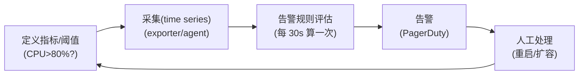
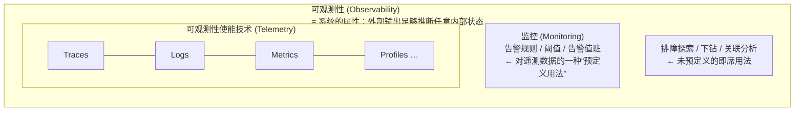

# 可观测性（Observability）vs 监控（Monitoring）

> 阶段 0 · 概念基础 / 笔记 1
>
> 一句话总结：**监控回答你提前想到要问的问题，可观测性让你能回答事先没想到要问的问题。**
> 监控是可观测性的一个子集，而不是它的对立面。

---

## 目录

1. [从控制论说起：可观测性的数学起源](#1-从控制论说起可观测性的数学起源)
2. [什么是监控](#2-什么是监控)
3. [什么是可观测性](#3-什么是可观测性)
4. [已知未知 vs 未知未知：两种系统的灵魂差异](#4-已知未知-vs-未知未知两种系统的灵魂差异)
5. [关系：监控是可观测性的子集](#5-关系监控是可观测性的子集)
6. [同一个故障，两种视角：举例对比](#6-同一个故障两种视角举例对比)
7. [什么时候需要可观测性：复杂度阶梯](#7-什么时候需要可观测性复杂度阶梯)
8. [可观测性成熟度自评](#8-可观测性成熟度自评)
9. [常见误区](#9-常见误区)
10. [面试常见问题小结](#10-面试常见问题小结)
11. [参考资料](#11-参考资料)

---

## 1. 从控制论说起：可观测性的数学起源

"可观测性"这个词并不是 IT 行业发明的，它来自 **控制论（Cybernetics）**。

1960 年，匈牙利裔美国数学家 **Rudolf E. Kálmán** 在论文《On the General Theory of Control Systems》中提出了控制系统的两个基础概念：

- **可控性（Controllability）**：能否通过外部输入，把系统从任意初始状态驱动到任意目标状态；
- **可观测性（Observability）**：**仅凭系统的外部输出（Output），在有限时间内，能否唯一推断出系统内部状态（Internal State）**。

用控制论的语言描述一个系统：

```text
状态方程：  x(k+1) = A·x(k) + B·u(k)        （内部状态如何演化）
输出方程：  y(k)   = C·x(k)                  （我们能观测到什么）
```

其中 `x` 是内部状态（看不到），`y` 是外部输出（看得到）。系统"可观测"的判据是**可观测性矩阵**满秩：

```text
Q = [ C; C·A; C·A²; ...; C·A^(n-1) ]
```

软件工程在 2017 年前后（以 Honeycomb、Twitter、Stripe 等公司的一批博客文章为代表，代表人物如 Charity Majors）把这个概念"借"了过来，做了一个类比：

| 控制论 | 分布式软件系统 |
| --- | --- |
| 内部状态 `x` | 程序的内部执行状态：线程栈、变量、队列深度、某次请求经过的代码路径…… |
| 外部输出 `y` | 遥测数据（Telemetry）：Metrics、Logs、Traces、Profiles 等外部可见的输出 |
| 可观测性 | **仅凭外部输出（遥测数据），就能推断出系统内部任何时刻的状态——包括你没预料到的状态** |

这个起源解释了一个关键点：**可观测性是系统的属性，不是工具的属性。** 一个系统要么"设计得可观测"，要么不可观测；买来一堆工具并不能让一个没有输出足够信息的系统变得可观测——就像给黑盒子上再多的探测器，如果盒子上没有输出接口，你还是看不见里面。

## 2. 什么是监控

**监控（Monitoring）** 是一个古老而成熟的工程实践：预先定义一组你认为重要的指标和阈值，持续采集、与阈值比较，异常时触发告警，由人来响应。

一个典型的监控闭环：



监控的核心特征：

1. **面向"预定义的问题"**。你必须先猜到"什么会坏"，才能为它写告警规则；
2. **聚合优先**。监控通常处理的是**聚合后的数值**（平均值、分位数、速率），原始事件被丢弃或只保留很短时间；
3. **输出是"结论"**：正常 / 异常 / 告警，而不是"供探索的原始数据"；
4. **回答的是"是否（Whether）"**：系统是不是出了问题？

监控的价值毋庸置疑：磁盘满了、证书快过期了、错误率超阈值了——这类**已知的、重复发生的故障模式**，用监控 + 告警 + runbook 处理效率最高，也是最便宜的方案。

### 2.1 黑盒监控 vs 白盒监控

按"从哪里看"，监控又分两种互补视角：

| | 黑盒监控（Black-box） | 白盒监控（White-box） |
| --- | --- | --- |
| 站位 | 系统外部，以"用户/拨测点"身份探测 | 系统内部，读取运行时状态 |
| 手段 | ICMP/TCP/HTTP 拨测、合成监控（synthetic）、证书校验、可用性探测 | 指标、日志、trace、profile 等内部遥测 |
| 回答 | "用户现在能不能用？体验多差？" | "内部哪个环节出了问题？为什么？" |
| 优点 | 贴近真实用户体验；能发现"内部指标全绿但用户就是打不开"的问题（DNS、证书、运营商链路） | 信息丰富，可直接定位根因 |
| 局限 | 只知道"坏了"，不知道"为什么"；探测点与路径有限 | 依赖埋点质量；内部正常 ≠ 用户体验正常 |

Google SRE Book 对两者的经典结论：**黑盒监控反映"用户正在受苦"的症状，白盒监控反映"系统正在受苦"的原因**，二者缺一不可。实践上的常见组合是：面向用户的 SLI 用外部拨测做最终裁决，内部用白盒指标做定位与告警降噪（阶段 4 的 SLO 会再次用到这个分工）。

## 3. 什么是可观测性

**可观测性（Observability）** 是系统的一种属性：**能够通过其外部输出，理解并推断系统内部任何时刻的状态——尤其是那些你事先没有预料到的状态。**

CNCF 对可观测性使能技术的常见表述是"三大支柱"（Metrics、Logging、Tracing，后续笔记会展开），但支柱只是手段，可观测性真正的关注点是：

1. **面向探索与提问**：故障发生时，工程师能针对**任意维度组合**提出新问题，并在秒级得到答案；
2. **保留原始事件的细节**：不仅知道 P99 是 500ms，还能下钻到"具体是哪一类请求、哪个用户、哪个版本、哪条链路慢"；
3. **允许高基数（high cardinality）、高维度（high dimensionality）**：如 `user_id`、`order_id`、`trace_id`、`build_id` 这类取值几乎无限的维度，恰恰是区分"正常流量"与"那一个出问题的请求"的关键；
4. **回答的是"为什么（Why）"**：不仅知道出了问题，还能定位根因。

Charity Majors 有一个流传很广的公式化说法（意译）：

> 监控是关于"已知未知"（known unknowns）的；可观测性是关于"未知未知"（unknown unknowns）的。

## 4. 已知未知 vs 未知未知：两种系统的灵魂差异

这个说法源自美国前国防部长 Donald Rumsfeld 的著名发言，后来被 SRE 社区广泛借用：

| 类型 | 含义 | 举例 | 应对手段 |
| --- | --- | --- | --- |
| 已知已知（known knowns） | 你知道且已理解的事实 | "我们的 QPS 峰值是 3 万" | 文档、仪表盘 |
| 已知未知（known unknowns） | 你知道要盯、但不确定结果的指标 | "磁盘什么时候满？P99 会不会超阈值？" | **监控** + 告警 + runbook |
| 未知未知（unknown unknowns） | 你根本没预料到的故障形态 | "新上的依赖库在特定 UA 下死循环"、"两个本来无关的变更互相作用导致缓存雪崩" | **可观测性**：事后能对任意新问题做探索 |
| 未知已知（unknown knowns，默会知识） | 团队里有人知道、但没有沉淀的知识 | 老员工"凭手感"知道的事 | 知识管理、事后复盘 |

一个能说明问题的对比：

```text
监控思维：     "给 order-api 加一条 P99 > 800ms 持续 5 分钟就告警的规则。"
可观测性思维： "order-api P99 突然变成 2s 了。让我按 route × version × instance 切一下……
               只有 v2.3.1 + /checkout 慢。按 trace_id 抽几条慢链路看看……
               慢在下游 inventory-service 的 Lock 调用。为什么只有它慢？……"
```

前者在故障发生前就锁定了问题形态；后者在故障形态未知时，提供了**逐步缩小问题空间**的能力。

## 5. 关系：监控是可观测性的子集

一个常见误区是把两者对立（"监控过时了，我们要可观测性"）。正确的关系是**包含**：



换句话说：

- **遥测数据（Telemetry）是原材料**：traces、logs、metrics、profiles；
- **监控是这些原材料的一种预定义消费方式**：阈值 + 告警；
- **可观测性是整个体系的属性**：数据是否足以支撑未预定义的探索。

工程实践里两者必须同时存在：

| 能力 | 靠什么 | 典型问题 |
| --- | --- | --- |
| 磁盘 85% 提前告警 | 监控 | 已知未知 |
| 证书 14 天内过期提醒 | 监控 | 已知未知 |
| "昨晚 3 点支付成功率为何抖动" | 可观测性（探索） | 未知未知 |
| 新版本灰度中定位长尾延迟根因 | 可观测性（探索） | 未知未知 |

## 6. 同一个故障，两种视角：举例对比

场景：**电商下单接口，某天 14:32 开始，成功率从 99.9% 掉到 97%。**

### 只有监控的世界

- 14:32 告警触发：`order-api http_5xx_ratio > 1% for 3m`；
- 值班工程师打开 Grafana：错误率确实升高了，CPU 正常、QPS 正常、依赖的 DB 主从延迟正常（这些都提前配好了监控）；
- 但"97% 的失败里，失败的都是**谁**？请求打到**哪个实例**？失败发生在**哪一行代码 / 哪个下游**？"——监控数据里没有，因为指标都按 `job` 聚合了；
- 只能靠猜：先回滚最近一次发布（15:00），未恢复；再重启实例（15:10），未恢复；逐个摘除下游依赖做金丝雀（15:40）……最终 16:15 定位是某个依赖的 gRPC 连接池在新内核参数下耗尽。
- **MTTR（平均恢复时长）≈ 1 小时 43 分，其中 90% 时间花在"收集证据"而不是"修复"。**

### 有可观测性的世界

- 同样的告警触发（监控仍然在工作！）；
- 工程师打开 traces 视图，filter：`service=order-api AND status=ERROR`，发现失败请求的 span 树里，`grpc.client/order → inventory` 这个 span 全部带 `error` 事件，错误消息是 `connection pool exhausted`；
- 切到 logs，用 `trace_id` 关联同一条 trace 的结构化日志，看到报错实例集中在 `instance=order-api-7f9c-x2rl`（某个特定 Pod）；
- 再按 `instance` 维度切 metrics：该实例的出站连接数早已打满，且内核参数 `net.ipv4.tcp_tw_reuse` 在当天 10 点被一次运维任务改过；
- **14:41 定位根因并修复。MTTR ≈ 9 分钟。**

两者用的告警是一样的——差别在于**告警触发之后**，工程师手里有没有足够细的数据把问题空间一路切下去。

## 7. 什么时候需要可观测性：复杂度阶梯

可观测性不是免费的（存储、基数、工程师学习成本都是钱），系统复杂度决定投入力度：

| 系统形态 | 失败模式数量 | 建议投入 |
| --- | --- | --- |
| 单体 + 单库 + 5 人以下团队 | 少，多数已知 | 监控 + 结构化日志即可，traces 可选 |
| 单体 + 多依赖（缓存/MQ/三方） | 中 | 监控 + 日志聚合 + 关键路径 trace |
| 微服务（10~100 个服务） | 指数增长，大量未知 | 三大支柱全套 + trace_id 贯通 + 高基数支持 |
| Serverless / 多租户 SaaS | 海量未知 + 爆炸半径小 | 全套 + 采样策略 + profiling |
| 大规模（1000+ 服务、多区域） | 极多 | 全套 + exemplars + SLO 体系 + tail sampling |

经验法则（来自 Honeycomb 等厂商的总结，同样适用于自建方案）：

1. **当"排障靠 ssh 上机器 grep 日志"的次数开始明显变多，就该投入结构化日志与集中式查询了**；
2. 当一次排障需要跨 3 个以上服务追上下文时，就该上分布式追踪了；
3. 当告警群里"看不懂、不知道该谁处理"的告警超过一半时，需要的不是更多告警，而是更细的可观测性。

## 8. 可观测性成熟度自评

把上文的概念落成一把可以量自己的尺子。综合 CNCF 调研与业界常见的成熟度划分，可粗糙地分五级（L0→L4）：

| 级别 | 名称 | 特征 | 典型表现 |
| --- | --- | --- | --- |
| **L0** | 无观测 | 出了事靠人肉 | ssh 上机器 `grep` 日志；用户报障才知道宕机 |
| **L1** | 基础监控 | 看资源与存活 | CPU/内存/磁盘/进程存活有告警；日志散落在各机器上 |
| **L2** | 集中与结构化 | 遥测集中、可查 | 结构化日志集中采集（ELK/Loki）；核心服务有 RED 指标面板 |
| **L3** | 三支柱贯通 | 信号互相关联 | trace_id 贯通日志与链路；指标可下钻（exemplar）；换后端不动代码（OTel 标准化） |
| **L4** | 数据驱动运营 | 用数据管质量 | SLO 与错误预算驱动发布决策；采样/成本策略精细化；容量与变更关联分析 |

自评问题（每答一个"是"，大致升半级）：

1. 检测故障靠告警而不是用户报障吗？（L1 的门槛）
2. 排障时能在 5 分钟内检索到任意实例近 7 天的结构化日志吗？（L2）
3. 一条日志点开能看到它的 trace，一条慢 trace 能看到它的日志吗？（L3）
4. 埋点用的是 OpenTelemetry 标准 API 而非厂商私有 SDK 吗？（L3，解耦是持续演进的前提）
5. 错误预算的消耗速度会实际影响你们的发布节奏吗？（L4）

两个常见提醒：

- **级别不是越高越好**，而是与系统复杂度匹配（对照第 7 节阶梯）；五人小团队停在 L2 完全合理；
- **跨越 L2→L3 的标志不是买了三个产品，而是 trace_id 把三个信号串起来了**——这也是本学习路线阶段 3/4 的核心目标。

## 9. 常见误区

### 误区 1："买了可观测性平台，我们就有可观测性了"

工具是必要非充分条件。可观测性是**系统属性**：代码要输出结构化日志、请求要带 trace context、指标要有合理的维度标签、异常路径要留痕。一个只会打 `print("error")` 的系统，接上再贵的平台也观测不了。**埋点质量 > 工具选型。**

### 误区 2："可观测性 = 三大支柱各买一套"

支柱是数据种类，不是产品清单。如果 traces、logs、metrics 之间**没有关联**（尤其是日志里没有 trace_id），你得到的是三个孤岛，排障时仍要人肉对时间戳。打通（trace_id 回填日志、metrics 挂 exemplar 指向 trace）比堆工具更重要。

### 误区 3："数据越多越可观测"

无差别采集只会推高成本和噪声。可观测性讲究的是**在成本约束下保留可下钻的细节**：例如 traces 用采样（错误请求 100% 保留、正常请求采 1%），logs 分级保留（ERROR 90 天、DEBUG 3 天），metrics 谨防高基数标签爆炸（不要把 user_id 放进 metrics 的 label）。

### 误区 4："监控是过时的老古董"

监控解决的是"已知故障的快速感知"，它没有也不会被替代。SLO 告警、黑盒拨测、资源容量告警仍然是最有效的第一道防线。**可观测性接管的是告警触发之后的"为什么"。**

### 误区 5："可观测性就是 APM"

APM（Application Performance Monitoring）是商业产品品类，历史上往往绑定私有 Agent 和私有数据格式。可观测性是目标；OpenTelemetry 之类的开放标准让你在不锁定厂商的前提下达到这个目标（见笔记 3）。

### 误区 6："仪表盘越多越好"

仪表盘本质上是"预先想好的问题集合"，做得太多会退化成另一种形式的监控，且维护成本极高。可观测性成熟团队通常只维护少量标准化的服务总览盘（RED/USE，见笔记 2），把精力放在"即席查询能力"上。

### 误区 7："加人值班就能弥补可观测性的不足"

MTTR = 检测时间 + 定位时间 + 修复时间。检测靠监控，修复靠代码，**定位时间几乎完全由可观测性决定**。定位能力不足的团队，加人只会让更多人在同一份日志面前发呆。

## 10. 面试常见问题小结

**Q1：可观测性和监控的区别是什么？**

> 答：监控面向**已知未知**——预先定义指标与阈值，回答"是否出了问题"，输出结论（告警）；可观测性是系统属性，指**仅凭外部输出就能推断任意内部状态**，面向**未知未知**，回答"为什么出了问题"，输出可探索的原始数据（高维度、高基数、可关联的 traces/logs/metrics）。监控是可观测性体系的一个子集/一种消费方式，不是对立概念。

**Q2："可观测性"这个词是怎么来的？**

> 答：源自 1960 年 Kálmán 的控制论工作——通过系统的外部输出能否重构内部状态（可观测性矩阵满秩判据）。软件领域在 2017 年后借用了这个概念，把 metrics/logs/traces 等遥测数据类比为"外部输出"。

**Q3：什么信号说明团队需要投入可观测性建设？**

> 答：排障时反复"上机器 grep 日志"；跨服务追问题要靠时间戳人肉对齐；告警触发后定位时间远大于修复时间；同一类故障反复发生但根因从未真正查清。

**Q4：为什么说"买了工具不等于有可观测性"？**

> 答：因为可观测性是系统属性。工具只能消费数据；若代码没有输出结构化、带上下文（trace_id）、有合理维度的遥测，工具无数据可用。埋点质量与数据关联性决定成败。

**Q5：举例说明监控解决不了、但可观测性能解决的问题。**

> 答：例如"新版本灰度后只有持有旧客户端 token 的少量用户下单失败"。预先定义的聚合指标（按 job/状态码聚合的错误率）可能完全看不到这 0.1% 的长尾；带高维度的 traces/logs 可以按 `version × route × user_segment` 下钻直接命中。

**Q6：可观测性和 SRE 里的 MTTR 有什么关系？**

> 答：MTTR = 检测（MTTD）+ 定位 + 修复。监控优化检测，代码质量决定修复难度，而**定位时间主要由可观测性决定**——这也是投入可观测性最直接的 ROI 度量方式。

**Q7：黑盒监控和白盒监控有什么区别？实践中如何配合？**

> 答：黑盒从系统外部以用户身份探测（拨测/合成监控），回答"用户能不能用"，能发现内部指标全绿但外部不可达的问题（DNS、证书、网络链路）；白盒读取内部遥测（指标/日志/trace），回答"哪个环节坏了、为什么"。实践中：面向用户的 SLI 用黑盒做最终裁决，白盒做定位与告警降噪；只有白盒没有黑盒，会出现"内部正常但用户受苦"的盲区。

## 11. 参考资料

1. Kálmán, R. E. (1960). *On the General Theory of Control Systems*. IFAC Proceedings Volumes.
   概览：<https://en.wikipedia.org/wiki/Observability> （访问日期：2026-11-04）
2. Charity Majors 等，Honeycomb《Observability: A Comprehensive Guide》免费在线版：
   <https://www.honeycomb.io/what-is-observability> （访问日期：2026-11-04）
3. Cindy Sridharan，《Monitoring and Observability》(2016)：
   <https://medium.com/@copyconstruct/monitoring-and-observability-8417d1952e1c> （访问日期：2026-11-04）
4. Google SRE Book, Chapter 6 *Monitoring Distributed Systems*：
   <https://sre.google/sre-book/monitoring-distributed-systems/> （访问日期：2026-11-04）
5. OpenTelemetry 官方文档，Observability primer：
   <https://opentelemetry.io/docs/specs/otel/overview/> （访问日期：2026-11-04）
6. CNCF 对云原生可观测性的定义与白皮书：
   <https://github.com/cncf/tag-observability/blob/main/whitepaper.md> （访问日期：2026-11-04）

---

> 下一篇：[three-pillars.md](./three-pillars.md) —— 三大支柱 Metrics / Logging / Tracing 的数据模型与排障演练。

## 附：ASCII 图替换清单

| 原 ASCII 图位置（章节标题） | 原图内容简述 | 替换结果 |
| --- | --- | --- |
| 2. 什么是监控 | 监控闭环：定义指标/阈值 → 采集 → 告警规则评估 → 告警 → 人工处理，人工处理回路到定义指标 | flowchart LR |
| 5. 关系：监控是可观测性的子集 | 可观测性 ⊃ 遥测技术（Traces/Logs/Metrics/Profiles）、监控（预定义用法）、排障探索（即席用法）的嵌套包含关系 | flowchart TB（嵌套 subgraph） |
