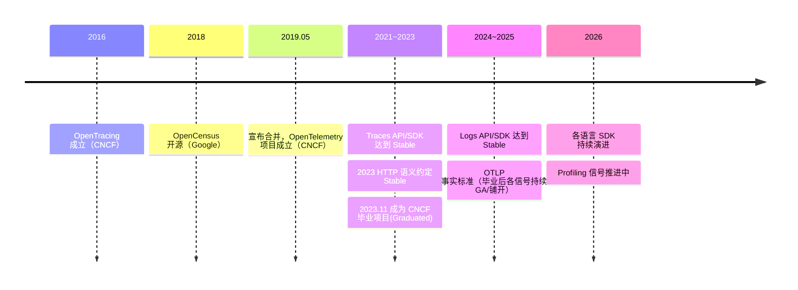
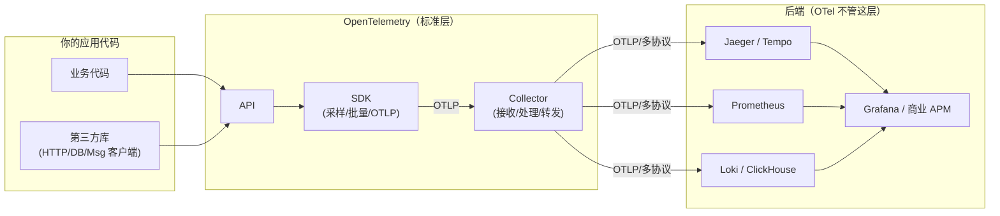
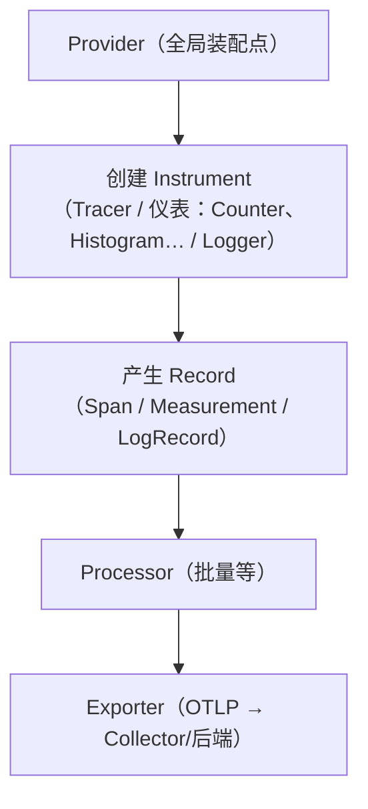
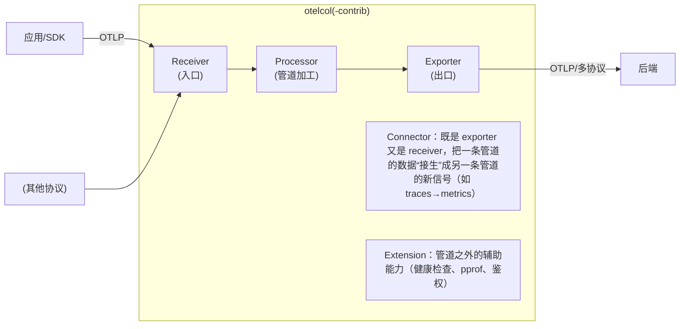
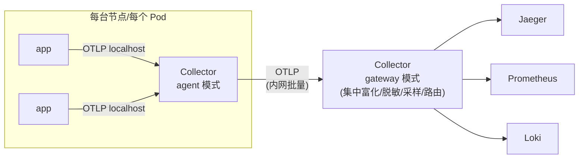
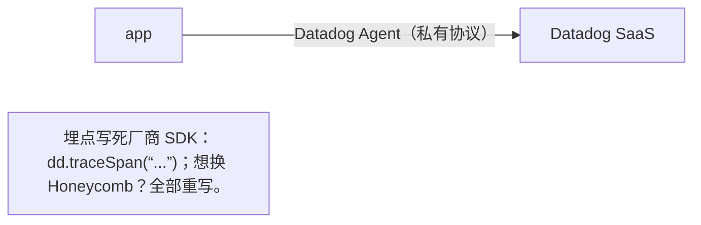
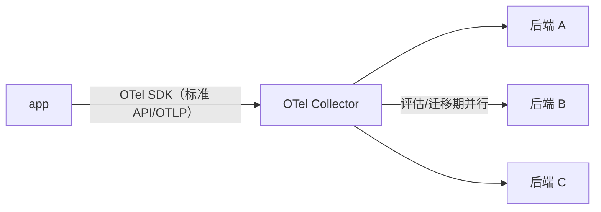

# OpenTelemetry 基本概念总览

> 阶段 0 · 概念基础 / 笔记 3
>
> 一句话总结：**OpenTelemetry（OTel）是 CNCF 的开放标准 + 开源工具集，统一了 traces / metrics / logs 等遥测数据的产生、传输与处理方式，让你"埋一次点，随便换后端"。**
> 注意：OTel **不是** APM 产品，它**不提供**存储、查询和可视化——那是 Jaeger、Prometheus、Loki、Grafana 以及各商业后端的事。

---

## 目录

1. [项目历史：OpenTracing + OpenCensus → OpenTelemetry](#1-项目历史opentracing--opencensus--opentelemetry)
2. [CNCF 生态中的地位](#2-cncf-生态中的地位)
3. [总体架构：API / SDK / Protocol / Collector](#3-总体架构api--sdk--protocol--collector)
4. [API vs SDK](#4-api-vs-sdk)
5. [Signals：遥测信号](#5-signals遥测信号)
6. [OTLP 协议](#6-otlp-协议)
7. [Collector 架构](#7-collector-架构)
8. [Instrumentation：自动 vs 手动埋点](#8-instrumentation自动-vs-手动埋点)
9. [与厂商解耦的价值](#9-与厂商解耦的价值)
10. [常见误区](#10-常见误区)
11. [面试常见问题小结](#11-面试常见问题小结)
12. [参考资料](#12-参考资料)

---

## 1. 项目历史：OpenTracing + OpenCensus → OpenTelemetry

在 2019 年之前，可观测性埋点标准是**两强相争**的局面：

| 项目 | 出身 | 发布时间 | 覆盖信号 | 问题 |
| --- | --- | --- | --- | --- |
| **OpenTracing** | CNCF 项目（社区驱动，Uber/Jaeger、LightStep 等推动） | 2016 年 | 仅 tracing API | 只有 API，没有实现与数据传输协议的统一约定 |
| **OpenCensus** | Google 内部 census 库开源 | 2018 年 | tracing + metrics | Google 主导，API 演进节奏与社区生态不合；同样缺统一后端协议 |

两套标准并存的代价是灾难性的：**每个库作者都要选边站**（或者写两份适配代码），每个应用都要维护两套依赖；采集 Agent、传输协议、后端格式全都碎片化。

**2019 年 5 月**，两个项目的核心维护者（Ted Young、Morgan McLean 等）共同宣布合并：两边团队一起进入 CNCF 新项目 **OpenTelemetry**，OpenTracing 与 OpenCensus 进入维护模式并最终归档。合并后的目标：

1. 提供三大信号（后来加上更多）**统一的 API、SDK 与语义约定**；
2. 提供统一、高效的传输协议 **OTLP**；
3. 提供与厂商无关的采集组件 **Collector**；
4. 兼容存量生态（Prometheus、Jaeger、Zipkin 格式互转，兼容 W3C Trace Context）。

时间线速览：



## 2. CNCF 生态中的地位

- OpenTelemetry 目前是 **CNCF 毕业项目（Graduated）**，归类为 Observability（据 CNCF 官方项目页，访问日期：2026-11-04）；
- 按贡献者数量与发布频率，它常被称为**仅次于 Kubernetes 的第二大 CNCF 项目**；
- 它处在"应用代码"与"可观测性后端"之间的**标准层**，向下对接语言运行时与基础设施，向上对接开源后端（Jaeger/Tempo、Prometheus、Loki、Grafana）与几乎所有商业 APM（Datadog、Dynatrace、Honeycomb、Splunk……后者均官方支持 OTLP 摄入）。

生态位置图：



## 3. 总体架构：API / SDK / Protocol / Collector

OpenTelemetry 的技术版图可以拆成四块，自上而下：

| 层 | 是什么 | 由谁引入 | 备注 |
| --- | --- | --- | --- |
| **API** | 一组接口/抽象（Tracer、Meter、Logger 等） | 库作者、业务代码 | 无操作实现，零开销；只依赖 API 不带来采集行为 |
| **SDK** | API 的参考实现（真正的采集引擎） | 应用最终装配 | 控制采样、批量、资源信息、导出目标 |
| **OTLP** | 遥测数据传输协议（Protobuf 编码，gRPC 或 HTTP） | SDK ↔ Collector ↔ 后端 | 端口约定：gRPC `4317`、HTTP `4318` |
| **Collector** | 独立部署的采集/处理/转发进程 | 基础设施团队 | 解耦应用与后端，做协议转换、清洗、富化、采样 |

再加一块横切的规范：**语义约定（Semantic Conventions）**——统一命名与属性（`service.name`、`http.request.method`……），见笔记 4。

## 4. API vs SDK

这是 OTel 最容易被误解的设计，也是它成功的关键之一。

### 4.1 API：无副作用的"插座"

`opentelemetry-api`（各语言同名概念）只定义接口。若 classpath/依赖里没有 SDK，API 会落到 **no-op 实现**：

```python
# 库作者的角度：只依赖 API，永远安全
from opentelemetry import trace

tracer = trace.get_tracer("my.library", "1.2.3")
with tracer.start_as_current_span("parse-config") as span:   # 没 SDK 时是 no-op span
    span.set_attribute("config.format", "yaml")              # no-op，不报错
    pass  # 业务逻辑照常执行，完全不感知 SDK 是否存在
```

设计动机：

1. **库作者可以放心埋点**，不会把采集实现强加给使用方；
2. **应用启动时才决定**装不装 SDK、采样多少、发到哪（运维决策而非库的决策）；
3. 避免 SDK 版本冲突（API 稳定性承诺强于 SDK）。

### 4.2 SDK：插上插座后的"发动机"

应用（或自动探针）装配 SDK 后，同样的 API 调用产生真实数据：

```python
# 应用启动入口：装配 SDK（lab00 的实际代码就是这套骨架）
from opentelemetry.sdk.trace import TracerProvider
from opentelemetry.sdk.trace.export import BatchSpanProcessor
from opentelemetry.exporter.otlp.proto.grpc.trace_exporter import OTLPSpanExporter

provider = TracerProvider(resource=resource)
provider.add_span_processor(BatchSpanProcessor(OTLPSpanExporter(endpoint="http://otel-collector:4317")))
trace.set_tracer_provider(provider)     # 从此 API 调用全部"通电"
```

### 4.3 对比表

| | API | SDK |
| --- | --- | --- |
| 谁引入 | 库作者 / 业务代码 | 应用装配者（或自动探针） |
| 行为 | 无 SDK 时为 no-op | 真实采集：采样、批处理、导出 |
| 稳定性 | 高（向后兼容承诺强） | 随版本演进，偶有破坏性变更 |
| 数量 | 每进程一套全局 | 每进程一套全局 |
| 典型依赖 | `opentelemetry-api` | `opentelemetry-sdk` + `opentelemetry-exporter-otlp` |

## 5. Signals：遥测信号

OTel 把不同种类的遥测数据称为**信号（Signals）**。当前规范定义的主信号：

| 信号 | 描述 | 核心对象 | 规范状态（截至 2026-11） |
| --- | --- | --- | --- |
| **Traces** | 分布式请求的因果路径（trace/span） | Tracer / TracerProvider | Stable |
| **Metrics** | 聚合的时间序列测量 | Meter / MeterProvider | Stable |
| **Logs** | 结构化事件记录（含 trace 关联） | Logger / LoggerProvider | Stable（各语言实现成熟度有差异） |
| **Baggage** | 跨进程传播的**键值上下文**（业务标签，非遥测本身） | baggage API | Stable；注意：不产生数据，用于携带如 `user.plan=pro` 这类信息供下游日志/埋点使用 |
| **Profiling** | 持续性能剖析（CPU/内存栈样本） | eBPF/信号规范推进中 | 开发中（Development），新版本 Collector 已提供 `otelcol-ebpf-profiler` 等发行版 |

各信号的共同骨架（同一套心智模型）：



细节见笔记 5《核心对象速查》。

## 6. OTLP 协议

**OTLP（OpenTelemetry Protocol）** 是 OTel 的官方传输协议：Protobuf 数据结构 + 两种传输绑定。

| 绑定 | 默认端口 | 说明 |
| --- | --- | --- |
| OTLP/gRPC | **4317** | 长连接、双向流、适合 agent→后端常驻链路；OTLP 未用 gRPC 的全部特性，实际是单向 RPC |
| OTLP/HTTP | **4318** | HTTP POST + Protobuf（或 JSON）body，路径 `/v1/traces`、`/v1/metrics`、`/v1/logs`；穿代理/CDN 友好 |

要点：

1. **端点书写规则因绑定而异**：gRPC exporter 常写 `http://host:4317`；HTTP exporter 写 `http://host:4318`（SDK 会自动拼 `/v1/traces`）。混用端口是新手第一大坑（见 lab00 README 排错节）；
2. SDK 侧大量行为可用**环境变量**配置（`OTEL_EXPORTER_OTLP_ENDPOINT`、`OTEL_SERVICE_NAME`……），规范里叫 *SDK 自动配置*，跨语言一致；
3. 除了 OTLP，SDK 还保留 Jaeger、Zipkin、Prometheus 等传统 exporter，但**官方推荐统一走 OTLP**，其余格式交给 Collector 去转换。

## 7. Collector 架构

> 本节是架构级概览；生产化深水区（connector/extension 完整模型、confmap 配置工程、
> 处理器顺序与导出队列语义、自监控与容量压测、OCB 定制）见续篇
> [otel-collector-deep-dive.md](otel-collector-deep-dive.md)。

**OpenTelemetry Collector** 是一个独立进程（Go 编写），负责**接收、处理、导出**遥测数据。它是"应用与后端之间的解耦层"，也是 lab00 的主角。

### 7.1 核心组件



| 组件 | 职责 | 常见例子 |
| --- | --- | --- |
| **Receivers** | 数据入口，一种或多种协议/来源 | `otlp`、`prometheus`（抓取）、`filelog`、`hostmetrics`、`kafka`、`zipkin`、`jaeger` |
| **Processors** | 管道内加工（批处理、脱敏、过滤、富化、改写） | `batch`（强烈推荐，默认必备）、`memory_limiter`、`attributes`、`resource`、`k8sattributes`、`filter`、`transform`、`tailsampling` |
| **Exporters** | 数据出口，发往一个或多个后端 | `otlp`、`otlphttp`、`debug`（人读输出，调参神器）、`file`、`prometheus`、`clickhouse`、`kafka` |
| **Connectors** | 信号转换器（exporter + receiver 双重身份） | `spanmetrics`（traces→RED 指标）、`count`、`routing`、`servicegraph` |
| **Extensions** | 辅助能力，不碰数据流 | `health_check`、`pprof`、`basicauth`、`oauth2client`、`docker_observer` |

配置模型：组件在顶层**声明**（带名字与参数），在 `service.pipelines` 中**按信号组队**引用：

```yaml
# lab00 使用的骨架（完整可运行版见 labs/lab00-otel-collector-basics/）
receivers:
  otlp:                       # 声明一个 OTLP receiver
    protocols:
      grpc: { endpoint: 0.0.0.0:4317 }
      http: { endpoint: 0.0.0.0:4318 }

processors:
  batch: {}                   # 批处理：攒批降开销，几乎必配

exporters:
  debug: { verbosity: detailed }   # 打印到 stdout，学习/调试用
  file:  { path: /var/lib/otelcol/out.jsonl }

service:
  pipelines:
    traces:  { receivers: [otlp], processors: [batch], exporters: [debug, file] }
    metrics: { receivers: [otlp], processors: [batch], exporters: [debug, file] }
    logs:    { receivers: [otlp], processors: [batch], exporters: [debug, file] }
```

规则：**组件声明了不引用** → 不启用（静默失效，不报错，是个常见坑）；**管道引用了未声明** → 启动报错；一条 pipeline 只属于一种信号。

### 7.2 发行版：core vs contrib

| 发行版镜像（ghcr.io/open-telemetry/opentelemetry-collector-releases） | 内容 |
| --- | --- |
| `otelcol` | 仅核心组件：otlp receiver、batch/memory_limiter processor、otlp/debug exporter |
| `otelcol-contrib` | 上述 + 全部社区组件（file exporter、health_check extension、k8sattributes……约 250+ 组件），最常用 |
| `otelcol-k8s` | 面向 K8s 部署的精选集 |
| 其他 | `otelcol-otlp`、`otelcol-prometheus`、`otelcol-ebpf-profiler` 等 |

lab00 使用 **`otelcol-contrib`**（我们需要 `debug`、`file` exporter 和 `health_check` extension）。

### 7.3 部署模式：Agent vs Gateway



| 模式 | 部署位置 | 职责 | 优点 | 缺点 |
| --- | --- | --- | --- | --- |
| **Agent** | 与应用同机/同 Pod（DaemonSet / sidecar） | 本地缓冲、初步处理、出口统一 | 应用零网络配置；后端故障时本地兜底重试 | 每节点一份资源；处理逻辑分散 |
| **Gateway** | 集中集群（Deployment） | 富化（k8sattributes）、脱敏、tail sampling、路由、多后端分发 | 处理集中、改配置不动应用；tail-based sampling 只能在这里做 | 需要容量规划与高可用；多一跳 |
| **Agent + Gateway（推荐生产形态）** | 两者串联 | 分层职责 | 兼得两者 | 链路长、排障层次多 |

学习路径上，lab00 用的是**单 Collector 直连**的最简形态（gateway 角色的雏形）。

## 8. Instrumentation：自动 vs 手动埋点

### 8.1 自动埋点（zero-code / auto-instrumentation）

不改业务代码，由探针在运行时织入框架钩子：

| 语言 | 机制 |
| --- | --- |
| Java | `javaagent`（JVM 字节码增强）：`java -javaagent:otel-javaagent.jar ...` |
| Python | `opentelemetry-instrument` 命令 / `opentelemetry-instrumentation-*` 包（monkey patch） |
| Node.js | `--require` 预加载模块 |
| Go | 无动态织入，需在 main 显式引入 `otelhttp` 等中间件包（"半自动"） |
| .NET | `OTEL_DOTNET_AUTO_HOME` 探针 |

能自动获得：HTTP server/client span、SQL/NoSQL 调用、消息队列、日志关联 trace_id、以及一批进程/运行时指标。

优点：接入成本近零、覆盖面立刻可用；缺点：span 语义泛化、颗粒度不受控、部分框架不支持。

### 8.2 手动埋点（manual / code-based instrumentation）

直接用 SDK API 写业务语义的埋点：

```python
tracer = trace.get_tracer("shop.checkout", "1.0")

with tracer.start_as_current_span("checkout.reserve_stock") as span:
    span.set_attribute("product.id", pid)          # 业务维度
    try:
        reserve(pid)
    except InsufficientStock as e:                  # 异常自动记录为 span 事件/状态
        span.record_exception(e)
        span.set_status(trace.Status(trace.StatusCode.ERROR, str(e)))
        raise
```

优点：业务语义精确、可加自定义属性；缺点：侵入代码、维护成本随埋点数增长。

### 8.3 实践建议（业界共识）

> **自动打底 + 手动补关键路径。** 用自动探针拿到"横切面"（框架层 HTTP/DB/RPC span），在核心业务流程（下单、支付、风控决策）手动加少量高价值 span 与属性。全手动太贵，全自动太糙。

## 9. 与厂商解耦的价值

### 9.1 Before：锁定



### 9.2 After：OTel 标准层



具体收益：

1. **换后端不动代码**：只改 Collector 配置（或 SDK 的 endpoint）；
2. **多云/混合分发**：同一份数据同时发 Grafana 云与自建 ClickHouse，对比验证；
3. **库生态复用**：一次为 OTel 埋点的开源库，所有用户受益（无论用哪家后端）；
4. **议价与退出能力**：数据出口标准化后，商业后端变成可替换的存储/查询引擎，而非埋点资产的持有者；
5. **安全与合规集中**：脱敏、裁剪、地域路由在 Collector 统一实施，而不是散在每个应用里。

### 9.3 代价（客观列出）

- 多一层组件（Collector）要运维；
- 学习曲线（语义约定、信号规范）；
- 极端场景下，专有 SDK 的个别深度功能（如某厂商的特定探测器）要自行补齐。

## 10. 常见误区

### 误区 1："OpenTelemetry 是一个 APM/监控产品"

不是。OTel 只负责**产生与搬运**遥测数据（API/SDK/OTLP/Collector）。存储、查询、仪表盘、告警由 Jaeger、Prometheus、Loki、Grafana 或商业平台完成。"OTel 之于可观测性，约等于 JDBC 之于数据库"。

### 误区 2："用了 OTel 就必须换掉现有 Prometheus 体系"

不必。Collector 可以继续以 Prometheus 协议对外暴露指标；存量 exporter 也可以经 Collector 汇聚。OTel 是增量演进的粘合层，不是推倒重来。

### 误区 3："API 和 SDK 是同一个东西"

API 是无操作的安全插座（库依赖它），SDK 是通电后的采集引擎（应用装配它）。以为"引入 API 就有数据"是新手最常见的"为什么没数据"事故来源。

### 误区 4："4317 和 4318 随便用"

4317 是 gRPC、4318 是 HTTP，客户端与服务端端口/协议不匹配会得到看似"服务健康"却完全发不通的假象（连接被拒或 405/415）。lab00 README 有专门排错条目。

### 误区 5："Collector 只是转发器，可以随便过载"

Collector 有背压与内存保护问题（所以官方强烈建议默认带 `memory_limiter` + `batch`）。数据洪峰下不加保护的 Collector 会 OOM，连带所有应用阻塞（gRPC 同步导出时）。

### 误区 6："Baggage 也是遥测数据"

Baggage 是跨进程的键值**上下文**（如 `user.plan=pro`），本身不进后端存储；它用于让下游日志/属性带上这些标签。误把敏感信息塞 baggage 会随每个请求全链路传播——注意脱敏。

## 11. 面试常见问题小结

**Q1：OpenTelemetry 是什么？解决什么问题？**

> 答：CNCF 毕业项目（由 OpenTracing 与 OpenCensus 于 2019 年合并而来），提供可观测性的开放标准：统一的信号 API/SDK（traces/metrics/logs 等）、统一传输协议 OTLP、统一处理组件 Collector 与语义约定。解决的是埋点标准碎片化与厂商锁定问题。

**Q2：API 和 SDK 的区别？**

> 答：API 是接口层，无 SDK 时挂接 no-op 实现，库作者可以零成本依赖；SDK 是 API 的参考实现，负责采样、批处理、资源与导出，由应用装配。二者分离让"埋点权在库、采集权在应用"。

**Q3：OTel Collector 的三大组件是什么？**

> 答：Receivers（入口，多协议）、Processors（批处理/富化/过滤/采样）、Exporters（出口，多后端），加上 Connectors（跨信号转换，如 spanmetrics）与 Extensions（健康检查等辅助）。组件在顶层声明、在 service.pipelines 中按信号组队。

**Q4：agent 和 gateway 部署模式的区别？**

> 答：agent 与应用同机（DaemonSet/sidecar），做本地缓冲与统一出口；gateway 集中部署，做富化、脱敏、tail sampling、路由分发。生产常见 agent+gateway 两级串联；tail-based sampling 只能在 gateway（等请求完成后决策，需要看到全部 span）。

**Q5：OTLP 的 4317 和 4318 分别是什么？**

> 答：4317 = OTLP over gRPC（长连接，agent 常用）；4318 = OTLP over HTTP（POST /v1/traces|metrics|logs，穿代理友好）。协议与端口必须两侧一致。

**Q6：为什么说 OTel 让你与厂商解耦？**

> 答：埋点写的是标准 API，数据走标准协议 OTLP，出口在 Collector 统一管理。换/增后端只改配置不动代码；库生态埋点一次全后端复用。

## 12. 参考资料

1. OpenTelemetry 官方文档（概念、规范、FAQ）：
   <https://opentelemetry.io/docs/> （访问日期：2026-11-04）
2. OpenTelemetry 规范总览（Signals / API / SDK / Collector 分层）：
   <https://opentelemetry.io/docs/specs/otel/overview/> （访问日期：2026-11-04）
3. 合并公告：*Merging OpenTracing and OpenCensus: Future of Tracing APIs*（CNCF Blog, 2019）：
   <https://www.cncf.io/blog/2019/05/21/merging-opentracing-and-opencensus-future-of-tracing-apis/> （访问日期：2026-11-04）
4. CNCF 官方项目页（OpenTelemetry 为 Graduated 项目）：
   <https://www.cncf.io/projects/> （访问日期：2026-11-04）
5. OTLP 规范：
   <https://opentelemetry.io/docs/specs/otlp/> （访问日期：2026-11-04）
6. Collector 文档（架构与组件）：
   <https://opentelemetry.io/docs/collector/> （访问日期：2026-11-04）
7. Collector 发行版镜像仓库（版本以官方 release 为准）：
   <https://github.com/open-telemetry/opentelemetry-collector-releases> （访问日期：2026-11-04）
8. 自动埋点文档 *Zero-code Instrumentation*：
   <https://opentelemetry.io/docs/zero-code/> （访问日期：2026-11-04）

---

> 上一篇：[three-pillars.md](./three-pillars.md)
> 下一篇：[semantic-conventions.md](./semantic-conventions.md) —— 语义约定：为什么 `service.name` 不叫 `serviceName`。

## 附：ASCII 图替换清单

| 原 ASCII 图位置（章节标题） | 原图内容简述 | 替换结果 |
| --- | --- | --- |
| 1. 项目历史：OpenTracing + OpenCensus → OpenTelemetry | 2016–2026 项目演进时间线（成立、合并、Stable、毕业、Profiling 推进） | timeline |
| 5. Signals：遥测信号 | 三信号共同骨架：Provider → Instrument → Record → Processor → Exporter 链 | flowchart TD |
| 7. Collector 架构 / 7.1 核心组件 | otelcol 进程内 Receiver → Processor → Exporter 管道，外加 Connector 与 Extension 说明，应用经 OTLP/其他协议进入、出口到后端 | flowchart LR（subgraph） |
| 9. 与厂商解耦的价值 / 9.1 Before：锁定 | app → Datadog Agent（私有协议）→ Datadog SaaS 的厂商锁定链路及注释 | flowchart LR |
| 9. 与厂商解耦的价值 / 9.2 After：OTel 标准层 | app → OTel SDK → Collector 分发到后端 A/B/C 的解耦拓扑 | flowchart LR |
