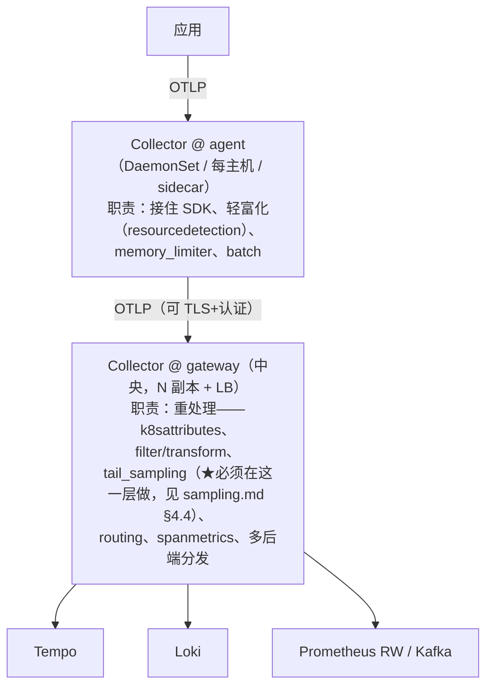

# OpenTelemetry Collector 生产化：组件模型、配置工程、可靠性与自监控

> [opentelemetry-overview.md §7](opentelemetry-overview.md#7-collector-架构) 讲了
> Collector 是什么，[lab00](../../labs/lab00-otel-collector-basics/README.md) 跑通了第一个管道；
> 本篇回答"**怎么把 Collector 当成一个生产组件来运营**"：
> 五类组件的完整模型（含 connector/extension）、declare ≠ activate 的装配规则、
> confmap 配置工程（env 展开/include/多文件）、生产必备处理器及其顺序、
> 导出队列与重试语义、容量规划与自监控、用 OCB 定制发行版。
> tail-based 采样不在本篇（见 [sampling.md §4](../05-production/sampling.md#4-tail-based-samplingcollector-端决策)）。
> 设计视角续篇：[系统设计 04 · 接入管道设计](../06-system-design/ingestion-pipeline.md)（整个接入层的拓扑与背压设计）。

## 目录

1. [组件模型：五类组件与 service 装配](#1-组件模型五类组件与-service-装配)
2. [Connector：管道与管道之间的桥](#2-connector管道与管道之间的桥)
3. [Extension：管道外的横切能力](#3-extension管道外的横切能力)
4. [配置工程：confmap、env 展开、include 与多文件](#4-配置工程confmapenv-展开include-与多文件)
5. [生产必备处理器与顺序](#5-生产必备处理器与顺序)
6. [导出可靠性：sending queue、retry 与背压](#6-导出可靠性sending-queueretry-与背压)
7. [部署拓扑：agent → gateway 级联与职责分层](#7-部署拓扑agent--gateway-级联与职责分层)
8. [Collector 的自监控](#8-collector-的自监控)
9. [容量规划与压测](#9-容量规划与压测)
10. [core / contrib / OCB：发行版怎么选怎么裁](#10-core--contrib--ocb发行版怎么选怎么裁)
11. [常见故障模式速查](#11-常见故障模式速查)
12. [面试题小结](#12-面试题小结)
13. [参考资料](#13-参考资料)

---

## 1. 组件模型：五类组件与 service 装配

Collector 配置由两大块组成：**组件声明区**（receivers/processors/exporters/connectors/extensions，
各列一堆带 ID 的实例）与 **service 装配区**（声明哪些组件真正被启用、如何连成 pipeline）。

```yaml
# ============ 组件声明区（只是"定义"，不会运行） ============
receivers:
  otlp:                         # 组件类型: 实例ID（ID 可省略，即默认实例）
    protocols:
      grpc: { endpoint: 0.0.0.0:4317 }
      http: { endpoint: 0.0.0.0:4318 }
  filelog:
    include: [/var/log/apps/*.json]

processors:
  memory_limiter:
    check_interval: 1s
    limit_mib: 512
  batch: {}

exporters:
  otlp/gateway:
    endpoint: otel-gateway:4317
    tls: { insecure: true }
  debug: {}

extensions:
  health_check: {}

# ============ service 装配区（引用上面声明的实例） ============
service:
  extensions: [health_check]    # extension 也要在这里激活
  telemetry:                    # Collector 自身的可观测性（§8）
    metrics: { level: detailed }
  pipelines:
    traces:
      receivers:  [otlp]
      processors: [memory_limiter, batch]   # ★ 顺序即数据流顺序
      exporters:  [otlp/gateway]            # 必须与声明区的实例 ID 完全一致（写错启动即报错）
    logs:
      receivers:  [otlp, filelog]
      processors: [memory_limiter, batch]
      exporters:  [debug]
```

**第一条军规：declare ≠ activate**。声明了但没有出现在 `service` 里的组件**完全不运行**
（不监听端口、不占内存）——这是排查"为什么 filelog 没在采"的第一检查点。
一个组件实例可以被多条 pipeline 复用（上例 `memory_limiter`、`batch` 被 traces/logs 共享，
但**各自独立执行**，batch 缓冲不跨 pipeline 混批）。

五类组件职责一览（对比 [quickstart §4.2](otel-quickstart-concepts.md#42-collector-侧-processor数据离开应用之后)）：

| 组件 | 方向 | 职责 | 常见实例 |
|---|---|---|---|
| receiver | 入 | 把外部协议/来源的数据接进 Collector | `otlp`、`filelog`、`hostmetrics`、`prometheus`、`kubeletstats`、`httpcheck` |
| processor | 中 | 逐条（批）加工：富化/过滤/改写/限流/采样 | `memory_limiter`、`batch`、`k8sattributes`、`resourcedetection`、`filter`、`transform`、`attributes` |
| exporter | 出 | 把数据发往后端 | `otlp`/`otlphttp`、`prometheus`、`prometheusremotewrite`、`debug`、`file`、`kafka` |
| connector | 桥 | 一条管道的出口 + 另一条管道的入口（§2） | `routing`、`spanmetrics`、`count`、`forward` |
| extension | 外 | 不接触遥测数据的横切能力（§3） | `health_check`、`pprof`、`zpages`、`file_storage`、`basicauth`、`docker_observer` |

## 2. Connector：管道与管道之间的桥

connector 是 2.x 时代补齐的组件类型：**既是 exporter（对上游管道）又是 receiver（对下游管道）**，
用于"把数据再喂回 Collector 自己"的场景——这是很多高级拓扑的钥匙：

```yaml
connectors:
  spanmetrics:                  # trace → metrics：从 span 产 RED 指标
    dimensions: [{ name: http.route }]
  routing:                      # 按属性把数据分发到不同 exporter
    default_pipelines: [traces/backup]
    table:
      - context: span
        pipelines: [traces/prod]
        condition: attributes["env"] == "prod"

service:
  pipelines:
    traces:                     # 上游：正常采集
      receivers:  [otlp]
      exporters:  [spanmetrics, routing]     # 把数据交给两个 connector
    metrics/spanmetrics:        # 下游：connector 产出的指标走自己的管道
      receivers:  [spanmetrics]
      exporters:  [prometheusremotewrite]
    traces/prod:
      receivers:  [routing]
      exporters:  [otlp/gateway]
```

三个高频用法：

| Connector | 做什么 | 典型场景 |
|---|---|---|
| `spanmetrics` | 从 span 聚合 RED 指标（调用数/错误/耗时直方图） | 没有埋点的服务也能有指标；lab04 用的是 Tempo metrics_generator 的同款思想（[correlation.md §7](../04-integration/correlation.md#7-tempo-服务图与派生指标derived-series)），Collector 侧方案不绑定 Tempo |
| `routing` | 按属性/资源字段路由到不同管道/exporter | 多租户分流、安全数据走独立通道、灰度后端 |
| `count` / `forward` | 统计通过量 / 纯转发（配合多下游） | 审计、镜像双写 |

**认知收益**：理解 connector 后，"采样前先分叉指标"这类拓扑
（[sampling.md §6.1](../05-production/sampling.md#61-为什么用-trace-数量算错误率会失真)）
就不再神秘——都是"上游管道 → connector → 下游管道"的标准玩法。

## 3. Extension：管道外的横切能力

extension 不处理遥测数据，服务于 Collector 自身的运维与控制面：

| Extension | 默认端口 | 用途 |
|---|---|---|
| `health_check` | 13133 | `/` 与 `/health` 探针（K8s readiness/liveness 首选） |
| `pprof` | 1777 | Go 运行时 profile（CPU/heap）——排查 Collector 自身性能 |
| `zpages` | 55679 | 运行时调试页：动态改日志级别、查看各组件统计与配置 |
| `file_storage` | — | 给 exporter 队列提供落盘存储（§6） |
| `basicauth` / `bearer` | — | 出口/入口认证（保护 OTLP 端口、带凭据访问后端） |
| `*_observer` | — | 进程/容器发现（配合 filelog/rsyslog 动态采文件） |

一个容易被忽略的运维事实：**OTLP receiver 默认无认证**——任何能访问 4317/4318 的
进程都能注入数据。生产部署要么把 Collector 收进内网/专用网络平面，要么在 receiver 前面
挂认证（basicauth 等）。

## 4. 配置工程：confmap、env 展开、include 与多文件

Collector 的配置加载器叫 **confmap**，掌握它才能把配置做成"一套模板多环境部署"：

### 4.1 环境变量展开

```yaml
exporters:
  otlp/gateway:
    endpoint: ${env:OTEL_GATEWAY_ENDPOINT}     # ${env:NAME} 在加载时展开
    headers:
      x-tenant: ${env:TENANT}
    tls:
      ca_file: ${env:CA_FILE:/etc/ssl/ca.pem}   # 支持默认值语法（组件版本相关，谨慎依赖）
```

`${env:...}` 让同一份 YAML 跑 dev/prod；字面量 `$${` 是转义（不展开）。
密钥通过 env 注入而不是写进 YAML——配合 K8s Secret，配置文件可安全入库。

### 4.2 include 与分层

```yaml
# otelcol-config.yaml（主配置）
receivers: { otlp: { protocols: { grpc: {} } } }
include:                      # 2.x：拆分多文件，同层 merge
  - components.yaml           # 处理器/exporter 声明
  - pipelines.yaml            # service 段
```

也支持启动参数级多文件：`--config=base.yaml --config=overlays/prod.yaml`
（**后加载的覆盖/合并先加载的**，list 按序拼接——语义细节以当前版本文档为准）。

分层的工程价值：`base.yaml`（公司标准处理器链）+ `env.yaml`（环境 endpoint）+
`app.yaml`（应用特有 receiver），跨团队共享同一套基线。

### 4.3 验证与渲染

```bash
# 只验证配置，不启动进程（CI 里对每个 PR 的 collector 配置跑一遍）
otelcol validate --config=otelcol-config.yaml

# 需要看"展开 env/合并 include 后"的最终配置时：
# 启动日志会打印解析后的组件清单；zpages（§3）可在线查看 effective config
```

## 5. 生产必备处理器与顺序

processor 在 pipeline 里的书写顺序 = 执行顺序。生产基线（traces 为例）：

```yaml
processors:
  memory_limiter:                    # ① 永远第一位：进程内存保险丝
    check_interval: 1s
    limit_mib: 400                   # 目标 = 容器 memory limit 的 ~70~75%
    spike_limit_mib: 100             # 突发缓冲；spike 区间内开始拒绝（refused）
  resourcedetection:                 # ② 尽早富化：host/cloud/ec2/gcp 探测
    detectors: [env, system, ec2]    #    按部署环境裁剪
    timeout: 2s
  k8sattributes:                     # ③ K8s 元数据（pod name/namespace/labels）
    extract:                         #    从 node/pod 维度补 context
      metadata: [k8s.pod.name, k8s.namespace.name, k8s.node.name]
  attributes:                        # ④ 轻量改写/规范化（drop 敏感属性等）
    actions:
      - { key: http.request.header.authorization, action: delete }
  transform:                         # ⑤ OTTL 重逻辑（改名/合成字段）
    trace_statements:
      - context: span
        statements:
          - set(attributes["k8s.cluster"], "prod-a") where attributes["k8s.cluster"] == nil
  batch:                             # ⑥ 永远最后：导出前攒批
    timeout: 200ms                   # 默认 200ms
    send_batch_size: 8192            # 默认 8192（条）
    send_batch_max_size: 10000       # 上限（防超大批）

service:
  pipelines:
    traces:
      processors: [memory_limiter, resourcedetection, k8sattributes,
                   attributes, transform, batch]
```

顺序的三条原理：

1. **`memory_limiter` 必须第一**：任何处理发生前先有保险丝——它在内存逼近上限时
   直接**拒绝接收**（上游 SDK 的 batch exporter 会重试），宁可暂时拒收也不能 OOM 全丢；
2. **富化类（resourcedetection/k8sattributes）在改写类（attributes/transform）之前**：
   先有完整上下文，再基于它做逻辑；且 tail_sampling 之类决策处理器（若用）要放在
   富化之后（按 K8s 属性做采样决策才有意义）；
3. **`batch` 必须最后**：它的输出直接对接 exporter，前面还有处理器会把攒好的批打散。

两类书写工具：`filter`（OTTL 条件丢弃，如丢掉健康检查产生的海量 span）与
`transform`（OTTL 改写）。**OTTL（OpenTelemetry Transformation Language）是
Collector 界的 LogQL**——值得花一小时读语法文档，它几乎能替代写自定义组件。

## 6. 导出可靠性：sending queue、retry 与背压

数据从 processor 到 exporter 不是"直接发走"，而是经过每个 exporter 内置的
**发送队列 + 重试器**（exporter helper，所有标准 exporter 继承）：

```yaml
exporters:
  otlp/gateway:
    endpoint: otel-gateway:4317
    sending_queue:                  # 队列：削峰 + 后端短暂不可用时缓冲
      enabled: true
      num_consumers: 10             # 并发发送 worker
      queue_size: 5000              # 批数缓冲（×batch 大小≈容量）
    retry_on_failure:               # 重试：指数退避
      enabled: true
      initial_interval: 5s
      max_interval: 30s
      max_elapsed_time: 5m          # 总时长上限，超过则放弃该批
```

理解这套机制的三个结论：

1. **可靠性边界**：后端短暂故障（分钟级）数据不丢（在队列里等）；故障超过
   `queue_size` 缓冲或 `max_elapsed_time` 则**丢弃并计数**——Collector 的语义是
   "尽力而为 + 可观测的损失"，不是分布式消息队列；
2. **file_storage extension 可把队列落盘**：发送队列从内存改为本地文件
   （`storage: file_storage`），Collector 重启也不丢缓冲——代价是磁盘 IO，
   对"日志类不可再生数据"值得开；
3. **背压传导路径**：队列满 → exporter 阻塞/丢批 → processor 停滞 →
   （若 memory_limiter 生效）receiver 拒收 → SDK 端队列堆积 → 最终可能影响应用
   （这就是 SDK 侧也要设导出队列上限的原因，见 [quickstart §3](otel-quickstart-concepts.md#31-sdk-侧-exporter把记录编码发出)）。
   健康的系统里每一段的"满了"都应该被指标看到（§8）。

## 7. 部署拓扑：agent → gateway 级联与职责分层

两种基本角色（[overview §7.3](opentelemetry-overview.md#73-部署模式agent-vs-gateway)）在生产里
通常**级联**，且职责严格分层：



分层原则（每一条都对应一个事故模式）：

- **重处理放 gateway**：agent 上跑 tail_sampling 需要"同 trace 的 span 汇聚到同一实例"
  （[sampling.md §7.3](../05-production/sampling.md#73-多实例-collector-负载均衡打散-trace)），
  在 agent 层做几乎必然断链；k8sattributes 依赖与 kubelet 的连接，集中在 gateway 更好运维；
- **agent 保持"傻快"**：agent 挂的机会数 = 节点数，越简单越稳；它唯一的智能应该是
  memory_limiter 与本地缓冲；
- **tail_sampling 场景 gateway 前要有 LB 的 trace 亲和**（按 trace_id 哈希）或单层汇聚；
- **跨网/跨域再插一层**：边缘集群 → 区域 Collector → 中央，每层都只做本层该做的事。

## 8. Collector 的自监控

Collector 内置遥测（`service.telemetry` 段控制），四个入口：

```yaml
service:
  telemetry:
    metrics:
      level: detailed             # internal metrics（Prometheus 格式，默认端口 8888）
    logs:
      level: info
```

| 入口 | 端口/形式 | 用途 |
|---|---|---|
| internal metrics | 8888（`/metrics`） | 用 Prometheus 抓 Collector 自己 |
| `health_check` extension | 13133 | 探针 |
| `zpages` extension | 55679 | 运行时改日志级别 / 看组件统计 / effective config |
| `pprof` extension | 1777 | Go profile（CPU/heap，排查 Collector 自身） |

**必须告警的指标族**（前缀 `otelcol_`，四象限"接收/处理/导出 × 成功/失败"）：

```promql
# 1. 数据被迫丢弃/拒收（memory_limiter 或队列满）——最重要
sum by (exporter) (rate(otelcol_exporter_send_failed_spans[5m])) > 0
#   同族：otelcol_exporter_send_failed_{metric_points,log_records}
#   receiver 拒收：otelcol_receiver_refused_spans（limiter 生效时会涨）

# 2. 接收与导出的差值（堆积/丢失的先行指标）
rate(otelcol_receiver_accepted_spans[5m])
  - rate(otelcol_exporter_sent_spans[5m])     # 持续为正 = 消化不良

# 3. 队列水位（exporter helper 暴露 queue size 指标，level: detailed 下更全）

# 4. 进程自我保护生效
otelcol_process_memory_rss 接近 memory_limiter 的 limit_mib
```

排障入口顺序：**refused/failed 指标 → Collector 日志 → zpages 的组件统计 →
pprof 看是不是自己在烧 CPU**。这套四象限指标与 [correlation.md §9 的脚本](../04-integration/correlation.md#9-常见坑与排查-checklist)
（`otelcol_exporter_send_failed_*` 检查点）是同一件事的系统化版本。

## 9. 容量规划与压测

Collector 是**单进程 Go 程序**，容量三要素：内存（processors 缓冲 + 队列）、
CPU（序列化/OTTL 处理）、网络（出口带宽）。工程做法：

1. **用 telemetrygen 压测**（contrib 发行版自带）：
   ```bash
   # 用和你真实数据形状接近的参数打流，观察 RSS 与 otelcol_* 指标
   telemetrygen traces --otlp-insecure --traces 10000 --rate 5000 \
     --attribute key1=val1
   ```
2. **内存定标**：容器 memory limit → `limit_mib` 取其 ~70~75%（留 Go runtime 与突发），
   压测确认稳态 RSS 落在 spike_limit 之下；
3. **吞吐不拍脑袋**：单实例吞吐受处理器链（tail_sampling、重 OTTL 是大头）影响
   一个数量级——以自己 pipeline 的压测数字为准，官方不承诺通用数字；
4. **水平扩容公式**：gateway 副本数 = 峰值吞吐 / 单实例压测吞吐 × 1.5（冗余），
   前提是 receiver 层有 LB 且重处理不依赖单实例状态。

## 10. core / contrib / OCB：发行版怎么选怎么裁

| 发行版 | 内容 | 用 |
|---|---|---|
| **otelcol**（core） | 少量核心稳定组件（otlp、prometheus、debug…） | 极简 agent/网关 |
| **otelcol-contrib** | 社区全家桶（filelog/hostmetrics/k8sattributes…） | 大多数场景的默认选择 |
| **K8s Operator 发行版** | 由 OpenTelemetry Operator 管理（CRD 声明 Collector） | K8s 环境的声明式运维 |
| **OCB 自定义**（OpenTelemetry Collector Builder） | 按 manifest 精选组件编译 | 控制体积/攻击面/升级节奏 |

OCB（builder）用法一页：

```yaml
# builder-config.yaml：声明要哪些组件，生成专属二进制
dist:
  name: my-otelcol
  output_path: _build
exporters:
  - gomod: go.opentelemetry.io/collector/exporter/otlpexporter v0.xxx
  - gomod: github.com/open-telemetry/opentelemetry-collector-contrib/exporter/lokiexporter v0.xxx
receivers:
  - gomod: go.opentelemetry.io/collector/receiver/otlpreceiver v0.xxx
# （版本对齐矩阵以官方发布为准，core 与 contrib 版本必须配套）
```

```bash
builder --config=builder-config.yaml && _build/my-otelcol --config=...
```

选型经验：**从 contrib 起步**（要什么有什么），等出现"升级慢（全家桶绑定发布节奏）/
镜像太大/安全扫描面广"的痛点再裁 OCB；**组件稳定性等级不同**
（core 里的 OTLP receiver/exporter 已稳定，contrib 不少组件是 alpha/beta——引入
contrib 组件前查一眼官方 stability matrix，alpha 组件配置格式可能变）。

## 11. 常见故障模式速查

| 现象 | 根因 | 处置 |
|---|---|---|
| Collector OOMKilled | 没有 memory_limiter / limit_mib 超容器 limit / tail_sampling `num_traces` 过大 | 补 §5 基线；压测定标；调小 num_traces 或加副本 |
| `otelcol_receiver_refused_spans` 涨 | memory_limiter 生效（内存压力）或 receiver 限流 | 看 RSS 曲线定位是谁吃内存（batch 太大/tail 缓冲）；扩容或裁处理器 |
| 后端恢复后数据"缺一段" | 队列缓冲不足或 max_elapsed_time 太短，故障期间批被丢 | 增 queue_size / 开 file_storage；接受"可观测的损失"并告警化 |
| filelog 采不到文件 | declare ≠ activate（filelog 没进 pipelines）；或 include glob 错 | 检查 service.pipelines；日志里确认发现文件数 |
| `error decoding config` | YAML 缩进 / `${env:}` 未定义 / 组件 ID 拼错 | `otelcol validate` 先跑；启动日志会指出具体 key |
| trace 断链且采样率正常 | gateway 层 tail_sampling 被打散（LB 无 trace 亲和） | sampling.md §7.3：哈希 LB 或单层汇聚 |
| 升级后行为变化 | contrib 组件 alpha/beta 配置格式变更 | 锁版本 + 读 release notes；OCB 固定组件集 |
| K8s 上周期性拒收 | CPU limit 节流 → GC/处理变慢 → 内存堆积触发 limiter | 看 CPU throttling 指标；提高 CPU limit 或降低单实例负载 |
| 改了配置但没生效 | 忘了组件要在 service 里激活；或多文件覆盖顺序 | zpages 看 effective config；捋 include 顺序 |

## 12. 面试题小结

**Q1：Collector 的五类组件与装配规则？**
A：receivers/processors/exporters/connectors/extensions。声明区定义实例，service 区
激活并连成 pipelines（traces/metrics/logs 各自的管道）；declare ≠ activate——未进
service 的组件不运行。processor 在管道中的书写顺序即执行顺序。

**Q2：connector 是什么？解决什么问题？**
A：同时具备 exporter（对上游）与 receiver（对下游）双重身份的组件，把一条管道的
输出变成另一条管道的输入。典型：spanmetrics（trace→指标）、routing（按属性分流）、
count/forward。让"信号衍生信号""多租户路由"无需自定义组件。

**Q3：为什么 memory_limiter 必须是第一个 processor、batch 必须是最后一个？**
A：limiter 第一是为了在任何处理开销发生前就有内存保险丝（超限时拒收数据并让上游
重试，而非 OOM 全量丢失）；batch 最后是因为它的输出直接对接 exporter 的发送队列，
前面还有处理器会把批打散、失去攒批意义。

**Q4：Collector 的数据可靠性语义？什么情况下丢数据？**
A：尽力而为 + 可观测损失：exporter 内置 sending_queue（削峰缓冲）与 retry_on_failure
（指数退避）。后端短暂故障不丢；故障超过队列容量或 max_elapsed_time 则丢批并计入
`otelcol_exporter_send_failed_*`。要更强保证可开 file_storage 落盘队列，或前置 Kafka。

**Q5：agent 与 gateway 的职责怎么分？为什么 tail_sampling 必须在 gateway？**
A：agent 傻快（接收、memory_limiter、batch、轻富化）；gateway 重处理（K8s 富化、
OTTL、routing、spanmetrics、tail_sampling）。tail_sampling 需要同一 trace 的全部 span
汇聚于同一实例做决策——agent 层 LB 天然打散，必然断链（哈希亲和或单层汇聚解决）。

**Q6：怎么监控 Collector 自己？必告警的指标？**
A：service.telemetry 开 internal metrics（8888 Prometheus），加 health_check（探针）、
zpages（运行时调试）、pprof（性能）。必告警：`otelcol_exporter_send_failed_*`
（丢弃）、`otelcol_receiver_refused_*`（拒收）、接收-导出速率差（堆积）、RSS 逼近 limit。

**Q7：core、contrib、OCB 怎么选？**
A：core 极简稳定；contrib 全家桶（默认选择，注意组件有 alpha/beta 稳定性等级）；
OCB（builder）按 manifest 裁剪自定义二进制——当升级节奏/镜像体积/安全面成为痛点时再上。

## 13. 参考资料

- OpenTelemetry Collector 官方文档（组件与配置）：<https://opentelemetry.io/docs/collector/>（访问日期：2026-11-04）
- 组件稳定性矩阵（core）：<https://github.com/open-telemetry/opentelemetry-collector-releases/blob/main/distributions/otelcol/README.md>（访问日期：2026-11-04）
- contrib 组件索引： <https://github.com/open-telemetry/opentelemetry-collector-contrib/tree/main>（访问日期：2026-11-04）
- confmap（env 展开/include/providers）：<https://opentelemetry.io/docs/collector/configuration/>（访问日期：2026-11-04）
- OTTL（filter/transform 语法）：<https://github.com/open-telemetry/opentelemetry-collector-contrib/blob/main/pkg/ottl/README.md>（访问日期：2026-11-04）
- Collector 内部遥测与 otelcol_ 指标：<https://opentelemetry.io/docs/collector/internal-telemetry/>（访问日期：2026-11-04）
- OpenTelemetry Collector Builder（OCB）：<https://opentelemetry.io/docs/collector/custom-collector/>（访问日期：2026-11-04）
- Connector 设计文档：<https://github.com/open-telemetry/opentelemetry-collector/blob/main/docs/design.md>（访问日期：2026-11-04）
- 本工作区相关：[opentelemetry-overview.md](opentelemetry-overview.md)、[otel-quickstart-concepts.md](otel-quickstart-concepts.md)、[sampling.md](../05-production/sampling.md)、[lab00](../../labs/lab00-otel-collector-basics/README.md)

## 附：ASCII 图替换清单

| 原 ASCII 图位置（章节标题） | 原图内容简述 | 替换结果 |
| --- | --- | --- |
| 7. 部署拓扑：agent → gateway 级联与职责分层 | 应用 → agent（轻职责）→ gateway（重职责）→ Tempo/Loki/Prometheus RW/Kafka 的级联拓扑与各层职责标注 | flowchart TD |
