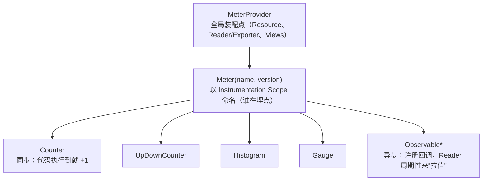
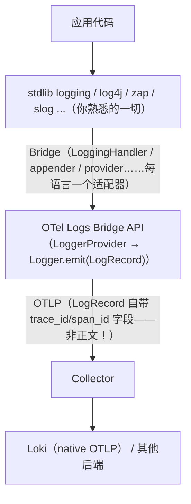

# OTel Metrics SDK 与 Logs 信号：把另外两根支柱的 SDK 讲透

> [otel-sdk.md](../03-tracing/otel-sdk.md)（阶段 3）把 Traces SDK 讲透了；但 OTel 是
> **三信号 SDK**，Metrics 与 Logs 的对象模型、聚合细节、与后端的映射各有专精。
> 本篇补上：MeterProvider/Instrument 层级与选型表、View 自定义聚合（直方图桶/改名/删维度/
> cardinality 控制）、temporality 与后端选择、exemplar 关联，以及 Logs 信号
> （Logs Bridge API 的定位、severity 映射、OTLP→Prometheus/Loki 的字段映射）。
> 前置：[otel-quickstart-concepts.md](otel-quickstart-concepts.md)、
> [semantic-conventions.md](semantic-conventions.md)。

## 目录

1. [信号与 SDK 成熟度总览](#1-信号与-sdk-成熟度总览)
2. [Metrics 对象层级：MeterProvider → Meter → Instrument](#2-metrics-对象层级meterprovider--meter--instrument)
3. [七种 Instrument 与选型表（含 Prometheus 映射）](#3-七种-instrument-与选型表含-prometheus-映射)
4. [Python 实战：埋点完整骨架](#4-python-实战埋点完整骨架)
5. [View：聚合的二次定制](#5-view聚合的二次定制)
6. [Temporality：cumulative vs delta 与后端选择](#6-temporalitycumulative-vs-delta-与后端选择)
7. [Metrics 的 exemplar 关联](#7-metrics-的-exemplar-关联)
8. [Logs 信号：Logs Bridge API 的定位](#8-logs-信号logs-bridge-api-的定位)
9. [LogRecord 的字段与 severity 映射](#9-logrecord-的字段与-severity-映射)
10. [OTLP 到后端的字段映射规则](#10-otlp-到后端的字段映射规则)
11. [常见坑](#11-常见坑)
12. [面试题小结](#12-面试题小结)
13. [参考资料](#13-参考资料)

---

## 1. 信号与 SDK 成熟度总览

| 信号 | API/SDK 状态 | 后端生态 | 本工作区专篇 |
|---|---|---|---|
| Traces | 稳定（最成熟） | Jaeger/Tempo/商业 APM | [otel-sdk.md](../03-tracing/otel-sdk.md) |
| **Metrics** | 稳定 | Prometheus（经转换）、OTLP 原生后端 | **本篇 §2–7** |
| **Logs** | 稳定（生态较新） | Loki 原生 OTLP / Collector 分发 | **本篇 §8–10**，[structured-logging.md](../02-logging/structured-logging.md) |
| Profiling | 开发中（pprof 载荷已可用） | Pyroscope/Parca | [profiling.md](../05-production/profiling.md) |
| Baggage | 稳定（传播机制，非遥测） | — | [quickstart §2](otel-quickstart-concepts.md#2-context-传播) |

一个贯穿本篇的对照：**Traces SDK 的核心问题是"上下文怎么传"，Metrics SDK 的核心问题是
"数值怎么聚合"，Logs 信号的核心问题是"怎么接上你已有的日志库"**——三个问题想清楚，
OTel SDK 就没有黑盒了。

## 2. Metrics 对象层级：MeterProvider → Meter → Instrument



与 Traces 的对象一一对仗（[quickstart §1](otel-quickstart-concepts.md#11-provider全局装配点)）：
`MeterProvider≈TracerProvider`、`Meter≈Tracer`（同样携带 scope 名与版本，
后端能按 `scope.name` 区分"哪个库埋的点"）、Instrument≈Span。

关键差异是**取数模型**：Traces 是纯推（span 结束即导出）；Metrics 是
**"SDK 内部聚合 + MetricReader 周期采集"**——你的 `counter.add(1)` 只是改了内存里的
聚合状态，真正的导出发生在 Reader 的采集周期（默认 60s，可调）。这就是为什么
改代码后指标"晚一分钟出现"是正常现象，不是 bug。

## 3. 七种 Instrument 与选型表（含 Prometheus 映射）

| Instrument | 语义 | 单调性 | Prometheus 端形态 | 典型场景 |
|---|---|---|---|---|
| **Counter** | 只增计数 | ✅ | `xxx_total`（counter） | 请求数、错误数、订单数 |
| **UpDownCounter** | 可增可减 | ❌ | gauge | 在途请求数、队列长度、连接数 |
| **Histogram** | 值的分布（桶 + sum/count） | — | `xxx_bucket/_sum/_count` | 延迟、请求体大小 |
| **Gauge**（同步） | 记录瞬时值（最后一次为准） | — | gauge | 缓存命中率、当前温度 |
| **ObservableCounter** | 异步回调报累计值 | ✅ | counter | 从外部系统读的累计量（如第三方 API 总调用） |
| **ObservableGauge** | 异步回调报瞬时值 | — | gauge | 文件描述符数、内存占用（系统指标的标准姿势） |
| **ObservableUpDownCounter** | 异步回调报可增减值 | ❌ | gauge | 外部队列长度 |

选型三问：**值只增吗**（否 → UpDown 族）？**需要分布吗**（要 p99 → Histogram，
只有均值语义 → Counter/Gauge）？**取值是推还是拉**（值来自外部系统/全局扫描 →
Observable 族回调，否则同步 API）。

两条纪律：

- **延迟一律 Histogram**（与 [data-model.md](../01-metrics/data-model.md) 的 Prometheus
  端结论一致——均值会撒谎，分位数才可信）；
- **Observable 回调里不要做慢 IO**：它阻塞的是 Reader 的采集周期，回调超时整个
  导出批次都跟着抖。

## 4. Python 实战：埋点完整骨架

```python
from opentelemetry import metrics
from opentelemetry.sdk.metrics import MeterProvider
from opentelemetry.sdk.metrics.export import PeriodicExportingMetricReader
from opentelemetry.exporter.otlp.proto.grpc.metric_exporter import OTLPMetricExporter
from opentelemetry.sdk.resources import Resource

# ---- 1. 装配（进程启动一次；Reader 周期默认 60s）----
provider = MeterProvider(
    resource=Resource.create({"service.name": "checkout-svc"}),   # semconv：Resource 低基数
    metric_readers=[PeriodicExportingMetricReader(
        OTLPMetricExporter(endpoint="http://otelcol:4317", insecure=True),
        export_interval_millis=15_000,       # 压缩采集周期（实验友好）
    )],
)
metrics.set_meter_provider(provider)
meter = metrics.get_meter("shop.checkout", "1.2.0")     # scope = 库/模块名

# ---- 2. 同步埋点 ----
orders = meter.create_counter("checkout.orders.created", unit="{order}",
                              description="下单成功数")
latency = meter.create_histogram("http.server.duration", unit="s",
                                 description="HTTP 处理耗时")

def handle(req):
    orders.add(1, {"route": "/checkout"})          # 属性=指标 label（低基数！）
    latency.record(0.142, {"route": "/checkout"})

# ---- 3. 异步埋点（ObservableGauge：外部状态采样）----
fd_gauge = meter.create_observable_gauge("process.fd.count", unit="{fd}")
@fd_gauge.callback                       # 装饰器注册回调：Reader 采集时来取
def _fd(_options):
    import resource as r
    yield Observation(r.getrlimit(r.RLIMIT_NOFILE)[0] * 0, attrs={})
    # 简化示意：真实实现读 /proc 或 psutil，yield Observation(value, attrs)
```

埋点规范三连（与 [exporters.md](../01-metrics/exporters.md) 的 Prometheus 命名纪律同源）：
指标名 `.<namespace>.<name>` 点分小写、unit 用语义约定的花括号形式（`{order}`、`s`）、
属性名遵循 [semantic-conventions.md](semantic-conventions.md)（`http.route` 而不是自造 `path`）。

## 5. View：聚合的二次定制

埋点代码发出的是"原始流"，**最终长成什么序列由 View 决定**——这是 Metrics SDK 里
最像"配置即代码"的部分（应用侧版的 [Transformations](../01-metrics/grafana-deep-dive.md#7-transformations查询之后的第二道加工厂)）：

```python
from opentelemetry.sdk.metrics.view import View
from opentelemetry.sdk.metrics import (
    ExplicitBucketHistogramAggregation, DropAggregation)

views = [
    # ① 自定义直方图桶：默认桶对 100ms~2s 的 API 延迟太粗，改 SRE 边界
    View(instrument_name="http.server.duration",
         aggregation=ExplicitBucketHistogramAggregation(
             boundaries=[0.005, 0.01, 0.025, 0.05, 0.1, 0.25, 0.5, 1, 2.5, 5, 10])),

    # ② 拿掉高危维度：某个库埋的指标带了 user_id，存储侧防爆（应用层根治更好）
    View(instrument_name="billing.charge",
         attribute_keys={"tenant", "status"}),      # 白名单：只保留这些属性

    # ③ 改名 & 补语义（迁移期统一命名）
    View(instrument_name="http.server.duration",
         stream_name="http.request.duration"),

    # ④ 直接丢弃（比 Collector 端 filter 更省——聚合都不会发生）
    View(instrument_name="runtime.internal.noise", aggregation=DropAggregation()),
]
provider = MeterProvider(..., views=views)
```

View 匹配维度（`instrument_name`/`meter_name`/`instrument_type`/`unit`）与用途对照：

| 目的 | View 手段 | 提醒 |
|---|---|---|
| 桶边界不合适 | `ExplicitBucketHistogramAggregation` | 桶要覆盖 p99 观察区间，边界两侧留余量（[promql.md](../01-metrics/promql.md) 的 histogram_quantile 依赖好桶） |
| 高基数属性 | `attribute_keys` 白名单 | 治本在埋点代码（[cardinality.md](../05-production/cardinality.md)），View 是护栏 |
| 指标改名 | `stream_name` | semconv 迁移期双轨过渡 |
| 省成本 | `DropAggregation` | 比 Collector filter 早一步，连聚合内存都省 |
| 控制 series 总量 | （部分语言 SDK 提供 cardinality cap，如 Java） | 超限序列会被丢弃并计数——上生产前压一下 |

## 6. Temporality：cumulative vs delta 与后端选择

同一个 Counter，两种时间语义的导出（temporality，"时间性"）：

| | cumulative（累计） | delta（增量） |
|---|---|---|
| 每次导出的值 | 从进程启动到现在的总量 | 自上次导出以来的增量 |
| 丢一次导出 | ✅ 无损（下次仍是全量，rate 可算） | ❌ 那段增量永久缺失 |
| 后端亲和 | **Prometheus 系**（PromQL 的 rate 假设 cumulative counter） | Delta 后端（部分商业 APM、statsd 风格） |
| OTLP 默认 | 多数 SDK 默认 cumulative（以语言文档为准） | 需显式指定 |

**实务结论**：后端是 Prometheus / Prometheus remote write（含 VM/Mimir/Thanos）→
必须 cumulative；OTLP 原生后端（商业 APM）按其文档选。混合栈（指标同时发 Prometheus
与 APM）时优先满足 Prometheus 语义。Delta 直方图能省带宽（只传增量桶），但换来
丢点风险——除非带宽敏感，否则别为它折腾。

## 7. Metrics 的 exemplar 关联

Metrics SDK 内建了 exemplar 机制（规范细节见 [exemplars.md](../04-integration/exemplars.md)），
让直方图桶携带"代表性样本的 trace_id"：

```bash
# 零代码开关（多数 SDK 支持）：OTEL_METRICS_EXEMPLAR_FILTER=trace_based
#   trace_based（默认/推荐）：仅当当前有活跃 span 时挂 exemplar —— 与"日志带 trace_id"同款思想
#   always_on：无条件挂；always_off：关闭
```

链路条件：SDK 在 `histogram.record()` 时从当前 context 抓 trace_id/span_id 存入
桶的 exemplar 槽 → OTLP 导出（Collector 透传，prometheus exporter 转 OpenMetrics 格式）
→ Prometheus 存储 → Grafana 面板点亮 exemplar 点（lab04 已演示全链路）。
**采样提醒**：exemplar 指向的 trace 若被 trace 侧采样丢弃（trace_flags=00），
点击会查空——这在 [sampling.md §6.2](../05-production/sampling.md#62-exemplar连接指标与-trace-的桥也会被采样打断) 有专述。

## 8. Logs 信号：Logs Bridge API 的定位

OTel 日志的设计哲学一句话：**应用继续用自己语言的日志库，OTel 只负责"桥接"**。



**Logs Bridge API 是给"日志库适配器作者"用的，不是给你的业务代码用的**——
直接在业务里 `logger.emit(LogRecord(...))` 是反模式（放弃了日志库的全部生态：
格式化、级别过滤、轮转）。你在 lab04 里用的 `LoggingHandler` 挂接方式
（[correlation.md §3](../04-integration/correlation.md#3-日志注入-trace_idpython-完整代码)）
就是正道：**logging 库照常配置，多挂一个 OTLP handler 而已**。

Python 最小接入（三行核心）：

```python
from opentelemetry.sdk._logs import LoggerProvider, LoggingHandler
provider = LoggerProvider(resource=resource)
handler = LoggingHandler(level=logging.INFO, logger_provider=provider)  # 桥
logging.getLogger().addHandler(handler)      # 与 console handler 并存（双写）
```

## 9. LogRecord 的字段与 severity 映射

一条 OTel LogRecord 的结构（OTLP 里是独立字段，不是塞在正文 JSON 里）：

| 字段 | 来源 | 说明 |
|---|---|---|
| `Timestamp` | 日志库 | 事件时间 |
| `Body` | 消息体 | 字符串**或结构化值**（规范允许；落 Loki 时通常渲染成正文） |
| `SeverityNumber` | 日志级别映射 | 1–24 数值（下表） |
| `SeverityText` | 日志库原文 | `"WARN"`/`"WARNING"` 等保持原样 |
| `TraceId / SpanId / TraceFlags` | **当前 context 自动抓取** | 记录日志时有活跃 span 就带上——这就是"日志天生带 trace_id"的机制（[correlation.md §2](../04-integration/correlation.md#2-关联的数据模型trace_id-是那把钥匙)） |
| `Attributes` | 附加键值 | 结构化字段（order_id 等，注意基数纪律在查询侧而非索引侧） |

severity 数值锚点（完整 24 级以规范为准）：

| SeverityNumber | 语义 | 常见日志库 |
|---|---|---|
| 5 | DEBUG | debug |
| 9 | INFO | info |
| 13 | WARN | warning |
| 17 | ERROR | error |
| 21 | FATAL | critical/fatal |

后端按数值范围过滤（如 `severity_number >= 17`）比按文本匹配稳健——不同语言的
级别拼写不一致（`WARN` vs `WARNING`），数值是公约数。

## 10. OTLP 到后端的字段映射规则

**Metrics → Prometheus**（Collector 的 prometheus / prometheusremotewrite exporter
执行的转换，写查询前必须知道）：

```
OTLP                                    Prometheus
checkout.orders.created (unit={order})  checkout_orders_created_total     # 点→下划线 + counter 加 _total
http.server.duration (unit=s)           http_server_duration_seconds_bucket/_sum/_count
                                        #                                    └─ unit 追加为后缀
属性 route="/checkout"                   label {route="/checkout"}          # 属性即 label（低基数红线不变）
Resource service.name=checkout-svc      target_info / service_name label   # 依 exporter 配置（resource_to_telemetry_conversion）
```

<!-- 保留原图：OTLP 到 Prometheus 的字段映射清单，属数据对照示例，非概念示意图 -->

两条最常踩的映射规则：**名字变了**（点变下划线、unit 变后缀、counter 加 `_total`）——
查不到指标先 `up`/`__name__` 全列对一下；**Resource 默认不进 label**（要开
`resource_to_telemetry_conversion`，否则只有 service.instance 等少数进 target 元数据）。

**Logs → Loki**（native OTLP ingestion，[loki.md §8.1](../02-logging/loki.md#81-native-otlp-ingestion原生-otlp-写入)）：
LogRecord 的 Body 渲染为日志行、Attributes/Resource 展开为查询字段、
SeverityNumber 映射为 `severity` 字段——**trace_id 走 structured metadata 或行内**
取决于发送链路配置（[correlation.md §2.1](../04-integration/correlation.md#21-三种信号里-trace_id-的官方位置) 的
"管道侧提升"就是在这里做：Collector transform 把 OTLP trace 字段拷贝进行正文/属性）。

## 11. 常见坑

1. **在业务代码里直接调 Bridge API**：丢掉日志库生态且 body 无格式化。
   正道：logging 库 + 桥接 handler；
2. **改了埋点立刻查指标**：Reader 周期未到（默认 60s）+ Prometheus scrape 间隔，
   正常延迟一两分钟；实验时调小 `export_interval_millis` 与 scrape interval；
3. **Histogram 桶没定制就上生产**：默认桶对 API 延迟（百毫秒级）太粗，
   `histogram_quantile` 出来全是阶梯——用 View 定 SRE 边界（§5①）；
4. **temporality 与后端不匹配**：delta counter 落 Prometheus，`rate()` 全是诡异锯齿
   （或为空）——Prometheus 系一律 cumulative；
5. **Observable 回调里做慢查询**：阻塞采集周期，整个 export 抖动；回调只做
   O(1) 读内存/全局快照，采集慢数据放后台线程更新快照；
6. **拿 unit/命名不当回事**：`duration`（无 unit）与 `duration_seconds` 在
   Prometheus 里变成两个序列家族；unit 用语义约定（`s`、`{request}`）并保持一致；
7. **exemplar 打开但 trace 采样 0.1%**：面板上 exemplar 星星点点全是 `trace_flags=00`
   的死链——exemplar 过滤与 trace 采样策略要一起设计（[sampling.md §6.2](../05-production/sampling.md#62-exemplar连接指标与-trace-的桥也会被采样打断)）；
8. **以为 Logs Bridge 会改变日志行为**：桥接只是"多一份导出"，级别过滤、格式化、
   console 输出一切照旧——`quickstart §8 误区 6` 的正反例可直接复习。

## 12. 面试题小结

**Q1：OTel 三信号的 SDK 状态与各自核心问题？**
A：Traces/Metrics/Logs 均稳定（Profiling 开发中）。核心问题分别是：上下文传播
（W3C）、数值聚合（Instrument/View/Temporality）、与既有日志库的桥接（Bridge API
不替代日志库）。

**Q2：七种 Instrument 怎么选？**
A：先问单调性（只增 Counter / 可增减 UpDown 族）、再问是否要分布（p99 用 Histogram）、
最后问推拉模型（值在外部系统用 Observable 族回调）。延迟场景一律 Histogram。

**Q3：同步 Instrument 与 Observable 的本质区别？**
A：同步（add/record）由代码路径触发，改 SDK 内存聚合状态；Observable 注册回调，
由 MetricReader 采集周期驱动"拉值"——适合外部状态采样。回调阻塞的是采集周期，
不能做慢 IO。

**Q4：View 能做什么？举三个生产用法。**
A：在导出前重定义聚合与流：①自定义直方图桶边界（ExplicitBucketHistogram）；
②`attribute_keys` 白名单砍高危维度（基数护栏）；③`stream_name` 改名统一语义、
`DropAggregation` 在应用侧直接丢弃无用指标（比 Collector filter 更省）。

**Q5：temporality 是什么？Prometheus 后端该怎么选？**
A：时间性——导出的是累计值（cumulative）还是增量（delta）。Prometheus 系
（含 VM/Mimir/Thanos）必须 cumulative：PromQL rate 语义建立在 cumulative counter 上，
丢一次 delta 导出则该段永久缺失、速率失真。

**Q6：为什么 OTel 当初不自己发明新日志库？Bridge API 给谁用？**
A：日志库生态（格式化/过滤/轮转/运维习惯）太成熟，推翻重来的迁移成本不可接受；
OTel 只做桥接层。Bridge API 的直接用户是日志库适配器作者（LoggingHandler/appender），
应用开发者继续用原生库 + 挂 handler。

**Q7：LogRecord 的 trace_id 和"正文里的 trace_id"什么关系？**
A：OTLP LogRecord 有独立的 TraceId/SpanId 字段（记录时自动从 context 抓取），
属于协议层；正文注入（filter 写进 message JSON）是兼容"只存正文"后端的工程手段。
两者常双保险并存——derivedFields 用正文，Loki native OTLP 用协议字段
（[correlation.md §2](../04-integration/correlation.md#2-关联的数据模型trace_id-是那把钥匙)）。

**Q8：OTLP 指标到 Prometheus 的名字转换规则？**
A：点号→下划线；unit 作为后缀追加（`s`→`_seconds`）；counter 加 `_total`；
属性→label。Resource 默认不成为 label（需 resource_to_telemetry_conversion）。
查不到序列时先按这套规则换算名字。

## 13. 参考资料

- OpenTelemetry Metrics API/SDK 规范：<https://opentelemetry.io/docs/specs/otel/metrics/>（访问日期：2026-11-04）
- Instrument 种类说明：<https://opentelemetry.io/docs/specs/otel/metrics/api/#instrument>（访问日期：2026-11-04）
- View 规范：<https://opentelemetry.io/docs/specs/otel/metrics/sdk/#view>（访问日期：2026-11-04）
- Metrics 数据模型中的 Temporality 定义：<https://opentelemetry.io/docs/specs/otel/metrics/data-model/#temporality>（访问日期：2026-11-04）
- OpenTelemetry Logs 规范与数据模型：<https://opentelemetry.io/docs/specs/otel/logs/>（访问日期：2026-11-04）
- Severity Number 定义：<https://opentelemetry.io/docs/specs/otel/logs/data-model/#field-severitynumber>（访问日期：2026-11-04）
- Python SDK metrics 示例：<https://opentelemetry.io/docs/languages/python/metrics/>（访问日期：2026-11-04）
- Prometheus exporter 的转换规则（OTLP→Prom）：<https://github.com/open-telemetry/opentelemetry-collector-contrib/blob/main/exporter/prometheusexporter/README.md>（访问日期：2026-11-04）
- 本工作区相关：[otel-quickstart-concepts.md](otel-quickstart-concepts.md)、[otel-sdk.md](../03-tracing/otel-sdk.md)、[semantic-conventions.md](semantic-conventions.md)、[exemplars.md](../04-integration/exemplars.md)、[data-model.md](../01-metrics/data-model.md)

## 附：ASCII 图替换清单

| 原 ASCII 图位置（章节标题） | 原图内容简述 | 替换结果 |
| --- | --- | --- |
| 2. Metrics 对象层级：MeterProvider → Meter → Instrument | MeterProvider → Meter → 五类 Instrument 的父子层级树（带同步/异步注释） | flowchart TD |
| 8. Logs 信号：Logs Bridge API 的定位 | 应用日志库 → Bridge → Logs Bridge API → OTLP → Collector → Loki/其他后端的纵向流程 | flowchart TD |

### 保留说明

| 位置 | 内容 | 原因 |
| --- | --- | --- |
| 10. OTLP 到后端的字段映射规则 | OTLP 指标名到 Prometheus 序列名的字段映射对照清单 | 属数据对照示例（名字/标签的映射清单），非对象+关系示意图，Mermaid 无对应原生类型 |
