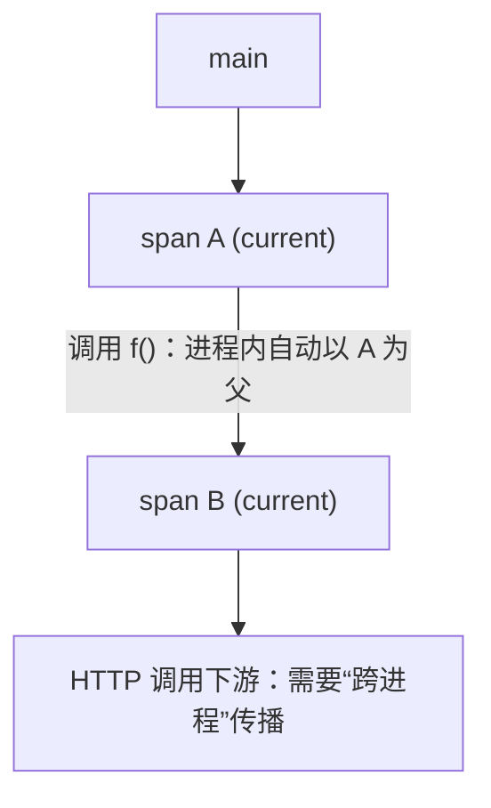
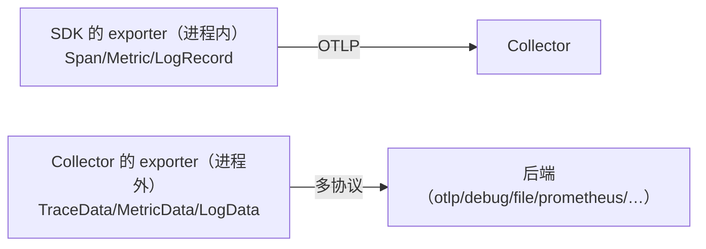
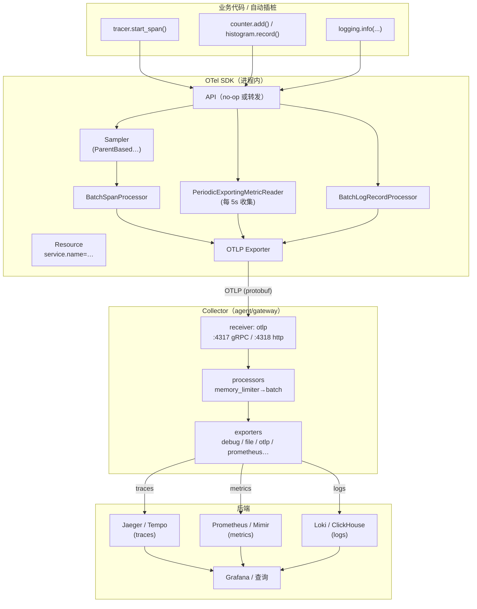

# OpenTelemetry 核心对象速查（Quickstart Concepts）

> 阶段 0 · 概念基础 / 笔记 5
>
> 一句话总结：三种信号的 SDK 都是同一个套路——**Provider 全局装配 → 拿 Instrument（Tracer/Meter/Logger）→ 产生记录 → Processor 批处理 → Exporter 发出去**，而把它们跨进程串起来的是 context 传播。

---

## 目录

1. [核心对象一览：Provider / Instrument / Record](#1-核心对象一览provider--instrument--record)
2. [Context 传播](#2-context-传播)
3. [Exporter](#3-exporter)
4. [Processor](#4-processor)
5. [采样器概念预览](#5-采样器概念预览)
6. [信号从应用到后端的全链路图](#6-信号从应用到后端的全链路图)
7. [常见误区](#7-常见误区)
8. [面试常见问题小结](#8-面试常见问题小结)
9. [参考资料](#9-参考资料)

---

## 1. 核心对象一览：Provider / Instrument / Record

三种信号的对象严格平行，对照记忆：

| | Traces | Metrics | Logs |
| --- | --- | --- | --- |
| **Provider（装配点，全局一次）** | `TracerProvider` | `MeterProvider` | `LoggerProvider` |
| **Instrument（工厂/仪表，按库名取用）** | `Tracer`（以 scope 命名） | `Meter` → Counter / Histogram / Gauge / ObservableCounter… | `Logger` |
| **Record（产生的记录）** | `Span`（含树结构） | Measurement（随时间聚合成时间序列） | `LogRecord` |
| **导出单位** | ReadableSpan | Metric（聚合后的数据点，含属性维度） | LogRecord |
| **典型 SDK 处理器** | `BatchSpanProcessor` | `PeriodicExportingMetricReader` | `BatchLogRecordProcessor` |

### 1.1 Provider：全局装配点

Provider 持有 Resource、Sampler、Processor 链，是 SDK 的"总开关"。**每个进程每种信号一个全局 Provider**，在应用启动时装配（通常在 main/import 早期），之后库代码只通过 API 取用：

```python
# lab00/app/app.py 的真实装配骨架（Python）
import logging

from opentelemetry import trace, metrics, _logs
from opentelemetry.sdk.resources import Resource
from opentelemetry.sdk.trace import TracerProvider
from opentelemetry.sdk.trace.export import BatchSpanProcessor
from opentelemetry.sdk.metrics import MeterProvider
from opentelemetry.sdk.metrics.export import PeriodicExportingMetricReader
from opentelemetry.sdk._logs import LoggerProvider, LoggingHandler
from opentelemetry.sdk._logs.export import BatchLogRecordProcessor
from opentelemetry.exporter.otlp.proto.grpc.trace_exporter import OTLPSpanExporter
from opentelemetry.exporter.otlp.proto.grpc.metric_exporter import OTLPMetricExporter
from opentelemetry.exporter.otlp.proto.grpc._log_exporter import OTLPLogExporter

resource = Resource.create({"service.name": "lab00-app", "service.version": "0.1.0"})

# --- Traces ---
tp = TracerProvider(resource=resource)
tp.add_span_processor(BatchSpanProcessor(OTLPSpanExporter()))     # 默认 OTLP endpoint 走 env
trace.set_tracer_provider(tp)

# --- Metrics ---
mp = MeterProvider(resource=resource,
                   metric_readers=[PeriodicExportingMetricReader(OTLPMetricExporter(),
                                                                 export_interval_millis=5000)])
metrics.set_meter_provider(mp)

# --- Logs：把 stdlib logging 桥接为 OTel LogRecord ---
lp = LoggerProvider(resource=resource)
lp.add_log_record_processor(BatchLogRecordProcessor(OTLPLogExporter()))
_logs.set_logger_provider(lp)
logging.getLogger().addHandler(LoggingHandler(level=logging.INFO, logger_provider=lp))
```

要点：

- **先装配再使用**：Provider 未装配时 API 返回 no-op 对象（不报错、也不出数据——最常见的"为什么没数据"原因之一）；
- 三种 Provider 共享同一个 Resource（`service.name` 一致，后端才能把三种信号对上号）；
- **退出时要 `shutdown()`**：批处理器里有未发送的缓冲数据，进程直接被 kill 会丢最后一批。

### 1.2 Instrument：以 Scope 命名的"仪表"

```python
tracer = trace.get_tracer("shop.checkout", "1.0.0")   # scope name + version
meter  = metrics.get_meter("shop.checkout", "1.0.0")
logger = logging.getLogger("shop.checkout")           # logs 侧 scope 即 logger 名
```

scope（name+version）会作为 `otel.scope.name/otel.scope.version` 随数据导出，用于区分"这段 span 是 flask 插桩产生的还是业务代码产生的"。

### 1.3 记录的产生：以 span 为例

```python
with tracer.start_as_current_span("checkout") as span:      # 进入作用域自动挂到 context
    span.set_attribute("shop.order.id", "A-1029384")        # 结构化属性（低/高基数皆可）
    span.set_attribute("shop.payment.method", "credit_card")
    span.add_event("coupon_applied", {"coupon.code": "BLACKFRIDAY"})   # 时间点事件
    try:
        pay()
    except PaymentError as e:
        span.record_exception(e)                            # 记录异常（exception.* 属性）
        span.set_status(trace.Status(trace.StatusCode.ERROR, "payment failed"))
        raise
# 离开 with 块，span 自动 end，随后交给 Processor 链
```

Metrics 侧的仪表（阶段 1 深入，先认识四个）：

```python
request_count = meter.create_counter("app.request.count", unit="{request}",
                                     description="处理完成的请求数")
duration_hist = meter.create_histogram("app.request.duration", unit="s",
                                       description="请求耗时分布")
request_count.add(1, attributes={"route": "/order", "status": "200"})   # 属性=指标维度
duration_hist.record(0.182, attributes={"route": "/order"})
```

## 2. Context 传播

### 2.1 隐式 context：为什么 span 能"自动"串起来

SDK 里有一个**进程内全局的 Context**（Python 里基于 contextvars，Go 里显式传 `context.Context`）。`start_as_current_span` 会把新 span 设为"当前 span"；同线程内后续所有 `start_*` 调用默认以它为父——这就是你不用手动传 parent 的原因。



### 2.2 跨进程传播：inject / extract + Propagator

跨进程时，把 context 塞进请求头（**inject**），对端再从请求头取回（**extract**）：

```python
# 客户端：发请求前注入
from opentelemetry.propagate import inject
headers = {}
inject(headers)                      # 默认 W3C TraceContext + baggage
requests.post(url, headers=headers)  # headers 里已带 traceparent

# 服务端：收到请求后提取
from opentelemetry.propagate import extract
ctx = extract(request.headers)
with tracer.start_as_current_span("POST /orders", context=ctx):   # 以远程 span 为父
    ...
```

默认协议是 **W3C Trace Context** 的 `traceparent` 头：

```text
traceparent: 00-3382e10b1b4c6f5d8c0a4e2f1a3b4c5d-5b8ad3c7d1e94f2a-01
             │  └──────────── trace_id (32 hex / 16 字节) ─────┘ └─ parent_id ─┘ └└ flags: bit0=采样
             └ version
tracestate:  vendor1=opaque-value          # （可选）厂商扩展信息
baggage:     user.plan=pro,experiment=zz9  # （另一个独立头）业务键值上下文
```

<!-- 保留原图：traceparent/tracestate/baggage 头格式标注示例，属协议格式示例输出，非概念示意图 -->

三个易错点：

1. `trace_id`/`span_id` 是 **hex 字符串**，全程小写、长度固定（32/16），别自造格式；
2. **任何一环没 inject/extract，链路就断在那里**——常见断点：自研 HTTP client 封装、消息队列（要把 context 塞进消息 header）、异步线程/协程（Python 的 contextvars 在新线程要显式复制 context）、跨存储中转（把 trace_id 落库再取回，用 `links` 关联而非 parent）；
3. `baggage` 与 trace 传播是**两条独立通道**（两个头），baggage 装业务标签、会全链路传播，**不要放敏感信息**。

## 3. Exporter

### 3.1 SDK 侧 Exporter：把记录编码发出

| Exporter | 用途 |
| --- | --- |
| `OTLPSpanExporter` / `OTLPMetricExporter` / `OTLPLogExporter` | **生产标配**：OTLP（gRPC 或 HTTP）发给 Collector/后端 |
| `ConsoleSpanExporter` 等 | 打印到 stdout，学习/调试用（lab00 里 Collector 的 `debug` exporter 起类似作用，但发生在 Collector 侧） |
| Jaeger / Zipkin / Prometheus exporter | 直连传统后端（可省掉 Collector，但失去解耦层，不推荐新项目使用） |

OTLP 目标通常用环境变量配置（跨语言一致，运维友好）：

| 环境变量 | 作用 | 示例 |
| --- | --- | --- |
| `OTEL_EXPORTER_OTLP_ENDPOINT` | 所有信号的统一端点 | `http://otel-collector:4317`（gRPC）|
| `OTEL_EXPORTER_OTLP_PROTOCOL` | `grpc` 或 `http/protobuf` | `grpc` |
| `OTEL_EXPORTER_OTLP_TRACES_ENDPOINT` | 仅 traces 覆盖 | `http://collector:4318/v1/traces` |
| `OTEL_EXPORTER_OTLP_HEADERS` | 附带头（如鉴权 token） | `api-key=xxx` |
| `OTEL_SERVICE_NAME` | 覆盖 `service.name` | `order-api` |
| `OTEL_TRACES_SAMPLER` 等 | 采样配置（见第 5 节） | `parentbased_always_on` |

### 3.2 注意：SDK Exporter ≠ Collector Exporter

同名但不同层：



## 4. Processor

### 4.1 SDK 侧 Processor（每条记录流过）

| SDK Processor | 行为 |
| --- | --- |
| `SimpleSpanProcessor` | 同步逐条导出：**仅用于开发调试**（阻塞、低效，但即时可见） |
| `BatchSpanProcessor` | **生产默认**：攒批 + 后台线程发送（默认约 5s / 512 条一批），失败重试；代价是退出前必须 `shutdown()`/`force_flush()` 否则丢尾部数据 |

metrics 侧的对应物是 **MetricReader**（`PeriodicExportingMetricReader`：每隔 N 毫秒做一次收集+导出，默认 60s，lab00 调成 5s 便于观察）。

### 4.2 Collector 侧 Processor（数据离开应用之后）

| Collector Processor | 作用 | 常见用法 |
| --- | --- | --- |
| `batch` | 跨请求攒批，大幅降低导出开销 | **几乎必配**（官方建议默认带） |
| `memory_limiter` | 内存超限先丢数据/拒收，保护 Collector 不 OOM | 生产必备，放管道最前 |
| `attributes` / `resource` | 增删改 span/资源属性 | 补环境标签、删敏感字段 |
| `filter` / `transform`(OTTL) | 按条件丢弃/改写数据 | 噪声治理、统一命名 |
| `tailsampling` | **尾采样**：看到整条 trace 后再决定保留与否 | 错误 trace 100% 保留（阶段 5） |
| `k8sattributes` / `resourcedetection` | 富化 K8s/主机元数据 | gateway 层统一补全 |

记忆方式：**SDK 侧管"攒批与退出语义"，Collector 侧管"批量、保护与治理"。**

## 5. 采样器概念预览

细节（head vs tail、各采样器实现、动态采样）留到阶段 3/5，这里只建立最小模型：

- **采样发生在 span 产生时**（head-based）或整条 trace 完成后（tail-based，只能在 Collector 做）；
- 采样决策随 context 传播（`traceparent` 的 flags 位），**子 span 尊重父决策**（ParentBased），否则同一 trace 会出现"一半有一半没有"的破碎链路；
- 常见采样器：

| 采样器 | 行为 | 适用 |
| --- | --- | --- |
| `AlwaysOn` | 全采 | 开发/低流量/初上生产 |
| `AlwaysOff` | 全不采 | 临时关闭 |
| `TraceIdRatioBased(p)` | 按 trace_id 哈希均匀采 p 比例 | 生产常规 |
| `ParentBased(根采样器)` | 有父随父，无父用根采样器 | **默认**，保链路完整 |

lab00 不配置采样（默认 ParentBased+AlwaysOn，全采）。

## 6. 信号从应用到后端的全链路图



读图要点：

1. **同一条 trace 走完全程**：代码产生 span → SDK 采样/批处理 → OTLP → Collector → 后端；三种信号平行流动、共享 Resource；
2. 每一层都可能"没有数据"：API 未接 SDK（no-op）、采样全拒、Exporter 端点配错、Collector 管道没引用组件——排障时**沿这条链逐层验证**（lab00 的验证步骤就是这么设计的）；
3. context 传播不在这张竖直图里（它发生在**请求的水平方向**），两者叠加才是完整链路。

## 7. 常见误区

### 误区 1："装配顺序无所谓"

Provider 装配前 import 的库若缓存了 Tracer/Meter 引用（no-op），后续装配可能不生效。正确姿势：**在进程入口最早期完成装配**（自动探针就是干这个的）。

### 误区 2："进程退出时数据自然会发出去"

Batch*Processor 是异步攒批发送，`kill -9` 必丢尾部数据。要在退出钩子里调用各 Provider 的 `shutdown()`（或 `force_flush()`），lab00 的 app 里用 `atexit` 演示了这一点。

### 误区 3："指标必须自己定时上报"

OTel metrics 是**拉模型抽象下的推实现**：仪表只管 `add()/record()`，`PeriodicExportingMetricReader` 定期"收集"当前聚合值再导出。自己起线程 sleep-send 是对模型的误解（也是重复计数的常见来源）。

### 误区 4："span 的 parent 会自动跨进程"

不会。跨进程必须显式 `inject`/`extract`（或依赖自动插桩替你做）。链路断链九成发生在自研封装、MQ、线程切换三处。

### 误区 5："Sampler 配在 Collector 上就能减少 SDK 开销"

head 采样减少的是**应用内产生/处理 span 的开销**，必须在 SDK 侧配置；Collector 侧的 `tailsampling` 只能减少**发给后端的数据量**，应用内 span 已经产生过了。这是 head vs tail 的本质区别。

### 误区 6："日志桥接后原来 logging 的行为全变了"

`LoggingHandler` 是**新增一个 handler** 把记录同时导出为 LogRecord，原有 stdout/文件输出不受影响；但注意去重（别把同一个 logger 挂两个 OTel handler）和级别（handler 有自己的 level 过滤）。

## 8. 面试常见问题小结

**Q1：TracerProvider / MeterProvider / LoggerProvider 的职责？**

> 答：三种信号各自的 SDK 全局装配点：持有 Resource、采样器（trace）、处理器/读数器链，负责生命周期（shutdown/force_flush）。进程内全局唯一，启动时装配；未装配时 API 层返回 no-op。

**Q2：`start_as_current_span` 做了哪三件事？**

> 答：(1) 基于"当前 context"决定 parent（并咨询 Sampler 是否创建真实 span）；(2) 创建 span 并**设为当前 context**（这就是"隐式传播"）；(3) 退出作用域时自动 end 并交给 processor 链。异常路径上应 `record_exception` + `set_status(ERROR)`。

**Q3：traceparent 头的格式？flags 位什么含义？**

> 答：`00-<32位hex trace_id>-<16位hex parent_id>-<2位hex flags>`；flags 的 bit0 是 sampled 位，采样决策随传播，配合 ParentBased 保证整条链要么采要么不采。

**Q4：BatchSpanProcessor 和 SimpleSpanProcessor 怎么选？**

> 答：开发调试用 Simple（同步、即时、阻塞）；生产用 Batch（攒批+后台线程+重试）。用 Batch 就必须在退出时 shutdown/force_flush，否则丢尾部数据。

**Q5：head-based 与 tail-based sampling 的区别？**

> 答：head 在 span 创建时（SDK 内）决策，省应用开销，但看不到请求结果（错误请求可能被丢）；tail 在整条 trace 汇聚后（Collector）决策，可以按"有错误/足够慢"保留，代价是全量 span 先要送到 Collector。生产常组合：head 低比例采样兜底 + tail 保错误。

**Q6：三种信号怎么保证在后端能对上同一实体？**

> 答：共享同一个 Resource（尤其 `service.name`/`service.instance.id`），且日志桥接自动注入 trace_id/span_id（trace 关联），指标侧可用 exemplar 关联 trace。装配时用一个 Resource 对象传给三个 Provider。

## 9. 参考资料

1. OpenTelemetry 概念文档 *Instrumentation* / *API & SDK*：
   <https://opentelemetry.io/docs/concepts/instrumentation/> （访问日期：2026-11-04）
2. 规范 *API Overview*（Tracer/Provider/Context 抽象）：
   <https://opentelemetry.io/docs/specs/otel/overview/#api-overview> （访问日期：2026-11-04）
3. W3C Trace Context（`traceparent` 格式）：
   <https://www.w3.org/TR/trace-context/> （访问日期：2026-11-04）
4. W3C Baggage 规范：
   <https://www.w3.org/TR/baggage/> （访问日期：2026-11-04）
5. SDK 环境变量（自动配置）清单：
   <https://opentelemetry.io/docs/specs/otel/configuration/sdk-environment-variables/> （访问日期：2026-11-04）
6. Sampling 规范（head/tail、ParentBased 等）：
   <https://opentelemetry.io/docs/specs/otel/trace/sampling/> （访问日期：2026-11-04）
7. Python SDK 快速入门（本笔记代码片段的语言参照）：
   <https://opentelemetry.io/docs/languages/python/getting-started/> （访问日期：2026-11-04）

---

> 上一篇：[semantic-conventions.md](./semantic-conventions.md)
> 动手实验：[../../labs/lab00-otel-collector-basics/](../../labs/lab00-otel-collector-basics/README.md) —— 亲手跑通三种信号。

## 附：ASCII 图替换清单

| 原 ASCII 图位置（章节标题） | 原图内容简述 | 替换结果 |
| --- | --- | --- |
| 2. Context 传播 / 2.1 隐式 context：为什么 span 能“自动”串起来 | main → span A → span B → HTTP 调用下游的进程内父子链与跨进程传播起点 | flowchart TD |
| 3. Exporter / 3.2 注意：SDK Exporter ≠ Collector Exporter | SDK 侧 exporter（进程内，OTLP 到 Collector）与 Collector 侧 exporter（进程外，多协议到后端）两条平行流 | flowchart LR |

### 保留说明

| 位置 | 内容 | 原因 |
| --- | --- | --- |
| 2. Context 传播 / 2.2 跨进程传播：inject / extract + Propagator | traceparent 头的字段标注示例（含 tracestate/baggage 注释行） | 属协议格式示例输出（对字符串各段的标注说明），非对象+关系示意图 |
