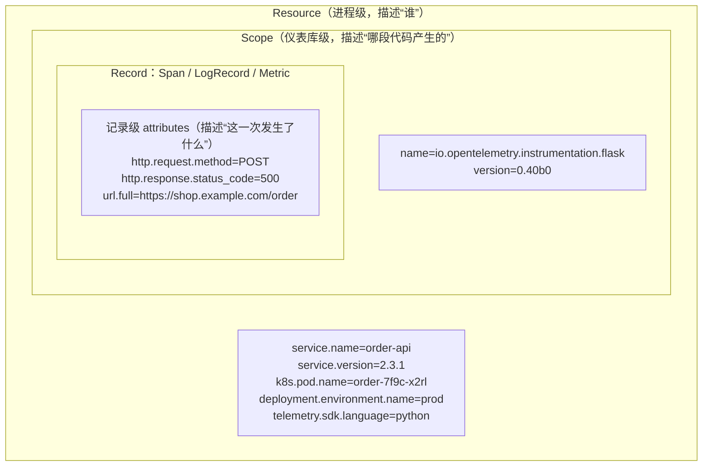

# 语义约定（Semantic Conventions）

> 阶段 0 · 概念基础 / 笔记 4
>
> 一句话总结：**语义约定 = 遥测数据的"命名规范字典"**，规定 `service.name`、`http.request.method`、`db.system` 这些名字怎么取、取值长什么样。有了它，不同语言、不同团队、不同后端的遥测数据才能互相看懂。

---

## 目录

1. [为什么需要统一命名](#1-为什么需要统一命名)
2. [概念层级：Resource / Scope / Record / Attribute](#2-概念层级resource--scope--attribute)
3. [Resource 约定：描述"数据来自谁"](#3-resource-约定描述数据来自谁)
4. [常见属性约定速查（带实例）](#4-常见属性约定速查带实例)
5. [Attribute 命名空间与命名规范](#5-attribute-命名空间与命名规范)
6. [版本化与稳定性现状](#6-版本化与稳定性现状)
7. [常见误区](#7-常见误区)
8. [面试常见问题小结](#8-面试常见问题小结)
9. [参考资料](#9-参考资料)

---

## 1. 为什么需要统一命名

设想没有约定的世界：同样是"一次 HTTP 请求的方法名"，不同框架/埋点可能写成：

```text
method          （Go net/http 探针随手写）
http_method     （Python requests 埋点）
httpMethod      （Java 驼峰习惯）
request.method  （Node.js 社区）
http.request.method   （OpenTelemetry 语义约定 ✅）
```

<!-- 保留原图：不同框架的属性命名变体平铺清单，无层级语义，非概念示意图 -->

后果：

1. **仪表盘不可复用**：每个团队写一遍"错误率按路由聚合"的查询，字段名各不相同；
2. **告警规则不可移植**：换一个 SDK/后端，规则全部重写；
3. **关联分析失效**：日志说 `httpMethod=GET`，trace 说 `http.request.method=GET`，同一事实两个名字，无法 join；
4. **机器学习/自动分析无能为力**：工具无法内置"看到 `db.system=mysql` 就知道这是数据库调用"的常识。

语义约定（Semantic Conventions，社区常缩写为 **semconv**）就是 OTel 规范里的一份**属性名字典 + 取值词典**：

- **名字**：属性叫什么（`http.response.status_code`）；
- **类型**：整型/字符串/布尔/枚举；
- **取值**：枚举的合法值（`db.system = postgresql | mysql | mssql | redis | mongodb | ...`）；
- **要求级别**：Required（必须）/ Conditionally Required（条件下必须）/ Recommended（推荐）；
- **稳定性**：Stable（稳定）/ Development（开发中，可能变）。

一句话：**信号模型（trace/span/metric）是"语法"，语义约定是"词汇表"。**

## 2. 概念层级：Resource / Scope / Attribute

理解语义约定前，先看清 OTel 数据模型的层级（三种信号通用）：



三个层级的语义与约束：

| 层级 | 回答的问题 | 典型内容 | 基数要求 | 生命周期 |
| --- | --- | --- | --- | --- |
| **Resource** | 这批数据**来自哪个实体**？ | 服务名、版本、实例 ID、Pod、区域、运行时 | **必须低基数**（实例级，数量有限） | 进程启动时确定，整个进程共享 |
| **Scope** | 由**哪个仪表库**产生？ | 库名 + 版本（如 flask 插桩、你自写的 tracer） | 极低 | 装配时确定 |
| **Record attributes** | **这一次**事件/请求的细节 | HTTP 方法、SQL、订单号、错误原因 | 可以高基数（如 `order.id`） | 随每条记录产生 |

为什么 Resource 必须低基数？因为 Resource 主要用于后端**索引与路由**（按 service 分流、分表）。把 `user.id` 放进 Resource 等于给存储制造百万级"服务身份"，是可观测性后端的经典性能事故。

## 3. Resource 约定：描述"数据来自谁"

最常用的 Resource 属性（均为小写点分命名）：

| 属性 | 含义 | 示例值 | 说明 |
| --- | --- | --- | --- |
| `service.name` | 逻辑服务名 | `order-api` | **最重要**的一条；无它几乎无法查询。可由 `OTEL_SERVICE_NAME` 环境变量注入 |
| `service.namespace` | 服务分组/命名空间 | `shop.prod` | 多环境多租户时消歧义 |
| `service.version` | 版本 | `2.3.1` | 发布对比、回滚验证的关键维度 |
| `service.instance.id` | 实例唯一 ID | `order-7f9c-x2rl` | 区分同服务不同副本（K8s 中通常取 Pod 名） |
| `deployment.environment.name` | 部署环境 | `prod` / `staging` | **注意**：旧名 `deployment.environment` 已被改名，新代码用带 `.name` 的版本 |
| `telemetry.sdk.name/language/version` | 采集 SDK 自描述 | `opentelemetry` / `python` / `1.29.0` | SDK 自动注入 |
| `process.pid`、`process.command` | 进程信息 | `12345` | 主流语言 SDK 默认注入一批 process.* |
| `container.id`、`k8s.pod.name`、`k8s.namespace.name` | 容器/K8s 坐标 | `…` | 多由 Collector 端 `resourcedetection`/`k8sattributes` 处理器富化补全 |

Python 里构造 Resource 的实际代码（lab00 会用到）：

```python
from opentelemetry.sdk.resources import Resource

resource = Resource.create({
    "service.name": "lab00-app",
    "service.version": "0.1.0",
    "deployment.environment.name": "lab",
})
# Resource.create 会自动合并 OTEL_RESOURCE_ATTRIBUTES / OTEL_SERVICE_NAME 环境变量
# 以及 SDK 默认注入的 telemetry.sdk.* 等标准属性
```

也可以在 **Collector 端**统一补 Resource（应用零改动）：

```yaml
# otel-collector-config.yaml 片段：给所有途经数据盖上统一标记
processors:
  resource:
    attributes:
      - key: deployment.environment.name
        value: lab
        action: upsert
```

## 4. 常见属性约定速查（带实例）

以下按技术域列出高频约定（**以官方 registry 为准**，这里给 2026-11 时点的常用快照；标 ⚠ 的属于仍在演进的迁移区，见第 6 节）。

### 4.1 HTTP（span / log / metric 通用）

一次 `POST https://shop.example.com:443/v1/orders` 的 server span 应当带上：

```yaml
# 伪 YAML 展示一个 span 的 attributes（真实数据里是扁平 key-value）
http.request.method: POST                 # 枚举：GET/POST/…；非标准方法用 _OTHER
http.route: /v1/orders                    # 路由模板（非原始路径！避免高基数）
url.scheme: https
server.address: shop.example.com
server.port: 443
url.full: https://shop.example.com/v1/orders
network.protocol.version: 1.1
http.response.status_code: 201
user_agent.original: "Mozilla/5.0 (Macintosh; ...) Chrome/130.0"
```

要点：

- `http.route` 记**路由模板**（`/v1/orders`），不要记原始路径（`/v1/orders/1029384`）——后者高基数，指标里尤其致命；
- 旧属性名 `http.method`、`http.status_code`、`http.url` 属于**上一代约定**，已废弃（见第 6 节迁移说明）；
- 客户端 span 另有 `server.socket.address`（对端真实地址）等。

### 4.2 数据库（db）

一次 PostgreSQL 查询的 span：

```yaml
db.system: postgresql            # 枚举：postgresql|mysql|mssql|oracle|db2|redis|mongodb|elasticsearch|...
db.operation.name: SELECT        # 操作名
db.collection.name: orders       # 表/集合（旧名 db.sql.table 已废弃）
db.query.text: "SELECT id, amount FROM orders WHERE user_id = $1"   # ⚠ 新名；旧名 db.statement
db.response.status_code: 200     # 部分系统有协议级状态
network.peer.address: 10.2.3.4:5432
db.query.parameter: '["u-88123"]'   # 绑定参数（新名，旧名 db.statement.parameter；务必脱敏后上报）
```

要点：

- `db.system` 是**路由与聚合**的关键枚举：后端凭它知道"这是 Redis 还是 PG"；
- SQL 全文放 `db.query.text`（⚠ 由 `db.statement` 迁移而来），**务必脱敏参数**（Collector 端有 `redaction`/`attributes` 处理器可用）；
- `db.namespace` 表示连接的 database/schema 名。

### 4.3 RPC / 消息 / 异常 / 生成式 AI

```yaml
# gRPC 调用
rpc.system: grpc
rpc.method: ReserveStock
rpc.service: inventory.v1.InventoryService
rpc.grpc.status_code: 14          # UNAVAILABLE

# Kafka 消息（producer span）
messaging.system: kafka
messaging.destination.name: order.created
messaging.operation.type: publish
messaging.message.id: "…"

# 异常事件（span event / log 的标准载荷）
exception.type: "exceptions.InsufficientStockError"
exception.message: "sku=SKU-42 stock=0"
exception.stacktrace: |
  Traceback (most recent call last):
    File "app.py", line 88, in checkout
      reserve(pid)
  exceptions.InsufficientStockError: sku=SKU-42 stock=0

# 生成式 AI（2024 起的新约定域，仍在演进）
gen_ai.system: openai
gen_ai.request.model: gpt-4o
gen_ai.usage.input_tokens: 812
```

### 4.4 通用横切属性

| 属性 | 用途 |
| --- | --- |
| `error.type` | 错误类型归类（异常类名或状态码），指标侧推荐使用 |
| `thread.name` / `thread.id` | 记录产生事件的线程 |
| `http.request.body.size` / `http.response.body.size` | 请求体大小（用于容量分析） |

## 5. Attribute 命名空间与命名规范

### 5.1 命名语法（官方规范）

属性名** SHOULD **满足：

1. 仅由**小写字母、数字、`.`、`_`、`-`** 构成（禁止大写、空格、`/`）；
2. 采用**点分层级**的命名空间：`<域>.<对象>.<属性>`，如 `http.request.method`；
3. 常见后缀语义：`*.id`（标识符）、`*.name`（人可读名）、`*.type`、`*.url`、`*.duration`；
4. 单位含义进名字：`duration` 默认可能带单位后缀（如 `http.request.duration`，配合明确的 unit 字段），不要起 `time` 这种含糊名。

### 5.2 命名空间治理：谁能发明名字？

| 命名空间 | 归属 | 例子 |
| --- | --- | --- |
| `http.*`、`db.*`、`messaging.*`、`rpc.*`、`url.*`、`server.*`、`network.*`、`process.*`、`container.*`、`k8s.*`、`gen_ai.*` | **官方注册表**，社区评审后进入 | `db.system` |
| `otel.*` | OTel 自身保留 | `otel.scope.name` |
| `mycompany.*`（如 `shop.*`、`acme.*`） | 组织命名空间，**应向官方 registry 登记**，避免冲突 | `shop.order.channel` |
| `own.*` | **实验性自定义**专用前缀，官方承诺永不占用 | `own.debug_flag` |

实践建议：**先查注册表，再自造名字**。90% 的业务属性都能映射到既有约定（如"调用方 IP"→ `client.address`），自定义名只用于真正的业务概念（`shop.order.channel`）。

### 5.3 同名不同值的坑：Resource vs Record

`service.name` 只能出现在 Resource；`db.system` 只该出现在 span attributes。**不要把 Resource 属性重复塞进每条记录**（浪费体积），也不要把每请求变化的值放进 Resource（基数灾难）。判断口诀：

> **进程内不变的 → Resource；每次请求变的 → Record attributes。**

## 6. 版本化与稳定性现状

语义约定按**域（domain）**独立演进、独立宣布稳定，整体状态（截至 2026-11，以官方 registry 为准）：

| 域 | 状态 | 说明 |
| --- | --- | --- |
| Resource（`service.*` 等） | **Stable** | 已广泛实现 |
| HTTP | **Stable**（v1.23 起，2023-07 宣布） | 稳定版采用 `http.request.method` 等新名 |
| Exceptions（`exception.*`） | **Stable** | 2023 年初稳定 |
| Logs（日志正文/级别约定） | **Stable** | 2024 年稳定；与 `LogRecord` 模型配套 |
| DB / Messaging / RPC | 部分 Stable、部分迁移中 ⚠ | 如 `db.statement` → `db.query.text`、`deployment.environment` → `deployment.environment.name` 属于"稳定过程中的改名" |
| `gen_ai.*`、profiling 相关 | Development | 快速演进，勿硬编码依赖 |

### 6.1 兼容机制：Schema URL 与"双发"

1. **Schema URL**：每条导出的数据可携带 `schema_url`（如 `https://opentelemetry.io/schemas/1.26.0`），声明"我按哪一版约定命名"。Collector/后端可据此做**schema 转换**（旧名 → 新名），官方发布机器可读的 schema 文件；
2. **双发（dual emission）**：在 HTTP 约定从旧名（`http.method`）切到新名（`http.request.method`）的过渡期，多数语言 SDK 提供开关同时上报新旧两组属性，例如环境变量：

```bash
# Java / Python 等支持：同时输出稳定版与旧版 HTTP 属性，便于后端渐进迁移
OTEL_SEMCONV_STABILITY_OPT_IN=http
OTEL_SEMCONV_STABILITY_OPT_IN=http/dup
```

### 6.2 给使用者的三条行动建议

1. **新代码一律写新名**（`http.request.method`、`deployment.environment.name`、`db.query.text`），旧名只出现在兼容代码里；
2. **别在业务逻辑里硬编码 semconv 字符串拼查询**——把属性名收敛到常量模块，升级时只改一处；
3. 升级 SDK/插桩库前读一眼 release note 的 semconv 变更段，仪表盘查询同步改。

## 7. 常见误区

### 误区 1："属性名随便起，反正是自己查"

自造名（`reqMethod`）导致：自动插桩的属性与你的属性对不上、社区仪表盘/告警库不可复用、多团队数据无法聚合。**先查 registry，再造词。**

### 误区 2："把原始 URL 路径放进 `http.target`/指标维度"

`/orders/1029384` 每单一个值，指标序列爆炸；trace 里也污染聚合。路由模板（`http.route`）进维度，原始路径只留 span/log。

### 误区 3："Resource 里塞了 user.id 方便过滤"

Resource 是实例级索引信息，塞请求级高基数属性会拖垮后端路由。请求级细节放 span/log attributes。

### 误区 4："语义约定已经全部稳定，随便依赖"

只有部分域 Stable；`gen_ai.*` 等仍在 Development，升级可能改名。生产硬依赖前看该域状态标记。

### 误区 5："用了 OTel SDK 就自动符合语义约定"

SDK 保证**骨架字段**（trace/span 结构、Resource 基础属性）符合；**业务属性**靠你自己遵循命名与脱敏约定；Collector 端还可能需要 processors（`redaction`、`transform`）兜底清洗。

### 误区 6："驼峰/下划线无所谓"

规范要求小写点分。`httpRequestMethod`、`http_request_method` 都会被视为不合规范的私有命名，丧失互操作价值（工具会按 `http.*` 域识别）。

## 8. 面试常见问题小结

**Q1：什么是语义约定？为什么需要？**

> 答：OTel 规范中的属性命名与取值字典（如 `service.name`、`http.request.method`、`db.system` 及其枚举值）。需要它是因为：多语言/多团队/多后端的遥测数据只有统一词汇才能聚合查询、复用仪表盘与告警，并让工具内置"常识"（识别 DB 调用、HTTP 请求）。

**Q2：Resource 属性和 Span 属性有什么区别？**

> 答：Resource 描述数据来源实体（service/pod/version），进程级、低基数、用于索引路由；span attributes 描述单次事件细节，可高基数。判断口诀：进程内不变放 Resource，每请求变化放 Record。

**Q3：`service.name` 从哪里来？**

> 答：最佳来源是部署环境注入的 `OTEL_SERVICE_NAME` 环境变量（SDK 自动读取），其次代码构造 Resource 显式指定，也可由 Collector 的 resource processor 统一补盖。

**Q4：HTTP 语义约定的旧名和新名分别是什么？迁移期怎么处理？**

> 答：旧名 `http.method/http.status_code/http.url` → 新名 `http.request.method/http.response.status_code/url.full`（v1.23 起稳定）。迁移期多数 SDK 提供 `OTEL_SEMCONV_STABILITY_OPT_IN` 开关做双发；数据侧可依 Schema URL 做转换。

**Q5：属性命名有哪些规则？**

> 答：小写字母/数字/`.`/`_`/`-`，点分层级命名空间；先使用官方注册表命名空间（`http.`、`db.` 等），组织名应登记（`mycompany.*`），临时自定义用 `own.*`；避免高基数值进入 Resource 和指标维度。

## 9. 参考资料

1. OpenTelemetry 语义约定总入口（含 registry）：
   <https://opentelemetry.io/docs/specs/semconv/> （访问日期：2026-11-04）
2. General Attributes（命名规范、命名空间治理）：
   <https://opentelemetry.io/docs/specs/semconv/general/attributes/> （访问日期：2026-11-04）
3. Resource 语义约定：
   <https://opentelemetry.io/docs/specs/semconv/resource/> （访问日期：2026-11-04）
4. HTTP 语义约定（Stable 版）：
   <https://opentelemetry.io/docs/specs/semconv/http/http-spans/> （访问日期：2026-11-04）
5. Database 语义约定（含 `db.query.text` 迁移说明）：
   <https://opentelemetry.io/docs/specs/semconv/database/database-spans/> （访问日期：2026-11-04）
6. HTTP 语义约定稳定公告（2023）：
   <https://opentelemetry.io/blog/2023/http-semconv-stability/> （访问日期：2026-11-04）
7. Schema 与版本转换（OTLP `schema_url`、schema 文件）：
   <https://opentelemetry.io/docs/specs/otel/schemas/overview/> （访问日期：2026-11-04）

---

> 上一篇：[opentelemetry-overview.md](./opentelemetry-overview.md)
> 下一篇：[otel-quickstart-concepts.md](./otel-quickstart-concepts.md) —— 核心对象速查：Provider / Tracer / Meter / Logger 一图流。

## 附：ASCII 图替换清单

| 原 ASCII 图位置（章节标题） | 原图内容简述 | 替换结果 |
| --- | --- | --- |
| 2. 概念层级：Resource / Scope / Attribute | Resource ⊃ Scope ⊃ Record 三层嵌套包含关系及各层示例属性 | flowchart TB（嵌套 subgraph） |

### 保留说明

| 位置 | 内容 | 原因 |
| --- | --- | --- |
| 1. 为什么需要统一命名 | 各框架对“HTTP 方法名”的命名变体清单（method/http_method/httpMethod/…） | 平铺字段清单，无真实层级语义，非概念示意图 |
