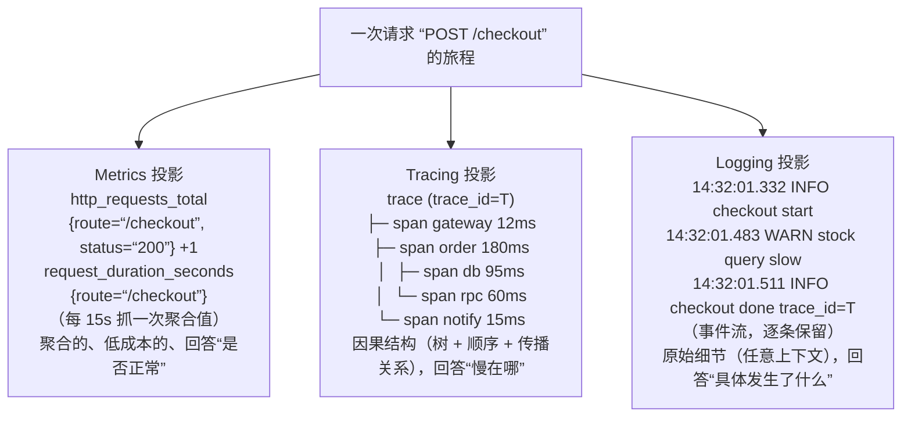
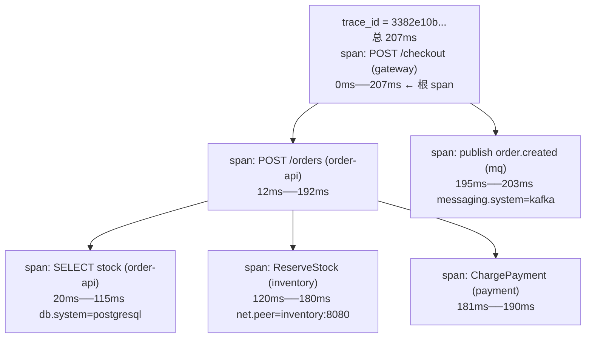
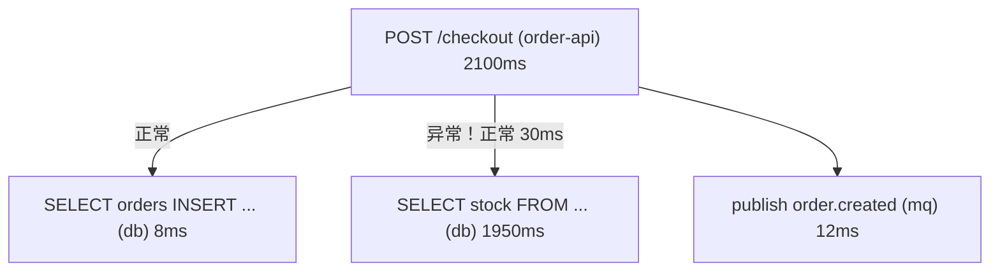

# 三大支柱：Metrics / Logging / Tracing

> 阶段 0 · 概念基础 / 笔记 2
>
> 一句话总结：**Metrics 告诉你"出了问题"，Tracing 告诉你"问题在哪一环"，Logging 告诉你"为什么"。**
> 三者不是三个孤立的产品，而是同一份现实的三种投影。

---

## 目录

1. [总览：三种投影](#1-总览三种投影)
2. [Metrics：指标](#2-metrics指标)
3. [Logging：日志](#3-logging日志)
4. [Tracing：链路追踪](#4-tracing链路追踪)
5. [三者如何互补：提问矩阵](#5-三者如何互补提问矩阵)
6. [成本模型对比](#6-成本模型对比)
7. [真实排障演练：下单接口变慢](#7-真实排障演练下单接口变慢)
8. [四大黄金信号与 USE / RED 方法论](#8-四大黄金信号与-use--red-方法论)
9. [常见误区](#9-常见误区)
10. [面试常见问题小结](#10-面试常见问题小结)
11. [参考资料](#11-参考资料)

---

## 1. 总览：三种投影

想象一次 HTTP 请求穿过你的系统，三种信号分别在记录它的不同侧面：



| | Metrics | Logs | Traces |
| --- | --- | --- | --- |
| 记录的是 | 聚合数值随时间的变化 | 离散事件文本（结构化最佳） | 请求在分布式系统中的因果路径 |
| 粒度 | 服务/接口级聚合 | 单条事件 | 单次请求（可跨 N 个进程） |
| 典型基数 | 低～中（label 组合数） | 中～高 | 高（每次请求一个 trace_id） |
| 典型保留 | 13 个月（按天降采样） | 7～90 天 | 3～30 天 |
| 查询模式 | 时序查询、聚合、告警 | 关键字/字段过滤、全文检索 | trace_id 精确查、服务拓扑、慢查询 |

## 2. Metrics：指标

### 2.1 数据模型

指标的本质是**时间序列**：一条序列 = 指标名 + 一组标签（labels/attributes）+ `(timestamp, value)` 序列。

以 Prometheus 数据模型为准（OTel 的指标模型在语义上兼容）：

```text
http_server_request_duration_seconds_bucket{
  service="order-api", route="/checkout", le="0.5"}   1827    @1700000000
     └──────────── 指标名 ────────────┘ └──── 标签集 ────┘ └值┘ └─时间戳─┘
```

<!-- 保留原图：Prometheus 样本行格式标注示例，属示例输出，非概念示意图 -->

四种基本指标类型：

| 类型 | 语义 | 只会变？ | 典型用途 | PromQL 例子 |
| --- | --- | --- | --- | --- |
| **Counter（计数器）** | 单调递增累计值 | 只增不减（重启清零） | 请求总数、错误数、字节总数 | `rate(http_requests_total[5m])` |
| **Gauge（瞬时值）** | 可升可降的当前值 | 任意 | 队列长度、内存占用、连接数、温度 | `queue_depth` |
| **Histogram（直方图）** | 按桶统计的分布 | 只增（桶计数） | 延迟分布、请求体大小分布 | `histogram_quantile(0.99, rate(http_request_duration_seconds_bucket[5m]))` |
| **Summary（摘要）** | 客户端预计算分位数 | 只增 | 单实例延迟 P50/P90/P99 | `http_request_duration_seconds{quantile="0.99"}` |

**Histogram vs Summary** 是高频考点：

- Histogram 在**服务端**聚合（桶计数可加），支持跨实例合并、可事后计算任意分位数，但分位数是**近似值**；
- Summary 在**客户端**预计算分位数，数值精确，但**无法跨实例合并**（P99 的 P99 没有意义），分位数需预先固定；
- 现代实践几乎一律选 **Histogram**（或 OpenTelemetry 的 Exponential Histogram / Prometheus native histogram，桶边界自适应，更省存储）。

### 2.2 指标的优缺点

优点：

1. **成本极低**：预先聚合，存储与基数成正比、与流量无关（QPS 翻 100 倍，指标还是 15 秒一个点）；
2. **适合告警与趋势**：数学运算丰富（rate、derivative、预测）；
3. **语义标准成熟**：PromQL 生态事实标准。

缺点：

1. **丢失个体细节**：均值/分位数会掩盖长尾（P99 正常但 0.1% 请求 30s 超时）；
2. **基数是硬约束**：一个 label 取值 1 万的组合 × N 个 label 会击穿存储（"高基数问题"，阶段 5 展开）；
3. **无法告诉你"为什么"**，只能定位到"哪个指标异常"。

### 2.3 指标的标准入口

- 上报侧：OpenTelemetry SDK（OTLP 协议）或直接暴露 `/metrics` 给 Prometheus 抓取（阶段 1 实战）；
- 语义侧：OpenTelemetry 语义约定统一命名（见笔记 4），如 `http.server.request.duration`。

## 3. Logging：日志

### 3.1 数据模型

一条**结构化日志**是带时间戳的属性集（推荐 JSON 或 logfmt）：

```json
{
  "timestamp": "2026-11-04T14:32:01.511Z",
  "severity": "INFO",
  "body": "checkout completed",
  "service": { "name": "order-api", "version": "2.3.1" },
  "trace": { "trace_id": "3382e10b1b4c6f5d8c0a4e2f1a3b4c5d", "span_id": "5b8ad3c7d1e94f2a" },
  "attributes": {
    "order.id": "A-1029384",
    "user.id": "u-88123",
    "payment.method": "credit_card",
    "duration_ms": 179
  }
}
```

关键字段三层：

1. **时间戳 + 级别 + 正文**：最基本的三元组；
2. **上下文属性**：结构化字段（服务、版本、实例、订单号、用户分群）；
3. **关联字段**：`trace_id` / `span_id` —— 把日志挂到链路上，这是三大支柱打通的关键（阶段 4 展开）。

### 3.2 非结构化 → 结构化

```text
非结构化（人读友好，机器难解析）：
  2026-11-04 14:32:01 INFO checkout completed in 179ms order=A-1029384

结构化（可直接过滤/聚合）：
  {"ts":"...","level":"INFO","msg":"checkout completed","duration_ms":179,"order.id":"A-1029384"}
```

<!-- 保留原图：非结构化与结构化日志样例对照，属日志示例输出，非概念示意图 -->

排障时你要做的查询是"**给我 trace_id=T 的所有日志**""**payment.method=credit_card 且 duration>1000 的日志条数**"——没有结构化，这些都做不了。

### 3.3 日志的优缺点

优点：

1. **信息密度最高**：能记录任何业务细节、错误栈、变量值；
2. **门槛最低**：任何语言都有日志库；
3. **审计与合规友好**：事件流天然是证据。

缺点：

1. **成本最高**：量与流量成正比，全量长期保留很贵；
2. **查询靠预埋字段**：没写进日志的信息，事后永远查不到；
3. **跨服务拼图难**：没有 trace_id 时，只能按时间戳 + 关键字对齐，噪声极大。

### 3.4 常见选型（阶段 2 展开）

| 方案 | 特点 |
| --- | --- |
| ELK / OpenSearch | 全文检索强，生态成熟，运维成本高 |
| Loki | 与 Prometheus 标签模型对齐，只索引标签不索引正文，便宜 |
| ClickHouse | 列存分析型，大规模扫描/聚合极快，近年 SaaS 后端常用 |

## 4. Tracing：链路追踪

### 4.1 数据模型：Trace 与 Span

- **Trace**：一次（分布式）请求的完整执行轨迹，由全局唯一 `trace_id` 标识；
- **Span**：轨迹中的一个工作单元（一次 HTTP 调用、一次 SQL、一段计算），有 `span_id`、父 `span_id`、起止时间、属性、事件、状态。

一次下单请求的 span 树：



每个 span 携带的典型信息：

| 字段 | 说明 | 示例 |
| --- | --- | --- |
| trace_id / span_id / parent_span_id | 身份与父子关系 | 32/16 位 hex |
| name + kind | 名称与类型 | `POST`，kind=SERVER/CLIENT/INTERNAL |
| start/end | 起止时间（相减得出耗时） | 1700000000.012 ~ .207 |
| status | OK / ERROR + 描述 | ERROR, "insufficient stock" |
| attributes | 结构化属性 | `db.system=postgresql`、`http.response.status_code=200` |
| events | 时间点事件（无子 span 的轻量记录） | `exception` 事件带堆栈 |
| links | 关联其他 trace | MQ 异步消费链回溯生产者 trace |

### 4.2 context 传播：tracing 的灵魂

跨进程的关键是把 `(trace_id, 当前 span_id, 采样标志)` 随请求一起传出去，事实标准是 **W3C Trace Context** HTTP 头：

```text
traceparent: 00-3382e10b1b4c6f5d8c0a4e2f1a3b4c5d-5b8ad3c7d1e94f2a-01
             └┬┘ └────────────── trace_id (32 hex) ─────────────┘ └── span_id ──┘ └flags(采样)
             版本
```

<!-- 保留原图：traceparent 头格式标注示例，属协议格式示例输出，非概念示意图 -->

下游服务**提取**该头 → 作为自己的 parent → 处理请求时**注入**到它发起的下一个出站调用。任何一环丢失（HTTP 客户端没带、MQ 消息没塞进 header、线程池切换丢 context），链路就在那里断成两截。

### 4.3 Tracing 的优缺点

优点：

1. **保留因果与拓扑**：唯一能回答"这次请求到底慢/错在哪一环"的信号；
2. **跨服务边界**：把 N 个服务的日志串成一条线（靠 trace_id）；
3. **衍生价值**：服务依赖拓扑、spanmetrics（把 trace 聚合成指标）、容量分析。

缺点：

1. **成本与流量成正比**，必须采样（全量采集大厂也扛不住）；
2. **只覆盖被埋点的路径**：没过框架/没插桩的代码不留痕；
3. **实现侵入性相对高**：依赖 context 传播正确性，异步/跨线程场景易踩坑。

## 5. 三者如何互补：提问矩阵

| 你想问的问题 | 最先查谁 | 为什么 |
| --- | --- | --- |
| 系统现在整体健康吗？ | Metrics | 聚合视角 + 告警已就位 |
| 错误率/延迟的绝对值和趋势？ | Metrics | 时序对比 |
| 这次失败的具体请求长什么样？ | Tracing | 单请求视角，span 树 |
| 慢在哪个服务、哪次下游调用？ | Tracing | span 耗时 + 服务边界 |
| 抛了什么异常、变量值是什么？ | Logs | 原始细节 |
| 该 span 前后这条请求还发生了什么？ | Logs（按 trace_id 过滤） | trace_id 关联 |
| 某类用户的失败比例有多少？ | Metrics（分维度）或 Logs 聚合 | 看基数与预算 |
| 依赖拓扑/谁调用了谁？ | Tracing 衍生 | 服务图 |

一句话分工：

> **Metrics 负责"发现异常"（检测），Tracing 负责"定位异常位置"（隔离），Logs 负责"解释异常原因"（诊断）。**

## 6. 成本模型对比

| 维度 | Metrics | Logs | Traces |
| --- | --- | --- | --- |
| 数据量与流量的关系 | **无关**（固定采样间隔） | 正比 | 正比（采样率可调） |
| 主要成本项 | 序列基数（label 组合） | 摄入量 × 保留天数 | span 数量 × 保留天数 |
| 压缩空间 | 极好（delta+XOR 编码） | 中（文本压缩） | 好（列存/protobuf） |
| 高基数容忍度 | 差（序列爆炸） | 好（只是属性值） | 好（本来就是个体） |
| 采样策略 | 一般不采样（聚合点） | 分级/过滤 | head/tail 采样（阶段 5） |
| 典型量级参照 | 100 万序列 ≈ 单机 Prometheus 上限量级 | GB/天～TB/天 | 每百万 span ≈ 0.5~2 GB 原始 |
| 典型保留策略 | 30 天明细 + 1 年降采样 | ERROR 90d / INFO 7~30d | 3~14 天（错误 trace 更久） |

成本直觉：**同样描述一次请求，一条 span 约为一条结构化日志的 1/5~1/2 大小，一个指标点约为 span 的 1/1000**。所以"指标看面、链路看点、日志看细节"的分层消费本身就是成本优化。

## 7. 真实排障演练：下单接口变慢

**现象**：周二 10:15，值班群告警：`order-api` P99 延迟 450ms → 2.3s，持续 6 分钟，错误率正常。

### 第一幕：用 Metrics 确定问题面（"是什么、有多糟、从何时开始"）

```promql
# 黄金信号之延迟：按服务看 P99
histogram_quantile(0.99,
  sum by (service, le) (rate(http_server_request_duration_seconds_bucket[5m])))

# 黄金信号之流量：QPS 有没有暴涨（排除流量型变慢）
sum by (service) (rate(http_server_request_duration_seconds_count[5m]))

# 黄金信号之饱和度：下游连接池、CPU、GC
order_db_connection_pool_active / order_db_connection_pool_max
```

观察结果（虚构但典型）：

- 只有 `order-api` 的 P99 变慢，QPS 平稳 → 排除流量型；
- `db pool active/max = 1.0`（打满）→ 疑点指向数据库访问环节；
- 但"池为什么满"指标答不了 → 进入第二幕。

### 第二幕：用 Tracing 定位问题环节（"哪一环"）

打开 tracing UI，filter：`service=order-api AND duration > 1s`，取一条 2.1s 的 trace：



再按 `db.statement` 聚合这批慢 trace 的 span：

```text
SELECT stock FROM inventory WHERE sku_id = ?   → P99 = 1980ms, 且大量 span 在等待池
```

结论：**慢查询 + 连接池互相拖垮**（慢查询占住连接 → 后续请求排队等池 → 整体雪崩）。但 SQL 为什么慢，trace 里看不到执行计划 → 第三幕。

### 第三幕：用 Logs 找根因（"为什么"）

用该 span 的 `span_id` / `trace_id` 关联日志（日志平台按 `trace_id` 过滤）：

```json
{"level":"WARN","msg":"slow query detected","db.query.text":"SELECT stock ...",
 "db.rows_scanned": 4821039, "db.plan":"Seq Scan on inventory","trace_id":"3382e1..."}
```

同时段 DBA 日志/审计日志显示：**10:02 有人对 `inventory` 表执行了大批量 UPDATE，导致该表统计信息过期、优化器放弃索引改走全表扫描。**

`ANALYZE inventory;` 后 P99 恢复。**闭环用时 11 分钟，三种信号各司其职。**

复盘动作（体现支柱互补的制度化）：

1. 给 `db pool active/max` 加饱和度告警（Metrics）；
2. 给慢 span（`duration>500ms` 的 db span）自动生成指标与告警（spanmetrics，Tracing→Metrics）；
3. 慢查询日志强制带 `trace_id`（Logs 关联）。

## 8. 四大黄金信号与 USE / RED 方法论

### 8.1 四大黄金信号（Google SRE）

来自 Google SRE Book 第 6 章，衡量任何面向用户的系统健康度只需盯四个信号：

| 信号 | 回答 | 常见度量 | 注意点 |
| --- | --- | --- | --- |
| **延迟（Latency）** | 请求多快返回 | P50/P95/P99，**成功与失败要分开统计** | 错误请求往往"快"（快速失败），混在一起会掩盖问题 |
| **流量（Traffic）** | 系统承载多少需求 | QPS/RPS、并发数、消息速率、IOPS | 流量突变既是故障线索也是容量线索 |
| **错误（Errors）** | 失败了多少 | 显式 5xx、隐式 200+错误体、策略性失败 | 隐式错误（HTTP 200 返回业务失败）最易漏 |
| **饱和度（Saturation）** | 资源有多满 | CPU、内存、连接池、队列深度、磁盘 IO Util | 要测"排队程度"而非"使用率"（如线程池等待时间） |

### 8.2 USE 方法（面向"资源"，Brendan Gregg, 2012）

对每一种资源（CPU、内存、磁盘、网络、连接池）依次检查：

- **U**tilization（使用率）：资源忙的时间比例；
- **S**aturation（饱和度）：排队/等待程度（队列长度、等待时间）；
- **E**rrors（错误）：错误计数（ECC 错误、重传、设备重置）。

适用层次：**机器、内核、存储、网络设备**——基础设施排障的机械流程，防止"盯仪表盘发呆"。

### 8.3 RED 方法（面向"服务"，Tom Wilkie, 2015）

对每一个（微）服务检查：

- **R**ate（速率）：每秒请求数；
- **E**rrors（错误）：每秒失败数；
- **D**uration（耗时）：延迟分布。

### 8.4 三者关系与组合拳

| 方法论 | 视角 | 信号集 | 用在哪 |
| --- | --- | --- | --- |
| 黄金信号 | 终极目标 | 延迟/流量/错误/饱和度 | SLO 与用户视角健康度 |
| USE | 自底向上（资源） | 使用率/饱和度/错误 | 主机与中间件层 |
| RED | 自顶向下（服务） | 速率/错误/耗时 | 每个微服务的标准面板 |

实践组合：**每个微服务一块 RED 面板，其下挂所依赖资源的 USE 面板**；RED 的 Duration 对应黄金信号的 Latency，RED 的 Rate 对应 Traffic——两者共同覆盖黄金信号，Saturation 由 USE 层承接。这也是阶段 1 Grafana 仪表盘的模板结构。

## 9. 常见误区

### 误区 1："三套系统各自为政"

指标、日志、链路三个平台互不关联，排障时人工对时间戳。正确姿势：日志强制携带 `trace_id`（免费）、指标通过 **exemplars**（直方图桶里挂代表性 trace_id）回链 trace（阶段 4 实战）。

### 误区 2："把高基数值塞进指标标签"

`user_id`、`order_id` 这类几乎无限的值放进 metrics label 会造成序列爆炸。高基数细节应放日志/链路，指标只放有界维度（route、status、version、region）。

### 误区 3："只看平均值"

平均延迟 120ms 可能掩盖"P99=8s"。面向用户体验必须看分位数，且**成功/失败分开统计**。

### 误区 4："日志级别拉满就万事大吉"

DEBUG 全量采集成本极高且淹没信号。要分级保留、按需动态调整级别，并把"结构化 + trace_id"当成比"更多日志"更重要的事。

### 误区 5："上了 trace 就不用打日志了"

trace 只记录"经过哪些环节"，具体业务细节（参数、重试原因、降级开关状态）仍要日志承载。span 上的 `events` 只是轻量补充，不是日志替代品。

### 误区 6："三大支柱必须同时上齐才能开始"

可以从"结构化日志 + 黄金信号指标"起步，traces 在服务数 ≥3、跨服务排障变频繁时再上。信号之间的关联（trace_id 贯通）比数量更重要。

## 10. 面试常见问题小结

**Q1：三大支柱各适合解决什么问题？请各举一例。**

> 答：Metrics——低成本、聚合视角，适合健康度监控与告警（例：错误率>1% 告警）；Logs——原始事件细节，适合根因诊断与审计（例：某 trace_id 对应的异常堆栈）；Traces——跨服务因果路径，适合定位"慢/错在哪一环"（例：P99 慢在下游 DB span）。

**Q2：Histogram 和 Summary 的区别？**

> 答：Summary 客户端预计算分位数、精确但不可跨实例聚合、分位数需预定义；Histogram 上报桶计数、可在服务端任意聚合后计算分位数（近似），支持跨实例合并。分布式场景几乎总选 Histogram。

**Q3：什么是高基数问题？怎么应对？**

> 答：指标 label 取值组合过多导致时间序列数爆炸（存储/查询/内存都崩）。应对：有界维度设计、高基数信息下沉到日志/trace、服务端限流（如 Prometheus 的 label 接受列表）、用 exemplar 替代。

**Q4：trace_id 怎么把三大支柱串起来？**

> 答：SDK 在产生日志时自动注入当前 span 上下文（trace_id/span_id 成为日志字段），日志平台可按 trace_id 过滤；指标侧通过 exemplar 把直方图桶与代表 trace 关联。这样"指标发现→链路定位→日志解释"形成闭环。

**Q5：四大黄金信号是什么？和 RED/USE 的关系？**

> 答：延迟、流量、错误、饱和度（Google SRE Book）。RED（速率/错误/耗时）是服务层视角，覆盖前三者；USE（使用率/饱和度/错误）是资源层视角，主要承接饱和度。实践中服务用 RED 面板、资源用 USE 面板组合落地。

**Q6：为什么错误请求和成功请求的延迟要分开统计？**

> 答：失败请求常走快速失败路径（如校验直接 400），把两者混合会拉低平均延迟，掩盖真实用户体感的尾部延迟；SRE Book 明确建议按成功/失败拆分统计。

## 11. 参考资料

1. Google SRE Book, Chapter 6 *Monitoring Distributed Systems*（四大黄金信号）：
   <https://sre.google/sre-book/monitoring-distributed-systems/> （访问日期：2026-11-04）
2. Brendan Gregg, *The USE Method*：
   <https://www.brendangregg.com/usemethod.html> （访问日期：2026-11-04）
3. Tom Wilkie, *The RED Method*（SignalFx/Monitorama 演讲与博客）：
   <https://grafana.com/blog/2018/08/02/the-red-method-how-to-instrument-your-services/> （访问日期：2026-11-04）
4. Prometheus 文档 *Metric Types*：
   <https://prometheus.io/docs/concepts/metric_types/> （访问日期：2026-11-04）
5. W3C Trace Context 规范：
   <https://www.w3.org/TR/trace-context/> （访问日期：2026-11-04）
6. OpenTelemetry 文档 *Observability Primer* 与 Signals：
   <https://opentelemetry.io/docs/specs/otel/overview/> （访问日期：2026-11-04）
7. CNCF Observability Whitepaper：
   <https://github.com/cncf/tag-observability/blob/main/whitepaper.md> （访问日期：2026-11-04）

---

> 上一篇：[observability-vs-monitoring.md](./observability-vs-monitoring.md)
> 下一篇：[opentelemetry-overview.md](./opentelemetry-overview.md) —— OpenTelemetry：统一三大支柱的开放标准。

## 附：ASCII 图替换清单

| 原 ASCII 图位置（章节标题） | 原图内容简述 | 替换结果 |
| --- | --- | --- |
| 1. 总览：三种投影 | 一次请求扇出到 Metrics / Tracing / Logging 三种投影及各自内容与回答的问题 | flowchart TD |
| 4. Tracing：链路追踪 / 4.1 数据模型：Trace 与 Span | 一次下单请求的 span 树（父子层级 + 各 span 起止毫秒与属性标注） | flowchart TD |
| 7. 真实排障演练：下单接口变慢 / 第二幕：用 Tracing 定位问题环节 | 2100ms 慢 trace 的 span 树（含“正常/异常”标注） | flowchart TD |

### 保留说明

| 位置 | 内容 | 原因 |
| --- | --- | --- |
| 2. Metrics：指标 / 2.1 数据模型 | Prometheus 样本行的指标名/标签集/值/时间戳字段标注示例 | 属示例输出（对样本行各段的标注说明），非对象+关系示意图 |
| 3. Logging：日志 / 3.2 非结构化 → 结构化 | 非结构化日志行与结构化 JSON 日志的样例对照 | 属日志样例，非概念示意图 |
| 4. Tracing：链路追踪 / 4.2 context 传播：tracing 的灵魂 | traceparent 头的字段标注示例（版本/trace_id/span_id/flags） | 属协议格式示例输出，非概念示意图 |
