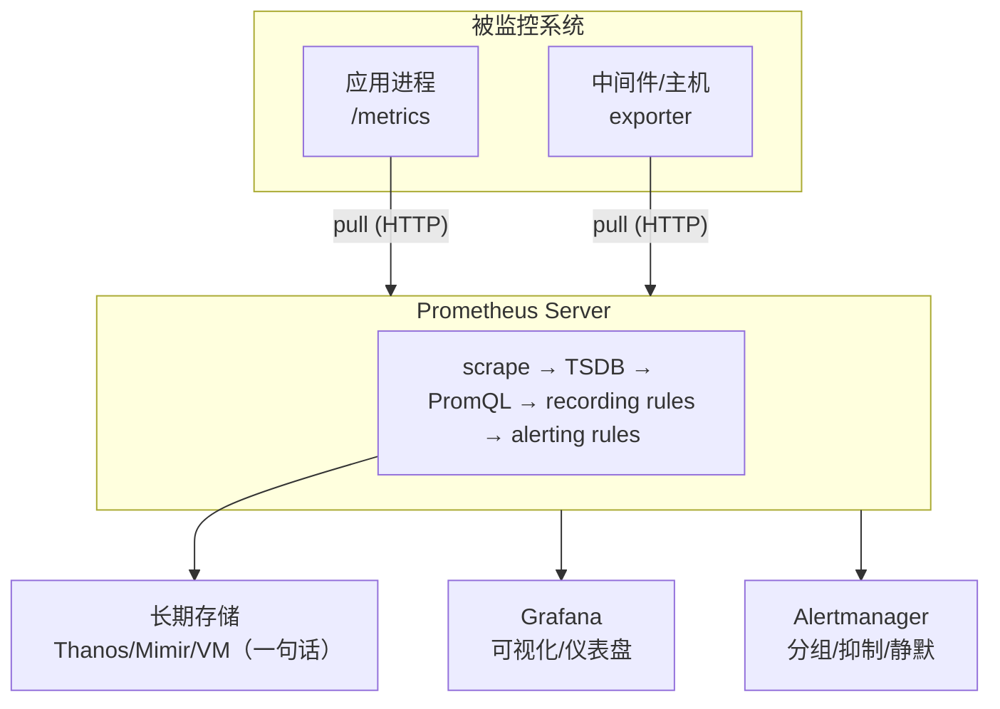

# 阶段 1 · 指标 Metrics（Prometheus + Grafana）

> 本阶段是可观测性三大支柱的第一站：**指标（Metrics）**。
> 指标回答的是"**系统现在怎么样？**"——它是低成本的数值时间序列，适合做趋势分析、容量规划与告警。
> 学完本阶段，你应当能够：读懂 `/metrics`、写出常用的 PromQL、为应用设计 RED 指标、搭出 Grafana 仪表盘并配置告警。

## 学习目标

- [ ] 理解 Prometheus 拉模型架构与核心组件（Server / Target / Service Discovery / TSDB / Alertmanager）
- [ ] 掌握 Prometheus 数据模型：metric name + labels + 四种指标类型
- [ ] 熟练使用 PromQL：rate、聚合、histogram_quantile、join、subquery
- [ ] 会用 exporter 与 client library 完成埋点（node_exporter / blackbox / 应用内 RED 指标）
- [ ] 能用 Grafana 做出可读性好的仪表盘（面板选型、变量联动、dashboard as code）
- [ ] 能设计"可操作"的告警规则并正确配置 Alertmanager（grouping / inhibition / silence / routing）

## 笔记索引（建议按序阅读）

| # | 笔记 | 主题 | 关键词 |
| --- | --- | --- | --- |
| 1 | [prometheus-architecture.md](prometheus-architecture.md) | Prometheus 架构 | 拉模型、scrape、TSDB、retention、生态组件 |
| 2 | [data-model.md](data-model.md) | 数据模型与指标类型 | labels、时间序列、counter/gauge/histogram/summary、native histogram、exemplars |
| 3 | [promql.md](promql.md) | PromQL 详解 | rate/irate/increase、聚合、histogram_quantile、join、subquery、recording rules |
| 4 | [exporters.md](exporters.md) | Exporter 与应用埋点 | node_exporter、blackbox_exporter、中间件 exporter、Go/Python client、RED、命名规范 |
| 5 | [grafana-visualization.md](grafana-visualization.md) | Grafana 可视化 | 数据源、面板选型、模板变量、阈值单位、provisioning |
| 6 | [grafana-deep-dive.md](grafana-deep-dive.md) | Grafana 进阶 | 配置体系与 HA、认证（OIDC/Service Account）、组织与权限模型、Explore 工作流、Transformations、统一告警 as code、插件 |
| 7 | [alerting.md](alerting.md) | 告警体系 | 规则语法、for、severity、Alertmanager 路由树、告警设计原则、SLO 告警预览 |
| 8 | [long-term-storage.md](long-term-storage.md) | 长期存储与水平扩展 | remote_write 与 external_labels、Thanos（Sidecar/Receive 两种 HA + 去重）、VictoriaMetrics（单二进制/MetricsQL）、Mimir（多租户集群）、降采样成本交易、选型决策树 |

## 配套实验

- **lab01：从零搭一套指标监控** —— [labs/lab01-prometheus-grafana/](../../labs/lab01-prometheus-grafana/README.md)

  示例应用埋点（Python + prometheus-client）→ Prometheus 抓取 → Grafana 可视化 → 告警规则 + Alertmanager。
  podman compose 一键启动，包含 QPS / 错误率 / p99 延迟 / 资源使用率四类面板与两条可触发的告警。

## 本阶段知识地图

## 与其他阶段的衔接

- **向上（阶段 0）**：如果"可观测性 vs 监控"还不清晰，先回看概念笔记——指标擅长回答**预定义问题**，日志与链路擅长**探索未知根因**。
- **向右（阶段 2/3）**：日志与链路追踪。注意 metrics 的标签设计（低基数）与日志字段、trace 属性的命名对齐。
- **向后（阶段 4）**：exemplars 把指标与 trace 关联起来；SLO 告警基于本阶段的错误率/p99 查询进阶为多窗口、多燃烧率告警。
- **向下（进阶）**：知识地图右下角的"长期存储 Thanos/Mimir/VM"只是预告——保留期/高可用/全局查询的完整突破路线见 [long-term-storage.md](long-term-storage.md)。

## 参考资料（权威入口）

- Prometheus 官方文档：<https://prometheus.io/docs/introduction/overview/>（访问日期：2026-11-04）
- Prometheus 数据模型：<https://prometheus.io/docs/concepts/data_model/>（访问日期：2026-11-04）
- PromQL 官方文档：<https://prometheus.io/docs/prometheus/latest/querying/basics/>（访问日期：2026-11-04）
- metric 类型与命名最佳实践：<https://prometheus.io/docs/practices/naming/>（访问日期：2026-11-04）
- exporter 与 client library 列表：<https://prometheus.io/docs/instrumenting/exporters/>（访问日期：2026-11-04）
- Grafana 文档：<https://grafana.com/docs/grafana/latest/>（访问日期：2026-11-04）
- Alertmanager 文档：<https://prometheus.io/docs/alerting/latest/alertmanager/>（访问日期：2026-11-04）
- Google SRE Book 第 6 章《监控分布式系统》：<https://sre.google/sre-book/monitoring-distributed-systems/>（访问日期：2026-11-04）

## 附：ASCII 图替换清单

| 原 ASCII 图位置（章节标题） | 原图内容简述 | 替换结果 |
| --- | --- | --- |
| 本阶段知识地图 | 被监控系统 → Prometheus Server → Grafana / Alertmanager / 长期存储 | flowchart TD |

---

## 阶段导读：为什么要有这个阶段

三大支柱里，指标是**成本最低、生态最成熟、几乎每个团队都已经在用**的一类信号，所以实战路径的第一站给它。但"已经在用"和"用对"之间隔着整整一个阶段的内容：同一套 Prometheus，有人只能看 CPU 曲线，有人能用它定位发布回滚、容量拐点与错误率抬升——差距几乎全在数据模型与 PromQL 上。

本阶段要解决的四个问题，正好对应八篇笔记：

1. **数据长什么样**：metric name + labels 构成时间序列，四种指标类型各有适用场景（prometheus-architecture、data-model）；
2. **怎么问问题**：PromQL 是后面一切的面板语言、告警语言、SLO 语言（promql）；
3. **数据从哪来**：exporter 生态与应用内埋点、RED 方法与命名规范（exporters）；
4. **怎么被看见、怎么被听见**：Grafana 仪表盘两篇、告警体系，以及规模变大后的长期存储选型（grafana-visualization、grafana-deep-dive、alerting、long-term-storage）。

它在整条路径中的位置：阶段 4 的 SLO 与多窗口燃烧率告警，就是本阶段 recording rules + PromQL 的进阶应用；阶段 5 的高基数治理，治理对象正是本阶段设计的 label；阶段 6 的存储后端设计，讲的正是本阶段所用 TSDB 的内部机制。**把本阶段的 label 设计想清楚，后面每一站都会顺**；反过来，label 乱掉，后面全是还债。

配套实验 [labs/lab01-prometheus-grafana/](../../labs/lab01-prometheus-grafana/README.md) 把八篇笔记串成一条可见的链路：Python 应用埋点 → Prometheus 抓取 → Grafana 面板 → 可触发的告警。建议的读法是"一篇笔记、回一次 lab"：读一篇就到 lab 里找到对应配置，改一个参数（比如抓取间隔、告警的 `for`）看现象变化。

## 常见误区与正解

- **误区一："counter 重启后会算出负值或巨大尖峰，是 Prometheus 的 bug。"**
  为什么错：counter 允许重置是数据模型设计的一部分，`rate()`/`increase()` 会自动检测重置并做补偿计算。
  正解：对 counter 一律用 `rate()`/`increase()`，不要手动拿两个时间点的值相减；看到尖峰先检查抓取窗口与目标重启（见踩坑表）。
- **误区二："求平均延迟就 `avg()` 一下，或拿 histogram 的 mean 当分位数。"**
  为什么错：分位数不能跨序列平均——两个服务的 P99 合并不出正确的 P99；`histogram_quantile()` 是对桶边界的**插值估计**，桶越粗误差越大；summary 虽在客户端算准分位数但**不可聚合**。
  正解：尾部问题用 histogram + `histogram_quantile()`，并认真设计桶边界；跨服务聚合的分位数只能靠直方图方案。
- **误区三："label 加得越多，以后查询越灵活。"**
  为什么错：每个 label 的取值组合都是一条独立时间序列，`user_id`、完整 URL、IP 这类高基数 label 会让序列数乘法爆炸，拖垮 TSDB 与查询（阶段 5 的 cardinality 笔记专门讲）。
  正解：label 表达"类别"（method、status、handler 名），不表达"个体"；个体信息留给日志与 trace。
- **误区四："告警越多越安全，宁可误报不能漏报。"**
  为什么错：不可操作的告警会训练所有人忽略通知，真正的事故反而被淹没——告警疲劳比漏报更危险。
  正解：只对"症状"（用户可感知的劣化）告警，"原因"交给面板与日志下钻；每条告警都要有处理指引（阶段 4 会把这套原则升级为 SLO 告警）。
- **误区五："把 `for` 设成 0s，告警更灵敏。"**
  为什么错：瞬时抖动（一次抓取失败、一个慢请求）会直接触发误报，灵敏度换来的全是噪音。
  正解：用 `for` 给状态一个持续时间门槛，用 recording rules 平滑表达式；对灵敏度的更高要求交给阶段 4 的多窗口燃烧率。

## 踩坑速查

| 现象 | 可能原因 | 处置 |
| --- | --- | --- |
| Grafana 曲线是锯齿或有空洞 | range query 的 step 小于抓取间隔 | step 不小于 scrape_interval，稳妥取 2 倍以上 |
| `rate(...[1m])` 结果为 0 或断续 | 窗口内样本不足（至少需要 2 个点） | 窗口取抓取间隔的 4 倍以上，如 15s 抓取用 `[1m]` 起 |
| target 在 UI 里是 UP，但查不到某指标 | 应用没暴露该指标 / metric 名或 label 拼错 | 先 curl 目标的 `/metrics` 端点确认，再写查询 |
| `histogram_quantile` 返回 NaN | 分母（请求总数）为 0，无流量时段 | 查询过滤空桶，面板做空值处理 |
| 一次故障收到几百条告警 | Alertmanager 未配置分组与抑制 | grouping 按服务与告警名分组，inhibition 屏蔽衍生告警 |
| Prometheus 内存持续上涨直至重启 | 高基数 label 导致序列爆炸 | 用 TSDB Status API 找 top series，砍掉高基数 label |
| Grafana 模板变量下拉很慢 | 对高基数 label 做全量取值 | 用 `label_values(metric, label)` 限定到具体指标再取值 |

更多排障入口见 Prometheus 官方文档 `https://prometheus.io/docs` （官方文档） 与 Grafana 官方文档 `https://grafana.com/docs` （官方文档） 。

## 一页速记：指标阶段的核心动作

把本阶段压成一张"动作表"。出门在外忘了细节，回来查这张表，再跳到对应笔记：

| 场景 | 核心动作 | 关键细节 |
| --- | --- | --- |
| 设计一个业务指标 | 先问"它回答什么预定义问题"，再选类型 | 计数用 counter，当前水位用 gauge，耗时/大小分布用 histogram |
| 给指标命名 | 按"前缀 + 主体 + 单位"的命名规范 | 计数器带 `_total`，单位后缀（`_seconds`/`_bytes`），不把单位混进名字 |
| 写 counter 查询 | 用 `rate()` / `increase()` | 窗口取抓取间隔的 4 倍以上；重置由函数自动补偿，不要手动相减 |
| 写分位数查询 | `histogram_quantile(0.99, sum by (le) (rate(xxx_bucket[5m])))` | 分位数不可跨序列平均；summary 在客户端算准但不可聚合 |
| 做一块面板 | 时序用 Time series，单值用 Stat，分布用 Heatmap | 单位显式设置，不要留默认；step 不小于抓取间隔 |
| 配一条告警 | 症状优先，`for` 设持续门槛 | annotations 写清现象与处理指引，labels 带 severity 分级 |
| 告警太吵 | 先用 Alertmanager 治理（分组/抑制/静默） | 判定与通知分离：规则在 Prometheus，策略在 Alertmanager |
| 数据要留更久 | remote_write 到长期存储并加 external_labels | Thanos / VictoriaMetrics / Mimir 按团队运维能力选，见 long-term-storage |

这张表是索引不是替代：每一行的完整推理都在对应笔记里。判断自己是否过关的标准很简单——不看表也能说出每一行"为什么这么做"。

## 与下一阶段的接口：进入日志阶段前

指标和日志是一对默认搭档：指标负责"发现异常"，日志负责"解释异常"。进入阶段 2 之前，把这两件事办妥：

1. **带走一个痛点**：回想一次你在 lab01 或工作里"看着错误率涨但查不出细节"的时刻——阶段 2 的 structured-logging 整篇都在解决这个痛点，带着具体痛点读它的效率完全不同；
2. **带走一个习惯**：给指标设计 label 时，同时想一遍"对应的日志里该有哪些字段"。两边的命名对齐（服务名、handler、协议）看似小事，其实是阶段 4 三向关联能配起来的地基——derivedFields 的正则和 exemplar 的跳转都依赖命名一致；
3. **检查一个遗留项**：本阶段 alerting 笔记末尾预览过"SLO 告警"，如果你当时没看懂多窗口燃烧率的推导，先不急——那是阶段 4 的正餐；但要确认基础的规则语法、`for`、severity 你已经会用了，否则阶段 4 的 Alertmanager 部分会很难受。

一个返工信号：在阶段 2 查日志时，发现自己不知道该查哪个服务、哪个时间段——说明本阶段的仪表盘分层（RED + 资源 + 依赖）没做熟，回 lab01 把面板补全再继续。指标阶段的所有练习都值得做在"自己的"仪表盘上，而不是只看现成的。

## 输出自测题：三道实战题

1. **运营要"按接口路径看错误率"，但路径里带订单 ID。** 指标怎么设计？
   要点：label 里放归一化后的路由模板（如 `/orders/{id}` 形态），具体 ID 绝不进 label；顺手说出估算过程——路由数是可控的类别数，ID 是不可控的个体数，两者基数差几个数量级。
2. **一条 `rate(http_errors_total[5m]) > 0` 的告警天天误报。** 怎么改？
   要点：绝对值为零的阈值等于"有一个错误就叫人"；改成错误率（错误数除以总请求）并设合理阈值；加 `for` 给持续门槛；先用 recording rules 承载表达式再被告警引用；聚合维度收窄到服务级，避免单实例抖动外溢。
3. **负责人问："Prometheus 的数据能存多久？能不能存一年？"** 你怎么答？
   要点：本机 TSDB 的保留期由配置决定，适合短期高频查询；一年以上的需求走 remote_write 到长期存储并配降采样，代价是存储成本与远端查询延迟——按 long-term-storage 笔记的决策树给方案，别当场拍板。

三道题分别压在"label 设计"、"告警质量"、"保留策略"三个最容易被面试和评审追问的位置上。
