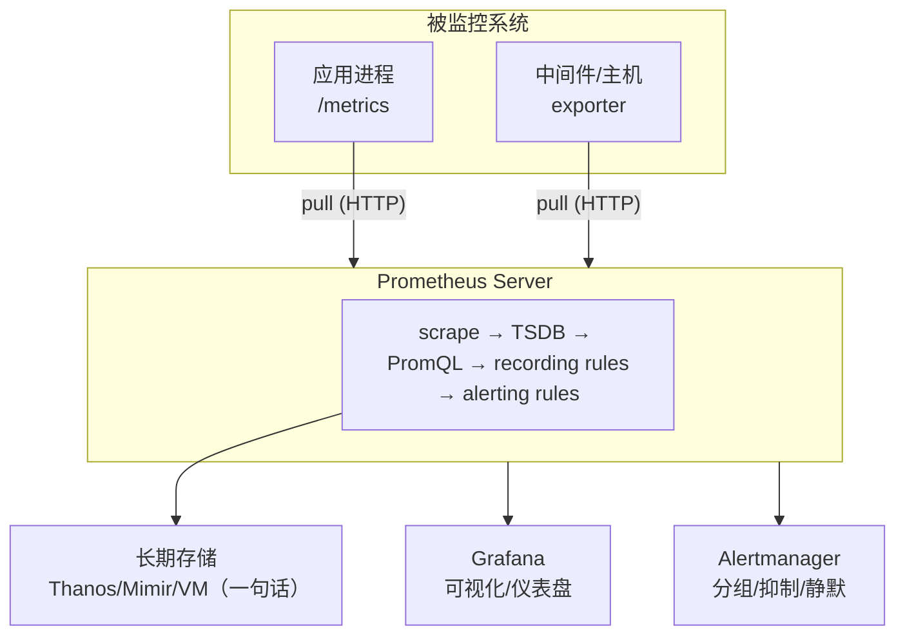

# 阶段 1 · 指标 Metrics（Prometheus + Grafana）

> 本阶段是可观测性三大支柱的第一站：**指标（Metrics）**。
> 指标回答的是"**系统现在怎么样？**"——它是低成本的数值时间序列，适合做趋势分析、容量规划与告警。
> 学完本阶段，你应当能够：读懂 `/metrics`、写出常用的 PromQL、为应用设计 RED 指标、搭出 Grafana 仪表盘并配置告警。

## 学习目标

- [ ] 理解 Prometheus 拉模型架构与核心组件（Server / Target / Service Discovery / TSDB / Alertmanager）
- [ ] 掌握 Prometheus 数据模型：metric name + labels + 四种指标类型
- [ ] 熟练使用 PromQL：rate、聚合、histogram_quantile、join、subquery
- [ ] 会用 exporter 与 client library 完成埋点（node_exporter / blackbox / 应用内 RED 指标）
- [ ] 能用 Grafana 做出可读性好的仪表盘（面板选型、变量联动、dashboard as code）
- [ ] 能设计"可操作"的告警规则并正确配置 Alertmanager（grouping / inhibition / silence / routing）

## 笔记索引（建议按序阅读）

| # | 笔记 | 主题 | 关键词 |
| --- | --- | --- | --- |
| 1 | [prometheus-architecture.md](prometheus-architecture.md) | Prometheus 架构 | 拉模型、scrape、TSDB、retention、生态组件 |
| 2 | [data-model.md](data-model.md) | 数据模型与指标类型 | labels、时间序列、counter/gauge/histogram/summary、native histogram、exemplars |
| 3 | [promql.md](promql.md) | PromQL 详解 | rate/irate/increase、聚合、histogram_quantile、join、subquery、recording rules |
| 4 | [exporters.md](exporters.md) | Exporter 与应用埋点 | node_exporter、blackbox_exporter、中间件 exporter、Go/Python client、RED、命名规范 |
| 5 | [grafana-visualization.md](grafana-visualization.md) | Grafana 可视化 | 数据源、面板选型、模板变量、阈值单位、provisioning |
| 6 | [grafana-deep-dive.md](grafana-deep-dive.md) | Grafana 进阶 | 配置体系与 HA、认证（OIDC/Service Account）、组织与权限模型、Explore 工作流、Transformations、统一告警 as code、插件 |
| 7 | [alerting.md](alerting.md) | 告警体系 | 规则语法、for、severity、Alertmanager 路由树、告警设计原则、SLO 告警预览 |
| 8 | [long-term-storage.md](long-term-storage.md) | 长期存储与水平扩展 | remote_write 与 external_labels、Thanos（Sidecar/Receive 两种 HA + 去重）、VictoriaMetrics（单二进制/MetricsQL）、Mimir（多租户集群）、降采样成本交易、选型决策树 |

## 配套实验

- **lab01：从零搭一套指标监控** —— [labs/lab01-prometheus-grafana/](../../labs/lab01-prometheus-grafana/README.md)

  示例应用埋点（Python + prometheus-client）→ Prometheus 抓取 → Grafana 可视化 → 告警规则 + Alertmanager。
  podman compose 一键启动，包含 QPS / 错误率 / p99 延迟 / 资源使用率四类面板与两条可触发的告警。

## 本阶段知识地图

## 与其他阶段的衔接

- **向上（阶段 0）**：如果"可观测性 vs 监控"还不清晰，先回看概念笔记——指标擅长回答**预定义问题**，日志与链路擅长**探索未知根因**。
- **向右（阶段 2/3）**：日志与链路追踪。注意 metrics 的标签设计（低基数）与日志字段、trace 属性的命名对齐。
- **向后（阶段 4）**：exemplars 把指标与 trace 关联起来；SLO 告警基于本阶段的错误率/p99 查询进阶为多窗口、多燃烧率告警。
- **向下（进阶）**：知识地图右下角的"长期存储 Thanos/Mimir/VM"只是预告——保留期/高可用/全局查询的完整突破路线见 [long-term-storage.md](long-term-storage.md)。

## 参考资料（权威入口）

- Prometheus 官方文档：<https://prometheus.io/docs/introduction/overview/>（访问日期：2026-11-04）
- Prometheus 数据模型：<https://prometheus.io/docs/concepts/data_model/>（访问日期：2026-11-04）
- PromQL 官方文档：<https://prometheus.io/docs/prometheus/latest/querying/basics/>（访问日期：2026-11-04）
- metric 类型与命名最佳实践：<https://prometheus.io/docs/practices/naming/>（访问日期：2026-11-04）
- exporter 与 client library 列表：<https://prometheus.io/docs/instrumenting/exporters/>（访问日期：2026-11-04）
- Grafana 文档：<https://grafana.com/docs/grafana/latest/>（访问日期：2026-11-04）
- Alertmanager 文档：<https://prometheus.io/docs/alerting/latest/alertmanager/>（访问日期：2026-11-04）
- Google SRE Book 第 6 章《监控分布式系统》：<https://sre.google/sre-book/monitoring-distributed-systems/>（访问日期：2026-11-04）

## 附：ASCII 图替换清单

| 原 ASCII 图位置（章节标题） | 原图内容简述 | 替换结果 |
| --- | --- | --- |
| 本阶段知识地图 | 被监控系统 → Prometheus Server → Grafana / Alertmanager / 长期存储 | flowchart TD |
