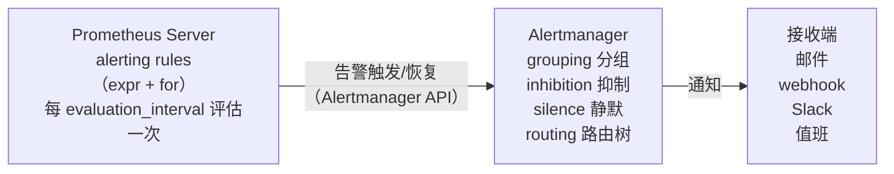
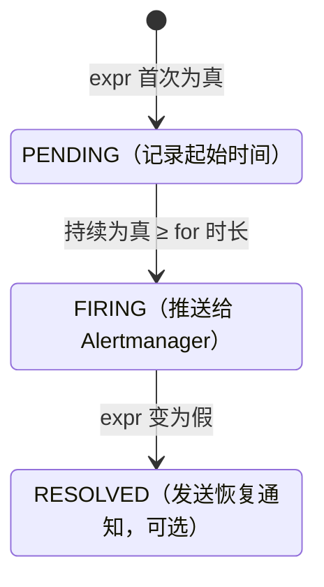

# 告警体系：规则 + Alertmanager + 设计原则

> 告警是指标的"最后一步价值"：让正确的人在正确的时间做正确的事。
> 本篇讲 Prometheus 告警规则语法（expr / for / labels / annotations）、severity 分级、
> Alertmanager 四大机制（grouping / inhibition / silence / routing）与完整配置示例，
> 最后总结告警设计原则与 SLO 告警的关系（细节留到阶段 4）。

## 1. 告警的两半：规则在 Prometheus，路由在 Alertmanager



职责切分的意义：

- **Prometheus 只负责"判定"**：表达式为真即 pending → 持续 for → firing；恢复时发 resolved。
- **Alertmanager 负责"通知策略"**：谁收、怎么分组、何时抑制、何时静默、发到哪个渠道。规则可以重启重建，通知策略独立演进。

## 2. 告警规则语法详解

### 2.1 完整示例（lab01 实际使用的规则）

```yaml
# alert_rules.yml —— 由 prometheus.yml 的 rule_files 加载
groups:
  - name: http.alerts            # 规则组：组内规则按序评估（默认与全局 evaluation_interval 同步）
    interval: 30s                # 组级评估间隔（可选，覆盖全局）
    rules:
      - alert: HighErrorRate
        expr: |
          sum by (job) (rate(http_requests_total{status=~"5.."}[5m]))
            / sum by (job) (rate(http_requests_total[5m])) > 0.05
        for: 2m                  # 持续满足 2 分钟才 firing（pending → firing）
        labels:
          severity: critical     # 附加到告警实例上的标签（参与路由匹配！）
          team: backend
        annotations:
          summary: "{{ $labels.job }} 错误率过高"
          description: "{{ $labels.job }} 5xx 比例 {{ $value | humanizePercentage }}（>5%，持续 2 分钟）"
          runbook_url: "https://wiki.example.com/runbook/high-error-rate"

      - alert: HighLatencyP99
        expr: |
          histogram_quantile(0.99,
            sum by (job, le) (rate(http_request_duration_seconds_bucket[5m]))) > 1
              # ↑ 注意保留 job：sum by (le) 会把 job 聚合掉，
              #   下面 summary 里的 {{ $labels.job }} 将渲染为空字符串
        for: 5m
        labels:
          severity: warning
        annotations:
          summary: "{{ $labels.job }} p99 延迟超 1s"
          description: "当前 p99 = {{ $value | humanize }} 秒"
```

### 2.2 四个组成部分

| 字段 | 作用 | 要点 |
| --- | --- | --- |
| `alert` | 告警名 | 命名"症状"而非原因：`HighErrorRate` ✓，`CpuHigh` ✗（那是维度不是症状） |
| `expr` | PromQL，返回向量 | **每个非空序列 = 一个告警实例**（firing per label 组合） |
| `for` | pending 持续时长 | 省略则一满足立即 firing |
| `labels` / `annotations` | 附加信息 | labels 参与路由/抑制匹配；annotations 只做展示 |

### 2.3 pending vs firing（for 的状态机）



`for` 的价值：**过滤瞬时抖动**。错误率尖峰 30 秒内自动恢复的，不该吵醒任何人；持续 2 分钟才是真问题。`for` 的代价是告警延迟，所以核心链路用短 for（1~2m）+ 平滑窗口（[5m]），非核心用长 for。

### 2.4 模板变量与函数

- `$labels.<name>`：告警实例的标签（含 expr 结果标签 + 规则 labels）。
- `$value`：触发值。
- 常用管道：`{{ $value | humanize }}`（0.944 → 0.944）、`{{ $value | humanizePercentage }}`（0.05 → 5%）、`{{ $value | humanizeDuration }}`（秒 → 1m 30s）、`query "expr"` 函数（在 annotation 里嵌套查询，慎用，每次评估都执行）。

### 2.5 必配的"元告警"

```yaml
- alert: TargetDown                 # 目标不可达（每实例一条）
  expr: up == 0
  for: 1m
  labels: {severity: critical}
  annotations:
    summary: "{{ $labels.job }}/{{ $labels.instance }} 抓取失败"

- alert: PrometheusRuleEvalFailures # 规则评估失败（元监控）
  expr: increase(prometheus_rule_evaluation_failures_total[5m]) > 0

- alert: PrometheusNotificationsError  # 投递 Alertmanager 失败（元监控）
  expr: rate(prometheus_notifications_errors_total[5m]) > 0
```

**监控系统的可用性也要被监控**（meta-monitoring）——Alertmanager 挂了没人知道是运维事故。生产上常用第二个 Prometheus（或 Uptime 外部探测）盯主链路。

## 3. severity 分级

分级是路由与响应策略的输入，常用三级：

| severity | 含义 | 响应 | 通知渠道 | for 建议 |
| --- | --- | --- | --- | --- |
| `critical` | 用户可见影响/资损：服务不可用、错误率雪崩、证书过期 | 立即响应（值班电话/PagerDuty） | 电话/高优 IM | 1~2m |
| `warning` | 趋势恶化、冗余降级：单实例挂、磁盘 80%、p99 缓慢上涨 | 工作时间处理 | IM/邮件 | 5~15m |
| `info` | 无需动作、留档观察：流量突增提示、配置变更记录 | 不响应 | 低频渠道/只进库 | — |

约定：**severity 写进规则 labels**，Alertmanager 路由按 `severity` 分流。如果一条告警"没有任何人需要为它行动"，它应该是 info 或 dashboard，而不是 warning。

## 4. Alertmanager 架构与四大机制

### 4.1 完整配置示例（含全部四大机制）

```yaml
# alertmanager.yml —— lab01 使用同款结构
global:
  resolve_timeout: 5m          # 告警源停止重发多久后视为 resolved

route:                          # 路由树根节点：每条告警自上而下匹配
  receiver: default             # 兜底接收器（所有未匹配的走这里）
  group_by: ['alertname', 'job']     # ① 分组键：同键的告警合并成一封通知
  group_wait: 30s               # 首次通知前等待（让同组告警聚齐）
  group_interval: 5m            # 同组新告警的追加通知间隔
  repeat_interval: 4h           # firing 告警的重发间隔
  routes:                       # 子路由（数组，逐个匹配，continue=false 则首个命中即停）
    - matchers:
        - severity =~ "critical|warning"
      receiver: ops-im
      group_wait: 10s
      repeat_interval: 2h
      routes:
        - matchers:
            - severity = "critical"
          receiver: ops-oncall  # critical 打电话
    - matchers:
        - alertname = "Watchdog"
      receiver: watchdog       # 死信告警：常态 firing，收到=链路断了（反向心跳）
      repeat_interval: 5m

inhibit_rules:                  # ② 抑制：高严重度触发时，压制同源的低严重度
  - source_matchers:
      - severity = "critical"
    target_matchers:
      - severity = "warning"
    equal: ['alertname', 'job']   # 仅当这些标签相等时抑制

receivers:
  - name: default
    email_configs: ...
  - name: ops-im
    webhook_configs:
      - url: http://app:8000/webhook/alerts   # lab01：打到演示 webhook（路由见 app.py 的 POST /webhook/alerts）
  - name: ops-oncall
    webhook_configs:
      - url: http://oncall.example.com/api/critical
  - name: watchdog
    webhook_configs:
      - url: http://app:8000/watchdog
```

### 4.2 Grouping（分组）：对抗告警风暴的第一道闸

- **为什么**：某服务 50 个实例同时挂，`TargetDown` 产生 50 条告警实例 → 不分组 = 50 通电话。
- **怎么做**：`group_by: [alertname, job]` 把它们合成一条通知（列出 50 个 instance）。
- **三个计时器**：
  - `group_wait`：组的第一条告警到达后等 30s，等同伴到齐再发；
  - `group_interval`：已发过通知的组，新告警至少隔 5m 才追加；
  - `repeat_interval`：没有任何变化的 firing 组每 4h 重发一次。

### 4.3 Inhibition（抑制）

- **语义**：当 source（如 critical）告警存在时，**静默**匹配 target（如 warning）且 `equal` 标签相同的告警。
- **典型用法**：机器 down 时抑制其上所有进程级告警；机房断网时抑制该机房全部告警。
- 注意：抑制只影响**通知**，不删数据；equal 列表是"同源"判定的键，写错会误杀或失效。

### 4.4 Silence（静默）

- **场景**：计划内维护窗口，提前 2h 静默 `job=maintenance-target`，避免已知噪音。
- **操作**：UI（`http://localhost:9093`，v0.27+ 自带）或 `amtool silence add`；必须有**作者、理由、过期时间**（永不过期的静默是定时炸弹）。
- **API**：`POST /api/v2/silences`。静默与路由匹配语法一致（matchers）。

### 4.5 Routing（路由树）

- 语法要点：`routes[]` 数组按序匹配；默认**首个匹配即停**；`continue: true` 允许同时走多条分支（如同时进 IM 和归档库）。
- 匹配器新旧写法：`matchers: [severity = "critical"]`（新）；旧版 `match: {severity: critical}` 已弃用，看到老配置要认识。
- HA：Alertmanager 本身支持多副本 gossip 集群（`--cluster.peer`），Prometheus 配多个 alertmanager 地址即可实现"去重后的高可用"。lab01 单实例演示。

文档：<https://prometheus.io/docs/alerting/latest/configuration/>（访问日期：2026-11-04）

## 5. 告警设计原则（SRE 视角）

出自 Google SRE Book 第 6 章（<https://sre.google/sre-book/monitoring-distributed-systems/>，访问日期：2026-11-04）：

1. **面向症状（用户影响），不面向原因**：
   - 好：`HighErrorRate`（用户拿到 5xx）、`HighLatencyP99`（用户感觉慢）。
   - 差：`CpuUsageHigh`（CPU 高但用户可能毫无感知）。原因类指标放 dashboard，供定位用；症状类才配电话级告警。
2. **每条告警必须可操作（actionable）**：收到的人知道下一步做什么——写进 `runbook_url`。收到的第一反应是"关掉它"的告警，就是不该存在的告警。
3. **尽量避免 Noise（告警风暴）**：
   - 分组（group_by）聚合同源告警；
   - 抑制（inhibition）在重故障时压掉次生告警；
   - `for` + 平滑窗口过滤抖动；
   - 定期复盘告警：每周告警量、无人处理/秒关的告警清单，删掉或降级。
4. **症状优先级 = 用户影响广度 × 深度**：全站不可用 > 核心接口 p99 翻倍 > 边缘接口偶发错误 > 单实例重启（有冗余时不告警）。
5. **告警里带上下文**：summary 一句话定性，description 带数值与持续时间，runbook 给步骤。让人不用打开 Grafana 就能判断严重性。
6. **不要用告警做趋势通知**："流量创新高"是 dashboard/news，不是 page。

## 6. 与 SLO 告警的关系（预告阶段 4）

本阶段的阈值告警（错误率 > 5% 持续 2m）有个天然缺陷：**阈值从何而来**？"5%"为什么不是 3%？拍脑袋的阈值要么误报要么漏报。

SLO（Service Level Objective）把这个问题变成契约：

- 定义 SLI（如"请求成功率""p99 < 300ms"）与目标（99.9% 可用）；
- 错误预算 = 1 - SLO，量化"允许的不可用量"；
- 告警升级为**多窗口多燃烧率**（multi-window multi-burn-rate）：1h 烧掉 2% 预算 → 快速告警；6h 烧掉 5% → 慢速告警；
- 好处：告警直接对齐用户承诺，天然免疫"阈值拍脑袋"，错误预算耗尽驱动功能发布 vs 稳定性的决策。

本阶段把"如何写规则、如何路由"练熟，阶段 4 在同样的机制上换一层 SLI 表达式即可。

## 7. 告警规则也要写测试：promtool test rules

告警规则是"会打电话给人的代码"，上线前应当像代码一样做单元测试：

```yaml
# alert_rules_test.yml
rule_files:
  - alert_rules.yml          # 被测规则

evaluation_interval: 1m

tests:
  # 场景 1：错误率 10% 持续 2 分钟 → HighErrorRate 应 firing
  - interval: 1m
    input_series:
      - series: 'http_requests_total{job="api",status="500"}'
        values: '0+10x10'        # 每分钟 +10
      - series: 'http_requests_total{job="api",status="200"}'
        values: '0+90x10'        # 每分钟 +90 → 错误率恒 10%（10/(10+90)）
    alert_rule_test:
      - eval_time: 3m
        alertname: HighErrorRate
        exp_alerts:              # 期望 3 分钟时已 firing（t=1m 起 pending，for: 2m）
          # promtool 要求 exp_labels 与 exp_annotations 和实际**完全相等**：
          # 规则里附加的 team、以及全部 annotations 都要写全，漏一个测试就挂
          - exp_labels:
              severity: critical
              team: backend
              job: api
            exp_annotations:
              summary: "api 错误率过高"
              description: "api 5xx 比例 10%（>5%，持续 2 分钟）"
              runbook_url: "https://wiki.example.com/runbook/high-error-rate"

  # 场景 2：错误率 3%（低于 5%）→ 不应告警
  - interval: 1m
    input_series:
      - series: 'http_requests_total{job="api",status="500"}'
        values: '0+3x10'
      - series: 'http_requests_total{job="api",status="200"}'
        values: '0+97x10'
    alert_rule_test:
      - eval_time: 10m
        alertname: HighErrorRate
        exp_alerts: []           # 期望为空
```

```bash
promtool test rules alert_rules_test.yml
```

`values` 语法速记：`0+10x10` = 从 0 开始每步 +10 共 10 步；`0x10` = 恒 0；`stale` 表示序列消失。
CI 里把 `promtool check config` + `promtool test rules` 作为 PR 门禁，规则回归就再也不靠"上线试试"。

文档：<https://prometheus.io/docs/prometheus/latest/configuration/unit_testing_rules/>（访问日期：2026-11-04）

## 8. 告警排障速查表

| 症状 | 第一步查什么 |
| --- | --- |
| 指标明明异常却没告警 | Prometheus `/alerts`：规则是否加载（`/rules`）、expr 在 `/graph` 手跑是否非空 |
| 规则一直 PENDING 不 firing | for 期间表达式是否间歇为假（窗口抖动）→ 加大 rate 窗口或缩短 for |
| firing 了但没收到通知 | Alertmanager UI：告警是否到达 → 是否被静默（Silences 页）/ 抑制 / group_wait 未到 |
| 通知重复轰炸 | repeat_interval 是否过短；是否多副本 Alertmanager 未组集群导致重复 |
| 恢复通知没收到 | 对应 receiver 的 `send_resolved` 是否开启；resolve_timeout 是否过长 |
| 收到了但没人处理 | runbook 缺失或 severity 分级与值班策略脱节——回到设计原则第 2 条 |

## 9. 常见坑（FAQ）

1. **告警规则不加载**：`rule_files` 路径写错（容器内路径 vs 宿主路径）；改完没热加载（SIGHUP 或 `POST /-/reload`，且需启动参数 `--web.enable-lifecycle`）。用 `promtool check config prometheus.yml` 先校验。
2. **改了规则不生效**：规则组 interval 缓存；或 Prometheus 版本不支持某语法。UI `/rules` 页看加载状态与最近错误。
3. **for 填了但立即 firing**：表达式在 pending 期间曾短暂为假，状态机重置——窗口波动导致，加大 expr 内的 rate 窗口或加长 for。
4. **告警一直 firing 但没收到通知**：查 Alertmanager UI 的告警是否到达（没到达=网络/服务发现；到达未发=被分组等待、被抑制、被静默，或路由没匹配到接收器）。
5. **恢复通知没发**：`send_resolved` 默认 false（部分集成）；Prometheus 停止重发后 Alertmanager 按 `resolve_timeout` 判 resolved。
6. **annotation 模板报错**：`$labels.xxx` 访问了不存在的标签 → 空串不报错但 summary 缺信息；复杂模板先在 `/alerts` 页预览渲染结果。
7. **抑制误伤**：`equal` 写了过多标签，同源判定太严（suppress 不生效）或太松（把无关 warning 全压了）。从 `['alertname', 'job']` 起步。
8. **静默忘了过期时间**：永远生效的 silence 会掩盖真实故障；规定 silence 必须 < 24h 并写理由。
9. **Alertmanager 单点**：它挂了所有告警黑洞。生产至少双副本 + Prometheus `alerting.alertmanagers` 配多个地址。
10. **把告警阈值画在面板却与规则不一致**：面板红线 10%，规则触发 20%——人机不一致。数值一处定义（注释互链或用 label 携带）。

## 10. 面试题小结

1. **Q：Prometheus 与 Alertmanager 各自负责什么？为什么要分开？**
   A：Prometheus 评估规则判定 pending/firing/resolved；Alertmanager 负责去重、分组、抑制、静默与路由。分开让"判定逻辑"与"通知策略"独立演进，且 Alertmanager 可做 HA 集群而不动监控侧。
2. **Q：`for` 的作用与状态机？**
   A：表达式为真先进入 pending，连续为真达到 for 时长才 firing；期间一旦为假即重置。用于过滤瞬时抖动，代价是告警时延。
3. **Q：group_wait / group_interval / repeat_interval 分别控制什么？**
   A：首次通知前的聚合等待 / 已通知组追加新告警的最小间隔 / firing 组无变化时的重发间隔。
4. **Q：inhibition 和 silence 的区别？**
   A：inhibition 是配置化的自动规则（critical 存在时压掉同源 warning）；silence 是人工临时静默（维护窗口），带过期时间。
5. **Q：如何设计一条好的告警？**
   A：面向用户可见症状而非内部原因；带 severity 分级与 runbook；for+平滑窗口防抖；确保可操作——每条告警都应有人、有动作。
6. **Q：什么是告警风暴？如何系统性防止？**
   A：大量同源告警同时触发淹没值班。对策：grouping 聚合、inhibition 级联抑制、for 过滤、根因（TargetDown）优先、SLO 化收敛症状数量、周期性清理低价值告警。
7. **Q：Watchdog/死信告警是干什么的？**
   A：一条永远 firing 的特殊告警直通专用接收端，接收端发现它"停止到达"即说明告警链路断了——用告警监控告警系统。
8. **Q：SLO 告警相对阈值告警的优势？**
   A：阈值来自用户契约（错误预算）而非拍脑袋；多窗口燃烧率同时兼顾快速发现与低误报；告警语义直接是"预算在燃烧"，可操作性强。

## 11. 参考资料

- Alerting 概览（规则与 Alertmanager 分工）：<https://prometheus.io/docs/alerting/latest/overview/>（访问日期：2026-11-04）
- 告警规则语法：<https://prometheus.io/docs/prometheus/latest/configuration/alerting_rules/>（访问日期：2026-11-04）
- Alertmanager 配置（route/grouping/inhibition/silence）：<https://prometheus.io/docs/alerting/latest/configuration/>（访问日期：2026-11-04）
- 通知模板：<https://prometheus.io/docs/alerting/latest/notifications/>（访问日期：2026-11-04）
- Google SRE Book 第 6 章（告警哲学）：<https://sre.google/sre-book/monitoring-distributed-systems/>（访问日期：2026-11-04）
- Alerting on SLOs（SLO 告警预告）：<https://sre.google/workbook/alerting-on-slos/>（访问日期：2026-11-04）

## 附：ASCII 图替换清单

| 原 ASCII 图位置（章节标题） | 原图内容简述 | 替换结果 |
| --- | --- | --- |
| 1. 告警的两半：规则在 Prometheus，路由在 Alertmanager | Prometheus Server → Alertmanager → 接收端的告警链路（含告警触发/恢复、通知边标注） | flowchart LR |
| 2.3 pending vs firing（for 的状态机） | PENDING/FIRING/RESOLVED 三状态迁移及触发条件 | stateDiagram-v2 |
