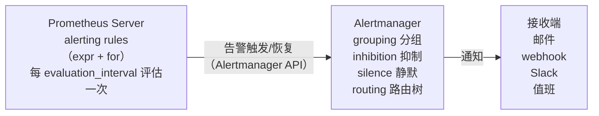
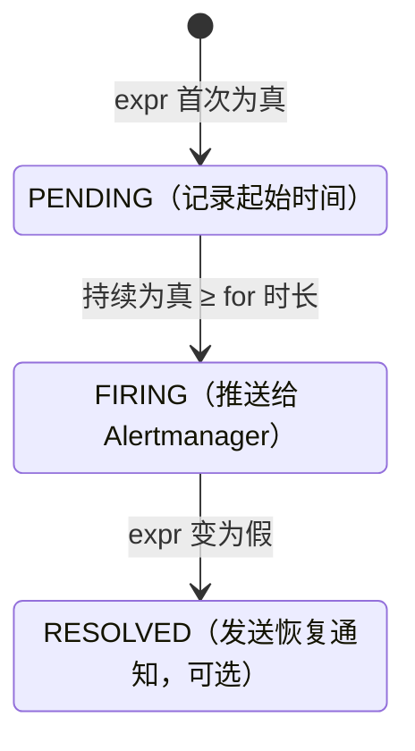

# 7. 告警体系：规则 + Alertmanager + 设计原则

> 告警是指标的"最后一步价值"：让正确的人在正确的时间做正确的事。
> 本篇讲 Prometheus 告警规则语法（expr / for / labels / annotations）、severity 分级、
> Alertmanager 四大机制（grouping / inhibition / silence / routing）与完整配置示例，
> 最后总结告警设计原则与 SLO 告警的关系（细节留到阶段 4）。

## 1. 告警的两半：规则在 Prometheus，路由在 Alertmanager



职责切分的意义：

- **Prometheus 只负责"判定"**：表达式为真即 pending → 持续 for → firing；恢复时发 resolved。
- **Alertmanager 负责"通知策略"**：谁收、怎么分组、何时抑制、何时静默、发到哪个渠道。规则可以重启重建，通知策略独立演进。

## 2. 告警规则语法详解

### 2.1 完整示例（lab01 实际使用的规则）

```yaml
# alert_rules.yml —— 由 prometheus.yml 的 rule_files 加载
groups:
  - name: http.alerts            # 规则组：组内规则按序评估（默认与全局 evaluation_interval 同步）
    interval: 30s                # 组级评估间隔（可选，覆盖全局）
    rules:
      - alert: HighErrorRate
        expr: |
          sum by (job) (rate(http_requests_total{status=~"5.."}[5m]))
            / sum by (job) (rate(http_requests_total[5m])) > 0.05
        for: 2m                  # 持续满足 2 分钟才 firing（pending → firing）
        labels:
          severity: critical     # 附加到告警实例上的标签（参与路由匹配！）
          team: backend
        annotations:
          summary: "{{ $labels.job }} 错误率过高"
          description: "{{ $labels.job }} 5xx 比例 {{ $value | humanizePercentage }}（>5%，持续 2 分钟）"
          runbook_url: "https://wiki.example.com/runbook/high-error-rate"

      - alert: HighLatencyP99
        expr: |
          histogram_quantile(0.99,
            sum by (job, le) (rate(http_request_duration_seconds_bucket[5m]))) > 1
              # ↑ 注意保留 job：sum by (le) 会把 job 聚合掉，
              #   下面 summary 里的 {{ $labels.job }} 将渲染为空字符串
        for: 5m
        labels:
          severity: warning
        annotations:
          summary: "{{ $labels.job }} p99 延迟超 1s"
          description: "当前 p99 = {{ $value | humanize }} 秒"
```

### 2.2 四个组成部分

| 字段 | 作用 | 要点 |
| --- | --- | --- |
| `alert` | 告警名 | 命名"症状"而非原因：`HighErrorRate` ✓，`CpuHigh` ✗（那是维度不是症状） |
| `expr` | PromQL，返回向量 | **每个非空序列 = 一个告警实例**（firing per label 组合） |
| `for` | pending 持续时长 | 省略则一满足立即 firing |
| `labels` / `annotations` | 附加信息 | labels 参与路由/抑制匹配；annotations 只做展示 |

### 2.3 pending vs firing（for 的状态机）



`for` 的价值：**过滤瞬时抖动**。错误率尖峰 30 秒内自动恢复的，不该吵醒任何人；持续 2 分钟才是真问题。`for` 的代价是告警延迟，所以核心链路用短 for（1~2m）+ 平滑窗口（[5m]），非核心用长 for。

### 2.4 模板变量与函数

- `$labels.<name>`：告警实例的标签（含 expr 结果标签 + 规则 labels）。
- `$value`：触发值。
- 常用管道：`{{ $value | humanize }}`（0.944 → 0.944）、`{{ $value | humanizePercentage }}`（0.05 → 5%）、`{{ $value | humanizeDuration }}`（秒 → 1m 30s）、`query "expr"` 函数（在 annotation 里嵌套查询，慎用，每次评估都执行）。

### 2.5 必配的"元告警"

```yaml
- alert: TargetDown                 # 目标不可达（每实例一条）
  expr: up == 0
  for: 1m
  labels: {severity: critical}
  annotations:
    summary: "{{ $labels.job }}/{{ $labels.instance }} 抓取失败"

- alert: PrometheusRuleEvalFailures # 规则评估失败（元监控）
  expr: increase(prometheus_rule_evaluation_failures_total[5m]) > 0

- alert: PrometheusNotificationsError  # 投递 Alertmanager 失败（元监控）
  expr: rate(prometheus_notifications_errors_total[5m]) > 0
```

**监控系统的可用性也要被监控**（meta-monitoring）——Alertmanager 挂了没人知道是运维事故。生产上常用第二个 Prometheus（或 Uptime 外部探测）盯主链路。

## 3. severity 分级

分级是路由与响应策略的输入，常用三级：

| severity | 含义 | 响应 | 通知渠道 | for 建议 |
| --- | --- | --- | --- | --- |
| `critical` | 用户可见影响/资损：服务不可用、错误率雪崩、证书过期 | 立即响应（值班电话/PagerDuty） | 电话/高优 IM | 1~2m |
| `warning` | 趋势恶化、冗余降级：单实例挂、磁盘 80%、p99 缓慢上涨 | 工作时间处理 | IM/邮件 | 5~15m |
| `info` | 无需动作、留档观察：流量突增提示、配置变更记录 | 不响应 | 低频渠道/只进库 | — |

约定：**severity 写进规则 labels**，Alertmanager 路由按 `severity` 分流。如果一条告警"没有任何人需要为它行动"，它应该是 info 或 dashboard，而不是 warning。

## 4. Alertmanager 架构与四大机制

### 4.1 完整配置示例（含全部四大机制）

```yaml
# alertmanager.yml —— lab01 使用同款结构
global:
  resolve_timeout: 5m          # 告警源停止重发多久后视为 resolved

route:                          # 路由树根节点：每条告警自上而下匹配
  receiver: default             # 兜底接收器（所有未匹配的走这里）
  group_by: ['alertname', 'job']     # ① 分组键：同键的告警合并成一封通知
  group_wait: 30s               # 首次通知前等待（让同组告警聚齐）
  group_interval: 5m            # 同组新告警的追加通知间隔
  repeat_interval: 4h           # firing 告警的重发间隔
  routes:                       # 子路由（数组，逐个匹配，continue=false 则首个命中即停）
    - matchers:
        - severity =~ "critical|warning"
      receiver: ops-im
      group_wait: 10s
      repeat_interval: 2h
      routes:
        - matchers:
            - severity = "critical"
          receiver: ops-oncall  # critical 打电话
    - matchers:
        - alertname = "Watchdog"
      receiver: watchdog       # 死信告警：常态 firing，收到=链路断了（反向心跳）
      repeat_interval: 5m

inhibit_rules:                  # ② 抑制：高严重度触发时，压制同源的低严重度
  - source_matchers:
      - severity = "critical"
    target_matchers:
      - severity = "warning"
    equal: ['alertname', 'job']   # 仅当这些标签相等时抑制

receivers:
  - name: default
    email_configs: ...
  - name: ops-im
    webhook_configs:
      - url: http://app:8000/webhook/alerts   # lab01：打到演示 webhook（路由见 app.py 的 POST /webhook/alerts）
  - name: ops-oncall
    webhook_configs:
      - url: http://oncall.example.com/api/critical
  - name: watchdog
    webhook_configs:
      - url: http://app:8000/watchdog
```

### 4.2 Grouping（分组）：对抗告警风暴的第一道闸

- **为什么**：某服务 50 个实例同时挂，`TargetDown` 产生 50 条告警实例 → 不分组 = 50 通电话。
- **怎么做**：`group_by: [alertname, job]` 把它们合成一条通知（列出 50 个 instance）。
- **三个计时器**：
  - `group_wait`：组的第一条告警到达后等 30s，等同伴到齐再发；
  - `group_interval`：已发过通知的组，新告警至少隔 5m 才追加；
  - `repeat_interval`：没有任何变化的 firing 组每 4h 重发一次。

### 4.3 Inhibition（抑制）

- **语义**：当 source（如 critical）告警存在时，**静默**匹配 target（如 warning）且 `equal` 标签相同的告警。
- **典型用法**：机器 down 时抑制其上所有进程级告警；机房断网时抑制该机房全部告警。
- 注意：抑制只影响**通知**，不删数据；equal 列表是"同源"判定的键，写错会误杀或失效。

### 4.4 Silence（静默）

- **场景**：计划内维护窗口，提前 2h 静默 `job=maintenance-target`，避免已知噪音。
- **操作**：UI（`http://localhost:9093`，v0.27+ 自带）或 `amtool silence add`；必须有**作者、理由、过期时间**（永不过期的静默是定时炸弹）。
- **API**：`POST /api/v2/silences`。静默与路由匹配语法一致（matchers）。

### 4.5 Routing（路由树）

- 语法要点：`routes[]` 数组按序匹配；默认**首个匹配即停**；`continue: true` 允许同时走多条分支（如同时进 IM 和归档库）。
- 匹配器新旧写法：`matchers: [severity = "critical"]`（新）；旧版 `match: {severity: critical}` 已弃用，看到老配置要认识。
- HA：Alertmanager 本身支持多副本 gossip 集群（`--cluster.peer`），Prometheus 配多个 alertmanager 地址即可实现"去重后的高可用"。lab01 单实例演示。

文档：<https://prometheus.io/docs/alerting/latest/configuration/>（访问日期：2026-11-04）

## 5. 告警设计原则（SRE 视角）

出自 Google SRE Book 第 6 章（<https://sre.google/sre-book/monitoring-distributed-systems/>，访问日期：2026-11-04）：

1. **面向症状（用户影响），不面向原因**：
   - 好：`HighErrorRate`（用户拿到 5xx）、`HighLatencyP99`（用户感觉慢）。
   - 差：`CpuUsageHigh`（CPU 高但用户可能毫无感知）。原因类指标放 dashboard，供定位用；症状类才配电话级告警。
2. **每条告警必须可操作（actionable）**：收到的人知道下一步做什么——写进 `runbook_url`。收到的第一反应是"关掉它"的告警，就是不该存在的告警。
3. **尽量避免 Noise（告警风暴）**：
   - 分组（group_by）聚合同源告警；
   - 抑制（inhibition）在重故障时压掉次生告警；
   - `for` + 平滑窗口过滤抖动；
   - 定期复盘告警：每周告警量、无人处理/秒关的告警清单，删掉或降级。
4. **症状优先级 = 用户影响广度 × 深度**：全站不可用 > 核心接口 p99 翻倍 > 边缘接口偶发错误 > 单实例重启（有冗余时不告警）。
5. **告警里带上下文**：summary 一句话定性，description 带数值与持续时间，runbook 给步骤。让人不用打开 Grafana 就能判断严重性。
6. **不要用告警做趋势通知**："流量创新高"是 dashboard/news，不是 page。

## 6. 与 SLO 告警的关系（预告阶段 4）

本阶段的阈值告警（错误率 > 5% 持续 2m）有个天然缺陷：**阈值从何而来**？"5%"为什么不是 3%？拍脑袋的阈值要么误报要么漏报。

SLO（Service Level Objective）把这个问题变成契约：

- 定义 SLI（如"请求成功率""p99 < 300ms"）与目标（99.9% 可用）；
- 错误预算 = 1 - SLO，量化"允许的不可用量"；
- 告警升级为**多窗口多燃烧率**（multi-window multi-burn-rate）：1h 烧掉 2% 预算 → 快速告警；6h 烧掉 5% → 慢速告警；
- 好处：告警直接对齐用户承诺，天然免疫"阈值拍脑袋"，错误预算耗尽驱动功能发布 vs 稳定性的决策。

本阶段把"如何写规则、如何路由"练熟，阶段 4 在同样的机制上换一层 SLI 表达式即可。

## 7. 告警规则也要写测试：promtool test rules

告警规则是"会打电话给人的代码"，上线前应当像代码一样做单元测试：

```yaml
# alert_rules_test.yml
rule_files:
  - alert_rules.yml          # 被测规则

evaluation_interval: 1m

tests:
  # 场景 1：错误率 10% 持续 2 分钟 → HighErrorRate 应 firing
  - interval: 1m
    input_series:
      - series: 'http_requests_total{job="api",status="500"}'
        values: '0+10x10'        # 每分钟 +10
      - series: 'http_requests_total{job="api",status="200"}'
        values: '0+90x10'        # 每分钟 +90 → 错误率恒 10%（10/(10+90)）
    alert_rule_test:
      - eval_time: 3m
        alertname: HighErrorRate
        exp_alerts:              # 期望 3 分钟时已 firing（t=1m 起 pending，for: 2m）
          # promtool 要求 exp_labels 与 exp_annotations 和实际**完全相等**：
          # 规则里附加的 team、以及全部 annotations 都要写全，漏一个测试就挂
          - exp_labels:
              severity: critical
              team: backend
              job: api
            exp_annotations:
              summary: "api 错误率过高"
              description: "api 5xx 比例 10%（>5%，持续 2 分钟）"
              runbook_url: "https://wiki.example.com/runbook/high-error-rate"

  # 场景 2：错误率 3%（低于 5%）→ 不应告警
  - interval: 1m
    input_series:
      - series: 'http_requests_total{job="api",status="500"}'
        values: '0+3x10'
      - series: 'http_requests_total{job="api",status="200"}'
        values: '0+97x10'
    alert_rule_test:
      - eval_time: 10m
        alertname: HighErrorRate
        exp_alerts: []           # 期望为空
```

```bash
promtool test rules alert_rules_test.yml
```

`values` 语法速记：`0+10x10` = 从 0 开始每步 +10 共 10 步；`0x10` = 恒 0；`stale` 表示序列消失。
CI 里把 `promtool check config` + `promtool test rules` 作为 PR 门禁，规则回归就再也不靠"上线试试"。

文档：<https://prometheus.io/docs/prometheus/latest/configuration/unit_testing_rules/>（访问日期：2026-11-04）

## 8. 告警排障速查表

| 症状 | 第一步查什么 |
| --- | --- |
| 指标明明异常却没告警 | Prometheus `/alerts`：规则是否加载（`/rules`）、expr 在 `/graph` 手跑是否非空 |
| 规则一直 PENDING 不 firing | for 期间表达式是否间歇为假（窗口抖动）→ 加大 rate 窗口或缩短 for |
| firing 了但没收到通知 | Alertmanager UI：告警是否到达 → 是否被静默（Silences 页）/ 抑制 / group_wait 未到 |
| 通知重复轰炸 | repeat_interval 是否过短；是否多副本 Alertmanager 未组集群导致重复 |
| 恢复通知没收到 | 对应 receiver 的 `send_resolved` 是否开启；resolve_timeout 是否过长 |
| 收到了但没人处理 | runbook 缺失或 severity 分级与值班策略脱节——回到设计原则第 2 条 |

## 9. 常见坑（FAQ）

1. **告警规则不加载**：`rule_files` 路径写错（容器内路径 vs 宿主路径）；改完没热加载（SIGHUP 或 `POST /-/reload`，且需启动参数 `--web.enable-lifecycle`）。用 `promtool check config prometheus.yml` 先校验。
2. **改了规则不生效**：规则组 interval 缓存；或 Prometheus 版本不支持某语法。UI `/rules` 页看加载状态与最近错误。
3. **for 填了但立即 firing**：表达式在 pending 期间曾短暂为假，状态机重置——窗口波动导致，加大 expr 内的 rate 窗口或加长 for。
4. **告警一直 firing 但没收到通知**：查 Alertmanager UI 的告警是否到达（没到达=网络/服务发现；到达未发=被分组等待、被抑制、被静默，或路由没匹配到接收器）。
5. **恢复通知没发**：`send_resolved` 默认 false（部分集成）；Prometheus 停止重发后 Alertmanager 按 `resolve_timeout` 判 resolved。
6. **annotation 模板报错**：`$labels.xxx` 访问了不存在的标签 → 空串不报错但 summary 缺信息；复杂模板先在 `/alerts` 页预览渲染结果。
7. **抑制误伤**：`equal` 写了过多标签，同源判定太严（suppress 不生效）或太松（把无关 warning 全压了）。从 `['alertname', 'job']` 起步。
8. **静默忘了过期时间**：永远生效的 silence 会掩盖真实故障；规定 silence 必须 < 24h 并写理由。
9. **Alertmanager 单点**：它挂了所有告警黑洞。生产至少双副本 + Prometheus `alerting.alertmanagers` 配多个地址。
10. **把告警阈值画在面板却与规则不一致**：面板红线 10%，规则触发 20%——人机不一致。数值一处定义（注释互链或用 label 携带）。

## 10. 面试题小结

1. **Q：Prometheus 与 Alertmanager 各自负责什么？为什么要分开？**
   A：Prometheus 评估规则判定 pending/firing/resolved；Alertmanager 负责去重、分组、抑制、静默与路由。分开让"判定逻辑"与"通知策略"独立演进，且 Alertmanager 可做 HA 集群而不动监控侧。
2. **Q：`for` 的作用与状态机？**
   A：表达式为真先进入 pending，连续为真达到 for 时长才 firing；期间一旦为假即重置。用于过滤瞬时抖动，代价是告警时延。
3. **Q：group_wait / group_interval / repeat_interval 分别控制什么？**
   A：首次通知前的聚合等待 / 已通知组追加新告警的最小间隔 / firing 组无变化时的重发间隔。
4. **Q：inhibition 和 silence 的区别？**
   A：inhibition 是配置化的自动规则（critical 存在时压掉同源 warning）；silence 是人工临时静默（维护窗口），带过期时间。
5. **Q：如何设计一条好的告警？**
   A：面向用户可见症状而非内部原因；带 severity 分级与 runbook；for+平滑窗口防抖；确保可操作——每条告警都应有人、有动作。
6. **Q：什么是告警风暴？如何系统性防止？**
   A：大量同源告警同时触发淹没值班。对策：grouping 聚合、inhibition 级联抑制、for 过滤、根因（TargetDown）优先、SLO 化收敛症状数量、周期性清理低价值告警。
7. **Q：Watchdog/死信告警是干什么的？**
   A：一条永远 firing 的特殊告警直通专用接收端，接收端发现它"停止到达"即说明告警链路断了——用告警监控告警系统。
8. **Q：SLO 告警相对阈值告警的优势？**
   A：阈值来自用户契约（错误预算）而非拍脑袋；多窗口燃烧率同时兼顾快速发现与低误报；告警语义直接是"预算在燃烧"，可操作性强。

## 11. 参考资料

- Alerting 概览（规则与 Alertmanager 分工）：<https://prometheus.io/docs/alerting/latest/overview/>（访问日期：2026-11-04）
- 告警规则语法：<https://prometheus.io/docs/prometheus/latest/configuration/alerting_rules/>（访问日期：2026-11-04）
- Alertmanager 配置（route/grouping/inhibition/silence）：<https://prometheus.io/docs/alerting/latest/configuration/>（访问日期：2026-11-04）
- 通知模板：<https://prometheus.io/docs/alerting/latest/notifications/>（访问日期：2026-11-04）
- Google SRE Book 第 6 章（告警哲学）：<https://sre.google/sre-book/monitoring-distributed-systems/>（访问日期：2026-11-04）
- Alerting on SLOs（SLO 告警预告）：<https://sre.google/workbook/alerting-on-slos/>（访问日期：2026-11-04）

## 附：ASCII 图替换清单

| 原 ASCII 图位置（章节标题） | 原图内容简述 | 替换结果 |
| --- | --- | --- |
| 1. 告警的两半：规则在 Prometheus，路由在 Alertmanager | Prometheus Server → Alertmanager → 接收端的告警链路（含告警触发/恢复、通知边标注） | flowchart LR |
| 2.3 pending vs firing（for 的状态机） | PENDING/FIRING/RESOLVED 三状态迁移及触发条件 | stateDiagram-v2 |

## 12. 工程三陷阱：for 抖动重置、模板空渲染、抑制失配

三个"配置看起来全对、行为却完全不对"的高频陷阱。每个都按触发场景、根因、规避三段展开，都可以在变更评审阶段提前拦住。

### 陷阱一：故障持续存在，告警却永远停在 PENDING

- **触发场景**：错误率在阈值附近来回穿越——5 分钟窗口的取值依次是 6%、4.8%、6%、4.9%、6%……规则阈值 5%、`for: 2m`、评估间隔 1m。按直觉"大部分时间是坏的，早该报了"，实际上这条告警从未 firing，故障持续了半小时却无人知晓。
- **根因**：`for` 状态机要求的是**连续**为真，不是累计为真；任何一次评估为假都把计时器清零。判定窗口太短（例如 `rate(...[1m])`）导致曲线贴着阈值抖动时，"连续 2 分钟为真"几乎不可能成立。
- **规避**：先让表达式平滑，再谈 for——判定窗口与 for 同量级或更长（for 2m 配 `rate[5m]` 是常见组合）；阈值不要贴着正常波动带的上沿画线；在 promtool 测试里写一条"抖动序列"用例（values 里交错真值与假值）锁住行为。治理顺序：窗口平滑是第一道防抖闸，for 只是最后一道。

### 陷阱二：告警发出去了，summary 里关键标签渲染成空

- **触发场景**：p99 告警的表达式写成 `histogram_quantile(0.99, sum by (le) (rate(...)))`——`le` 留下了，`job` 被聚合掉了。值班收到的通知是"p99 延迟超 1s"，却不知道是哪个服务，只能挨个面板点开找。
- **根因**：告警实例的标签集等于表达式结果向量的标签加上规则 labels；维度在聚合时丢失后，`{{ $labels.job }}` 自然取不到值。Go 模板访问不存在的标签返回空串而**不报错**，这类缺失不会在配置校验阶段暴露。
- **规避**：聚合时保留路由与展示所需的最小维度集（`by (job, le)`）；新规则上线前在 Prometheus 的 /alerts 页面看渲染后的 summary 与 description；对可能缺失的标签用 `{{ with }}` 分支加 `{{ else }}` 兜底文案。本篇 2.1 示例里 HighLatencyP99 旁边的那行注释，就是这个坑的现场记录。

### 陷阱三：抑制规则的 equal 键失配，风暴时形同虚设

- **触发场景**：一台宿主机宕机，其上 8 个 exporter 的 TargetDown 正常触发；但同机上层服务的 20 条 warning（HighErrorRate、HighLatencyP99 等）照样逐条轰炸值班群——明明配了"critical 抑制 warning"。
- **根因**：`inhibit_rules` 的生效条件是 source 与 target 同时存在，且 `equal` 列表中**所有标签取值相同**。若 equal 写了 `['alertname']`，TargetDown 与 HighErrorRate 的告警名永远不同，抑制永远不命中；反过来 equal 写得过宽（只留 cluster），又会把其他集群的无关 warning 一起误杀。
- **规避**：equal 放"同源标识"——机器级故障用 `instance` 或 `host`，机房级用 `cluster` 与 `zone`；每条抑制规则上线前构造一对真实实例，在 Alertmanager UI 里同时验证命中与不命中两侧；抑制关系按"基础设施层 → 业务层"单向设计，避免互相抑制成环。

路由与抑制的完整机制在同册 [alertmanager-in-depth.md](../04-integration/alertmanager-in-depth.md) 有专篇，本节只从陷阱视角点名最常失手的三个位置。

## 13. 手算配方：for 与评估间隔的触发时刻推演

"告警从坏到响要几分钟"由四个时间参数共同决定：表达式判定窗口、评估间隔、for、Alertmanager 的 group_wait。用一条时间线把它算清楚，比背概念快得多。

**设定**（示意参数）：评估间隔 1m；`for: 2m`；`group_wait: 30s`。表达式每分钟评估一次，结果序列如下：

| 评估时刻 t（分钟） | 1 | 2 | 3 | 4 | 5 | 6 | 7 | 8 |
| --- | --- | --- | --- | --- | --- | --- | --- | --- |
| 表达式取值 | 真 | 真 | 真 | 假 | 真 | 真 | 真 | 真 |

**逐步推演**：

1. t=1：表达式首次为真 → 进入 PENDING，ActiveSince 记为 t=1；
2. t=2：仍为真，持续 1 分钟（小于 for）→ 继续 PENDING；
3. t=3：连续为真达 2 分钟，满足 for → 转 FIRING，本次评估结束即推送 Alertmanager；
4. t=3 之后 30 秒：group_wait 到期 → 值班收到第一条通知；
5. t=4：表达式为假 → 状态回到 inactive（此前已 firing，会补发 resolved）；
6. t=5：重新为真 → 再次进入 PENDING，ActiveSince 重记为 t=5；
7. t=6 持续 1 分钟、t=7 持续 2 分钟 → t=7 再次 FIRING，第二条通知在 t=7 加 30 秒到达；
8. 假设故障在 t=8 后结束：值班共被吵两次。

**算术自验**：表达式为真的比例是 7/8 = 87.5%，但"连续为真且长度不小于 2 分钟"的区段只有 t=1 到 t=3 与 t=5 到 t=7 两段，通知次数由后者决定——这就是抖动序列的代价。最坏触发延迟 = 评估间隔 + for + group_wait = 1m + 2m + 30s = 3 分 30 秒（表达式恰在两次评估之间变真的情形）；最好情况 = for + group_wait = 2 分 30 秒。

**推论**（可直接抄进团队规范）：

- 要求"从坏到响"不超过 N 分钟时，参数必须满足评估间隔加 for 加 group_wait 不超过 N，三个数一起调；只压 for 一个是常见误区；
- 抖动治理的顺序：先加大表达式窗口让曲线变平滑，再把阈值挪离噪声带，最后才考虑加长 for；
- 复盘时单独统计"反复 resolved 又立刻 firing"的翻烙饼告警，它们是窗口配置不当的直接证据，优先重写表达式而不是改阈值。

想对判定窗口本身做系统复习，回到 [promql.md](promql.md) 的 rate 与聚合小节。

## 14. 决策速查表：告警参数怎么定

按"症状类型 → 判定窗口 → for → severity → 渠道"一条链定参数（基线为示意，按团队值班策略微调）：

| 症状 | 判定窗口 | for | severity | 渠道 |
| --- | --- | --- | --- | --- |
| 核心接口错误率 | rate [5m] | 1~2m | critical | 电话/值班 |
| 核心接口 p99 超标 | [5m] 分位数 | 5m | warning（持续恶化可升级） | IM 高优 |
| 单实例 down（有冗余） | up == 0 | 1m | warning | IM |
| 整个 job 不可用 | sum by (job) (up) == 0 | 1m | critical | 电话 |
| 磁盘将满 | predict_linear 外推 4 小时 | 30m | warning | IM |
| 证书即将过期 | 剩余有效期阈值（探针指标与 time() 之差） | — | warning（小于 7 天）/critical（小于 1 天） | IM |
| 流量突增或突降 | 与上周同比偏离 | 15m | info | 只进库不呼叫 |
| 通知投递失败 | notifications errors 速率 | 5m | critical（告警黑洞风险） | 电话 |
| 规则评估失败 | evaluation failures 增长 | 5m | warning | IM |

Alertmanager 侧的时间参数：

| 参数 | 建议起点 | 说明 |
| --- | --- | --- |
| group_wait | 默认 30s，critical 子路由 10s | 等同组同伴到齐；critical 少等 |
| group_interval | 5m | 已通知组的追加通知最小间隔 |
| repeat_interval | critical 1~2h，warning 4~8h | 太短轰炸、太长漏看 |
| 评估间隔 | 全局 30s~1m，核心规则组可单独调小 | 评估越密状态机越快，代价是评估负载 |

两条"显式决定不告警"的纪律：有冗余的单实例重启（已有 TargetDown 兜底）放 dashboard 不进路由树；趋势观察（流量缓慢上涨）用录制规则加 info 留档。判断标准回到第 5 节原则：每条进路由树的告警都必须能回答"谁、在什么时间窗内、要做什么"。阈值来源想契约化，转向 [slo.md](../04-integration/slo.md) 的多窗口燃烧率；事件升级与复盘流程见 [incident-response.md](../07-topics/incident-response.md)。

定完参数再做**联动自检三问**：一问延迟预算——评估间隔、for、group_wait 三者相加是否在承诺的"从坏到响"时限内（加法见第 13 节），只压其中一个参数是无效优化；二问通知频率——按历史触发频率估算每天的通知条数，超过团队忍耐线就调高阈值或延长 for 与 repeat_interval，而不是让值班学会忽略；三问恢复语义——send_resolved 是否开启、resolve_timeout 是否大于最长可能的恢复延迟，否则会出现"永远 firing 的僵尸告警"。三问的答案写进变更描述，评审按问逐条核对，参数打架的 PR 当场就能拦下。

## 15. code review 检查单（告警规则 PR）

- [ ] 表达式在 /graph 手跑过且结果非空，返回标签包含路由与模板所需的全部维度；
- [ ] alertname 面向症状命名（HighErrorRate 而非 CpuHigh），且全仓库唯一；
- [ ] for 与判定窗口量级匹配（窗口与 for 同量级或更长），变更说明里写明防抖依据；
- [ ] severity 写在规则 labels 中，对照路由树 matchers 走一遍能命中预期接收器；
- [ ] annotations 三件套齐全：summary 一句话定性、description 带当前值与持续时间、runbook_url 指向真实存在的页面；
- [ ] 聚合维度未引入高基数标签（user_id、trace_id 等不得出现在告警结果里）；
- [ ] 附带 promtool test rules 用例：至少一个触发场景与一个不触发场景，exp_labels 与 exp_annotations 写全；
- [ ] 涉及抑制或路由改动时，评估对既有告警通知量的影响（估算每天多发几条、发给谁）；
- [ ] 新增监控对象同时确认被元告警覆盖（TargetDown、规则评估失败、通知投递失败）；
- [ ] 变更描述回答三问：告警给谁、预期频率多少、误报时退路（阈值与 for 如何回调）。

十条全过再合入。评审时最值得花时间的是第三条与第七条——它们分别对应"上线后抖动不停"与"测试形同虚设"两类高频事故。配套实验的规则文件与验证流程见 [labs/lab01-prometheus-grafana/README.md](../../labs/lab01-prometheus-grafana/README.md)。

## 16. 反模式对照

这张表把前文零散提到的错误姿势收拢成一张对照清单，来源是真实的告警复盘记录——每一条都对应第 5 节设计原则里的某一条被违反。评审告警规则或值班制度时，拿左列逐行扫一遍，命中率通常超出预期。

| 反模式 | 典型表现 | 通常的成因 | 纠正动作 |
| --- | --- | --- | --- |
| 面向原因告警 | CPU 高、内存高就打电话，用户却毫无感知 | 指标好取、症状难定义，写原因比写症状省事 | 原因类指标下放 dashboard，只对用户可见症状配电话级（原则 1） |
| 无 for 直通 firing | 曲线抖一下电话就响 | 上线赶时间，把 for 当成可省的参数 | 全部规则强制 for 与平滑窗口，团队模板里写默认值 |
| 不配置分组 | 一次事故几十条独立通知轰炸值班群 | group_by 用了默认值从来没审过 | 按 alertname 加 job 分组，让同源告警合成一封 |
| 永不过期的静默 | 维护窗口结束后告警消失数月 | 图省事不填过期时间与理由 | 静默强制过期时间，例会过一遍活跃 silences 清单 |
| runbook 链接 404 | 描述里有链接，点开页面不存在 | 文档平台搬家没人同步 | runbook 与代码同仓同版本，CI 校验链接可达 |
| 面板与规则阈值不一致 | 图上红线 10%，实际 20% 才触发 | 面板和规则分头维护、各改各的 | 阈值单一来源（录制规则产出），面板与告警引用同一序列 |
| severity 全是 critical | 电话太多，值班开始习惯性忽略 | 没有分级标准，怕漏报全部拉满 | 按第 3 节三级表过一遍，critical 只留用户可见影响 |
| 抑制 equal 键随手写 | 要么把无关告警全压掉，要么根本压不住 | 从模板复制粘贴没理解同源判定语义 | equal 放同源标识标签，上线前用配对实例实测（第 12 节陷阱三） |
| 趋势通知进值班链路 | 流量创新高也打电话 | 分不清 news 与 page 的边界 | 趋势类进 dashboard 或 info 级留档，不进路由树（原则 6） |
| 告警当心跳用 | 靠某条业务告警"没响"判断系统活着 | 缺少正面的健康检查设计 | 用 Watchdog 死信告警做反向心跳（见 4.1 路由示例） |
| 通知渠道不分流 | critical 与 info 混在同一个群 | 路由树没按 severity 分层 | 子路由按严重度分流，info 只进库不进群 |
| 静默被当作修复 | 告警静默之后没人跟进根因 | 静默与工单系统脱节，处理状态无处可查 | 静默必须挂工单号，到期自动复核再决定续期或关闭 |
| 恢复通知被关掉 | resolved 不发送，没人知道故障何时结束 | 觉得恢复通知是噪音 | 关键接收器开启 send_resolved，恢复同样是排障信息 |

使用方法：季度告警复盘会上，把本季度触发过的告警逐条对到这张表上——能对上左列的，按第四列动作整改；对不上、又是新姿势的，经过讨论后加一行进来，让这张表随团队一起演化。它与第 15 节检查单配套使用：检查单守住单条规则的合入质量，反模式表守住整个告警体系的演化方向。如果两张表都执行了告警还是又多又吵，问题通常不在工具，而在没有明确的责任人对"这条告警该不该存在"签字——先把这个人定下来，再谈参数调优。

复盘会上建议固定统计三个数字：本周告警总量、其中无人做出任何动作的比例、被静默或秒关的比例。三个数都不设绝对目标值，只看趋势——连续几个周期上涨，说明规则质量在滑坡，按本表逐行归因；某个数字突然跳变，几乎总能对应到一次具体的变更（新服务接入、值班换班、路由改配置）。把"告警质量"当成和"服务延迟"一样的服务指标来经营，值班体验才会持续变好，而不是每换一批人就从头烂一遍。
