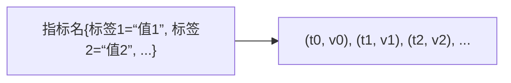

# Prometheus 数据模型与指标类型

> 一切 PromQL 都建立在数据模型之上。本篇讲清楚：指标名 + 标签如何唯一确定一条时间序列；
> 四种指标类型（counter / gauge / histogram / summary）各自的语义、适用场景与经典误区；
> 并逐行精读一份真实的 `/metrics` 输出，最后预览 exemplar 与 native histogram。

## 1. 数据模型：时间序列 = 指标名 + 标签集合

### 1.1 核心概念

Prometheus 把所有数据存为**时间序列（time series）**：



- **指标名（metric name）**：表达"度量什么"，如 `http_requests_total`。
- **标签（labels）**：表达"在哪个维度上度量"，如 `method="GET", handler="/api/orders"`。
- **样本（sample）**：一个 `<毫秒时间戳, float64 值>` 二元组，按时间顺序追加到序列尾部。
- **序列的唯一标识**：`指标名 + 全部标签的键值对`。**任何一个标签值不同，就是另一条完全独立的序列。**

```
http_requests_total{method="GET",status="200"}     ← 序列 A
http_requests_total{method="GET",status="500"}     ← 序列 B（status 不同）
http_requests_total{method="POST",status="200"}    ← 序列 C（method 不同）
```
<!-- 保留原图：三条不同标签序列的示例数据（exposition 样例），非示意图 -->

### 1.2 没有标签值 = 有标签值：空标签

`__name__` 是一个内建标签，存放指标名。`http_requests_total` 等价于 `{__name__="http_requests_total"}`。此外还有两个保留标签：

- `job`：来自抓取配置的 `job_name`，标记"这条数据来自哪组抓取任务"。
- `instance`：默认 `host:port`，标记"数据来自哪个被抓取端点"。

这两个标签由 Prometheus 抓取时自动附加，**天然区分了同一二进制部署在多实例上的数据**。

### 1.3 高基数（high cardinality）——理解标签的关键推论

既然标签值不同就是不同序列，那么：

| 标签设计 | 序列数量 |
| --- | --- |
| `status` ∈ {200, 404, 500} | 3 条 |
| `status` × `method` ∈ {GET, POST} | 6 条 |
| `user_id` ∈ {10,000 个用户} | 10,000 条 |
| `request_id`（每次请求唯一） | 无限增长，**事故** |

**经验法则**：标签取值必须有界且数量可控（一般几百以内）。user_id、email、session_id、全量 URL、IP+port 这类无界维度**绝对禁止**做标签——它们属于日志/链路的维度，Prometheus 里只会撑爆 TSDB。高基数治理在阶段 5 展开。

官方数据模型文档：<https://prometheus.io/docs/concepts/data_model/>（访问日期：2026-11-04）

## 2. 四种指标类型

注意：**类型是客户端（client library）层面的概念**。TSDB 只存浮点序列，类型决定了客户端如何计数/暴露，以及**你在 PromQL 里能用哪些函数**（例如 `rate()` 只对 counter 有意义）。

### 2.1 Counter（计数器）：只增不减的累计值

**语义**：从进程启动开始的累计计数，只允许增加或**归零重启**（进程重启后从 0 重新计数）。

**典型用途**：请求数、错误数、完成任务数、收发字节数。

**关键认知**：counter 的绝对值几乎没意义（取决于进程活了多久），有意义的是**变化率**——这正是 `rate()` / `increase()` 存在的原因（见 PromQL 笔记）。

```python
from prometheus_client import Counter
c = Counter('http_requests_total', 'HTTP 请求总数', ['method', 'status'])
c.labels(method='GET', status='200').inc()      # +1
c.labels(method='GET', status='500').inc(1)
```

### 2.2 Gauge（仪表盘）：可增可减的瞬时值

**语义**：任意时刻的当前状态值，可升可降。

**典型用途**：内存占用、并发连接数、队列长度、温度、开关状态（0/1）、"最近 N 分钟内是否有错误"。

```python
from prometheus_client import Gauge
q = Gauge('queue_length', '当前队列长度')
q.set(42)      # 直接设值
q.inc(); q.dec(3)
```

**注意**：gauge 不能用 `rate()`（它可能下降，rate 语义会错乱）。看趋势用 `avg_over_time` / `max_over_time` / `delta` 类函数（PromQL 没有 `delta()` 对任意 gauge 的官方函数，趋势请用 `deriv()` 或 `*_over_time` 系列）。

### 2.3 Histogram（直方图）：把观测值装进桶

**语义**：对每个观测值（如请求耗时），把它放进**预定义的累积桶**里，同时暴露观测总和与观测次数。客户端暴露的不是一个序列，而是一组序列：

- `<name>_bucket{le="上界"}`：观测值 `<= le` 的累计次数（**cumulative，累积**！）
- `<name>_sum`：所有观测值之和
- `<name>_count`：观测次数（等价 `_bucket{le="+Inf"}`）

```python
from prometheus_client import Histogram
h = Histogram('http_request_duration_seconds', '请求耗时(秒)',
              ['method'],
              buckets=(0.005, 0.01, 0.025, 0.05, 0.1, 0.25, 0.5, 1, 2.5, 5, 10))
h.labels(method='GET').observe(0.042)   # 落进 le=0.05（及所有更大的桶）
```

**le 与 cumulative 语义（必须刻进 DNA）**：

```text
http_request_duration_seconds_bucket{le="0.1"}  120   # <= 0.1s 的请求有 120 个
http_request_duration_seconds_bucket{le="0.5"}  200   # <= 0.5s 的有 200 个
http_request_duration_seconds_bucket{le="1"}    230   # <= 1s    的有 230 个
http_request_duration_seconds_bucket{le="+Inf"} 240   # 总共 240 个
```
<!-- 保留原图：histogram 累积桶计数的示例输出，非示意图 -->

- `le="0.5"` 的 200 **包含了** `le="0.1"` 的 120（累积，不是区间计数）。
- `_bucket{le="+Inf"}` 恒等于 `_count`。
- 桶边界在**客户端定义时写死**，部署后改桶需要发版。
- 分位数（p99 等）由 `histogram_quantile()` 在**查询端**从桶内插值估算——所以 histogram 支持事后聚合（先 sum 各实例的桶，再算分位数），这是它相对 summary 的决定性优势。

### 2.4 Summary（摘要）：客户端预计算分位数

**语义**：客户端在进程内滑动窗口上直接计算分位数并暴露**结果值**（不是桶）：

```text
http_request_duration_seconds{quantile="0.5"}  0.023   # 客户端算好的 p50
http_request_duration_seconds{quantile="0.9"}  0.078   # p90
http_request_duration_seconds_sum  150.2
http_request_duration_seconds_count 1000
```
<!-- 保留原图：summary 指标（quantile/sum/count）示例输出，非示意图 -->

**quantile（分位数）语义**：`quantile="0.9"` 表示 90% 的观测值小于等于该值。

**为什么 summary 不能跨实例聚合**：分位数在数学上**不可平均**——两个实例各自 p90 的平均值不是全局 p90（正确做法是合并全部观测值重算）。而客户端只暴露了结果值、没暴露分布，查询端无法"合并重算"。因此多实例场景下 summary 只能逐实例看，或对 `_sum/_count` 求平均得到均值（不是分位数）。

### 2.5 Histogram vs Summary 全面对比

| 维度 | Histogram | Summary |
| --- | --- | --- |
| 分位数计算位置 | 查询端（`histogram_quantile`） | 客户端（预先配置 quantile 列表） |
| 桶/分位数可变性 | 查询时任选分位数（受桶粒度限制） | 只能得到客户端预定义的那几个分位数 |
| **可聚合性** | **可**（桶先 sum 再算分位数） | **不可**（分位数不可平均） |
| 服务端成本 | 序列多（桶数 × 标签组合） | 序列少 |
| 精度 | 桶内线性插值，受桶宽影响 | 客户端精确计算（窗口内） |
| 桶边界调整 | 改查询无需改代码；改桶需发版 | 改分位数列表需发版 |
| 典型选择 | **默认选它**（多实例、要聚合） | 单实例进程内监控、精确分位数 |

官方建议与详细对比：<https://prometheus.io/docs/concepts/metric_types/>、<https://prometheus.io/docs/practices/histograms/>（访问日期：2026-11-04）

### 2.6 Native Histogram（原生直方图）简介

经典 histogram 每个桶是一条序列，桶一多序列爆炸；且桶边界固定。**Native histogram（Prometheus 2.40 引入实验，3.x 逐步稳定）** 把整个直方图存为**单个样本**（稀疏桶 + 指数桶边界按需增长）：

- 一个直方图 = 一条序列，存储与传输成本大幅下降；
- 桶边界无需预定义，客户端自动适应观测值范围；
- `histogram_quantile` 可直接对其计算，聚合语义不变；
- 需要客户端与 Prometheus 双端开启（客户端 `--enable-native-histograms` 类选项，服务端 `--enable-feature=native-histograms`）。

本阶段了解概念即可，实战仍以经典 histogram 为主。参考：<https://prometheus.io/docs/concepts/metric_types/#histogram>（访问日期：2026-11-04）

## 3. /metrics 文本格式逐行精读

这是 lab01 中示例应用的真实输出（做了删节），逐行注释。完整格式规范见 OpenMetrics / Prometheus exposition format：<https://prometheus.io/docs/instrumenting/exposition_formats/>（访问日期：2026-11-04）

```text
# ===== 1. HELP：一行人类可读说明（每个指标组最多一条） =====
# HELP http_requests_total HTTP 请求总数
# ===== 2. TYPE：声明指标类型，帮助读代码的人与部分工具识别语义 =====
# TYPE http_requests_total counter
# ===== 3. counter：注意标签展开成多行，每行一条序列 =====
http_requests_total{method="GET",status="200"} 1027
http_requests_total{method="GET",status="500"} 3
http_requests_total{method="POST",status="200"} 415
# ↑ 数值 1027 是自进程启动的累计值；没有时间戳 = 抓取时刻的时间戳（推荐做法）

# ===== 4. gauge：当前值 =====
# HELP queue_length 当前队列长度
# TYPE queue_length gauge
queue_length 5

# ===== 5. 进程默认指标（client library 自动暴露，前缀 process_）=====
# HELP process_resident_memory_bytes 常驻内存字节数
# TYPE process_resident_memory_bytes gauge
process_resident_memory_bytes 3.4492416e+07    # ≈ 34MB，float 科学计数法合法
# HELP process_start_time_seconds 进程启动时间(UNIX 秒)
# TYPE process_start_time_seconds gauge
process_start_time_seconds 1.762262401e+09     # 可用来计算 uptime / 重启检测

# ===== 6. histogram：一组序列，le 是累积语义 =====
# HELP http_request_duration_seconds 请求耗时(秒)
# TYPE http_request_duration_seconds histogram
http_request_duration_seconds_bucket{method="GET",le="0.005"} 240
http_request_duration_seconds_bucket{method="GET",le="0.01"} 490
http_request_duration_seconds_bucket{method="GET",le="0.025"} 801
http_request_duration_seconds_bucket{method="GET",le="0.05"} 972
http_request_duration_seconds_bucket{method="GET",le="0.1"} 993
http_request_duration_seconds_bucket{method="GET",le="0.25"} 1001
http_request_duration_seconds_bucket{method="GET",le="0.5"} 1022
http_request_duration_seconds_bucket{method="GET",le="1"} 1029
http_request_duration_seconds_bucket{method="GET",le="2.5"} 1030
http_request_duration_seconds_bucket{method="GET",le="+Inf"} 1030
# ↑ 每个更大 le 的桶计数只增不减（累积）；le="+Inf" 恒等于 count
http_request_duration_seconds_sum{method="GET"} 21.756000000000004
http_request_duration_seconds_count{method="GET"} 1030
# ↑ sum/count 相除 = 平均耗时 21.756/1030 ≈ 21.1ms

# ===== 7. Go 运行时指标（Go client 自动暴露，Python 是 python_*）=====
# HELP go_goroutines 当前 goroutine 数量
# TYPE go_goroutines gauge
go_goroutines 63

# ===== 8. exemplar 预览：在序列值后附加 # {trace_id=...} =====
http_request_duration_seconds_bucket{method="GET",le="0.05"} 972 # {trace_id="abc123def456"} 0.041
# ↑ 格式：值 # {标签="值"} 精确观测值
# 作用：把"落在 0.05 桶里"这条统计与一条具体 trace 关联起来，
#      在 Grafana 里点击直方图数据点即可跳转到该 trace 的全链路详情。
# 需 OpenMetrics 格式（Prometheus 2.26+ 抓取时加 EnableOpenMetrics）。
# 细节留到阶段 4。
```
<!-- 保留原图：/metrics 端点真实输出的逐行精读（exposition 格式示例输出），非示意图 -->

**格式要点速记**：

1. 每行 = `指标名{标签} 值 [时间戳] [# {exemplar} 观测值]`。
2. `# HELP` / `# TYPE` 是注释型元数据，抓取端按组解析。
3. 值必须是 float64 文本（`1027`、`3.44e+07`、`NaN`、`+Inf` 均合法）。
4. 手写时间戳一般别用：Prometheus 默认拒收超过抓取时刻太久（或太未来）的样本，容易导致 `out of order` 或被丢弃。
5. 同一指标名的标签键集合必须一致（否则语义混乱、部分工具报错）。

## 4. 类型选择速查表

| 想度量的东西 | 类型 | 理由 |
| --- | --- | --- |
| 请求总数 / 错误数 | counter | 只增，rate 出 QPS |
| 当前连接数 / 队列长 | gauge | 瞬时可升降 |
| 请求耗时 / 响应大小 | **histogram** | 要分位数、要跨实例聚合 |
| 单进程内精确 p99（不聚合） | summary | 客户端精确计算 |
| 任务最后一次运行时间戳 | gauge（存 epoch 秒） | `time() - xxx` 得年龄 |
| 配额使用比例 | gauge（0~1） | 直接展示/告警 |
| 缓存命中率 | 两个 counter（hits / total） | 查询时算比值，**不要**在客户端算成 gauge 存 |

> 反模式：在客户端预计算比率（如直接暴露 `error_rate` gauge）。保留分子分母两个 counter，
> 查询端再 `rate(errors)/rate(total)`——这样任何时间窗口的比率都能事后算出来。

## 5. OpenMetrics 与 Prometheus 文本格式的差异

抓取端 Negotiation：客户端可同时支持两种格式，Prometheus 抓取时会带 `Accept` 头协商。差异速览：

| 维度 | Prometheus text format（0.0.4） | OpenMetrics |
| --- | --- | --- |
| 元数据 | `# HELP` / `# TYPE` | 增加 `# UNIT`；TYPE 行放在组尾（EOF 标记 `# EOF`） |
| counter 命名 | 惯例 `_total` | **强制** `_total`，且暴露 `_created` 辅助序列（进程内创建时间） |
| exemplar | 扩展语法（部分版本支持） | 一等公民，任何样本都可带 |
| 类型 | counter/gauge/histogram/summary | 增加 `gaugehistogram`（gauge 语义的直方图）、`info`、`unknown` |
| 生态 | 所有旧工具兼容 | 向 OpenTelemetry / 主流 client 收敛的标准（CNCF sandbox 项目） |

实践建议：新项目用 client library 默认输出即可（Go 1.12+ / Python 的 OpenMetrics 支持按协商切换），无需手工操心；
自写 exporter 时若要 exemplar，必须走 OpenMetrics（Prometheus 抓取侧 `EnableOpenMetrics: true` 的 `http_client_config` 或 client 默认协商）。

规范原文：<https://github.com/OpenObservability/OpenMetrics/blob/main/specification/OpenMetrics.md>（访问日期：2026-11-04）

## 6. 识别指标类型：拿到陌生指标怎么判断

TSDB 不存类型，但你可以从名字与行为推断（排障/接手别人的系统时非常有用）：

1. **看后缀**：`_total` → counter（`_sum`/`_count`/`_bucket` 是 histogram/summary 的伴生序列）。
2. **看斜率**：对序列跑 `increase(x[1h])`，返回合理正数 → counter；返回 0 或负 → gauge。
3. **看伴生序列**：`x_bucket{le=...}` 存在 → histogram；`x{quantile=...}` 存在 → summary。
4. **看 TYPE 注释**：`curl` 一下 /metrics，`# TYPE` 行是客户端声明的"官方答案"（手拼文本可能缺失）。
5. **Go/Python client 的默认指标前缀**：`process_*`（进程资源）、`go_*` / `python_*`（运行时）、`http_*`（常见中间件），大多 gauge/counter，不影响使用但要知道来源。

## 7. 常见坑（FAQ）

1. **counter 看起来"偶尔变小"**：进程重启归零，这是合法行为。`rate()` 内置了对手动重启（counter reset）的检测（两侧样本都按"新起点"外推），所以**永远对 counter 用 rate/increase，不要用减法**。
2. **gauge 求 rate**：得到的是无意义甚至为负的速率。gauge 的"一段时间内变化"用 `increase()` 也能算但语义可疑；趋势用 `avg_over_time` / `max_over_time` / `min_over_time`。
3. **histogram 桶边界不含你的 SLA**：如果 SLA 是 300ms，最好让桶边界恰好有 0.3（如 0.1/0.3/1），否则直方图插值会落在含糊区间。
4. **summary 分位数跨实例 sum/avg**：数学错误。要么逐实例看，要么改用 histogram。
5. **`_total` 后缀缺失**：counter 按惯例应以 `_total` 结尾（OpenMetrics 强制），缺失会让部分工具/告警规则混淆类型。
6. **单位不统一**：全仓库统一用**秒和字节**（base unit），不要毫秒/MB 混用，单位只放进指标名（`_seconds`、`_bytes`）。Grafana 端负责友好显示换算。
7. **把 trace_id/request_id 塞进标签**：高基数炸弹，见 1.3。
8. **浮点值写成了带引号的字符串**：exposition 格式里数值不能加引号，加了是解析错误。

## 8. 面试题小结

1. **Q：一条时间序列由什么唯一确定？**
   A：指标名（`__name__`）+ 全部标签键值对。任何标签不同即是不同序列。
2. **Q：counter 和 gauge 的本质区别？rate() 为什么只能用于 counter？**
   A：counter 只增（重启归零），gauge 任意变化。rate 假设序列单调递增并对重启做外推补偿；对会下降的 gauge 计算 rate 会得出错误速率。
3. **Q：histogram 的 le 是什么语义？为什么要累积而不是区间计数？**
   A：`le` = "less than or equal"，该桶计数所有 <= le 的观测值，累积分布。累积形式让任意桶差可算区间计数，且支持直接跨实例相加后插值求分位数（区间计数相加后无法还原分布）。
4. **Q：为什么 histogram 可聚合而 summary 不可？**
   A：histogram 暴露的是**分布（桶）**，分布可以先相加再算分位数；summary 暴露的是**已算好的分位数结果**，分位数不可平均，无法从结果恢复分布。
5. **Q：p99 是怎么从 histogram 算出来的？精确吗？**
   A：`histogram_quantile(0.99, sum by (le)(rate(..._bucket[5m])))`——找到覆盖 99% 观测的桶，在桶内做线性插值。不精确，受桶宽影响，是估计值。
6. **Q：`_sum` 和 `_count` 有什么用？**
   A：`sum/count` = 平均观测值；`rate(_sum)/rate(_count)` 得到的同样是平均观测值（且对进程重启导致的 counter 归零更稳健），两者通常一致；`rate(_sum)` **单独**用才是每秒吞吐速率（字节类的 bytes/sec）。
7. **Q：native histogram 解决了什么问题？**
   A：把整条直方图存为单样本（稀疏指数桶），序列数与存储大幅下降，且无需预定义桶边界。
8. **Q：exemplar 是什么？解决什么问题？**
   A：附着在 histogram 桶样本上的 `{trace_id=...}` 元数据 + 精确观测值，把统计点与具体 trace 关联，实现"从指标下钻到链路"。
9. **Q：OpenMetrics 相比 Prometheus 文本格式多了什么？**
   A：强制 counter `_total`、`# UNIT` 元数据、`# EOF` 结束标记、exemplar 一等公民、info/gaugehistogram 新类型；由 client 在抓取协商时自动切换。

## 9. 参考资料

- 数据模型：<https://prometheus.io/docs/concepts/data_model/>（访问日期：2026-11-04）
- 指标类型：<https://prometheus.io/docs/concepts/metric_types/>（访问日期：2026-11-04）
- Histograms 与分位数（官方实践）：<https://prometheus.io/docs/practices/histograms/>（访问日期：2026-11-04）
- Exposition formats（含 exemplar/OpenMetrics）：<https://prometheus.io/docs/instrumenting/exposition_formats/>（访问日期：2026-11-04）
- 命名最佳实践：<https://prometheus.io/docs/practices/naming/>（访问日期：2026-11-04）

## 附：ASCII 图替换清单

| 原 ASCII 图位置（章节标题） | 原图内容简述 | 替换结果 |
| --- | --- | --- |
| 1.1 核心概念 | 指标名+标签集合 到 时间戳-值样本序列 的映射 | flowchart LR |

### 保留说明

| 位置 | 内容 | 保留原因 |
| --- | --- | --- |
| 1.1 核心概念 | 三条不同标签序列的示例数据 | exposition 样例数据，非示意图 |
| 2.3 Histogram（le 与 cumulative 语义） | le 累积桶计数示例 | 指标示例输出，非示意图 |
| 2.4 Summary | quantile/sum/count 示例输出 | 指标示例输出，非示意图 |
| 3. /metrics 文本格式逐行精读 | /metrics 端点真实输出 | exposition 格式示例输出，非示意图 |
