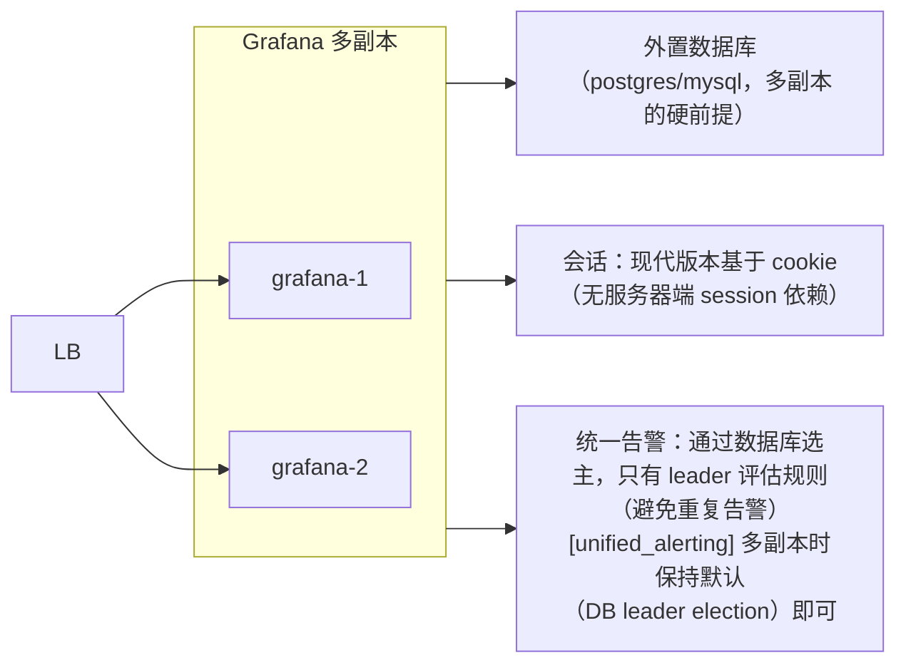
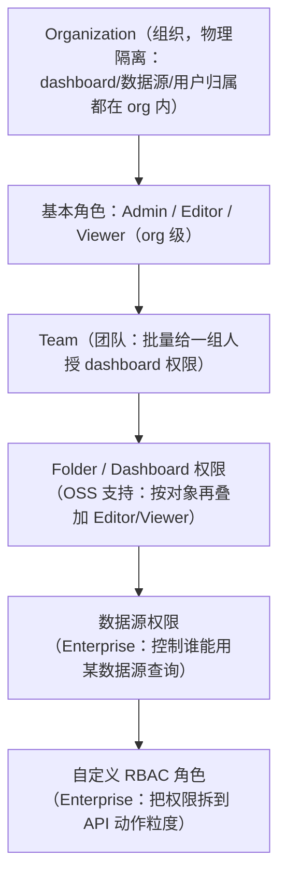
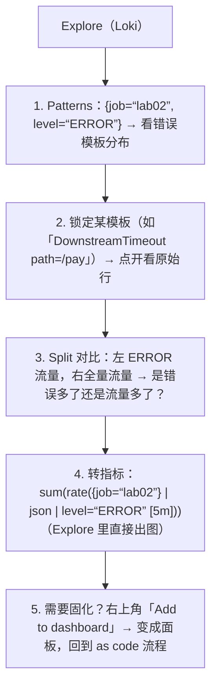

# Grafana 进阶：配置、认证与权限、Explore、Transformations、Alerting as Code

> [grafana-visualization.md](grafana-visualization.md) 讲"怎么画好一块面板"（使用者视角）；
> 本篇讲"**怎么把 Grafana 当成一个生产系统来运营**"（管理员与进阶用户视角）：
> 配置体系与优先级、多副本 HA、认证（OAuth/LDAP/Service Account）、组织与权限模型、
> Explore 排障工作流、Transformations 数据加工、统一告警的 provisioning 化、插件与升级。
> 实验环境仍是 [lab01](../../labs/lab01-prometheus-grafana/README.md) /
> [lab02](../../labs/lab02-loki-vector-logging/README.md)（本篇命令均可对照执行）。

## 目录

1. [配置体系：ini / 环境变量 / flag 三层覆盖](#1-配置体系ini--环境变量--flag-三层覆盖)
2. [常用配置项速查（server / database / security / users / unified_alerting）](#2-常用配置项速查)
3. [多副本 HA 与运维（升级 / 备份）](#3-多副本-ha-与运维升级--备份)
4. [认证：从匿名到 OIDC，以及 Service Account](#4-认证从匿名到-oidc以及-service-account)
5. [组织 / 团队 / 权限模型](#5-组织--团队--权限模型)
6. [Explore：为排障而生的交互面](#6-explore为排障而生的交互面)
7. [Transformations：查询之后的第二道加工厂](#7-transformations查询之后的第二道加工厂)
8. [面板进阶：repeat / data links / annotations](#8-面板进阶repeat--data-links--annotations)
9. [Unified Alerting as Code：provisioning 全套](#9-unified-alerting-as-codeprovisioning-全套)
10. [插件体系与生态](#10-插件体系与生态)
11. [常见坑（进阶向）](#11-常见坑进阶向)
12. [面试题小结](#12-面试题小结)
13. [参考资料](#13-参考资料)

---

## 1. 配置体系：ini / 环境变量 / flag 三层覆盖

Grafana 全部行为由一份 `grafana.ini`（或 `custom.ini`）描述，覆盖优先级：


环境变量是最适合容器的形态（无文件挂载、密钥走 secret）：

```yaml
# compose / k8s 里最常见的一组
environment:
  GF_SERVER_ROOT_URL: "https://grafana.example.com"   # 对外地址：邮件链接、OAuth 回跳、分享链接全靠它
  GF_SECURITY_ADMIN_USER: admin
  GF_SECURITY_ADMIN_PASSWORD__FILE: /run/secrets/admin_pw   # 密钥支持 __FILE 后缀读文件
  GF_USERS_ALLOW_SIGN_UP: "false"                     # 关自注册（公网暴露的必备项）
  GF_DATABASE_TYPE: postgres
  GF_DATABASE_HOST: postgres:5432
  GF_DATABASE_NAME: grafana
  GF_DATABASE_USER: grafana
  GF_DATABASE_PASSWORD__FILE: /run/secrets/db_pw
```

**`GF_SECURITY_ADMIN_PASSWORD__FILE` 这种 `__FILE` 后缀**适合所有敏感字段——
避免密钥出现在进程列表（`docker inspect`）与编排文件里。

容器内 ini 位置：默认 `/usr/share/grafana/conf/defaults.ini`（**不要改**）+
`/etc/grafana/grafana.ini`（自定义入口）。lab01/lab02 用的是最简默认 + 环境变量，
生产环境应该把"非密钥配置"固化为一份受版本管理的 ini。

## 2. 常用配置项速查

| Section / Key | 作用 | 生产建议 |
|---|---|---|
| `[server] root_url` | 对外完整 URL | 反向代理/HTTPS 后**必配**，否则所有跳转与邮件链接坏掉 |
| `[server] serve_from_sub_path` | 挂子路径（如 example.com/grafana） | 与反代配置一致 |
| `[server] cookie_secure` `strict_transport_security` | HTTPS 安全头 | 公网必开 |
| `[database]` | sqlite3（默认）/ mysql / postgres | **多副本必须外置数据库**；单副本 sqlite 也建议定期备份文件 |
| `[database] migration_locking` | 启动时 schema 迁移加锁 | 保持默认 true，避免多副本同时迁移 |
| `[security] disable_initial_admin_creation` | 禁用 admin/admin 初始化 | 接管账户体系后开启 |
| `[security] disable_gravatar` / `allow_embedding` | 头像外联 / iframe 嵌入 | 内网安全要求高时关 embedding |
| `[users] allow_sign_up` / `auto_assign_org_role` | 自注册与默认角色 | 关自注册；默认角色给 Viewer |
| `[auth.anonymous]` | 匿名只读访问 | 大屏展示场景可开（org_role: Viewer），公网慎用 |
| `[auth.github]` `[auth.generic_oauth]` `[auth.ldap]` | 外部认证 | 见 §4 |
| `[dashboards] versions_to_keep` | dashboard 版本历史保留数 | 默认 20，团队协作频繁可调大 |
| `[dashboards] min_refresh_interval` | 面板刷新下限 | 防"5s 刷新打爆 Prometheus"的全局闸（配合数据源超时） |
| `[unified_alerting] enabled` | 统一告警子系统 | 多副本注意选主（§3） |
| `[metrics] basic_auth_username/password` | 自身 /metrics 的保护 | 让 Prometheus 抓 Grafana 也走认证 |
| `[logging] level` / `[log.console]` | 日志级别 | 排障时 `debug`，平时 `info`/`warn` |
| `[plugins] allow_loading_unsigned_plugins` | 允许未签名插件 | 只在隔离测试环境开 |

> Grafana 自身也该被监控：`/metrics` 暴露 `grafana_http_request_duration_seconds_*`、
> `grafana_api_dataproxy_request_all_seconds_*`（数据源代理延迟，判断"Grafana 慢还是数据源慢"）等。

## 3. 多副本 HA 与运维（升级 / 备份）

### 3.1 HA 拓扑

Grafana 是**准无状态**应用，多副本只有两个共享点：



- SQLite **不能**支撑多副本（文件数据库）；切 postgres/mysql 是水平扩展第一步；
- dashboard 修改即时写库，副本间无缓存一致性问题（读时查库）；
- 长查询无粘性要求，LB 随机分配即可。

### 3.2 升级路径

1. **逐 minor 版本升级**（9.3 → 9.5 → 10.x → …），不要跨大版本直接跳；
2. 启动时自动跑 DB 迁移（`migration_locking` 保证单副本执行），**升级前备份数据库**；
3. 大版本常伴随 breaking changes：面板 schema、插件 API、provisioning 格式、
   认证默认值——读官方 `breaking-changes` 文档后再动生产；
4. 有条件先在测试环境导入生产 DB 快照演练一次。

### 3.3 备份什么

| 内容 | 位置 | 说明 |
|---|---|---|
| 数据库 dump | pg_dump / mysqldump | dashboard、用户、告警规则、数据源全在里面 |
| provisioning 目录 | /etc/grafana/provisioning + dashboard JSON | 本身已版本化（Git），与 DB 里的"手工资产"互补 |
| 插件目录 | /var/lib/grafana/plugins | 离线环境重装时需要 |

**治理原则**：凡能 provisioning 的都走 Git（数据源、dashboard、告警、文件夹），
数据库里只留"临时探索资产"——灾备就简化为"重建容器 + 挂载 Git 产物"。

## 4. 认证：从匿名到 OIDC，以及 Service Account

### 4.1 认证方式全景

| 方式 | 配置 | 场景 |
|---|---|---|
| 内置账号 | admin 初始化 + 手工创建 | 实验（lab01/lab02） |
| **OIDC / OAuth2**（generic_oauth） | 对接 Keycloak/Okta/Auth0/企业 IdP | **生产首选** |
| GitHub / GitLab / Google | `[auth.github]` 等 | 小团队快捷方式 |
| LDAP / AD | `[auth.ldap]` + `ldap.toml` | 传统企业内网 |
| SAML | Enterprise 许可 | 大企业合规 |
| 匿名 | `[auth.anonymous]` | 只读大屏 |

OIDC 最小可用配置（以 Keycloak 为例）：

```ini
[auth.generic_oauth]
name = Keycloak
enabled = true
client_id = grafana
client_secret = __REDACTED__
scopes = openid profile email
auth_url = https://idp.example.com/realms/dev/protocol/openid-connect/auth
token_url = https://idp.example.com/realms/dev/protocol/openid-connect/token
api_url  = https://idp.example.com/realms/dev/protocol/openid-connect/userinfo
; 角色映射：从 ID token 的 claim 里用 JMESPath 提取
role_attribute_path = "contains(groups[*], 'oncall') && 'Admin' || contains(groups[*], 'dev') && 'Editor' || 'Viewer'"
allow_sign_up = true          # 首登自动建账号
auto_assign_org_role = Viewer # 无角色 claim 时的兜底
```

`role_attribute_path` 是身份体系与 Grafana 权限的**桥**：返回 `Admin/Editor/Viewer`
（或自定义角色名）。上面这句的语义：oncall 组 → Admin，dev 组 → Editor，其余 Viewer。

### 4.2 机器账户：Service Account 取代 API Key

一切自动化（CI 导入 dashboard、Terraform、curl 脚本）都需要"非人类账号"：

- **API Key（旧）**：单一固定权限字符串，无过期、无主体概念，官方已标记废弃方向；
- **Service Account（9.x+，正道）**：有名字/团队的"账号"，可挂多个 **token**，
  token 可设过期时间、单独吊销、按角色限权、审计日志可区分"谁的服务干的"。

```bash
# UI: Administration → Service accounts → Add service account (role: Admin)
#     → Add service account token（记下只显示一次的 token）

curl -H "Authorization: Bearer <sa-token>" \
  http://localhost:3000/api/search?query=Lab02
# Terraform/CI 里一律用它，不再创建长期 API key
```

注意：Service Account token 走 `Authorization: Bearer`；旧 API key 走 `Authorization: Bearer <key>`（形似但主体不同）——迁移时脚本只换字符串即可。

## 5. 组织 / 团队 / 权限模型

Grafana 的授权层级从粗到细：



要点：

1. **组织是硬隔离**。跨 org 看不到对方任何资产；同一个人可属于多 org（通过
   `X-Grafana-Org-Id` header/API 切换）。用 org 隔离"生产/演示"或"甲方 A/甲方 B"，
   团队内部分权**不要**用 org（切来切去体验差），用文件夹权限；
2. **文件夹是权限管理的单位**，不是单个 dashboard：按团队建顶层文件夹
   （`team-platform/`、`team-app/`），权限挂在文件夹上，子 dashboard 继承；
3. **服务账号 + 团队组合**：给"CI 机器人"建团队，把某文件夹 Editor 权给该团队，
   token 轮换不动权限结构；
4. OSS 能做到"文件夹级 view/edit 精细授权"；**数据源级权限与自定义角色是 Enterprise**——
   OSS 环境的近似做法：把敏感数据源查询收进专用文件夹的 dashboard，用文件夹权限控范围。

## 6. Explore：为排障而生的交互面

Dashboard 面向"已知问题"（固化查询）；**Explore 面向"未知问题"（迭代式查询）**。
快捷键与交互值得形成肌肉记忆：

- `Alt+←/→` 在查询历史间跳转；查询历史按数据源保留（可星标常用查询）；
- **Split（拆分视图）**：同屏对比两个查询（如 error vs total、两个时间窗、甚至两个数据源）；
- **Explore 内直接换数据源**：同一时间范围下从 Prometheus 跳到 Loki/Tempo，
   时间上下文保留——这就是"指标 → 日志 → trace"下钻的入口（关联配置见
   [correlation.md §6](../04-integration/correlation.md#6-grafana-关联配置详解)）。

### 6.1 Loki 数据源在 Explore 里的四板斧

| 视图 | 干什么 | 什么时候用 |
|---|---|---|
| **Logs** | 原始日志流（`|=` `| json` 即时过滤） | 已知大概范围，翻日志找线索 |
| **Patterns** | 相似行自动归并成模板 + 频次 | 面对海量错误，先看"到底有哪几类"（比肉眼扫快一个数量级） |
| **Fields / Detected fields** | 解析出的字段列表 + 取值分布（点击即过滤） | 字段值探索（如 status 的分布、user_id 直方图） |
| **Detected labels / Label browser** | label 及其取值 | 先确认"有哪些流"再下钻（label 拼写错误的第一现场） |

新版 Grafana 把这套交互升级为独立的 **Drilldown apps**（如 Loki Drilldown：
服务 → 日志 → patterns 的导航式下钻），Explore 是它的底层引擎——概念不变：**先聚合看全貌（patterns/fields），再过滤看细节（logs）**。

### 6.2 一个 5 分钟排障动线（lab02 可复现）



## 7. Transformations：查询之后的第二道加工厂

当数据源查不出理想形状（跨两个指标算比率、重命名、过滤行）时，先想
**Transformations**（面板级、查询结果之后的无状态加工），而不是硬造查询。
常用速查：

| Transformation | 作用 | 典型场景 |
|---|---|---|
| **Join by field** | 按某字段把多个查询结果拼成宽表 | 错误数 ÷ 总数 = 错误率（见下例） |
| **Add field from calculation** | 对字段做算术/二元素运算 | 同上（join 之后做除法） |
| **Rename by regex** | 正则重命名序列名 | 把 `http_requests_total{path="/x"}` 整理成 `/x` |
| **Filter data by values** | 按值过滤行 | 只看 >0 的序列、排除总量行 |
| **Filter fields by name** | 丢掉不要的列 | 表格面板瘦身 |
| **Partition by values** | 按某列的值把一个 frame 拆成多个序列 | 把长表拆成多序列画图 |
| **Extract fields** | 从字符串/JSON 列里抽数据源 | 从日志模板提取字段 |
| **Convert field type** | 类型转换（字符串→时间等） | 数据源给了字符串时间戳 |
| **Format time** | 时间列格式化 | 表格展示 UTC/本地 |
| **Config from query results** | 用一个查询的值配置另一个面板 | 动态阈值线 |
| **Merge** | 合并多个查询的 field | 同面板多数据源拼表 |

### 7.1 实战一：错误率（两个查询 join 出比率）

数据源只有 `errors_total` 和 `requests_total` 两个 counter 时，不用 PromQL `or` 硬拼
（labels 不齐时 `/` 运算丢序列），Transformations 三步更稳：

```
Query A: sum(rate(http_requests_total{job=~"$job"}[$__rate_interval]))   → 序列名 "requests"
Query B: sum(rate(http_requests_total{job=~"$job",status=~"5.."}[$__rate_interval])) → "errors"

Transformations:
  1. Join by field: Time            # 按 Time 对齐成宽表
  2. Add field from calculation:
     Mode: Binary op,  errors / requests, 字段名 "error_ratio"
  3. Filter fields by name: 只留 Time, error_ratio
→ Unit 选 percentunit，一块干净的错误率面板
```
<!-- 保留原图：含 PromQL 查询表达式的 Transformation 操作步骤清单，表达式需一字不动，非概念示意图 -->

（两查询 label 完全对齐时 PromQL 一句除法仍是最优；join 方案的价值在
**label 不齐 / 跨数据源**时的鲁棒性。）

### 7.2 实战二：把 Loki 查询变成人读表格

```
Query: {job="lab02"} | json | level="ERROR" | line_format "{{.request_id}} · {{.event}} · {{.duration_ms}}ms"

Transformations:
  1. Extract fields（若 line 未拆列）
  2. Convert field type: duration_ms → Number
  3. Filter fields by name: 留 request_id, event, duration_ms
→ Table 面板 + Field override（duration_ms 右对齐、ms 单位）
```
<!-- 保留原图：含 LogQL 查询表达式的 Transformation 操作步骤清单，表达式需一字不动，非概念示意图 -->

**原则**：Transformations 是**展示层逻辑**，复杂业务逻辑仍应下沉到查询（PromQL/LogQL）
或录制规则——面板里摞七八个 transformation 的结果是没人看得懂它算了什么。

## 8. 面板进阶：repeat / data links / annotations

### 8.1 Repeat：一个面板 × 变量值 = N 块面板

面板设置里 `Repeat options → Repeat by variable`（选 multi 值变量如 `$service`），
Grafana 为每个值克隆一块面板（可按行/列排布）。**Row 也能 repeat**：
"每个服务一行、每行一套同构面板"的鲁棒型 dashboard 就是这么来的——比手工复制
N 份面板可维护得多（改一处，全部生效）。

### 8.2 Data links：数据点上挂跳转

面板级 `Data links` 把任意序列/点变成链接，支持模板变量：

- 指标序列 → `d/lqi-logs?orgId=1&var-service=${__field.labels.service}&from=${__from}&to=${__to}`
  （带上时间范围变量 `${__from}/${__to}`，跳转目标自动继承当前窗口）；
- Loki 日志行 → Tempo trace（内部机制是 derivedFields，见
  [correlation.md §6.2](../04-integration/correlation.md#62-loki-数据源logs--tracederivedfields)，
  data links 则是它的通用化手动版）。

### 8.3 Annotations：把"事件"画在时间轴上

- **手动标注**：任意 dashboard 上 `Ctrl/⌘+K` → Add annotation（值班交接时手工标记
  "这里发布了 v1.4.2"）；
- **查询型标注（自动化）**：Dashboard settings → Annotations → New，
   数据源选 Prometheus，查询 `ALERTS{alertstate="firing", severity=~"critical|warning"}`，
   告警区间直接以竖线叠加在所有面板上——**回看事故时序的利器**；
   也可查 Loki（如 `|= "deploy"` 把部署日志画上时间轴）；
- 也可用 `POST /api/annotations` 从 CI/CD 写入（发布、扩容、配置变更事件）。

## 9. Unified Alerting as Code：provisioning 全套

Grafana 统一告警（内置了告警评估引擎 + Alertmanager 功能）的最大质疑是
"规则存在数据库里不可 review"——**provisioning 正面解决它**：

```
/etc/grafana/provisioning/alerting/
├── rules.yaml            # 告警规则（groups）
├── contact-points.yaml   # 通知通道（webhook/邮件/钉钉…）
├── policies.yaml         # 路由树（谁收什么）
├── mute-timings.yaml     # 定时静默（如维护窗口）
└── templates.yaml        # 通知模板（Go template）
```
<!-- 保留原图：provisioning 目录结构清单，非概念示意图，Mermaid 无原生文件树类型 -->

### 9.1 规则文件（rules.yaml）

```yaml
apiVersion: 1
groups:
  - orgId: 1
    name: lab02-error-rate          # 规则组（同组共享 interval）
    folder: Lab02                   # UI 中归属的文件夹
    interval: 1m
    rules:
      - uid: lab02-error-ratio      # 稳定 uid：更新/迁移的幂等键
        title: 错误日志占比过高
        condition: C                # 以 refId=C 的节点为触发条件
        for: 10m                    # Pending → Alerting 的持续时间（与 Prometheus for 同义）
        noDataState: NoData         # NoData 时面板状态：Alerting/NoData/OK/KeepLast
        executionErrorState: Error  # 执行出错时的状态
        annotations:
          summary: "错误日志占比超 20% 持续 10 分钟"
          runbook_url: "https://wiki.example.com/runbooks/log-error-ratio"
        labels:
          severity: warning
          team: platform
        data:                       # 查询-降采样-阈值 三段流水线
          - refId: A                # 查询（Loki 数据源，LogQL 指标查询）
            relativeTimeRange: { from: 600, to: 0 }
            datasourceUid: loki     # 与数据源 provisioning 的 uid 对齐
            model:
              expr: 'sum(rate({job="lab02"} | json | level="ERROR" [5m])) / sum(rate({job="lab02"} [5m]))'
              instant: false
          - refId: B                # Reduce：把序列归纳成单值（last/avg/max…）
            datasourceUid: __expr__
            model: { type: reduce, expression: A, reducer: last }
          - refId: C                # Threshold：阈值判定
            datasourceUid: __expr__
            model: { type: threshold, expression: B, conditions: [{ evaluator: { params: [0.2], type: gt } }] }
```

结构化认知：一条 Grafana 告警规则 = **`data` 流水线**（A 查询 → B reduce → C threshold）
+ **状态机配置**（`for`/`noDataState`/`executionErrorState`）+ 元数据（labels/annotations）。
`noDataState` 是 Prometheus 告警没有的概念——**数据消失本身可作为一种告警**（NoData）。

> `model` 的完整 JSON 较繁琐，实用工作流：**在 UI 里把规则建好 → 用 API
> `GET /api/v1/provisioning/alert-rules` 导出 YAML → 入库**，此后在 Git 里改。

### 9.2 通知与路由（contact-points.yaml / policies.yaml）

```yaml
# contact-points.yaml
apiVersion: 1
contactPoints:
  - orgId: 1
    name: platform-webhook
    receivers:
      - uid: cp-platform-webhook
        type: webhook
        settings:
          url: http://dispatcher:8080/alert   # 转发到内部机器人/钉钉/飞书适配器
# policies.yaml —— 路由树：label 匹配 → receiver
apiVersion: 1
policies:
  - orgId: 1
    receiver: default-webhook          # 兜底
    group_by: [alertname, team]
    group_wait: 30s
    group_interval: 5m
    repeat_interval: 4h
    routes:
      - receiver: platform-webhook
        matchers: [team="platform"]
      - receiver: oncall-pager
        matchers: [severity="critical"]
        continue: false
```

语义与 Alertmanager 路由树同构（group_by/group_wait/matchers），迁移心智成本≈0。
区别：这是**每 org 一棵树**，且 mute timings（定时静默）与 silence 并存。

### 9.3 与 Prometheus 告警并存的原则

两套告警引擎并存时必须划清边界，否则重复告警 + 双份维护：

| 维度 | 归 Prometheus | 归 Grafana Unified Alerting |
|---|---|---|
| 纯指标阈值 | ✅（主力，规则 YAML 已 as code） | 可但没必要 |
| **跨数据源条件**（日志错误率、多源比值） | ❌ 做不到 | ✅ 唯一选择 |
| NoData/Error 状态细控 | 弱 | ✅ 原生 |
| 团队已有 Alertmanager 生态（静默/升级链） | ✅ | 通过转发接 Alertmanager |

实践（本工作区主线）：指标告警留在 Prometheus + Alertmanager（[alerting.md](alerting.md)）；
**当且仅当**告警条件需要 Loki 日志派生指标（或 NoData 语义）时进 Grafana，
并把 receiver 指向同一个 Alertmanager/机器人，统一去重与静默入口。

## 10. 插件体系与生态

- 三类插件：**数据源插件**（接入新后端）、**面板插件**（新可视化）、**App 插件**（整页应用）；
- 安装：`grafana cli plugins install <id>`（或镜像环境 `GF_INSTALL_PLUGINS` 环境变量），
  重启生效；**更新**同样走 cli，注意大版本插件 API 兼容性；
- **未签名插件**：默认拒绝加载，需 `[plugins] allow_loading_unsigned_plugins` 显式放行
  （供应链风险自负，隔离环境再开）；
- 离线环境：把插件 zip 解压到 `/var/lib/grafana/plugins/` 即可（plugin.json 声明签名校验）；
- 判断"要不要装"：面板能表达的数据形状（§4 选型表）覆盖不了的才找插件——
  多数"缺一张图"其实是缺一次数据变换（Transformations）或缺一个查询改写。

## 11. 常见坑（进阶向）

1. **`root_url` 不配**：反向代理后所有分享链接/OAuth 回跳都是 `localhost:3000`——
   上生产第一个要检查的配置；
2. **多副本 + SQLite**：文件锁冲突、数据漂移。水平扩展前先迁 postgres/mysql；
3. **升级跨大版本**：面板 schema/插件 API/deprecated 配置直接跳版本出的问题最难查，
   逐 minor 升；
4. **provisioning 与 UI 编辑打架**：provisioned 资产在 UI 只读，有人"图方便"手工复制一份
   修改——从此两份漂移。约定：**手工资产只放 scratch 文件夹**，正式资产一律 Git；
5. **告警规则 uid 漂移**：重新 provisioning 时 uid 变了 = 旧规则残留 + 新规则重复告警；
   uid 一旦定下不改名（改名=删旧建新，告警历史断链）；
6. **NoDataState 全默认 Alerting**：采集器重启期间一片"数据消失"告警——
   每条规则显式想清楚 NoData 该是 NoData 还是 Alerting；
7. **变量查询无权限**：变量 `label_values()` 走当前用户身份，Viewer 对数据源无权限时
   变量下拉为空（面板查询错、变量查询先错）——数据源权限排查先看变量；
8. **Transformations 掩盖查询问题**：join 兜住了本该在查询层解决的 label 不齐，
   数据形状变化时静默错位——join 面板要配"行数健康检查"（如另一块 raw 计数面板）；
9. **匿名访问 + 公网**：org_role: Viewer 仍是"能查所有该 org 数据源"，公网场景
   用独立只读 org + 专用受限数据源，而不是把主 org 匿名放出去。

## 12. 面试题小结

**Q1：Grafana 配置的三层覆盖顺序？容器里推荐哪种？**
A：flag > 环境变量（GF_SECTION_KEY）> ini > 默认值。容器推荐环境变量
（密钥用 `__FILE` 后缀读文件），非密钥配置固化进版本化的 ini，两者组合实现"配置即代码"。

**Q2：Grafana 怎么做高可用？**
A：准无状态 + 外置数据库（postgres/mysql）。会话基于 cookie 无服务器依赖；
统一告警多副本通过数据库选主，仅 leader 评估，避免重复告警。SQLite 只适合单副本。

**Q3：API Key 与 Service Account 的区别，为什么推荐后者？**
A：API Key 是无主体的固定字符串（无过期、不可细粒度授权、审计无法归属）；
Service Account 是真正的"机器账号"：可挂多 token、token 可过期/吊销、按角色限权、
计入审计。9.x 起官方推荐全部自动化场景迁移到 SA。

**Q4：Grafana 的权限模型分几层？OSS 与 Enterprise 的边界在哪？**
A：Org（硬隔离）→ 基本角色（Admin/Editor/Viewer）→ Team → 文件夹/仪表盘权限 →
数据源权限 → 自定义 RBAC。OSS 支持到文件夹级叠加授权；数据源权限与自定义角色是
Enterprise，OSS 用"敏感查询收进专用文件夹"近似。

**Q5：一条 Grafana 告警规则的内部结构？**
A：`data` 流水线（查询 refId → reduce → threshold，`condition` 指向最后的判定节点）
+ 状态机（`for`、`noDataState`、`executionErrorState`）+ 元数据（labels/annotations）。
其中 NoData/Error 状态是相对 Prometheus 告警的表达力优势。

**Q6：Transformations 与查询内计算怎么分工？**
A：能在查询层干净解决的（label 对齐的比率、聚合）留在 PromQL/LogQL；
跨数据源拼接、label 不齐的 join、纯展示层重命名/过滤/类型转换进 Transformations。
原则：展示层逻辑不放业务语义，摞太多 transformation 说明该下沉或上录制规则。

**Q7：Explore 与 Dashboard 的定位差异？**
A：Dashboard 固化"已知问题"的查询（共享、as code、长期运维）；Explore 服务
"未知问题"的迭代探索（Split 对比、查询历史、Loki patterns/fields 聚合下钻）。
健康的工作流：Explore 里发现 → Add to dashboard 固化 → provisioning 入库。

**Q8：Grafana 告警与 Prometheus 告警并存怎么治理？**
A：按条件类型分工：纯指标阈值留 Prometheus + Alertmanager；跨数据源（日志派生指标）、
需要 NoData 细粒度语义的进 Grafana Unified Alerting；两者的通知统一汇入同一
Alertmanager/机器人，避免双份路由与重复告警。

## 13. 参考资料

- Grafana 配置（grafana.ini 全量参考）：<https://grafana.com/docs/grafana/latest/setup-grafana/configure-grafana/>（访问日期：2026-11-04）
- 配置优先级与环境变量：<https://grafana.com/docs/grafana/latest/setup-grafana/configure-grafana/#override-configuration-with-environment-variables>（访问日期：2026-11-04）
- 认证（OAuth2/OIDC/LDAP）：<https://grafana.com/docs/grafana/latest/setup-grafana/configure-security/configure-authentication/>（访问日期：2026-11-04）
- Service accounts：<https://grafana.com/docs/grafana/latest/administration/service-accounts/>（访问日期：2026-11-04）
- 角色/权限（RBAC 与 OSS/Enterprise 边界）：<https://grafana.com/docs/grafana/latest/administration/roles-and-permissions/>（访问日期：2026-11-04）
- Transformations：<https://grafana.com/docs/grafana/latest/panels-visualizations/query-transform-data/transform-data/>（访问日期：2026-11-04）
- 统一告警 provisioning：<https://grafana.com/docs/grafana/latest/alerting/set-up/provision-alerting-resources/>（访问日期：2026-11-04）
- 告警规则概念（condition/NoData state）：<https://grafana.com/docs/grafana/latest/alerting/fundamentals/alert-rules/>（访问日期：2026-11-04）
- Explore 与 Drilldown：<https://grafana.com/docs/grafana/latest/explore/>（访问日期：2026-11-04）
- 插件管理：<https://grafana.com/docs/grafana/latest/administration/plugin-management/>（访问日期：2026-11-04）
- 本工作区前置笔记：[grafana-visualization.md](grafana-visualization.md)、[alerting.md](alerting.md)
- 配套实验：[lab01](../../labs/lab01-prometheus-grafana/README.md)、[lab02](../../labs/lab02-loki-vector-logging/README.md)

## 附：ASCII 图替换清单

| 原 ASCII 图位置（章节标题） | 原图内容简述 | 替换结果 |
| --- | --- | --- |
| 1. 配置体系：ini / 环境变量 / flag 三层覆盖 | flag/环境变量/ini/默认值的覆盖优先级链 | flowchart LR |
| 3.1 HA 拓扑 | LB → grafana-1/2 → 外置数据库，及会话与统一告警两个共享点说明 | flowchart LR |
| 5. 组织 / 团队 / 权限模型 | Org → 角色 → Team → 文件夹 → 数据源 → RBAC 的授权层级树 | flowchart TD |
| 6.2 一个 5 分钟排障动线 | Explore（Loki）五步排障工作流 | flowchart TD |

### 保留说明

| 位置 | 内容 | 保留原因 |
| --- | --- | --- |
| 7.1 实战一：错误率 | 含 PromQL 查询与 Transformation 步骤清单 | PromQL 表达式需一字不动，属操作步骤清单非概念图 |
| 7.2 实战二：Loki 查询变人读表格 | 含 LogQL 查询与 Transformation 步骤清单 | 同上 |
| 9. Unified Alerting as Code | provisioning/alerting 目录结构 | 目录/文件树清单，Mermaid 无原生文件树类型 |
