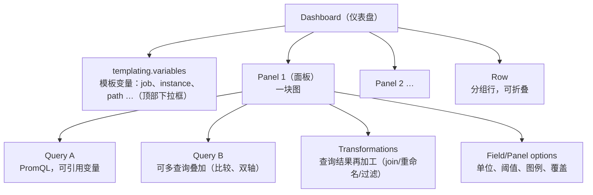

# 5. Grafana 可视化

> Prometheus 存数据，Grafana 让数据"可读"。本篇讲：数据源配置、dashboard/panel/variable 三层模型、
> 面板类型选型（什么数据配什么图）、阈值与单位、dashboard as code（provisioning + JSON）与查询优化。
> （本篇是"怎么画好面板"；配置体系、认证权限、Explore、Transformations、告警 as code 见续篇
> [grafana-deep-dive.md](grafana-deep-dive.md)。）

## 1. 数据源（Data Source）配置

### 1.1 添加 Prometheus 数据源

Grafana 支持几十种数据源；本阶段只关心 Prometheus。手工配置路径：**Connections → Data sources → Add data source → Prometheus**。

| 配置项 | 建议值 | 说明 |
| --- | --- | --- |
| URL | `http://prometheus:9090` | Grafana 容器内可达地址（容器网络服务名） |
| Access | Server | 由 Grafana 后端代理请求（Browser 模式已废弃，且要求用户浏览器能直连数据源） |
| Scrape interval | `15s` | 与 Prometheus 全局抓取间隔一致，影响 `$__rate_interval` 的下限 |
| Query editor | 自动补全/指标浏览 | 默认即可 |
| Manage alerts via Alerting | 按需 | Grafana 自有告警（本阶段用 Prometheus 告警，可不勾） |

### 1.2 `$__rate_interval`（重要）

Grafana 内置变量 `rate(x[$__rate_interval])`：自动取 `max(4 × scrape interval, 每个step的1/4)`，**保证窗口内至少有 4 个样本**，避免 `rate(x[1m])` 在面板放大到 1h（step 变大/变小）时空洞或过采样。**面板里 rate 窗口一律用 `$__rate_interval`**，取代手写 `[5m]`（告警规则里没有这个变量，仍手写窗口）。

参考：<https://grafana.com/docs/grafana/latest/datasources/prometheus/template-variables/>（访问日期：2026-11-04）

## 2. 三层模型：Dashboard → Panel → Query



- **Panel 是最小可视单元**，每个 Query 返回一个 frame（多列多行）；`Format: Time series` / `Table` / `Heatmap` 决定 Prometheus 响应如何映射。
- Dashboard JSON 就是这棵树的序列化（`schemaVersion`、`panels[]`、`templating.list[]`），可以导出/导入/版本管理。

## 3. 模板变量（Templating）：一板多用

### 3.1 变量类型

| 类型 | 用途 | 例子 |
| --- | --- | --- |
| `query` | 从数据源动态取值 | job / instance / path 下拉框 |
| `custom` | 手写枚举 | env: prod, staging |
| `interval` | 时间粒度 | `1m,5m,10m`（配合 `__interval` 变量） |
| `datasource` | 切换数据源 | 多环境多 Prometheus |
| `constant` / `textbox` | 固定值/用户输入 | 阈值输入框 |
| `adhoc` | 临时标签过滤 | 用户自由拼 `{status=~"5.."}` |

### 3.2 变量定义示例（lab01 实际使用）

```json
{
  "name": "job",
  "type": "query",
  "query": { "query": "label_values(up, job)", "refId": "PrometheusVariableQueryEditor-1" },
  "includeAll": true,
  "multi": true,
  "current": { "text": "All", "value": "$__all" }
}
```

- `label_values(up, job)`：返回 up 指标上出现过的全部 job 值（也可 `label_values(http_requests_total, path)`）。
- 变量在 PromQL 中用 `$job` / `${job}` 引用；开 multi 后，Grafana 会把多选展开成正则 `job=~"a|b"`。

### 3.3 变量联动（级联）

第二个变量查询里引用第一个变量，实现"选了服务再选该服务的实例"：

```text
变量1 job:     label_values(up, job)
变量2 instance: label_values(up{job=~"$job"}, instance)
```

面板查询再引用 `$job`、`$instance`，一块面板即可覆盖全部服务/实例组合——这就是"模板变量联动"，是仪表盘数量不失控的关键。

### 3.4 内置变量速查

| 变量 | 含义 |
| --- | --- |
| `$__rate_interval` | 安全的 rate 窗口（见 1.2） |
| `$__interval` | 面板 step |
| `$__range` | 面板选择的整个时间范围 |
| `$__from` / `$__to` | 范围起止 epoch ms |
| `$__all` / `$__all-variable` | All 选项值 |
| `$__dashboard` / `$__org` | 面板/组织名 |

## 4. 面板类型选型

**核心原则：图的形状要匹配数据的语义**（趋势→折线，当前值→大数字，分布→热力图，比例→gauge）。

| 面板类型 | 适合的数据 | 典型场景 | 反面案例 |
| --- | --- | --- | --- |
| **Time series** | 随时间变化的多序列 | QPS、延迟、内存曲线 | 一条"当前值"序列画折线浪费（用 Stat） |
| **Stat** | 单个当前值（+sparkline） | 当前错误率、总实例数 | 多维多序列全塞进来（数字爆炸） |
| **Gauge** | 有上下界的单值（0~100%） | CPU/内存使用率、SLO 达成率 | 无界值（QPS）画仪表盘没有意义 |
| **Bar gauge** | 多个有界值排行 | 每盘使用率、每服务错误率 | 无界值 |
| **Heatmap** | 随时间变化的**分布** | 直方图桶按时间堆叠（延迟热力图） | 非 histogram 数据 |
| **Table** | 多列结构化 | TopK 排行、序列清单 | 单序列趋势 |
| **Bar chart** | 分类对比 | 各 path 请求量对比 | 时间序列用柱状（密度低） |
| **State timeline / Status history** | 离散状态随时间 | up 探活、告警历史 | 连续值 |
| **Logs / Traces** | 日志/链路 | 阶段 2/3 使用 | — |

**延迟热力图（Heatmap）配法**：Query 返回 `le` 桶的 rate，`Format: Heatmap` + 面板开启 `Calculate`（或直接用 `histogram` 格式）——颜色越亮表示落在该延迟区间的请求速率越高。它比单条 p99 折线信息量大得多：能看到"双峰分布"（一部分请求快、一部分慢）这类 p99 掩盖的现象。

## 5. 阈值（Thresholds）与单位（Unit）

### 5.1 单位

- 在 Field/Panel options → Unit 选择：`requests/sec`（reqps）、`seconds`（Grafana 自动显示 ms/s）、`percentunit`（0~1 小数显示为 %）、`bytes(IEC)`（自动 KiB/MiB）。
- **PromQL 返回 0~1 比率时选 percentunit，不要自己在查询里 ×100**——保持数据干净，展示层换算。
- 延迟查询保持秒，Unit 选 seconds 后 Grafana 按量级自动换算显示（0.042 → 42ms）。

### 5.2 阈值

```json
"thresholds": {
  "mode": "absolute",
  "steps": [
    {"color": "green", "value": null},
    {"color": "yellow", "value": 0.05},
    {"color": "red", "value": 0.10}
  ]
}
```

- 三段式（绿/黄/红）最常用；阈值应与**告警阈值一致**（面板黄 = 告警黄），让人眼与系统同一标准。
- Time series 面板阈值默认只影响图例色与背景区带；Stat/Gauge 会直接变色。
- 进阶：`Thresholds style` 开 "Line" 画参考线（如 SLA 线）。

## 6. Dashboard as Code：Provisioning + JSON

手工点出来的 dashboard 属于"雪花配置"——不可复现、不可 review。Grafana 原生支持文件化装配。

### 6.1 Provisioning 目录结构

```
/etc/grafana/provisioning/
├── datasources/
│   └── prometheus.yml        # 数据源声明
└── dashboards/
    └── dashboards.yml        # dashboard provider：从哪加载 JSON
/opt/grafana/dashboards/      # JSON 放这里（provider 指向的路径）
└── lab01-overview.json
```
<!-- 保留原图：provisioning 目录结构清单，非概念示意图，Mermaid 无原生文件树类型 -->

### 6.2 数据源 provisioning 文件

```yaml
# datasources/prometheus.yml
apiVersion: 1
datasources:
  - name: Prometheus
    type: prometheus
    access: proxy
    url: http://prometheus:9090   # 容器网络内服务名
    isDefault: true
    jsonData:
      timeInterval: "15s"         # 告知抓取间隔，供 $__rate_interval 计算
```

### 6.3 Dashboard provider 文件

```yaml
# dashboards/dashboards.yml
apiVersion: 1
providers:
  - name: lab01
    folder: Lab01                # 界面上归入哪个文件夹
    type: file
    updateIntervalSeconds: 10    # 磁盘 JSON 变化后自动重载
    options:
      path: /opt/grafana/dashboards
      foldersFromFilesStructure: false
```

### 6.4 Dashboard JSON 骨架（最小完整结构）

```json
{
  "annotations": {"list": []},
  "editable": true,
  "graphTooltip": 1,
  "refresh": "30s",
  "schemaVersion": 39,
  "tags": ["lab01", "metrics"],
  "time": {"from": "now-1h", "to": "now"},
  "timezone": "browser",
  "title": "Lab01 · 服务总览",
  "uid": "lab01-overview",
  "version": 1,
  "templating": {"list": [ /* 变量 */ ]},
  "panels": [ /* 面板 */ ]
}
```

关键点：**`uid` 必须固定**（导入/更新按 uid 幂等）；`schemaVersion` 声明 JSON 结构代数；面板 JSON 中 `datasource` 用 `{"type":"prometheus","uid":"${DS_PROMETHEUS}}"` 或 provisioning 数据源名。

### 6.5 工作流建议

1. 在 UI 里画 → **Share → Export → Save JSON**（勾 "Export for sharing externally" 会把数据源换成变量）。
2. JSON 入库（随 lab 目录走），由 provisioning 加载。
3. CI 可用 `grafana-dashboard-validator` 或至少 `jq` 校验 JSON 结构。
4. 大规模管理再考虑 grafanafoundationsdk / Terraform provider / Grizzly，本阶段 JSON + provisioning 足够。

文档：<https://grafana.com/docs/grafana/latest/administration/provisioning/>（访问日期：2026-11-04）

## 7. 面板查询优化

1. **面板数量克制**：一个 dashboard 10~20 块面板为宜；每个 range query 都是打向 Prometheus 的真实查询，30s 自动刷新 × 20 面板 ≈ 每分钟 40 次查询（不到 1 QPS，但全部落在同一台 Prometheus 上，叠加多用户就会吃紧）。
2. **复用 recording rules**：多面板共用的复杂聚合先固化为 rule（见 PromQL 笔记 §7）。
3. **`$__rate_interval` 替代固定窗口**：缩放时间范围时自动适配，避免窗口 < step 的锯齿。
4. **Legend 用 `{{label}}` 模板**：`{{path}} · {{status}}`，比默认序列全串可读；`legend_format: {{job}}/{{instance}}`。
5. **Min step / interval override**：数据 15s 一个点时把面板 min step 设为 `15s`，防止过度查询。
6. **TopK 面板加刷新**：热点路径随时间变化，`topk(5, ...)` 面板保持 30s~1m 刷新。
7. **避免 subquery 大范围**：`[1h:15s]` 在 30 天视图上是灾难；改 recording rule。
8. **查询数合并**：`sum by (status)(rate(...))` 一次返回多条序列，优于写 5 个独立 status 查询。
9. **数据源代理缓存**：Grafana 会做瞬时去重（同查询同时间窗），但不要依赖它。
10. **面板链路排障**：Query inspector → Refresher/Query 统计耗时；>2s 的面板优先优化。

## 8. 一块面板的 JSON 解剖

以 lab01 的「QPS 按路径」面板为例，理解面板 JSON 的最小完整结构（dashboard as code 的基础）：

```json
{
  "datasource": {"type": "prometheus", "uid": "prometheus"},   // 固定 uid，不依赖名称
  "gridPos": {"h": 8, "w": 12, "x": 0, "y": 5},               // 24 列栅格布局
  "id": 6,                                                     // dashboard 内唯一
  "type": "timeseries",                                        // 面板插件类型
  "title": "QPS 按路径（Rate 分解）",
  "targets": [{                                                // 查询列表（可多条叠加）
    "datasource": {"type": "prometheus", "uid": "prometheus"},
    "expr": "sum by (path) (rate(http_requests_total{job=~\"$job\"}[$__rate_interval]))",
    "legendFormat": "{{path}}",                                // 图例模板：用标签渲染
    "refId": "A"
  }],
  "fieldConfig": {                                             // 字段级配置：单位/阈值/颜色
    "defaults": {"unit": "reqps", "custom": {"fillOpacity": 10, "drawStyle": "line"}},
    "overrides": []                                            // 按序列名/正则覆盖（如 p99 专用红色）
  },
  "options": {                                                 // 面板级配置：图例/提示框
    "legend": {"displayMode": "table", "calcs": ["lastNotNull", "max"]},
    "tooltip": {"mode": "multi", "sort": "desc"}
  }
}
```

三层配置的分工记法：**options 管交互（图例/提示框）、fieldConfig 管数据呈现（单位/阈值/坐标轴）、
overrides 管特例（把某条序列单独染色）**。改任何面板，用 UI 改完再导出 diff，是学习 JSON 结构最快的方式。

## 9. Grafana Alerting 与 Prometheus 告警的关系

两者都能"表达式 + 阈值 → 通知"，但定位不同（lab01 采用 Prometheus 侧告警）：

| 维度 | Prometheus alerting rules + Alertmanager | Grafana Alerting |
| --- | --- | --- |
| 评估引擎 | Prometheus（每 evaluation_interval） | Grafana 后端（统一告警子系统） |
| 数据源 | 只能 Prometheus | 跨数据源（Prometheus + Loki + 云 + 日志衍生指标可同规则组合） |
| 路由能力 | Alertmanager：分组/抑制/静默成熟 | 内置路由树 + 对外可转发 Alertmanager |
| 生态兼容 | 云原生事实标准，规则纯 YAML 可 review | UI 为主，规则存 Grafana DB（也可 provisioning） |
| 适用 | 已有 Prometheus 栈、K8s 场景 | 多源混合告警、Grafana OnCall/Cloud 体系 |

选择建议：指标告警用 Prometheus + Alertmanager（本阶段与大多数生产实践）；只有当告警需要
跨数据源（如"日志错误关键词突增"）时再引入 Grafana Alerting，避免两套告警并行导致认知混乱。

## 10. 常见坑（FAQ）

1. **面板报 "Too many data points"**：step 远小于数据点密度。用 `$__interval`（自动）而非手动 `1s`。
2. **变量显示 `$__all` 而非内容**：忘了 `includeAll: true` 或 current.value 未设 `$__all`。
3. **多选变量传进正则查询没生效**：`job=~"$job"` 在多选时 Grafana 自动展开为 `job=~"a|b"`；若写成 `job="$job"` 则多选无效（=不支持正则）。
4. **导出 JSON 导回去数据源丢了**：导出没勾 externals / 导入时没映射数据源变量。provisioning 数据源用固定 `uid` 可彻底规避。
5. **percentunit 与 percent 混淆**：查询返回 0~1 却选了 percent(0-100) → 显示 3%（实际 3%当 0.03 用）；比率统一 percentunit。
6. **Heatmap 乱码/空图**：未把查询 Format 设为 Heatmap、或没对 bucket 做 rate——热力图需要的是"每时间片的桶计数速率"。
7. **refresh 5s 打爆 Prometheus**：页面挂着几十块面板 × 5s 刷新；默认 30s，排障时临时调快。
8. **时区错乱**：dashboard `timezone: browser` vs UTC。团队跨时区时显式固定 `timezone: utc` 更稳。

## 11. 面试题小结

1. **Q：Grafana 的 Access: Server 与 Browser 模式区别？**
   A：Server 由 Grafana 后端向数据源发请求（可藏凭据、不暴露数据源给浏览器）；Browser 由用户浏览器直连（已废弃）。生产一律 Server。
2. **Q：`$__rate_interval` 是什么？为什么推荐它？**
   A：Grafana 计算的安全 rate 窗口 = max(4×抓取间隔, step/4 的合理值)，保证窗口内至少 4 个样本；随面板缩放自适应，避免固定窗口在缩放后的过采样/锯齿。
3. **Q：Stat / Gauge / Time series / Heatmap 分别适合什么数据？**
   A：单值看 Stat；有界比率看 Gauge/Bar gauge；多序列趋势看 Time series；分布随时间演变看 Heatmap（直方图桶）。
4. **Q：模板变量如何实现级联过滤？**
   A：后一个变量的查询引用前一个变量（`label_values(up{job=~"$job"}, instance)`），形成依赖链。
5. **Q：dashboard as code 有哪些方式？provisioning 如何工作？**
   A：JSON + provisioning（文件目录自动装配）、Terraform provider、Grizzly、SDK。provisioning 扫描 `/etc/grafana/provisioning/{datasources,dashboards}`，datasources 即时生效，dashboards provider 按 updateIntervalSeconds 周期重载 JSON。
6. **Q：为什么比率查询返回 0~1 而不是直接算百分比？**
   A：保持数据标准化（无单位），由展示层 unit(percentunit) 换算；跨面板/告警复用同一查询时不需要各自 ×100。

## 12. 参考资料

- Grafana 文档首页：<https://grafana.com/docs/grafana/latest/>（访问日期：2026-11-04）
- Prometheus 数据源配置：<https://grafana.com/docs/grafana/latest/datasources/prometheus/>（访问日期：2026-11-04）
- 模板变量：<https://grafana.com/docs/grafana/latest/dashboards/variables/>（访问日期：2026-11-04）
- Provisioning：<https://grafana.com/docs/grafana/latest/administration/provisioning/>（访问日期：2026-11-04）
- 面板可视化：<https://grafana.com/docs/grafana/latest/panels-visualizations/>（访问日期：2026-11-04）

## 附：ASCII 图替换清单

| 原 ASCII 图位置（章节标题） | 原图内容简述 | 替换结果 |
| --- | --- | --- |
| 2. 三层模型：Dashboard → Panel → Query | Dashboard/Panel/Query/Row 的三层包含关系树 | flowchart TD |

### 保留说明

| 位置 | 内容 | 保留原因 |
| --- | --- | --- |
| 6.1 Provisioning 目录结构 | provisioning 与 dashboard JSON 的目录树 | 目录/文件树清单，Mermaid 无原生文件树类型 |

---

## 13. 手算/走查配方

本篇的三个配方都围绕一个目标：让你能**手算出面板行为**，而不是在 UI 里试错。配方一算窗口、配方二算负载、配方三算端到端呈现——窗口、QPS、阈值三个数字都能落到纸面上，面板设计就脱离了玄学。三者的推进顺序也有讲究：先算窗口（保证正确性），再算负载（保证容量），最后算呈现（作为验收），跳步会造成返工。

### 配方一：$__rate_interval 手算

官方文档当前给出的定义是：

```text
$__rate_interval = max( $__interval + scrape_interval, 4 × scrape_interval )
```

其中 scrape_interval 取该查询设置的 Min step（未设置时用数据源配置的 Scrape interval，即 provisioning 里的 `jsonData.timeInterval`）。设计意图与 §1.2 的记忆口诀一致：**保证窗口内至少有 4 个抓取样本**（rate 至少要两个点，取 4 倍是为了容忍个别抓取失败），同时窗口不小于 step，保证相邻计算点的窗口首尾相接、每个样本都被至少一个窗口覆盖，缩放时间范围时不出现锯齿。下面的手算一律按这个官方定义走。

设数据源 `timeInterval = 15s`（即 Grafana 认为抓取间隔是 15 秒），三档典型 step 的走查：

| 面板 step | 4 × scrape | step + scrape | 取 max 的窗口 | 窗口内样本数 |
| --- | --- | --- | --- | --- |
| 15s | 60s | 30s | 60s | 60 ÷ 15 = 4 |
| 30s | 60s | 45s | 60s | 60 ÷ 15 = 4 |
| 1m | 60s | 75s | 75s | 75 ÷ 15 = 5 |
| 5m | 60s | 315s | 315s | 315 ÷ 15 = 21 |

自验算：15 + 15 = 30，取 max(60, 30) = 60；30 + 15 = 45，仍取 60；60 + 15 = 75；300 + 15 = 315；315 ÷ 15 = 21。四档全部满足"至少 4 个样本"。

两个直接结论：其一，**timeInterval 必须与真实抓取间隔一致**——实际抓取 30 秒却声明 15 秒时，60 秒窗口里只有 2 个样本，rate 曲线剧烈抖动，而且这种错不会报任何错，只能靠对账发现；其二，告警规则里没有这个变量，手写窗口时应取抓取间隔 4 倍以上的整倍数（如 15s 抓取配 `[5m]`），并与面板窗口保持口径一致，避免"面板与告警数字对不上"。

其三，三者对齐口诀：数据源的 timeInterval、面板的 min step、真实的抓取间隔，三者一致（比如都是 15s）时，`$__rate_interval` 的计算才建立在正确前提上（§7 建议 5 的 min step 就是干这个的）。排查"曲线锯齿"类问题时，先把这三个数对齐，再谈别的。

**告警窗口怎么手写**：告警规则拿不到 `$__interval`，窗口必须写死。选择依据是"抗抖动与响应快"的折中：窗口越长曲线越平滑、单次毛刺越难触发误报，但发现越慢。常见做法是抓取间隔 4 倍起步、告警的 for 时长再兜一层抖动，例如 15s 抓取配 `[5m]` 窗口加 for 2 分钟。另一个必须向值班讲清的现象：面板窗口（如 75s）与告警窗口（如 5m）不同，**不影响长期均值**——rate 在不同窗口下都是无偏估计，差异只体现在平滑程度与响应速度上；所以"面板曲线已经回落、告警却还在触发"多半是两者窗口不同的正常表现，不是 bug。

**顺手做一次 timeInterval 对账**：结论一说"必须一致"，对账就三步。第一步，查 Prometheus 侧的真实抓取间隔（看全局 scrape_interval 配置与 job 级覆盖）；第二步，查 Grafana 侧数据源的 Scrape interval（UI 里数据源设置）或 provisioning 文件的 `jsonData.timeInterval`；第三步，两者不相等时以 Prometheus 侧为准改 Grafana。改完用配方三第 5 步的缩放验证收尾。

### 配方二：一块大盘的查询压力估算

打开一块大盘的真实代价 = 面板数 × 每面板查询数 × 刷新频率 × 同时在线人数。走查一个典型组合（示意数）：

1. 大盘 20 块面板，每块 1 条查询，refresh 30s → 每面板每分钟 2 次 → 全盘每分钟 20 × 2 = 40 次查询 ≈ 40 ÷ 60 ≈ 0.67 QPS；
2. 团队里 10 个人同时开着这块盘 → ≈ 6.7 QPS，全部落在同一台 Prometheus 上，还要叠加告警与 recording rule 的评估负载；
3. 再算单次查询的点数：24 小时视图、maxDataPoints 取 240 时，step = 86400 ÷ 240 = 360 秒 = 6 分钟，即每条序列返回约 240 个点。面板多、序列多的查询（比如按 path 分解出 50 条序列）一次就返回上万点。

结论：面板数、刷新间隔、共享人数三者相乘才是真实负载。Prometheus 查询变慢时，先砍面板（合并同源查询、删除没人看的）、再调刷新（30s 起步），最后才考虑扩存储——§7 的优化清单就是按这个性价比排序的。

**对应的处置菜单**：第一步合并查询——同一指标按 status 分解，用一条 `sum by (status)(rate(...))` 返回多条序列，替换掉 5 条独立查询；第二步固化 recording rule——大盘上反复出现的复杂聚合进 rule（§7 建议 2），面板只查轻量结果；第三步降频——排障盘临时 5s，日常一律 30s 起步，排障结束改回去。三步做完通常能省一半以上查询量，比扩 Prometheus 便宜得多。

再补一个单面板的账：一块面板合理的 targets 数是 1~3 条。超过 3 条通常意味着该拆面板或该进 recording rule——判断标准是"这几条查询会不会被同时读"：会同时读（比如环境对比）就保留叠加；只是同类指标排排站，就拆开各自成面板，图例才读得过来。

### 配方三：P95 面板从表达式到展示的五步走查

1. **表达式**：`histogram_quantile(0.95, sum by (le) (rate(http_request_duration_seconds_bucket{job=~"$job"}[$__rate_interval])))`——分桶与插值的数学原理已在 [exporters.md](exporters.md) 配方一推演过，语法细节见 [promql.md](promql.md)。
2. **Format**：Time series；legend 写 `{{path}}`（按 path 聚合时每条序列一个路由）。
3. **Unit**：seconds，Grafana 按量级自动显示毫秒——查询层保持秒，展示层换算（§5.1 的原则）。
4. **阈值**：与 SLO 对齐，比如 SLO 是 P95 < 1s，就设黄色 0.8、红色 1.0（示意值），并且与 [alerting.md](alerting.md) 里对应告警规则的阈值取同一个数——面板颜色与告警状态必须是同一套标准（§15 反模式三）。Thresholds 风格选 Line 画参考线（§5.2），SLO 线直接印在图上，越线与否一眼可见。
5. **缩放验证**：把时间范围从 1h 拉到 7d 再拉回，曲线不应出现锯齿或跳变——出现即说明窗口没走 `$__rate_interval`，回到配方一重查。

三个高频失败模式，走查时对照排除：

1. **图里一条线都没有**：查询把 `_bucket` 后缀写丢了（查成了 `_sum` 或 `_count`），histogram_quantile 拿不到桶数据直接返回空。先把内层查询单独执行，确认返回的是带 le 标签的序列。
2. **延迟显示成 0.0x 的"占比"**：unit 选错成了 percentunit，耗时被当比率渲染。回到第 3 步，延迟面板的 unit 必须是 seconds。
3. **分位数大得离谱**：内层漏了 rate，直接拿累计计数当桶数据，rank 相对总量失真。任何 `histogram_quantile` 的内层都必须是 rate 之后的桶计数，这是一条铁律。

## 14. 决策速查表

选型顺序：先明确问题（表一），再定单位与阈值（表二），最后调性能参数（表三、表四与配方二）。顺序反了就会先搭面板再找问题，面板越多越乱。

**表一：你要回答什么问题，就用什么面板**（与 §4 互补：那张表按数据形态索引，这张按分析意图索引）

| 你想回答的问题 | 面板 | 数据要求 |
| --- | --- | --- |
| 趋势往哪个方向走 | Time series | counter 派生的 rate 或 gauge 原值 |
| 现在这个数好不好 | Stat | 单序列最新值，配阈值变色 |
| 离上限还有多远 | Gauge / Bar gauge | 有界比率（percentunit） |
| 延迟分布长什么样 | Heatmap | histogram 桶的 rate（§4 配法） |
| 谁是当前 TopN | Table 配 topk | 聚合后排序 |
| 什么时候变的红或绿 | State timeline | up、布尔或枚举序列 |
| 分类占比谁贡献得多 | Bar chart / Pie chart | 离散分类的聚合（别拿时间序列画饼图） |
| 和谁比、比什么 | Time series 多查询叠加 | 两条查询各带 legend 前缀（本周/上周） |
| 临时按任意标签过滤排查 | Time series 配 adhoc 变量 | adhoc 变量自由拼过滤条件（§3.1），不必改盘 |

**表二：单位怎么选**

| 数据形态 | Unit | 常见错法 |
| --- | --- | --- |
| 0~1 的比率 | percentunit | 在查询里 ×100 再选 percentunit，显示放大 100 倍（§10 坑 5） |
| 秒 | seconds | 查询里手动 ×1000 改毫秒，展示层无法再自适应换算 |
| 字节 | bytes(IEC) | 与 SI 进制混用，内核口径按 1024 进位时读数错位 |
| 请求速率 | reqps | 选成 ops 或不选单位，跨面板读数不可比 |

**表三：刷新与 step 怎么定**

| 场景 | refresh | min step |
| --- | --- | --- |
| 默认大盘 | 30s | 与抓取间隔一致（如 15s） |
| 排障临时加速 | 5s~10s | 用完改回，别把排障配置留在生产盘上 |
| 长趋势（30 天视图） | 5m 以上 | 1m 起步，防点数爆炸（§10 坑 1） |
| 大屏/值班室固定展示 | 1m | 与告警评估节奏一致，肉眼跟得上 |

**表四：变量与数据源怎么布局**

| 决策点 | 建议 | 理由 |
| --- | --- | --- |
| 单环境大盘要不要 datasource 变量 | 不要 | 少一层间接性；数据源由 provisioning 固定 uid（§6.2） |
| 多环境（多 Prometheus） | datasource 变量 + folder 按环境分组 | 切环境换数据源，大盘 JSON 只维护一份 |
| 排障大盘要不要 adhoc 变量 | 要 | 让值班自由拼标签过滤，不必为每种过滤改盘（§3.1） |
| 自建 interval 变量 | 尽量不用，内置变量覆盖不住再引入 | 大多数场景 `$__interval` 已够，自建徒增理解成本 |
| 变量要不要开 multi | 常用维度开 multi 配 includeAll | 多选自动展开为正则（§3.2）；强隔离维度才单选 |

多环境、多大盘的组织问题（folder、权限、共享大盘的治理）不在本篇范围，见 [grafana-deep-dive.md](grafana-deep-dive.md) 与 [unified-dashboard.md](../04-integration/unified-dashboard.md)；官方文档入口 `https://grafana.com/docs/` 的 Dashboards 章节。

## 15. 反模式对照

对照表的使用方式：评审大盘时逐行扫一遍，症状列出现在自己盘上就按右列当工单处理。反模式之间高度相关——一块失控的大盘通常同时犯两三条，治理时一起治，单独修一条往往被其余的拖回去。

| 反模式 | 症状 | 正确做法 |
| --- | --- | --- |
| 雪花仪表盘（UI 里改完不回写 JSON） | provisioning 重载后被覆盖；环境之间同一块盘长得不一样 | UI 改完立即导出入库，走 §6 的 dashboard as code 流程 |
| 一图多问（一块面板 5 条查询 3 个双轴） | 没人能说清哪条线对应哪个轴，读图靠猜 | 一图一问；叠加最多两条，轴与颜色在图例里说清 |
| 阈值双份维护（面板一套、告警一套） | 面板说黄告警说红，值班与看盘的人互相怀疑 | 阈值单一来源，面板在描述里注明"与某告警规则同源"（配方三第 4 步） |
| 固定 rate 窗口（rate(x[5m]) 配手动 step） | 缩放时间范围后锯齿或过采样 | `$__rate_interval` + `$__interval`（配方一） |
| 百分比双换算（查询 ×100 又选 percentunit） | 数字放大 100 倍，或两个面板读数差 100 倍 | 二选一，约定查询返回 0~1、展示层换算 |
| 复制粘贴大盘（每个服务拷一份改 job 名） | 大盘数量线性增长，改一处要同步 N 份 | 模板变量一板多用（§3.3 级联），一份盘服务全部实例 |
| 超载大盘（50 块面板塞一张） | 打开慢、查询排队、没人看得完 | 按"总览 / 服务详情 / 资源详情"分层拆盘，用链接跳转衔接 |
| 告警复写面板长表达式 | 两处表达式各自演化，口径漂移后面板与告警对不上 | 公共复杂聚合固化为 recording rule，面板与告警都引用它（§7 建议 2） |

共同根因只有一句话：把仪表盘当"一次性截图"而不是"随代码演进的交付物"。凡是治理了 dashboard as code（§6）与变量复用（§3）的团队，上表大部分反模式会自然消失——它们都是"不可复现"的衍生症状。

**自查方法**：随机抽三块面板，问三个问题——这块图回答什么问题？数据来自哪条查询或 rule？改动之后怎么回归验证？三个都答不上来的面板，就是待治理的反模式存量，按 §6 流程入库或直接下线。抽检不必专门排期：评审别人的大盘时顺手做，攒够三个问题就开一张治理工单。

## 16. code review 检查单

评审 dashboard 相关 PR（JSON 变更）时逐条过。这份清单假设大盘按 §6 的 JSON + provisioning 方式管理；越是纯手工维护的团队越需要它——因为没有 CI 与版本管理兜底，任何一处手滑都直接落到生产盘上：

- [ ] `uid` 固定且有意义（导入/更新按 uid 幂等，随机 uid 会在各环境复制出多份）？
- [ ] 变量设了 `includeAll` 与合理的默认值？级联变量的查询顺序正确（后一个引用前一个）？
- [ ] 所有 rate/increase 用 `$__rate_interval`，step 用 `$__interval`，没有手写死窗口？
- [ ] 比率查询返回 0~1 且 unit 是 percentunit，没有查询层 ×100？
- [ ] legend 用 `{{label}}` 模板，tooltip 模式与排序有明确选择？
- [ ] 面板数不超过 20，refresh 不低于 30s？
- [ ] 阈值与对应告警规则数值一致，并在面板描述里注明来源？
- [ ] timezone 明确设置（跨时区团队用 utc，不依赖各人浏览器）？
- [ ] JSON 能通过语法校验（至少 jq 过一遍），已放入 provisioning 目录对应路径？
- [ ] 面板标题与单位能独立读懂——不看查询也知道"这块图回答什么问题"，没有"新面板/临时/v2"这类占位名？

使用方式与 [exporters.md](exporters.md) 的埋点检查单一致：作者在 PR 描述里贴勾选结果，豁免条目写明理由。其中 uid、JSON 校验、refresh 上限三条适合做成 CI 脚本自动检查——JSON 是结构化的，机器比人眼更适合盯格式；人眼留给阈值一致性与语义可读性这两类机器判不了的事。
