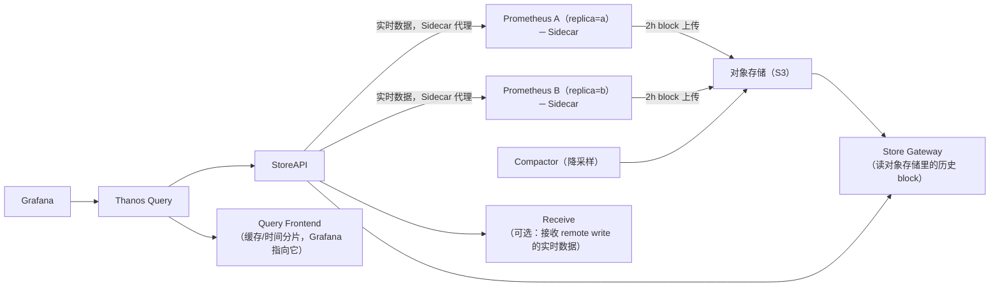
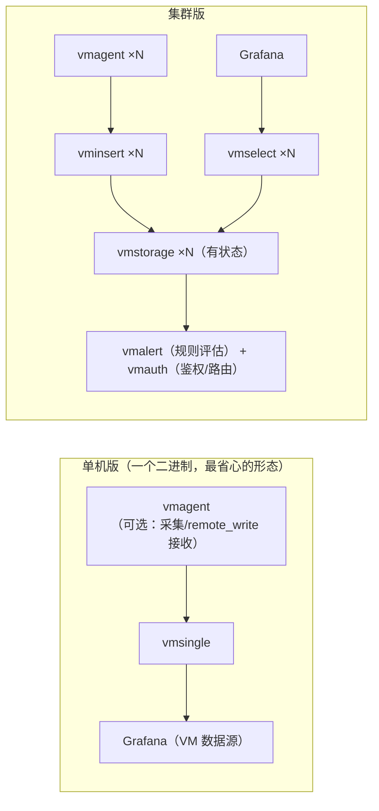
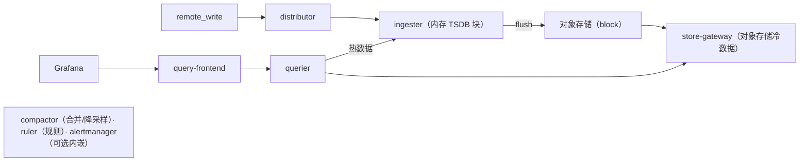
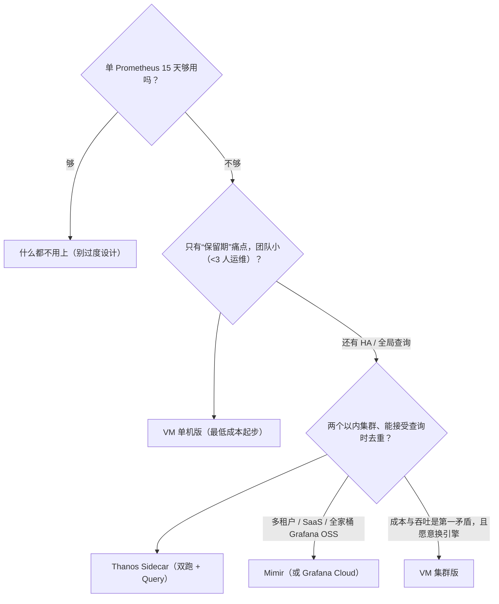

# 指标长期存储与水平扩展：Thanos / VictoriaMetrics / Mimir

> 单机 Prometheus 有三个天花板：**保留期**（本地盘放不下 13 个月）、**高可用**
> （一个实例挂了查询就断）、**全局视图**（100 个实例 = 100 个孤岛 TSDB，跨集群查不了）。
> 本篇讲主流的三条突破路线：**Thanos**（Sidecar 复用对象存储）、**VictoriaMetrics**
> （重写存储引擎，单二进制）、**Mimir**（Grafana 的多租户集群方案），
> 以及贯穿三者的公共机制：remote write、降采样、去重与多租户。
> 前置：[prometheus-architecture.md](prometheus-architecture.md)、[cardinality.md](../05-production/cardinality.md)。

## 目录

1. [问题定义：单机 Prometheus 的三个天花板](#1-问题定义单机-prometheus-的三个天花板)
2. [公共机制一：remote write 与外部标签](#2-公共机制一remote-write-与外部标签)
3. [Thanos：Sidecar 模式的鼻祖](#3-thanossidecar-模式的鼻祖)
4. [VictoriaMetrics：换个引擎的路线](#4-victoriametrics换个引擎的路线)
5. [Mimir（Cortex）：Grafana 的集群化路线](#5-mimircortexgrafana-的集群化路线)
6. [三方对比与选型决策树](#6-三方对比与选型决策树)
7. [降采样：成本与精度的交易](#7-降采样成本与精度的交易)
8. [常见坑](#8-常见坑)
9. [面试题小结](#9-面试题小结)
10. [参考资料](#10-参考资料)

---

## 1. 问题定义：单机 Prometheus 的三个天花板

| 天花板 | 表现 | 规模触发点 |
|---|---|---|
| **保留期** | 本地 TSDB 一般留 15~30 天，审计/年报/容量规划需要 1 年+ | 监控是"只增"数据，100 万 series × 15s 间隔 ≈ 每天 57.6 亿样本（10⁶ ÷ 15 × 86400 ≈ 5.76×10⁹） |
| **高可用** | 官方明确不做 Prometheus 自身集群；双跑两个相同实例又带来两倍查询目标 | 任何把监控用于"值班呼叫"的团队（监控自己不能是单点） |
| **全局视图** | 每个 Prometheus 只看自己 scrape 的目标；跨集群/跨实例聚合（`sum` 全公司 QPS）做不到 | 第 2 个集群出现的那天 |

三条路线的本质差异在于**"把哪一层搬到对象存储/集群"**：

```
Thanos      ：Prometheus 原封不动，把"已落盘的 block"搬对象存储，查询层做全局聚合
VictoriaMetrics：扔掉 Prometheus 的存储与查询层，换一个更高压缩的引擎（采集端不变）
Mimir       ：把 Prometheus 的 TSDB 内存块搬进集群组件（ingester），对象存储兜底
```
<!-- 保留原图：三条路线的文字对照清单（无箭头/框线结构），非示意图 -->

## 2. 公共机制一：remote write 与外部标签

三条路线里 Thanos(Receive)/VM/Mimir 都吃 Prometheus 的 **remote write** 协议
（HTTP + snappy 压缩的 protobuf 时序写请求），这是 Prometheus 官方的标准出口：

```yaml
# prometheus.yml
global:
  external_labels:
    cluster: prod-a          # ★ 关键：双跑实例必须用 external_labels 区分（cluster+replica）
    replica: "$(POD_NAME)"
remote_write:
  - url: http://vminsert:8480/insert/0/prometheus/api/v1/write
    queue_config:
      max_shards: 30           # 并行分片数（吞吐上限）
      capacity: 10000          # 队列缓冲
      max_samples_per_second: 0
    write_relabel_configs:     # 出口裁剪：不上报的指标根本不离开本机
      - source_labels: [__name__]
        regex: 'go_.*'
        action: drop
```

三条经验：

1. **`external_labels` 是长期存储的身份系统**：少了 `replica` 标签，双跑去重无从谈起；
   少了 `cluster`，全局聚合的分组维度就丢了。第一天就要定好命名规范（与
   [cardinality.md](../05-production/cardinality.md) 的治理一脉相承）；
2. **`write_relabel_configs` 是第一道成本闸门**：`go_.*`/`process_.*` 这类对全局无用
   的指标在出口就 drop，比在存储端丢弃便宜一个数量级；
3. remote write 是**异步队列**：下游故障时样本在内存队列堆积，堆满后**丢弃最旧样本**
   ——监控自身要有 `prometheus_remote_storage_samples_pending` / `dropped` 告警。

## 3. Thanos：Sidecar 模式的鼻祖

### 3.1 架构与组件



| 组件 | 职责 | 一句话 |
|---|---|---|
| **Sidecar** | 与 Prometheus 同 Pod，把 TSDB 每 2h 的 block 上传对象存储 | "Prometheus 不动，历史搬走" |
| **Query / Query Frontend** | 全局 PromQL 引擎：聚合多个 StoreAPI、去重、缓存 | Grafana 的真正数据源 |
| **Store Gateway** | 把对象存储里的历史 block 以 StoreAPI 暴露出来 | 冷数据的门卫 |
| **Compactor** | block 合并 + 降采样（5m/1h） | 存储账单的调节阀 |
| **Receive**（可选） | 接收 remote write，写自己的 TSDB 再上传 | 推模式（vs Sidecar 拉模式） |

### 3.2 两种 HA 形态（经典面试题）

| | Sidecar 模式（默认） | Receive 模式 |
|---|---|---|
| 数据到达路径 | 双 Prometheus 各自 scrape → 各自上传 block | Prometheus remote write → **单个** Receive（分片集群） |
| 去重 | Query 开 `deduplication`，按 `replica` 外部标签取一份 | 不需要（数据只有一份），但 Receive 成为新组件 |
| 复杂度 | 低（无状态 Sidecar） | 高（Receive 是有状态、要扩缩容） |
| 适用 | 大多数场景 | 边缘集群网络差、或要做"写路径多租户" |

**去重的正确理解**：`replica=a/b` 双跑时对象存储里有两份几乎相同的 block，
Query 的 dedup 是**查询时**按去重窗口取样本，不是物理删除——存储成本仍是 ×2
（这就是有人用 `--deduplication.func=penalty` 等精细化参数省存储的原因，慎用）。

## 4. VictoriaMetrics：换个引擎的路线

### 4.1 单机版与集群版



### 4.2 为什么流行：三个工程判断

1. **压缩率与写吞吐**：自研存储引擎对高基数写入做了大量优化，官方基准称平均
   每样本 ~0.4 字节级（Prometheus TSDB 通常 1~2 字节级）——**同样的对象存储预算能放
   2~5 倍的样本量**（以自己数据实测为准，但方向性结论稳定）；
2. **MetricsQL**：兼容绝大多数 PromQL，额外提供生产高频函数
   （`rollup_rate`、`histogram_quantile` 高效实现、`keep_metric_names` 等），
   以及更宽松的 `+Inf`/`-Inf` 处理；迁移成本主要是边缘语法；
3. **运维单元少**：单机版一个进程搞定采集接收存储查询告警，小团队从单机版起步，
   长大后再拆集群版，**数据模型与 API 不变**。

内置能力（对应 Thanos 要拼装的件）：retention 精确到月（如 `-retentionPeriod=25m`）、
按保留期自动降采样、多租户（URL 路径 `/insert/<tenant>/prometheus/...`）、
`/api/v1/status/tsdb` 风格的基数自检。

### 4.3 注意事项

- **兼容是"高度"而非"完全"**：个别 PromQL 细节（边界函数、某些 `absent` 语义）有差异，
  迁移时把现有 dashboard 与告警规则在 VM 上全量回归一遍；
- vmagent 的 stream aggregation（预聚合降基数）等高级特性部分在 Enterprise 版，
  开源版规划时确认功能边界；
- 生态位：VM 是"Loki 之前 Grafana 生态外"的成功者，Grafana 数据源与 kube-prometheus
  社区 helm chart 都有良好支持，但**若团队已全面 Grafana OSS，Mimir 的整合体验更顺**。

## 5. Mimir（Cortex）：Grafana 的集群化路线

Mimir 是 Grafana 2022 年在 Cortex（社区多租户 Prometheus 后端）基础上的继任项目，
架构与 Loki 同族（ring/memberlist/对象存储/SSM→微服务），读一遍 [loki-operations.md §1](../02-logging/loki-operations.md#1-部署模式单二进制--读写分离--微服务) 会发现是同一套思维：



特点：

- **写路径换 ingester**：不像 Thanos Sidecar 依赖 Prometheus 本地 TSDB，
  Mimir 自己管理数据（ingester 攒块 flush 对象存储）——**Prometheus 可以退化为
  纯采集器（agent mode）甚至被 vmagent/OTel Collector 替代**；
- **多租户是一等公民**（`X-Scope-OrgID`，与 Loki 一致），大组织/SaaS 场景的默认答案；
- 与 Grafana 生态深度协同（与 Loki/Tempo 同一套运维心智、LTS 版本承诺）。

代价：组件最多、运维面最大，**中小团队直接上 Mimir 通常是过度设计**。

## 6. 三方对比与选型决策树

| 维度 | Thanos | VictoriaMetrics | Mimir |
|---|---|---|---|
| 核心思路 | 复用 Prometheus 本地数据 + 对象存储 | 重写引擎，替代存储+查询 | 集群化重写（Cortex 系） |
| Prometheus 角色 | 保持完整（含本地 TSDB） | 可降级为纯采集器 | 可降级为纯采集器 |
| 部署最小集 | Sidecar+Query+StoreGW | **单进程**（vmsingle） | distributor+ingester+querier+... |
| 多租户 | 弱（靠分集群） | URL 租户（简单） | 强（一等公民） |
| 全局查询去重 | ★ 查询时 dedup（学这个概念） | 无需（单写路径） | 无需（单写路径） |
| 降采样 | Compactor 显式 | 按保留期内置 | Compactor 内置 |
| PromQL 兼容 | 100%（就是 Prometheus 引擎） | 高度（MetricsQL 增益） | 高度 |
| 存储/压缩 | 对象存储 ×2（双跑副本） | 同预算更多样本 | 对象存储 |
| 适合 | 已重投资 Prometheus、要保留 scrape 语义 | 小→大平滑、成本敏感、少运维 | 多租户/全 Grafana OSS 栈 |

选型决策（经验版）：



## 7. 降采样：成本与精度的交易

长期存储省钱的终极手段是**用低精度换存储**（ Thanos Compactor / VM 自动降采样）：

- 原始 15s 样本 → 保留 30~90 天；聚合为 5m 样本 → 保留 1 年；1h → 更久；
- counter 类指标降采样为 `rate` 结果（`max_over_time`/`sum` 等聚合策略依配置），
  **降采样后的数据不能再算 `rate()`**（已经是导数），只能画趋势——所以"最近 30 天走原始、
  年报走 5m"的路由要在 Query Frontend/查询习惯里体现；
- **有损且不可逆**：降采样跑过之后原始明细没了（该周期内）。审计/计费类指标要明确
  排除在降采样之外（Thanos `-- Downsampling.disable` 全局关 / 或对特定 bucket 策略）。

一句话：**降采样解决的是"看一年前的图"，不是"精确复现一年前的每个点"**。

## 8. 常见坑

1. **双跑忘了 `replica` 外部标签**：Thanos Query 收到两份无法区分的数据，
   dedup 失效、面板数值×2，且混入存储后不可洗（只能靠时间淘汰）；
2. **对象存储 bucket 混用**：Thanos/Tempo/Loki 各自的 bucket 分开，retention 与
   lifecycle 策略不同，混在一个 bucket 里用前缀区分是排障噩梦；
3. **remote write 队列堆积无告警**：下游存储慢时 Prometheus 静默丢最旧样本，
   `prometheus_remote_storage_samples_dropped_total` 必须告警；
4. **把降采样数据当原始数据用**：一年前的 `rate()` 突然返回空/异常——是降采样粒度
   不支持，不是数据丢了；
5. **高基数照搬进长期存储**：本地 15 天能扛的基数，×25 的保留期后账单/磁盘×25。
   长期存储上线前先做 [基数治理](../05-production/cardinality.md)；
6. **VM 迁移只测大盘不测告警**：MetricsQL 边缘差异最先炸的是告警规则里的表达式，
   迁移回归清单里告警规则优先级最高；
7. **Thanos Receive 与 Sidecar 混用同一份数据**：两条路径写同一租户导致重复样本
   （两种模式是替代关系，不是叠加）。

## 9. 面试题小结

**Q1：单机 Prometheus 的局限，以及三种主流扩展路线？**
A：保留期/高可用/全局查询三个天花板。Thanos：Prometheus 不动，block 上传对象存储 +
查询层聚合去重；VictoriaMetrics：替换存储与查询引擎（高压缩、单二进制起步）；
Mimir：集群化重写（ingester 攒块 flush 对象存储，多租户一等公民）。

**Q2：Thanos 的两种 HA 模式及去重机制？**
A：Sidecar 模式双跑 Prometheus（相同 scrape、不同 `replica` 外部标签），Query 查询时
按标签去重；Receive 模式收 remote write 单份写入（无重复但引入有状态组件）。
去重是查询时语义，存储成本仍是双份。

**Q3：external_labels 为什么是长期存储的第一配置？**
A：它是数据的身份系统：`cluster` 提供全局聚合分组维度，`replica` 是去重键。
缺失或命名不一致会直接导致重复计数与无法下钻，且错误数据会长期留存。

**Q4：VictoriaMetrics 相比 Prometheus 存储的核心卖点与风险？**
A：卖点：更高压缩（同预算更多样本）、单二进制低运维、MetricsQL 生产函数增强、
内置多租户/降采样。风险：PromQL 兼容是高度而非完全，迁移要全量回归告警规则与面板。

**Q5：降采样的收益与代价？**
A：收益：长期保留的成本降一个数量级。代价：有损不可逆——counter 变成聚合值后
不能再 `rate()`，审计/计费类数据要排除在降采样外；"精确复现历史每个点"的需求
只能靠保留原始粒度。

**Q6：remote write 的可靠性语义？丢了怎么发现？**
A：异步队列、at-least-once 方向（下游故障时堆内存队列，满了丢最旧）。
监控 `prometheus_remote_storage_samples_pending/dropped_total` 与 shard 饱和度，
配合 `write_relabel_configs` 在出口裁剪无用指标降低队列压力。

**Q7：什么时候不该上这三件套？**
A：单 Prometheus + 本地 15 天已满足需求时（成本与运维复杂度不划算）；
或需求只是"偶尔查半年前的数据"（对象存储 + vmctl/importer 做批量冷归档更轻）。

## 10. 参考资料

- Thanos 官方文档（架构/组件）：<https://thanos.io/tip/thanos/design.md/>（访问日期：2026-11-04）
- Prometheus remote write 配置：<https://prometheus.io/docs/prometheus/latest/configuration/configuration/#remote_write>（访问日期：2026-11-04）
- VictoriaMetrics 官方文档（单机/集群/MetricsQL）：<https://docs.victoriametrics.com/>（访问日期：2026-11-04）
- Mimir 官方文档（架构/多租户）：<https://grafana.com/docs/mimir/latest/>（访问日期：2026-11-04）
- Thanos 与 VictoriaMetrics 对比（社区视角）：<https://thanos.io/tip/thanos/comparison.md/>（访问日期：2026-11-04）
- 本工作区相关笔记：[prometheus-architecture.md](prometheus-architecture.md)、[cardinality.md](../05-production/cardinality.md)、[loki-operations.md](../02-logging/loki-operations.md)

## 附：ASCII 图替换清单

| 原 ASCII 图位置（章节标题） | 原图内容简述 | 替换结果 |
| --- | --- | --- |
| 3.1 架构与组件 | Thanos 双副本 Sidecar 上传 block、Query 经 StoreAPI 聚合实时/历史数据的架构 | flowchart LR |
| 4.1 单机版与集群版 | VictoriaMetrics 单机版与集群版组件数据流 | flowchart LR（双 subgraph） |
| 5. Mimir（Cortex） | Mimir 写路径（distributor→ingester→对象存储）与读路径（querier 双源） | flowchart LR |
| 6. 三方对比与选型决策树 | 长期存储方案选型的决策流程 | flowchart TD |

### 保留说明

| 位置 | 内容 | 保留原因 |
| --- | --- | --- |
| 1. 问题定义 | Thanos/VM/Mimir 三条路线的文字对照 | 平铺文字清单（无箭头/框线结构），非示意图 |
