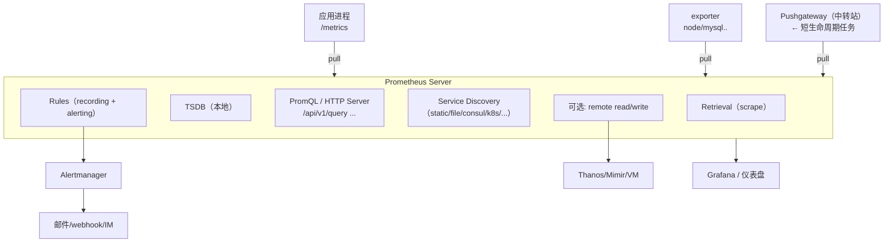

# Prometheus 架构详解

> Prometheus 是 CNCF 毕业项目、事实上的云原生指标监控标准。本篇聚焦其架构设计与核心概念：
> 拉模型（pull）、抓取（scrape）、目标（target）与服务发现（service discovery）、本地时序数据库 TSDB、
> 版本演进（2.x → 3.x）、周边生态（Alertmanager / Pushgateway / 长期存储方案）以及 retention 配置。
> TSDB 内部骨架（倒排索引/Gorilla 压缩/块组织）与横向扩展三路线的展开见 [系统设计 05 · 存储后端设计](../06-system-design/storage-backends.md)。

## 1. 整体架构鸟瞰

Prometheus 的核心是一个**独立的、自包含的时序数据库 + 抓取调度器 + 查询引擎**：



要点：

- **每个 Prometheus Server 都是自治的**：它不依赖集群中的其他组件即可完成抓取、存储、查询、告警评估。这种"单机可用"的设计让它非常适合做联邦（federation）和分层部署。
- 数据流是**单向拉取**：Prometheus 主动向 target 发起 HTTP GET，target 只需暴露一个只读文本端点。
- 告警评估在 Prometheus 内部完成，**通知路由在 Alertmanager** 中完成（两者职责分离，见阶段 1 告警笔记）。

官方架构图见：<https://prometheus.io/docs/introduction/overview/#architecture>（访问日期：2026-11-04）

## 2. 拉模型（Pull）vs 推模型（Push）

### 2.1 两种数据流向对比

| 维度 | 拉模型（Prometheus） | 推模型（StatsD / Datadog Agent / InfluxDB telegraf） |
| --- | --- | --- |
| 数据流向 | 监控服务器 → HTTP GET → 目标 | 目标 → 上报 → 监控服务器 |
| 目标感知 | 服务端需要"目标清单"（服务发现） | 服务端无需预先知道目标 |
| 目标健康 | 抓不到 = 目标挂了，`up == 0` 自动产生信号 | 推不上来时较难区分"没数据"与"挂了" |
| 速率控制 | 抓取频率由中心统一控制 | 每个客户端各自控制，易被打爆 |
| 短生命周期任务 | 不友好（进程退出前没被抓到）→ 用 Pushgateway 补位 | 天然支持 |
| NAT/防火墙 | 目标必须可被服务端访问 | 只需客户端能访问服务端 |
| 批处理任务 | 不友好 | 友好 |

### 2.2 为什么 Prometheus 选择 Pull

1. **健康检查免费赠送**：每一次抓取本身就是一次存活探测。`up{job="..."}` 是最重要的内置指标——抓取失败即置 0，天然给出"目标不可用"信号，而推模型需要额外的心跳/超时机制。
2. **速率与压力可控**：抓取间隔、超时、并发都由 Prometheus 统一调度，客户端无法压垮服务端。
3. **调试友好**：任何目标都可以用 `curl http://target/metrics` 直接看到原始数据，问题定位极其简单。
4. **天然防止"坏数据"**：拉取时若目标正在启动/关闭，最多损失一个样本，不会出现洪泛。

### 2.3 Pull 的短板与补位方案

- **短生命周期任务**（批处理、CI job、Lambda）：进程活不过一个抓取周期。官方答案是 **Pushgateway**：任务把指标推到 Pushgateway 常驻，Prometheus 再从 Pushgateway 拉。注意 Pushgateway 上的指标**不会自动过期**（进程死了指标还在），必须配合 `delete` API 或按分组清理，否则会永远展示最后一次的值。
- **网络不可达**（边缘节点、客户内网）：用联邦（federation）分层拉取，或 remote write 中转。
- **强制推模式的环境**：Prometheus 3.x 起内置 OTLP 接收器（`--web.enable-otlp-receiver`），可以用 OpenTelemetry SDK 以 OTLP HTTP 推送指标进 Prometheus，这是官方对推场景的正式补位。参考：<https://prometheus.io/docs/guides/opentelemetry/>（访问日期：2026-11-04）

### 2.4 一个常见误解

> "Pull 意味着实时性差。"

抓取间隔默认 15s~60s，对指标监控而言完全够用（指标本来就用于趋势与告警，不是逐请求追踪）。需要毫秒级实时性的场景属于 tracing/profiling 的领地。

## 3. 抓取（scrape）、目标（target）与服务发现（service discovery）

### 3.1 三个概念

- **target（目标）**：一个被抓取的 HTTP 端点（IP:port + metrics path），如 `http://10.0.0.5:9100/metrics`。
- **scrape（抓取）**：Prometheus 按固定间隔对这些端点执行 GET，解析文本，写入 TSDB。每次抓取会自动附加两个标签：`job`（必带，来自配置）和 `instance`（默认 `host:port`，唯一标识一个被抓取端点）。
- **service discovery（SD，服务发现）**：动态生成 target 列表的机制。静态环境用 `static_configs`；动态环境（K8s、Consul、DNS、EC2…）用对应 SD 机制。

### 3.2 最小可用的 prometheus.yml

```yaml
global:
  scrape_interval: 15s      # 默认抓取间隔
  evaluation_interval: 15s  # 告警/记录规则评估间隔
  scrape_timeout: 10s       # 单次抓取超时（必须 <= scrape_interval）

scrape_configs:
  # 1) 抓取 Prometheus 自身
  - job_name: prometheus
    static_configs:
      - targets: ['localhost:9090']

  # 2) 静态目标列表：常见于物理机/虚机/裸容器
  - job_name: node
    static_configs:
      - targets: ['192.168.1.10:9100', '192.168.1.11:9100']
        labels:
          env: prod            # 附加静态标签，抓取时打在该 job 所有序列上

  # 3) 文件式服务发现：target 列表来自文件，文件变化自动热加载
  - job_name: apps-file
    file_sd_configs:
      - files: ['/etc/prometheus/targets/*.yml']   # 支持 glob
        refresh_interval: 30s

  # 4) Kubernetes SD：自动发现 Pod（带 annotation 过滤）
  - job_name: kubernetes-pods
    kubernetes_sd_configs:
      - role: pod
    relabel_configs:
      - source_labels: [__meta_kubernetes_pod_annotation_prometheus_io_scrape]
        action: keep
        regex: "true"
      - source_labels: [__meta_kubernetes_pod_annotation_prometheus_io_path]
        action: replace
        target_label: __metrics_path__
        regex: (.+)
```

配置语法权威参考：<https://prometheus.io/docs/prometheus/latest/configuration/configuration/>（访问日期：2026-11-04）

### 3.3 relabel_configs：抓取前的标签改写

服务发现产出的原始 target 往往携带大量元标签（`__meta_*`，仅存在于抓取阶段，不会入库）。`relabel_configs` 在抓取**之前**对它们做改写/过滤：

| action | 作用 | 典型用途 |
| --- | --- | --- |
| `replace`（默认） | 用正则改写/生成标签 | 从 `__meta_*` 提取 `namespace`、`pod` |
| `keep` / `drop` | 按 regex 保留/丢弃 target | 只抓带注解的 Pod |
| `labeldrop` / `labelkeep` | 删除标签 | 清理含敏感信息的标签 |
| `hashmod` | 对标签 hash 取模 | 分片抓取（多实例水平扩展） |

入库后对样本标签做改写则用 `metric_relabel_configs`（例如丢弃高基数指标 `drop` 掉 `container_id` 标签）。两者名字很像，区别就一句话：**relabel 作用于 target，metric_relabel 作用于已抓到的样本**。

### 3.4 常用服务发现机制一览

| SD 机制 | 适用环境 | 发现的对象 |
| --- | --- | --- |
| `static_configs` | 固定环境、测试 | 手写 target 列表 |
| `file_sd_configs` | 有配置管理（Ansible/Chef）的主机清单 | 文件中的 target 列表 |
| `consul_sd_configs` | Consul 注册中心 | 注册的服务实例 |
| `dns_sd_configs` | DNS SRV/A 记录可动态变更 | 域名背后的实例 |
| `kubernetes_sd_configs` | K8s（node/service/pod/endpoint/ingress） | 集群工作负载 |
| `ec2_sd_configs` / `azure_*` / `gce_*` | 云厂商 | 云主机 |
| `http_sd_configs` | 自研服务目录 | HTTP 接口返回的 target JSON |

### 3.5 内置抓取指标（必须记住）

每次抓取 Prometheus 都会自动生成一组指标，是排障的第一现场：

| 指标 | 类型 | 含义 |
| --- | --- | --- |
| `up{job,instance}` | gauge | 抓取成功 1 / 失败 0。**最重要的健康信号** |
| `scrape_duration_seconds{job,instance}` | gauge | 本次抓取耗时 |
| `scrape_samples_scraped` | gauge | 本次抓到的样本数（暴涨往往是高基数征兆） |
| `scrape_samples_post_metric_relabeling` | gauge | 经过 metric_relabel 之后实际入库的样本数 |
| `scrape_body_size_bytes` | gauge | 响应体大小（受 `body_size_limit` 限制，默认 0 = 不限制） |

## 4. TSDB：本地时序数据库

### 4.1 存储模型

Prometheus 将样本存为 `(时间戳, float64 值)` 序列，同一序列的标识是 `__name__ + labels`。存储组织为：

- **按时间分块（block）**：默认每 2 小时一个 block 目录，包含该时间窗内所有序列的压缩数据（chunk）+ 索引 + 元数据。后台会将小 block 逐步合并（compaction）为更大的 block（最长跨度可达 31 天，保留窗口的 10%）。
- **内存头块（head block）**：最近 2 小时数据先在内存，落盘前可被查询。
- **WAL（Write-Ahead Log）**：抓取样本先写 WAL 再入库，进程崩溃后重放 WAL 恢复最近数据。
- **倒排索引**：按标签对 → 序列 ID 建索引，使 `http_requests_total{status="500"}` 这类按标签筛选的查询极快。

### 4.2 设计取舍：本地优先，不做分布式

Prometheus 官方定位是**单机、可靠、可依赖本地盘**的监控系统：每个实例独立抓取并保存完整数据，不做副本、不分片（那是 Thanos/Mimir/VictoriaMetrics 等远程方案的事）。这样换来的是极简运维与极低查询延迟——单实例可轻松承载百万级活跃序列。

### 4.3 数据目录与 head 系列

- 数据目录（`--storage.tsdb.path`，默认 `data/`）下：`01/…`（按 ULID 命名的 block）、`wal/`、`chunks_head/`。
- `prometheus_tsdb_head_series` 暴露当前活跃序列数——这是**容量规划与高基数监控**的关键自监控指标。

### 4.4 retention 配置

数据保留策略由两个启动参数控制（**二选一，同时设置时以 flag 为准**）：

```bash
# 保留最近 15 天（flag 方式）
prometheus --storage.tsdb.retention.time=15d

# 或保留约 500GB（超过即从最老 block 开始删）
prometheus --storage.tsdb.retention.size=500GB
```

也支持配置文件外置管理（3.x 起部分参数可入配置，但 retention 仍主要用 flag 传递；以你所用版本文档为准）。要点：

- retention 只能**整块删除**：最老 block 会被整体删除，所以实际保留时间会有 2h~compaction 粒度的误差。
- 默认值随版本演进：2.x 默认 15d；3.x 起 head block 默认 2h、retention 默认仍为 15d（以官方 release notes 为准：<https://prometheus.io/docs/prometheus/latest/storage/>，访问日期：2026-11-04）。
- 磁盘占用估算：`每样本约 1~2 字节（压缩后） × 每秒新样本数 × 86400 × 天数`，用 `prometheus_tsdb_head_series` × (60/interval) 估算每日样本量。

## 5. Prometheus 2.x 与 3.x 简要演进

| 版本线 | 时间 | 代表特性 |
| --- | --- | --- |
| 1.x | 2016 前后 | 初代架构，存储性能有限 |
| 2.0 | 2017-11 | 重写 TSDB，资源占用与查询性能大幅提升；remote read/write 稳定 |
| 2.x 系列 | 2017–2024 | WAL 改进、agent 模式（2.33，只抓取+remote write 不查不存）、UTF-8 metric 名逐步支持、OTLP export（2.47+ 默认开启 remote write receiver 相关能力逐步增强） |
| 3.0 | 2024-11 | 大版本：UTF-8 指标名与标签默认启用、OTLP receiver 默认开启、Remote Write 2.0 原型、原生直方图（native histogram）进入预览后逐步稳定、Go 1.23 |
| 3.x 系列 | 2024 至今 | Remote Write 2.0 正式落地、原生直方图持续增强（bucket 策略、稀疏桶）、TSDB 与查询优化、安全修复 |

3.x 升级注意（官方 migration guide：<https://prometheus.io/docs/prometheus/3.0/migration/>，访问日期：2026-11-04）：

1. **UTF-8 名称**：指标名与标签值可含更宽字符，但旧客户端/旧 Grafana 可能显示异常；`--enable-feature=strict-exporter-metric-validation` 可开启严格校验兜底。
2. **OTLP receiver 默认开启**：`/v1/metrics` 可直接收 OTLP HTTP 推送（仍建议显式加 `--web.enable-otlp-receiver` 表达意图）。
3. **压缩算法升级**（3.0 起 TSDB 支持 zstd）：旧数据由旧版本读取仍兼容，但**回滚到 2.x 前务必测试**。
4. 抓取默认 body 上限、部分 flag 更名——升级前 diff 一下 `promtool check config` 输出。

## 6. Prometheus 生态组件

| 组件 | 解决什么问题 | 一句话定位 |
| --- | --- | --- |
| **Prometheus Server** | 抓取、存储、查询、规则评估 | 核心，必部署 |
| **Alertmanager** | 告警去重、分组、路由、静默、抑制 | 告警的"大脑"，独立进程 |
| **Pushgateway** | 短生命周期任务的指标中转站 | push→pull 桥接，慎用（指标不自动过期） |
| **exporter** | 把第三方系统指标翻译成 /metrics 格式 | node/mysql/redis/blackbox…（下篇笔记详述） |
| **client library** | 应用内埋点 | Go/Python/Java/Rust… |
| **Thanos** | 长期存储 + 全局视图 + 高可用 | 对象存储为底座的横向扩展方案（一句话） |
| **Grafana Mimir** | 长期存储，Prometheus 兼容 | Grafana 系横向扩展方案（一句话） |
| **VictoriaMetrics** | 长期存储/替代 TSDB | 高压缩、低成本，兼容 PromQL 大部分语法（一句话） |
| **promtool** | 配置/规则校验、单元测试 | `promtool check config` / `test rules` |

长期存储三件套（Thanos/Mimir/VictoriaMetrics）本阶段只要求知道"Prometheus 本地盘不是为多年数据设计的，大规模场景用它们把 remote write 出去"，深入对比放到阶段 5。

## 7. 两种扩展形态：Agent 模式与联邦

### 7.1 Agent 模式（`--agent`，2.33+）

以 agent 模式启动的 Prometheus **只抓取 + remote write**，不存本地 TSDB、不提供查询：

```bash
prometheus --agent --remote-write.url=https://central.example.com/api/v1/write
```

适用场景：边缘节点 / 每 Pod 一个 sidecar / 采集后统一写到 Mimir/Thanos Receive/VictoriaMetrics。
资源占用远小于完整模式，换来的是"本地无查询能力"——排障要么去中心端查，要么临时 curl /metrics。

### 7.2 联邦（Federation）

一个中心的 Prometheus 通过 `/federate` 端点**按需拉取**下层 Prometheus 已聚合的序列：

```yaml
scrape_configs:
  - job_name: federate
    honor_labels: true
    metrics_path: /federate
    params:
      'match[]':
        - '{__name__=~"job:.*"}'     # 只拉取 recording rule 预聚合的序列
    static_configs:
      - targets: ['prom-leaf-1:9090', 'prom-leaf-2:9090']
```

联邦的坑：它是"拉序列"而非复制——拉原始高频指标时数据量大且会丢点（两次拉取之间的样本不补齐）。
正确姿势是叶子端用 recording rule 预聚合，中心只拉聚合序列；要完整历史数据请走 remote write + Thanos/Mimir。

## 8. Prometheus 自监控关键指标

监控 Prometheus 本身用什么？——它自己暴露的 `/metrics`（job=prometheus）：

| 指标 | 含义 | 告警建议 |
| --- | --- | --- |
| `up{job="prometheus"}` | 自身存活 | critical（用另一个实例/外部探测来盯） |
| `prometheus_tsdb_head_series` | 活跃序列数 | 突增 >20% 告警（高基数征兆） |
| `prometheus_tsdb_head_samples_appended_total` | 每秒入库样本数（rate） | 容量规划基准 |
| `prometheus_rule_evaluation_duration_seconds` | 规则评估耗时 | p99 > interval 的一半需警惕 |
| `prometheus_notifications_errors_total` | 向 Alertmanager 投递失败 | > 0 告警（告警黑洞风险） |
| `prometheus_sd_failed_configs` | 服务发现失败的配置数 | > 0 告警 |
| `prometheus_tsdb_compactions_failed_total` | compaction 失败 | > 0 告警 |
| `prometheus_remote_storage_samples_failed_total` | remote write 失败样本 | 持续增长告警（长期存储丢数） |

排障三件套入口：UI `/targets`（抓取错误明细）、`/service-discovery`（SD 展开结果与 relabel 链）、`/status`（运行时配置与统计）。

## 9. 常见坑（FAQ）

1. **`up == 0` 排障四连**：`curl http://instance:port/metrics` 通不通？target 端口是否监听在 `0.0.0.0`？Prometheus 容器内 DNS 是否可达（容器网络）？metrics path 是否被 relabel 改错？先看 Prometheus UI `/targets` 页的错误信息，90% 的答案在那里。
2. **docker 里抓宿主机服务**：容器内 `localhost` 是容器自己。工作区使用 podman：用 `host.containers.internal`（Mac/Win 的 podman machine 内可达宿主机）；docker 环境下等价物是 `host.docker.internal`。也可把服务加进同一容器网络用服务名。
3. **时区与时间戳**：TSDB 一律 UTC 存储，Grafana 显示时按浏览器时区转换。宿主机与容器时间不同步会导致图表"数据在未来"。
4. **scrape_timeout >= scrape_interval**：直接配置校验失败。抓取必须在一个周期内完成。
5. **relabel 与 metric_relabel 混淆**：想丢弃某个序列用 `metric_relabel_configs` 的 `drop`；想不抓某个目标用 `relabel_configs` 的 `drop`。
6. **Pushgateway 滥用**：把常驻服务也推到 Pushgateway 会丢掉 `up` 健康信号且标签易冲突。只用于短任务，且要有清理策略。
7. **重启后数据没了**：容器没挂 volume。`/prometheus` 数据目录必须持久化（见 lab01 的 compose 配置）。
8. **内存持续上涨**：先看 `prometheus_tsdb_head_series` 是否暴涨——几乎总是高基数标签（user_id、request_id 之类）混进了指标。

## 10. 面试题小结

1. **Q：Prometheus 为什么用 pull 而不是 push？**
   A：抓取即健康检查（`up` 指标免费获得）；抓取速率由中心统一控制，客户端无法压垮服务端；可用 curl 直接调试任意目标；目标启动/关闭时最多损失一个样本。短任务场景用 Pushgateway 或 OTLP receiver 补位。
2. **Q：`up` 指标是谁产生的？target 挂了为什么还能查到数据？**
   A：由 Prometheus 抓取循环生成，属于"合成指标"。target 失联后 Prometheus 仍会持续写入 `up=0` 样本（并附 `scrape_*` 失败信息），所以 `up` 永远有最新值——这正是它能当存活告警的原因。
3. **Q：scrape_interval 和 evaluation_interval 的区别？**
   A：前者是拉取指标数据的节奏；后者是评估 alerting/recording rules 的节奏。两者独立，通常同为 15s~1m。
4. **Q：Prometheus 的数据是怎么组织的？为什么查询快？**
   A：按 2h block 分块存储 + 倒排索引（标签对→序列）+ chunk 压缩。按标签过滤的查询走倒排索引直接定位序列，时间范围再按 block 裁剪。
5. **Q：单机 Prometheus 挂了怎么办？长期数据怎么办？**
   A：常用双实例对等抓取（简单 HA）；长期存储/全局查询用 Thanos / Mimir / VictoriaMetrics 通过 remote write 横向扩展。Prometheus 本身定位单机自治，不做内置副本。
6. **Q：relabel_configs 与 metric_relabel_configs 的区别？**
   A：前者在抓取前作用于 target 元数据（可决定抓不抓、改 address/path）；后者作用于已抓到的样本（可丢弃序列、改写标签入库前"消毒"）。
7. **Q：retention 怎么配？为什么设置了 15d 实际有时是 14.8d 或 16d？**
   A：`--storage.tsdb.retention.time`（或 size）。删除以 block 为单位，最老 block 整块删除，粒度受 compaction 影响，故实际保留时间存在块粒度误差。
8. **Q：agent 模式和联邦各适合什么场景？**
   A：agent 模式适合"只采集不存储、集中写入远端"的边缘/sidecar 场景；联邦适合分层组织多个 Prometheus、中心只拉预聚合序列（recording rule 结果）做全局视图。要完整历史用 remote write 而非联邦。

## 11. 参考资料

- Prometheus 官方文档 Overview（架构图）：<https://prometheus.io/docs/introduction/overview/>（访问日期：2026-11-04）
- 配置参考（scrape_configs / SD / relabel）：<https://prometheus.io/docs/prometheus/latest/configuration/configuration/>（访问日期：2026-11-04）
- TSDB 存储：<https://prometheus.io/docs/prometheus/latest/storage/>（访问日期：2026-11-04）
- Pushgateway 文档：<https://github.com/prometheus/pushgateway>（访问日期：2026-11-04）
- Prometheus 3.0 发布说明与迁移指南：<https://prometheus.io/docs/prometheus/3.0/migration/>（访问日期：2026-11-04）
- Thanos：<https://thanos.io/>；Grafana Mimir：<https://grafana.com/docs/mimir/latest/>；VictoriaMetrics：<https://victoria.net.cn/>（访问日期：2026-11-04）

## 附：ASCII 图替换清单

| 原 ASCII 图位置（章节标题） | 原图内容简述 | 替换结果 |
| --- | --- | --- |
| 1. 整体架构鸟瞰 | 应用/exporter/Pushgateway pull → Prometheus Server 内部组件 → Alertmanager/长期存储/Grafana 的整体架构 | flowchart TD |
