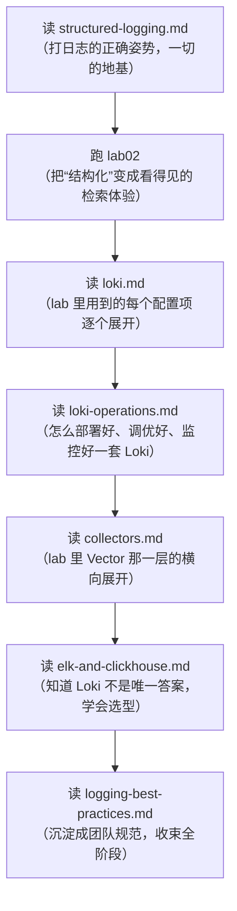

# 阶段 2 · 日志 Logging

> 日志是三大支柱中最古老、信息密度最高、也最容易失控（日志太多、太贵、查不到）的一环。
> 本阶段回答四个问题：**怎么打**（结构化）、**怎么存**（Loki / ELK / ClickHouse 选型）、
> **怎么采**（Vector / Fluent Bit / Filebeat 对比）、**怎么管**（规范与治理清单）。

## 学习目标

完成本阶段后，你应该能够：

1. 用任意主流语言写出**结构化、可检索、不含敏感信息**的日志，并说清每条字段的用途；
2. 画出 Loki 的架构图（distributor / ingester / querier / query-frontend / compactor / 对象存储），
   并解释"只索引 label 不索引全文"背后的成本取舍；
3. 熟练使用 **LogQL**：流选择器、行过滤器、`| json` 解析器、`rate / unwrap` 指标查询；
4. 针对 ELK / ClickHouse / Loki / 云托管给出有理由的选型建议（什么规模、什么团队、选什么）；
5. 用 Vector/Fluent Bit 独立完成一条采集链路：解析、脱敏、多行合并、路由、降采样。

## 笔记索引

| 笔记 | 主题 | 一句话摘要 |
|------|------|-----------|
| [structured-logging.md](structured-logging.md) | 结构化日志 | 字符串拼接 vs JSON 的检索效率对比、标准字段表、级别语义、多语言日志库、脱敏与"日志≠审计库"的边界 |
| [loki.md](loki.md) | Grafana Loki 深入 | 只索引 label 的设计哲学、核心组件拆解、label vs 内容字段（高基数的坑）、LogQL 15+ 实战示例、3.x 新特性 |
| [loki-operations.md](loki-operations.md) | Loki 运维深水区 | 部署模式（SSM/微服务）、schema 与 chunk 编码、ingester 内存模型与 chunk 生命周期、限流/缓存/查询保护、ruler 日志告警、容量速算、自监控指标（cortex_ 前缀）、故障恢复手册 |
| [elk-and-clickhouse.md](elk-and-clickhouse.md) | 存储选型对比 | ELK/EFK 架构与 ES 倒排索引的开销、ClickHouse 列存方案、四维对比表、云托管一览、决策树 |
| [collectors.md](collectors.md) | 采集器对比与配置 | Vector 架构与 VRL 完整示例、Fluent Bit tail/多行配置、Filebeat 基础、对比表、容器（Docker/Podman）stdout 采集的坑 |
| [logging-best-practices.md](logging-best-practices.md) | 实践清单 | 一条好日志的 checklist、错误日志三要素、trace_id 关联预览、日志量治理、指标下钻到日志 |

## 配套实验

**[labs/lab02-loki-vector-logging/](../../labs/lab02-loki-vector-logging/README.md)**
—— Python(structlog) → stdout JSON（tee 双写共享卷文件）→ Vector(file source，解析/脱敏) → Loki(本地模式) → Grafana(预置仪表盘)，
`podman compose up -d --build` 一键运行，含 12 条可复制的 LogQL 验证查询与思考题。

## 建议学习路径

## 本阶段关键外部资料

- Grafana Loki 官方文档：<https://grafana.com/docs/loki/latest/>（访问日期：2026-11-04）
- LogQL 语法参考：<https://grafana.com/docs/loki/latest/query/>（访问日期：2026-11-04）
- Vector 官方文档 / VRL：<https://vector.dev/docs/> 、<https://vector.dev/docs/reference/vrl/>（访问日期：2026-11-04）
- Fluent Bit 文档：<https://docs.fluentbit.io/manual/>（访问日期：2026-11-04）
- OpenTelemetry Logs 规范：<https://opentelemetry.io/docs/specs/otel/logs/>（访问日期：2026-11-04）
- structlog 文档：<https://www.structlog.org/en/stable/>（访问日期：2026-11-04）
- Go `log/slog` 标准库：<https://pkg.go.dev/log/slog>（访问日期：2026-11-04）

## 附：ASCII 图替换清单

| 原 ASCII 图位置（章节标题） | 原图内容简述 | 替换结果 |
| --- | --- | --- |
| 建议学习路径 | 七篇笔记/lab 的顺序学习路径（↓ 串联） | flowchart TD |
