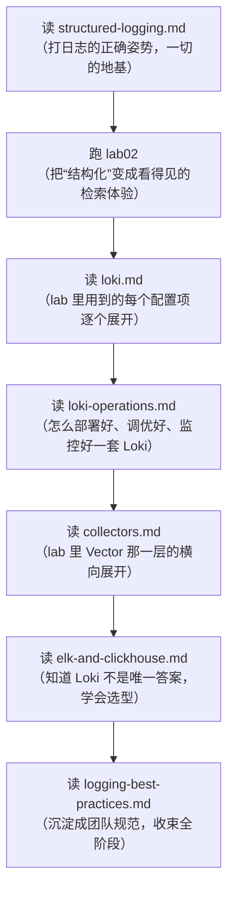

# 阶段 2 · 日志 Logging

> 日志是三大支柱中最古老、信息密度最高、也最容易失控（日志太多、太贵、查不到）的一环。
> 本阶段回答四个问题：**怎么打**（结构化）、**怎么存**（Loki / ELK / ClickHouse 选型）、
> **怎么采**（Vector / Fluent Bit / Filebeat 对比）、**怎么管**（规范与治理清单）。

## 学习目标

完成本阶段后，你应该能够：

1. 用任意主流语言写出**结构化、可检索、不含敏感信息**的日志，并说清每条字段的用途；
2. 画出 Loki 的架构图（distributor / ingester / querier / query-frontend / compactor / 对象存储），
   并解释"只索引 label 不索引全文"背后的成本取舍；
3. 熟练使用 **LogQL**：流选择器、行过滤器、`| json` 解析器、`rate / unwrap` 指标查询；
4. 针对 ELK / ClickHouse / Loki / 云托管给出有理由的选型建议（什么规模、什么团队、选什么）；
5. 用 Vector/Fluent Bit 独立完成一条采集链路：解析、脱敏、多行合并、路由、降采样。

## 笔记索引

| 笔记 | 主题 | 一句话摘要 |
|------|------|-----------|
| [structured-logging.md](structured-logging.md) | 结构化日志 | 字符串拼接 vs JSON 的检索效率对比、标准字段表、级别语义、多语言日志库、脱敏与"日志≠审计库"的边界 |
| [loki.md](loki.md) | Grafana Loki 深入 | 只索引 label 的设计哲学、核心组件拆解、label vs 内容字段（高基数的坑）、LogQL 15+ 实战示例、3.x 新特性 |
| [loki-operations.md](loki-operations.md) | Loki 运维深水区 | 部署模式（SSM/微服务）、schema 与 chunk 编码、ingester 内存模型与 chunk 生命周期、限流/缓存/查询保护、ruler 日志告警、容量速算、自监控指标（cortex_ 前缀）、故障恢复手册 |
| [elk-and-clickhouse.md](elk-and-clickhouse.md) | 存储选型对比 | ELK/EFK 架构与 ES 倒排索引的开销、ClickHouse 列存方案、四维对比表、云托管一览、决策树 |
| [collectors.md](collectors.md) | 采集器对比与配置 | Vector 架构与 VRL 完整示例、Fluent Bit tail/多行配置、Filebeat 基础、对比表、容器（Docker/Podman）stdout 采集的坑 |
| [logging-best-practices.md](logging-best-practices.md) | 实践清单 | 一条好日志的 checklist、错误日志三要素、trace_id 关联预览、日志量治理、指标下钻到日志 |

## 配套实验

**[labs/lab02-loki-vector-logging/](../../labs/lab02-loki-vector-logging/README.md)**
—— Python(structlog) → stdout JSON（tee 双写共享卷文件）→ Vector(file source，解析/脱敏) → Loki(本地模式) → Grafana(预置仪表盘)，
`podman compose up -d --build` 一键运行，含 12 条可复制的 LogQL 验证查询与思考题。

## 建议学习路径

## 本阶段关键外部资料

- Grafana Loki 官方文档：<https://grafana.com/docs/loki/latest/>（访问日期：2026-11-04）
- LogQL 语法参考：<https://grafana.com/docs/loki/latest/query/>（访问日期：2026-11-04）
- Vector 官方文档 / VRL：<https://vector.dev/docs/> 、<https://vector.dev/docs/reference/vrl/>（访问日期：2026-11-04）
- Fluent Bit 文档：<https://docs.fluentbit.io/manual/>（访问日期：2026-11-04）
- OpenTelemetry Logs 规范：<https://opentelemetry.io/docs/specs/otel/logs/>（访问日期：2026-11-04）
- structlog 文档：<https://www.structlog.org/en/stable/>（访问日期：2026-11-04）
- Go `log/slog` 标准库：<https://pkg.go.dev/log/slog>（访问日期：2026-11-04）

## 附：ASCII 图替换清单

| 原 ASCII 图位置（章节标题） | 原图内容简述 | 替换结果 |
| --- | --- | --- |
| 建议学习路径 | 七篇笔记/lab 的顺序学习路径（↓ 串联） | flowchart TD |

---

## 阶段导读：为什么要有这个阶段

日志是最古老、信息密度最高、也最容易失控的信号：它早在指标和 trace 普及之前就撑起了排障，但也最容易变成"打了一大堆、出事查不出、存储费用吓死人"的负债。本阶段的目标是把日志从"随手 print"升级成一条**可治理的工程链路**，回答四个问题：

1. **怎么打**：结构化——每条日志是一条带类型字段的记录，这是后续一切检索、聚合、关联的前提（structured-logging）；
2. **怎么存**：Loki / ELK / ClickHouse 三条路线的架构、成本模型与选型决策（loki、loki-operations、elk-and-clickhouse）；
3. **怎么采**：Vector / Fluent Bit / Filebeat 在"应用输出"与"存储后端"之间的解析、脱敏、多行合并与路由（collectors）；
4. **怎么管**：级别语义、脱敏边界、日志量治理清单（logging-best-practices）。

在整条路径中的位置：阶段 1 的指标负责"发现异常"，本阶段的日志负责"解释异常"——指标告警之后的第一步下钻就是查日志。到阶段 4，日志会带上 trace_id 加入三支柱关联；lab02 里用 Vector 做的字段加工，到阶段 6 接入管道设计时会以架构视角再次出现。

建议顺序遵循上方学习路径图：先读 structured-logging（一切的地基），再做 lab02 把"结构化"变成看得见的检索体验，然后逐篇展开。**第一篇比选型更重要**：字段设计得好，换任何后端都不难受；字段设计得差，最强的引擎也查不出东西。

## 常见误区与正解

- **误区一："先把日志打出来，以后要查再想办法。"**
  为什么错：非结构化字符串的字段提取依赖正则猜测，格式一变全部失效；事后"想办法"的成本远高于打日志时多写几个字段。
  正解：从第一天就结构化（JSON 或键值对），固定 `timestamp/level/logger/message` 标准字段，业务字段按规范命名。
- **误区二："日志存得越久越安全。"**
  为什么错：日志量与存储成本线性相关，而绝大多数查询集中在最近几天；无差别长保留是典型的低回报支出。
  正解：分级保留——ERROR 与审计相关的按要求保留更久，INFO 按排障窗口保留，冷数据进对象存储归档；保留策略写进配置而不是口头约定。
- **误区三："ERROR 用来引起注意，多打几条没关系。"**
  为什么错：级别是日志的"严重度坐标系"，一旦失真，告警规则、值班判断、自动化工具全部失效；ERROR 泛滥等于没有 ERROR。
  正解：ERROR = 需要人介入的失败；预期内的降级与重试用 WARN，流程细节用 DEBUG/INFO。级别语义要像代码规范一样写进团队约定。
- **误区四："选型有标准答案，大厂用 ELK 我们也用。"**
  为什么错：三条路线对应不同的规模与团队形态——ELK 全文检索强但资源开销大，Loki 靠标签便宜但查询模式受限，ClickHouse 分析力强但要自己搭管道；脱离规模谈选型没有意义。
  正解：按"日志量 × 查询模式 × 团队运维能力"三维决策（elk-and-clickhouse 的决策树），小团队优先托管服务或 Loki。
- **误区五："采集器装上就行，没什么可配的。"**
  为什么错：解析、多行合并、脱敏、背压、路由全部发生在采集层；这层配错，后端拿到的是"一坨还要再 parse 的文本"，甚至把敏感信息直接送进存储。
  正解：显式配置 JSON 解析、多行规则、脱敏转换（如 VRL），并给采集器自身配置监控与告警。

## 术语速查表

| 术语 | 英文 | 一句话解释 |
| --- | --- | --- |
| 结构化日志 | Structured Logging | 每条日志是一条带类型字段的记录（JSON/键值对），而非自然语言句子。 |
| 严重度 | Severity | 日志级别语义（DEBUG/INFO/WARN/ERROR 等），OTel 有标准级别枚举。 |
| 标签 | Label | Loki 只为其建索引的低基数键值对，决定日志流怎么切分。 |
| 流选择器 | Stream Selector | LogQL 中 `{app="foo"}` 形式的标签匹配表达式。 |
| LogQL | LogQL | Loki 的查询语言：流选择 + 行过滤 + 解析器 + 指标聚合。 |
| 倒排索引 | Inverted Index | ELK 的核心结构：从词找到包含它的文档，功能强但写入与存储开销大。 |
| 列存 | Column-oriented Storage | ClickHouse 的存储方式：按列压缩与聚合，适合日志的大规模分析查询。 |
| 采集器 | Log Collector / Agent | 部署在数据源附近，负责发现、解析、加工、转发日志的进程。 |
| 多行合并 | Multiline Grouping | 把堆栈跟踪等多行条目合并为一条日志记录的处理。 |
| 脱敏 | Data Masking | 在打印或采集时抹去密码、token、证件号等敏感字段。 |
| 保留策略 | Retention | 各级别日志保留多久、存于哪层介质（热/温/冷）的治理规则。 |

权威入口：Grafana Loki 官方文档 `https://grafana.com/docs/loki` （官方文档） 、Vector 官方文档 `https://vector.dev/docs` （官方文档） 、ClickHouse 官方文档 `https://clickhouse.com/docs` （官方文档） 。

## 与下一阶段的接口：日志给后面阶段留下什么

日志不是孤立的一站，它给后面每个阶段都留下了接口，读后续阶段之前先知道这些"预留插口"：

- **给阶段 3（链路追踪）**：logging-best-practices 预览过的 trace_id 字段，前提是日志结构化且字段名统一。字段名漂移（一会儿 `trace_id`、一会儿 `traceId`）会让后面的关联配置直接失效——命名纪律在这里欠的账，到阶段 4 一定要还；
- **给阶段 4（整合）**：Grafana 的 derivedFields 靠正则从日志正文提取 trace_id 生成跳转链接——正则能不能写对，取决于本阶段的字段纪律；ERROR 级别语义失真，"错误日志带 trace_id"这条证据链也会跟着失去意义；
- **给阶段 5（生产进阶）**：本阶段的"日志量治理"清单，在生产化阶段升级为采样与分层保留的成本工程；"脱敏"清单则变成管道层（阶段 6 接入管道）的必备加工项；
- **给阶段 6（系统设计）**：elk-and-clickhouse 的三路线对比与成本分析，正是 storage-backends"日志存储三路线"设计章的素材——现在你站在"选型者"视角，到阶段 6 换成"设计者"视角重读一遍，收获完全不同。

一个返工信号：到阶段 4 配 derivedFields 时，发现日志里根本没有统一的 trace_id 字段，或 ERROR 日志里没有异常上下文——回 structured-logging 的标准字段表与级别语义节补课，不要在关联配置里硬凑正则。另一个检验：合上笔记，你能对同事说清"为什么 Loki 敢只索引 label"这个设计决定的三层理由（写路径、存储成本、查询模式）吗？说不全，说明 loki.md 还没读完。

## 自检清单（进入下一阶段前）

- [ ] 能用一句话说清结构化日志与非结构化日志在"检索成本"上的差异；
- [ ] 能画出 Loki 的读写路径，并解释"只索引 label"的写路径收益与查询模式代价；
- [ ] 能写出"流选择器 + 行过滤器 + `| json` 解析 + 指标聚合"的完整 LogQL，并说出每一段的作用；
- [ ] 能按"日志量 × 查询模式 × 运维能力"三个维度，为小团队、中大型自研团队、强合规团队各给一个存储选型与理由；
- [ ] 能口述 Vector 里"解析 + 脱敏 + 路由"两三步 VRL 转换的写法思路（不必默写，思路对即可）；
- [ ] 能说出 ERROR / WARN / INFO 的级别语义边界，并举出各自的一个标准场景；
- [ ] 能说出敏感信息治理的两道防线（打印时少打、采集时兜底脱敏）以及为什么不能只靠其中一道；
- [ ] 已完成 lab02 并把 README 里的验证查询逐条跑通过，至少改坏过一个配置观察报错形态。

全过的标准不是"看过"，而是每一条都能对着 lab02 的真实环境演示给别人。有打不了勾的条目，回对应笔记补齐再进阶段 3。

## 一页速记：日志链路五句话

1. 日志是写给机器读的，顺便给人看——结构化是检索、聚合、关联三件事的总前提。
2. 字段先于引擎：标准字段表在第一天定下来，换任何存储后端都不难受。
3. 级别是坐标系：ERROR 只留给需要人介入的失败，用 WARN/INFO 描述流程与降级。
4. 标签表类别、正文放细节：Loki 的高基数事故都从"把细节塞进 label"开始。
5. 采集层不是搬运工：解析、脱敏、多行合并、路由，全在这一层显式配置。

五句话对照五篇主笔记：结构化、字段设计、级别语义、Loki 标签纪律、采集器配置——哪句说不透就回哪篇。
