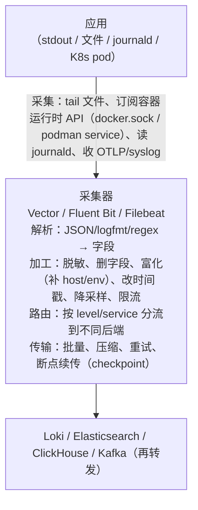

# 采集器对比与配置：Vector / Fluent Bit / Filebeat

> 应用把日志写到 stdout/文件后，中间需要一层"采集器"完成：发现日志源、解析、
> 脱敏/富化、多行合并、路由、批量传输、断点续传。这层的选择与配置质量，
> 决定了后端（Loki/ES/CH）拿到的是"干净的字段"还是"一坨还要再 parse 的文本"。

- [1. 采集器在链路中的位置](#1-采集器在链路中的位置)
- [2. Vector：架构与配置模型](#2-vector架构与配置模型)
- [3. VRL（Vector Remap Language）完整示例](#3-vrlvector-remap-language完整示例)
- [4. Fluent Bit：架构与 tail 完整配置](#4-fluent-bit架构与-tail-完整配置)
- [5. 多行日志处理](#5-多行日志处理)
- [6. Filebeat 基础](#6-filebeat-基础)
- [7. 三者对比表](#7-三者对比表)
- [8. 生产部署形态（一句话预览）](#8-生产部署形态一句话预览)
- [9. 容器日志驱动与 stdout 采集的坑（Docker 与 Podman）](#9-容器日志驱动与-stdout-采集的坑docker-与-podman)
- [10. 常见坑](#10-常见坑)
- [11. 面试题小结](#11-面试题小结)
- [12. 参考资料](#12-参考资料)

---

## 1. 采集器在链路中的位置



为什么不让应用直接写后端？三个理由：

1. **解耦**：应用重启/升级不应牵动日志后端配置；后端故障时应用不阻塞（stdout 永远能写）；
2. **横切关注点**：脱敏、格式统一、采样这类"组织级策略"放在采集层，比改几十个应用便宜；
3. **可靠性**：采集器负责批量/压缩/重试/checkpoint，应用零成本获得"日志不丢"语义（尽力而为）。

## 2. Vector：架构与配置模型

### 2.1 数据模型与组件

Vector（Rust，Datadog 开源）把管道抽象为三段：

| 组件 | 职责 | 常用项 |
|------|------|--------|
| **sources** | 产生事件（一行日志 = 一个 JSON 事件） | `docker_logs`、`file`、`kubernetes_logs`、`http`、`socket`(syslog)、`kafka`、`internal_logs`、OTLP `otel`（v0.6x 支持 otlp source） |
| **transforms** | 加工事件 | `remap`（VRL，万能）、`filter`、`sample`（降采样）、`dedupe`（去重）、`route`（分流）、`throttle`（限流）、`add_fields` |
| **sinks** | 输出 | `loki`、`elasticsearch`、`clickhouse`、`kafka`、`console`、`blackhole`、`http` |

> `docker_logs` source 依赖 Docker Engine API。在 podman 环境下要么用 `podman system service`
> 暴露一个 docker 兼容 socket（可行但路径/权限随 podman machine 变化），要么改用 `file`
> source 采集日志文件——本工作区 lab02 采用后者（应用双写共享卷文件），详见
> [labs/lab02-loki-vector-logging/](../../labs/lab02-loki-vector-logging/README.md)。

配置（TOML/YAML/JSON）声明一个 **DAG**：`inputs = [...]` 连接组件，事件沿边流动，
每个组件独立并发。类型系统强：VRL 表达式在加载时编译检查（拼错字段/类型错在启动时就报）。

### 2.2 最小可用骨架（lab02 即此结构：file source）

```toml
[sources.app_file]
type = "file"
include = ["/var/log/lab02/app.log"]   # tail 应用双写出来的共享卷日志文件
read_from = "beginning"                # 首次发现文件从头读；之后靠 data_dir checkpoint 续读

[transforms.parse]
type = "remap"
inputs = ["app_file"]
source = '. = merge(., parse_json!(string!(.message)))'

[sinks.loki]
type = "loki"
inputs = ["parse"]
endpoint = "http://loki:3100"

[sinks.loki.labels]
job = "lab02"
```

若运行环境是 Docker，也可以用 `docker_logs` source 订阅容器 stdout（`include_labels`
过滤容器 label）；podman 环境优先走上面的 `file` 方案——它同时是生产 K8s 的形态
（kubelet 落盘 + DaemonSet tail 宿主机日志文件）。

### 2.3 运维面

- `vector validate / tap / top`（CLI 校验配置、在线观察事件、看拓扑吞吐）；
- API（默认 8686）暴露 GraphQL，可查内部指标；
- 自身暴露 Prometheus 指标（`internal_metrics` source 或 `--metrics` 全局配置），
  生产必看：`buffer_events`、`http_*_response_errors`。

## 3. VRL（Vector Remap Language）完整示例

VRL 是一门**编译期类型检查的领域语言**，专为"日志行 → 结构化事件"设计。
文档：<https://vector.dev/docs/reference/vrl/>（访问日期：2026-11-04）。

核心心智模型：

- 每条事件是一个对象 `.`（点号即"当前事件"），字段访问 `.field.nested`；
- 函数分**可失败/不可失败**：可失败函数用 `foo(...)` 拿 `(result, err)`，或 `foo!(...)`
  失败时中止（丢弃该事件）——`!` 除非确定不会失败，否则别乱用；
- `if/else`、变量、`for` 循环齐全，但目标是小段变换（几十行），不是写应用。

### 3.1 一个综合 transform（解析 → 脱敏 → 富化 → 改时间戳 → 打标）

```toml
[transforms.normalize]
type = "remap"
inputs = ["app_file"]
source = '''
# ---------- 1. 解析 JSON 行（失败时保留原样，绝不静默丢） ----------
raw, err = parse_json(string!(.message))
if err == null {
    . = merge(., raw)          # 应用字段平铺到根级
    del(.message)
    .parsed_json = true
} else {
    .parsed_json = false       # 留待排查（容器启动输出、panic 行等）
}

# ---------- 2. 删除/脱敏敏感字段（纵深防御） ----------
if exists(.user_email) { del(.user_email) }          # PII：直接删
if exists(.authorization) { .authorization = "REDACTED" }
if exists(.phone) {
    p = string!(.phone)
    .phone = truncate(p, length: 3) + "****"          # 138****1234
}

# ---------- 3. 规范化（大小写/命名统一） ----------
if exists(.level) {
    .level = upcase(string!(.level))                  # error -> ERROR
}
if exists(.duration) && !exists(.duration_ms) {       # 兼容旧字段名
    .duration_ms = to_int!(.duration)
    del(.duration)
}

# ---------- 4. 富化：补环境字段 ----------
.env = get_env_var!("DEPLOY_ENV") ?? "local"
if !exists(.host) {
    .host = get_hostname!()
}

# ---------- 5. 时间戳：优先用应用时间，回退采集时间 ----------
if exists(.timestamp) {
    ts, err = parse_timestamp(string!(.timestamp), format: "%+")
    if err == null {
        .timestamp = ts
    }
}

# ---------- 6. 按内容打标（供后续 route/sample 使用） ----------
if contains(string!(.event), "security") {
    .security_relevant = true
}
'''
```

### 3.2 按级别路由 + 降采样（配 `route`/`sample` transform）

```toml
# 路由：安全日志走独立通道，其余按级别
[transforms.route_by_kind]
type = "route"
inputs = ["normalize"]
route.security = 'contains(string!(.event), "security")'
route.debug    = '.level == "DEBUG"'
route.default  = 'true'

# DEBUG 降采样：只留 5%
[transforms.sample_debug]
type = "sample"
inputs = ["route_by_kind.debug"]
rate = 20            # 1/20 ≈ 5%
exclude = '.status >= 500'   # 排除条件优先级更高：错误即使 DEBUG 也全留

[sinks.loki_main]
type = "loki"
inputs = ["route_by_kind.default", "sample_debug"]     # 合流
endpoint = "http://loki:3100"

[sinks.clickhouse_security]
type = "clickhouse"
inputs = ["route_by_kind.security"]
endpoint = "http://clickhouse:8123"
database = "audit"
table = "security_events"
```

去重（防御性）：

```toml
[transforms.dedupe_errors]
type = "dedupe"
inputs = ["normalize"]
# 5 秒窗口内，同 fingerprint（级别+事件+用户）视为重复，只放第一条
fields.match = ["level", "event", "user_id"]
cache.num_events = 5000
timeout_ms = 5000
```

> lab02 的完整可运行版本见 `labs/lab02-loki-vector-logging/vector/vector.toml`。

## 4. Fluent Bit：架构与 tail 完整配置

### 4.1 架构

Fluent Bit（C 语言，CNCF）流水线五段：**input → parser → filter → (buffer) → output**。
事件模型与 Vector 不同：默认是 `[timestamp, map]` 二元组，多线程 input，
单线程 event loop 处理（v2+ 改进多 worker）。

| 段 | 常用插件 |
|----|---------|
| input | `tail`（文件）、`docker`、`systemd`、`forward`（fluentd 协议）、`http`、`node_exporter_metrics` |
| parser | `json`、`regex`、`logfmt`、`ltsv`、`docker`（解析 docker json-file 的 meta） |
| filter | `record_modifier`（改/删字段）、`grep`、`lua`、`kubernetes`（补 pod 元数据）、`modify`、`nest`、`rewrite_tag` |
| output | `loki`、`es`/`opensearch`、`kafka`、`clickhouse`、`stdout`、`forward`、`http` |

### 4.2 tail input 完整配置（生产常用版）

```ini
# fluent-bit.conf ------------------------------------------------
[SERVICE]
    Flush        5          # 每 5s flush 一次输出插件
    Daemon       Off
    Log_Level    info
    Parsers_File parsers.conf
    storage.path /var/log/flb-buffer/      # 文件缓冲（filesystem buffering）
    storage.sync normal
    storage.max_chunks_up 128              # 内存中活跃 chunk 上限
    storage.backlog.mem_limit 50MB         # 回放历史 chunk 的内存预算
    HTTP_Server  On                        # /api/v1/health 与 /metrics
    HTTP_Listen  0.0.0.0
    HTTP_Port    2020

[INPUT]
    Name              tail
    Path              /var/log/containers/*.log
    Parser            docker                # 解析 docker json-file 外壳 {"log":"...","stream":...}
    Tag               kube.*
    DB                /var/log/flb-kube.db  # 断点续传的 offset 库（关键！）
    DB.Sync           Normal
    Mem_Buf_Limit     50MB                  # 内存缓冲上限，超限暂停读取并落盘
    Skip_Long_Lines   On                    # 超长行跳过（防卡死），配 Exit_On_Error 观察
    Refresh_Interval  10                    # 发现新文件的轮询间隔
    Rotate_Wait       5                     # 轮换后旧文件继续读 5s，防尾部丢失
    storage.type      filesystem

[FILTER]
    Name kubernetes                     # 用 tag 里的 pod 信息查 API，补 namespace/labels
    Match kube.*
    Kube_URL https://kubernetes.default.svc:443
    Merge_Log On                        # 尝试把 log 字段的 JSON 再解析一层
    K8S-Logging.Parser On               # 尊重 pod annotation: fluentbit.io/parser
    K8S-Logging.Exclude Off

[FILTER]
    Name record_modifier
    Match *
    Record deploy_env production        # 富化统一字段

[OUTPUT]
    Name grafana-loki
    Match *
    Host loki-gateway.observability.svc
    Port 3100
    Labels job=fluentbit, env=production
    Label_keys $kubernetes['namespace_name']   # 把 pod 元数据提升为 label（低基数可这样用）
    Line_format json
```

配套 `parsers.conf` 关键片段：

```ini
[PARSER]
    Name docker
    Format json
    Time_Key time
    Time_Format %Y-%m-%dT%H:%M:%S.%L
    Time_Keep Off
    # 解析后取出 .log 作为消息体，stream/stderr 保留为字段

[PARSER]
    Name app_json
    Format json
    Time_Key timestamp
    Time_Format %Y-%m-%dT%H:%M:%S.%LZ
    Time_Keep On
```

要点解释：

- **DB 文件**是断点续传的关键：没有它，重启后从头读（重复日志）或漏读；
- **Mem_Buf_Limit + storage.path**：后端不可用时缓冲不丢（文件缓冲比纯内存稳）；
- **Rotate_Wait**：日志轮换瞬间（mv+新建）保证旧文件尾部读完整。

## 5. 多行日志处理

Java/Python 堆栈是多行的"一条日志"，按行采集会被拆碎（Loki 里一条 stacktrace 变 50 条日志，
`| json` 全报错）。三道防线：

### 5.1 首选：应用侧避免多行（结构化日志的天然优势）

把堆栈 `\n` 转义进单个字段（structlog 的 `format_exc_info`、Java `LogstashEncoder` 都是这么做的）。
lab02/结构化示例已演示——**这是最根本的解法**。

### 5.2 采集侧：Fluent Bit multiline parser

```ini
# parsers.conf
[MULTILINE_PARSER]
    Name multiline_java
    Type regex
    Flush_Timeout 2000
    Rule "start_state"  "/^(\t| )*(at |Caused by: )/"  "cont"
    Rule "cont"         "/^(Exception|java\.|org\.|com\.|Caused by: ).*/" "start_state"

# 或内置 docker 多行（按时间+stream 聚合）
[MULTILINE_PARSER]
    Name multiline_docker
    Type timedecay
    Flush_Timeout 2000

[INPUT]
    Name tail
    Path /var/log/containers/*.log
    Multiline.Parser multiline_java     # 引用
```

### 5.3 存储侧：Loki 的兜底

Loki push 端不支持合并（收到的就是一行行），但：
- Promtail 曾内置 multiline stage（现由 Alloy/Fluent Bit/Vector 等在采集端处理）；
- Vector 的 `file` source 没有 multiline 原生选项时，可用 `reduce` transform
  （按间隔合并"以空白开头"的行）：

```toml
[transforms.reduce_stacktrace]
type = "reduce"
inputs = ["file_app"]
merge_as_array = true
# 无新行到达 1s 后认为该"条"日志结束，合并窗口内的行
expire_period_ms = 1000
# 更精确的做法：用 ends_when 定义"结束行"（如匹配 ^\d{4}-\d{2}-\d{2} 的新时间戳开头）
```

## 6. Filebeat 基础

Filebeat（Go，Elastic Beats 家族）专为"可靠读文件"设计，模型：

- **harvester**：每个文件一个读取 goroutine，逐行读；
- **registry**：`/var/lib/filebeat/registry` 记录每个文件（inode+偏移），重启续传；
- **inputs/processors**：input（log/container/kubernetes）+ processors（add_fields、drop_event、
  dissect/json 解析、script）；
- **modules**：预置常见软件（nginx/redis/mysql…）的采集+解析+ES 模板，开箱即用；
- 输出：ES（配 ingest pipeline）、Kafka、Logstash（forward 协议）、Redis。

```yaml
# filebeat.yml 最小生产形态
filebeat.inputs:
  - type: container
    paths:
      - /var/log/containers/*.log
    processors:
      - add_fields:
          target: ''
          fields: { env: production }

processors:
  - drop_fields:
      fields: ["log.file.path", "agent.ephemeral_id"]   # 裁剪

output.elasticsearch:
  hosts: ["es:9200"]
  index: "logs-%{[kubernetes.namespace]:default}-%{+yyyy.MM.dd}"
  pipeline: "logs-json"        # 解析下推到 ES ingest pipeline

setup.ilm:
  policy_name: logs-policy
  rollover_alias: logs
```

定位：Elastic 生态内的可靠 shipper。转换能力弱（复杂变换推给 Logstash/ingest），
与 Loki/CH 生态也可通（output http/文件），但社区主流仍把它和 ES 搭配。

## 7. 三者对比表

| 维度 | Vector | Fluent Bit | Fluentd | Filebeat |
|------|--------|-----------|---------|----------|
| 语言/资源 | Rust；内存占用小、吞吐极高（官方 benchmark 领先一个数量级） | C；**常驻内存极小（~450KB–十几 MB）**，K8s 边缘首选 | Ruby+C（JVM 可选）；重（百 MB 级） | Go；轻量但逊于 FB |
| 转换能力 | **最强**：VRL（编译检查、单元测试 `vrl tests`） | 中：parser+filter+Lua | 强（Ruby 插件生态海量） | 弱：processors+外部 pipeline |
| 生态/协议 | OTLP source/sink、loki/clickhouse/es/kafka 全覆盖 | 插件最多（含 metrics） | 老牌、插件最多但渐被 FB 取代 | Elastic 深度整合（modules） |
| 可观测性 | 自身 metrics + API + `vector top/tap` | HTTP /metrics + 热加载 | 插件化 | 自监控 + audit |
| 断点续传 | file source 有 checkpoint（data_dir） | DB 文件 | pos file | registry（最成熟） |
| 热加载配置 | VRL 修改需重启（watch 有限） | ✅ 热加载 | ✅ | 部分 |
| 学习曲线 | 中（VRL 值得学） | 低–中 | 中 | 低 |
| 一句话定位 | "日志的编译器"：集中做解析/脱敏/路由 | 边缘侧资源敏感的瑞士军刀 | 历史积累深厚的中转站 | ES 生态可靠 shipper |

> Fluent Bit 与 Fluentd 同源（Treasure Data/CNCF），新项目默认选 Fluent Bit；
> Fluentd 只在需要其独有插件/存量配置时保留。

## 8. 生产部署形态（一句话预览）

- **DaemonSet（每节点一个采集器）**：K8s 主流，读宿主机 `/var/log/containers`，资源摊薄、
  与应用解耦（阶段 5 详讲其权衡）；
- **Sidecar（每 Pod 一个）**：需要独立配置/多行复杂处理时用，代价是资源 × Pod 数；
- **应用直推（OTLP）**：省掉采集层，但要处理背压与后端故障隔离。
- 一句话结论：**默认 DaemonSet + 统一配置；特殊需求才 Sidecar；新应用走 OTLP 直推是长期方向。**

## 9. 容器日志驱动与 stdout 采集的坑（Docker 与 Podman）

### 9.1 日志驱动一览

容器运行时的日志驱动决定 stdout/stderr 去哪（`podman run --log-driver=...` /
`docker run --log-driver=...`，compose 里对应 `logging.driver`）。
Docker 与 Podman 的驱动名不完全相同，选型/排障前先确认自己站在哪个运行时上：

| 驱动 | 去向 | 备注 |
|------|------|------|
| `json-file`（Docker 默认；Podman 中是 `k8s-file` 的别名） | Docker：宿主机 `/var/lib/docker/containers/<id>/<id>-json.log`，每行包一层 `{"log":"...","stream":"stdout","time":"..."}`；K8s 的 kubelet 走 containerd 的日志文件（语义类似） | 采集器 tail 时需 docker parser 剥壳 |
| `k8s-file`（Podman 无 journald 时的默认） | Podman 落盘 `<storage>/overlay-containers/<id>/userdata/ctr.log`（rootless 默认 `~/.local/share/containers/storage/...`），格式为 `时间戳 stream 行` | `podman logs` 读的就是它；**macOS 的 podman machine 里该文件在 VM 内**，宿主机/别的容器直接 tail 并不方便 |
| `journald`（Podman 在有 systemd 的 Linux 上的默认；Docker 亦支持） | systemd journal | 需 journald 采集 input（Vector `journald` source / Fluent Bit `systemd`） |
| `local`（Docker 专属） | 二进制格式，自带轮转，性能更好但**不可被 `docker logs`/`podman logs` 之外的普通工具直读** | 单机自用可考虑 |
| `none` | 丢弃 | **千万别在生产容器上配 none 还以为有采集器兜底** |
| 云厂商（awslogs/gcplogs/...，Docker） | 直推云日志服务 | 与云绑定；绕过本地采集器 |

> 正因为 Podman（尤其 macOS podman machine）的日志文件藏在 VM 里、也没有现成的
> docker.sock，本工作区 lab02 的采集通道是"应用把 stdout 双写一份到共享卷日志文件，
> Vector 用 `file` source tail"——这恰好也是生产 K8s 的形态（kubelet 落盘 +
> DaemonSet tail 宿主机日志文件）。

### 9.2 stdout 采集的经典坑

1. **不配轮转 → 磁盘打满**：json-file / k8s-file 默认**不轮转**，容器日志能把宿主机磁盘吃光。
   必须显式（`podman compose` 识别如下配置；Podman 把 json-file 别名到 k8s-file，
   轮转参数支持以 podman 文档为准）：

   ```yaml
   logging:
     driver: json-file
     options:
       max-size: "50m"
       max-file: "5"
   ```

   （K8s 里由 kubelet `containerLogMaxSize`/`containerLogMaxFiles` 全局控制。）
2. **轮转后丢尾部**：`podman logs` / `docker logs` 场景少见，但自建采集器 tail 文件时，
   轮换瞬间要保证读完整旧文件再追新文件（Fluent Bit `Rotate_Wait`、
   Vector file source 自带 inode 追踪）。
3. **多行被拆散**：json-file / k8s-file 都按行切割，Java 堆栈天然破碎（见第 5 节）；
   结构化单行输出是根治。
4. **stdout 阻塞**：管道写满（采集方卡住/不读）时**写 stdout 的应用进程会被内核阻塞**，
   表现为"应用无故卡死"。缓解：采集器资源给足、应用日志库异步化（pino/structlog 的异步 renderer、
   logback AsyncAppender）。
5. **文件 + stdout 双写被重复采集**：往文件又往 stdout 打同一条，若两个出口都被采集器订阅 → 采集两次。
   12-factor 原则：只写 stdout，采集交给日志驱动/采集层。lab02 的双写是刻意设计且不冲突：
   stdout 只给人看（`podman compose logs app`），共享卷文件才是唯一进采集器的出口，各司其职。
6. **容器重建后文件路径变化**：K8s 的 `/var/log/containers/*.log` 是符号链接到运行时存储，
   按"路径"做 dedup/续传会失效，要按容器 ID/inode。
7. **`podman logs` 与采集器看到的不一致**：`podman logs`（及 `docker logs`）走的是驱动文件，
   采集器读的是磁盘上的另一份（或另一路径）；若驱动配 none 或 local，第三方 tail 采集器读不到 →
   "`podman logs` 有、Loki 没有"的悬案多数是驱动/路径错位。
8. **时区**：容器内应用打印本地时间无时区 → 时间轴错 8 小时；统一 UTC + RFC3339（结构化笔记 9.2）。

## 10. 常见坑

1. **采集器"静默丢"**：VRL `!` 断言失败、LogQL 解析失败默认 drop、Fluent Bit `Skip_Long_Lines`
   都会丢行。生产建议：加"解析失败率"指标/告警（Vector internal_metrics 的 `dropped_events`）。
2. **label 设计错误进采集端**：采集器把 `kubernetes.pod_name` 提升为 Loki label——
   Pod 名每次发布都变 = 高基数（loki.md 第 4 节的坑在采集层重演）。
3. **单点采集器资源不足**：DaemonSet 限 memory 100MB 跑 5GB/天节点 → OOMKilled 反复重启丢数据；
   按"节点日志速率 × 峰值系数"配额。
4. **checkpoint 数据库损坏/丢失**（Fluent Bit DB 在 tmpfs）→ 重启全量重读，后端被历史日志冲刷；
   DB 放持久盘。
5. **重试风暴**：后端故障恢复瞬间，所有采集器同时补传 → 二次打挂。
   Vector `request.retry_attempts` + `retry_backoff_secs`（指数退避）、output 端限流。
6. **配置漂移**：几十个 DaemonSet 配置不一致（某节点采集器版本旧、解析规则旧）→ 同一服务日志两种格式；
   配置纳入版本管理 + 均匀滚动发布。
7. **clock skew**：多机时间不齐 + 采集器用事件自带时间戳 → 后端乱序拒绝（loki.md 坑 1）；
   NTP/chrony 是可观测性的地基。

## 11. 面试题小结

**Q1：Vector/Fluent Bit/Filebeat 怎么选？**
A：看两点——转换复杂度与资源约束。需要复杂解析/脱敏/路由/测试化运维 → Vector（VRL）；
边缘节点资源极度敏感（K8s DaemonSet 每节点常驻）→ Fluent Bit；
Elastic 生态且变换需求简单 → Filebeat。三者都支持主流后端，混合部署也常见
（边缘 FB → 中心 Vector）。

**Q2：VRL 的 `!` 断言和错误元组该怎么选？**
A：`foo(...)` 返回 `(result, err)` 可以兜住错误（保留原事件打标排查）；
`foo!(...)` 失败即中止该事件（丢弃并计数）。解析**不可信输入**（外部日志）必须用错误元组；
处理**自己保证过的字段**（前一 transform 已建立不变量）可用 `!` 简化。

**Q3：日志轮换（logrotate）时采集器怎么不丢数据？**
A：三要素：按 inode 而非路径追踪文件（rename 不影响继续读旧 fd）；轮换后宽限期继续读完旧文件
（Fluent Bit `Rotate_Wait`）；新文件及时发现（Refresh_Interval/轮询）。
Filebeat registry、Vector checkpoint、Fluent Bit DB 都实现了这套语义。

**Q4：`--log-driver none` 后 `podman logs`（`docker logs`）空了，还能找回日志吗？**
A：不能——none 意味着运行时不接管 stdout。日志只可能还在应用自己写的文件里（若有）。
这也是"应用必须至少写 stdout"的原因之一：运行时驱动才是容器日志的规范出口。

**Q5：Fluent Bit 的 DB 文件是干什么的？放 tmpfs 会怎样？**
A：tail input 的 offset 持久化（文件:偏移），保证重启续传。放 tmpfs（容器重启即失）会退化为
"从头重读或跳到文件尾"（取决于配置），造成大量重复或漏读；应挂持久卷。

**Q6：为什么 Java 堆栈在 Loki 里查出来是碎的？**
A：stdout/json-file 按行切割，堆栈 50 行成为 50 条独立日志。解法优先级：应用侧单行化
（JSON 字段转义堆栈）> 采集侧 multiline 合并（FB multiline parser / Vector reduce）>
查询侧忍受（line_format 拼接）。

**Q7：采集层如何做"降采样但错误不丢"？**
A：按级别分层采样：DEBUG 1%–5%、INFO 20% 或改聚合、WARN 全量、ERROR/FATAL 100%；
Vector `sample` transform 的 `exclude` 条件优先于采样（`exclude = '.level == "ERROR"'`），
保证错误永远直通。

## 12. 参考资料

- Vector 官方文档：<https://vector.dev/docs/>（访问日期：2026-11-04）
- Vector 配置参考（sources/transforms/sinks）：<https://vector.dev/docs/reference/configuration/>（访问日期：2026-11-04）
- VRL 语言参考与函数库：<https://vector.dev/docs/reference/vrl/>（访问日期：2026-11-04）
- Fluent Bit 官方手册：<https://docs.fluentbit.io/manual/>（访问日期：2026-11-04）
- Fluent Bit tail input：<https://docs.fluentbit.io/manual/pipeline/inputs/tail/>（访问日期：2026-11-04）
- Fluent Bit multiline：<https://docs.fluentbit.io/manual/pipeline/parsers/multiline-parser/>（访问日期：2026-11-04）
- Filebeat 文档：<https://www.elastic.co/guide/en/beats/filebeat/current/filebeat-getting-started.html>（访问日期：2026-11-04）
- Docker 日志驱动配置：<https://docs.docker.com/config/containers/logging/configure/>（访问日期：2026-11-04）
- Podman 日志驱动与 `podman logs`：<https://docs.podman.io/en/latest/markdown/podman-run.1.html#log-driver-driver>（访问日期：2026-11-04）
- 12-Factor App · Logs：<https://12factor.net/logs>（访问日期：2026-11-04）
- 本工作区配套实验：[labs/lab02-loki-vector-logging/](../../labs/lab02-loki-vector-logging/README.md)

## 附：ASCII 图替换清单

| 原 ASCII 图位置（章节标题） | 原图内容简述 | 替换结果 |
| --- | --- | --- |
| 1. 采集器在链路中的位置 | 应用 → 采集器（解析/加工/路由/传输）→ 存储后端的日志链路位置图 | flowchart TD |
