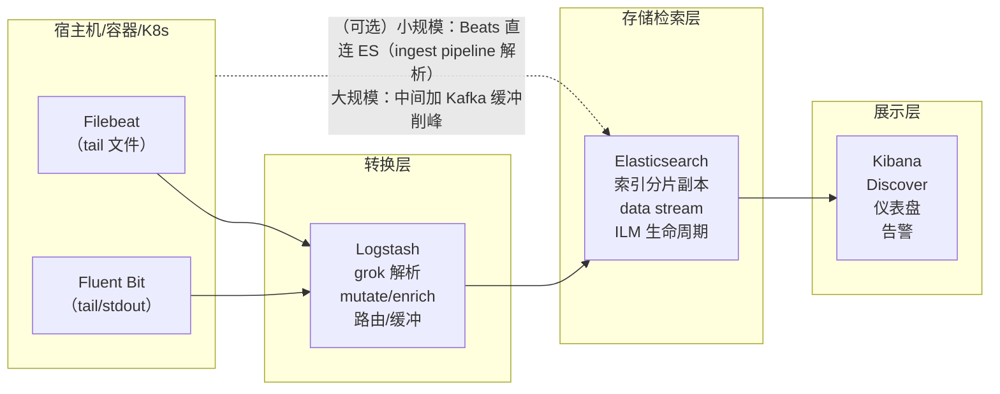
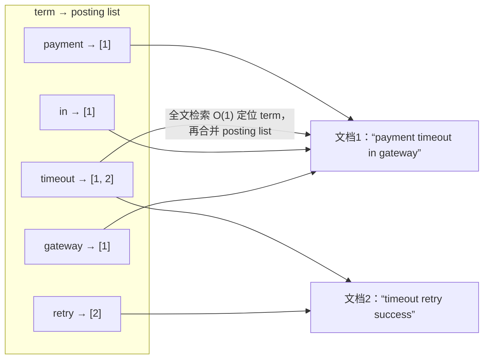
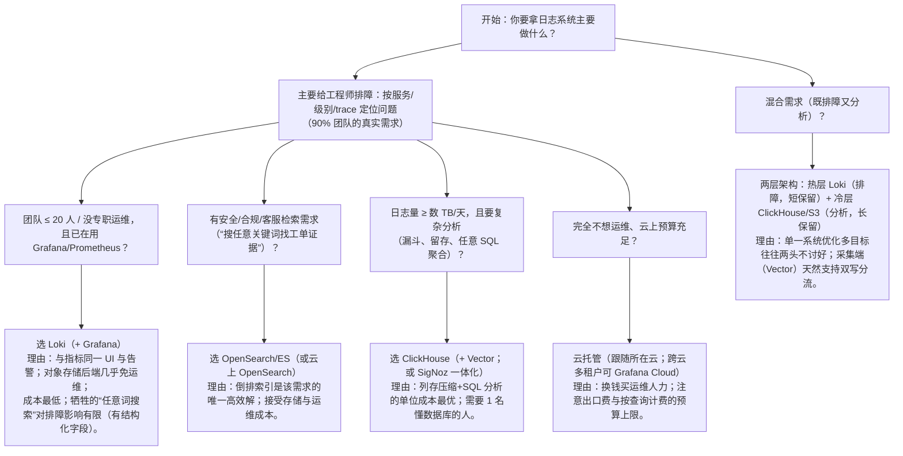
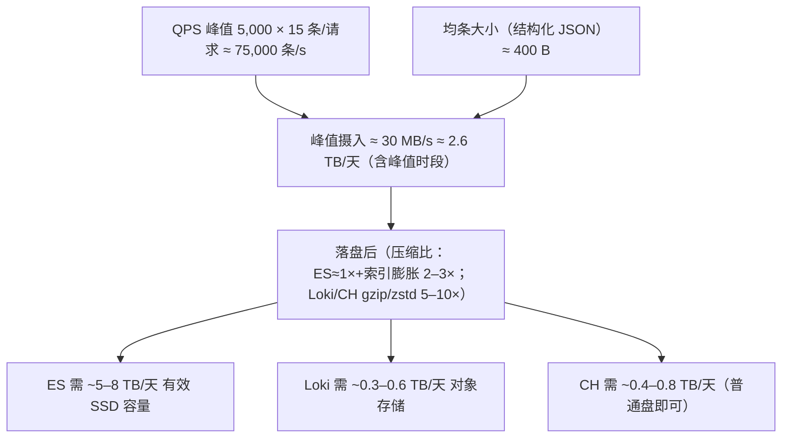

# 日志存储选型：ELK / ClickHouse / Loki 与云托管

> Loki 解决了"便宜"，但不是所有场景都该用 Loki：需要任意词全文检索、需要复杂聚合分析、
> 或者团队已经有 ES/CH 运维能力时，答案会不同。本篇把主流方案放在同一张桌子上比较，
> 并给出可辩护的决策树。

- [1. ELK/EFK：经典全文检索方案](#1-elkefk经典全文检索方案)
- [2. ES 倒排索引：能力与开销的一体两面](#2-es-倒排索引能力与开销的一体两面)
- [3. ClickHouse 方案：列存与分析](#3-clickhouse-方案列存与分析)
- [4. 四方案横向对比表](#4-四方案横向对比表)
- [5. 云托管选项一览](#5-云托管选项一览)
- [6. 选型决策树（附理由）](#6-选型决策树附理由)
- [7. 容量速算：选型前先算三笔账](#7-容量速算选型前先算三笔账)
- [8. 常见坑](#8-常见坑)
- [9. 面试题小结](#9-面试题小结)
- [10. 参考资料](#10-参考资料)

---

## 1. ELK/EFK：经典全文检索方案

### 1.1 名词澄清

- **ELK** = **E**lasticsearch（存储+检索）+ **L**ogstash（采集/转换）+ **K**ibana（可视化）；
- **EFK** = 把 Logstash 换成 **F**luentd（或 Fluent Bit）的组合（K8s 圈更常见）；
- **Beats** 家族：Elastic 官方的轻量采集器（Filebeat 文件、Metricbeat 指标、Packetbeat 网络等）；
  现代部署里 "Filebeat 直写 ES（用 ingest pipeline 做解析）" 比 "Filebeat→Logstash→ES" 更常见。

### 1.2 架构与数据流



各层职责：

| 层 | 组件 | 职责 | 要点 |
|----|------|------|------|
| 采集 | Filebeat / Fluent Bit | tail 文件、registry 断点续传、背压 | 轻量（常驻内存 <100MB），不做重转换 |
| 转换 | Logstash / ES ingest pipeline | grok/ dissect 解析非结构化、字段丰富（geoip/user_agent）、多路路由、缓冲 | Logstash 是 JVM（内存大户）；简单解析可下推到 ES ingest pipeline |
| 存储 | Elasticsearch | 分词、倒排索引、聚合分析 | 分片（shard）× 副本、segment merge、ILM 管理热温冷与删除 |
| 展示 | Kibana | Discover 检索、Dashboard、告警 | 与 ES 深度耦合 |

### 1.3 典型链路要点

1. **解析尽量前移**：应用直接输出 JSON（阶段 2 结构化笔记）时，Logstash/ingest 只需 `json` codec，
   grok（正则）是给存量非结构化日志准备的"还债工具"——CPU 杀手，能少用就少用；
2. **Kafka 削峰**：日志洪峰（批量发布、故障重试风暴）下，直接写 ES 会把集群打挂；
   采集端 → Kafka → Logstash 消费（消费端限流）是稳妥形态；
3. **data stream + ILM**：时序日志一律走 data stream（写别名），ILM 按年龄在
   hot/warm/cold 节点间迁移并最终删除——retention 靠 ILM，不是手动删索引。

## 2. ES 倒排索引：能力与开销的一体两面

### 2.1 原理一页纸

倒排索引（inverted index）："词 → 包含该词的文档列表（posting list）"。
写入时：文本字段 → **分词器**（standard/英文/ik 中文）切成 term → 写进倒排表。



查询 `timeout AND gateway` = 两个 posting list 求交集，**与数据总量无关的部分**极快——
这就是 ES "任意词搜索"的来源。数值/日期字段则走 BKD 树（范围查询）。

### 2.2 开销清单（为什么 ES 贵）

| 开销 | 说明 |
|------|------|
| **写入放大** | 每条日志：原文 `_source` + 倒排表 + doc values（列存，供聚合）至少三份结构；refresh 每 1s 生成小 segment，后台不断 merge，CPU/IO 翻倍 |
| **磁盘占用** | 索引 + _source + 副本 ×N；文本字段越多、分词越细，膨胀越大（常常 2–3 倍于原始日志） |
| **JVM heap** | 分片元数据、查询缓存吃堆；分片数过多直接 OOM（经典错误配置：日索引 100 分片） |
| **SSD 依赖** | 高写入下机械盘 merge 跟不上 |
| **运维复杂度** | 分片规划、mapping 管理（字段爆炸 mapping explosion）、版本升级（数据迁移）、跨集群复制 |

### 2.3 给日志场景"减配"的常见手段

- `index.codec: best_compression`（deflate，CPU 换空间）；
- 关闭不需要的字段索引：`"index": false` 只存不索引、`doc_values` 按需关闭；
- **logsdb 索引模式**（Elastic 8.15+）：官方为日志场景预调优的索引模式（列存优先、
  合并策略/默认映射针对日志），显著降存储——需要较新版本；
- 控制 `refresh_interval`（默认 1s，日志可放宽到 30s，写入吞吐立涨）；
- ILM 冷层转可搜索快照（searchable snapshot，冷数据放 S3）。

即便如此，**每个词都进索引**的成本模型不变——这是与 Loki/ClickHouse 的根本差异。

## 3. ClickHouse 方案：列存与分析

### 3.1 为什么列存适合日志

ClickHouse 的 MergeTree 引擎按**列**存文件、按**主键（ORDER BY）排序**存储：

- **压缩比惊人**：同一列数据类型一致、局部相关性高，LZ4/ZSTD 压缩常达 5–20×
  （时间戳、level、service 这类低基数列压缩后几乎"消失"）；
- **聚合快**：分析查询只读涉及的列（`count()`, `quantile(0.95)(duration_ms)` 扫描量远小于行存）；
- **成本可控**：没有"每个词的倒排"，只有排序键索引 + 稀疏索引，写放大小。

弱项：**点查与高频小写入弱**（合并机制）、没有全文倒排（`hasToken`/`match` 需要专门索引列）、
join 能力有限（日志场景基本不需要）。

### 3.2 典型建表（日志场景）

```sql
CREATE TABLE logs
(
    timestamp    DateTime64(3),
    service      LowCardinality(String),   -- 低基数列：内存与体积优化
    env         LowCardinality(String),
    level       LowCardinality(String),
    event       LowCardinality(String),
    message     String,                    -- 正文，不建索引
    request_id  String,
    user_id     String,
    duration_ms UInt32,
    body        String CODEC(ZSTD(1))      -- 正文高压缩
)
ENGINE = MergeTree
PARTITION BY toYYYYMMDD(timestamp)         -- 按天分区：retention 按分区 DROP，秒级
ORDER BY (service, env, level, timestamp)  -- 查询主键设计：服务→环境→级别→时间
TTL toDateTime(timestamp) + INTERVAL 30 DAY DELETE;   -- 分级保留还可以按列/按表达式
```

设计要点：**ORDER BY = 你的查询入口**（先按什么过滤就放前面）；
PARTITION 按天支持 `ALTER TABLE logs DROP PARTITION` 快速过期。

### 3.3 常见组合

| 组合 | 形态 | 说明 |
|------|------|------|
| **ClickHouse + Vector** | apps → Vector(`clickhouse` sink，按批 INSERT) → CH → Grafana（ClickHouse 数据源/插件） | 自建最常见；Vector 的 `clickhouse` sink 原生批量写入 |
| **SigNoz** | OTel Collector + ClickHouse 一体化开源可观测平台 | logs/traces/metrics 统一，想"一套平台替代 ELK+Jaeger+Prom"的团队 |
| **Grafana + ClickHouse 数据源** | 复用 Grafana 做日志 UI | 官方维护的 ClickHouse 插件支持 Logs 视图 |
| **Uber LogPilot 思路**（历史参考） | Uber 早年在容器化中开源过"自动发现容器 → 动态生成 Fluentd 配置 → 路由 Kafka/ES"的采集组件 LogPilot，其**采集端按容器元数据自动配置**的思路，被后来 Fluent Bit 的 kubernetes filter、Vector 的 `include_labels`、OTel filelog+k8s 元数据增强等普遍吸收；Uber 后续公开分享中也多次讨论超大规模下 ELK 的成本/扩展痛点，是业界转向列存（ClickHouse 系）的重要背景之一 | 理解"采集自动配置化"思想的来源即可，具体组件已被生态取代 |

ClickHouse 官方近年在 observability 方向投入很大（官方文档有 observability 专题、
云服务提供日志/trace 的 SQL 接口），详见第 9 节参考。

## 4. 四方案横向对比表

（Loki 行呼应 [loki.md](loki.md)；"经典 ELK"指自建 ES）

| 维度 | Elasticsearch（ELK） | Loki | ClickHouse | 云托管（如 CloudWatch/OpenSearch Service） |
|------|---------------------|------|-----------|----------------------------------|
| 索引方式 | 全文倒排 + 列存聚合 | 仅 label（流）+ 压缩 chunk | 排序键（稀疏索引）+ 列存 | 供应商实现（CW 有自有索引/scan；OpenSearch=ES 系） |
| 任意词全文搜索 | ✅ 最强（分词、评分、短语） | ⚠️ 正则扫流（慢，大范围不可用） | ⚠️ `hasToken`/`match` 需建 token 列，无评分 | ✅（CloudWatch Insights 语法子集） |
| 聚合分析 | ✅ 强（aggs） | ⚠️ LogQL 指标查询够用但简单 | ✅ 极强（SQL：join/窗口/任意分位数） | ✅/⚠️ 视产品 |
| 存储成本 | 高（索引+_source+副本，SSD） | 最低（对象存储+高压缩） | 低（列存高压缩，可用普通盘+对象存储） | 高（按 GB·月计费，出口流量费隐藏） |
| 写入吞吐 | 中–高（merge 有上限） | 高（聚合批写） | 很高（批量 INSERT，忌小批次） | 中（有限流/配额） |
| 查询延迟（典型） | 快（索引命中） | 首次查询慢（扫 chunk），重复查询可缓存 | 快（需 ORDER BY 命中设计） | 不稳定（共享资源、限流） |
| 资源/运维复杂度 | 高：JVM、分片、mapping、升级 | 中：组件多但容器化成熟（SST/S3 后端简单） | 中–高：需要 DBA 思维（合并、分区、副本） | 低：免运维，但排查"黑盒" |
| 生态/工具 | Kibana 全家桶、告警、SIEM | Grafana 原生（与 Prometheus/Tempo 同 UI） | Grafana 插件、SQL 生态 | 各云自家控制台 |
| 适用规模 | GB/天–数 TB/天 | 任意（对象存储弹性），超大规模最典型 | TB/天–PB 级分析型 | 任意（账单弹性 😅） |
| 厂商锁定 | 低（开源） | 低（开源） | 低（开源） | 高（API/计费/数据迁移） |

**一句话各有立场**：ES 卖"搜索"、Loki 卖"便宜与 Grafana 一体"、ClickHouse 卖"SQL 分析力"、
云托管卖"免运维"。

## 5. 云托管选项一览

| 服务 | 提供方 | 形态 | 计费特征 | 适合 |
|------|--------|------|---------|------|
| **CloudWatch Logs** | AWS | 托管采集+存储+Insights 查询语言 | 按 GB 摄入 + 存储 + 查询扫描量计费；**查询扫描按量收费是隐藏大头** | 已深度用 AWS、日志量中小、想零运维 |
| **Amazon OpenSearch Service / OpenSearch Serverless** | AWS | 托管 ES/OpenSearch | 实例型（贵）或按 CU 的 Serverless | 要 Kibana 式全文检索且不想自运维 |
| **Grafana Cloud（Loki/Alerting 全托管）** | Grafana Labs | 托管 Loki + Grafana | 按使用量（GB 摄入/用户数），有免费档 | 想要 Loki/Grafana 生态但不想自己跑 |
| **Azure Monitor Logs** | Microsoft | KQL 查询的托管日志 | 按摄入 GB + 保留 | Azure 中心组织 |
| **Google Cloud Logging** | Google | 托管 + Logging query language | 摄入+保留计费，有免费配额 | GCP 中心组织 |
| **阿里云 SLS（日志服务）** | 阿里云 | 采集+索引+查询+分析（SQL92 子集） | 摄入+索引+存储分项计费 | 国内云、合规数据落地 |
| **Elastic Cloud** | Elastic | 官方托管 ES | 实例/存储型 | 必须 Elastic 全家桶（SIEM/APM） |

云托管的共同代价：**出口流量费、按查询计费的"惊喜账单"、锁定**。量大后"自建 Loki + 对象存储"
几乎总是更便宜，代价是自己背可用性。

## 6. 选型决策树（附理由）



补充几条经验判断：

1. **存量沉没成本 > 技术优劣**：已有 ELK 跑得好好的，迁移动机通常是"存储账单"，
   这时先试 logsdb/ILM 调优，其次才是换引擎；
2. **Loki 的隐性成本在"查询习惯改造"**：要求日志本身结构化（阶段 2 第一篇的地基），
   团队没准备好 schema 就上 Loki，最后会退化成"天天 `|~` 正则扫全量"；
3. **ClickHouse 不是"更便宜的 ES"**：它是分析库，点查/全文检索要靠设计规避，
   没有数据库文化不要轻易自建；
4. **从保留期反推预算**：同 5TB/天、保 30 天，对象存储上的 Loki 与 SSD 上的 ES
   月成本可差 5–10 倍——选型前先算这笔账，比争论功能实在。

## 7. 容量速算：选型前先算三笔账

选型争论常常输给一张 Excel。以"中型团队、200 个服务、平均 15 条请求日志/次请求、
峰谷比 3:1"为例，先算**写入账**：



再算**保留账**（30 天保留 + 分级）：ERROR 10% 保 90 天、其余保 14 天的加权存储量，
直接决定月度成本数量级。最后算**查询账**：日活查询 × 平均扫描量——这决定云托管方案
（按扫描计费）会不会爆账单，也决定自建 ES 集群要不要给 heavy 查询隔离节点。

| 量级（原始日志/天） | 经验基线（写速） | 参考结论 |
|--------------------|----------------|---------|
| < 50 GB/天 | < 1 MB/s | 任何方案都撑得住；选运维最省的（云托管或单机 Loki） |
| 50 GB – 1 TB/天 | 1–12 MB/s | 自建单副本 Loki/小 ES 集群（3–5 节点）的舒适区 |
| 1 – 5 TB/天 | 12–60 MB/s | ES 开始贵得明显；Loki/CH 的成本优势显现；需要专职运维 |
| > 5 TB/天 | > 60 MB/s | 对象存储后端（Loki/CH）几乎必选；查询要有分片与缓存治理 |

（数字为数量级估算，用于快速 sanity check；正式选型用自己流量分布重算。）

## 8. 常见坑

1. **ES 分片数拍脑袋**：日索引 50 分片 ×N 天 = 堆内元数据爆炸；
   经验：单分片 10–50GB，总量控制在"节点数 × 几十"量级，用 ILM shrink/rollover 管理。
2. **mapping explosion**：字段名里带变量（`duration_1234ms`）导致 mapping 字段无限增长，
   集群拒绝写入。禁动态映射：`"dynamic": false`/`strict`，字段名进 schema 管理（本质又回到结构化规范）。
3. **Logstash 当万能中间件**：所有解析堆在 Logstash（JVM 起步 1–2GB），
   采集端稍多就要集群化。能下推就下推：ingest pipeline / 应用直出 JSON。
4. **ClickHouse 小批量高频 INSERT**：每秒几百次单条 insert 会把 merge 打死
   （"too many parts"）。必须批量（≥1000 行/次或 1s 聚合），Vector 的 clickhouse sink 默认就是批的。
5. **ORDER BY 设计错误**：主键不含高频过滤列（如 service），查询全表扫描；
   上线前用真实查询清单反推 ORDER BY。
6. **retention 只在存储层配了一半**：ES 配了 ILM 删除却没管磁盘水位；
   ClickHouse 配了 TTL 但分区粒度太粗（月分区+天级 TTL 退化成整月删）。
7. **云托管"按查询计费"失控**：一个 dashboard 每分钟扫 500GB CloudWatch Insights；
   用日志订阅/导出到 S3/Athena 的省钱形态重设计。
8. **双写数据不一致无对账**：Loki+CH 双层架构要有抽样对账（按时间窗 count 对比），
   否则排障时两处数字打架没人信。

## 9. 面试题小结

**Q1：ELK 为什么贵？**
A：每个词都进倒排索引（+_source、doc values、副本），写入放大与磁盘占用大；
merge 与 refresh 消耗 CPU/IO；分片元数据吃 JVM heap；依赖 SSD。
本质是为"任意词全文检索"预付的成本——没这个需求就是纯浪费。

**Q2：ES 的倒排索引怎么工作的？**
A：文本字段经分词器切成 term，写入 term → posting list（文档 id 列表）的映射表；
查询时按 term 查表（字典 term index 定位），posting list 求交/并得到文档集，
与数据总量弱相关所以快。数值/日期字段用 BKD 树支持范围查询。

**Q3：ClickHouse 为什么适合日志分析、不适合点查？**
A：列存 + 按 ORDER BY 排序 + 稀疏索引，分析查询只读少数列、压缩比高、扫描带宽低；
但定位"某一行"需要跨多个合并中的 part，点查延迟高且放大读。
日志是"写多、按维度批量读"的负载，正好匹配。

**Q4：什么信号出现时你会考虑从 ES 迁到 Loki/ClickHouse？**
A：① 存储成本曲线失控（SSD 扩容频繁）；② 查询模式统计显示 95% 是维度过滤而非任意词搜索；
③ 运维负担（JVM/分片/升级）与团队规模不匹配；④ 已有 Grafana 生态想统一。
迁移路径通常先"新日志进新系统、旧日志留在 ES 到过期"，双轨过渡。

**Q5：CloudWatch Logs 的账单为什么经常超预期？**
A：摄入费之外，Insights 查询按**扫描量**计费，每次全量扫描大时间窗都计费；
GetLogEvents 出口也有费用。治理：精确时间窗+filter pattern 前置、订阅导出 S3+ Athena
做分析、按 log group 设置保留期。

**Q6：为什么说"混合两层（Loki 热 + CH 冷）"越来越多见？**
A：排障（短窗口、按维度、要快）与分析（长窗口、任意 SQL、要便宜）的最优存储不同；
采集层（Vector）天然支持 fan-out 双写，各取所长。代价是架构复杂度与对账成本，
小团队不建议一开始就上。

**Q7：SigNoz 这类一体化平台解决什么痛点？**
A：用 OTel + ClickHouse 把 metrics/logs/traces 装进一个开源栈，避免
"Prom + ELK + Jaeger"三套系统的集成与成本；适合想要 DataDog 体验但数据需自主可控的团队。

## 10. 参考资料

- Elasticsearch 官方文档：<https://www.elastic.co/guide/en/elasticsearch/reference/current/index.html>（访问日期：2026-11-04）
- Filebeat 入门：<https://www.elastic.co/guide/en/beats/filebeat/current/filebeat-getting-started.html>（访问日期：2026-11-04）
- Logstash 文档：<https://www.elastic.co/guide/en/logstash/current/index.html>（访问日期：2026-11-04）
- 倒排索引概念：<https://en.wikipedia.org/wiki/Inverted_index>（访问日期：2026-11-04）
- ClickHouse MergeTree 引擎：<https://clickhouse.com/docs/en/engines/table-engines/mergetree-family/mergetree>（访问日期：2026-11-04）
- ClickHouse 可观测性专题（logs/traces on CH）：<https://clickhouse.com/docs/en/observability>（访问日期：2026-11-04）
- SigNoz 文档（OTel + ClickHouse 一体化）：<https://signoz.io/docs/>（访问日期：2026-11-04）
- AWS CloudWatch Logs 文档：<https://docs.aws.amazon.com/AmazonCloudWatch/latest/logs/WhatIsCloudWatchLogs.html>（访问日期：2026-11-04）
- Grafana Cloud：<https://grafana.com/products/cloud/>（访问日期：2026-11-04）
- Uber 工程博客（大规模日志/基础设施分享入口）：<https://www.uber.com/en-US/blog/engineering/>（访问日期：2026-11-04）
- 本工作区相关笔记：[loki.md](loki.md)、[collectors.md](collectors.md)、[structured-logging.md](structured-logging.md)

## 附：ASCII 图替换清单

| 原 ASCII 图位置（章节标题） | 原图内容简述 | 替换结果 |
| --- | --- | --- |
| 1.2 架构与数据流 | ELK 四层管道：采集（Filebeat/Fluent Bit）→ 转换（Logstash）→ 存储检索（Elasticsearch）→ 展示（Kibana），含「（可选）Beats 直连 ES / 大规模加 Kafka」标注 | flowchart LR（subgraph 分层） |
| 2.1 原理一页纸 | 倒排索引示例：term → posting list 与两篇文档的映射关系 | flowchart LR |
| 6. 选型决策树（附理由） | 按团队需求问答分支的日志方案选型决策树（结论附理由） | flowchart TD |
| 7. 容量速算：选型前先算三笔账 | 写入账推导链：QPS×条数 → 峰值摄入 → 落盘后按 ES/Loki/CH 三分支估算 | flowchart TD |
