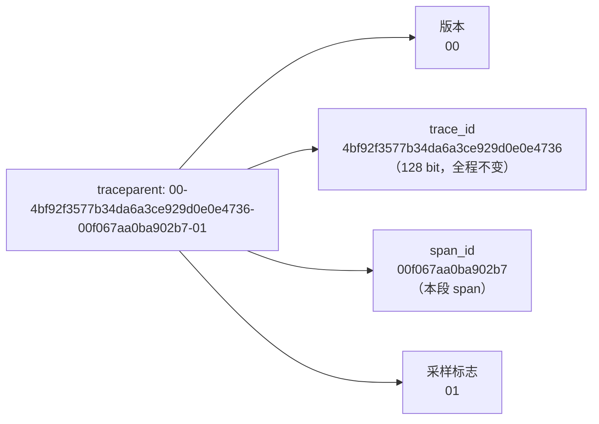
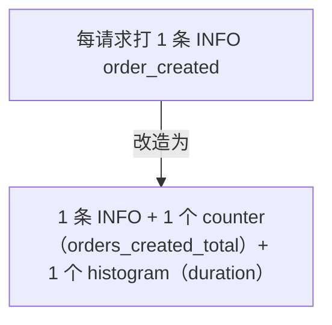

# 日志最佳实践清单：从"会打"到"打得对、打得省"

> 前四篇讲的是机制，本篇是**可以直接抄进团队规范文档**的操作清单。
> 每条都按"怎么做 / 为什么 / 反例"组织，code review 时可逐条对照。

- [1. 一条好日志的 Checklist](#1-一条好日志的-checklist)
- [2. 错误日志三要素：事件、上下文、动作](#2-错误日志三要素事件上下文动作)
- [3. trace_id 注入：跨服务关联预览（阶段 4 详讲）](#3-trace_id-注入跨服务关联预览阶段-4-详讲)
- [4. 日志量治理：采样、去重、分级保留](#4-日志量治理采样去重分级保留)
- [5. 从指标下钻到日志（Grafana 预览）](#5-从指标下钻到日志grafana-预览)
- [6. 团队落地：规范怎么变成习惯](#6-团队落地规范怎么变成习惯)
- [7. 常见坑](#7-常见坑)
- [8. 面试题小结](#8-面试题小结)
- [9. 参考资料](#9-参考资料)

---

## 1. 一条好日志的 Checklist

写完一行日志代码，过一遍这 10 条（前 6 条每条都必过，后 4 条视场景）：

| # | 检查项 | 判据 |
|---|--------|------|
| 1 | **结构化** | 走日志库的结构化 API（key-value），不是 f-string 拼句子 |
| 2 | **级别正确** | 按"需要人关注吗？"定级：自愈失败→ERROR，可自愈→WARN，正常事件→INFO（见 structured-logging.md 第 4 节） |
| 3 | **事件名可枚举** | `event="order_created"`，不是 `event=f"order {oid} ok"` |
| 4 | **有时间戳/级别/服务名/环境** | 库默认或 processor 统一注入，业务代码不手写 |
| 5 | **有定位上下文** | request_id / user_id / 关键业务键（order_id）至少其一 |
| 6 | **无敏感信息** | 对照敏感字段清单（密码/token/PII）——日志=组织内广播 |
| 7 | 数值字段是数值 | `duration_ms=34`，不是 `duration="34ms"` |
| 8 | 有错误细节 | 异常路径带 `exception`（堆栈）；每错误只打一次（最外层） |
| 9 | 频率可控 | 这行代码在最坏情况下每秒打多少条？会不会被日志风暴放大 |
| 10 | 可聚合 | 将来要按它统计吗？那它得是字段而不是句子里的一个词 |

### 正反例对照

```python
# 反例：句子拼接 + 级别滥用 + 高频 + 无上下文 + PII
logger.info(f"User {phone} logged in and did something, ok? {time.time()}")

# 正例：结构化、可枚举事件、上下文齐全、脱敏
log.info("user_login_succeeded", user_id="u1007", method="oauth", duration_ms=87,
         request_id=req_id)   # 不打手机号；要区分用户有 user_id 足够
```

一条"好日志"的自检问句：**"半夜被告警叫醒的人，只看这一条能开始排查吗？"**
不能 → 缺字段；不需要被叫醒 → 级别错了。

## 2. 错误日志三要素：事件、上下文、动作

ERROR 级日志的价值公式：**事件 + 上下文 + 动作**。

| 要素 | 回答的问题 | 落到字段 |
|------|-----------|---------|
| **事件（What）** | 发生了什么失败？ | `event`（可枚举）、`error`/`error_type`、`exception`（堆栈） |
| **上下文（Where/Who/When）** | 在什么请求、什么用户、什么输入、什么依赖上发生？ | `request_id`、`user_id`、`path`、`downstream`、关键参数、`timestamp`、`service`/`env`/`version` |
| **动作（Then what）** | 系统接下来做了什么/需要人做什么？ | `action="retried"`、`impact="order_cancelled"`、`runbook="https://wiki/runbooks/payment-gw-timeout"` |

三要素齐的样例：

```json
{
  "level": "error",
  "timestamp": "2026-11-04T21:00:05.123Z",
  "service": "payment-svc", "env": "prod", "version": "2.14.3",
  "event": "payment_failed",
  "request_id": "9f8e7d6c5b4a", "user_id": "u1007", "order_id": "ord-1a2b",
  "downstream": "payment-gw", "error": "connection reset by peer",
  "exception": "Traceback ... ConnectionResetError ...",
  "action": "retry_exhausted_order_queued", "runbook": "https://wiki/runbooks/payment-gw"
}
```

对比缺要素的坏例子及后果：

| 坏例子 | 缺什么 | 后果 |
|--------|--------|------|
| `ERROR: something failed` | 事件细节+全部上下文 | 无法定位是哪条链路、哪个依赖 |
| `ERROR payment-gw timeout req=9f8e... user=1007 oid=1a2b took=3001ms retries=3 dead=true` | 全挤在文本里 | 字段不可聚合，每次人肉正则 |
| 每层 catch 都打一条 ERROR | 一次错误 ×N 条 | error rate 指标虚高、告警风暴 |
| 只有 event 没有动作 | 不知道后果 | 无法判断是"已自动重试可忽略"还是"订单卡死需人工" |

**"动作"要素最常被忽视**：它决定读日志的人第一反应是"继续睡"还是"现在起来"。
高成熟团队会在 SDK 封装里要求 `action` 与 `runbook` 字段成对出现。

## 3. trace_id 注入：跨服务关联预览（阶段 4 详讲）

### 3.1 为什么需要

微服务里一次排障要横跨 5+ 服务。request_id 只在入口网关生成、靠业务代码透传，
链路一长就断；**trace_id 是行业标准（W3C Trace Context）的全局标识**，由 OTel SDK
随 HTTP header（`traceparent`）/gRPC metadata 自动传播，日志、trace、指标（exemplars）
三方共用一个 ID —— 这是阶段 4"三大支柱关联"的核心钥匙。



规范：W3C Trace Context <https://www.w3.org/TR/trace-context/>（访问日期：2026-11-04）。

### 3.2 最小可用模式（Python，中间件 + contextvars）

```python
# 伪代码：真实生产用 OTel SDK 自动埋点（阶段 3/4 实战）
from opentelemetry import trace
import structlog

tracer = trace.get_tracer(__name__)

@app.middleware("http")
async def trace_middleware(request, call_next):
    with tracer.start_as_current_span(request.url.path) as span:   # 自动解析 traceparent
        structlog.contextvars.bind_contextvars(
            trace_id=format(span.get_span_context().trace_id, "032x"),  # 32 hex
            span_id=format(span.get_span_context().span_id, "016x"),
            request_id=request.headers.get("x-request-id", "-"),
        )
        try:
            return await call_next(request)
        finally:
            structlog.contextvars.unbind_contextvars("trace_id", "span_id", "request_id")
```

Go 一句话版：`slog` + `trace.SpanContext(ctx)` 注入 attr；Node 用 pino `mixIn` + AsyncLocalStorage。

### 3.3 本阶段的两个预埋动作

1. 日志 schema 里**现在就留 `trace_id`/`span_id` 字段**（哪怕暂时为空）——Grafana 数据源里配
   **derived field**（正则提取 trace_id → 一键跳转 Tempo/Jaeger），lab02 的数据源配置里已预置；
2. 入口网关先统一生成/透传 `X-Request-Id`——它是 trace_id 落地前的过渡钥匙。

阶段 4（[notes/04-integration/](../04-integration/README.md)）会完整讲 OTel 自动注入与 exemplars。

## 4. 日志量治理：采样、去重、分级保留

日志的三个失控维度：**条数（写入/查询成本）**、**重复（信息密度）**、**保留期（存储成本）**。

### 4.1 分层采样（Sampling by level）

| 层 | 策略 | 理由 |
|----|------|------|
| DEBUG | 采集前默认关闭；临时开（排障）限时回收；必须采时 1%–5% | 量大信息低 |
| INFO | 100% 或按 event 白名单；高频循环日志（每请求 5 条）考虑合并为 1 条摘要 | 量中信息中 |
| WARN | 100% | 趋势观察的原料 |
| ERROR/FATAL | **100% 永不采样** | 错误样本的完整性就是告警的准确性 |

实现位置（从前往后优先）：应用内（级别过滤+日志库 sampler，省 CPU）→ 采集器
（Vector `sample` + `exclude` 直通错误）→ 后端（Loki/CH 分租户分流，少见）。

### 4.2 去重与限流（采集层防线）

- **去重**：同一 `fingerprint`（如 level+event+error_type）在时间窗内只放第一条
  （Vector `dedupe`、Fluent Bit `rewrite_tag`+`grep` 组合）；防"一个数据库挂了打出 50 万条相同 ERROR"；
- **限流**：每服务每级别设每秒上限（Vector `throttle`），超限部分聚合成一条
  `"log flood: dropped 12345 events in 10s"` 摘要——**丢弃也要留账**。

### 4.3 分级保留（Retention tiers）

按"信息价值衰减速度"设保留期（示例基线，按合规调整）：

| 类别 | 保留期 | 说明 |
|------|--------|------|
| ERROR/FATAL + 安全审计流 | 90 天–1 年 | 事故复盘、合规追查 |
| WARN | 30 天 | 趋势回看 |
| INFO | 14–30 天 | 常规排障窗口 |
| DEBUG（若保留） | 1–3 天 | 复现细节 |

工程实现取舍（详见 elk-and-clickhouse.md 第 6 节决策树与 loki.md 第 6 节）：
单系统难做行级分级 → 常见"按 level 拆 label/租户/索引 + 各自 retention"，或接受统一保留靠压缩省钱。

### 4.4 从"逐条日志"升维到"指标"

排障时 95% 的问题只需要**计数与分布**：



原则：**能用指标回答的问题（速率/分位数/比例）不要靠扫日志回答**；日志负责"看单样本"，
指标负责"看总量"。这就是三大支柱分工在日志治理上的投影。

### 4.5 成本观测（治理要闭环）

给日志链路自己建三个指标 + 一块仪表盘：

1. 摄入速率（GB/天、条/秒）按服务分解 → 发现"谁在刷屏"；
2. 采集器丢弃/采样率（dropped vs delivered）→ 别让治理变成静默丢；
3. 单 GB 落地成本（存储单价 × 摄入）→ 让"删掉 10% 无效 DEBUG"变成可汇报的省钱数字。

## 5. 从指标下钻到日志（Grafana 预览）

排障的标准动线：**指标发现异常（面）→ 日志定位样本（点）→ trace 还原过程（线）**。
Grafana 里打通前两步：

### 5.1 Explore 的 Metrics → Logs 联动

在 Explore（Prometheus）查询旁点 **"Logs" 按钮标签**（metrics-to-logs）：
Grafana 按数据源配置的 **label 映射**（`job` → `job`、`instance` → `host`）自动生成对应的
Loki 查询（如 `{job="payment-svc", host="pod-1"}` + 时间范围），无需手抄标签。

### 5.2 Derived Fields（日志 → trace 一键跳转）

Loki 数据源配置里给 `trace_id` 建 derived field（lab02 的
`grafana/provisioning/datasources/loki.yaml` 已预置）：

```yaml
derivedFields:
  - name: TraceID
    matcherRegex: '"trace_id":\s*"([0-9a-f]+)"'
    url: '$${__value.raw}'        # 或完整 Tempo/Jaeger 深链
```

日志行旁出现可点击的 TraceID 徽章 → 直达该请求的完整调用链（阶段 4 完整实战）。

### 5.3 Dashboard 内联动

- 同一 dashboard 上放"指标面板 + 日志面板"，共享时间范围与变量（`$service`），
  日志查询写成 `{job="lab02", service="$service"} | json`；
- 日志面板配 **data link**：字段值（如 `user_id`）链接到预填该值的 Explore 查询；
- lab02 的仪表盘（`grafana/dashboards/lab02-logs.json`）就是这个结构的最小实现：
  错误速率曲线（指标视图，由 LogQL 聚合而来）+ 日志原始流 + p95 面板同屏。

### 5.4 告警回链

Alertmanager 告警注解里带**预填好的日志查询链接**（runbook 的一部分）：
`logs: {job="payment-svc"} | json | downstream="payment-gw" | status >= 500`，
被叫醒的人一次点击进入现场。

## 6. 团队落地：规范怎么变成习惯

1. **一页纸规范**：把本文第 1 节 checklist + 字段字典（structured-logging.md 3.1 表）
   固化为 `LOGGING.md` 放仓库，code review 引用条目编号（"违反 L3：event 不可枚举"）；
2. **统一 SDK 封装**：各语言封装团队 logger（公共字段注入、脱敏 processor、
   request_id/trace_id 中间件、默认 JSON），**让正确的事成为默认行为**；
   lab02 的 `app/app.py` 就是这种封装的最小样例；
3. **静态检查**：
   - Python：ruff/flake8 禁 f-string 直入 logger（`logging-fstring-interpolation`）、
     规定 `extra=` 或结构化库；
   - Go：lint 禁 `fmt.Println`（应用代码内），统一 slog；
4. **CI 红线扫描**：对新增日志语句跑敏感词表（password/token/bearer…），命中即 fail；
5. **日志评审例会**：季度性拉"日志 top 量服务 + top 贵查询"，删 DEBUG、拆高基数 label
   ——把第 4.5 节的成本观测变成固定议程；
6. **新人第一周任务**：用 lab02 跑一遍全链路，理解每个组件的配置项为什么存在。

## 7. 常见坑

1. **"先打上再说"式 DEBUG 上生产**：忘记摘除 → 量暴涨 + 可能带 PII；
   DEBUG 要有临时开关（配置中心）与自动回收（TTL）。
2. **脱敏只做在应用层**：第三方库（ORM 错误带连接串）照样漏；
   采集层兜底（lab02 Vector `redact_sensitive`）+ 红线扫描双保险。
3. **告警依赖日志文本**：`日志含 "timeout" 就告警` 在措辞微调后全体静默失效；
   告警应基于指标（含由日志聚成的指标），文本只做辅助。
4. **ERROR 当流程控制**：用 error 日志的副作用（触发某个监听程序）做业务逻辑——
   日志系统不可靠（见 structured-logging.md 第 8 节），业务逻辑请走正经消息通道。
5. **保留期一刀切 90 天**：INFO 也 90 天 → 存储账单 ×3；按 4.3 节分级。
6. **采样把错误也采没了**：全局 10% 采样把 ERROR 也丢了 90% → 告警失真。
   采样必须按级别分层且错误直通（4.1 节表）。
7. **字段字典没人维护**：半年后 event 出现 `orderCreated`/`order_created`/`create_order` 三种；
   字典要挂 CI 校验（枚举值变更走 PR）。
8. **runbook 链接腐烂**：错误三要素里的 runbook URL 404 —— 与代码同仓随版本发布。

## 8. 面试题小结

**Q1：设计一个日志规范，最先固化的五件事？**
A：①字段字典（timestamp/level/service/env/event/request_id 必有）+ 命名约定；
②级别判定规则（可自愈？需要人？）③敏感字段清单与脱敏四招；④错误日志三要素；
⑤采样与保留基线。配套统一 SDK 封装让规范自动执行。

**Q2：如何答"我们的日志存储太贵了"？**
A：四步：量化（GB/天×单价，按服务/级别分解）→ 削峰（DEBUG 关闭/采样、去重限流、
高频循环合并）→ 分级保留（ERROR 90d/INFO 14d）→ 换引擎评估（SSD 倒排 → 对象存储+压缩，
见选型决策树）。先治理后迁移，通常前两步就能省 50%+。

**Q3：ERROR 日志要包含哪三要素？为什么"动作"最重要？**
A：事件（发生了什么失败）、上下文（哪个请求/用户/依赖/输入）、动作（系统后续做了什么、
人要不要处理、runbook 在哪）。动作决定响应优先级与第一动作，缺它的人只能"猜影响面"。

**Q4：日志采样为什么必须分层？给一个具体策略。**
A：不同级别信息价值/量级差万倍，全局采样要么浪费（错误被丢）要么无效（DEBUG 还是太多）。
策略：ERROR/FATAL 100%、WARN 100%、INFO 100% 或白名单、DEBUG 1%–5%；
错误直通用采集器 exclude 条件实现（Vector sample + `exclude`）。

**Q5：指标和日志的边界？什么时候该把日志改成指标？**
A：指标回答"多少/多快/什么比例"（聚合视图），日志回答"具体哪一条/长什么样"（单样本）。
当你在用 LogQL/ES 聚合回答速率或分位数问题时，就该加 counter/histogram 指标了；
日志里保留样本与异常细节即可。

**Q6：trace_id 和 request_id 在日志里各扮演什么角色？**
A：request_id 是入口请求的业务追踪键（简单、单系统够用）；trace_id 是 W3C 标准的
分布式追踪键（跨服务自动传播，还能关联 trace 视图与 exemplars）。
成熟形态：两个都打，trace_id 用于跳转 trace，request_id 用于与用户反馈/工单对账。

**Q7：Grafana 里如何从"P99 延迟升高"走到"看到具体慢请求日志"？**
A：指标面板（P99）确认时间窗与标签 → Explore 的 metrics-to-logs 联动（label 映射生成 Loki 查询）
→ 日志流里按 `duration_ms > 阈值` 过滤拿样本 → 用行内 trace_id derived field 跳转 trace
（阶段 4）→ 定位慢 span。

## 9. 参考资料

- 本阶段其他笔记：[structured-logging.md](structured-logging.md)、[loki.md](loki.md)、
  [collectors.md](collectors.md)、[elk-and-clickhouse.md](elk-and-clickhouse.md)
- Google SRE Books（章节：Practical Alerting / Managing Incidents）：<https://sre.google/books/>（访问日期：2026-11-04）
- W3C Trace Context 规范：<https://www.w3.org/TR/trace-context/>（访问日期：2026-11-04）
- OpenTelemetry Logs 规范：<https://opentelemetry.io/docs/specs/otel/logs/>（访问日期：2026-11-04）
- Grafana Loki 数据源（derived fields / metrics-to-logs）：<https://grafana.com/docs/grafana/latest/datasources/loki/>（访问日期：2026-11-04）
- Vector sampling/dedupe transforms：<https://vector.dev/docs/reference/configuration/transforms/sample/>（访问日期：2026-11-04）
- 12-Factor App · Logs：<https://12factor.net/logs>（访问日期：2026-11-04）
- 本工作区配套实验：[labs/lab02-loki-vector-logging/](../../labs/lab02-loki-vector-logging/README.md)

## 附：ASCII 图替换清单

| 原 ASCII 图位置（章节标题） | 原图内容简述 | 替换结果 |
| --- | --- | --- |
| 3.1 为什么需要 | traceparent 头的字段分解标注（版本 / trace_id / span_id / 采样标志） | flowchart LR |
| 4.4 从“逐条日志”升维到“指标” | 「每请求一条 INFO」改造为「INFO + counter + histogram」的前后对比 | flowchart TD |
