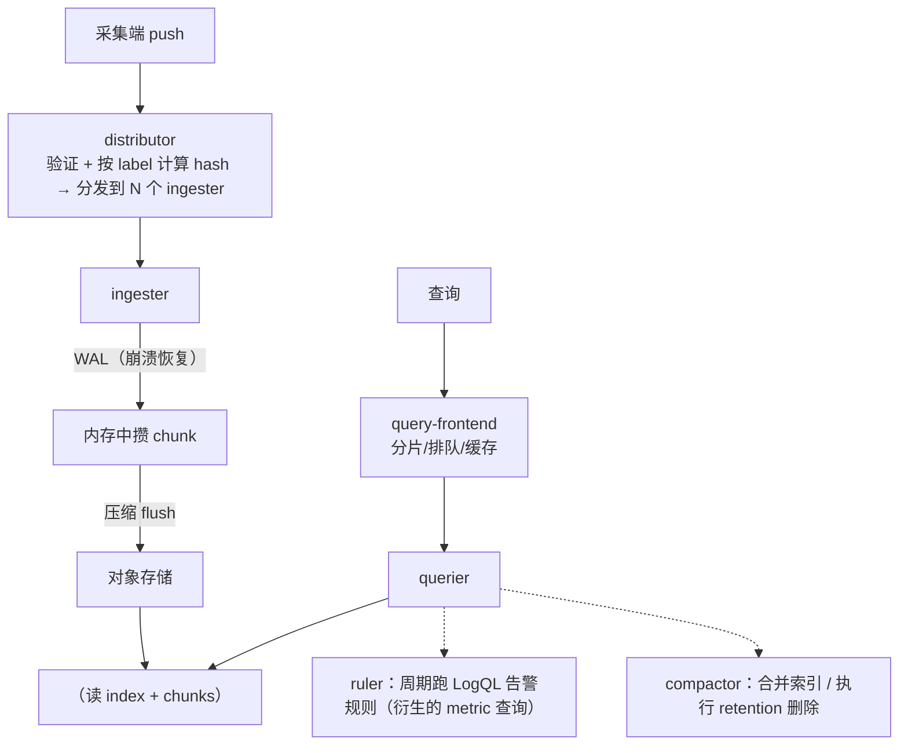
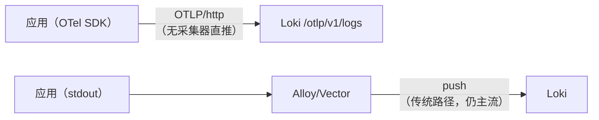
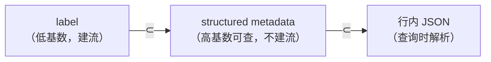

# Grafana Loki 深入：只索引 label 的日志数据库

> Loki 的自我定位是"像 Prometheus 一样省钱省事的日志系统"：**只给标签建索引，
> 日志正文原样压缩存进对象存储**。理解这一句话，就理解了 Loki 的全部设计、能力边界与常见坑。
> （本篇是"是什么/怎么查"；部署拓扑、schema 迁移、调优与自监控见续篇 [loki-operations.md](loki-operations.md)。）

- [1. 设计哲学：为什么只索引 label](#1-设计哲学为什么只索引-label)
- [2. 架构组件拆解](#2-架构组件拆解)
- [3. 读写路径走一遍](#3-读写路径走一遍)
- [4. label 与内容字段：Loki 的第一军规](#4-label-与内容字段loki-的第一军规)
- [5. 日志采集：Promtail 之后的时代](#5-日志采集promtail-之后的时代)
- [6. retention 与 compactor](#6-retention-与-compactor)
- [7. LogQL 详解](#7-logql-详解)
- [8. Loki 3.x 新特性](#8-loki-3x-新特性)
- [9. 常见坑与排障](#9-常见坑与排障)
- [10. 面试题小结](#10-面试题小结)
- [11. 参考资料](#11-参考资料)

---

## 1. 设计哲学：为什么只索引 label

### 1.1 与 Elasticsearch 全文索引的根本分歧

日志检索系统的两个极端方案：

| | Elasticsearch（全文索引） | Loki（只索引 label） |
|---|---|---|
| 索引对象 | **每个词**（token）：分词 → term → 倒排表（term → 文档列表） | **每组 label 值组合**（= 一条"流" stream） |
| 索引体积 | 与日志量、词汇量成正比，常达数据本身的 1–3 倍 | 与流的数量成正比，与日志条数无关 |
| 存储 | 高性能本地盘（SSD），副本 ×2 | 任意对象存储（S3/GCS/OSS/本地 filesystem） |
| 任意词搜索 | ✅ 秒级 | ❌ 需要正则扫流内日志行（慢但可接受） |
| 典型查询模式 | "哪些文档包含这个词" | "这条流里符合模式的行" |
| 成本曲线 | 线性于日志量（每条都要索引） | 近似于"日志压缩后的存储成本"（索引几乎免费） |

关键洞察来自 Prometheus：**运维排障 95% 的查询入口其实是低基数维度**
（"这个服务/这个实例/这个级别的日志"），而不是任意关键词。为 5% 的场景给 100% 的日志建全文索引，
就是 ELK 存储贵的根源。Loki 把 label（服务、环境、级别、主机）建索引，
正文压成 gzip/chunk 放对象存储，查询时先把流选出来，再在流内做行过滤。

### 1.2 成本直观对比（数量级示意）

假设 5TB/天原始日志，副本 ×3（ES）vs ×1（对象存储 11 个 9 持久性）：

- **ES**：日志本身 5TB + 索引 5–15TB + 副本，多在 SSD 上，还需大 JVM heap；
- **Loki**：压缩比约 5–15×（gzip/zstd）→ 0.3–1TB/天对象存储（单价是 SSD 的 1/5–1/20），
  索引（TSDB）仅几百 MB–GB 级。

一句话：**Loki 用"先选流再扫行"换来了数量级的存储成本优势**；代价是全文搜索能力弱
（可用`|~`正则 + pattern/inference 弥补一部分，见第 8 节）。

## 2. 架构组件拆解

### 2.1 组件总览



| 组件 | 职责 | 关键细节 |
|------|------|---------|
| **distributor** | 写入入口 | 校验 label 合法性（格式/基数/时间窗），对 label 集合做 hash，按一致性哈希环分发到 `replication_factor` 个 ingester；客户端错误直接 400 |
| **ingester** | 写缓冲 | 每条流在内存累积成 chunk（约 1.5MB 或 2h 窗口），达到阈值压缩（gzip/zstd）后 flush 到对象存储；**WAL 先落盘**保证崩溃恢复；流内时间戳必须递增（乱序限流，3.x 支持有限乱序） |
| **querier** | 执行查询 | 同时问"内存里的（ingester）+ 已落盘的（对象存储索引）"，合并去重返回；水平扩展并行 |
| **query-frontend** | 查询调度 | 把大时间窗查询切分成按天/小时的 shard，排队、限并发、结果缓存（防大查询打垮 querier） |
| **ruler** | 日志告警 | 周期评估 LogQL 规则（如 error rate > x），产出告警发 Alertmanager；规则本身存在对象存储/ConfigMap |
| **compactor** | 索引维护 | 合并 TSDB 索引块防小文件膨胀；**retention 执行者**（删除过期 chunk，见第 6 节） |
| **hash ring** | 成员协调 | ingester/querier/compactor 的服务发现（memberlist/consul/k8s ring） |
| **对象存储** | 唯一真源 | S3/GCS/Azure/阿里云 OSS/本地 filesystem（单机实验用）；chunk 数据与索引都最终存在这里 |

所有组件都可以打包在 `loki` 单二进制里（monolithic 模式，读写分离用 `-target=xxx` 控制），
小规模单进程、大规模按组件拆分部署。

### 2.2 多租户

`auth_enabled: true` 时，每个请求带 `X-Scope-OrgID` header 区分租户，
limits（ingestion rate、retention、查询并发）都可按租户覆盖——这是 SaaS 化和内部大组织隔离的基础。
lab02 关闭了它（单租户 `fake`）。

## 3. 读写路径走一遍

**写路径**（一条日志的一生）：

1. 采集端（Vector/Promtail/Alloy/OTel）攒批 → POST `/loki/api/v1/push`（snappy 压缩的 JSON/protobuf）；
2. distributor 校验：label 格式、流数量限制、时间戳新鲜度（`reject_old_samples`）；
3. hash(label set) → 哈希环 → 写入 3 个（默认）ingester；
4. ingester 先写 **WAL**，再进内存 chunk；满了压缩并 flush 到对象存储；
5. 索引（TSDB）：记录"label 组合 → 该时间窗内 chunk 的位置"。

**读路径**（一条 LogQL 的执行）：

1. query-frontend 解析、切分时间窗（如按天）、入队；
2. querier 拿到子任务：先查索引找出候选流（label 匹配），再拉取（或读缓存的）chunk；
   **同时**订阅 ingester 获取未 flush 的最新数据；
3. 在每个流内应用行过滤/解析器（`|=`、`| json`）；
4. 如果是指标查询（rate/count_over_time），把每流结果聚合成时间序列返回；
5. frontend 合并分片结果（可选 results cache 直接命中）。

记住一个直觉：**查询贵不贵 ≈ 匹配到的流数量 × 每条流要扫的行数**。label 选得准（流少）+ 行过滤快
（`|=` 子串优先于 `|~` 正则），查询就便宜。

## 4. label 与内容字段：Loki 的第一军规

### 4.1 什么是流（stream）

**label 值完全相同的一组日志构成一条流**。`{job="app", env="prod", level="error"}` 和
`{job="app", env="prod", level="info"}` 是两条不同的流。流是 Loki 的最小索引单位与并行单位。

### 4.2 哪些字段适合做 label

判据三条：**低基数（取值 <几百）、稳定（不随时间增长）、查询入口常用**。

| 字段 | 做 label？ | 理由 |
|------|-----------|------|
| `job` / `service` | ✅ 必须 | 排障第一入口；值 = 服务数 |
| `env` / `cluster` / `region` | ✅ | 固定枚举 |
| `level` | ✅（有争议但实用） | 通常 <10 个值；`{level="error"}` 直达错误流，比 `| json` 便宜 |
| `hostname` / `instance` | ✅（数量可控时） | 定位到具体机器有用；万级节点的大集群慎用（放 label 数会大，但 Loki 官方现在可接受适度规模） |
| `source`（stdout/file） | ✅ | 排查采集问题 |
| `user_id` | ❌ 绝不 | 百万用户 = 百万流：索引爆炸、ingester 内存爆炸、flush 风暴（见 4.3） |
| `request_id` / `trace_id` / `order_id` | ❌ 绝不 | 每条日志一个新值 → 每条日志一条新流！ |
| `http.path`（真实 URL） | ❌ | 路径含 ID 时高基数；用路由模板或放内容 |
| `status_code` | ⚠️ 勉强可以 | 值有限（几十个），但与 level 乘起来流数翻倍；建议放内容 |

### 4.3 高基数 label 的坑（真实故障模式）

把 `user_id` 设为 label、10 万 DAU 的服务会发生什么：

1. **流数量爆炸**：每用户每级别一条流 → 数十万条流；TSDB 索引与 ingester 内存中每条流都要占槽；
2. **ingester OOM / flush 风暴**：每条流独立攒 chunk，大部分流只来了一两条日志，
   永远攒不满，占着内存不 flush（后来的 v13/3.x 有 per-stream idle 回收，但压力仍在）；
3. **查询反而变慢**：`{user_id="u1007"}` 单用户查询快了，但任何不带该 label 的查询
   要扫描/合并的流元数据暴增；
4. **报错信号**：`maximum active streams per tenant exceeded`、`too many streams`、
   ingester 内存告警 —— 看到这些第一件事就是查有没有高基数 label 混进来（`/loki/api/v1/label/__name__/values` 不存在，
   用 cardinality API：`/loki/api/v1/cardinality/active_label_names`、
   `/loki/api/v1/cardinality/active_label_values?label=xxx`）。

**替代方案**：高基数字段留在日志行 JSON 里，查询时 `| json | user_id="u1007"` 提取过滤
（这就是"字段 vs label"的分工）。Loki 3.x 的 **structured metadata**（第 8 节）
进一步提供"随行存储、可按字段过滤、不建流"的中间形态。

### 4.4 label 规范速查

```
✅ {job="order-svc", env="prod", level="error"}
✅ {job=~"order-svc|pay-svc", env="prod"}
❌ {user_id="u1007"}            # 高基数
❌ {trace_id="a1b2..."}          # 高基数
❌ {} 或 {job=~".+"}            # 匹配所有流，大集群会超时/被拒
```
<!-- 保留原图：label 正反示例清单，非概念示意图 -->

## 5. 日志采集：Promtail 之后的时代

**Promtail 状态（务必知悉）**：Promtail 自 2024 年（Loki 3.0 前后）冻结新功能进入维护状态，
并于 **2026-03-02 正式 EOL**（官方文档原文："Promtail is end of life (EOL) as of March 2, 2026"，访问日期：2026-11-04）。
官方推荐迁移到 **Grafana Alloy**（提供 `promtail convert` 一键转换命令）。存量集群仍在跑 Promtail 没问题，
新项目不要再选它。

| 采集器 | 定位 | 与 Loki 的关系 |
|--------|------|---------------|
| **Grafana Alloy** | Grafana 官方 OTel Collector 发行版（融合了 Promtail/agent），pipeline 模式（river 语法） | 官方首选；也能采指标/trace，一体化 |
| **Vector** | Datadog 开源的 Rust 采集器，source→transform→sink，VRL 变换语言 | 社区最流行的"通用管道"，lab02 采用；loki sink 成熟 |
| **Fluent Bit** | CNCF 轻量采集器（C 语言，内存占用极小） | K8s DaemonSet 事实标准之一；output = loki |
| **OTel Collector** | CNCF 标准，接收 OTLP / filelog receiver | 应用直接用 OTel SDK 发 OTLP 时可完全跳过文件采集（见 8.1） |

选型详见 [collectors.md](collectors.md)；本文只需记住：**采集器的核心职责是把非结构化世界
（文件/stderr/docker/k8s）规范化成带低基数 label 的 push 请求**。

## 6. retention 与 compactor

### 6.1 retention（日志保留期）

Loki 的删除不是"到点删行"，而是 **compactor 按 chunk 层面物理删除**。配置三件套（缺一不可）：

```yaml
limits_config:
  retention_period: 720h      # 必须 24h 的整数倍；0 = 永久保留（默认）

compactor:
  working_directory: /loki/compactor
  retention_enabled: true     # 打开 retention 执行器
  delete_request_store: filesystem   # 删除请求的存储（与 object_store 同类；生产= s3/gcs）
  retention_concurrency: 4
```

要点：

- `retention_period` **必须是 24h 的整数倍**（写成 25h 会启动报错/被拒）；
- 没开 `retention_enabled: true` 时，`retention_period` 只是摆设，数据永远留着（磁盘悄悄涨满的经典事故）；
- 多租户可按租户覆盖：`limits_config.per_tenant_override_config` 指向一个 override 文件，
  给不同团队配不同保留期；
- **面向用户的删除 API**（合规"被遗忘权"）：`POST /loki/api/v1/delete` 提交删除请求
  （按时间窗+流选择器），由 compactor 异步执行——注意粒度是时间窗/流，不能按"某用户"精确删行。

### 6.2 compactor 的另一半工作：索引合并

TSDB 索引按周期（`index.period: 24h`）切分，每个周期每个租户一份；不合并的话小文件越积越多，
查询要打开几十个索引。compactor 定期把多天索引合并成更大的块（单活跃 compactor，
内部多 worker），查询打开的索引数下降一个数量级。`compaction_interval` 控制检查周期。

### 6.3 分级保留的工程做法

"ERROR 保 90 天、INFO 保 14 天"这类需求，Loki 单流做不到按行级别区分保留，
常见三种做法：

1. **按 level 拆 label/租户 + 多套 retention**：error 推到租户 A（90d），其余推租户 B（14d）——
   查询要跨租户，改造成本高；
2. **两套 Loki 集群**（长短期）：贵但干净；
3. **对象存储生命周期 + 接受粒度**：统一保留，靠压缩省钱（多数团队最终选择）。

## 7. LogQL 详解

LogQL = **流选择器（查什么流）+ 管道表达式（对行做什么）**，最后可选地聚合成指标。
语法文档：<https://grafana.com/docs/loki/latest/query/>（访问日期：2026-11-04）。

### 7.1 流选择器（Log stream selector）

```logql
{job="lab02"}                       # 等值匹配
{job="lab02", level="ERROR"}        # 多 label 交集
{job=~"order|pay", level!="DEBUG"}  # =~ 正则匹配 / != 排除
{job=~".+"}                         # 所有有 job 的流（危险：大集群别用）
```

匹配符：`=`（相等）、`!=`（不等）、`=~`（正则全串匹配）、`!~`（正则排除）。
**至少要有一个非空匹配条件**（`{}`、`{job=~".*"}` 会被拒绝）。

### 7.2 行过滤器（Line filter）——先粗筛，最便宜

```logql
{job="lab02"} |= "error"          # 包含子串
{job="lab02"} != "healthz"        # 不包含
{job="lab02"} |~ "timeout|refused"   # 行内正则（ERE）
{job="lab02"} !~ "^DEBUG"         # 行内正则排除
```

性能递增的顺序：`|~` 正则 > `|=` 子串（子串有优化，尽量先用 `|=`）。
多个过滤器串联时从左到右依次缩小数据集。

### 7.3 解析器（Parser）——把行变成字段

```logql
{job="lab02"} | json                       # 解析 JSON 行，字段可当"标签"过滤
{job="lab02"} | logfmt                     # key=value 格式（logfmt）
{job="lab02"} | pattern "<ip> - <user> \"<method> <path>\""   # 模板抽取
{job="lab02"} | regexp "(?P<method>\\w+) (?P<path>\\S+)"     # 命名分组抽取
{job="lab02"} | json status="status_code"  # 重命名提取
```

解析后的字段过滤（label filter 表达式）：

```logql
{job="lab02"} | json | level="ERROR"            # 字符串等值
{job="lab02"} | json | status >= 500            # 数值比较
{job="lab02"} | json | duration_ms > 800 and level!="debug"   # and/or 组合
{job="lab02"} | json | user_id=~"u10.*"         # 正则
```

注意：字段名带 `.` 或 `-` 时要加引号：`|"http.status_code" >= 500`。
解析失败的行为：失败行会被打上 `__error__` 标签（后续按提取字段的过滤会自然排除它们）；显式过滤用 `| __error__=""`（只看解析成功的）或 `| __error__!=""`（专看失败样本）；采集端可在解析 stage 配 `drop_malformed` 直接丢弃。

### 7.4 格式化与加工

```logql
{job="lab02"} | json | line_format "{{.request_id}} {{.event}} {{.duration_ms}}ms"   # Go 模板重写行
{job="lab02"} | json | label_format new_path="{{ .path | replace \"/api/\" \"\" }}"  # 生成新 label
{job="lab02"} | json | drop(path, user_agent)   # 3.x：丢弃字段（减小结果体积）
{job="lab02"} | json | keep(event, level, request_id)  # 3.x：只保留这些字段
{job="lab02"} | json | unpack                    # 展开嵌套 json（如 OTLP 包装）
```

### 7.5 指标查询（Log metric queries）——从日志算指标

两类：

**a) 计数类（不带 unwrap）**：

```logql
count_over_time({job="lab02"}[5m])                        # 每流 5 分钟行数
rate({job="lab02"}[1m])                                   # 每流每秒行数（最常用）
bytes_rate({job="lab02"}[1m])                             # 每流每秒字节（估流量）
sum(rate({job="lab02"}[1m]))                              # 全局日志速率（条/秒）
sum by (level) (count_over_time({job="lab02"} | json [$__auto]))   # 按 level 分组
topk(5, sum by (path) (count_over_time({job="lab02"} | json [$__auto])))  # top 路径
sum(rate({job="lab02"} | json | level="ERROR" [5m])) / sum(rate({job="lab02"} [5m]))  # 错误占比
absent_over_time({job="lab02"} |= "service_started" [10m])  # "没有日志"本身当告警（进程死了）
```

**b) 数值聚合类（unwrap：把某字段当样本值）**：

```logql
avg_over_time({job="lab02"} | json | unwrap duration_ms [5m])     # 平均耗时
quantile_over_time(0.95, {job="lab02"} | json | unwrap duration_ms [5m])  # p95
max_over_time({job="lab02"} | json | unwrap amount [1h])          # 最大单笔金额
sum_over_time / stddev_over_time / variance_over_time             # 同族函数
```

unwrap 后可接函数：`| unwrap duration_ms | __error__=""`（过滤解析失败行，常用兜底）。

### 7.6 15 条实战示例（lab02 数据可直接复现）

```logql
-- 1. 看原始日志
{job="lab02"}

-- 2. label 直达错误流（最快路径：索引直接命中）
{job="lab02", level="ERROR"}

-- 3. 解析器字段过滤（字段在行内而非 label 时）
{job="lab02"} | json | level="ERROR"

-- 4. 5xx 请求（数值比较）
{job="lab02"} | json | status >= 500

-- 5. 行内正则搜堆栈关键词
{job="lab02"} |~ "DownstreamTimeout|InsufficientStock"

-- 6. 某用户的全链路日志（高基数在行内查，安全）
{job="lab02"} | json | user_id="u1007"

-- 7. 某次请求的全部日志（request_id 串联，阶段 4 换 trace_id）
{job="lab02"} | json | request_id="9f8e7d6c5b4a"

-- 8. 排除健康检查噪音再看错误
{job="lab02"} != "healthz" |= "error"

-- 9. 错误日志速率（条/秒）
sum(rate({job="lab02"} | json | level="ERROR" [1m]))

-- 10. 错误占比（注意分母不解析、分子解析，都成立）
sum(rate({job="lab02"} | json | level="ERROR" [5m])) / sum(rate({job="lab02"} [5m]))

-- 11. 按事件类型统计错误数 top3
topk(3, sum by (event) (count_over_time({job="lab02"} | json | level="ERROR" [$__auto])))

-- 12. 请求耗时 p95（unwrap 数值字段）
quantile_over_time(0.95, {job="lab02"} | json | event="slow_request" | unwrap duration_ms [5m])

-- 13. 自定义行输出（表格化人读）
{job="lab02"} | json | level="ERROR" | line_format "{{.request_id}} {{.event}} {{.duration_ms}}"

-- 14. 30 分钟没有启动日志 → 进程可能挂了
absent_over_time({job="lab02"} |= "service_started" [30m])

-- 15. 日志模板聚合（3.x pattern：把相似行归成模板，看真实错误分布）
{job="lab02"} | json | level="ERROR" | pattern `<_> "<error>"`  -- 或直接用 Grafana "Patterns" 视图
```

> 第 15 条也可用 Grafana Explore 的 **Patterns** 面板（无 SQL 式交互）与 3.x 的
> `topk(10, sum by ("pattern") (count_over_time({...} | pattern ... [5m])))` 聚合形式。

### 7.7 查询性能法则

1. label 过滤最便宜 → 尽量把时间窗和流数量压小；
2. `|=` 比 `|~` 快 → 子串能解决就不用正则；
3. `[1m]` 比 `[24h]` 便宜（要扫的行少）→ Grafana 里用 `$__auto` 自适应；
4. `| json` 每行都要解析 → 先用行过滤缩小再解析（`|= "ERROR" | json` 与 `| json | level="ERROR"`
   结果近似时，前者常更快，但语义要小心：前者匹配的是行内子串）；
5. 大范围聚合查询交给 ruler（录制规则）预计算，别让每个 dashboard 实时跑。

## 8. Loki 3.x 新特性

### 8.1 Native OTLP Ingestion（原生 OTLP 写入）

Loki 3.0 起直接暴露 OTLP HTTP 端点 **`POST /otlp/v1/logs`**（gRPC 亦支持）：
应用用任意 OpenTelemetry SDK/Collector 直接把日志按 OTLP 协议推给 Loki，
**不再需要文件采集中转**。Body/Attributes 会展开为查询字段。



意义：日志管道与 OTel 生态统一（同一 Collector 同时发指标/日志/trace），
且 OTLP 走 protobuf，比 JSON push 更省带宽。字段语义对照见
<https://grafana.com/docs/loki/latest/send-data/otlp/>（访问日期：2026-11-04）。

### 8.2 Structured Metadata（结构化元数据）

Loki 2.9 引入、3.0 默认可用（`limits_config.allow_structured_metadata: true`，schema 需 v13+）。
它允许在**每条日志**上附加少量键值（如 `trace_id`、`customer_id`），

- **不**像 label 那样参与流的划分（不产生新流，高基数安全）；
- 但**可被查询端按字段过滤**（部分场景下比 `| json` 更高效，配合 3.x 的列式裁剪）；
- 典型用途：写入时带 `trace_id` → Tempo 一键跳转（阶段 4 的 exemplar 关联）。



### 8.3 其他值得知道的 3.x 能力

| 特性 | 版本 | 一句话 |
|------|------|--------|
| **Patterns 聚合** | 2.9+/3.x | 把海量相似日志自动归并为模板并统计频次（Grafana Explore 内置视图），快速发现"到底有哪些错误" |
| **Volume queries** | `volume_enabled: true` | `sum by (level) (over_time({job=...}[1h]))` 直接按 label 统计日志量，不用扫行 |
| **TSDB 默认 + 列存内部优化** | 3.x | 索引默认 TSDB v13；3.4+ 对 chunk 内部做列式化改造（per-stream 查询更快） |
| **有限乱序写入** | 2.7+ / 3.x | `out_of_order_window` 允许窗口内乱序，缓解多机时钟漂移 |
| **原生_histogram 无关** | — | Loki 的指标查询本质仍是行计数/unwrap，别与 PromQL 原生直方图混淆 |
| **S3/GCS 生态强化、`max_chunk_limit` 等自我保护** | 3.x | 大规模运维性持续增强 |

## 9. 常见坑与排障

| 现象/错误 | 原因 | 解法 |
|-----------|------|------|
| `entry too far behind` / 丢弃旧日志 | push 的时间戳早于流内最后时间戳减 `max_chunk_age` | 修时钟/保序推送；采集端开 out-of-order 兼容（Vector `out_of_order_action="accept"`） |
| `maximum active streams per tenant exceeded` | 流数超限（几乎必然是高基数 label） | 用 cardinality API 找出坏 label，移到行内字段 |
| ingester 内存持续上涨 | 活跃流过多、每流 chunk 攒不满 | 同上；调 `chunk_idle_period`/`max_chunk_age` 让冷流更快 flush |
| 查询 `429 too many outstanding requests` | query-frontend 并发超限（大查询挤兑） | 拆小时间窗、加 querier 副本、启用/调大 splits、给 dashboard 用录制规则 |
| `retention 设了但磁盘一直涨` | `compactor.retention_enabled` 没开，或 delete_request_store 缺失 | 补齐第 6 节三件套；`retention_period` 必须为 24h 整数倍 |
| Grafana 有数据但 Loki API 没有 | 时间范围/时区问题；或 results cache | 用绝对时间戳 `&start=&end=`（ns）复查；`X-Scope-OrgID` 是否一致 |
| 日志整行缺失 | 超过 `max_line_size`（默认 256KB）的行**整行被丢弃**（是丢弃，不是截断！） | 应用侧别打巨型对象；必要时调大该限值（有代价） |
| `| json` 后查不到字段 | 字段名大小写不一致 / 带 `.` 未加引号 / 解析失败的行被静默丢弃 | 加 `| __error__!=""` 先看解析失败样本；统一 schema（阶段 2 结构化笔记） |
| restart 后重复日志 | WAL 重放 + 客户端重试的 at-least-once 语义 | 正常现象，排障时去重（Grafana `dedup` 或 LogQL `| dedup`） |
| Promtail 升级 Alloy 后行为变化 | river 语义/label 映射差异 | 用官方 `alloy convert --source-format=promtail` 迁移后逐项 diff |

## 10. 面试题小结

**Q1：Loki 和 Elasticsearch 的核心区别？**
A：索引策略。ES 对每个词建倒排索引（任意词搜索快、成本高、依赖本地 SSD）；
Loki 只对 label 组合（流）建索引，正文压缩进对象存储（成本低、可全文搜索弱）。
Loki 赌的是运维查询以"维度"入口为主；ES 适合真正需要全文检索的场景（安全审计、文本分析）。

**Q2：为什么 user_id 不能做 Loki 的 label？**
A：label 组合定义流；高基数 label 使流数接近日志条数 → 索引/内存膨胀、flush 风暴、
查询变慢甚至拒绝写入（active streams 限制）。应留在日志行内用 `| json | user_id=...` 过滤，
或用 3.x structured metadata。

**Q3：描述 Loki 写入路径。**
A：client push → distributor（校验、一致性哈希）→ 多个 ingester（先 WAL 后内存 chunk，
压缩后 flush 到对象存储）→ 索引（TSDB）记录流→chunk 映射。at-least-once 语义，
可能重复，不可能静默丢（WAL 保护）。

**Q4：`rate({job="x"}[5m])` 在 LogQL 里算的是什么？**
A：匹配流内日志**行数每秒**的增长率（不是字节；字节是 `bytes_rate`）。
配合行过滤可当"事件速率"用，如 `rate({...} |= "ERROR" [5m])` 即错误日志速率。

**Q5：retention 怎么配？为什么开了 retention_period 磁盘还在涨？**
A：`limits_config.retention_period`（24h 整数倍）+ `compactor.retention_enabled: true` +
`delete_request_store` 三件套。只配第一项不生效是经典坑——compactor 没被启用删除逻辑。

**Q6：Loki 3.x 的 native OTLP ingestion 解决什么问题？**
A：让 OTel 生态（SDK/Collector）用标准 OTLP 协议直推 Loki，省掉文件采集层，
protobuf 更高效，并把日志并入统一遥测管道；文件/stdout 采集仍是存量主流。

**Q7：structured metadata 是什么，和 label、行内字段什么关系？**
A：随每条日志存储的键值（不建流、高基数安全），查询端可按其过滤；
介于 label（建流可索引）与行内 JSON（查询时解析）之间，典型用法是存 trace_id 支撑日志↔trace 跳转。

**Q8：同一个 LogQL 在 Grafana 快、在 API 慢，可能是什么原因？**
A：Grafana 走 query-frontend 的分片 + results cache，且默认带 step 对齐；
裸 API 一次性大范围查询没有分片排队保护。其他常见：时间窗/step 不同、缓存命中、
并发限制差异（frontend 的 max_outstanding_per_tenant）。

## 11. 参考资料

- Loki 官方文档总入口：<https://grafana.com/docs/loki/latest/>（访问日期：2026-11-04）
- Loki 架构（Storage / Architecture）：<https://grafana.com/docs/loki/latest/get-started/architecture/>（访问日期：2026-11-04）
- Loki 最佳实践（labels、cardinality）：<https://grafana.com/docs/loki/latest/get-started/best-practices/>（访问日期：2026-11-04）
- LogQL 语法与查询函数：<https://grafana.com/docs/loki/latest/query/>（访问日期：2026-11-04）
- Loki retention 配置：<https://grafana.com/docs/loki/latest/operations/storage/retention/>（访问日期：2026-11-04）
- Loki 配置参考：<https://grafana.com/docs/loki/latest/configure/>（访问日期：2026-11-04）
- Promtail EOL 公告与迁移：<https://grafana.com/docs/loki/latest/send-data/promtail/>（访问日期：2026-11-04）
- Grafana Alloy（推荐采集器）：<https://grafana.com/docs/alloy/latest/>（访问日期：2026-11-04）
- OTLP 写入 Loki：<https://grafana.com/docs/loki/latest/send-data/otlp/>（访问日期：2026-11-04）
- Loki releases（版本确认）：<https://github.com/grafana/loki/releases>（访问日期：2026-11-04）
- 本工作区配套实验：[labs/lab02-loki-vector-logging/](../../labs/lab02-loki-vector-logging/README.md)

## 附：ASCII 图替换清单

| 原 ASCII 图位置（章节标题） | 原图内容简述 | 替换结果 |
| --- | --- | --- |
| 2.1 组件总览 | Loki 写入路径（distributor → ingester → 对象存储）与查询路径（query-frontend → querier → 读 index/chunks），附 ruler/compactor 说明 | flowchart TD |
| 8.1 Native OTLP Ingestion | 应用直推 Loki（OTLP）与传统采集器（Alloy/Vector）两条写入链路 | flowchart LR |
| 8.2 Structured Metadata | label ⊂ structured metadata ⊂ 行内 JSON 的包含关系 | flowchart LR |

### 保留说明

- 4.4 label 规范速查：label 正反示例清单（✅/❌ 标记的查询示例），属查询语法示例数据而非概念示意图，保留原样。
