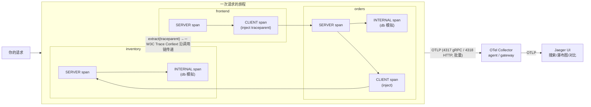

# 阶段 3 · 链路追踪 Tracing（OpenTelemetry + Jaeger）

> 本阶段是可观测性三大支柱的第三站：**链路追踪（Distributed Tracing）**。
> 指标回答"系统现在怎么样"，日志回答"这条记录发生了什么"，而链路追踪回答的是——
> **"这一次请求，到底经过了哪些服务、每一步花了多少时间、在哪里出了错？"**
> 学完本阶段，你应当能够：读懂 trace/span 模型、理解 W3C Trace Context 传播、用 OTel SDK 手动埋点、
> 搭起 OTel Collector + Jaeger 的本地链路体系，并能像老手一样"读"一条 trace。

## 学习目标

- [ ] 理解 trace/span 数据模型：trace_id / span_id / parent_id 的关系，span 的完整组成（kind、status、attributes、events、links）
- [ ] 理解 Google Dapper 论文的核心思想，以及它如何演化为今天的 OpenTelemetry
- [ ] 掌握 context 传播：W3C Trace Context（traceparent / tracestate）、b3、baggage，跨 HTTP / gRPC / 消息队列的传播差异
- [ ] 能用 OTel SDK（Python / Go 双语言）完成手动埋点：server / client / internal span、record error、事件
- [ ] 了解自动 instrumentation 的原理，以及为什么 Go 做不到无侵入
- [ ] 会部署 OTel Collector（agent / gateway 两种模式）并接通 Jaeger
- [ ] 能对 Jaeger / Tempo 做后端选型对比（存储成本、查询方式、生态契合度）
- [ ] 掌握"读 trace"的方法论：关键路径、网络 vs 处理时间、错误 trace 定位

## 笔记索引（建议按序阅读）

| # | 笔记 | 主题 | 关键词 |
| --- | --- | --- | --- |
| 1 | [trace-model.md](trace-model.md) | trace/span 模型 | Dapper、trace_id/span_id/parent_id、span 组成、SpanKind、命名最佳实践、常见误区 |
| 2 | [context-propagation.md](context-propagation.md) | context 传播 | W3C Trace Context、traceparent 逐字段、b3 迁移、baggage、MQ 消费端 parenting、断链排查 |
| 3 | [otel-sdk.md](otel-sdk.md) | OTel SDK 实战 | TracerProvider/Tracer/Span、Resource、SpanProcessor、OTLP 导出、自动/手动埋点、OTEL_* 环境变量、Collector 接线 |
| 4 | [jaeger-vs-tempo.md](jaeger-vs-tempo.md) | 后端选型 | Jaeger v1/v2 架构、Tempo 对象存储、对比表、Zipkin/SkyWalking/云厂商、选型建议 |
| 5 | [tracing-practice.md](tracing-practice.md) | 分析方法与最佳实践 | 怎么读 trace、关键路径、慢/错误定位、trace-日志关联、埋点覆盖策略、span 开销控制 |
| 6 | [apm-landscape.md](apm-landscape.md) | APM 平台全景 | 三代演进（插桩→SaaS→OTel）、Datadog/New Relic/Dynatrace 商业标杆、SkyWalking/SigNoz 开源一体化、OTel 的颠覆、计费模型与成本陷阱、选型决策树 |

## 配套实验

- **lab03：微服务链路追踪实战——亲眼看一条跨服务 trace** —— [labs/lab03-otel-tracing-jaeger/](../../labs/lab03-otel-tracing-jaeger/README.md)

  frontend → orders → inventory 三个 Python 微服务（OTel SDK 手动埋点，W3C Trace Context 传播），
  经 OTel Collector（batch → OTLP）送入 Jaeger。podman compose 一键启动，可制造正常 / 慢 / 错误三类 trace，
  并能用 curl 手工携带 traceparent 验证传播与采样行为。

## 本阶段知识地图

## 与其他阶段的衔接

- **向左（阶段 1/2）**：指标告诉你"哪个服务慢了"，日志告诉你"那条记录说了什么"，但只有 trace 能把一次请求在多个服务间的因果关系串起来。exemplars（阶段 4）会把三者真正打通。
- **向后（阶段 4）**：日志注入 trace_id、exemplars 指标关联 trace、统一仪表盘，都以本阶段的 trace_id 传播为基础。
- **向远（阶段 5）**：本阶段刻意只讲"全量采样"的最简形态；head/tail-based 采样、高基数治理、eBPF 与 K8s 场景留到阶段 5。

## 参考资料（权威入口）

- OpenTelemetry 官方文档：<https://opentelemetry.io/docs/>（访问日期：2026-11-04）
- OpenTelemetry 规范（含 trace 数据模型）：<https://opentelemetry.io/docs/specs/otel/>（访问日期：2026-11-04）
- W3C Trace Context 规范：<https://www.w3.org/TR/trace-context/>（访问日期：2026-11-04）
- Google Dapper 论文：<https://research.google/pubs/pub36356/>（访问日期：2026-11-04）
- Jaeger 官方文档：<https://www.jaegertracing.io/docs/>（访问日期：2026-11-04）
- Grafana Tempo 文档：<https://grafana.com/docs/tempo/latest/>（访问日期：2026-11-04）

## 附：ASCII 图替换清单

| 原 ASCII 图位置（章节标题） | 原图内容简述 | 替换结果 |
| --- | --- | --- |
| 本阶段知识地图 | 三服务 span 调用链（W3C traceparent 传递）+ OTLP → Collector → Jaeger 导出链路 | flowchart LR（嵌套 subgraph） |

---

## 阶段导读：为什么要有这个阶段

前两站之后你已经能回答"系统现在怎么样"（指标）和"这条记录说了什么"（日志），但分布式系统里最要命的问题是：**一次慢请求，到底慢在哪一跳、谁在等谁**。指标给不了因果，日志给不了归属；只有 trace 能把一次请求在多个服务间的全部工作段连成一棵树。本阶段就是把这个信号从概念变成肌肉记忆，按五步展开：

1. **模型**：trace/span 树、SpanKind、status 与 events——一切追踪系统共用的抽象（trace-model）；
2. **传播**：跨进程缝合靠 W3C Trace Context 的 `traceparent` 头，断链发生在哪、怎么查（context-propagation）；
3. **产出**：OTel SDK 手动埋点的完整代码，自动埋点的原理与语言边界（otel-sdk）；
4. **落地**：Collector 两种部署形态接 Jaeger，Jaeger/Tempo 后端选型（jaeger-vs-tempo）；
5. **方法**：拿到一条 trace 怎么读出关键路径与根因（tracing-practice）。

在整条路径中的位置：trace_id 是阶段 4 三支柱关联的"那把钥匙"——日志注入它、指标 exemplar 指向它。本阶段刻意保持"全量采样"的教学默认，真实生产中的 head/tail 采样留给阶段 5；这个默认让 lab03 的每条请求都能在 Jaeger 里被看到，先把注意力留给模型与传播本身。

配套实验 [labs/lab03-otel-tracing-jaeger/](../../labs/lab03-otel-tracing-jaeger/README.md) 用 frontend → orders → inventory 三个 Python 微服务还原完整链路。强烈建议亲手做一次"手工携带 traceparent 调 curl"的传播验证——亲手注入一次请求头，胜过读十遍传播原理。

## 常见误区与正解

- **误区一："接了 OTel SDK，全链路 trace 就自动有了。"**
  为什么错：跨进程缝合靠的是把 context 写进请求头（inject）再从请求头读出来（extract），任何一环没做（自研 RPC、没装拦截器的 HTTP client、裸消息队列）都断链。
  正解：把"传播是显式的"当成公理；每接一种新通道（HTTP/gRPC/MQ）就验证一次 `traceparent` 是否真的到达下游。
- **误区二："span 越多越详细，排查越方便。"**
  为什么错：每个 span 都有创建、上报、存储成本；海量微小 span 会淹没瀑布图，反而找不到关键路径。
  正解：只对关键路径、外部调用、可疑分支手动补 span；命名遵循语义约定且保持低基数。
- **误区三："trace 断了，肯定是 SDK 的 bug。"**
  为什么错：断链的三大高发位置是应用自身的工程结构——异步线程池没透传 context、MQ 消费端把消息当新请求、自研 RPC 框架没注入头。
  正解：按 context-propagation 的断链排查清单逐段检查应用与中间件，最后才怀疑 SDK。
- **误区四："Jaeger 上查不到这条 trace，说明没采集。"**
  为什么错：查不到的原因可能是导出失败、batch 未 flush 进程就退出、采样器丢弃、查询时间范围选错等多种情况。
  正解：沿"SDK → OTLP → Collector → 后端"逐段排查：看 Collector 日志、exporter 自监控指标、采样器配置。
- **误区五："采样之后 trace 数据不全，链路追踪没用了。"**
  为什么错：那是把"全量"当成了唯一正确形态；生产体系的正确姿势是"错误与慢 trace 全保 + 正常流量按比例"（阶段 5 的 tail 采样）。
  正解：本阶段吃透模型与传播；采样策略到阶段 5 展开，两者是递进关系不是矛盾。

## 踩坑速查

| 现象 | 可能原因 | 处置 |
| --- | --- | --- |
| 两个服务各自成独立 trace 树 | 下游没收到 `traceparent`（客户端未 inject） | 手动注入请求头，或换支持传播的 client 库 |
| 子 span 挂在根 span 而不是正确的父 span | 异步任务没透传 context 对象 | 把 context 显式传进线程池/协程任务 |
| 同名 span 一大片，无法区分调用 | 命名太泛（如 `handler`） | 按语义约定改为低基数的操作名 |
| span 时长与真实感受耗时差异大 | batch 未 flush / 节点时钟漂移 | 进程退出前强制 flush；校准节点 NTP |
| gRPC 调用链全部断链 | 客户端或服务端没装 OTel 拦截器 | 两端各装一次拦截器并验证 |
| baggage 设置后下游读不到 | propagator 列表没包含 baggage | 检查 `OTEL_PROPAGATORS` 环境变量配置 |
| Jaeger 偶尔丢整批 trace | Collector 导出抖动且无缓冲队列 | exporter 配置重试与发送队列 |

权威入口：OpenTelemetry 官方文档 `https://opentelemetry.io/docs` （官方文档） 、Jaeger 官方文档 `https://www.jaegertracing.io/docs` （官方文档） 、W3C Trace Context 规范 `https://www.w3.org/TR/trace-context` （官方文档） 。

## 一页速记：链路追踪十二句话

面试前、值班前、给别人讲解前，回来看这十二句。每一句都能展开成半页纸，说不清哪句就回哪一篇：

1. 一次分布式请求 = 一棵 span 树；span 是一段有名字、有起止时间、有属性的工作单元。
2. 跨进程传播永远是显式的三步：inject 写进请求头 → 线上传输 → extract 读出来，没有任何框架能替你跳过。
3. `traceparent` 四段式：版本号 - 32 位十六进制 trace_id - 16 位十六进制 span_id - 采样标志位，逐字段含义见 context-propagation。
4. SpanKind 五种：server / client / internal / producer / consumer，回答"这段工作处在请求路径的什么位置"。
5. Resource 放低基数的身份信息（`service.name`、版本、环境），span 属性放本次请求的细节，两层永不混用。
6. 命名要低基数、按语义约定：`GET /orders/{id}` 是好名字，`GET /orders/12345` 不是。
7. 自动埋点只覆盖框架边界（HTTP、DB 驱动、消息客户端）；Go 没有字节码增强，关键业务段必须手动 span。
8. Collector 的职责是接收、处理、导出三件事；agent 贴近应用做首跳，gateway 收口采样、脱敏与路由策略。
9. 读 trace 三步：找到入口 server span → 沿最长子 span 链看关键路径 → 区分"网络等待"与"真实处理时间"。
10. 查错误 trace：先看 status 与 events 记录的异常，再看出错 span 的属性，最后凭 trace_id 下钻日志。
11. 查不到 trace 别急着怀疑采集：沿"SDK 导出 → Collector 接收 → 后端写入 → 查询时间范围"四段逐段排查。
12. 全量采样是教学默认；生产的姿势是 tail 采样——错误与慢 trace 全保、正常流量按比例（阶段 5 展开）。

用法建议：把这十二句讲给一位没学过链路追踪的同事听，讲的过程中对方追问"为什么"而你答不上的那几句，就是你下一步要重读的笔记——这比任何自测清单都准。

## 与下一阶段的接口：进入整合阶段前

trace_id 是阶段 4 的"针线"：日志要注入它、指标 exemplar 要指向它、Grafana 跳转全靠它。所以离开本阶段前，先把两件"接口工程"确认掉：

1. **确认传播链稳定**：在 lab03 里至少完成一次三服务全链路不断线的请求；如果连这里都偶发断链，阶段 4 的三向跳转配好后也只会是"有时灵有时不灵"的玄学状态——先回 context-propagation 把断链清零；
2. **确认日志能拿到 trace_id**：lab03 的应用日志里有没有 trace_id 字段？没有的话，回阶段 2 的标准字段表把它加上（或用 OTel 的日志桥接）。阶段 4 的 derivedFields 要靠它写正则，字段名与格式在本阶段定好，下一阶段就是纯配置工作；
3. **确认 exemplar 的地基**：阶段 4 会启用 exemplar 四段链路，其中第一段在 SDK——趁现在确认你所用语言的 metrics SDK 是否支持 exemplar 输出（笔记 7 有关键提示），避免下一阶段边配边踩兼容性坑。

一个返工信号：到阶段 4 配 tracesToLogsV2 或 derivedFields 时发现 trace 与日志对不上，八成不是 Grafana 的问题，而是本阶段的传播断链或日志字段名不一致——按上面第 1、2 条回查，比在数据源配置里反复试错快得多。

## 自检清单（进入下一阶段前）

- [ ] 能画出一次三服务请求的 span 树，并标出每个 span 的 SpanKind；
- [ ] 能默写 `traceparent` 的四段结构，并指出采样标志位在哪一段；
- [ ] 能对断链三大高发位置（异步线程池、MQ 消费端、自研 RPC）各举出一个具体场景与修法；
- [ ] 能用 OTel SDK 写出 server / client / internal 三种 span，并在出错路径正确设置 status 与 events；
- [ ] 能说清 Resource 属性与 span 属性的分工，并解释为什么 Resource 必须低基数；
- [ ] 能说出 Collector 的 agent / gateway 两种部署形态各自解决什么问题；
- [ ] 拿到一条真实瀑布图，能指出关键路径并区分"网络等待"与"真实处理时间"；
- [ ] 已在 lab03 制造并观察到正常 / 慢 / 错误三类 trace，并完成手工携带 `traceparent` 的传播验证。

打不了勾的条目就是下一步的阅读清单——链路追踪是动手信号，所有概念都要在瀑布图上见过实物才算数。
