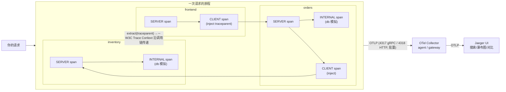

# 阶段 3 · 链路追踪 Tracing（OpenTelemetry + Jaeger）

> 本阶段是可观测性三大支柱的第三站：**链路追踪（Distributed Tracing）**。
> 指标回答"系统现在怎么样"，日志回答"这条记录发生了什么"，而链路追踪回答的是——
> **"这一次请求，到底经过了哪些服务、每一步花了多少时间、在哪里出了错？"**
> 学完本阶段，你应当能够：读懂 trace/span 模型、理解 W3C Trace Context 传播、用 OTel SDK 手动埋点、
> 搭起 OTel Collector + Jaeger 的本地链路体系，并能像老手一样"读"一条 trace。

## 学习目标

- [ ] 理解 trace/span 数据模型：trace_id / span_id / parent_id 的关系，span 的完整组成（kind、status、attributes、events、links）
- [ ] 理解 Google Dapper 论文的核心思想，以及它如何演化为今天的 OpenTelemetry
- [ ] 掌握 context 传播：W3C Trace Context（traceparent / tracestate）、b3、baggage，跨 HTTP / gRPC / 消息队列的传播差异
- [ ] 能用 OTel SDK（Python / Go 双语言）完成手动埋点：server / client / internal span、record error、事件
- [ ] 了解自动 instrumentation 的原理，以及为什么 Go 做不到无侵入
- [ ] 会部署 OTel Collector（agent / gateway 两种模式）并接通 Jaeger
- [ ] 能对 Jaeger / Tempo 做后端选型对比（存储成本、查询方式、生态契合度）
- [ ] 掌握"读 trace"的方法论：关键路径、网络 vs 处理时间、错误 trace 定位

## 笔记索引（建议按序阅读）

| # | 笔记 | 主题 | 关键词 |
| --- | --- | --- | --- |
| 1 | [trace-model.md](trace-model.md) | trace/span 模型 | Dapper、trace_id/span_id/parent_id、span 组成、SpanKind、命名最佳实践、常见误区 |
| 2 | [context-propagation.md](context-propagation.md) | context 传播 | W3C Trace Context、traceparent 逐字段、b3 迁移、baggage、MQ 消费端 parenting、断链排查 |
| 3 | [otel-sdk.md](otel-sdk.md) | OTel SDK 实战 | TracerProvider/Tracer/Span、Resource、SpanProcessor、OTLP 导出、自动/手动埋点、OTEL_* 环境变量、Collector 接线 |
| 4 | [jaeger-vs-tempo.md](jaeger-vs-tempo.md) | 后端选型 | Jaeger v1/v2 架构、Tempo 对象存储、对比表、Zipkin/SkyWalking/云厂商、选型建议 |
| 5 | [tracing-practice.md](tracing-practice.md) | 分析方法与最佳实践 | 怎么读 trace、关键路径、慢/错误定位、trace-日志关联、埋点覆盖策略、span 开销控制 |
| 6 | [apm-landscape.md](apm-landscape.md) | APM 平台全景 | 三代演进（插桩→SaaS→OTel）、Datadog/New Relic/Dynatrace 商业标杆、SkyWalking/SigNoz 开源一体化、OTel 的颠覆、计费模型与成本陷阱、选型决策树 |

## 配套实验

- **lab03：微服务链路追踪实战——亲眼看一条跨服务 trace** —— [labs/lab03-otel-tracing-jaeger/](../../labs/lab03-otel-tracing-jaeger/README.md)

  frontend → orders → inventory 三个 Python 微服务（OTel SDK 手动埋点，W3C Trace Context 传播），
  经 OTel Collector（batch → OTLP）送入 Jaeger。podman compose 一键启动，可制造正常 / 慢 / 错误三类 trace，
  并能用 curl 手工携带 traceparent 验证传播与采样行为。

## 本阶段知识地图

## 与其他阶段的衔接

- **向左（阶段 1/2）**：指标告诉你"哪个服务慢了"，日志告诉你"那条记录说了什么"，但只有 trace 能把一次请求在多个服务间的因果关系串起来。exemplars（阶段 4）会把三者真正打通。
- **向后（阶段 4）**：日志注入 trace_id、exemplars 指标关联 trace、统一仪表盘，都以本阶段的 trace_id 传播为基础。
- **向远（阶段 5）**：本阶段刻意只讲"全量采样"的最简形态；head/tail-based 采样、高基数治理、eBPF 与 K8s 场景留到阶段 5。

## 参考资料（权威入口）

- OpenTelemetry 官方文档：<https://opentelemetry.io/docs/>（访问日期：2026-11-04）
- OpenTelemetry 规范（含 trace 数据模型）：<https://opentelemetry.io/docs/specs/otel/>（访问日期：2026-11-04）
- W3C Trace Context 规范：<https://www.w3.org/TR/trace-context/>（访问日期：2026-11-04）
- Google Dapper 论文：<https://research.google/pubs/pub36356/>（访问日期：2026-11-04）
- Jaeger 官方文档：<https://www.jaegertracing.io/docs/>（访问日期：2026-11-04）
- Grafana Tempo 文档：<https://grafana.com/docs/tempo/latest/>（访问日期：2026-11-04）

## 附：ASCII 图替换清单

| 原 ASCII 图位置（章节标题） | 原图内容简述 | 替换结果 |
| --- | --- | --- |
| 本阶段知识地图 | 三服务 span 调用链（W3C traceparent 传递）+ OTLP → Collector → Jaeger 导出链路 | flowchart LR（嵌套 subgraph） |
