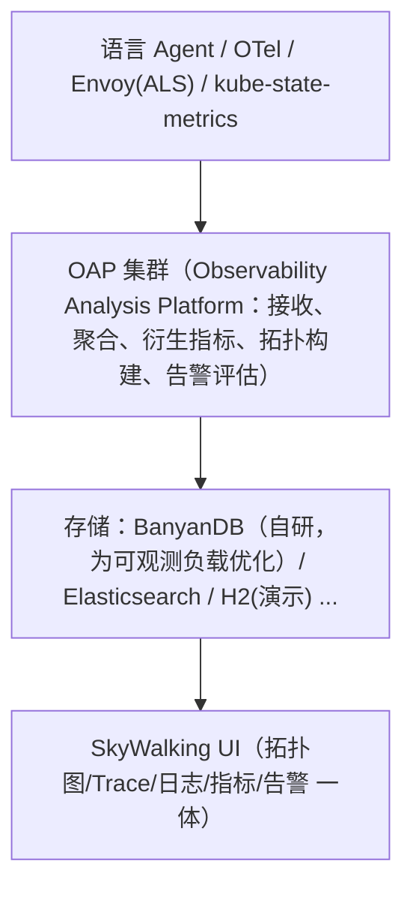
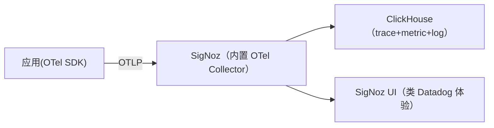
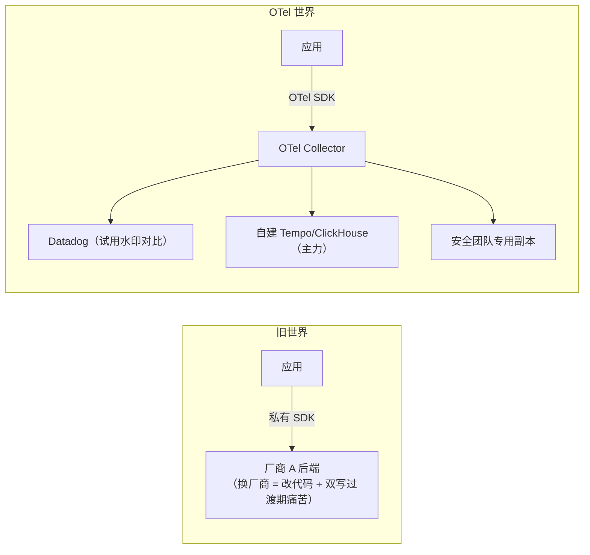
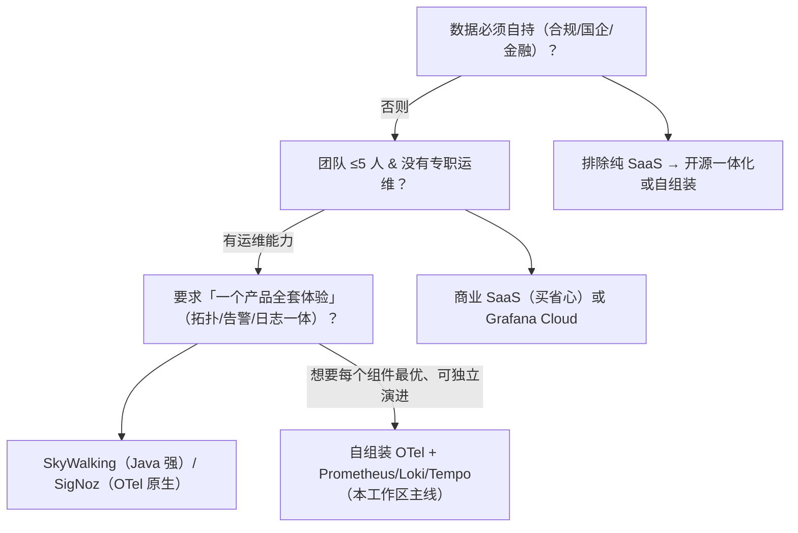

# APM 平台全景：商业标杆、开源一体化与 OpenTelemetry 的颠覆

> [jaeger-vs-tempo.md](jaeger-vs-tempo.md) 比较的是"追踪后端"；本篇把镜头拉远：
> **APM（Application Performance Monitoring）平台**——同时包揽 trace + 日志 + 指标 +
> 拓扑图 + 告警的一体化产品，是"可观测性"这个词商业化最成功的形态。
> 讲清楚三类玩家（商业 SaaS、开源一体化、自组装 OSS 栈）、它们的计费/架构差异、
> 以及 OpenTelemetry 如何改写游戏规则。选型时这篇是地图，不是答案。

## 目录

1. [APM 的定义与三代演进](#1-apm-的定义与三代演进)
2. [商业 SaaS 标杆：Datadog / New Relic / Dynatrace / Elastic](#2-商业-saas-标杆datadog--new-relic--dynatrace--elastic)
3. [开源一体化：SkyWalking / SigNoz / 其他](#3-开源一体化skywalking--signoz--其他)
4. [OpenTelemetry：改写规则的那张牌](#4-opentelemetry改写规则的那张牌)
5. [架构拆解：一体化平台的通用骨架](#5-架构拆解一体化平台的通用骨架)
6. [计费模型与成本陷阱](#6-计费模型与成本陷阱)
7. [选型决策树：商业 vs 开源 vs 自组装](#7-选型决策树商业-vs-开源-vs-自组装)
8. [常见坑](#8-常见坑)
9. [面试题小结](#9-面试题小结)
10. [参考资料](#10-参考资料)

---

## 1. APM 的定义与三代演进

APM = 围绕**应用**（而非主机/网络）的性能与错误监控，现代 APM 平台基本都长这样：
分布式追踪 + 服务拓扑 + 指标 + 日志关联 + 错误聚合 + 告警 + （越来越多的）profiling。

三代演进（理解了演进就理解了今天的竞争格局）：

| 代际 | 时代 | 代表 | 埋点方式 | 特征 |
|---|---|---|---|---|
| 第一代：字节码插桩 | 2005~ | Dynatrace、AppDynamics | Java agent 字节码增强（无侵入） | 卖给传统企业，按服务器计费，贵 |
| 第二代：Cloud/SaaS APM | 2010~ | New Relic、Datadog | 语言 agent/SDK | 开发者自助接入、按 host/用量计费 |
| 第三代：OTel + 后端可替换 | 2020~ | OTel（埋点）× 任意后端 | **厂商中立的 OTLP** | 埋点标准化，竞争移到后端与体验 |

**第三代的深远影响**：埋点（instrumentation）曾经是 APM 厂商的护城河——换厂商意味着
改代码。OTLP 成为事实标准后，**埋点与后端解耦**，Datadog/New Relic 们从"全家桶"
退守为"OTLP 的一个消费者"，开源后端的可行性大幅提升。

## 2. 商业 SaaS 标杆：Datadog / New Relic / Dynatrace / Elastic

> 定位速览，细节以各官网当前产品页为准（产品线变化快）。

| 产品 | 起家优势 | 生态广度 | 计费模型要点 | 典型选择场景 |
|---|---|---|---|---|
| **Datadog** | 云原生 SaaS APM 事实标杆 | 极广（infra/APM/logs/RUM/安全/Cost/CI 一站式，几百个集成） | Infra 按host；APM 按 host（含 span 上限）；Logs 按 GB 索引；按功能模块单独订阅 | 预算充足、要"一个平台全搞定"、工程团队大 |
| **New Relic** | 最早的开发者友好 APM | 中上（含 Errors Inbox、RUM） | 按用量（GB/用户）+ 免费额度 | 从它家迁移出的存量团队、用量计费偏好 |
| **Dynatrace** | 第一代王者转型，AI 根因分析（Davis） | 大企业向（SAP/大型机都有） | 按 host/基础设施单元 | 传统大企业、复杂异构环境、要"AI 告诉我根因" |
| **Elastic Observability** | ES 存储复用（日志团队顺手上 APM） | 与 ELK 同栈 | 按 GB/资源 | 已重度投入 ELK 的团队 |
| **Grafana Cloud** | OSS 全家桶的托管版 | LGTM 栈 + Faro/RUM + Sift（LLM 排障） | 按用量（series/GB/用户） | 已用 Grafana OSS、想省运维、保留可迁回性 |

**商业平台的共性价值**（也是"贵"买到的部分）：零运维、SLA、开箱即用的
自动仪表化（一行 env var 接入）、现成 dashboard/告警/周报、企业 SSO/审计。

## 3. 开源一体化：SkyWalking / SigNoz / 其他

### 3.1 Apache SkyWalking（国内主流）

Apache 顶级项目（2019 毕业，创始人吴晟），国内微服务/Java 生态的 APM 事实标准之一：



- **强项**：语言 agent 覆盖广（Java 最成熟，字节码增强无侵入）、**服务拓扑自动生成**
  （这是很多团队留下的第一理由）、trace/metric/log 三支柱 + 告警规则一体的中文友好体验、
  Mesh 与 Kubernetes 场景的原生接入（Envoy ALS、Zabbix/Telegram 集成等）；
- **演进**：从"APM"扩展为"可观测性平台"（8.x logs、9/10.x UI 重构、BanyanDB 替代
  ES 作为推荐存储——省掉一个重型 ES 集群是运维上最实在的改进）；
- **定位**：Java/微服务为主、想自建一体化、英文文档生态之外的强选择。

### 3.2 SigNoz（开源版 Datadog 的定位）

OTel 原生 + ClickHouse 单存储后端的一体化平台：



- 卖点：**架构极简**（一个数据库、一套 Go 服务）、OpenTelemetry-first（无私有 agent）、
  拓扑/告警/仪表盘齐备，Cloud 版本补贴开源开发；
- 适合：想要"Datadog 的样子"但数据必须自持、且团队能运维 ClickHouse 的中小团队。

### 3.3 其他值得认识的

| 项目 | 一句话 |
|---|---|
| **OpenObserve** | Rust 写的一体化平台，S3 优先存储，主打成本（日志场景尤其激进） |
| **Quickwit** | 搜索型存储（替代 ES 的日志/trace 检索层），常与 Jaeger/OTel 组合 |
| **Uptrace** | OTel 后端，卖点是对 OpenTelemetry 语义的"原生利用" |
| **HyperDX** | 开源 + ClickHouse，主打"日志即事件"的排障体验（session replay 风格） |
| **Jaeger / Tempo / Zipkin** | 纯追踪后端，见 [jaeger-vs-tempo.md](jaeger-vs-tempo.md) |

## 4. OpenTelemetry：改写规则的那张牌

OTel 不是 APM 产品，而是**埋点与传输的标准**（SDK + Collector + OTLP 协议 +
语义约定）。它对选型的实际影响：



1. **后端可替换**：Collector 改一个 exporter 就换后端（[jaeger-vs-tempo.md §9](jaeger-vs-tempo.md#9-从-jaeger-迁移到-tempo或反向otel-让后端可替换) 的迁移实验）；
2. **一份埋点多处消费**：POC 期间双写两家商业平台对比效果，成本为零；
3. **厂商策略已经适应**：Datadog/New Relic 都直接吃 OTLP（各自保留一些增值
   instrument 库）——**"接不接 OTLP"已经不是区分度，数据体验才是**；
4. **自组装栈的基石**：本工作区 labs 的 Prom/Loki/Tempo 栈正是"OTel + 开源后端"
   的自组装形态——你已经在实践第三代的路线。

## 5. 架构拆解：一体化平台的通用骨架

无论商业还是开源，APM 平台内部高度同构（对照各产品文档都能找到）：

```
① 采集层     语言 agent / SDK / OTel Collector / 自动仪表化（一行接入的关键）
② 接收/管道  去重、尾部采样、富化（云 metadata、k8s labels）、基数限制
③ 存储       trace 列存（ClickHouse/自有）、指标 TSDB、日志（倒排/列存）
④ 衍生层     服务拓扑（span 边聚合）、RED 指标预计算、错误聚合（fingerprint 分组）
⑤ 呈现/行动  UI（瀑布图/拓扑/dashboard）、告警、SLO、on-call 集成
```
<!-- 保留原图：①~⑤ 五层平铺文字清单，无图形字符与连线，非示意图 -->

理解骨架的选型价值：**所有差异都是"某一层做了什么取舍"**——
SkyWalking 强在①（agent）④（拓扑）；SigNoz 强在③极简（单一 ClickHouse）；
Datadog 强在⑤广度与②的托管体验；自组装栈（本工作区）牺牲⑤的整合度
换②③的完全可控。本工作区各阶段笔记恰好逐层对应：
②[lab00 Collector](../../labs/lab00-otel-collector-basics/README.md)、
③[long-term-storage.md](../01-metrics/long-term-storage.md)/[loki.md](../02-logging/loki.md)、
④[correlation.md §7](../04-integration/correlation.md#7-tempo-服务图与派生指标derived-series)、
⑤[unified-dashboard.md](../04-integration/unified-dashboard.md)。

## 6. 计费模型与成本陷阱

商业 APM 的账单结构（各厂商细节不同，结构相通）：

| 维度 | 计费单位 | 陷阱 |
|---|---|---|
| APM | host / span 量 | **全量 span + 100% 采样 = 账单核弹**。先在 Collector 做采样（[sampling.md](../05-production/sampling.md)），再谈接入 |
| Logs | 摄入 GB / 索引 GB | DEBUG 日志全送是最常见浪费；摄入≠索引（降索引量是最直接省钱手段） |
| 指标 | 自定义 series | [基数](../05-production/cardinality.md)失控在云账单上同样爆炸 |
| RUM/Session | 会话量/Replay 量 | Replay 录制的采样率单独控（见 [frontend-rum.md](../04-integration/frontend-rum.md)） |
| 席位 | 每用户/每席位 | 只读 Viewer 席位便宜得多，按角色分配 |

**成本工程三件套**（接商业平台第一周就该做）：出口采样策略、DEBUG 日志降级、
基数预算表——同样适用于自建（省的是磁盘而不是账单）。

## 7. 选型决策树：商业 vs 开源 vs 自组装



补充判断：

- **混合是常态**：商业平台管告警值班与跨团队共享，自建栈管高量低成本数据
  （如 DEBUG 日志、全量 span）——OTel 双写让这种混合零成本；
- **退出成本**：签约前问一句"数据能不能全量导出"（OTLP/CSV/API），答案决定三年后
  你有没有议价权；
- **团队语言栈**：Java 重 → SkyWalking agent 体验最好；多语言微服务 → OTel 自动仪表化
  的覆盖度是第一评估项。

## 8. 常见坑

1. **100% 采样直连商业平台**：上线一周账单 10 倍于预估。先定采样策略再开写入；
2. **agent 版本与后端协议漂移**：自建 SkyWalking 时 agent 8.x ↔ OAP 9.x 的协议兼容
   窗口要按官方兼容矩阵锁版本，跨大版本盲升级会出现"一半服务消失"；
3. **把 APM 当唯一可观测方案**：APM 面向"应用"；主机/网络/K8s 层的深度观测
   （eBPF、node 指标）另算——[ebpf.md](../05-production/ebpf.md)；
4. **开源一体化省了软件费、没算运维账**：ClickHouse/BanyanDB/ES 都是大型有状态系统，
   "免费"的成本转移到了值班工程师身上；
5. **双写变永久**：POC 对比期的双写 Collector 配置留了一年后还在——采样、路由、
   熔断策略双份漂移，成了排障噪声源。POC 到期必须二选一回收；
6. **拓扑图当真相**：拓扑是从 span 采样推断的，低采样率下"没有边"≠"没有调用"
   （[correlation.md §7](../04-integration/correlation.md#73-service-graph-与-traceql-metrics) 的双侧 span 前提同理）；
7. **只评功能不评出口**：选型 POC 只看 dashboard 漂亮，不测"导出数据做二次分析"
   与"下一年费用曲线"——两个月后分别在报表和预算上后悔。

## 9. 面试题小结

**Q1：APM 与"可观测性三支柱"的关系？**
A：APM 是围绕应用性能的一体化产品形态，现代 APM 通常同时覆盖三支柱
（trace 为核心 + 指标 + 日志）并加拓扑/告警/错误聚合；三支柱是数据模型层面的概念，
APM 是产品层面的打包。OTel 让两者解耦：埋点标准化后，任何后端都能组装出 APM 形态。

**Q2：OpenTelemetry 对 APM 市场改变了什么？**
A：把"埋点绑定厂商"的护城河拆掉——SDK/协议（OTLP）与语义约定标准化，
应用侧一份埋点，Collector 侧多 exporter 分发/可替换后端。竞争焦点从"怎么接"
移到"存储成本、数据体验、AI 辅助排障"。

**Q3：SkyWalking 的架构组件与强项？**
A：Agent/OTel 等采集 → OAP 集群（接收+聚合+拓扑+告警评估）→ 存储
（推荐 BanyanDB，可选 ES）→ 一体 UI。强项：语言 agent（Java 字节码增强）成熟、
服务拓扑自动生成、三支柱一体、国内生态。选型要点是接受其存储层的运维成本。

**Q4：SigNoz 为什么敢说"开源 Datadog"？架构上它做了什么取舍？**
A：押注两个标准化件——OTel Collector（采集，不自研 agent）+ ClickHouse
（单存储承载 trace/metric/log）。取舍：放弃存储层多样性（换来运维极简），
产品体验向 Datadog 看齐但生态广度依赖社区。

**Q5：接入商业 APM 前必须做的三件成本工程？**
A：①采样策略（tail sampling 在 Collector 层，避免全量 span 计费）；
②日志分级降载（DEBUG 不出集群/不索引）；③指标基数预算
（自定义 series 上限提前谈）。三者对应账单的三大变量：span 量、GB、series 数。

**Q6：商业 APM、开源一体化、自组装 OSS 三条路线的取舍本质？**
A：钱换省心（SaaS：运维归零、退出成本高、按量膨胀）；一体化折中
（软件免费、运维自担、体验打包）；自组装最灵活可控（每层最优，但⑤层
呈现与整合体验要自己拼——本工作区阶段 4 就是在做这件事）。

**Q7：为什么服务拓扑图"没有边"不能断言"没有调用"？**
A：拓扑由 trace 采样聚合推断：该调用恰好全被采样丢弃、或仅单侧 span
（缺 client/server 一侧）时边不会生成。拓扑适合看"有什么"，不适合证明"没有什么"。

## 10. 参考资料

- OpenTelemetry 官网（规范与 Collector）：<https://opentelemetry.io/docs/>（访问日期：2026-11-04）
- Apache SkyWalking 文档与架构：<https://skywalking.apache.org/docs/>（访问日期：2026-11-04）
- SkyWalking BanyanDB：<https://skywalking.apache.org/docs/banyandb/>（访问日期：2026-11-04）
- SigNoz 文档：<https://signoz.io/docs/>（访问日期：2026-11-04）
- OpenObserve：<https://openobserve.ai/docs/>（访问日期：2026-11-04）
- Datadog / New Relic / Dynatrace / Elastic Observability 产品页（计费与能力以官方为准）：
  <https://www.datadoghq.com/product/> 、<https://newrelic.com/products> 、
  <https://www.dynatrace.com/platform/> 、<https://www.elastic.co/observability>（访问日期：2026-11-04）
- Grafana Cloud：<https://grafana.com/products/cloud/>（访问日期：2026-11-04）
- 本工作区相关笔记：[jaeger-vs-tempo.md](jaeger-vs-tempo.md)、[sampling.md](../05-production/sampling.md)、[cardinality.md](../05-production/cardinality.md)、[frontend-rum.md](../04-integration/frontend-rum.md)

## 附：ASCII 图替换清单

| 原 ASCII 图位置（章节标题） | 原图内容简述 | 替换结果 |
| --- | --- | --- |
| 3.1 Apache SkyWalking | 采集 → OAP → 存储 → UI 四层纵向架构 | flowchart TD |
| 3.2 SigNoz | 应用 → SigNoz → ClickHouse 横向数据流，UI 挂在 SigNoz 下 | flowchart LR |
| 4. OpenTelemetry：改写规则的那张牌 | 旧世界私有 SDK 单路对比 OTel 世界 Collector 三路分发 | flowchart LR（双 subgraph） |
| 7. 选型决策树 | 按约束逐级分流到四条路线的决策树 | flowchart TD |

### 保留说明

| 原 ASCII 图位置（章节标题） | 原图内容简述 | 保留原因 |
| --- | --- | --- |
| 5. 架构拆解：一体化平台的通用骨架 | ①~⑤ 五层平铺文字清单 | 无图形字符与连线，属分层清单而非示意图 |
