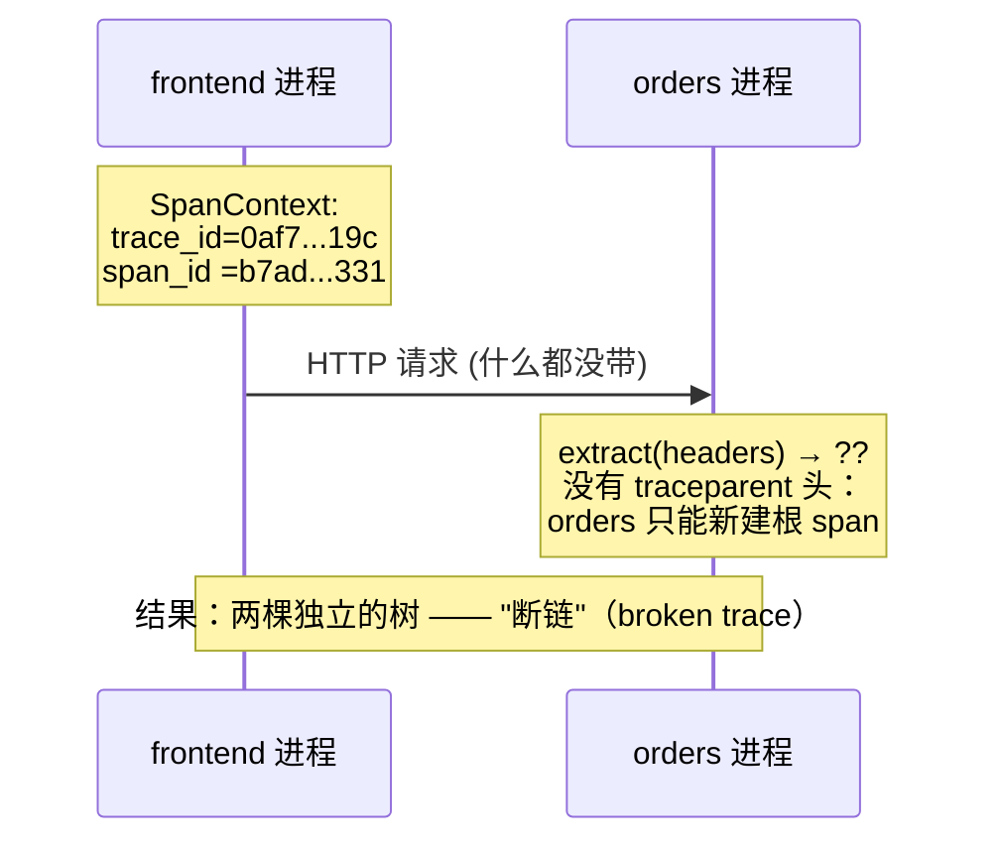
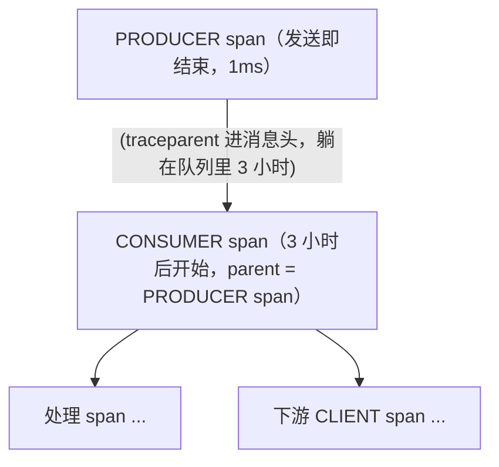

# 链路追踪笔记 02 · Context 传播：把 trace 缝起来的是请求头

> span 模型只解决了"怎么描述"一段工作；跨进程把 span 缝成一棵树，靠的是**context 传播**。
> 本篇讲清楚：为什么必须显式传播、W3C Trace Context 的逐字段格式、b3 与迁移、baggage 的利弊、HTTP/gRPC/消息队列三种通道的差异，以及一份拿来即用的断链排查清单。

## 1. 为什么 context 不会"自动"传过去

操作系统只帮你传你写进协议里的东西。跨进程边界时，trace 上下文（trace_id、父 span_id、采样标志）只是**你进程内存里的一个对象**，除非它被写进请求头/消息头，否则下游一无所知：



所以传播永远是**显式**的三步（无论 SDK 包装得多隐蔽，本质都是它）：

```
发送方（进程 A）                          接收方（进程 B）
1. inject(carrier)：把当前 SpanContext     3. extract(carrier)：从 header 解析出
   写进 HTTP 头 / gRPC metadata / 消息头     parent SpanContext
2. 发送请求                               4. start_span(context=parent)：子 span
                                            继承 trace_id 与采样标志
```
<!-- 保留原图：发送方/接收方两栏编号步骤清单，无图形字符，非示意图 -->

## 2. 传播的两个层面：进程内与跨进程

"Context 传播"一词覆盖两层，断链问题也分别出在这两层：

| 层面 | 载体 | 各语言机制 | 典型断裂点 |
| --- | --- | --- | --- |
| 进程内（in-process） | 语言级上下文对象 | Go：`context.Context` 显式传参；Java：`ThreadLocal`（跨线程要特殊处理）；Python：`contextvars`（asyncio 安全）；Node：`AsyncLocalStorage`；.NET：`AsyncLocal<T>` | 线程池/协程切换时没把 context 带上 |
| 跨进程（cross-process） | 协议头 | HTTP 头 `traceparent`；gRPC metadata；MQ 消息头（Kafka record headers、AMQP headers） | 忘了 inject/extract；中间代理剥头 |

进程内机制决定了"当前 span"这个概念在代码任何位置都能取到（如 `trace.get_current_span()`），但**它不出进程**——出进程必须经过 inject/extract。

## 3. W3C Trace Context：traceparent 逐字段解析

规范：<https://www.w3.org/TR/trace-context/>（访问日期：2026-11-04）。这是 OTel 默认且强烈推荐的传播标准，前身是各厂商私有格式（b3、jaeger-debug-id、x-cloud-trace-context……）的统一替代。

一个完整的 traceparent 头（示例取自规范原文）：

```
traceparent: 00-0af7651916cd43dd8448eb211c80319c-b7ad6b7169203331-01
              └┘ └───────────────┬───────────────┘ └───────┬──────┘ └┘
           version          trace-id              parent-id   trace-flags
```
<!-- 保留原图：traceparent 头字符串格式样例（字段位置标注属数据样例），非示意图 -->

| 字段 | 长度/格式 | 本例取值 | 规则与含义 |
| --- | --- | --- | --- |
| version | 2 个 hex | `00` | 版本号。`ff` 禁用；解析端遇到更高版本应按可解析前缀处理（向前兼容） |
| trace-id | 32 个 hex（128bit） | `0af7651916cd43dd8448eb211c80319c` | **全 0 非法**；整棵 trace 唯一；必须小写 |
| parent-id（即父 span_id） | 16 个 hex（64bit） | `b7ad6b7169203331` | **全 0 非法**；指向直接上游的 CLIENT/PRODUCER span |
| trace-flags | 2 个 hex（位图） | `01` | 目前只定义 bit0：`01`=sampled（应采样导出），`00`=不采样 |

解析规则里几条容易踩的细节（面试常考）：

1. **字段间必须恰好一个连字符 `-`，不能有空格**，大小写：十六进制字符应小写，解析方应当接受大写；
2. **收到非法的 traceparent（长度错、全 0、坏字符）→ 当作不存在**：接收方新建根 span（新 trace_id），而不是报错——保证"坏头不弄脏好链路"；
3. **出现多个 traceparent 头 → 整体非法**，同样按不存在处理；
4. `trace-flags` 是**建议**（sampled=01）而非强制：head-based 采样下，接收方采样器仍可能覆盖（但 OTel 默认 `ParentBased` 采样器会尊重上游决定）；
5. sampled 只有一个 bit，所以"必采样"的 debug 场景用 tracestate 或 vendor 头表达。

### 3.1 tracestate：厂商扩展区（一般别用）

```
tracestate: congo=t61rcWkgMzE,rojo=00f067aa0ba902b7
```
<!-- 保留原图：tracestate 头字符串样例，非示意图 -->

- 逗号分隔的 `key=value` 列表，最多 32 项，由各厂商/平台写自己的条目；
- 设计目的：跨厂商传递**追踪系统自身的元数据**（如额外的采样策略权重、厂商内部 trace 标识），**不是给人放业务数据的**（业务数据放 baggage，见第 5 节）；
- 规则：新的条目加在最前面，中间件应透传不认识的条目。日常业务开发几乎不需要写它，但要知道它和 baggage 的分工：**tracestate 属于 APM 厂商，baggage 属于应用**。

## 4. b3 传播器与从 Zipkin 体系迁移

b3 是 Zipkin 系的传播格式（名称来自 BigBrotherBird，Zipkin 前身 Brave 的内部代号）。规范：<https://github.com/openzipkin/b3-propagation>（访问日期：2026-11-04）。

多头形式：

```
X-B3-TraceId: 80f198ee56343ba864fe8b2a57d3eff7e   （可 64 或 128 bit hex）
X-B3-SpanId:  e457b5a2e4d86bd1
X-B3-ParentSpanId: e457b5a2e4d86bd1               （可选）
X-B3-Sampled: 1                                    （0/1；或用 X-B3-Flags: 1 表示 debug 必采）
```
<!-- 保留原图：b3 多头传播 HTTP 头格式样例，非示意图 -->

单头形式：`b3: {TraceId}-{SpanId}-{SamplingState}-{ParentSpanId}`，如 `b3: 80f198ee56343ba864fe8b2a57d3eff7-e457b5a2e4d86bd1-1`。

**迁移策略**（存量系统从 b3/baggage 走向 W3C 的标准做法）：配置**复合传播器**，注入时同时写新旧头，提取时依次尝试：

```python
# Python：同时说 W3C 和 b3（读：任一命中即可；写：两种头都带上）
from opentelemetry.propagate import set_global_textmap
from opentelemetry.propagators.composite import CompositePropagator
from opentelemetry.trace.propagation.tracecontext import TraceContextTextMapPropagator
from opentelemetry.baggage.propagation import W3CBaggagePropagator
from opentelemetry.propagators.b3 import B3MultiFormat

set_global_textmap(CompositePropagator([
    TraceContextTextMapPropagator(),   # 写/读 traceparent + tracestate
    W3CBaggagePropagator(),            # 写/读 baggage
    B3MultiFormat(),                   # 写/读 X-B3-* 多头（迁移期兼容）
]))
```

```bash
# 环境变量方式（所有 OTel SDK 通用）
OTEL_PROPAGATORS=tracecontext,baggage,b3multi
```

- 全部服务都升级后，把 b3 从列表里删掉，只留 `tracecontext,baggage`（OTel 默认值）；
- **顺序敏感**：composite 提取时按列表顺序找第一个能用的结果，注入时全部都写；新旧格式并存期各服务"双写"是安全的。

## 5. Baggage：随请求传播的业务上下文

规范：<https://www.w3.org/TR/baggage/>（访问日期：2026-11-04）。格式：

```
baggage: userId=42,role=admin,tenant=acme
```
<!-- 保留原图：baggage 头字符串样例，非示意图 -->

**它与 traceparent 的本质区别**：traceparent 传播的是**追踪系统自己的状态**（ID 与采样位），baggage 传播的是**应用想带的数据**（键值对），两者在 OTel 里都由 propagator 一起注入/提取。

利：

- 下游服务无需再查库/再传参就能拿到"当前是谁在操作"（租户、用户、AB 实验桶、会话 ID）；
- 与 trace_id 绑定后，日志/限流/审计可以在任何一跳做出一致的决策；
- OTel 各语言 SDK 原生支持：`opentelemetry.baggage.set_baggage("tenant", "acme")` / `get_baggage("tenant")`。

弊（必须认真对待）：

- **每一跳都带**：包括你调用的第三方 SaaS——等于把内部用户数据主动外发；
- **大小**：头太大被网关/代理截断或直接 4xx（一般建议所有 baggage 总量 < 1KB，条目 < 十几个）；
- **投毒**：外部调用者可以伪造 baggage 头塞入任意键值，消费方必须把它当**不可信输入**（校验 + 白名单）；
- **不是为大数据设计的**：不要塞 JSON、不要塞 PII（手机号、邮箱）。

实践建议：baggage 只放**少量、非敏感、有明确消费方的标识**；入站时白名单过滤，出第三方前剥离。

## 6. 三种通道的传播差异

### 6.1 HTTP

- inject 目标是请求头（header），键名 `traceparent`/`tracestate`/`baggage`；
- 注入方必须**在建立连接后、发送前**把头写全；提取方读头时注意大小写不敏感；
- 常见坑：
  - **反向代理/网关/LB 剥离或改写未知头**（尤其某些云 LB 默认只透传白名单头）；
  - **CORS**：跨域前端读自定义响应头需要 `Access-Control-Expose-Headers`，浏览器发 traceparent 需要服务端允许该请求头；
  - **重定向（3xx）**：多数 HTTP client 跟随重定向时**不会重发自定义头**，trace 在重定向处断掉；
  - 异步 HTTP 库的回调里再发后续请求时，当前 context 已变——要把 inject 结果显式传递。

### 6.2 gRPC

- 载体是 **metadata**（键小写，`traceparent` 同名）；OTel 各语言的 gRPC instrumentation 自动 inject/extract；
- 两个额外注意点：
  1. **deadline 传播是另一件事**：gRPC 的 `grpc-timeout` 头由框架随调用自动传递，与 trace 传播无关，但排障时两者经常一起看（下游为何被取消）；
  2. 自定义 `metadata.MD` 类型的 carrier 需要 getter/setter 适配（dict 默认 getter 直接可用的情况更多），手动埋点时注意。

### 6.3 消息队列（最容易断链也最容易被误解）

队列把"发送"和"处理"在**时间上解耦**了，传播语义与同步调用有三点本质不同：

1. **CONSUMER 的父是 PRODUCER（remote parent）**：消费者从消息头 extract 出生产者的 span context，作为 CONSUMER span 的 parent。于是 CONSUMER span 可能比它的父（PRODUCER span）**晚开始几个小时**——树形上仍是父子，时间上完全不相交（`trace-model.md` 第 6 节）。
2. **消费端 parenting 问题（经典考点）**：消费者通常是"**先批量拉取，再逐条处理**"的结构。逐条处理时父级应该是什么？两种实现流派：
   - **每条消息一个 CONSUMER span**，parent = 该消息 PRODUCER 的 span context（Kafka 早期 instrumentation 的做法）——链路语义最准，但"拉取"这个动作本身没有 span；
   - **"拉取"一个父 span（CONSUMER，代表 poll），每条消息的处理 span 用 link 指回各自的 PRODUCER span**（OTel 较新的 Kafka instrumentation 的推荐做法）——避免多条消息共享一个大父 span 导致的歧义。
   无论哪种，**消息头丢了 = 整条因果链断了**：Kafka 要用 record headers（不是 key/value！），RabbitMQ 用 AMQP headers，SQS 用 MessageAttribute（注意 10 个属性上限与大小限制）。
3. **重试/重投递**：同一条消息可能被处理多次，产生多个 CONSUMER span 指向同一个 PRODUCER span——这是正常现象，用 links 或属性（`messaging.delivery_attempts`）标注即可，不要试图"去重"trace。



## 7. 跨语言场景

好消息：**W3C 头是字节级别的标准**，只要双方都用标准传播器，语言差异不存在——Go 服务调 Python 服务调 Java 服务，头里的 hex 串完全一致。

差异体现在**进程内**上下文与**易错点**上：

| 语言 | 进程内机制 | 跨线程/协程易错点 |
| --- | --- | --- |
| Go | `context.Context` 作为第一个参数显式传递 | 新起的 goroutine 忘了把 ctx 传进去（编译器不报错）；`context.Background()` 一用，当前 span 就丢了 |
| Java | `ThreadLocal`（OTel 内部） | 提交到自定义线程池/`CompletableFuture` 时 ThreadLocal 不跟随，需用 `opentelemetry-context` 的 wrap 或 `Context.current().wrap(runnable)` |
| Python | `contextvars` | `asyncio.create_task` 默认复制当前 context（OK）；但 `ThreadPoolExecutor` + 回调风格要把 context 显式传入 |
| Node.js | `AsyncLocalStorage` | 一般跟随异步链路；`child_process`、手动 `setTimeout` 外发起的调用要显式带 |
| .NET | `AsyncLocal<T>` | 随 async 流动；`Task.Run` 中正常，自建线程需 `ExecutionContext.Run` |

### 7.1 代码级对照：把 context 带进后台任务的三种模式

第 2 节说过"进程内断裂"是断链的高发原因，这里给出可直接抄的三种正确写法（以 Python/Go 为例，其余语言同构）。

**模式 A：`start_as_current_span` 先建子 span，把 end 留给任务（推荐，对应 `trace-model.md` 第 6 节场景 3）**

```python
import threading
from opentelemetry import context as otel_context, trace

def handler():
    tracer = trace.get_tracer("app")
    # 在当前（SERVER）context 下创建子 span，但不用 with——不立即 end
    child = tracer.start_span("async flush", start_time=None)
    ctx = trace.set_span_in_context(child)          # 捕获"child 为当前"的 context
    def work():
        token = otel_context.attach(ctx)             # 任务线程里显式挂上
        try:
            ...                                      # 任务体，可继续开子 span
        finally:
            child.end()                              # 任务结束时才 end
            otel_context.detach(token)
    threading.Thread(target=work).start()            # handler 立即返回
```

**模式 B：任务体内再开 span，context 靠闭包/参数显式携带（Go 风格，任何语言通用）**

```go
ctx, span := tracer.Start(r.Context(), "async flush") // handler 里：先取好 ctx
span.End()                                            // PRODUCER 语义：发送即结束（或延后 end）
go func(ctx context.Context) {                        // 把 ctx 作为第一个参数传进去
    _, s2 := tracer.Start(ctx, "flush work")
    defer s2.End()
    // ... 若这里用 context.Background()，s2 就成了新根——最常见的断链写法
}(ctx)
```

**模式 C：直接用 SDK 的上下文绑定工具（有就用，少造轮子）**

```python
# Python：contextvars 在 ThreadPoolExecutor 里不自动跟随，用上下文复制包装
from concurrent.futures import ThreadPoolExecutor
from opentelemetry.context import attach, detach, get_current

def submit_with_context(pool, fn, *args):
    ctx = get_current()                 # 提交方：捕获当前 context
    def wrapped():
        token = attach(ctx)             # 执行方：恢复同一 context
        try:
            return fn(*args)
        finally:
            detach(token)
    return pool.submit(wrapped)
```

三个模式共同的原则只有一句：**context 不是魔法全局变量，它要么被运行时沿执行流携带（asyncio/AsyncLocalStorage），要么由你显式拷贝进新的执行单元**——忘记这一步，就是断链排查清单（第 8 节）里的第 4 条。

## 8. 断链排查清单（打印出来贴工位）

按"从近到远"的顺序检查，多数断链在第 1~3 条：

```
[ ] 1. 发送方真的 inject 了吗？
       curl -v 或抓包看请求头里有没有 traceparent。
       手写 client（requests/httpx/fetch）最容易忘——自动 instrumentation 才会帮你注入。
[ ] 2. 接收方真的 extract 了吗？
       在第一个中间件里 print 出 traceparent 头确认到达；再打印
       extract 后的 SpanContext.trace_id 是否与上游一致。
[ ] 3. 两边 propagator 配置一致吗？
       检查 OTEL_PROPAGERS（默认 tracecontext,baggage）。一边只配 b3、一边只配
       tracecontext 时互不相认——迁移期请用复合传播器（第 4 节）。
[ ] 4. 进程内丢了 context（异步/线程池）？
       症状：单服务内部断（SERVER span 有，业务 span 变成新根）。
       按第 7 节表格查各语言线程上下文传递。
[ ] 5. 中间设施剥头了吗？
       网关/LB/service mesh/CDN/WAF：确认 traceparent 在透传白名单；
       Nginx 默认透传自定义头，但某些 API 网关默认剥离。
[ ] 6. HTTP 重定向后 client 丢头了吗？
       3xx 跟随重定向时多数库不重发自定义头 → 在重定向前手工 inject。
[ ] 7. 消息队列 headers 真的带上了吗？
       Kafka：headers 而非 key/value；SQS：MessageAttributes（数量/大小上限）；
       消费端同样要 extract。
[ ] 8. 采样标志被拒了吗？
       traceparent 尾部是 00（unsampled）时下游按 ParentBased 采样会"正确地"
       不导出 span——不是断链！lab03 里可以亲手验证。
[ ] 9. 时间线乱了但树是对的？
       那是时钟偏差（clock skew），不是断链：跨机器时间戳来自不同主机时钟，
       NTP 毫秒级误差很常见。多数后端有 skew 校正，极端时序反常别急着改埋点。
[ ] 10. 多个 traceparent / 非法值？
       按规范视作不存在（重启新根）。用 curl -H 'traceparent: bad-value' 试出来的
       "断链"其实是规范行为。
```
<!-- 保留原图：断链排查勾选清单（检查项文本清单），非示意图 -->

## 9. 动手实验（配合 lab03）

lab03 的 README 有一节"手工验证 traceparent 传播"，核心两条命令：

```bash
# 1) 手工携带一个自己造的 traceparent（sampled=01），然后去 Jaeger 按 trace_id 搜索
TRACE_ID=$(openssl rand -hex 16); SPAN_ID=$(openssl rand -hex 8)
curl -s -H "traceparent: 00-${TRACE_ID}-${SPAN_ID}-01" http://localhost:8000/checkout
# 打开 http://localhost:16686 → Search by Trace ID → 应看到整棵 3 服务 trace

# 2) 把末位改成 00（不采样）→ Jaeger 里搜不到这条 trace
curl -s -H "traceparent: 00-${TRACE_ID}-${SPAN_ID}-00" http://localhost:8000/checkout
```

这两条命令分别验证了：传播真的在发生（头是我们编的，后端却能拼出整棵树）、采样标志沿链路生效。

## 10. 面试题小结

1. **Q：traceparent 四个字段分别是什么？哪些非法？**
   A：version-trace_id(32hex)-parent_id(16hex)-trace_flags(2hex)；trace_id/parent_id 全 0 非法，version=ff 非法；非法头按"不存在"处理，接收方新建根 span。

2. **Q：sampled 标志是什么？下游必须服从吗？**
   A：trace_flags 的 bit0，表示"建议采样导出"。OTel 默认 ParentBased 采样器服从上游（保证 trace 完整性），但技术上采样器可以在本地覆盖（如强制全采 debug）。

3. **Q：baggage 和 tracestate 有什么区别？**
   A：baggage 给应用传业务键值（多跳可用、需防投毒/泄露）；tracestate 给追踪厂商传系统级元数据（最多 32 项、前插式更新），应用不该用它。

4. **Q：Kafka 消费端 span 的 parent 应该是谁？"消费端 parenting 问题"指什么？**
   A：理想是消息内 PRODUCER 的 span context（remote parent）；问题在于批量拉取结构下"拉取"与"逐条处理"谁当父有歧义——现推荐 poll 一个父 span、逐条处理 span 用 links 关联各自 PRODUCER，避免多消息错认同一父。

5. **Q：线上发现 A→B 的 trace 总是断的，给一个排查顺序。**
   A：curl -v 看 A 是否发 traceparent → 看 B 第一跳是否 extract → 核对两侧 OTEL_PROPAGATORS → 查中间网关是否剥头 → 若单服务内部断查线程/协程 context 传递 → 确认不是 unsampled(00) 的"正常缺席"。

## 11. 参考

- W3C Trace Context：<https://www.w3.org/TR/trace-context/>（访问日期：2026-11-04）
- W3C Baggage：<https://www.w3.org/TR/baggage/>（访问日期：2026-11-04）
- b3 传播规范：<https://github.com/openzipkin/b3-propagation>（访问日期：2026-11-04）
- OpenTelemetry 传播器文档：<https://opentelemetry.io/docs/languages/python/instrumentation/#propagators>（访问日期：2026-11-04）
- OTel 语义约定 · 消息系统：<https://opentelemetry.io/docs/specs/semconv/messaging/>（访问日期：2026-11-04）
- OTel 上下文传播概念：<https://opentelemetry.io/docs/concepts/context-propagation/>（访问日期：2026-11-04）

## 附：ASCII 图替换清单

| 原 ASCII 图位置（章节标题） | 原图内容简述 | 替换结果 |
| --- | --- | --- |
| 1. 为什么 context 不会"自动"传过去 | frontend/orders 两进程 HTTP 交互与断链结果 | sequenceDiagram |
| 6.3 消息队列 | PRODUCER span → CONSUMER span 父子树（跨 3 小时消息头传播） | flowchart TD |

### 保留说明

| 原 ASCII 图位置（章节标题） | 原图内容简述 | 保留原因 |
| --- | --- | --- |
| 1. 为什么 context 不会"自动"传过去 | inject/extract 四步两栏对照 | 两栏编号步骤清单，无图形字符 |
| 3. W3C Trace Context | traceparent 头字段位置标注 | 字符串格式数据样例 |
| 3.1 tracestate | tracestate 头样例 | 字符串样例 |
| 4. b3 传播器与迁移 | X-B3-* 多头格式 | HTTP 头格式样例 |
| 5. Baggage | baggage 头样例 | 字符串样例 |
| 8. 断链排查清单 | 10 条勾选排查项 | 检查清单文本，非示意图 |
