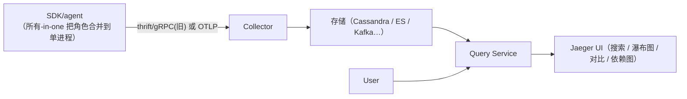
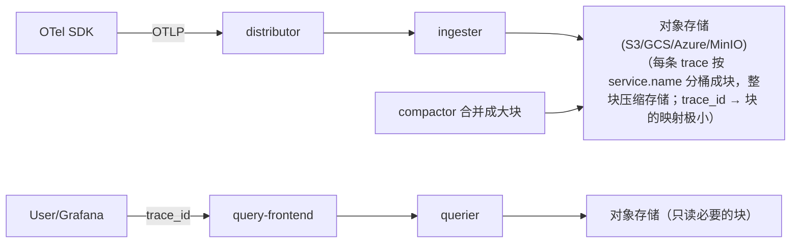
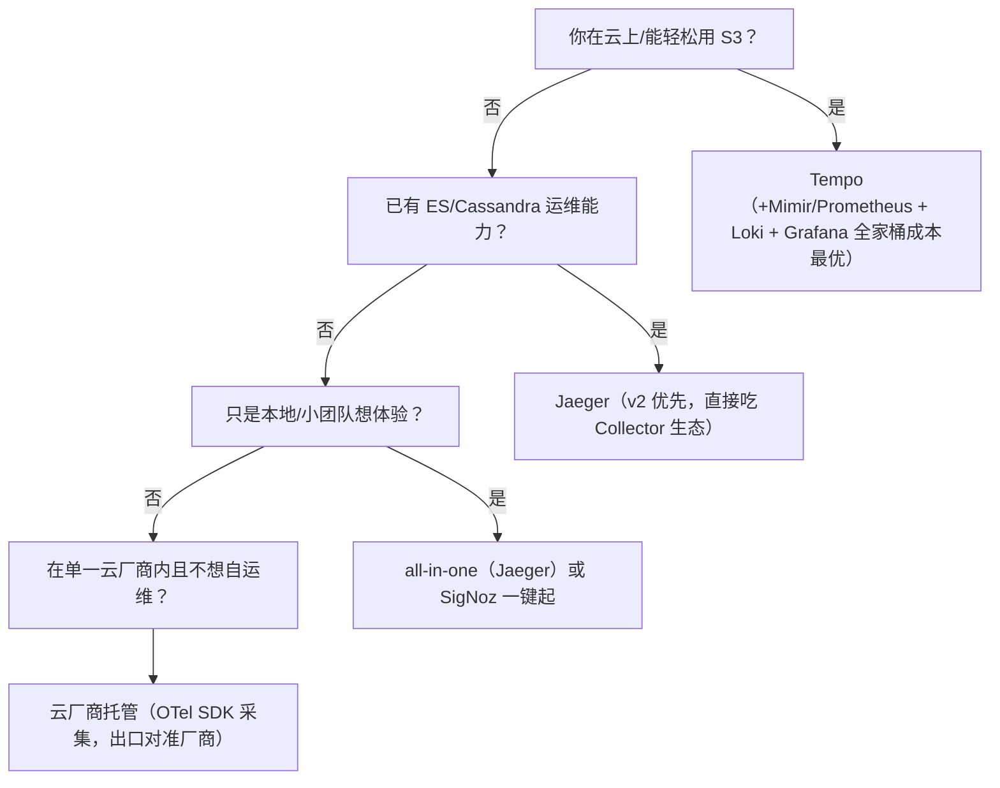

# 链路追踪笔记 04 · 后端选型：Jaeger、Tempo 与其他

> SDK 把 span 交出去之后，剩下的故事发生在**追踪后端**：接收、存储、索引、查询、UI。
> 本篇拆解 Jaeger（v1/v2）与 Grafana Tempo 两大开源自建主流的架构与取舍，附对比表、其他选手一览和选型建议。

## 1. 追踪后端要解决什么问题

一个"trace 后端"要同时满足四件事：

1. **接收（ingest）**：扛住全公司 span 流量（OTLP，可能还有存量协议），削峰、重试、限流；
2. **存储**：span 数据量大（1 条 trace 几 KB～几十 KB，QPS × span 数），且冷热分明（99% 的查询集中在最近 15 分钟）；
3. **索引**：支持"按服务/操作/标签/时间窗找 trace"——这是成本与能力的核心矛盾点；
4. **查询与展示**：瀑布图、对比、依赖图、聚合统计。

**两大流派正是围绕"索引怎么办"分野的**：

- Jaeger 流派：**建服务/操作级索引**（甚至 tag 索引），查询能力买在存储/索引成本里；
- Tempo 流派：**几乎不建索引**，只保证"给 trace_id 就能查回整条 trace"，索引的活儿交给周边生态（metrics-generator、exemplars、日志关联）。

## 2. Jaeger

主页/文档：<https://www.jaegertracing.io/docs/>（访问日期：2026-11-04）。Uber 2017 年开源，CNCF 毕业项目，K8s 生态事实标准之一。

### 2.1 v1 架构



| 组件 | 职责 | 备注 |
| --- | --- | --- |
| agent（v1 早期） | 本地转发+采样策略下发（remote sampling） | 部署在宿主机/ DaemonSet；OTel 普及后逐步淡出，SDK 直连 collector |
| collector | 校验、入队、写存储 | 无状态、可水平扩；写不进会返回错误/落盘重试（取决于配置） |
| query + UI | 查询 API 与界面 | 依赖存储做搜索 |
| 存储 | 见下表 | **v1 的运维重心**：换存储=换运维技能栈 |

存储后端选择（v1）：

| 后端 | 特点 | 适用 |
| --- | --- | --- |
| in-memory / Badger（嵌入式） | 重启即丢 / 单机盘 | 开发、demo（lab03 用 all-in-one 的内存模式） |
| Cassandra | Jaeger 亲儿子级支持、写吞吐好 | 大规模、无 ES 团队 |
| Elasticsearch / OpenSearch | 复用已有 ES 运维；tag 搜索强 | 已有 ES 集群（注意：成本高、ES 故障波及观测面） |
| Kafka（缓冲模式） | collector→Kafka→jaeger-ingester→存储 | 超大规模削峰（采集链路再拉长一节） |

v1 其他要点：**adaptive sampling**（collector 统计各端点 QPS 动态下发采样率）与 **remote sampling**（SDK 运行时拉取策略）是 Jaeger 的传统强项；Jaeger 原生 client 库已停止演进（推荐 OTel SDK + OTLP 接入）。

### 2.2 Jaeger v2：基于 OTel Collector 的重写（重要演进）

2024-11-12 发布 v2.0（CNCF 公告：<https://www.cncf.io/blog/2024/11/12/jaeger-v2-released/>，访问日期：2026-11-04；Docs：<https://www.jaegertracing.io/docs/2.2/>，访问日期：2026-11-04）。要点：

- **单二进制 = 一个 OTel Collector 发行版**：不再有独立 collector/query/agent 多二进制组合，全部能力折叠进 Collector 组件模型：
  - `receivers`: OTLP（原生）、旧 Jaeger thrift/gRPC；
  - `processors`: batch、tail_sampling、k8sattributes 等 Collector 生态处理器直接可用；
  - `extensions`: `jaeger_storage`（接 Cassandra/ES/Badger）、`jaeger_query`（UI/查询）、remote sampling；
- **配置文件就是 Collector YAML**：会 Collector 就会运维 Jaeger v2，学习成本大幅下降；
- 自适应采样等功能继续保留并强化（v1 的遗产能力以组件形式回归）。

一句话总结 v2 的意义：**"Jaeger 与 OTel Collector 合流"**——采集侧与存储侧的技术栈统一，对未来选型是明显的加分项。

### 2.3 all-in-one（lab03 使用）

`jaegertracing/all-in-one` 镜像把 collector+query+UI+内存存储合并为单进程，并**原生接收 OTLP（4317 gRPC / 4318 HTTP）**，一条命令起全功能环境：

```bash
podman run -p 16686:16686 -p 4318:4318 jaegertracing/all-in-one:1.62.0
# UI: http://localhost:16686    OTLP HTTP: http://localhost:4318/v1/traces
# podman 拉取的镜像名与 Docker Hub 完全相同（默认 registry 就是 docker.io）；
# macOS 上首次使用需先 `podman machine init && podman machine start` 启动 Linux 虚拟机。
```

镜像发布页：<https://hub.docker.com/r/jaegertracing/all-in-one>（访问日期：2026-11-04；podman 拉取相同镜像名）。

生产**不能**用 all-in-one（内存存储、无高可用），仅用于开发/演示。

## 3. Grafana Tempo

文档：<https://grafana.com/docs/tempo/latest/>（访问日期：2026-11-04）。Grafana Labs 出品，2020 年发布，口号是"**trace 存储便宜到可以全量保留**"。

### 3.1 核心设计：对象存储优先、极简索引



关键取舍：

1. **查询入口是 trace_id**（以及 TraceQL 表达式）：Tempo 不为任意 tag 建通用索引，而是把 trace 按 trace_id 与少量结构信息（service name）分块组织，查询时用 trace_id 定位块、解压、返回整条 trace。存储成本因此能做到 ES 的零头，且吞吐随对象存储几乎无限扩展。
2. **那"不知道 trace_id"怎么办？**——靠 Grafana 生态闭环：
   - **metrics-generator**：从 trace 流中派生 Red 指标（请求速率/错误/时长 per service+span 名），存 Prometheus/Mimir，可据此做服务图与慢请求下钻（v2.x 支持）；
   - **exemplars**：Grafana 指标直方图上的点携带 trace_id，点一下跳到 Tempo trace；
   - **Loki 日志关联**：日志里注入的 trace_id 可一键跳转（阶段 4 实操）；
   - **TraceQL Search / traces-by-attribute 检索**：新版本支持有限度的按属性检索（消耗扫描算力，规模上要克制）。
3. **TraceQL**：类 PromQL 的 trace 查询语言（如 `{ resource.service.name = "orders" && status = error }`），在已定位的 trace 集合内做结构化过滤非常趁手，但它不等于 Jaeger 那种全局搜索索引。

### 3.2 组件与运维

| 组件 | 职责 |
| --- | --- |
| distributor | 接收 OTLP、按 trace 哈希分片 |
| ingester | 在内存攒完整 trace（flush 到对象存储前的缓冲窗口），**决定"多晚到达的 span 还能聚到同一条 trace"** |
| compactor | 把小块合并压实，降低对象存储请求次数 |
| querier / query-frontend | 查询执行与拆分/去重 |
| metrics-generator | 派生 Red 指标（可选但强烈建议） |

运维上只需要：对象存储 + 这组无状态/近无状态服务 + Prometheus 监控自身。相比维护 Cassandra/ES 集群，负担显著更轻。

## 4. 正面对比表

| 维度 | Jaeger（v1/v2） | Tempo |
| --- | --- | --- |
| 存储模型 | 依赖外部数据库（Cassandra/ES…）为主 | 对象存储优先（S3/GCS/MinIO），近零索引 |
| 存储成本 | ES 昂贵；Cassandra 中等 | 极低（可全量保留 trace） |
| 查询方式 | service+operation+tag **全局搜索**（索引驱动），聚合统计面板成熟 | **trace_id 精确查询** + TraceQL；"无 ID 找 trace"依赖 metrics-generator/exemplars/日志关联 |
| 依赖组件 | 存储集群（Cassandra/ES）+ collector + query | 对象存储 + distributor/ingester/querier/compactor |
| 与 Grafana 生态 | 有数据源插件，可用但非一等公民 | 一等公民：exemplars→trace、日志→trace、metrics→trace 全打通 |
| 与 OTel 契合 | v2 直接基于 Collector，OTLP 原生 | OTLP 原生（推荐 OTLP/HTTP） |
| UI | 自带成熟 UI（瀑布图/对比/依赖图） | 主要用 Grafana（TraceQL 面板、trace 视图） |
| 采样配套 | adaptive sampling / remote sampling 传统强项 | 无内置 remote sampling，常配合 Collector tail_sampling |
| 运维门槛 | 有 DB 背景则顺；ES/Cassandra 本身是重资产 | 门槛在对象存储与 S3 兼容层（如 MinIO 自建） |
| 典型用户画像 | 已有 Cassandra/ES；需要开箱的全局 tag 搜索 | 重度 Grafana 用户；云上对象存储便宜；追求低成本全量保留 |

## 5. 其他选项一句话（认识即可）

- **Zipkin**（<https://zipkin.io/>，访问日期：2026-11-04）：Twitter 出品的前辈，轻量（单 jar + 内存/MySQL/ES），UI 简洁；b3 传播格式的出处。新项目一般不再首选，但存量与教学常见。
- **Apache SkyWalking**（<https://skywalking.apache.org/>，访问日期：2026-11-04）：Apache 顶级项目，APM 全家桶（trace+指标+日志+告警一体），中文社区活跃，存储默认 ES/BanyanDB；对"不想拼 Grafana 全家桶、要一站式"的团队很有吸引力。
- **AWS X-Ray / CloudTrail 相关**、**GCP Cloud Trace**、**Azure Monitor Application Insights**：云厂商托管，零运维、按量计费，锁定厂商；多云/混合架构下注意采集端仍可用 OTel 统一，导出到厂商端点。
- **SigNoz**（<https://signoz.io/>，访问日期：2026-11-04）：开源一体化（ClickHouse 单存储承 metrics+traces+logs），对中小团队"一个产品搞定三支柱"的路线。
- **商业 APM**（Datadog、Dynatrace、New Relic、Elastic APM 等）：体验与集成最好，贵；采集层用 OTel 可保留未来迁移自由。

## 6. 选型建议

按约束倒推：



补充三条经验：

1. **先定采集，再定后端**：只要 SDK/Collector 是 OTel 标准，后端随时可换（Jaeger→Tempo 只改 exporter 端点）；反过来被私有 SDK 锁定才是真成本。
2. **"能不能按服务/接口搜 trace"要提前想清楚**：Jaeger 开箱即得；Tempo 需要接受"指标下钻拿 trace_id"的工作流（这套工作流恰恰是 Grafana 的强项，也是很多团队后来的最爱）。
3. **存储成本量级**：同规模 span 流量下，ES 后端成本常见为对象存储方案的 5~10 倍（且随保留时长线性增长）；Tempo 类方案让"全量保留 30 天"从奢侈变成默认。

## 7. 动手对比：本地各起一套最小环境（podman）

选型结论别只停留在纸面——各花 10 分钟把两个后端跑起来，亲手感受"查询入口"的差异，比读十篇对比文章都有用。本工作区容器工具统一用 podman（macOS 先 `podman machine init && podman machine start`）。

**Jaeger 侧（lab03 已完整覆盖）**：lab03 就是 all-in-one + OTel Collector 的组合，这里不再重复。想单独体验 all-in-one，一条命令即可：

```bash
podman run --rm -p 16686:16686 -p 4318:4318 jaegertracing/all-in-one:1.62.0
```

**Tempo 侧（最小可运行骨架）**：Tempo 强依赖对象存储，本地用 MinIO 模拟 S3；再配一个 Grafana 做查询界面。以下 podman compose 文件是刻意压缩的最小骨架（生产不要照抄，参数含义见注释）：

```yaml
# tempo-minimal-compose.yaml —— 仅用于本地体验 Tempo 的查询模型
# 镜像名与 Docker Hub 相同，podman 直接拉取
services:
  minio:                                  # S3 兼容对象存储（Tempo 的存储后端）
    image: quay.io/minio/minio:RELEASE.2024-08-29T01-40-52Z
    command: server /data --console-address ":9001"
    environment:
      MINIO_ROOT_USER: tempo
      MINIO_ROOT_PASSWORD: supersecret
    ports: ["9000:9000"]

  tempo:                                  # 单体模式：所有组件跑一个进程（本地体验用）
    image: grafana/tempo:2.6.0
    command: ["-config.file=/etc/tempo/tempo.yaml"]
    volumes:
      - ./tempo.yaml:/etc/tempo/tempo.yaml:ro
    depends_on: [minio]

  grafana:                                # Tempo 没有自带 UI，查询靠 Grafana
    image: grafana/grafana:11.2.0
    environment:
      GF_AUTH_ANONYMOUS_ENABLED: "true"   # 本地体验免登录；生产必须关
    ports: ["3000:3000"]
    depends_on: [tempo]
```

配套的 `tempo.yaml` 关键段（完整字段见官方文档，访问日期：2026-11-04）：

```yaml
server:
  http_listen_port: 3200
distributor:
  receivers:                              # 直接接收 OTLP，无需单独的 Collector
    otlp:
      protocols: { grpc: { endpoint: 0.0.0.0:4317 }, http: { endpoint: 0.0.0.0:4318 } }
storage:
  trace:
    backend: s3
    s3:
      endpoint: minio:9000
      bucket: tempo-traces
      access_key: tempo
      secret_key: supersecret
      insecure: true
```

启动后做同一件事对比体验：把 lab03 的 collector exporter 从 `jaeger:4317` 改成 `tempo:4317`（或 4318），发几个请求，然后——

- **Jaeger**：打开 16686，直接按 Service + Operation 搜出 trace 列表；
- **Tempo**：打开 Grafana(3000) → Explore → Tempo 数据源，你**没有**"按服务搜 trace 列表"的入口，只能先拿到一个 trace_id（比如从服务响应头 `x-trace-id` 里复制）粘贴进去查整条 trace，再用 TraceQL 在结果内过滤。

这个"搜不出来 vs 搜得出来"的体感差异，就是第 4 节对比表里"查询方式"一行的真实含义，也是两个产品选型分歧的核心。

## 8. 容量与成本粗算（面试能报出量级就赢一半）

以一个中等规模系统为例做纸面推演（数字取整，记住方法而非记住数）：

```
假设：入口 1,000 QPS × 平均每请求 8 个 span × 平均每 span 压缩后 0.5 KB
span 产生速率 = 1,000 × 8 = 8,000 span/s
写入速率     ≈ 8,000 × 0.5 KB = 4 MB/s ≈ 345 GB/天（未采样！）
保留 7 天    ≈ 2.4 TB 原始数据
```
<!-- 保留原图：容量估算推算算式（数据推演清单），非示意图 -->

三种方案的粗算对比（自建、2026 年云存储公开价量级，仅示数量级）：

| 方案 | 存储单价量级 | 7 天保留成本量级 | 备注 |
| --- | --- | --- | --- |
| 全量 + ES/OpenSearch 后端 | ~$0.15/GB/月 + 副本 ×2~3 | 高（且索引常比原始数据更大） | 通常被迫降到 1~5% 采样 |
| 全量 + Cassandra | 中 | 中 | 写吞吐好，但集群本身 3 节点起 |
| 全量 + Tempo/S3 | ~$0.02/GB/月 | 低一个数量级 | "全量保留"从奢侈变默认 |
| 10% 头采样 + 任意后端 | ×0.1 | 全部同比例下降 | 最常用的第一杠杆 |

由此得出三条实践结论：

1. **采样率是成本的第一杠杆，后端选型是第二杠杆**——先问"该采多少"，再问"存哪里"；
2. 估算公式可以倒着用：给定预算反推允许的采样率（阶段 5 的 head/tail 策略设计就用它）；
3. Tempo 的"便宜"是有前提的：对象存储可访问 + 接受"trace_id 优先"的查询工作流；如果团队强依赖全局 tag 搜索，省下的存储钱会变成搭 metrics-generator/日志关联的工程时间。

## 9. 从 Jaeger 迁移到 Tempo（或反向）：OTel 让后端可替换

只要采集层是标准的 OTel SDK + Collector，后端迁移的最小改动只有一处——Collector 的 exporter：

```yaml
# 迁移前：exporters 指向 Jaeger
exporters:
  otlp/jaeger: { endpoint: jaeger:4317, tls: { insecure: true } }

# 迁移后：只改这一段（应用零改动、零重启之外的代码变更）
exporters:
  otlp/tempo: { endpoint: tempo:4317, tls: { insecure: true } }
```

迁移检查清单：

- [ ] 新后端先双写（exporters 列表同时挂 jaeger 与 tempo，灰度验证数据一致）；
- [ ] 核对 SDK 端 `OTEL_EXPORTER_OTLP_ENDPOINT` 是否有服务直连后端（绕过 Collector 的漏网之鱼）；
- [ ] Resource 属性（service.name 等）在新后端的服务列表里正确出现；
- [ ] 存量 trace 的保留期策略：旧数据留在旧后端自然过期，不要试图搬历史数据（成本远超价值）；
- [ ] 告警/仪表盘里引用 Jaeger 深链（trace 详情页 URL）的地方改为新后端的链接格式。

这就是"先定采集，再定后端"的价值：**采集标准化是可观测性的可迁移性**。

## 10. 面试题小结

1. **Q：Jaeger v1 的存储选型有哪些？为什么 ES 用得最多但常被劝退？**
   A：内存/Badger（开发）、Cassandra、ES/OpenSearch、Kafka（缓冲）。ES 搜索强但成本高、集群运维重，且业务 ES 故障容易波及观测面；Cassandra 吞吐好但需要专门技能。
2. **Q：Jaeger v2 变成了什么？为什么这是趋势？**
   A：基于 OTel Collector 的发行版：receivers/processors/exporters + jaeger_storage/jaeger_query 扩展，单二进制、Collector YAML 配置。趋势是采集与存储技术栈合流，运维心智统一。
3. **Q：Tempo 不建索引，怎么查 trace？不知道 trace_id 怎么办？**
   A：按 trace_id/服务分块存储于对象存储，精确查询高效；无 ID 场景靠 metrics-generator 派生 Red 指标、exemplars、Loki trace_id 关联、有限度的属性检索（TraceQL Search）迂回拿到 trace_id。
4. **Q：ingester 的作用是什么？为什么它影响"跨 span 聚合窗口"？**
   A：在内存/本地缓冲尚未落盘的 trace，等待同 trace 的迟到 span（异步/慢导出）到齐；flush 太早会把一条 trace 撕成两条，太晚增加丢失风险（实例宕机）与内存压力。
5. **Q：两个系统怎么选？**
   A：要开箱的全局 tag 搜索与自带 UI→Jaeger；对象存储可用且重度 Grafana 用户、追求低成本全量保留→Tempo；两者都先用 OTel 采集保持可迁移。
6. **Q：入口 1000 QPS、平均每请求 8 个 span、每 span 0.5KB，7 天保留要多少存储？怎么降成本？**
   A：8000 span/s × 0.5KB ≈ 4MB/s ≈ 345GB/天 ≈ 2.4TB/7 天（未采样）。降本顺序：先采样（第一杠杆，头采样 10% 直接 ×0.1），再选便宜的后端（对象存储类比 ES 低一个数量级），最后控 span 体积（属性预算、关 stacktrace）。
7. **Q：生产要把 Jaeger 换成 Tempo，应用要改什么？**
   A：理想情况下应用零改动——改 Collector 的 exporter 端点即可；前提是所有 SDK 都经 OTLP 标准接入。迁移期双写灰度，核对 Resource 与深链引用，存量数据留在旧后端自然过期。

## 11. 参考

- Jaeger 官方文档（含 v2）：<https://www.jaegertracing.io/docs/>（访问日期：2026-11-04）
- Jaeger v2 发布公告（CNCF Blog）：<https://www.cncf.io/blog/2024/11/12/jaeger-v2-released/>（访问日期：2026-11-04）
- Jaeger v2 文档：<https://www.jaegertracing.io/docs/2.2/>（访问日期：2026-11-04）
- Grafana Tempo 文档：<https://grafana.com/docs/tempo/latest/>（访问日期：2026-11-04）
- Tempo 架构：<https://grafana.com/docs/tempo/latest/architecture/>（访问日期：2026-11-04）
- TraceQL：<https://grafana.com/docs/tempo/latest/traceql/>（访问日期：2026-11-04）
- Tempo 生产部署（含对象存储后端配置）：<https://grafana.com/docs/tempo/latest/setup/>（访问日期：2026-11-04）
- Jaeger v1 存储后端对比：<https://www.jaegertracing.io/docs/latest/deployment/#storage>（访问日期：2026-11-04）
- MinIO（本地 S3 替代）：<https://min.io/docs/minio/container/index.html>（访问日期：2026-11-04）
- Zipkin：<https://zipkin.io/>（访问日期：2026-11-04）
- Apache SkyWalking：<https://skywalking.apache.org/>（访问日期：2026-11-04）
- SigNoz：<https://signoz.io/>（访问日期：2026-11-04）
- OpenTelemetry Collector：<https://opentelemetry.io/docs/collector/>（访问日期：2026-11-04）

## 附：ASCII 图替换清单

| 原 ASCII 图位置（章节标题） | 原图内容简述 | 替换结果 |
| --- | --- | --- |
| 2.1 v1 架构 | SDK/agent → Collector → 存储 与 User → Query → UI 两条链路 | flowchart LR |
| 3.1 核心设计 | 写入路径（SDK→distributor→ingester→对象存储）+ compactor + 查询路径 | flowchart LR |
| 6. 选型建议 | 按约束倒推的后端决策链（是/否分流） | flowchart TD |

### 保留说明

| 原 ASCII 图位置（章节标题） | 原图内容简述 | 保留原因 |
| --- | --- | --- |
| 8. 容量与成本粗算 | QPS×span×体积 的推算算式 | 数据推演清单，非示意图 |
