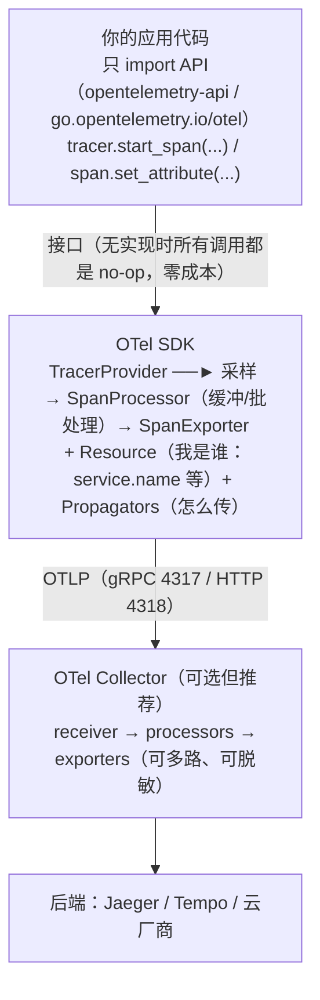
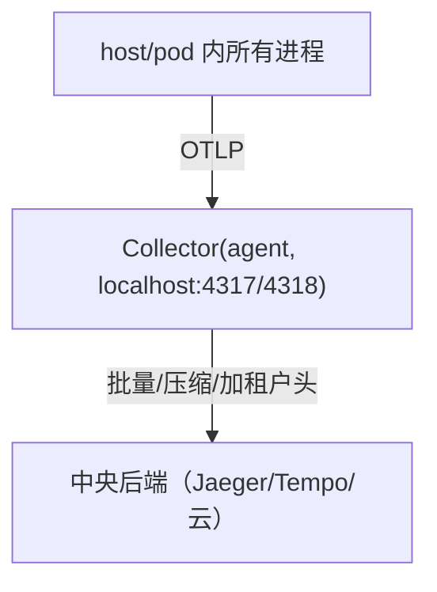
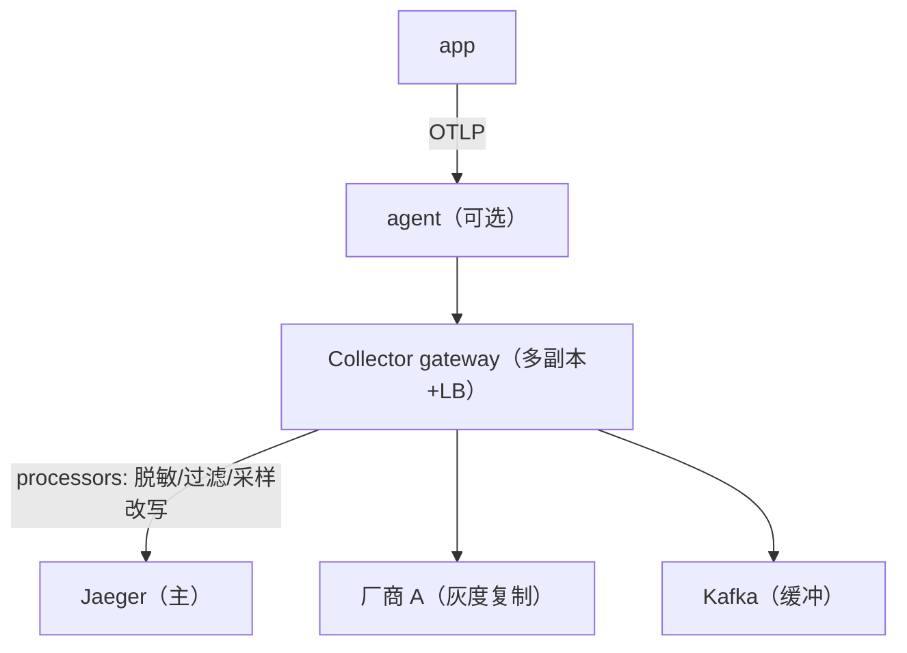

# 链路追踪笔记 03 · OpenTelemetry SDK 实战：从 TracerProvider 到 Collector

> 本篇回答四个问题：SDK 里那堆对象（TracerProvider/Tracer/Span/Processor/Exporter）是什么关系？
> Resource 怎么配？自动埋点的原理与边界在哪？手动埋点的完整代码长什么样（Go / Python 双语言）？
> 最后给出 OTEL_* 环境变量速查表和 Collector 两种部署形态的接线图。
> 设计视角续篇：[系统设计 02 · 服务端 SDK 设计](../06-system-design/sdk-design-server.md)（如果自己造 SDK，这些机制怎么设计）。

## 1. OTel 的分层：API、SDK、Exporter、Collector

OpenTelemetry 的设计哲学是**控制反转**：业务代码只依赖 API（接口），SDK（实现）在部署时注入。这样业务代码不绑定任何后端，换 Jaeger/Tempo/商业 APM 不改一行代码。



**没有注册 SDK 时，API 的所有调用都是空操作（no-op）**——这就是"业务代码可以随意埋点、代价为零"的底气；注册 SDK 后同样的代码开始产生真实 span。

## 2. 对象层级：TracerProvider → Tracer → Span

| 对象 | 数量级 | 职责 | 生命周期 |
| --- | --- | --- | --- |
| TracerProvider | 每进程 1 个（全局） | 持有 Resource、Sampler、所有 Processor；创建 Tracer；`shutdown()` 统一刷数据 | 进程启动时初始化，退出时 shutdown |
| Tracer | 每个埋点模块 1 个 | 命名空间（instrumentation scope：库名+版本），创建 span | 从 provider 获取，长期持有（**不要每次请求新建**） |
| Span | 每个工作段 1 个 | 记录一段工作 | 请求内短暂存活，`end()` 后进入导出队列 |

```go
// Go：Tracer 的名字 = instrumentation scope，规范建议用"埋点库名"而非服务名
tracer := otel.Tracer("github.com/myorg/payments/checkout")   // 全局 provider 提供
ctx, span := tracer.Start(ctx, "checkout create", trace.WithSpanKind(trace.SpanKindInternal))
defer span.End()
```

```python
# Python：显式从 provider 取（避免全局初始化时序问题时用这种）
tracer = trace.get_tracer("payments.checkout", "1.0.0")
with tracer.start_as_current_span("checkout create") as span:
    ...  # with 块结束自动 end，异常自动 record_exception + set_status(ERROR)
```

`instrumentation scope` 的意义：后端可以按"哪个埋点库产生了这个 span"过滤/统计版本，排查某版 instrumentation 引入的 bug 时救命。

## 3. Resource：回答"这些 span 是谁产生的"

Resource 是**进程级静态元数据**，附着在进程产生的每一个 span 上（不占 span 自身的 attributes 预算）：

```python
from opentelemetry.sdk.resources import Resource

resource = Resource.create({
    "service.name": "orders",                  # 最重要：后端服务列表的主键，缺失会被标记 unknown_service
    "service.namespace": "shop",               # 多环境/多产品线隔离
    "service.version": "1.4.2",                # 灰度排障：不同版本对比延迟
    "service.instance.id": os.uname().nodename,  # 实例级：定位到具体 pod
    "deployment.environment": "production",
})
provider = TracerProvider(resource=resource, ...)
```

要点：

1. `Resource.create()` 会**合并** SDK 默认值（`telemetry.sdk.name/language/version`）——别手写这些；
2. 语义键统一参考：<https://opentelemetry.io/docs/specs/semconv/resource/>（访问日期：2026-11-04）；
3. 环境变量可覆盖：`OTEL_SERVICE_NAME=orders`（优先级高于代码里 service.name 的默认值）与 `OTEL_RESOURCE_ATTRIBUTES="deployment.environment=prod,team=payments"`；
4. K8s 里常见的做法：由部署系统（Helm/Operator）注入 pod 名、namespace 作为 Resource 属性，代码只管业务。

## 4. SpanProcessor：span 从"结束"到"导出"之间发生了什么

Processor 决定 span.end() 之后数据的流转方式。两个内置实现：

| | SimpleSpanProcessor | BatchSpanProcessor（默认选择） |
| --- | --- | --- |
| 行为 | 每个 span 结束立即同步调用 exporter | 攒批（默认 512/span）、定时（默认 5s）、异步线程导出 |
| 延迟 | 立即 | 秒级 |
| 开销 | 高（每个 span 一次网络） | 低（摊薄） |
| 崩溃丢失风险 | 几乎不丢 | 队列（默认 2048）满则**丢弃**，进程退出未 flush 也丢 |
| 适用 | 调试、CLI 短命进程、ConsoleExporter | 一切长期运行的服务 |

```python
from opentelemetry.sdk.trace.export import BatchSpanProcessor, SimpleSpanProcessor, ConsoleSpanExporter

provider.add_span_processor(BatchSpanProcessor(OTLPSpanExporter()))          # 主通道
provider.add_span_processor(SimpleSpanProcessor(ConsoleSpanExporter()))      # 调试：本地同时打印
```

Batch 的关键环境变量：`OTEL_BSP_SCHEDULE_DELAY`（默认 5000ms）、`OTEL_BSP_MAX_QUEUE_SIZE`（2048）、`OTEL_BSP_MAX_EXPORT_BATCH_SIZE`（512）。

**最容易忽略的坑：退出不 shutdown = 丢最后一批 span。** 必须：

```python
import atexit
provider = TracerProvider(...)
atexit.register(provider.shutdown)   # flush 缓冲区（BatchSpanProcessor.shutdown 会同步导出剩余 span）
```

容器里 SIGTERM 不会触发 Python atexit，需要把 SIGTERM 翻译成正常退出（lab03 的 `otel_setup.py` 有完整处理）；Go 的 `defer tp.Shutdown(ctx)` 配合信号处理同理。

## 5. SpanExporter：OTLP 是唯一推荐答案

| Exporter | 用途 | 说明 |
| --- | --- | --- |
| **OTLP（gRPC :4317 / HTTP :4318）** | 生产标准 | 官方推荐；所有主流后端（Jaeger 1.35+、Tempo、SigNoz、云厂商 OTLP 端点）原生接收；可先发给本机/集群 Collector |
| Console / File | 调试 | 打印 JSON 到 stdout，学习期看 span 结构很有用 |
| Jaeger 专用 exporter | **已废弃** | OTel 各语言已停止维护（2023 年起），Jaeger 官方明确"请用 OTLP"；面试别再答"接 Jaeger 用 jaeger exporter" |
| Prometheus / Zipkin exporter | 特殊场景 | traces 不适用；zipkin exporter 用于存量 Zipkin 后端 |

OTLP 两种协议怎么选：

- **HTTP（4318，路径 `/v1/traces`）**：穿防火墙/代理友好、易调试（curl 就能发）、无 grpc 依赖——lab03 用它；
- **gRPC（4317）**：长连接多路复用、性能略优，但经过的每一跳代理都要支持 HTTP/2 长连接。

## 6. 自动 instrumentation：原理、用法与 Go 的例外

### 6.1 Java：字节码 agent，零代码

```bash
# 挂上 agent 即完成 HTTP/RPC/DB/日志框架的埋点与 OTLP 导出（版本以官方发布为准）
java -javaagent:opentelemetry-javaagent-2.10.0.jar \
     -Dotel.service.name=orders \
     -Dotel.exporter.otlp.endpoint=http://collector:4318 \
     -jar app.jar
```

原理：JVM 加载类时改写字节码（ASM），给已知框架（Spring MVC、OkHttp、JDBC、Kafka client……）的"接缝"插入 start/end span 调用。文档：<https://opentelemetry.io/docs/zero-code/java/agent/>（访问日期：2026-11-04）。

### 6.2 Python：`opentelemetry-instrument` 启动器

```bash
pip install opentelemetry-distro opentelemetry-exporter-otlp \
            opentelemetry-instrumentation-flask opentelemetry-instrumentation-httpx
opentelemetry-instrument \
    --traces_exporter otlp \
    --service_name orders \
    --exporter_otlp_endpoint http://collector:4318 \
    python app.py
```

原理：distro 通过 `sitecustomize` 机制在解释器启动时对已安装的 instrumentation 包执行 monkey-patch（包装 Flask/httpx/requests/psycopg2 等库的入口函数）。文档：<https://opentelemetry.io/docs/zero-code/python/>（访问日期：2026-11-04）。

### 6.3 Go：为什么做不到无侵入

Go 编译为**静态原生二进制**：没有 JVM 那样的运行时类加载环节，进程启动后没有稳定的"改写代码"时机。所以 Go 生态的现实是：

- **框架中间件/包装器**（`otelhttp.NewHandler`、`otelgrpc.NewServerHandler`、`otelsql`）：一行包装，侵入极小但仍是显式的；
- **`go.opentelemetry.io/auto`**（eBPF uprobe 方案）：内核探针挂到目标函数上，正在走向可用（支持面有限）；
- **第三方 eBPF 产品**（Grafana Beyla 等）：零代码但黑盒程度高。
文档：<https://opentelemetry.io/docs/zero-code/go/>（访问日期：2026-11-04）。

### 6.4 自动 vs 手动：生产上的正确姿势

| | 自动 instrumentation | 手动 instrumentation |
| --- | --- | --- |
| 覆盖 | 通用边界（HTTP/DB/MQ/缓存） | 业务语义（"创建订单成功"） |
| 成本 | 近零（一次接入） | 持续投入 |
| 粒度 | 请求/连接级 | 任意 |
| 风险 | 版本兼容性、黑盒排障难 | 忘 end/高基数等人为错误 |

**推荐组合**：自动埋点打底（保证边界 span 不缺），关键业务路径少量手动 span/event 补语义。lab03 刻意全手动，目的是让你看清自动埋点背后帮你做了什么。

## 7. 手动埋点完整代码

以下两份代码等价：HTTP server（extract 入站 context）→ 模拟 DB span（CLIENT）→ HTTP client（inject 出站 context）→ 错误记录与事件。lab03 是这份骨架的三服务扩展版。

### 7.1 Python 版（Flask + OTLP/HTTP）

```python
# app.py —— 最小完整手动埋点示例（依赖见文末注释）
import os, time
import httpx
from flask import Flask, request, jsonify

from opentelemetry import trace, propagate
from opentelemetry.exporter.otlp.proto.http.trace_exporter import OTLPSpanExporter
from opentelemetry.sdk.resources import Resource
from opentelemetry.sdk.trace import TracerProvider
from opentelemetry.sdk.trace.export import BatchSpanProcessor
from opentelemetry.trace import SpanKind, Status, StatusCode

# ---- 1. 初始化（进程启动一次）----
resource = Resource.create({"service.name": os.getenv("APP_NAME", "demo")})
provider = TracerProvider(resource=resource)
provider.add_span_processor(
    BatchSpanProcessor(OTLPSpanExporter(
        endpoint=os.getenv("OTEL_EXPORTER_OTLP_TRACES_ENDPOINT",
                           "http://localhost:4318/v1/traces"))))
trace.set_tracer_provider(provider)

import atexit; atexit.register(provider.shutdown)   # 退出前 flush（容器内还需处理 SIGTERM）
tracer = trace.get_tracer("demo.app", "1.0.0")

app = Flask(__name__)

# ---- 2. 入站：extract 上游 context，开 SERVER span（WSGI 中间件的最小形态）----
class TracingMiddleware:
    def __init__(self, wsgi, tracer):
        self.wsgi, self.tracer = wsgi, tracer
    def __call__(self, environ, start_response):
        headers = {k[5:].replace("_", "-").lower(): v for k, v in environ.items()
                   if k.startswith("HTTP_")}                      # WSGI environ → 标准头 carrier
        parent = propagate.extract(carrier=headers)               # traceparent → SpanContext
        name = f"{environ.get('REQUEST_METHOD','GET')} {environ.get('PATH_INFO','/')}"
        with self.tracer.start_as_current_span(name, context=parent,
                                               kind=SpanKind.SERVER) as span:
            span.set_attribute("http.request.method", environ.get("REQUEST_METHOD"))
            span.set_attribute("url.path", environ.get("PATH_INFO"))
            code_holder = {}
            def sr(status, headers_, exc_info=None):
                code_holder["code"] = int(status.split(" ")[0])   # 捕获响应码
                return start_response(status, headers_, exc_info)
            try:
                yield from self.wsgi(environ, sr)
            except Exception as e:
                span.record_exception(e)                          # 生成 exception 事件
                span.set_status(Status(StatusCode.ERROR, str(e)))
                raise
            finally:
                if code_holder.get("code", 500) >= 500:
                    span.set_status(Status(StatusCode.ERROR, "HTTP 5xx"))

app.wsgi_app = TracingMiddleware(app.wsgi_app, tracer)

# ---- 3. 业务：内部 span（模拟 DB）、事件、出站调用 ----
@app.get("/orders/<int:oid>")
def get_order(oid):
    # DB 调用按 OTel 语义约定应记为 CLIENT（对存储系统的出站调用），而非 INTERNAL
    with tracer.start_as_current_span("SELECT orders", kind=SpanKind.CLIENT) as db:
        db.set_attribute("db.system", "postgresql")
        db.set_attribute("db.query.text", f"SELECT * FROM orders WHERE id = {oid}")
        time.sleep(0.03)                                          # 模拟查询耗时
    # 出站 HTTP：inject 当前 context（traceparent 随请求带走）
    with tracer.start_as_current_span("GET http://inventory:8002/inventory",
                                      kind=SpanKind.CLIENT) as client:
        headers = {}
        propagate.inject(headers)                                 # 关键一步！
        client.set_attribute("server.address", "inventory")
        client.set_attribute("server.port", 8002)
        resp = httpx.get("http://inventory:8002/inventory", headers=headers, timeout=5)
        client.set_attribute("http.response.status_code", resp.status_code)
        if resp.status_code >= 500:
            client.set_status(Status(StatusCode.ERROR, f"HTTP {resp.status_code}"))
    span = trace.get_current_span()
    span.add_event("order.served", {"order.id": oid})             # 业务里程碑事件
    return jsonify({"ok": True, "stock": resp.json().get("stock")})

# 依赖：pip install flask httpx opentelemetry-sdk opentelemetry-exporter-otlp-proto-http
```

注意 `start_as_current_span` 的语义：**with 块内**它就是"当前 span"，inject 取的是它的 context；块内抛异常会自动 `record_exception` + `set_status(ERROR)` 再重新 raise——所以手动 try/except 主要用于"已处理的错误也要标红"的场景。

### 7.2 Go 版（net/http + OTLP/gRPC）

```go
// main.go —— 与 Python 版等价的最小手动埋点
package main

import (
	"context"
	"errors"
	"log"
	"net/http"
	"os"
	"time"

	"go.opentelemetry.io/otel"
	"go.opentelemetry.io/otel/attribute"
	"go.opentelemetry.io/otel/codes"
	otlpgrpc "go.opentelemetry.io/otel/exporters/otlp/otlptrace/otlptracegrpc"
	"go.opentelemetry.io/otel/propagation"
	sdkresource "go.opentelemetry.io/otel/sdk/resource"
	sdktrace "go.opentelemetry.io/otel/sdk/trace"
	"go.opentelemetry.io/otel/trace"
)

var tracer trace.Tracer

func initTracing(ctx context.Context) (shutdown func(context.Context) error, err error) {
	// exporter：OTLP gRPC → localhost:4317（生产改为 collector 地址）
	exp, err := otlpgrpc.New(ctx, otlpgrpc.WithEndpoint("localhost:4317"),
		otlpgrpc.WithInsecure())
	if err != nil {
		return nil, err
	}
	res, _ := sdkresource.Merge(sdkresource.Default(),
		sdkresource.NewWithAttributes("demo", attribute.String("service.name", "demo-go")))
	tp := sdktrace.NewTracerProvider(
		sdktrace.WithBatcher(exp),           // BatchSpanProcessor
		sdktrace.WithResource(res),
	)
	otel.SetTracerProvider(tp)
	otel.SetTextMapPropagator(propagation.NewCompositeTextMapPropagator(
		propagation.TraceContext{}, propagation.Baggage{}))
	tracer = tp.Tracer("demo/app")
	return tp.Shutdown, nil // 进程退出时调用，flush 缓冲
}

// ---- 入站中间件：extract → SERVER span ----
func tracingMiddleware(next http.Handler) http.Handler {
	return http.HandlerFunc(func(w http.ResponseWriter, r *http.Request) {
		ctx := otel.GetTextMapPropagator().Extract(r.Context(),
			propagation.HeaderCarrier(r.Header)) // traceparent → context
		ctx, span := tracer.Start(ctx, r.Method+" "+r.URL.Path,
			trace.WithSpanKind(trace.SpanKindServer))
		defer span.End()
		span.SetAttributes(attribute.String("http.request.method", r.Method),
			attribute.String("url.path", r.URL.Path))
		next.ServeHTTP(w, r.WithContext(ctx)) // 子处理从 ctx 拿到当前 span
	})
}

func orderHandler(w http.ResponseWriter, r *http.Request) {
	ctx := r.Context()
	serverSpan := trace.SpanFromContext(ctx) // 记住 server span 引用，稍后记事件用
	// DB span：模拟 DB。db.* 语义约定对存储系统的调用用 CLIENT，不是 INTERNAL
	_, dbSpan := tracer.Start(ctx, "SELECT orders", trace.WithSpanKind(trace.SpanKindClient))
	dbSpan.SetAttributes(attribute.String("db.system", "postgresql"),
		attribute.String("db.query.text", "SELECT * FROM orders LIMIT 1"))
	time.Sleep(30 * time.Millisecond)
	dbSpan.End()

	// 出站 HTTP：CLIENT span + inject（Go 必须 ctx 显式传递）
	name := "GET http://inventory:8002/inventory"
	ctx, client := tracer.Start(ctx, name, trace.WithSpanKind(trace.SpanKindClient))
	req, _ := http.NewRequestWithContext(ctx, http.MethodGet,
		"http://inventory:8002/inventory", nil)
	otel.GetTextMapPropagator().Inject(ctx, propagation.HeaderCarrier(req.Header)) // 关键！
	client.SetAttributes(attribute.String("server.address", "inventory"))
	resp, err := http.DefaultClient.Do(req)
	if err != nil {
		client.RecordError(err)                                   // 记录异常事件
		client.SetStatus(codes.Error, err.Error())
		client.End()
		http.Error(w, "inventory unreachable", http.StatusBadGateway)
		return
	}
	resp.Body.Close()
	client.SetAttributes(attribute.Int("http.response.status_code", resp.StatusCode))
	client.End()

	// 陷阱：此时 ctx 里装的仍是已 End 的 client span（End 不会把它"弹出"ctx），
	// 对已 End 的 span AddEvent 是静默 no-op——必须用开头保存的 serverSpan
	serverSpan.AddEvent("order.served")                           // 事件
	w.Write([]byte("ok"))
}

func main() {
	ctx := context.Background()
	shutdown, err := initTracing(ctx)
	if err != nil {
		log.Fatal(err)
	}
	defer func() { _ = shutdown(ctx) }()

	mux := http.NewServeMux()
	mux.HandleFunc("/orders", orderHandler)
	log.Fatal(http.ListenAndServe(":8001", tracingMiddleware(mux)))
}
```

```go
// go.mod（版本以官方发布为准；go mod tidy 会补全间接依赖与 go.sum）
module demo/otel-manual

go 1.22

require (
	go.opentelemetry.io/otel v1.28.0
	go.opentelemetry.io/otel/exporters/otlp/otlptrace/otlptracegrpc v1.28.0
	go.opentelemetry.io/otel/sdk v1.28.0
	go.opentelemetry.io/otel/trace v1.28.0
)
```

两个语言的对照记忆点：Python "当前 span" 由 contextvar 隐式携带，Go **必须**把 `ctx` 一路传下去——这也是 Go 断链最常见的原因（第 7 节表格见 `context-propagation.md`）。

## 8. OTEL_* 环境变量速查表

SDK 行为约定全部可用环境变量控制（规范：<https://opentelemetry.io/docs/specs/otel/configuration/sdk-environment-variables/>，访问日期：2026-11-04），容器部署尤其依赖它们：

| 变量 | 默认 | 作用 |
| --- | --- | --- |
| `OTEL_SERVICE_NAME` | （无） | 覆盖 Resource 的 service.name |
| `OTEL_RESOURCE_ATTRIBUTES` | 空 | 追加 Resource 属性，如 `deployment.environment=prod,team=payments` |
| `OTEL_TRACES_EXPORTER` | otlp | `otlp` / `none` / `console`（调试） |
| `OTEL_EXPORTER_OTLP_ENDPOINT` | `http://localhost:4318`（HTTP）| OTLP 端点。注意：HTTP 协议下 SDK 自动拼 `/v1/traces`；gRPC 用 `http://collector:4317` |
| `OTEL_EXPORTER_OTLP_PROTOCOL` | `http/protobuf`（个别 SDK 默认 grpc） | `grpc` / `http/protobuf` |
| `OTEL_EXPORTER_OTLP_HEADERS` | 空 | 附加头，云厂商端点鉴权：`authorization=Bearer%20xxx`（值需 URL 编码） |
| `OTEL_PROPAGATORS` | `tracecontext,baggage` | 传播器列表，迁移期加 `b3multi` |
| `OTEL_TRACES_SAMPLER` | `parentbased_always_on` | 采样器（`parentbased_traceidratio`、`traceidratio` 等） |
| `OTEL_TRACES_SAMPLER_ARG` | `1.0` | 采样器参数（如比例 0.1） |
| `OTEL_BSP_SCHEDULE_DELAY` | 5000 | Batch 导出间隔（ms） |
| `OTEL_BSP_MAX_QUEUE_SIZE` | 2048 | 批队列上限，满了丢 span |
| `OTEL_SDK_DISABLED` | false | 一键关闭 SDK（本地开发常用） |
| `OTEL_LOG_LEVEL` | info | SDK 自身日志级别 |

## 9. Collector 的两种接线形态

OTel Collector（<https://opentelemetry.io/docs/collector/>，访问日期：2026-11-04）不是必需组件（SDK 可直发后端），但生产强烈建议加一层：换后端不改应用、批量/重试/脱敏/多路复制集中处理。

**形态 A：agent 模式（每主机/每 pod 一个，DaemonSet/sidecar）**



- 优点：应用零网络配置（发 localhost）；进程崩溃 agent 仍可重试；跨进程共享连接；
- 成本：每主机一个容器（内存几十~几百 MB）。

**形态 B：gateway 模式（集群/全局一组）**



- 优点：集中策略（脱敏、tail 采样、多后端路由）、后端凭证不落到应用；
- 成本：需要运维一组有状态服务（gateway 挂掉=整集群 trace 断供，前置 Kafka 缓冲是大规模标配）。

lab03 里一个 Collector 容器同时扮演两者（一个 otlp receiver + batch + otlp exporter 到 Jaeger），配置文件不到 30 行：

```yaml
receivers:
  otlp:
    protocols:
      grpc: { endpoint: 0.0.0.0:4317 }
      http: { endpoint: 0.0.0.0:4318 }
processors:
  batch: {}
exporters:
  otlp/jaeger:
    endpoint: jaeger:4317
    tls: { insecure: true }
service:
  pipelines:
    traces:
      receivers: [otlp]
      processors: [batch]
      exporters: [otlp/jaeger]
```

## 10. 常见坑（SDK 实操版）

1. **重复/过晚初始化 TracerProvider**：Python 里 `set_tracer_provider` 只允许调用一次，之后修改无效；更隐蔽的是"模块导入时就 get_tracer 并缓存，provider 还没 set"——好在 API 的 no-op 兜底保证了不报错，但现象是"什么都收不到"。务必在应用入口最先初始化。
2. **退出不 shutdown**：最后 5 秒的 span 全丢（见第 4 节）；容器 SIGTERM 要显式处理。
3. **endpoint 写错协议**：4318 是 HTTP（SDK 自动补 `/v1/traces`），4317 是 gRPC；把 HTTP exporter 指到 4317 会得到连接重置/超时，且报错可能被 Batch 吞掉——排障时先切 `OTEL_TRACES_EXPORTER=console` 验证 SDK 本身工作正常。
4. **每个请求 get_tracer()**：Tracer 应模块级缓存；虽然现代实现廉价，但语义上 scope 是"库"不是"请求"。
5. **异步代码里用错 context**：见 `context-propagation.md` 第 7 节。
6. **Sampler 配置成 `traceidratio` 而非 `parentbased_traceidratio`**：上游 sampled=01 的 trace 到你这被二次随机丢弃，出现"半截 trace"。

## 11. 面试题小结

1. **Q：OTel 为什么要分 API 和 SDK？**
   A：业务依赖接口、部署注入实现：未注入时全 no-op 零成本；后端无关性（换 Jaeger/Tempo 不改代码）；instrumentation 库只依赖 API 即可发布。
2. **Q：Simple 和 Batch SpanProcessor 怎么选？Batch 会丢数据吗？**
   A：长期服务用 Batch（摊薄导出开销），调试/短命进程用 Simple。Batch 在队列满（默认 2048）时丢弃、进程退出未 flush 丢尾批；吞吐关键系统可调大队列并监控 `otelcol_exporter_send_failed_spans` 类指标。
3. **Q：SpanProcessor 和 SpanExporter 的区别？**
   A：Processor 管"何时、怎么送"（批处理、过滤、采样钩子），Exporter 管"送到哪、什么格式"（OTLP/console）。数据流：span.End() → processor → exporter → 网络。
4. **Q：为什么 Go 没有像 Java 那样的无侵入 agent？**
   A：Go 编译成静态二进制，没有运行时类加载/字节码注入点；替代路径是框架包装器（显式）与 eBPF uprobe（如 otel go auto / Beyla，覆盖面有限）。
5. **Q：OTEL_EXPORTER_OTLP_ENDPOINT 用 4317 还是 4318？**
   A：取决于 OTEL_EXPORTER_OTLP_PROTOCOL：grpc→4317，http/protobuf→4318（SDK 自动补 /v1/traces 路径）。报连接错误先核对两者是否匹配。
6. **Q：Collector 一定要部署吗？**
   A：不强制（SDK 可直发后端），但生产建议：统一重试/批量/脱敏/多路复制，且换后端不动应用。规模小时可只做 gateway，规模大时 agent+gateway 两层。

## 12. 参考

- OTel 概念：SDK 与管线：<https://opentelemetry.io/docs/concepts/instrumentation/libraries/>（访问日期：2026-11-04）
- Python SDK 手册：<https://opentelemetry.io/docs/languages/python/>（访问日期：2026-11-04）
- Go SDK 手册：<https://opentelemetry.io/docs/languages/go/>（访问日期：2026-11-04）
- SDK 环境变量规范：<https://opentelemetry.io/docs/specs/otel/configuration/sdk-environment-variables/>（访问日期：2026-11-04）
- OTLP 协议规范（端口与路径）：<https://opentelemetry.io/docs/specs/otlp/>（访问日期：2026-11-04）
- Collector 部署形态（agent/gateway）：<https://opentelemetry.io/docs/collector/deployment/>（访问日期：2026-11-04）

## 附：ASCII 图替换清单

| 原 ASCII 图位置（章节标题） | 原图内容简述 | 替换结果 |
| --- | --- | --- |
| 1. OTel 的分层 | 应用代码 → SDK → Collector → 后端 分层架构（接口/OTLP 边标注） | flowchart TD |
| 9. Collector 的两种接线形态 · 形态 A | 进程 → agent Collector → 中央后端 | flowchart TD |
| 9. Collector 的两种接线形态 · 形态 B | app → agent → gateway 三路分发到 Jaeger/厂商/Kafka | flowchart TD |
- Java agent 文档：<https://opentelemetry.io/docs/zero-code/java/agent/>（访问日期：2026-11-04）
- Python 零代码方案：<https://opentelemetry.io/docs/zero-code/python/>（访问日期：2026-11-04）
