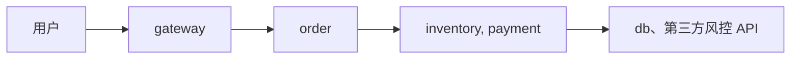
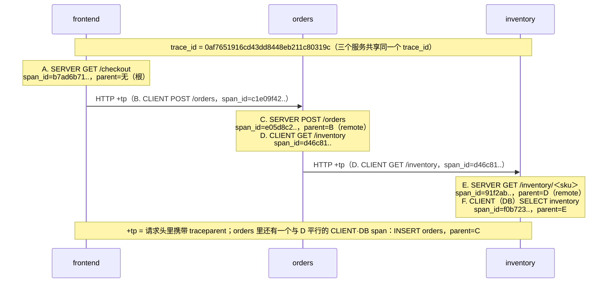
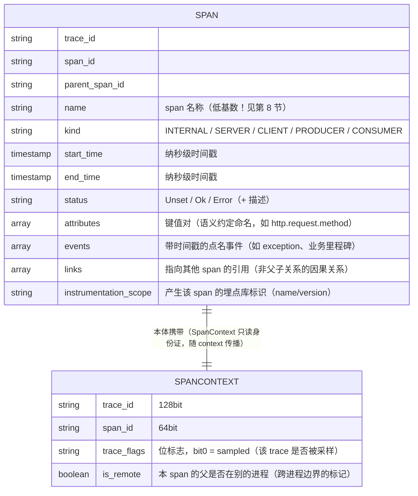
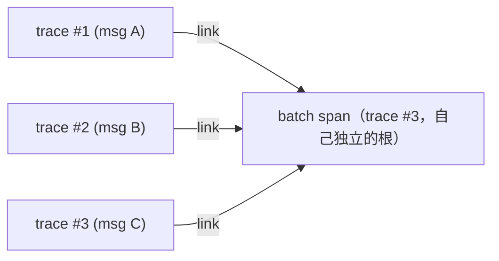
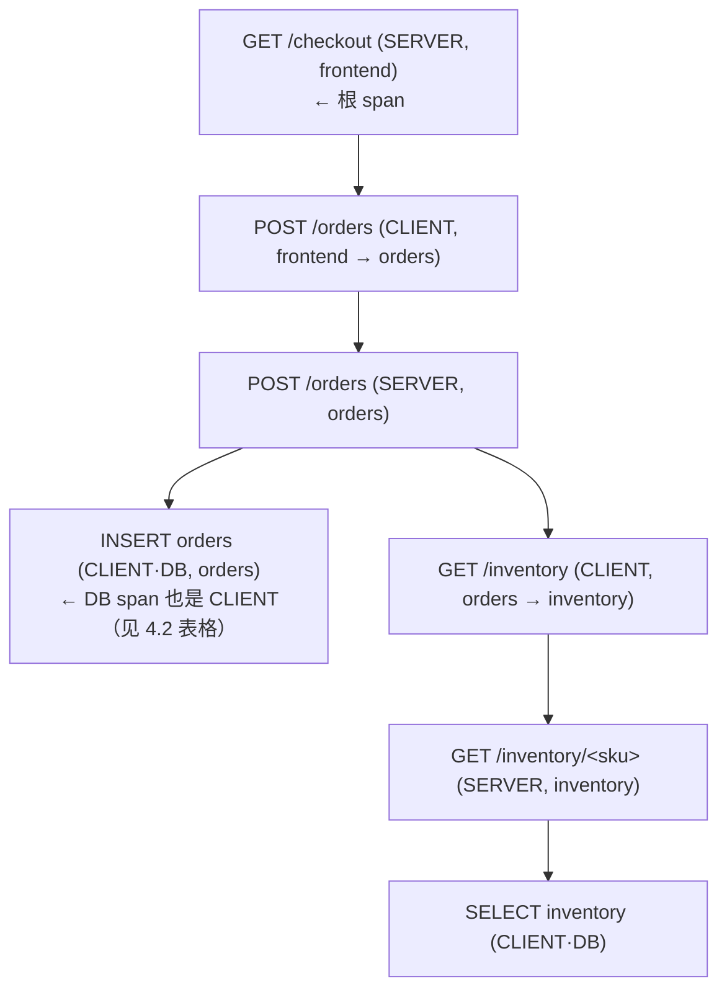

# 链路追踪笔记 01 · trace/span 数据模型

> 一切追踪系统（OpenTelemetry、Jaeger、Zipkin、Tempo……）都建立在同一个抽象上：**一次分布式请求 = 一棵 span 树**。
> 这篇笔记把这个模型彻底讲透：三个 ID 的关系、span 的完整组成、树与时间线两种视图、因果与时间的区别、命名最佳实践与常见误区。

## 1. 为什么需要链路追踪：先看一个事故场景

设想一次下单请求，用户反馈"偶尔要 8 秒才返回"。这条请求经过了 6 个服务：



- **指标（Metrics）**告诉你：order 服务 p99 = 6.2s，inventory p99 = 1.1s，第三方风控 p99 = 4.8s——但它们**无法告诉你同一次请求里谁等了谁**。
- **日志（Logging）**告诉你：某条 order 日志里 status=timeout——但你要在 6 个服务里 grep 出**属于同一次请求**的那些日志，靠手工传 request_id 非常脆弱。
- **链路追踪（Tracing）**直接给你答案：一条 trace，把这 6 个服务里属于这一次请求的所有工作段（span）连成一棵树，瀑布图上 4.8s 的风控 span 一眼可见。

三大支柱的分工一句话总结：**指标看群体（聚合），日志看个体（单点详情），trace 看关系（因果链路）**。

| 维度 | Metrics | Logging | Tracing |
| --- | --- | --- | --- |
| 回答的问题 | 系统整体表现如何？ | 这一行发生时细节是什么？ | 这一次请求经过了哪里、耗在哪？ |
| 数据形态 | 时间序列（数值+标签） | 离散文本/结构化事件 | span 树（带时间戳的因果图） |
| 基数 | 低（标签枚举有限） | 高 | 极高（每请求一条） |
| 典型成本 | 低 | 高（存储+索引） | 中～高（依赖采样控制） |
| 排障角色 | 发现问题、定位"哪个服务" | 解释"为什么" | 定位"哪一跳" |

## 2. Google Dapper 论文：现代链路追踪的起点

论文：*Dapper, a Large-Scale Distributed Systems Tracing Infrastructure*（Sigelman 等，Google，2010）
链接：<https://research.google/pubs/pub36356/>（访问日期：2026-11-04）

Google 内部几乎所有的分布式系统都在用 Dapper，这篇论文描述的设计直接决定了后续十年的追踪系统形态。核心思想提炼为五条：

1. **用"带时间戳的树"描述一次请求**。请求在进程间传递时天然形成一棵树，追踪系统只需要把这棵树还原出来。论文的原话是：*tracing trees exist, we simply have to record them*——树本来就存在，我们只是把它记录下来。
2. **每个工作段 = 一个 span，靠三个 ID 关联**：`trace_id`（整棵树同一个）、`span_id`（段自身）、`parent_id`（父段）。这是论文中"trace record"的核心内容，日志记录被简化成扁平的元组，而不是直接在进程间传结构。
3. **埋点放在公共组件（RPC 框架、线程池、RPC client 库）里，业务代码近乎无感**。论文承认"完全对应用透明做不到"：核心链路外的黑盒（如 SSL 隧道、异步回调）仍需少量手动埋点。
4. **采样是必须的，且开销要接近零**。Google 早期全量采样，后来靠 adaptive sampling 在数据量与覆盖率间权衡；论文给出目标：未采样路径的额外开销接近 0，采样路径开销 <1% 量级。
5. **带外收集（out-of-band collection）**：span 数据先写本地日志文件，由后台收集器集中拉走，与请求链路本身解耦——这套思路演化为今天的 OTel SDK → Collector → 后端存储 管道。

> **读论文的意义**：OpenTelemetry 的 SpanContext（trace_id/span_id/trace_flags）、ParentBased 采样、Collector 独立部署，全都能在 Dapper 里找到原型。面试里"Dapper 讲了什么"是高频题，答出上面 5 点中的 3 点即合格。

## 3. 三个 ID：trace_id / span_id / parent_id

OpenTelemetry 规范（<https://opentelemetry.io/docs/specs/otel/trace/api/>，访问日期：2026-11-04）对 ID 的定义：

| 字段 | 位数 | 常见表示 | 生成者 | 规则 |
| --- | --- | --- | --- | --- |
| trace_id | 128 bit | 32 个小写 hex 字符 | 请求进入系统的第一个服务（或采样器允许时） | 全 0 非法；同一棵 span 树内**完全相同** |
| span_id | 64 bit | 16 个小写 hex 字符 | 每个 span 开始时新生成 | 全 0 非法；树内唯一 |
| parent_span_id | 64 bit | 16 个小写 hex 字符 | 继承自上游 | 根 span 没有父；指向**直接触发**本 span 的那个 span |

把一次 `frontend → orders → inventory` 的请求画出来（与 lab03 完全对应）：



关键观察：

- orders 的 SERVER span C 的 parent 是 frontend 的 CLIENT span B（跨进程父子，extract 时标记 is_remote）；
- CLIENT span 与它引发的下游 SERVER span 是"同一个 RPC 的两端"，parent_id 把它们缝起来；
- DB 调用（F）也是 CLIENT span——数据库只是一类特殊的下游服务（携带 db.* 属性）；
- 整条链路只有一棵树、一个 trace_id，parent_id 链条从任何叶子都能回溯到根。

**为什么 CLIENT 和 SERVER 要各建一个 span，而不是只建一个？**
因为网络和排队发生在两者之间：`client.end - server.start ≈ 单向网络+排队耗时`，两个 span 的时间差是我们定位"网络慢还是服务慢"的唯一依据（详见 `tracing-practice.md`）。

## 4. span 的完整组成

OpenTelemetry 里一个 span 携带的全部信息（规范：<https://opentelemetry.io/docs/specs/otel/trace/api/#span>，访问日期：2026-11-04）：



### 4.1 name：span 的"身份"

- 要求**低基数**：`GET /users/{user_id}` 是好名字，`GET /users/12345` 是坏名字（每个用户一个 span 名，后端聚合直接爆炸）。
- 具体值来自哪个 span kind 有差异：HTTP SERVER span 建议用 `方法 + 路由模板`；DB span 用 `{db.operation} {表名}`；业务 span 用"动词 + 名词"。

### 4.2 kind：span 的角色（重要，用错会让 trace 图错乱）

| Kind | 含义 | 典型例子 | 子 span 挂在哪 |
| --- | --- | --- | --- |
| INTERNAL（默认） | 进程内部的一段工作 | 一个业务步骤、一次本地计算 | 当前进程内 |
| SERVER | **入站**同步请求的服务端半边 | HTTP handler、gRPC handler、RPC 服务端 | 处理请求期间创建的 span |
| CLIENT | **出站**同步调用的客户端半边 | 调下游 HTTP/gRPC/DB（DB 也是一种 CLIENT） | 一般无子 span，等待网络返回 |
| PRODUCER | **出站**异步消息的生产端 | Kafka producer 发一条消息 | 发送动作 |
| CONSUMER | **入站**异步消息的消费端 | Kafka consumer 处理一条消息 | 处理消息期间创建的 span |

两个高频错误：

- **DB span 忘了标 CLIENT**：DB span 按 semconv 应该是 `span.kind = CLIENT` + `db.system` 等属性（早期 Jaeger UI 里会显示成"客户端"，树形图更准确）。
- **把 SERVER 写成 CLIENT**：会导致 Jaeger 的系统拓扑图（System Architecture / Service Graph）方向画反，依赖关系错误。

### 4.3 status：三态，不是两态

| 状态 | 语义 | 什么时候用 |
| --- | --- | --- |
| Unset（默认） | 尚未判定 | 正常完成、或错误与否无意义 |
| Ok | 明确成功 | 显式标记成功（较少手动使用；HTTP client 收到 4xx 时按 semconv 可设 Ok——请求本身处理正确，是调用方传参错） |
| Error | 执行出错 | 未捕获异常、HTTP 5xx、超时、业务失败 |

HTTP 语义约定（<https://opentelemetry.io/docs/specs/semconv/http/http-spans/>，访问日期：2026-11-04）的推荐映射：

- 传输层错误（连不上、读超时）→ **Error**；
- 服务端 span：5xx → Error；4xx 一般保持 Unset（或按业务定义）；
- 客户端 span：5xx → Error；4xx → Ok（服务端正常工作，错误在调用方的请求）。

> 注意区分：**span 的 Error 状态是"调用是否失败"的判断依据**，Jaeger 里红色 span、错误率统计都来自它。把 404 标成 Error 会让错误率虚高。

### 4.4 attributes：结构化的"span 日志"

- 键值对，值为基础类型（string/bool/number）或其数组；数量和长度受 SDK 限制（默认上限 128 个属性，可配）。
- **优先使用语义约定（Semantic Conventions）命名**，让所有语言、所有服务产出同构数据：<https://opentelemetry.io/docs/specs/semconv/>（访问日期：2026-11-04）。常用例子：

| 语义键（新） | 旧键（很多文档/老 SDK 还在用） | 用途 |
| --- | --- | --- |
| `http.request.method` | `http.method` | HTTP 方法 |
| `url.full` | `http.url` | 完整 URL（CLIENT 用） |
| `http.route` | `http.route` | 路由模板（SERVER 用，低基数） |
| `http.response.status_code` | `http.status_code` | 响应码 |
| `server.address` / `server.port` | `net.peer.name` / `net.peer.port` | 对端地址（CLIENT 用） |
| `db.system` / `db.query.text` | `db.statement` | 数据库类型与语句 |

- **高基数内容（user_id、order_id、URL 全文）放 attributes，不放 name**——attributes 不参与 span 名聚合，后端可以按需索引/过滤。
- 不要放敏感信息（token、密码、身份证号）：trace 数据的访问控制通常弱于业务库。

### 4.5 events：span 内的时间点

`span.add_event(name, attributes, timestamp)`——在 span 生命周期内的某个瞬间打点。典型用法：

```
12.001s  event: "cache.miss"          {key: "user:42"}
12.013s  event: "retry"               {attempt: 2, backoff_ms: 50}
12.040s  event: "exception"           {exception.type: TimeoutError, ...}   ← record_exception() 的产物
```
<!-- 保留原图：event 打点输出样例（数据样例），非示意图 -->

**经验法则**：值得记录但"不值得单独开 span"的信息 → event。一段持续的工作才配开 span；一个瞬间只配 event。

### 4.6 links：非树状的因果关系

parent_id 只能表达"一个爹"，但真实系统里有大量**扇入（fan-in）**场景：

- **批处理**：一个聚合 span 处理了 1000 条消息，每条消息各有一条生产端 trace。聚合 span 用 `links` 指向这 1000 条消息各自的 span context，而不是强行认爹。
- **重试 / 多次尝试**：重试 span link 到前几次失败的 span。
- **缓存写入触发的异步刷新**：link 到触发它的那次请求。



Jaeger UI 里 link 会显示为可跳转的引用；没有 links，跨 trace 的因果关系就永久丢失了。

## 5. 两种视图：span 树与时间线（瀑布图）

同一份数据，后端给你两种看法。理解它们的区别是用好任何 tracing UI 的前提。

**树视图（DAG / 树形）**——强调**因果结构**：



**时间线 / 瀑布视图（Jaeger 默认）**——强调**耗时结构**，横轴是墙上时钟：

```mermaid
gantt
    title 时间轴（相对毫秒）
    dateFormat X
    axisFormat %s
    section frontend
    "GET /checkout" :0, 240
    "POST /orders (C)" :20, 225
    section orders
    "POST /orders (S)" :40, 230
    "SELECT orders" :60, 90
    "GET /inventory(C)" :100, 255
    section inventory
    "GET /inventory(S)" :120, 260
    "SELECT inventory" :160, 255
```



读图要点：

- 缩进 = 父子；长度 = duration；左端位置 = start time
- client span 与对应 server span 的"错位"= 网络 + 排队（本例约 15ms）
- 平行的兄弟 span（如同时调 A、B 两个下游）谁更长谁更可能在关键路径上

## 6. 跨进程的"因果"与"时间"是两回事

初学者最容易混淆的一件事：**parent_id 表达的是因果关系，不保证时间上的包含关系**。三个经典场景：

**场景 1：子 span 超出父 span 的时间范围（异步）**
请求 handler 里启动了一个 goroutine/线程去做异步落库，handler 立刻返回。若异步任务用的是"提前 end"的写法（见下），子 span 可能比父 span 晚结束。这在时间线上表现为"子块伸出父块"，**不是 bug**。

**场景 2：CLIENT 先于 SERVER 开始是常态，但 SERVER 结束可能晚于 CLIENT 结束吗？**
HTTP 同步调用不会（client 要等 response）。但异步消息会：PRODUCER span 在发送后立刻结束，而 CONSUMER span 可能在 10 分钟后才被消费创建——**子（consumer）的 start_time 远晚于父（producer）的 end_time**。瀑布图上两者完全不相交，全靠 parent/trace ID 维系因果。

**场景 3：异步任务的标准写法——"span 先行，end 延后"**
进程内异步（handler 返回后任务继续跑）时，正确写法不是把 span 交给子线程（父已 end），而是：

```
1. handler 内：child = tracer.start_span(...)          # 创建子 span，不 end
2. 把 child 的 context 传给异步单元（闭包/任务体）
3. handler 返回（SERVER span end）
4. 异步单元执行完毕：child.end()
```
<!-- 保留原图：异步任务四步操作（编号步骤清单，无图形字符），非示意图 -->

这样 SERVER span 时间线干净（不包含后台任务），而任务的 span 通过 parent 挂在树上、通过 context 携带同一 trace_id。

> **一句话**：树形图回答"谁引发了谁"，时间线回答"谁花了多久"。两者冲突时（子超父、子离父很远），先检查是否异步/跨进程，再怀疑埋点错误。

## 7. span 数量的直觉：一次请求应该有多少个 span？

没有硬性规定，但有健康区间：

| 请求类型 | 健康 span 数 | 说明 |
| --- | --- | --- |
| 简单 CRUD 服务 | 3~8 | SERVER + 1~3 个 CLIENT/INTERNAL |
| 中等复杂业务（几次下游调用+DB+缓存） | 10~50 | 每个 RPC/DB 各 1~2 个 |
| 网关/聚合服务 | 50~200 | 下游多，注意合并细粒度内部 span |
| 异常：每个函数一个 span | 数百~数千 | **病态**，见第 9 节 |

span 不是越多越好：每个 span 都有创建、序列化、传输、存储成本（详见 `tracing-practice.md` 第 6 节），并且过密的树会让人读不过来。

## 8. span 命名最佳实践

**核心公式：动词 + 名词，值域收敛（低基数）。**

| 场景 | 好名字 | 坏名字 | 为什么坏 |
| --- | --- | --- | --- |
| HTTP SERVER | `GET /users/{user_id}` | `GET /users/12345` | 每个用户一个名字，聚合爆炸 |
| HTTP SERVER | `POST /orders` | `handle_request` | 无信息量，全服务同名 |
| HTTP CLIENT | `GET http://inventory:8002/inventory` 或 `GET /inventory` | `GET /inventory/widget-9d2f?fail=1&slow=1` | URL 全文含参数，高基数 |
| DB | `SELECT inventory` / `INSERT orders` | `SELECT * FROM inventory WHERE sku='w1'`（当 name） | 语句进 name；语句应放 `db.query.text` 属性 |
| 业务 span | `risk.check` / `check risk` | `check` | 动词没有宾语，无法区分 |
| 消息 | `inventory reserve consume` | `kafka-topic-order-events-partition-3-msg-8817` | 分区/位移信息放属性 |

额外三条规则：

1. **占位符用 `{}` 风格的路由模板**，与框架路由一致（Flask `<sku>` → 展示为 `/inventory/{sku}`）。
2. **变化的值放 attributes**：`sku=widget` 是属性，不是名字的一部分。
3. **名字在 span 生命周期内可以改**（`span.update_name()`）：先按原始路径建 span，路由匹配完成后改成模板名——这是 lab03 里 inventory 服务实际采用的手法。

## 9. 常见误区（每条都对应一类真实事故）

**误区 1：每个函数一个 span。**
结果：一次请求 300 个 span，trace 图像毛线团，导出开销吞掉几个百分点 CPU。
正确姿势：span 只放在**边界与里程碑**（出/入进程、第三方调用、关键业务步骤），函数内部细节用 event 或日志表达。

**误区 2：span 太粗——整个请求一个 span。**
结果：知道慢，不知道慢在哪一跳，等于没做 trace。发现"一个服务一条请求只有一个 span"就该补边界埋点。

**误区 3：忘记 end span（span 泄漏）。**
未被 end 的 span 不会导出（或泄漏内存）。用语言提供的 `with`/`defer`/`start_as_current_span` 上下文管理器，不要手工配对 start/end。

**误区 4：高基数 name（见上表）**，以及高基数 attributes 滥用（每个 span 塞 2KB 上下文）——后端存储与索引成本失控。

**误区 5：status 语义错用。**
- 忘记 set_status(ERROR)：Jaeger 里错误 trace 统计为 0，没人发现故障；
- 4xx 标 Error：错误率虚高，告警疲劳。
正确姿势：统一在框架层按 semconv 映射（HTTP 状态码/异常 → status），业务失败另用属性标注。

**误区 6：Kind 标错**（SERVER/CLIENT 颠倒），导致服务依赖图方向错误。

**误区 7：把 trace_id 当业务 ID 用。**
trace_id 每次请求都不同（且采样下可能缺席），需要稳定业务关联请用业务主键；反过来，把业务 trace 关联回链路，靠的是日志里注入的 trace_id（阶段 4 主题）。

**误区 8：以为 span 树=调用栈。**
span 树是**因果**树：异步、消息、批处理都会让它长得不像调用栈（甚至子 span 与父 span 时间上不相交，见第 6 节）。

## 10. 动手验证（5 分钟）

装好 lab03 后（见 [labs/lab03-otel-tracing-jaeger/](../../labs/lab03-otel-tracing-jaeger/README.md)）：

```bash
curl -s http://localhost:8000/checkout?item=widget
```

打开 Jaeger UI（<http://localhost:16686>），Service 选 frontend，Find Traces，点开最新一条：

1. 数一数 span：应当恰好 7 个（frontend 2 + orders 3 + inventory 2），对应第 3 节的树；
2. 看 CLIENT 与 SERVER 的错位：frontend 的 CLIENT span 比 orders 的 SERVER span 早开始、晚结束，差值即网络+排队；
3. 点开任意 span，核对 attributes（http.route、url.full）、status、events 的实际值与本篇笔记一一对应。

## 11. 面试题小结

1. **Q：Dapper 论文最重要的贡献是什么？**
   A：确立"请求天然形成树，记录三个 ID 即可还原树"的模型；同时论证了公共组件埋点 + 采样 + 带外收集可以让追踪开销接近零，使全公司规模部署可行。

2. **Q：trace_id、span_id、parent_id 分别多少位？为什么 trace_id 要 128 位？**
   A：trace_id 128bit、span/parent 64bit，全 0 均非法。128bit 是为了全局唯一性：64bit 在高并发系统里有碰撞风险（Dapper 时代 Google 就靠 64bit+去重，现代规范升级到 128bit 前向兼容）。

3. **Q：CLIENT 和 SERVER span 为什么要成对出现？各自的作用？**
   A：CLIENT 表示出站调用（持有目标地址属性），SERVER 表示入站处理（持有路由模板）；两者用同一 trace_id、SERVER.parent=CLIENT.span_id 缝合。时间差用于区分网络耗时与服务端耗时。

4. **Q：什么时候用 links 而不是 parent？**
   A：一个 span 有多个"触发源"（批消费、扇入聚合、重试链）时。parent 只能有一个，表达唯一的直接因果；links 表达多重弱因果引用。

5. **Q：span 的 status 有哪几个取值？HTTP 404 应该设什么？**
   A：Unset/Ok/Error。服务端 404 通常保持 Unset（按 semconv，5xx 才 Error）；客户端视角 404 可以设 Ok——服务端行为正确，是调用方的问题。

6. **Q：为什么 span 名字必须低基数？**
   A：后端按 name 做 service+operation 聚合、建立操作索引与延迟分位数统计；高基数会让操作列表、指标聚合膨胀数万倍，查询与存储双双失控。变化的值应放 attributes。

## 12. 参考

- Dapper 论文：<https://research.google/pubs/pub36356/>（访问日期：2026-11-04）
- OpenTelemetry Trace 规范（数据模型与 Span 定义）：<https://opentelemetry.io/docs/specs/otel/trace/api/>（访问日期：2026-11-04）
- OpenTelemetry 语义约定总览：<https://opentelemetry.io/docs/specs/semconv/>（访问日期：2026-11-04）
- HTTP span 语义约定（status 映射）：<https://opentelemetry.io/docs/specs/semconv/http/http-spans/>（访问日期：2026-11-04）
- Span 生命周期与创建最佳实践：<https://opentelemetry.io/docs/specs/otel/trace/api/#spancreation>（访问日期：2026-11-04）
- Jaeger UI 使用说明：<https://www.jaegertracing.io/docs/latest/faq/>（访问日期：2026-11-04）

## 附：ASCII 图替换清单

| 原 ASCII 图位置（章节标题） | 原图内容简述 | 替换结果 |
| --- | --- | --- |
| 1. 为什么需要链路追踪 | 用户 → gateway → order → 下游 的请求调用链 | flowchart LR |
| 3. 三个 ID | frontend/orders/inventory 三服务 span 框图（SERVER/CLIENT、HTTP +tp、parent 关系） | sequenceDiagram |
| 4. span 的完整组成 | SpanContext 与 Span 本体的字段结构树 | erDiagram |
| 4.6 links | trace #1/#2/#3 经 link 汇入 batch span | flowchart LR |
| 5. 两种视图 · 树视图 | span 父子树（GET /checkout 为根） | flowchart TD |
| 5. 两种视图 · 瀑布视图 | 带时间轴的 span 瀑布（毫秒相对位置） | gantt |

### 保留说明

| 原 ASCII 图位置（章节标题） | 原图内容简述 | 保留原因 |
| --- | --- | --- |
| 4.5 events | 三条 event 打点输出 | 数据样例，非示意图 |
| 6. 跨进程的"因果"与"时间" · 场景 3 | 异步任务四步正确写法 | 编号步骤清单，无图形字符，非示意图 |
