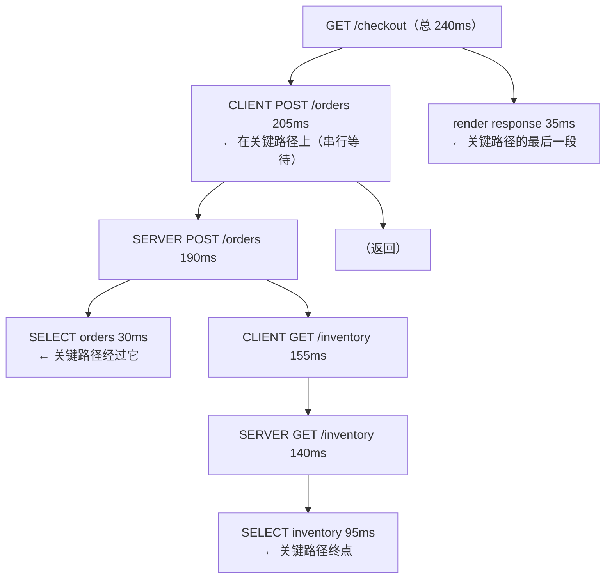
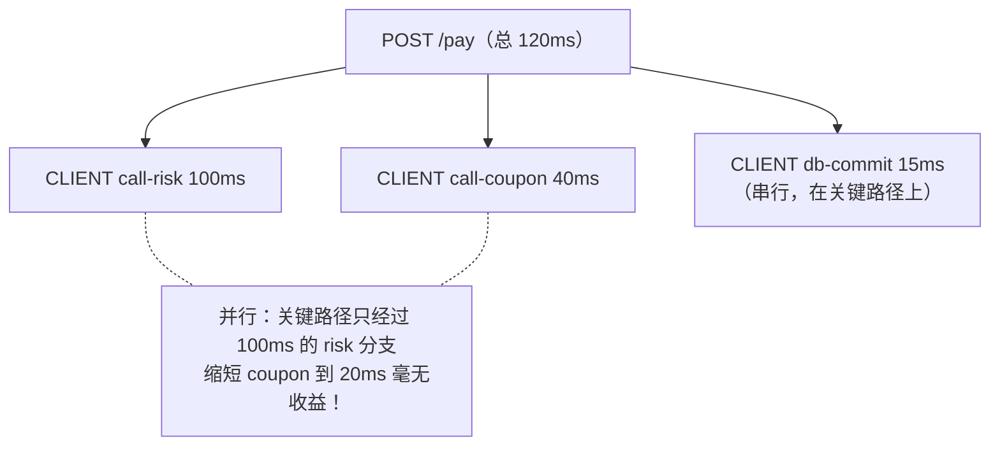
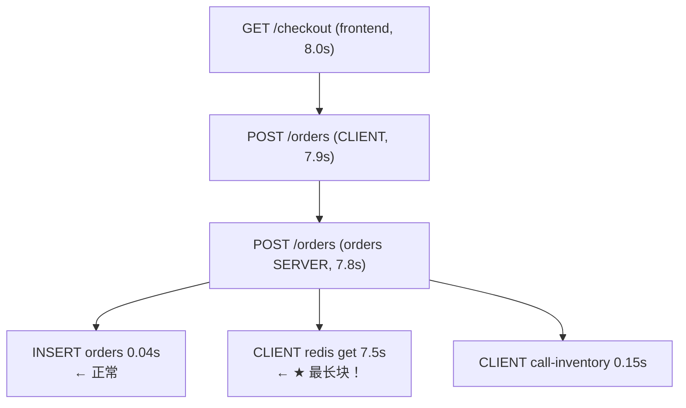
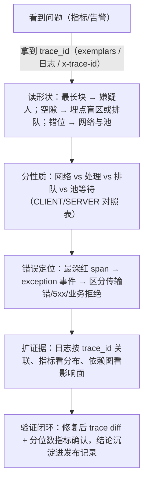

# 链路追踪笔记 05 · 分析方法与最佳实践：怎么"读"一条 trace

> 有了数据只是开始。这篇讲操作层面的方法论：拿到一条 trace 先看什么、怎么找关键路径、
> 怎么区分"网络慢"和"处理慢"、错误 trace 怎么定位、埋点该铺在哪、span 开销怎么控制。
> 大量结论可以直接在 lab03 上验证。

## 1. 拿到一条 trace 的标准动作（30 秒版）

以 Jaeger UI 为例，打开一条慢 trace 后按固定顺序过一遍：

1. **看总耗时与根 span**：确认这条 trace 到底多慢、入口是什么（方法+路由）；
2. **扫瀑布图找"最长块"与"最大空隙"**：
   - 最长块 = 某一跳处理耗时（服务慢）；
   - 父 span 内部的空隙（gap）= 父进程自己在干活但没有子 span 记录（本地计算、无埋点的调用、锁等待）；
3. **看每对 CLIENT→SERVER 的错位**：错位大 = 网络/排队/队列积压（见第 3 节）；
4. **找红色（status=Error）span 与 exception 事件**：定位最深的那个错误点；
5. **数一数结构**：串行的下游调用能不能并行？重复出现的短 span（如 10 连发 DB 查询）是不是 N+1？

养成"先结构后细节"的习惯：**大多数性能问题的答案在形状里，不在某个属性里。**

## 2. 关键路径（Critical Path）分析

**定义**：trace 中决定总时长的 span 序列——把这条路径上任何一段缩短，总时长才会缩短。它**不是**"最长的那个 span"，更不是"所有 span"。



另一个例子（并行调用下"最长兄弟"才在关键路径上）：



规则提炼：

- 串行子 span：**全部**在关键路径上；
- 并行子 span（时间上重叠）：只有**最晚结束的那个**分支在关键路径上——优化并行分支里的"短腿"不会降低总时长，这是 review 性能方案时最常被指出的错误；
- 父 span 中不被任何子 span 覆盖的空隙（self time）也是关键路径的一部分——"空隙大"说明**埋点有盲区**，先补埋点再谈优化。

**self time（自耗时）快速算法**：`父 span duration − 直接子 span 时间区间的并集`。Jaeger/Tempo 瀑布图用眼睛就能估：父块里没被子块盖住的部分就是。

## 3. 慢在哪里：网络 vs 处理 vs 排队

一对 CLIENT/SERVER span 是天然的"网络探针"：

```mermaid
gantt
    dateFormat X
    axisFormat %s
    "CLIENT span (从发起调用到收到响应，含等待)" :0, 250
    "SERVER span (服务端实际处理窗口)" :60, 180
```



- ◄────► 左侧空隙 = 请求方向网络+排队
- ◄──► 右侧空隙 = 响应方向网络+排队+序列化

| 观测 | 推断 | 验证方向 |
| --- | --- | --- |
| CLIENT−SERVER 空隙小（<几 ms，同机房） | 正常 | — |
| 空隙大且稳定（几十~几百 ms） | 物理距离远（跨区/跨云）、NAT/代理链路长 | ping/骨架测试、region 部署 |
| 空隙随负载增大 | 连接池排队、accept 队列满、LB 不健康节点 | 池指标、重试风暴、LB 健康检查 |
| CLIENT 总耗时 >> SERVER 总耗时且无网络理由 | 超时重试发生（client 重发了 N 次但 trace 只见一次） | 客户端重试日志/指标 |
| SERVER 长、无长子 span | 服务端 CPU/锁/GC/慢序列化 | profiling、runtime 指标 |

再看分布而不是单条：Jaeger 的 **Monitoring/延迟标签页**给出每个 operation 的 p50/p95/p99；"单条 trace 异常 vs 整体右移"是两类完全不同的问题（前者找特例：特定参数/用户；后者找系统性：容量、下游、发布）。

**N+1 模式识别**：瀑布图上同一操作连续重复十几行、每行几 ms——单项都不慢，串起来要命。修法是批量化（一次 IN 查询），埋点层面它的"形状"就是证据。

## 4. 错误 trace 分析

入口：按 service+operation 过滤 `status=Error`（Jaeger 搜索的 Errors 标签/TraceQL `{ status = error }`），或从告警（5xx 率）下钻拿 trace_id。

分析顺序：

1. **找最深的红色 span**：错误通常在链路末端产生，向上传播时每一层只是"记录并转发"——真正的原因在叶子；
2. **读 exception 事件的 stacktrace**：`record_exception()` 记录的 `exception.type` / `exception.message` / `exception.stacktrace` 三个属性就是现场的 log；
3. **区分错误类型**：
   - 传输错误（connect refused / timeout）→ 依赖不可用，看 CLIENT span 与 SERVER span 是否存在（SERVER 缺席 = 根本没到达）；
   - 5xx → 应用错误，看叶子 span 的异常；
   - 业务拒绝（余额不足）→ status 可能是 Ok/Unset，靠业务属性（`order.reject_reason`）标注，这类不该混进"系统错误率"；
4. **只看一条会误导，要看错误 trace 的聚类**：同一 operation、同一 exception.type 的一批 trace → 系统性 bug；散落在不同环节 → 更像容量/依赖问题；
5. **超时链**：上层超时但下层"其实成功了"——上层 CLIENT span 以 timeout 结束（红），下层 SERVER span 正常（绿）且晚于上层结束。这是**超时配置不合理**的经典形状，也是"用户看到失败、数据却写进去了"这类诡异事故的根源。

错误标注的红线（与 `trace-model.md` 4.3 呼应）：**只有"这次调用判定为失败"才 set Error**。把 404、参数校验失败标红，错误率图就废了。

## 5. trace 与日志的关联（基础版）

链路和日志是两种查询路径：trace 擅长"结构和时间"，日志擅长"内容"。关联键就是 **trace_id（+span_id）**。

最小实现（阶段 4 会展开 Loki 全链路）：

```
1) 日志记录里注入 trace 上下文（各语言都有现成 filter/bridge）：
   Python:  用 logging.Filter 把 current_span 的 trace_id 写进 record
   Go:      otelslog / logr bridge，或 handler 里 zap.Field("trace_id", ...)
2) 服务端日志样例：
   {"ts": "...", "level": "ERROR", "msg": "inventory query failed", "trace_id": "0af76519...", "span_id": "91f2..."}
3) 工作流 A（trace → 日志）：Jaeger 里看到错误 span → 拿 trace_id 去日志系统精确 grep → 得到同一瞬间的全部日志行
4) 工作流 B（日志 → trace）：日志发现异常 → 拿 trace_id 回 Jaeger → 看这次请求全链路
```
<!-- 保留原图：注入方式清单、服务端日志样例与两条关联工作流（编号清单+数据样例），非示意图 -->

注意事项：

- **被采样掉的 trace，日志里的 trace_id 查不到 trace**——这是采样策略要考虑一致性的一部分（阶段 5）；
- 日志量远大于 trace 量，注入要克制：不是每行都要，但 ERROR/WARN 级别必须带；
- 反向关联（metrics→trace）用 **exemplars**：直方图桶上的样本点带 trace_id，Grafana 里点指标直接跳 trace（阶段 4 实操）。

## 6. 埋点覆盖策略：span 该铺在哪

原则一句话：**边界全覆盖，内部选里程碑。**

| 优先级 | 埋点位置 | Kind | 理由 |
| --- | --- | --- | --- |
| P0 | HTTP/RPC/gRPC **SERVER** | SERVER | 入口；没有它 trace 无根 |
| P0 | 出站 HTTP/RPC **CLIENT** | CLIENT | 网络探针的一半；依赖图的边 |
| P0 | 数据库访问 | CLIENT | 多数"慢"发生在 DB；attributes 记 db.system/query.text |
| P1 | 缓存（Redis 等） | CLIENT | 缓存抖动是隐形延迟大户 |
| P1 | MQ PRODUCER/CONSUMER | PRODUCER/CONSUMER | 异步边界的因果链（易断链） |
| P1 | 第三方/SaaS 调用 | CLIENT | 你不可控的慢与错，必须留证据 |
| P2 | 关键业务步骤（下单、扣库存、风控判定） | INTERNAL | 业务语义；审计与排障的锚点 |
| P3 | 大段本地计算（>50ms 的算法/批处理） | INTERNAL | 只在确有排障需求时加 |

反模式（不该铺 span 的地方）：

- 每个函数/每层 service 方法（span 数失控）；
- 纯内存、微秒级的工具函数；
- 高频循环体内（一次请求几百个兄弟 span，用计数器属性替代：`span.set_attribute("cache.hits", n)`）。

中间件/框架层的统一埋点（每个服务只写一次）是性价比最高的投入：入口自动有 SERVER span、每个出站调用自动有 CLIENT span，业务开发者只在"业务里程碑"上花精力——这正是自动 instrumentation 与手动埋点分层合作的场景（见 `otel-sdk.md` 第 6 节）。

## 7. span 数量与开销控制

单个 span 的成本拆解：

| 环节 | 开销量级（健康实现） | 说明 |
| --- | --- | --- |
| 创建与线程本地切换 | ~1µs | 无采样命中时更便宜（no-op） |
| 属性填充 | 每 attribute ~百 ns | 大对象/长字符串注意拷贝成本 |
| 序列化+导出（OTLP/HTTP） | 每 span ~0.5–2KB 网络 | stacktrace、超长属性是体积大头 |
| 后端写入 | 与体积成正比 | 后端选型决定单价（见 `jaeger-vs-tempo.md`） |

控制手段（按优先级）：

1. **采样（第一杠杆）**：head-based（`traceidratio`/`parentbased`，采样器在 span 创建时决定，未命中的调用近乎零成本）是默认手段；tail-based（Collector 上按"慢/错全保留"决策）是进阶手段——策略细节在阶段 5 展开，这里记住：**lab03 的全量采样只适合学习与小流量**。
2. **降 span 为 event/属性**：N 个重复短 span → 1 个 span + 计数属性；调试期加的细粒度 span 上线前收回。
3. **控属性**：默认 128 个属性上限要当作预算用；URL 全文、大 payload、stacktrace（可关）是三大体积杀手。
4. **批处理导出**：BatchSpanProcessor 必开（`otel-sdk.md` 第 4 节）。
5. **健康检查线**：单请求 span 数 > 100（网关类 >300）就该复盘埋点设计； Collector 侧监控 `otelcol_receiver_accepted_spans` 与 drop 计数，别让观测系统自己变成事故。

## 8. 常见误读（数据没错，读错了）

- **瀑布图 ≠ 调用栈**：缩进是因果不是函数层级；异步/消息场景子 span 与父 span 时间上可以不相交（`trace-model.md` 第 6 节）；
- **时钟偏差**：不同主机的 start/end 来自不同时钟，毫秒级 NTP 误差可能让 SERVER 看起来早于 CLIENT 开始——别按"负网络时间"报 bug；
- **采样偏差**：默认头采样下，快慢 trace 等概率被采，统计分布接近真实；但"按错误保留"的尾采样数据里慢/错 trace 过采样，**不能**直接拿它算全局延迟分布（要用对应的 metrics）；
- **CLIENT 时长包含排队**：连接池等待、重试等待都算在 CLIENT span 内——"CLIENT 很长但下游 SERVER 很短"先查池与重试，再怀疑网络。

## 9. 实战复盘：一次"下单偶发 8 秒"的完整分析过程

把前 8 节的方法串成一条时间线。背景：电商下单接口 p99 从 1.2s 涨到 8s，告警触发，你的 20 分钟排查（脱敏简化，但顺序与真实事故一致）。

**第 0~3 分钟：先看形状，不看细节。**


三条慢 trace 的瀑布图形状完全一样：



结论候选：慢在 orders → redis 这一跳。注意方法：**没有看任何一行日志**，形状已经把范围从 6 个服务缩到 1 个依赖。

**第 3~8 分钟：区分"网络慢"还是"处理慢"。**

点开 redis CLIENT span：它**没有子 SERVER span**（Redis 没有埋点，这是预期），但属性里 `db.system=redis`、`db.operation=GET`。CLIENT span 自身 duration 7.5s——对 Redis 一个 GET 而言，这不是"处理慢"（单机 Redis 单命令 P99 通常 <1ms 量级），也不是"网络慢"（同机房 RTT <1ms）。剩下的假设只有一个：**连接获取阻塞**——连接池空了，GET 大部分时间在等连接。

验证：`redis_pool_wait_seconds` 指标（如果池埋点有的话）或 orders 进程的连接池配置——发现 max_connections=10，而当前 orders 并发约 200。

**第 8~15 分钟：找到"为什么现在才爆"。**

池一直是 10，为什么今天才慢？看 Jaeger 的 **Dependencies/依赖图**与发布记录：上游 marketing 服务两小时前上线了一个"下单后发券"的同步调用，使 /orders 入口 QPS 翻了 3 倍。池耗尽是从那时开始的（指标图上 redis 等待时间与 QPS 同步抬升）。

**第 15~20 分钟：修复与验证。**

- 热修：池调到 100 + 超时 200ms（宁可快速失败也不排队 7 秒）；
- 验证：p99 回落；再看新 trace：redis CLIENT span 回到 ms 级；
- 复盘改进：给所有出站依赖加"池等待"埋点属性；marketing 的发券改异步（超时预算见第 2 节关键路径分析）。

这个案例的三条通用教训：

1. **trace 的形状先于一切**（最长块 = 嫌疑人）；
2. **CLIENT span 是天然探针**，但"无子 span 的长 CLIENT"要想到连接池/池化资源，而不是网络；
3. **trace 只负责定位，容量与变更历史要靠指标和发布记录补全**——三支柱配合的日常形态（阶段 4 展开）。

## 10. 从 trace 到治理：依赖图、监控台与告警

个人排障之外，trace 数据还能沉淀成三类"公共资产"：

**1）服务依赖图（Service Graph / System Architecture）**

Jaeger 与 Tempo（metrics-generator）都能从 span 流推导出"A 调用了 B、QPS/错误率/延迟多少"的有向图。用途：

- 新人理解系统结构的活文档（比手工维护的架构图永远新鲜）；
- 变更影响面评估："我要下线 orders 的这个接口，谁还在调？"——看图上这条边的 QPS 是否归零；
- 循环依赖、意外依赖（生产服务调测试服务）的巡检。

注意：图来自**采样后的 trace**，边的存在性可靠（采样是按 trace 不是按边），但 QPS 数值要按采样率还原或改用 metrics 口径。

**2）监控台（Monitoring/RED 视图）**

Jaeger 自带 Monitoring 标签页（或 Tempo + metrics-generator + Grafana），按 service×operation 给 RED 三件套（Rate/Errors/Duration 分位数）。价值在于**从指标下钻到 trace 的闭环**：看到 orders 的 p99 异常 → 点开对应时间窗的慢 trace 列表 → 进入瀑布图。这比"指标看 Grafana、trace 看 Jaeger、两边来回切"的割裂工作流高效得多。

**3）基于 trace 的告警（慎重）**

- 可以做：某 operation 错误率（status=Error 占比）超阈值、某依赖的 CLIENT span P99 超阈值——数据源就是后端从 trace 派生的指标；
- 要克制：trace 数据有采样与聚合延迟，**秒级强实时告警请用 metrics**；trace 告警适合"体验类"阈值（p99、依赖错误率），不适合"可用性类"阈值（进程挂了、成功率掉底）；
- 告警文案里带上"如何拿 trace_id"的指引（exemplar 链接或最近错误 trace 深链），否则值班同学还是要手工翻 UI。

一句话总结本节：**trace 系统建设的目标是让"发现问题→定位问题"的路径从"凭记忆 grep"变成"点两下鼠标"**——埋点覆盖率（第 6 节）决定这条路通不通。

## 11. 发布验证：用 trace 对比（diff）确认优化收益

排障方法解决"变慢了找原因"，还有一类日常需求是反方向："我做了优化/发了新版本，怎么证明它真的有效？"——trace 对比就是最直接的证据工具。

**标准流程（Jaeger UI 的 Compare 功能）**：

```
1. 发布前：选一个代表性操作（如 POST /orders），挑 3~5 条正常负载下的 trace；
2. 发布后：同样负载再挑 3~5 条；
3. Jaeger 左侧勾选两条 trace（一前一后）→ 点 Compare；
4. UI 并排展示两条瀑布图，span 级别标出 duration 差异（变长/变短/新增/消失）。
```
<!-- 保留原图：发布前后 trace 对比四步操作（编号步骤清单，无图形字符），非示意图 -->

读对比结果的四个关注点：

| 对比现象 | 含义 | 动作 |
| --- | --- | --- |
| 目标 span 变短、总时长等比下降 | 优化生效且在关键路径上（呼应第 2 节） | 记录数据，写入发布记录 |
| 目标 span 变短、总时长没变 | 优化的 span 不在关键路径上（并行短腿） | 重新审视优化点选择 |
| 出现新增 span | 新版本引入了新的下游调用 | 确认是否预期（新依赖要同步依赖图） |
| 某段空隙（self time）变大 | 无埋点区域的耗时增加 | 先补埋点，让证据可见 |

**lab03 上的练习**：`curl 'localhost:8000/checkout?item=widget'` 与 `curl 'localhost:8000/checkout?item=widget&slow=1'` 各来一次，在 Jaeger 里勾选这两条 trace 点 **Compare**——你会看到 inventory 的 `SELECT inventory` span 相差约 800ms，而其余 span 基本重合。这就是"diff 证明慢点在哪"的最小演示。

**对比的纪律**：

- 对比的 trace 要**同负载、同参数形态**（拿一条慢查询 trace 和一条缓存命中 trace 对比没有意义）；
- 单条 trace 对比只证明"存在性"，不证明"普遍性"——发布结论要配合分位数指标（第 3 节的 Monitoring 视图）一起下；
- 把关键优化前后的 trace 深链存进 PR 描述/发布记录，半年后复盘时它是最好的存档。

## 12. 动手练习（lab03 对应实验）

1. `curl 'localhost:8000/checkout?slow=1'` → 找到那条 trace，指出哪段是关键路径、inventory 的 SELECT span 为什么变长；
2. `curl 'localhost:8000/checkout?item=boom'` → 找最深的红色 span，读出它的 exception.type/message；
3. 观察 frontend CLIENT span 与 orders SERVER span 的错位（本机容器网络，通常 <2ms），思考跨机房时这个空隙会变成什么样；
4. 连发 5 次正常请求，在 Jaeger 里用 **Compare** 功能对比两条 trace 的差异。

## 12.1 本篇小结（方法论一页纸）



## 13. 面试题小结

1. **Q：什么是关键路径？为什么优化并行分支里的慢调用可能无效？**
   A：决定总时长的串行 span 链。并行分支只有在它是"最晚完成者"时才在关键路径上；缩短非关键分支只会增加空隙，不减少总时长。
2. **Q：怎么用 trace 区分"网络慢"与"服务处理慢"？**
   A：对比同一次调用的 CLIENT 与 SERVER span：CLIENT−SERVER 的时间空隙≈网络+排队；SERVER 自身 duration（及其子 span/self time）= 处理耗时。
3. **Q：上层超时、下层成功，是什么形状？怎么产生的？**
   A：上层 CLIENT span 红且早结束，下层 SERVER span 绿且晚结束——上层超时阈值小于下游实际耗时；常伴随重试放大。需要核对超时预算与下游容量。
4. **Q：span 开销怎么控制？**
   A：头采样（第一杠杆）、降 span 为 event/属性、属性预算（默认 128 个）、BatchSpanProcessor、控制单请求 span 数（服务 <100）。
5. **Q：trace 和日志怎么关联？**
   A：以 trace_id/span_id 为键：日志注入当前 span 上下文（filter/bridge），双向工作流（trace→日志精确定位、日志→trace 全链回放）；metrics→trace 用 exemplars。采样一致性是前提。
6. **Q：一个 CLIENT span 很长、但没有对应的 SERVER span（如 Redis），怎么判断慢在哪？**
   A：先排自网络（同机房 RTT ms 级）与对端处理（Redis 单命令 µs~ms 级），再查池化资源：连接获取等待、池打满、排队重试。CLIENT span 的 duration 包含池等待，这是"长 CLIENT 无 SERVER"最常见的原因。
7. **Q：服务依赖图能用来做容量规划吗？要注意什么？**
   A：能看结构与边的存在性（边的出现/消失很可靠）；但 QPS/延迟数值来自采样后 trace，比例还原与聚合延迟使其不适合精确容量数字——容量口径应以 metrics 为准，依赖图做结构发现与影响面评估。
8. **Q：怎么证明一次性能优化真的生效？**
   A：同负载同参数下取发布前后各几条 trace 做 span 级 diff（Jaeger Compare）：目标 span 变短且总时长等比下降=生效且在关键路径；span 变短但总时长不变=不在关键路径。存在性结论再配合分位数指标验证普遍性。

## 14. 参考

- OTel span 语义约定：<https://opentelemetry.io/docs/specs/semconv/general/trace/>（访问日期：2026-11-04）
- Jaeger UI 功能（搜索/对比/依赖图）：<https://www.jaegertracing.io/docs/latest/frontend-ui/>（访问日期：2026-11-04）
- Tempo 服务图（metrics-generator 派生）：<https://grafana.com/docs/tempo/latest/metrics-generator/service-graphs/>（访问日期：2026-11-04）
- 采样概览（本篇只预览，阶段 5 详讲）：<https://opentelemetry.io/docs/concepts/sampling/>（访问日期：2026-11-04）
- Google SRE Book 第 22 章 Addressing Cascading Failures（超时与关键路径思想）：<https://sre.google/sre-book/addressing-cascading-failures/>（访问日期：2026-11-04）
- Dapper 论文（采样与开销的原始讨论）：<https://research.google/pubs/pub36356/>（访问日期：2026-11-04）

## 附：ASCII 图替换清单

| 原 ASCII 图位置（章节标题） | 原图内容简述 | 替换结果 |
| --- | --- | --- |
| 2. 关键路径（Critical Path）分析 | 两棵标注关键路径的 span 树（串行例 + 并行例） | flowchart TD ×2（原文两例拆为两个 mermaid 块） |
| 3. 慢在哪里 | CLIENT/SERVER span 时间窗与左右空隙 | gantt + 空隙标注保留为列表 |
| 9. 实战复盘 · 第 0~3 分钟 | 告警→指标→exemplar→trace 排查链 + 慢 trace span 树 | flowchart LR + flowchart TD（两个 mermaid 块） |
| 12.1 本篇小结（方法论一页纸） | 六步纵向排查流程 | flowchart TD |

### 保留说明

| 原 ASCII 图位置（章节标题） | 原图内容简述 | 保留原因 |
| --- | --- | --- |
| 5. trace 与日志的关联 | 注入方式、服务端日志样例、两条工作流 | 编号清单 + 日志数据样例，非示意图 |
| 11. 发布验证 | Jaeger Compare 四步操作 | 编号步骤清单，无图形字符，非示意图 |
