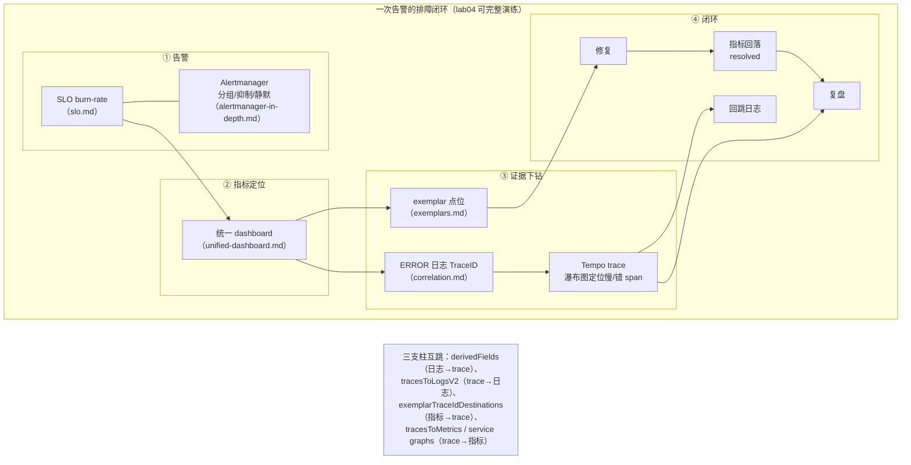

# 阶段 4 · 整合与告警（三支柱关联 + SLO + Alertmanager + 统一仪表盘）

> 本阶段是收获阶段：前三阶段分别点亮了 Metrics（Prometheus）、Logging（Loki）、
> Tracing（Tempo），现在把它们**缝成一个体系**——以 trace_id 为针线，
> 三种信号互相跳转；以 SLO 为度量衡，告警对"错误预算的消耗速度"响；
> 以统一仪表盘为战场，把排障过程固化成 SOP。
> 学完本阶段，你应当能够：独立搭建一套三支柱互跳的可观测性栈、定义 SLI/SLO
> 并落地多窗口多燃烧率告警、按 SOP 在 5 分钟内从告警走到根因证据。

## 学习目标

- [ ] 理解三支柱关联的数据模型：trace_id 在日志（正文注入 / OTLP 字段）、指标（exemplar）、trace（第一公民）中的位置
- [ ] 能实现"日志带 trace_id"（Python logging Filter / Go slog Handler）并解释 filter 挂 handler 的原因
- [ ] 会配 Grafana 四类关联：tracesToLogsV2（trace→日志）、derivedFields（日志→trace）、exemplarTraceIdDestinations（指标→trace）、tracesToMetrics（trace→指标）
- [ ] 说清 exemplar 的四段启用链路（SDK → Collector OpenMetrics → Prometheus 存储 → Grafana 展示）及其版本/语言兼容矩阵
- [ ] 理解 Tempo metrics_generator 的 spanmetrics / service graphs：从 trace 反向派生指标
- [ ] 会定义 SLI（可用性/延迟/正确性，含 PromQL）、制定 SLO（用户视角、28 天窗口、目标值方法论）
- [ ] 掌握错误预算与 burn rate 计算，能落地 Google SRE 的多窗口多燃烧率告警（14.4/6/3/1 四档）
- [ ] 吃透 Alertmanager：去重/分组/抑制/静默的路由流程、route 树与 receivers 配置、集群 HA 一句话
- [ ] 掌握告警治理：P0-P3 分级、告警周报与治理指标、静默与维护窗口纪律
- [ ] 能设计统一仪表盘（RED + 资源 + 依赖五层结构）并按五步 SOP 完成一次完整排障演练
- [ ] 理解 blameless postmortem 文化的要素与闭环方式

## 笔记索引（建议按序阅读）

| # | 笔记 | 主题 | 关键词 |
| --- | --- | --- | --- |
| 1 | [correlation.md](correlation.md) | 三支柱关联 | trace_id 数据模型、Python/Go 日志注入、tracesToLogsV2/derivedFields 逐项详解、spanmetrics/服务图、下钻闭环、关联失效 checklist |
| 2 | [exemplars.md](exemplars.md) | Exemplars | OpenMetrics/OTLP 格式、四段启用链路、query_exemplars API、版本兼容表、价值与限制（采样而非全集、PromQL 不可查） |
| 3 | [slo.md](slo.md) | SLO 与错误预算 | SLI/SLO/SLA 区别表、三类 SLI 的 PromQL、目标值方法论、burn rate 推导、多窗口多燃烧率告警、错误预算政策、反模式清单 |
| 4 | [alertmanager-in-depth.md](alertmanager-in-depth.md) | Alertmanager 深入 | 一条告警的旅程、route 树逐行注释、group_wait/interval/repeat 时间线、webhook 与模板、静默与维护窗口、P0-P3 告警治理 |
| 5 | [unified-dashboard.md](unified-dashboard.md) | 统一仪表盘与排障 SOP | 五层 dashboard 结构、五步排障剧本（含 lab04 点击路径）、SOP 固化到链接、dashboard 即代码、postmortem 文化 |
| 6 | [frontend-rum.md](frontend-rum.md) | 前端可观测性 / RUM | RUM vs 合成监控、Web Vitals（LCP/INP/CLS）、Grafana Faro 接入 LGTM 栈、Sentry 错误追踪与 Source Map、前后端 trace 串联（浏览器注入 traceparent）、Replay 隐私与采样 |

## 配套实验

- **lab04：三支柱整合——一次请求贯穿 Metrics / Logging / Tracing** ——
  [labs/lab04-three-pillars/](../../labs/lab04-three-pillars/README.md)

  一个 FastAPI 应用（web/inventory 双角色）同时产出三信号 → OTel Collector 分发
  → Prometheus / Loki / Tempo → Grafana 三向关联下钻 + SLO burn-rate 告警闭环。
  `podman compose` 一键启动，内置混沌开关（`/chaos`）与告警展示页（`/alerts`），
  可完整演练"告警 → 指标 → exemplar/日志 trace_id → Tempo trace → 回跳日志 →
  burn-rate 告警 → resolved"的全链路。

## 本阶段知识地图

## 与其他阶段的衔接

- **向左（阶段 1/2/3）**：本阶段不引入新的存储，只做"缝合"——阶段 1 的
  PromQL 与 recording rules 是 SLO 规则的语言，阶段 2 的 Loki 标签与正文结构
  决定 derivedFields 正则怎么写，阶段 3 的 trace 模型与 W3C 传播是 trace_id
  能贯穿一切的物理基础。
- **向后（阶段 5）**：本阶段默认**全量采样**；head/tail-based 采样（trace_flags=00
  的含义、exemplar 指向未采样 trace 的兜底）、高基数治理（lab04 教学用
  trace_id 当 Loki label 的反模式在生产中的正确姿势）、K8s 场景下的多租户
  Alertmanager，都留到阶段 5 展开。

## 参考资料（权威入口）

- Google SRE Workbook · Alerting on SLOs：<https://sre.google/workbook/alerting-on-slos/>（访问日期：2026-11-04）
- Google SRE Workbook · Error Budget Policy：<https://sre.google/workbook/error-budget-policy/>（访问日期：2026-11-04）
- Alertmanager 官方文档：<https://prometheus.io/docs/alerting/latest/alertmanager/>（访问日期：2026-11-04）
- Grafana Tempo 数据源关联配置：<https://grafana.com/docs/grafana/latest/datasources/tempo/configure-tempo-data-source/>（访问日期：2026-11-04）
- OpenTelemetry Exemplars 数据模型：<https://opentelemetry.io/docs/specs/otel/metrics/data-model/#exemplars>（访问日期：2026-11-04）

---

## 附：ASCII 图替换清单

| 原 ASCII 图位置（章节标题） | 原图内容简述 | 替换结果 |
| --- | --- | --- |
| 本阶段知识地图 | 一次告警排障闭环四阶段（告警 / 指标定位 / 证据下钻 / 闭环）+ 三支柱互跳说明的框图 | flowchart LR（含 subgraph 分组） |

---

## 阶段导读：为什么要有这个阶段

阶段 1-3 分别点亮了三种信号，但**三座孤岛不等于一个体系**：值班同学收到告警后，仍要在 Prometheus、Loki、Tempo 三个界面之间手工复制 trace_id 来回查。本阶段不引入任何新存储，做的是"缝合"——把排障从"三个工具间的手工搬运"变成"一次点击的跳转"，再把"系统好不好"从感觉变成可计算的契约：

1. **关联**：以 trace_id 为针线——日志注入它、指标 exemplar 指向它、Grafana 三向跳转（correlation、exemplars）；
2. **度量**：SLI/SLO 把"用户是否受影响"变成数字，错误预算与多窗口燃烧率把"要不要叫人"变成规则（slo）；
3. **行动**：Alertmanager 决定谁被吵醒、谁被抑制；统一仪表盘 + 五步 SOP 把凌晨三点的排障变成照着点就行的剧本（alertmanager-in-depth、unified-dashboard）；frontend-rum 把视角补到用户端。

在整条路径中的位置：这是前三阶段的"收获检验"——缝合不上的地方，多半是前面某个阶段的底子没打牢（日志没结构化、trace 断链、label 设计错）。同时它为阶段 5 留了两个"教学默认"：全量采样，以及 lab04 里把 trace_id 放进 Loki label 的演示做法——都会在阶段 5 被替换成生产姿势。

配套实验 [labs/lab04-three-pillars/](../../labs/lab04-three-pillars/README.md) 可以完整演练一次"告警 → 指标 → 证据下钻 → 闭环"：内置混沌开关（`/chaos`）与告警展示页（`/alerts`），本阶段所有配置都能在 lab04 里动手验证。

## 术语速查表

| 术语 | 英文 | 一句话解释 |
| --- | --- | --- |
| 关联 | Correlation | 三种信号以 trace_id 为钥匙互相跳转的能力。 |
| 示例 | Exemplar | 指标数据点附带的 trace_id 引用，让"异常点"能一键跳到 trace。 |
| 服务级指标 | SLI | 从用户视角定义的服务质量指标（可用性/延迟/正确性）。 |
| 服务级目标 | SLO | 对 SLI 的量化承诺（如 28 天可用性 99.9%）。 |
| 错误预算 | Error Budget | 1 减去 SLO 目标后允许失败的额度，消耗速度决定行动。 |
| 燃烧率 | Burn Rate | 错误预算的消耗速度相对"窗口刚好耗尽"速率的倍数。 |
| 多窗口多燃烧率告警 | Multi-window, Multi-burn-rate | 长短双窗口同时超阈值才触发，兼顾灵敏度与抗抖动。 |
| 分组 | Grouping | Alertmanager 把相似告警合并成一条通知的机制。 |
| 抑制 | Inhibition | 某类告警触发时屏蔽其衍生告警（如节点宕机屏蔽其上服务告警）。 |
| 静默 | Silence | 按匹配规则在指定时段内不发送通知，用于维护窗口。 |
| 真实用户监控 | RUM | 采集真实浏览器端的性能、错误与交互数据（对照合成监控）。 |
| 无责复盘 | Blameless Postmortem | 聚焦系统缺陷而非个人过错的复盘方法，产出可执行的改进项。 |

SLO 与燃烧率的权威推导见 Google SRE Workbook `https://sre.google/workbook` （官方文档） ；Alertmanager 配置细节见官方文档 `https://prometheus.io/docs/alerting/latest/alertmanager/` （官方文档） 。

## 自检清单（进入下一阶段前）

进入阶段 5（生产进阶）之前逐条自测——这些能力会在阶段 5 的成本与可靠性权衡里被反复调用：

- [ ] 能画出完整排障闭环：告警 → 统一仪表盘 → exemplar/日志 trace_id → Tempo 瀑布图 → 回跳日志，并说出每一跳用到的配置项；
- [ ] 能用 logging Filter（Python）/ slog Handler（Go）把 trace_id 注入日志，并解释为什么挂在 handler 层而不是 formatter；
- [ ] 能说出 exemplar 从 SDK 到 Grafana 的四段启用链路，以及 exemplar 指向未采样 trace 时的兜底方案；
- [ ] 能写出可用性 SLI 的 PromQL，并手工算出 28 天窗口的错误预算剩余；
- [ ] 能解释多窗口多燃烧率告警为什么必须"长短双窗口同时满足"，14.4/6/3/1 四档各面向什么场景；
- [ ] 能读懂一条 Alertmanager route 树，说出 group_wait / group_interval / repeat_interval 的区别；
- [ ] 能说出统一仪表盘的五层结构（RED + 资源 + 依赖）与五步排障 SOP；
- [ ] 知道 lab04 把 trace_id 放进 Loki label 是教学反模式，能说出生产环境的高基数风险与替代做法；
- [ ] 能说出 P0-P3 告警分级标准与至少三个告警治理指标；
- [ ] 对"哪些问题该用指标告警、哪些该用日志告警"能给出自己的判断标准。

全部通过后，带着"教学默认"的问题清单进入阶段 5：采样怎么做、基数怎么治、剖析与 eBPF 补哪些盲区。

## 输出自测题：五道综合场景题

学习目标是逐条的，真实工作是整段的。下面五道题都是"给定场景、说出你的完整做法"，答案要点全部来自本阶段笔记，答题时先不看要点：

1. **周五晚上 21 点，核心接口 p99 抬升、错误率上升，值班只有你一个人。** 你的前三步是什么？
   要点：打开统一仪表盘看 RED 三层，先确认影响面与起始时间；定位异常服务后，从异常时间段的 exemplar 点位或 ERROR 日志的 trace_id 跳进 trace 瀑布图；找到慢/错 span 后下钻日志确认根因证据，再决定修复还是回滚。
2. **Grafana 面板上的 exemplar 点位点击后报"找不到 trace"。** 给出排查思路。
   要点：按 exemplar 四段启用链路逐段查——SDK 是否随样本携带、Collector 导出格式是否保留、Prometheus 是否存储、Grafana 数据源是否开启 exemplar；若链路完好，则大概率是 exemplar 指向了被采样策略丢弃的 trace，检查采样配置与兜底方案。
3. **你上周配的新告警三天响了四十多次，全是误报，同事开始装没看见。** 怎么处置？
   要点：先静默止血再改规则，不要直接删告警；检查表达式窗口与 `for` 是否给了持续门槛，瞬时抖动是否被当成故障；把阈值型规则升级为多窗口燃烧率或用 recording rules 平滑；最后把这个案例记进告警周报。
4. **业务方问："给我们服务定个 SLO，定多少合适？"** 你怎么回答？
   要点：先一起从用户视角选 SLI（可用性/延迟/正确性），再看历史数据估算现实水平，参考错误预算政策定目标——目标是"承诺"不是"许愿"，28 天窗口、留有余量；同时说清达成不了时的应对（放缓发布、优先可靠性）。
5. **评审同事新做的"服务监控仪表盘"，里面只有 CPU 和内存两个面板。** 你指出缺什么？
   要点：缺 RED 三件套（速率、错误、延迟）这一用户视角的第一层；缺依赖层（下游服务与中间件的错误率/延迟）；缺与告警、排障 SOP、日志与 trace 的跳转链接——按五层结构逐层对照指出，并说明每层回答什么问题。

五道题的共同点：都不是"背知识点"能答好的，必须把 lab04 的完整闭环亲手走过一遍才有画面感。答不上的那道，回对应笔记并去 lab04 里把相关操作重做一次。

## 一页速记：排障闭环六句话

把本阶段压成六句，贴在值班手册第一页：

1. **告警只为症状响**：用户可感知的劣化才叫人，可疑原因放进面板，不放进通知渠道。
2. **仪表盘分五层**：从 RED 到资源到依赖，自上而下看，禁止一上来就钻单个主机。
3. **两座桥**：exemplar 是指标点到 trace 的桥，日志里的 trace_id 是日志到 trace 的桥——跳不过去先查桥有没有配，再查数据有没有被采样丢掉。
4. **燃烧率是节奏器**：燃烧率超过 1 就是在烧错误预算；多窗口双确认通过才升级为页呼，短窗口负责灵敏，长窗口负责拦抖动。
5. **SOP 优先于灵感**：凌晨排障按五步剧本走，走完每一步在告警链接里留下"我已经到这了"的痕迹，方便交接。
6. **复盘要有出口**：无责复盘的改进项必须带负责人与期限，回流到告警规则、仪表盘或 SLO 目标，否则下次事故还会走同一条路。

每句的展开都在对应笔记里：1 在 alerting，2/5 在 unified-dashboard，3 在 correlation 与 exemplars，4 在 slo，6 在 postmortem 相关章节。

## 与下一阶段的接口：进入生产进阶前

本阶段配好的关联与告警，都建立在"数据量不大"的隐含假设上。进入阶段 5 前，先带着两个问题出发：当前的全量 trace 与无差别日志保留，按现在的量级跑一年，成本曲线是什么形状？lab04 里哪些演示性做法——把 trace_id 放进 Loki label、全量采样、单机 compose——放进生产会最先爆掉？前一问是阶段 5 sampling 的入场券，后一问是 cardinality 的活教材。另外一个动作检验：合上所有笔记，在统一仪表盘上盲走一遍五步 SOP 的点击路径。练熟它还有一层意义——阶段 5 引入采样与基数治理之后，这套 SOP 依然要成立，那才是对整个体系的一次真实考验。
